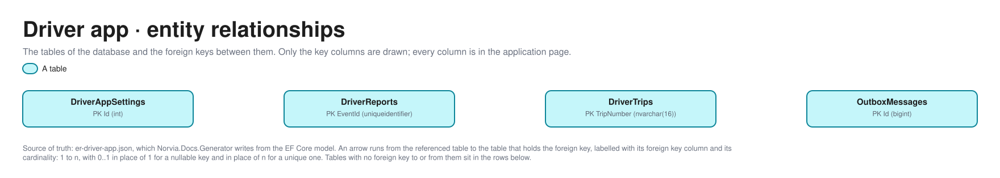

# Driver app

Part of the [applications](README.md).

## APIs

The Driver app API (`driver-app-api`) takes the Trip versions the TMS dispatches, the outcomes of the Driver's reports, and the Driver's own actions when a caller plays the Driver without the app's screens. Shapes come from the OpenAPI document [v1](openapi/driver-app.v1.json). Who holds which app role is in [identity-and-access.md](../architecture/identity-and-access.md); it is not copied here. The Driver app reaches the TMS only through the integration layer: it publishes what the Driver reports as events and never calls the TMS ([ADR 0001](../adr/0001-realistic-applications-integrated-only-through-ais.md)).

- **Three kinds of credential.** The Trip endpoint asks for the Driver app's endpoint key (`X-Api-Key`, `driver-app-endpoint-key` in the Driver app's Key Vault). The outcome endpoint asks for a token with the app role `DriverReports.ReportOutcome`. The Driver actions ask for a token whose **one app role is the Driver ID** (`DRV-0001`); the API takes the Driver from that role and nowhere else ([ADR 0037](../adr/0037-drivers-sign-in-to-the-driver-app-with-entra-and-the-driver-id-is-their-app-role.md)). Reset takes `Estate.Reset`.
- **Idempotency.** A Trip version sent twice, or a lower one after a higher, is acknowledged and ignored. An outcome for a report that has one already is acknowledged with result `Ignored`.
- **Refusals.** A request that breaks a rule answers a problem with a stable `code`; the routes below list the success shape only.
- **Locally.** There is no Entra under Aspire: every caller asks for a token with its own client ID and roles, signed with one key, and the Driver app API trusts that issuer. The Driver reports Logic App and the Trip dispatch Logic App are played by hosted workers ([ADR 0036](../adr/0036-locally-a-hosted-worker-plays-the-p11-trip-dispatch-logic-app.md), [ADR 0038](../adr/0038-locally-a-hosted-worker-plays-the-p12-driver-reports-logic-app.md)). The consumers and roles are the same.

### Consumers

Every consumer reaches the Driver app API **directly**; API Management never calls it.

| Consumer | Identity and credential | Process | Through API Management? |
|---|---|---|---|
| **Trip dispatch Logic App** | `trip-dispatch`; reads the Driver app's endpoint key | [P11](../processes/tms/p11-trip-dispatch.md) | No: reads the `trip-dispatch` subscription, then sends direct |
| **Driver reports Logic App** | `driver-reports`, `DriverReports.ReportOutcome` | [P12](../processes/tms/p12-trip-execution.md#driver-app) | No: reads the `driver-reports` subscription, then reports the outcome direct |
| **Simulator** | A client app per Driver that trusts `simulator`, holding the Driver ID as its one app role. Plays the Drivers ([ADR 0042](../adr/0042-the-simulator-signs-in-with-easy-auth-reaches-the-estate-as-its-own-identity-and-plays-the-personas-and-drivers-through-entra-client-apps.md)); `simulator` itself holds `Estate.Reset` | [P12](../processes/tms/p12-trip-execution.md#driver-app), Reset estate | No: direct ([ADR 0039](../adr/0039-the-simulator-books-only-through-the-estates-real-doors.md)) |
| **Partner portal** | None: the presenter panel calls the settings anonymously | [P11](../processes/tms/p11-trip-dispatch.md) | No: direct |
| **Driver app screens** (`driver-app-web`) | A Driver signed in with Entra, one app role (the Driver ID) | [P11](../processes/tms/p11-trip-dispatch.md), [P12](../processes/tms/p12-trip-execution.md) | Not callers: the screens run the same commands in process |
| **Agents (planned)** | None | None yet | No Agent reads the Driver app ([ADR 0040](../adr/0040-agents-read-the-estate-through-api-management-have-no-write-tools-and-their-own-identity.md)) |

[c4.md](../architecture/c4.md#l2-containers) draws the same callers.

### Trips

| Method and route | Purpose | Credential | Request and response | Consumers |
|---|---|---|---|---|
| `POST /v1/trips` | Take a whole version of a Dispatched Trip, with its Stops. A repeat or a lower version is ignored. While the Driver app is switched Unavailable it answers 503 and the Logic App reports the version Not delivered. 401 without the endpoint key. | Driver app endpoint key (`X-Api-Key`) | `TripVersionRequest` → accepted version (200) | Trip dispatch Logic App (P11) |
| `GET /v1/drivers/{driverId}/trips` | List a Driver's Trips, the latest version of each. | None | → the Driver's Trips | None in the estate: the Driver app's screens read in process and the Simulator uses the Driver actions below. Used by the API's integration tests. It is anonymous like the rest of the demo's read side; a Driver's own list is `GET /v1/driver/trips` |

### Driver actions

The Simulator's per-Driver token is the credential for all of these. A Trip that isn't the token's Driver's is `TripNotFound` (404). Each report travels to the TMS as a Driver app event and the TMS decides whether it stands.

| Method and route | Purpose | Credential | Request and response | Consumers |
|---|---|---|---|---|
| `GET /v1/driver/trips` | List the Driver's own Trips, the latest version of each, with their Stops in order and the Driver's reports on them. | Driver ID app role | → the Driver's Trips | Simulator (P12) |
| `POST /v1/driver/trips/{tripNumber}/start` | Start a Dispatched Trip as its Driver. | Driver ID app role | → the report | Simulator (P12) |
| `POST /v1/driver/trips/{tripNumber}/end` | End an In progress Trip as its Driver, once every Stop has an outcome. `ReportNotAvailable` (409) while the Trip isn't started or a Stop has no outcome. | Driver ID app role | → the report | Simulator (P12) |
| `POST /v1/driver/trips/{tripNumber}/stops/{shipmentNumber}/{kind}/{action}` | Report Collected, Collection failed or Delivery failed at a Stop, or damage at any. `kind` is `collection` or `delivery`; `action` is `collected`, `collection-failed`, `delivery-failed` or `damaged`. A failure and damage need a remark. `StopNotFound` (404), `ReportInvalid` (400), `ReportNotAvailable` (409). | Driver ID app role | optional remark → the report | Simulator (P12) |
| `POST /v1/driver/trips/{tripNumber}/stops/{shipmentNumber}/delivery/deliver` | Deliver a delivery Stop with a Proof of delivery: `receivedBy`, `condition` and a PNG signature, a remark when there are reservations, and 0 to 4 photos. Sends two reports under one correlation ID. | Driver ID app role | `DeliverRequest` (JSON, files as base64) → the reports | Simulator (P12) |

### Report outcomes

| Method and route | Purpose | Credential | Request and response | Consumers |
|---|---|---|---|---|
| `POST /v1/report-outcomes` | Tell the Driver app what became of a Driver's report: Recorded, Refused (with the TMS's code and message) or Not recorded. A report that has an outcome already is acknowledged with `Ignored`. `ReportNotFound` (404) for an unknown report or one of another Trip. | `DriverReports.ReportOutcome` | `ReportOutcomeRequest` → outcome result | Driver reports Logic App (P12) |

### Settings

| Method and route | Purpose | Credential | Request and response | Consumers |
|---|---|---|---|---|
| `GET /v1/settings/unavailable` | Read the "Driver app unavailable" demo fault. | None, on purpose: it only makes the Driver app refuse Trips ([coding guidelines §8](../coding-guidelines.md#8-configuration-secrets-and-security)) | → current setting | Partner portal's presenter panel (P11) |
| `PUT /v1/settings/unavailable` | Switch the fault on or off. | None, as above | `UnavailableRequest` → 204 | Partner portal's presenter panel (P11) |

### Reset

| Method and route | Purpose | Credential | Request and response | Consumers |
|---|---|---|---|---|
| `GET /v1/reset` | Whether a reset would be taken now: `enabled` is the `Reset:Enabled` setting, and `busySubscription` names the first subscription still holding unprocessed messages, or is null. | `Estate.Reset` | → `ResetReadiness` | Simulator (Reset estate) |
| `POST /v1/reset` | Delete the Trips the Driver app was sent, the Drivers' reports and the outbox Messages, and put the demo settings back to their defaults. Refused with `ResetDisabled` (403) while the setting is off and `SubscriptionBusy` (409) while the estate isn't quiet. | `Estate.Reset` | → `ResetReport` | Simulator (Reset estate) |

## Database

The database's tables are generated from its EF Core model by `Norvia.Docs.Generator`; do not edit between the markers. Table and column descriptions are written in [descriptions/driver-app.json](descriptions/driver-app.json) and use the terms in [GLOSSARY.md](../../GLOSSARY.md).

<!-- generated:database -->

### Entity relationships

Only the key columns are drawn; every column is in the tables below. The picture is drawn from [the model](../architecture/diagrams/er-driver-app.json) by `docs/architecture/diagrams/entities.py`, and its [Excalidraw file](../architecture/diagrams/er-driver-app.excalidraw) opens in Excalidraw.

### Tables

#### `DriverAppSettings`

The Driver app's demo settings, one row for the whole app. The presenter switches them from the Partner portal's panel (P11).

| Column | Type | Nullable | Default | Key | Description |
|---|---|---|---|---|---|
| `Id` | `int` | no |  | PK | Always 1: there is one row. |
| `Unavailable` | `bit` | no |  |  | The "Driver app unavailable" demo fault: while on, the Driver app refuses every Trip version with a 503, so the Trip dispatch Logic App reports it Not delivered. |

Primary key `PK_DriverAppSettings`: `Id`.

#### `DriverReports`

One thing a Driver reported from the road, with what became of it (P12). The Driver app owns nothing of the TMS's: it keeps a report only until the Driver reports Logic App tells it the TMS recorded it, refused it, or was never reached (ADR 0016).

| Column | Type | Nullable | Default | Key | Description |
|---|---|---|---|---|---|
| `EventId` | `uniqueidentifier` | no |  | PK | The Driver app event ID the report travels under, which the TMS keeps as the source event of the Tracking event or Proof of delivery. |
| `CorrelationId` | `nvarchar(128)` | no |  |  | Message trail of the Driver's action. A Deliver sends two reports (Delivered and Proof of delivery) under one. |
| `DriverId` | `nvarchar(32)` | no |  |  | The Driver who reported: their Driver ID (`DRV-0001`) from the token, never from the request (ADR 0037). |
| `EventTime` | `datetimeoffset` | no |  |  | When the Driver reported. |
| `FailureCode` | `nvarchar(100)` | yes |  |  | The TMS's failure code of a refusal, or the integration layer's code of a report that wasn't recorded; null otherwise. |
| `Kind` | `nvarchar(20)` | no |  |  | What was reported: `StartTrip`, `Collected`, `CollectionFailed`, `DeliveryFailed`, `Damaged`, `Delivered`, `ProofOfDelivery` or `EndTrip`. |
| `Message` | `nvarchar(1000)` | yes |  |  | The readable message of a refusal, or the technical cause of a report that wasn't recorded. |
| `OutcomeAt` | `datetimeoffset` | yes |  |  | When the Driver reports Logic App told the Driver app the outcome; null while Sending. |
| `Remark` | `nvarchar(500)` | yes |  |  | What the Driver said: required for a failure or damage, and the reservations of a Delivered with reservations. |
| `ShipmentNumber` | `nvarchar(16)` | yes |  |  | The Shipment a Stop report is about (a logical reference to the TMS); null for a Start Trip or End Trip. |
| `State` | `nvarchar(20)` | no |  |  | `Sending` (published, not yet reported by the Logic App), `Recorded`, `Refused` or `NotRecorded` (the Logic App gave up after its retries). |
| `Stop` | `nvarchar(16)` | yes |  |  | Which Stop of the Shipment: collection or delivery; null for a Start Trip or End Trip. |
| `TripNumber` | `nvarchar(16)` | no |  |  | The Trip the report is about (a logical reference to the TMS). |
| `VersionHeld` | `int` | no |  |  | The version of the Trip the Driver app held when the Driver reported, for tracing. |

Primary key `PK_DriverReports`: `EventId`.

| Index | Columns | Unique | Filter |
|---|---|---|---|
| `IX_DriverReports_TripNumber_EventTime` | `TripNumber`, `EventTime` | no |  |

#### `DriverTrips`

The latest version of a Trip the TMS dispatched to a Driver, as the Trip dispatch Logic App sent it (P11, ADR 0015). The Driver app takes whole versions: a lower or repeated version is acknowledged and ignored. The TMS owns the Trip (ADR 0002); this is the Driver's copy to work from.

| Column | Type | Nullable | Default | Key | Description |
|---|---|---|---|---|---|
| `TripNumber` | `nvarchar(16)` | no |  | PK | The Trip's number (a logical reference to the TMS). |
| `Details` | `nvarchar(max)` | no |  |  | The Trip version as JSON: day, planned start and driving duration, the Vehicle, and the Stops in order with their addresses, windows, Consignee and goods lines. |
| `DriverId` | `nvarchar(32)` | no |  |  | The Driver the Trip is dispatched to (`DRV-0001`). The ERP owns Drivers (ADR 0014). |
| `Version` | `int` | no |  |  | The version held; only a higher one replaces it. |

Primary key `PK_DriverTrips`: `TripNumber`.

| Index | Columns | Unique | Filter |
|---|---|---|---|
| `IX_DriverTrips_DriverId` | `DriverId` | no |  |

#### `OutboxMessages`

Driver app events the Driver app raised in the same transaction as the report that caused them, waiting to be published to the `driver-app-events` topic (transactional outbox, ADR 0003). They are published in order per Trip (ADR 0016).

| Column | Type | Nullable | Default | Key | Description |
|---|---|---|---|---|---|
| `Id` | `bigint` | no | identity | PK | Publishing order. |
| `ApplicationProperties` | `nvarchar(max)` | no |  |  | The Service Bus application properties of the message, as JSON. |
| `Body` | `nvarchar(max)` | no |  |  | The event as JSON. |
| `CorrelationId` | `nvarchar(128)` | no |  |  | The Message trail the event belongs to. |
| `CreatedAt` | `datetimeoffset` | no |  |  | When the event was raised. |
| `EventId` | `uniqueidentifier` | no |  |  | The event's own ID, unique, equal to the report's event ID. |
| `EventType` | `nvarchar(100)` | no |  |  | The event's type. |
| `PublishedAt` | `datetimeoffset` | yes |  |  | When the publisher sent it to Service Bus; null while it waits. |
| `SessionId` | `nvarchar(128)` | no |  |  | The Service Bus session the message goes in: the Trip number, which keeps one Trip's events in order. |
| `Topic` | `nvarchar(260)` | no |  |  | The Service Bus topic it goes to. |
| `TraceParent` | `nvarchar(55)` | yes |  |  | W3C trace context of the call that raised it, so the publish continues the same trace; null when there was none. |

Primary key `PK_OutboxMessages`: `Id`.

| Index | Columns | Unique | Filter |
|---|---|---|---|
| `IX_OutboxMessages_EventId` | `EventId` | yes |  |
| `IX_OutboxMessages_Unpublished` | `Id` | no | `[PublishedAt] IS NULL` |

<!-- /generated:database -->

### Logical references

Identifiers the Driver app stores from other applications. The database enforces none of them: the owner is the source of truth ([ADR 0002](../adr/0002-one-system-of-record-per-concept.md)), and the Driver app keeps only the Driver's working copy of a Trip and what the Driver reported.

| Column | Target application and concept |
|---|---|
| `DriverTrips.TripNumber`, `DriverReports.TripNumber`, `OutboxMessages.SessionId` | [TMS](tms.md): the Trip. The TMS owns it and dispatches whole versions ([ADR 0015](../adr/0015-a-dispatched-trip-is-sent-as-whole-versions.md)) |
| `DriverTrips.Details` (JSON, the Stops and their Shipment numbers) and `DriverReports.ShipmentNumber`, `DriverReports.Stop` | [TMS](tms.md): the Shipments the Trip's Stops collect and deliver |
| `DriverTrips.Details` (JSON, the Vehicle) | [ERP](erp.md): the Vehicle, which the ERP owns ([ADR 0014](../adr/0014-the-erp-owns-vehicles-and-drivers-the-tms-owns-their-availability.md)) |
| `DriverTrips.DriverId`, `DriverReports.DriverId` | [ERP](erp.md): the Driver (`DRV-0001`), which the ERP owns ([ADR 0014](../adr/0014-the-erp-owns-vehicles-and-drivers-the-tms-owns-their-availability.md)). The same ID is the Driver's app role on this API ([ADR 0037](../adr/0037-drivers-sign-in-to-the-driver-app-with-entra-and-the-driver-id-is-their-app-role.md)) |
| `DriverReports.EventId`, `OutboxMessages.EventId` | The event ID the [TMS](tms.md) keeps as `TrackingEvents.SourceEventId` or `ProofsOfDelivery.DocumentId` for an Own fleet source ([ADR 0016](../adr/0016-driver-reports-travel-as-driver-app-events-in-order-per-trip.md)) |
| `DriverReports.CorrelationId`, `OutboxMessages.CorrelationId` | The Message trail of the Driver's action, carried into the TMS |
| `DriverReports.FailureCode`, `DriverReports.Message` | [TMS](tms.md): the failure code and message of a refused report, copied as the Logic App relayed them |
