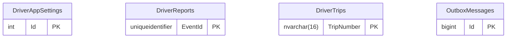

# Driver app

Part of the [applications](README.md).

## APIs

Not written yet: #658. The OpenAPI documents the Driver app API publishes: [v1](openapi/driver-app.v1.json).

## Database

The database's tables are generated from its EF Core model by `Norvia.Docs.Generator`; do not edit between the markers. Table and column descriptions are written in [descriptions/driver-app.json](descriptions/driver-app.json) and use the terms in [GLOSSARY.md](../../GLOSSARY.md).

<!-- generated:database -->

### Entity relationships

Only the key columns are drawn; every column is in the tables below.

### Tables

#### `DriverAppSettings`

| Column | Type | Nullable | Default | Key | Description |
|---|---|---|---|---|---|
| `Id` | `int` | no |  | PK |  |
| `Unavailable` | `bit` | no |  |  |  |

Primary key `PK_DriverAppSettings`: `Id`.

#### `DriverReports`

| Column | Type | Nullable | Default | Key | Description |
|---|---|---|---|---|---|
| `EventId` | `uniqueidentifier` | no |  | PK |  |
| `CorrelationId` | `nvarchar(128)` | no |  |  |  |
| `DriverId` | `nvarchar(32)` | no |  |  |  |
| `EventTime` | `datetimeoffset` | no |  |  |  |
| `FailureCode` | `nvarchar(100)` | yes |  |  |  |
| `Kind` | `nvarchar(20)` | no |  |  |  |
| `Message` | `nvarchar(1000)` | yes |  |  |  |
| `OutcomeAt` | `datetimeoffset` | yes |  |  |  |
| `Remark` | `nvarchar(500)` | yes |  |  |  |
| `ShipmentNumber` | `nvarchar(16)` | yes |  |  |  |
| `State` | `nvarchar(20)` | no |  |  |  |
| `Stop` | `nvarchar(16)` | yes |  |  |  |
| `TripNumber` | `nvarchar(16)` | no |  |  |  |
| `VersionHeld` | `int` | no |  |  |  |

Primary key `PK_DriverReports`: `EventId`.

| Index | Columns | Unique | Filter |
|---|---|---|---|
| `IX_DriverReports_TripNumber_EventTime` | `TripNumber`, `EventTime` | no |  |

#### `DriverTrips`

| Column | Type | Nullable | Default | Key | Description |
|---|---|---|---|---|---|
| `TripNumber` | `nvarchar(16)` | no |  | PK |  |
| `Details` | `nvarchar(max)` | no |  |  |  |
| `DriverId` | `nvarchar(32)` | no |  |  |  |
| `Version` | `int` | no |  |  |  |

Primary key `PK_DriverTrips`: `TripNumber`.

| Index | Columns | Unique | Filter |
|---|---|---|---|
| `IX_DriverTrips_DriverId` | `DriverId` | no |  |

#### `OutboxMessages`

| Column | Type | Nullable | Default | Key | Description |
|---|---|---|---|---|---|
| `Id` | `bigint` | no | identity | PK |  |
| `ApplicationProperties` | `nvarchar(max)` | no |  |  |  |
| `Body` | `nvarchar(max)` | no |  |  |  |
| `CorrelationId` | `nvarchar(128)` | no |  |  |  |
| `CreatedAt` | `datetimeoffset` | no |  |  |  |
| `EventId` | `uniqueidentifier` | no |  |  |  |
| `EventType` | `nvarchar(100)` | no |  |  |  |
| `PublishedAt` | `datetimeoffset` | yes |  |  |  |
| `SessionId` | `nvarchar(128)` | no |  |  |  |
| `Topic` | `nvarchar(260)` | no |  |  |  |
| `TraceParent` | `nvarchar(55)` | yes |  |  |  |

Primary key `PK_OutboxMessages`: `Id`.

| Index | Columns | Unique | Filter |
|---|---|---|---|
| `IX_OutboxMessages_EventId` | `EventId` | yes |  |
| `IX_OutboxMessages_Unpublished` | `Id` | no | `[PublishedAt] IS NULL` |

<!-- /generated:database -->

### Logical references

Not written yet: #658.
