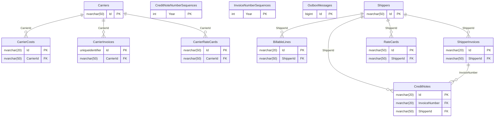

# ERP

Part of the [applications](README.md).

## APIs

Not written yet: #656. The OpenAPI documents the ERP API publishes: [v1](openapi/erp.v1.json).

## Database

The database's tables are generated from its EF Core model by `Norvia.Docs.Generator`; do not edit between the markers. Table and column descriptions are written in [descriptions/erp.json](descriptions/erp.json) and use the terms in [GLOSSARY.md](../../GLOSSARY.md).

<!-- generated:database -->

### Entity relationships

Only the key columns are drawn; every column is in the tables below.

### Tables

#### `BillableLines`

| Column | Type | Nullable | Default | Key | Description |
|---|---|---|---|---|---|
| `Id` | `nvarchar(20)` | no |  | PK |  |
| `BillingCorrelationId` | `nvarchar(128)` | no |  |  |  |
| `DeliveryTime` | `datetimeoffset` | no |  |  |  |
| `FreightCharge` | `nvarchar(max)` | no |  |  |  |
| `IntakeCorrelationId` | `nvarchar(128)` | no |  |  |  |
| `InvoiceNumber` | `nvarchar(20)` | yes |  |  |  |
| `RecordedAt` | `datetimeoffset` | no |  |  |  |
| `ReleasedWithoutProofOfDelivery` | `bit` | no |  |  |  |
| `RowVersion` | `rowversion` | yes |  |  |  |
| `ShipmentNumber` | `nvarchar(20)` | no |  |  |  |
| `ShipperId` | `nvarchar(50)` | no |  | FK |  |
| `ShipperReference` | `nvarchar(200)` | no |  |  |  |
| `Status` | `nvarchar(20)` | no |  |  |  |

Primary key `PK_BillableLines`: `Id`.

| Foreign key | Columns | References | On delete |
|---|---|---|---|
| `FK_BillableLines_Shippers_ShipperId` | `ShipperId` | `Shippers` (`Id`) | restrict |

| Index | Columns | Unique | Filter |
|---|---|---|---|
| `IX_BillableLines_ShipperId_Status` | `ShipperId`, `Status` | no |  |

#### `CarrierCosts`

| Column | Type | Nullable | Default | Key | Description |
|---|---|---|---|---|---|
| `Id` | `nvarchar(20)` | no |  | PK |  |
| `CarrierBookingReference` | `nvarchar(200)` | no |  |  |  |
| `CarrierId` | `nvarchar(50)` | no |  | FK |  |
| `Charge` | `nvarchar(max)` | no |  |  |  |
| `CorrelationId` | `nvarchar(128)` | no |  |  |  |
| `DeliveryTime` | `datetimeoffset` | no |  |  |  |
| `RecordedAt` | `datetimeoffset` | no |  |  |  |
| `RowVersion` | `rowversion` | yes |  |  |  |
| `ShipmentNumber` | `nvarchar(20)` | no |  |  |  |
| `Source` | `nvarchar(max)` | no |  |  |  |
| `Status` | `nvarchar(20)` | no |  |  |  |
| `TransportOrderNumber` | `nvarchar(20)` | no |  |  |  |

Primary key `PK_CarrierCosts`: `Id`.

| Foreign key | Columns | References | On delete |
|---|---|---|---|
| `FK_CarrierCosts_Carriers_CarrierId` | `CarrierId` | `Carriers` (`Id`) | restrict |

| Index | Columns | Unique | Filter |
|---|---|---|---|
| `IX_CarrierCosts_CarrierId_CarrierBookingReference` | `CarrierId`, `CarrierBookingReference` | no |  |
| `IX_CarrierCosts_CarrierId_Status` | `CarrierId`, `Status` | no |  |

#### `CarrierInvoices`

| Column | Type | Nullable | Default | Key | Description |
|---|---|---|---|---|---|
| `Id` | `uniqueidentifier` | no |  | PK |  |
| `ApprovedAmount` | `decimal(18,2)` | yes |  |  |  |
| `ApprovedAt` | `datetimeoffset` | yes |  |  |  |
| `CarrierId` | `nvarchar(50)` | no |  | FK |  |
| `CorrelationId` | `nvarchar(128)` | no |  |  |  |
| `InvoiceDate` | `date` | no |  |  |  |
| `InvoiceNumber` | `nvarchar(50)` | no |  |  |  |
| `Lines` | `nvarchar(max)` | no |  |  |  |
| `NotToldAt` | `datetimeoffset` | yes |  |  |  |
| `NotToldMessage` | `nvarchar(500)` | yes |  |  |  |
| `NotToldStatusCode` | `int` | yes |  |  |  |
| `ReceivedAt` | `datetimeoffset` | no |  |  |  |
| `RowVersion` | `rowversion` | yes |  |  |  |
| `Status` | `nvarchar(20)` | no |  |  |  |
| `ToldAt` | `datetimeoffset` | yes |  |  |  |
| `Total` | `decimal(18,2)` | no |  |  |  |

Primary key `PK_CarrierInvoices`: `Id`.

| Foreign key | Columns | References | On delete |
|---|---|---|---|
| `FK_CarrierInvoices_Carriers_CarrierId` | `CarrierId` | `Carriers` (`Id`) | restrict |

| Index | Columns | Unique | Filter |
|---|---|---|---|
| `IX_CarrierInvoices_CarrierId_InvoiceNumber` | `CarrierId`, `InvoiceNumber` | yes |  |
| `IX_CarrierInvoices_ReceivedAt` | `ReceivedAt` | no |  |

#### `CarrierRateCards`

| Column | Type | Nullable | Default | Key | Description |
|---|---|---|---|---|---|
| `Id` | `nvarchar(50)` | no |  | PK |  |
| `CarrierId` | `nvarchar(50)` | no |  | FK |  |
| `Versions` | `nvarchar(max)` | no |  |  |  |

Primary key `PK_CarrierRateCards`: `Id`.

| Foreign key | Columns | References | On delete |
|---|---|---|---|
| `FK_CarrierRateCards_Carriers_CarrierId` | `CarrierId` | `Carriers` (`Id`) | restrict |

| Index | Columns | Unique | Filter |
|---|---|---|---|
| `IX_CarrierRateCards_CarrierId` | `CarrierId` | no |  |

#### `Carriers`

| Column | Type | Nullable | Default | Key | Description |
|---|---|---|---|---|---|
| `Id` | `nvarchar(50)` | no |  | PK |  |
| `Active` | `bit` | no |  |  |  |
| `Name` | `nvarchar(200)` | no |  |  |  |

Primary key `PK_Carriers`: `Id`.

#### `CreditNoteNumberSequences`

| Column | Type | Nullable | Default | Key | Description |
|---|---|---|---|---|---|
| `Year` | `int` | no |  | PK |  |
| `LastTaken` | `int` | no |  |  |  |
| `RowVersion` | `rowversion` | yes |  |  |  |

Primary key `PK_CreditNoteNumberSequences`: `Year`.

#### `CreditNotes`

| Column | Type | Nullable | Default | Key | Description |
|---|---|---|---|---|---|
| `Id` | `nvarchar(20)` | no |  | PK |  |
| `AmountWithoutVat` | `decimal(18,2)` | no |  |  |  |
| `CorrelationId` | `nvarchar(128)` | no |  |  |  |
| `CreditNoteDate` | `date` | no |  |  |  |
| `DeliveryDate` | `date` | no |  |  |  |
| `InvoiceNumber` | `nvarchar(20)` | no |  | FK |  |
| `IssuedAt` | `datetimeoffset` | no |  |  |  |
| `NotDeliveredAt` | `datetimeoffset` | yes |  |  |  |
| `NotDeliveredMessage` | `nvarchar(500)` | yes |  |  |  |
| `NotDeliveredStatusCode` | `int` | yes |  |  |  |
| `Reason` | `nvarchar(500)` | no |  |  |  |
| `SentAt` | `datetimeoffset` | yes |  |  |  |
| `ShipmentNumber` | `nvarchar(20)` | no |  |  |  |
| `ShipperId` | `nvarchar(50)` | no |  | FK |  |
| `ShipperReference` | `nvarchar(200)` | no |  |  |  |
| `Status` | `nvarchar(20)` | no |  |  |  |
| `TotalWithVat` | `decimal(18,2)` | no |  |  |  |
| `TransportOrderNumber` | `nvarchar(20)` | no |  |  |  |
| `Vat` | `decimal(18,2)` | no |  |  |  |

Primary key `PK_CreditNotes`: `Id`.

| Foreign key | Columns | References | On delete |
|---|---|---|---|
| `FK_CreditNotes_ShipperInvoices_InvoiceNumber` | `InvoiceNumber` | `ShipperInvoices` (`Id`) | restrict |
| `FK_CreditNotes_Shippers_ShipperId` | `ShipperId` | `Shippers` (`Id`) | restrict |

| Index | Columns | Unique | Filter |
|---|---|---|---|
| `IX_CreditNotes_InvoiceNumber_TransportOrderNumber` | `InvoiceNumber`, `TransportOrderNumber` | no |  |
| `IX_CreditNotes_IssuedAt` | `IssuedAt` | no |  |
| `IX_CreditNotes_ShipperId` | `ShipperId` | no |  |

#### `InvoiceNumberSequences`

| Column | Type | Nullable | Default | Key | Description |
|---|---|---|---|---|---|
| `Year` | `int` | no |  | PK |  |
| `LastTaken` | `int` | no |  |  |  |
| `RowVersion` | `rowversion` | yes |  |  |  |

Primary key `PK_InvoiceNumberSequences`: `Year`.

#### `OutboxMessages`

| Column | Type | Nullable | Default | Key | Description |
|---|---|---|---|---|---|
| `Id` | `bigint` | no | identity | PK |  |
| `ApplicationProperties` | `nvarchar(max)` | no |  |  |  |
| `Body` | `nvarchar(max)` | no |  |  |  |
| `CorrelationId` | `nvarchar(128)` | no |  |  |  |
| `CreatedAt` | `datetimeoffset` | no |  |  |  |
| `EventId` | `uniqueidentifier` | no |  |  |  |
| `EventType` | `nvarchar(100)` | no |  |  |  |
| `PublishedAt` | `datetimeoffset` | yes |  |  |  |
| `Topic` | `nvarchar(260)` | no |  |  |  |
| `TraceParent` | `nvarchar(55)` | yes |  |  |  |

Primary key `PK_OutboxMessages`: `Id`.

| Index | Columns | Unique | Filter |
|---|---|---|---|
| `IX_OutboxMessages_EventId` | `EventId` | yes |  |
| `IX_OutboxMessages_Unpublished` | `Id` | no | `[PublishedAt] IS NULL` |

#### `RateCards`

| Column | Type | Nullable | Default | Key | Description |
|---|---|---|---|---|---|
| `Id` | `nvarchar(50)` | no |  | PK |  |
| `ShipperId` | `nvarchar(50)` | no |  | FK |  |
| `Versions` | `nvarchar(max)` | no |  |  |  |

Primary key `PK_RateCards`: `Id`.

| Foreign key | Columns | References | On delete |
|---|---|---|---|
| `FK_RateCards_Shippers_ShipperId` | `ShipperId` | `Shippers` (`Id`) | restrict |

| Index | Columns | Unique | Filter |
|---|---|---|---|
| `IX_RateCards_ShipperId` | `ShipperId` | no |  |

#### `ShipperInvoices`

| Column | Type | Nullable | Default | Key | Description |
|---|---|---|---|---|---|
| `Id` | `nvarchar(20)` | no |  | PK |  |
| `CorrelationId` | `nvarchar(128)` | no |  |  |  |
| `InvoiceDate` | `date` | no |  |  |  |
| `IssuedAt` | `datetimeoffset` | no |  |  |  |
| `Lines` | `nvarchar(max)` | no |  |  |  |
| `NotDeliveredAt` | `datetimeoffset` | yes |  |  |  |
| `NotDeliveredMessage` | `nvarchar(500)` | yes |  |  |  |
| `NotDeliveredStatusCode` | `int` | yes |  |  |  |
| `RowVersion` | `rowversion` | yes |  |  |  |
| `SentAt` | `datetimeoffset` | yes |  |  |  |
| `ShipperId` | `nvarchar(50)` | no |  | FK |  |
| `Status` | `nvarchar(20)` | no |  |  |  |
| `TotalWithVat` | `decimal(18,2)` | no |  |  |  |
| `TotalWithoutVat` | `decimal(18,2)` | no |  |  |  |
| `Vat` | `decimal(18,2)` | no |  |  |  |

Primary key `PK_ShipperInvoices`: `Id`.

| Foreign key | Columns | References | On delete |
|---|---|---|---|
| `FK_ShipperInvoices_Shippers_ShipperId` | `ShipperId` | `Shippers` (`Id`) | restrict |

| Index | Columns | Unique | Filter |
|---|---|---|---|
| `IX_ShipperInvoices_IssuedAt` | `IssuedAt` | no |  |
| `IX_ShipperInvoices_ShipperId` | `ShipperId` | no |  |

#### `Shippers`

| Column | Type | Nullable | Default | Key | Description |
|---|---|---|---|---|---|
| `Id` | `nvarchar(50)` | no |  | PK |  |
| `Active` | `bit` | no |  |  |  |
| `Name` | `nvarchar(200)` | no |  |  |  |

Primary key `PK_Shippers`: `Id`.

<!-- /generated:database -->

### Logical references

Not written yet: #656.
