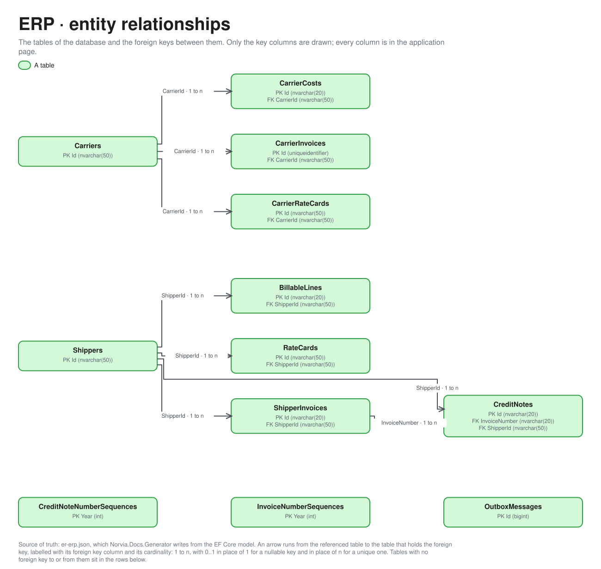

# ERP

Part of the [applications](README.md).

## APIs

The ERP API (`erp-api`, the "ERP billing API") takes the Canonical Model events that start billing and Carrier invoice matching as HTTP, and the reports that say whether a document reached its recipient. It checks the caller's app role and publishes what happened through its transactional outbox ([ADR 0003](../adr/0003-http-in-events-out.md)). Shapes come from the OpenAPI document [v1](openapi/erp.v1.json). Who holds which app role is in [identity-and-access.md](../architecture/identity-and-access.md#erp-api-roles); it is not copied here.

- **Every endpoint needs an app role.** There are no queries: nothing reads the ERP over HTTP, and the ERP UI changes and reads in process through the same commands the endpoints use.
- **Refusals.** A request that breaks a rule answers a problem with a stable `code` and the call's correlation ID. The routes below list the success shape only.
- **Idempotency.** Recording is idempotent on the sender's own key in the body (the Transport Order number, the Carrier booking number, the Carrier and its invoice number): a repeat with the same content answers 200 with `repeat` true, the first answers 201. A report for a document already reported is ignored and logged (200, `ignored` true). Reports take an `X-Correlation-ID` header, the Message trail the ERP created for the document.
- **Locally.** There is no Entra under Aspire: every caller asks for a token with its own client ID and roles, signed with one key, and the ERP API trusts that issuer. Hosted workers play the Logic Apps ([ADR 0043](../adr/0043-locally-a-hosted-worker-plays-the-e1-billing-logic-app.md), [ADR 0045](../adr/0045-locally-a-hosted-worker-plays-the-p9-carrier-cost-logic-app.md), [ADR 0046](../adr/0046-locally-a-hosted-worker-plays-the-e2-carrier-invoice-logic-app.md) and their siblings). The consumers and roles are the same.

### Consumers

Every consumer reaches the ERP API **directly**, with a token for its own identity. API Management never calls it: it only fronts the Carrier invoice Logic App, which then calls the ERP API itself. A Logic App is never called by the ERP: it reads Service Bus (or is called by API Management) and then calls the ERP API.

| Consumer | Identity and app role | Process | Through API Management? |
|---|---|---|---|
| **Billing Logic App** | `billing`, `BillableLines.Record` | [E1](../processes/erp/e1-invoicing.md#erp-api) | No: reads the `billing` subscription of `transport-order-events`, then calls direct |
| **Shipper invoice Logic App** | `shipper-invoice`, `ShipperInvoices.Report` | [E1](../processes/erp/e1-invoicing.md#erp-api) | No: reads the `shipper-invoice` subscription of `invoicing-events`, sends to the Shipper's endpoint, then reports direct |
| **Carrier cost Logic App** | `carrier-cost`, `CarrierCosts.Record` | [P9](../processes/tms/p9-freight-settlement.md), [E2](../processes/erp/e2-carrier-invoice-matching.md#erp-api) | No: reads the `carrier-cost` subscription of `shipment-events`, then calls direct |
| **Carrier invoice Logic App** | `carrier-invoice`, `CarrierInvoices.Receive` | [E2](../processes/erp/e2-carrier-invoice-matching.md#erp-api) | The Logic App is called by API Management, which puts the Carrier ID from the token in the body; its call to the ERP is direct |
| **Carrier invoice outcome Logic App** | `carrier-invoice-outcome`, `CarrierInvoices.Report` | [E2](../processes/erp/e2-carrier-invoice-matching.md#erp-api) | No: reads the `carrier-invoice-outcome` subscription of `invoicing-events`, tells the Carrier, then reports direct |
| **Simulator** | `simulator`, `ShipperInvoices.Manage`, `CarrierInvoices.Manage` and `Estate.Reset`. Plays Finance ([ADR 0039](../adr/0039-the-simulator-books-only-through-the-estates-real-doors.md)) | [E1](../processes/erp/e1-invoicing.md#erp-api), [E2](../processes/erp/e2-carrier-invoice-matching.md#erp-api), Reset estate | No: direct |
| **ERP UI** (`erp-web`) | Signs a `Finance` user in (see [identity-and-access.md](../architecture/identity-and-access.md)); holds no app role on the API | [E1](../processes/erp/e1-invoicing.md#erp-ui), [E2](../processes/erp/e2-carrier-invoice-matching.md#erp-ui) | Not a caller: it runs the same commands in process |
| **Carrier invoice matching agent** | `CarrierInvoices.FinanceAgent.Read`, the one role of its identity (locally `norvia-local-agent-finance-matching`) | [E2](../processes/erp/e2-carrier-invoice-matching.md#explain-a-line-that-is-to-decide) | Locally through the MCP stand-in's `finance-matching` server; in Azure through API Management's MCP server, read-only (#470, [ADR 0040](../adr/0040-agents-read-the-estate-through-api-management-have-no-write-tools-and-their-own-identity.md)) |

The Carrier invoice matching agent calls the ERP through the one read endpoint under [Agent view](#agent-view) below. [c4.md](../architecture/c4.md#l2-containers) draws the same callers.

### Billable lines

| Method and route | Purpose | App role | Request and response | Consumers |
|---|---|---|---|---|
| `POST /v1/billable-lines` | Record the Billable line a `TransportOrderBillable` carries, as Waiting. Publishes nothing. Refusals: `ShipperNotFound` (422), `BillableLineConflict` (409, the order is recorded with different content), `FreightChargeWithoutChargeLines` and `FreightChargeTotalMismatch` (400). | `BillableLines.Record` | `TransportOrderBillableRequest` → `RecordBillableLineResult` (201, or 200 for a repeat) | Billing Logic App (E1) |

### Shipper invoices and Credit notes

| Method and route | Purpose | App role | Request and response | Consumers |
|---|---|---|---|---|
| `POST /v1/shipper-invoices` | Invoice now: run the Invoice run for one Shipper over all its Waiting lines. Issues one Shipper invoice and publishes `ShipperInvoiceIssued`; answers with no invoice when the Shipper has no Waiting lines. `ShipperNotFound` (404). | `ShipperInvoices.Manage` | `InvoiceNowRequest` → `IssueShipperInvoiceResult` | Simulator (E1), as Finance. The ERP UI's Invoice now button runs the same command in process |
| `POST /v1/shipper-invoices/{invoiceNumber}/credit-notes` | Issue a Credit note on one line of a Shipper invoice, in full or in part, and publish `CreditNoteIssued`. Refusals: `ShipperInvoiceNotFound` and `InvoiceLineNotFound` (404), `CreditNoteReasonRequired`, `CreditNoteReasonTooLong` and `CreditNoteAmountInvalid` (400), `CreditNoteAboveLineTotal` (422). | `ShipperInvoices.Manage` | `IssueCreditNoteRequest` → `CreditNoteView` (201) | Simulator (E1), as Finance. The ERP UI's Credit note form runs the same command in process |
| `POST /v1/shipper-invoices/{invoiceNumber}/report-sent` | Report that the Shipper's invoice endpoint acknowledged a Shipper invoice: Issued becomes Sent. Publishes nothing. `ShipperInvoiceNotFound` (404). | `ShipperInvoices.Report` | `X-Correlation-ID` → `ShipperInvoiceReportResult` | Shipper invoice Logic App (E1) |
| `POST /v1/shipper-invoices/{invoiceNumber}/report-not-delivered` | Report that a Shipper invoice never reached the Shipper, with its technical cause: Issued becomes Not delivered and `ShipperInvoiceNotDelivered` is published. | `ShipperInvoices.Report` | `ShipperInvoiceNotDeliveredRequest` (`X-Correlation-ID`) → `ShipperInvoiceReportResult` | Shipper invoice Logic App (E1) |
| `POST /v1/credit-notes/{creditNoteNumber}/report-sent` | Report that the Shipper's invoice endpoint acknowledged a Credit note. `CreditNoteNotFound` (404). | `ShipperInvoices.Report` | `X-Correlation-ID` → `CreditNoteReportResult` | Shipper invoice Logic App (E1) |
| `POST /v1/credit-notes/{creditNoteNumber}/report-not-delivered` | Report that a Credit note never reached the Shipper, with its technical cause; publishes `ShipperInvoiceNotDelivered` with document type `CREDIT_NOTE`. | `ShipperInvoices.Report` | `ShipperInvoiceNotDeliveredRequest` (`X-Correlation-ID`) → `CreditNoteReportResult` | Shipper invoice Logic App (E1) |

### Carrier costs

| Method and route | Purpose | App role | Request and response | Consumers |
|---|---|---|---|---|
| `POST /v1/carrier-costs` | Record the Carrier cost a `CarrierCostIncurred` carries, as Open. Publishes nothing. Refusals: `CarrierNotFound` (422), `CarrierCostConflict` (409), `CarrierCostWithoutChargeLines` and `CarrierCostTotalMismatch` (400). | `CarrierCosts.Record` | `CarrierCostIncurredRequest` → `RecordCarrierCostResult` (201, or 200 for a repeat) | Carrier cost Logic App (P9, E2) |

### Agent view

In Azure the view is the Carrier invoice matching agent's only door: an API Management API in no product (`agent-views/finance-matching`) behind the `finance-matching` MCP server ([finance-matching-mcp.bicep](../../infra/estate/finance-matching-mcp.bicep)), which sends the ERP API a token for the **ERP agent API** app registration, and API Management's identity alone holds the one role on it. The view takes that token from a scheme of its own (`Agents:Api`), so no other caller's token opens it, and reads the Agent's identity from the `X-Agent-ID` header only on the gateway's own token. Locally the view takes the MCP stand-in's token for the ERP API's audience, signed with the AppHost's key.

| Method and route | Purpose | App role | Request and response | Consumers |
|---|---|---|---|---|
| `GET /v1/agent/finance/carriers/{carrierId}/invoices/{invoiceNumber}/lines/{carrierBookingReference}` | The Carrier invoice matching agent's view of a Carrier invoice line ([ADR 0040](../adr/0040-agents-read-the-estate-through-api-management-have-no-write-tools-and-their-own-identity.md)): its result, the invoiced amount, the agreed Carrier cost total and the difference, the Matching tolerance, the cost's source as a label (`Rate Card version N` or `Spot`, never the Planner's remark), for a Duplicate the earlier invoice and line that Invoiced the Carrier cost, and for an Unknown booking up to three likely candidate Open Carrier costs of the same Carrier, ranked by the ERP on reference similarity, amount and delivery date. An allowlist of fields: a new field stays out until someone adds it; no Shipper or Consignee data, no line description and no file contents. Read only. `CarrierInvoiceNotFound` and `CarrierInvoiceLineNotFound` answer 404. | `CarrierInvoices.FinanceAgent.Read` | → `AgentInvoiceLineView` (`X-Correlation-ID`, `X-Tool-Name`) | The Carrier invoice matching agent, through the MCP stand-in locally |

### Carrier invoices

| Method and route | Purpose | App role | Request and response | Consumers |
|---|---|---|---|---|
| `POST /v1/carrier-invoices` | Receive a Carrier invoice and match each line against its Carrier cost in one transaction: Matched lines are accepted at once, Price mismatch, Unknown booking and Duplicate lines wait for Finance. An invoice whose lines all match is Approved and publishes `CarrierInvoiceApproved`. Refusals: `CarrierNotFound` (422), `InvoiceNumberUsed` (409), `CarrierInvoiceWithoutLines`, `CarrierInvoiceLineWithoutReference`, `CarrierInvoiceLineAmountNotAboveZero` and `CarrierInvoiceReferenceRepeated` (400). | `CarrierInvoices.Receive` | `CarrierInvoiceRequest` → `ReceiveCarrierInvoiceResult` (201, or 200 for a repeat) | Carrier invoice Logic App (E2); upstream of it a Carrier Persona through API Management |
| `POST /v1/carrier-invoices/{carrierId}/{invoiceNumber}/report-told` | Report that the Carrier's invoice outcome endpoint acknowledged the outcome of an Approved Carrier invoice. Publishes nothing. `CarrierInvoiceNotFound` (404). | `CarrierInvoices.Report` | `X-Correlation-ID` → `CarrierInvoiceReportResult` | Carrier invoice outcome Logic App (E2) |
| `POST /v1/carrier-invoices/{carrierId}/{invoiceNumber}/report-not-delivered` | Report that the outcome never reached the Carrier, with its technical cause: flags the invoice Carrier not told and publishes `CarrierInvoiceOutcomeNotDelivered`. | `CarrierInvoices.Report` | `CarrierInvoiceOutcomeNotDeliveredRequest` (`X-Correlation-ID`) → `CarrierInvoiceReportResult` | Carrier invoice outcome Logic App (E2) |
| `POST /v1/carrier-invoices/{carrierId}/{invoiceNumber}/lines/{bookingReference}/accept` | Accept a line that waits for Finance, at the invoiced amount or an adjusted one (an adjusted amount needs a remark). The last decided line Approves the invoice and publishes `CarrierInvoiceApproved`. Refusals: `CarrierInvoiceNotFound` and `CarrierInvoiceLineNotFound` (404), `CarrierInvoiceLineAlreadyDecided` (409), `CarrierInvoiceLineHasNoOpenCarrierCost` (422), `CarrierInvoiceAdjustedAmountNotAboveZero` and `CarrierInvoiceAdjustedAmountNeedsRemark` (400). | `CarrierInvoices.Manage` | optional `AcceptCarrierInvoiceLineRequest` → `CarrierInvoiceView` | Simulator (E2), as Finance. The ERP UI's Accept button runs the same command in process |
| `POST /v1/carrier-invoices/{carrierId}/{invoiceNumber}/lines/{bookingReference}/reject` | Reject a line that waits for Finance, with a reason. Its Carrier cost stays as it was. The last decided line Approves the invoice. Refusals: `CarrierInvoiceNotFound` and `CarrierInvoiceLineNotFound` (404), `CarrierInvoiceLineAlreadyDecided` (409), `CarrierInvoiceRejectionNeedsReason` (400). | `CarrierInvoices.Manage` | `RejectCarrierInvoiceLineRequest` → `CarrierInvoiceView` | Simulator (E2), as Finance. The ERP UI's Reject button runs the same command in process |

### Reset

Neither call publishes anything or starts a Message trail: the reset is the presenter's, not a flow of the estate.

| Method and route | Purpose | App role | Request and response | Consumers |
|---|---|---|---|---|
| `GET /v1/reset` | Whether a reset would be taken now: `enabled` is the `Reset:Enabled` setting, and `busySubscription` names the first subscription (or the outbox) that still holds unprocessed messages, or is null. | `Estate.Reset` | → `ResetReadiness` | Simulator (Reset estate) |
| `POST /v1/reset` | Delete the ERP's transactional records: Shipper invoices, Credit notes, Billable lines, Carrier costs, Carrier invoices, the number sequences and the outbox. Master data stays. Refused with `ResetDisabled` (403) while the setting is off and `SubscriptionBusy` (409) while the estate isn't quiet. | `Estate.Reset` | → `ResetReport` | Simulator (Reset estate) |

## Database

The database's tables are generated from its EF Core model by `Norvia.Docs.Generator`; do not edit between the markers. Table and column descriptions are written in [descriptions/erp.json](descriptions/erp.json) and use the terms in [GLOSSARY.md](../../GLOSSARY.md).

<!-- generated:database -->

### Entity relationships

Only the key columns are drawn; every column is in the tables below. The picture is drawn from [the model](../architecture/diagrams/er-erp.json) by `docs/architecture/diagrams/entities.py`, and its [Excalidraw file](../architecture/diagrams/er-erp.excalidraw) opens in Excalidraw.

### Tables

#### `BillableLines`

The ERP's record of one Billable Transport Order (a Billable line), written from the `TransportOrderBillable` event. It is Waiting until an Invoice run puts it on a Shipper invoice, then Invoiced with that invoice's number, once and only once (E1). The Freight Charge is kept as the TMS rated it; the ERP never recalculates it (ADR 0006, ADR 0012).

| Column | Type | Nullable | Default | Key | Description |
|---|---|---|---|---|---|
| `Id` | `nvarchar(20)` | no |  | PK | The Transport Order number, which makes recording idempotent: the same order sent again is the same line. |
| `BillingCorrelationId` | `nvarchar(128)` | no |  |  | Message trail of the call that recorded the line. |
| `DeliveryTime` | `datetimeoffset` | no |  |  | When the Transport Order was delivered. |
| `FreightCharge` | `nvarchar(max)` | no |  |  | The Freight Charge the TMS rated, kept whole as JSON: its charge lines in EUR without VAT, the total and the Rate Card version it came from. |
| `IntakeCorrelationId` | `nvarchar(128)` | no |  |  | Message trail of the Transport Order's intake (P1), so a Shipper invoice line traces back to the booking. |
| `InvoiceNumber` | `nvarchar(20)` | yes |  |  | Number of the Shipper invoice that invoiced the line (`INV-2026-000001`); null while Waiting. |
| `RecordedAt` | `datetimeoffset` | no |  |  | When the ERP recorded the line. |
| `ReleasedWithoutProofOfDelivery` | `bit` | no |  |  | Whether Customer service released the order as Billable without a Proof of delivery. |
| `RowVersion` | `rowversion` | yes |  |  | Concurrency token: two Invoice runs never invoice the same line. |
| `ShipmentNumber` | `nvarchar(20)` | no |  |  | The Shipment of the Transport Order (a logical reference to the TMS). |
| `ShipperId` | `nvarchar(50)` | no |  | FK | The Shipper to invoice. |
| `ShipperReference` | `nvarchar(200)` | no |  |  | The Shipper's own reference for the order, printed on the invoice line. |
| `Status` | `nvarchar(20)` | no |  |  | `Waiting` or `Invoiced`. |

Primary key `PK_BillableLines`: `Id`.

| Foreign key | Columns | References | On delete |
|---|---|---|---|
| `FK_BillableLines_Shippers_ShipperId` | `ShipperId` | `Shippers` (`Id`) | restrict |

| Index | Columns | Unique | Filter |
|---|---|---|---|
| `IX_BillableLines_ShipperId_Status` | `ShipperId`, `Status` | no |  |

#### `CarrierCosts`

What Norvia owes a Carrier for one Carrier booking (a Carrier cost), written from the `CarrierCostIncurred` event. It is Open until a Carrier invoice line is matched against it or Finance accepts a line for it, then Invoiced (E2). The TMS calculated it; the ERP keeps it as sent (ADR 0013).

| Column | Type | Nullable | Default | Key | Description |
|---|---|---|---|---|---|
| `Id` | `nvarchar(20)` | no |  | PK | The Carrier booking number, which makes recording idempotent. |
| `CarrierBookingReference` | `nvarchar(200)` | no |  |  | The Carrier's own reference for the booking, which is what a Carrier invoice line quotes and is matched on. |
| `CarrierId` | `nvarchar(50)` | no |  | FK | The Carrier to pay. |
| `Charge` | `nvarchar(max)` | no |  |  | The Carrier cost's charge lines and total in EUR without VAT, as JSON. |
| `CorrelationId` | `nvarchar(128)` | no |  |  | Message trail of the call that recorded the Carrier cost. |
| `DeliveryTime` | `datetimeoffset` | no |  |  | When the Shipment was delivered. |
| `RecordedAt` | `datetimeoffset` | no |  |  | When the ERP recorded the Carrier cost. |
| `RowVersion` | `rowversion` | yes |  |  | Concurrency token: two lines never both claim the same Carrier cost. |
| `ShipmentNumber` | `nvarchar(20)` | no |  |  | The Shipment the Carrier carried (a logical reference to the TMS). |
| `Source` | `nvarchar(max)` | no |  |  | Where the TMS got the price, as JSON: a Carrier Rate Card version or a Spot price with the Planner's remark. |
| `Status` | `nvarchar(20)` | no |  |  | `Open` or `Invoiced`. |
| `TransportOrderNumber` | `nvarchar(20)` | no |  |  | The Transport Order the Shipment belongs to (a logical reference to the TMS). |

Primary key `PK_CarrierCosts`: `Id`.

| Foreign key | Columns | References | On delete |
|---|---|---|---|
| `FK_CarrierCosts_Carriers_CarrierId` | `CarrierId` | `Carriers` (`Id`) | restrict |

| Index | Columns | Unique | Filter |
|---|---|---|---|
| `IX_CarrierCosts_CarrierId_CarrierBookingReference` | `CarrierId`, `CarrierBookingReference` | no |  |
| `IX_CarrierCosts_CarrierId_Status` | `CarrierId`, `Status` | no |  |

#### `CarrierInvoices`

A Carrier's claim for payment, as received through the Norvia Partner API, with the result of Matching each line against its Carrier cost (E2). Lines that match are accepted at once; the others wait for Finance. When every line is decided the invoice is Approved and the Carrier is told the outcome. One row per Carrier and invoice number.

| Column | Type | Nullable | Default | Key | Description |
|---|---|---|---|---|---|
| `Id` | `uniqueidentifier` | no |  | PK | The Carrier invoice's own ID. |
| `ApprovedAmount` | `decimal(18,2)` | yes |  |  | Sum of the accepted amounts of the lines, in EUR without VAT; null until Approved. |
| `ApprovedAt` | `datetimeoffset` | yes |  |  | When the last line was decided; null until Approved. |
| `CarrierId` | `nvarchar(50)` | no |  | FK | The Carrier that sent the invoice, taken from its token by API Management, never from the payload (ADR 0005). |
| `CorrelationId` | `nvarchar(128)` | no |  |  | The Carrier invoice's own Message trail, which the `CarrierInvoiceApproved` event and the outcome Logic App's reports carry. |
| `InvoiceDate` | `date` | no |  |  | The date on the Carrier's invoice. |
| `InvoiceNumber` | `nvarchar(50)` | no |  |  | The Carrier's own invoice number, unique per Carrier. |
| `Lines` | `nvarchar(max)` | no |  |  | The lines as JSON, one per Carrier booking reference: the amount claimed, the Matching result (`Matched`, `PriceMismatch`, `UnknownBooking`, `Duplicate`), the line's status (`Matched`, `ToDecide`, `Accepted`, `Rejected`), the Carrier booking number it matched and Finance's decided amount and remark. |
| `NotToldAt` | `datetimeoffset` | yes |  |  | When the Carrier invoice outcome Logic App reported that the outcome never reached the Carrier; null otherwise. |
| `NotToldMessage` | `nvarchar(500)` | yes |  |  | The technical cause of that failure, in plain language. |
| `NotToldStatusCode` | `int` | yes |  |  | The HTTP status code of the Carrier's outcome endpoint; null when the failure had none, such as a timeout. |
| `ReceivedAt` | `datetimeoffset` | no |  |  | When the ERP received the invoice. |
| `RowVersion` | `rowversion` | yes |  |  | Concurrency token: two Finance decisions on one invoice don't both land. |
| `Status` | `nvarchar(20)` | no |  |  | `Received` while a line waits for Finance, `Approved` once every line is decided. |
| `ToldAt` | `datetimeoffset` | yes |  |  | When the Carrier's outcome endpoint acknowledged the outcome; null until then. |
| `Total` | `decimal(18,2)` | no |  |  | The total the Carrier claims, in EUR without VAT. |

Primary key `PK_CarrierInvoices`: `Id`.

| Foreign key | Columns | References | On delete |
|---|---|---|---|
| `FK_CarrierInvoices_Carriers_CarrierId` | `CarrierId` | `Carriers` (`Id`) | restrict |

| Index | Columns | Unique | Filter |
|---|---|---|---|
| `IX_CarrierInvoices_CarrierId_InvoiceNumber` | `CarrierId`, `InvoiceNumber` | yes |  |
| `IX_CarrierInvoices_ReceivedAt` | `ReceivedAt` | no |  |

#### `CarrierRateCards`

What Norvia pays one Carrier for transport, by Lane and weight (a Carrier Rate Card). The ERP owns it; the TMS keeps a read copy to calculate a Carrier cost at release (ADR 0013). Master data, loaded from the seed file until the sync exists (ADR 0002).

| Column | Type | Nullable | Default | Key | Description |
|---|---|---|---|---|---|
| `Id` | `nvarchar(50)` | no |  | PK | The Carrier Rate Card's ID. |
| `CarrierId` | `nvarchar(50)` | no |  | FK | The Carrier it belongs to. |
| `Versions` | `nvarchar(max)` | no |  |  | Every version of the card as JSON: its validity period, Zones, Lanes, Weight Breaks and minimum charges. |

Primary key `PK_CarrierRateCards`: `Id`.

| Foreign key | Columns | References | On delete |
|---|---|---|---|
| `FK_CarrierRateCards_Carriers_CarrierId` | `CarrierId` | `Carriers` (`Id`) | restrict |

| Index | Columns | Unique | Filter |
|---|---|---|---|
| `IX_CarrierRateCards_CarrierId` | `CarrierId` | no |  |

#### `Carriers`

A transport company Norvia subcontracts to (a Carrier), as the ERP knows it. The ERP owns the Carrier; the TMS keeps a read copy (ADR 0002). Master data, loaded from the seed file.

| Column | Type | Nullable | Default | Key | Description |
|---|---|---|---|---|---|
| `Id` | `nvarchar(50)` | no |  | PK | The Carrier ID (`CAR-0001`), which the other applications store. |
| `Active` | `bit` | no |  |  | Whether Norvia still uses the Carrier. An inactive Carrier keeps its history. |
| `Name` | `nvarchar(200)` | no |  |  | The Carrier's name. |

Primary key `PK_Carriers`: `Id`.

#### `CreditNoteNumberSequences`

The last Credit note number taken in each calendar year, so numbers (`CN-2026-000001`) run without gaps. Separate from the Shipper invoice sequence.

| Column | Type | Nullable | Default | Key | Description |
|---|---|---|---|---|---|
| `Year` | `int` | no |  | PK | The calendar year. |
| `LastTaken` | `int` | no |  |  | The last sequence number issued that year. |
| `RowVersion` | `rowversion` | yes |  |  | Concurrency token: two Credit notes never take the same number. |

Primary key `PK_CreditNoteNumberSequences`: `Year`.

#### `CreditNotes`

A document that reverses all or part of one line of a Shipper invoice, with a reason (a Credit note). Final once issued, like the invoice; delivery to the Shipper is tracked the same way (E1).

| Column | Type | Nullable | Default | Key | Description |
|---|---|---|---|---|---|
| `Id` | `nvarchar(20)` | no |  | PK | The Credit note number (`CN-2026-000001`). |
| `AmountWithoutVat` | `decimal(18,2)` | no |  |  | The credited amount in EUR without VAT. |
| `CorrelationId` | `nvarchar(128)` | no |  |  | The Credit note's own Message trail, which `CreditNoteIssued` and the Shipper invoice Logic App's reports carry. |
| `CreditNoteDate` | `date` | no |  |  | The date of the Credit note. |
| `DeliveryDate` | `date` | no |  |  | Delivery date of the credited invoice line. |
| `InvoiceNumber` | `nvarchar(20)` | no |  | FK | The Shipper invoice credited. |
| `IssuedAt` | `datetimeoffset` | no |  |  | When Finance issued it. |
| `NotDeliveredAt` | `datetimeoffset` | yes |  |  | When it was reported that the Credit note never reached the Shipper; null otherwise. |
| `NotDeliveredMessage` | `nvarchar(500)` | yes |  |  | The technical cause of that failure, in plain language. |
| `NotDeliveredStatusCode` | `int` | yes |  |  | The HTTP status code of the Shipper's endpoint; null when the failure had none. |
| `Reason` | `nvarchar(500)` | no |  |  | Finance's reason, printed on the document. |
| `SentAt` | `datetimeoffset` | yes |  |  | When the Shipper's invoice endpoint acknowledged it; null until then. |
| `ShipmentNumber` | `nvarchar(20)` | no |  |  | The Shipment of the credited line (a logical reference to the TMS). |
| `ShipperId` | `nvarchar(50)` | no |  | FK | The Shipper credited. |
| `ShipperReference` | `nvarchar(200)` | no |  |  | The Shipper's own reference of the credited line. |
| `Status` | `nvarchar(20)` | no |  |  | `Issued`, `Sent` or `NotDelivered`. |
| `TotalWithVat` | `decimal(18,2)` | no |  |  | The credited amount with VAT, in EUR. |
| `TransportOrderNumber` | `nvarchar(20)` | no |  |  | The Transport Order of the credited invoice line (a logical reference to the TMS). |
| `Vat` | `decimal(18,2)` | no |  |  | The VAT on the credited amount, in EUR. |

Primary key `PK_CreditNotes`: `Id`.

| Foreign key | Columns | References | On delete |
|---|---|---|---|
| `FK_CreditNotes_ShipperInvoices_InvoiceNumber` | `InvoiceNumber` | `ShipperInvoices` (`Id`) | restrict |
| `FK_CreditNotes_Shippers_ShipperId` | `ShipperId` | `Shippers` (`Id`) | restrict |

| Index | Columns | Unique | Filter |
|---|---|---|---|
| `IX_CreditNotes_InvoiceNumber_TransportOrderNumber` | `InvoiceNumber`, `TransportOrderNumber` | no |  |
| `IX_CreditNotes_IssuedAt` | `IssuedAt` | no |  |
| `IX_CreditNotes_ShipperId` | `ShipperId` | no |  |

#### `InvoiceNumberSequences`

The last Shipper invoice number taken in each calendar year, so numbers (`INV-2026-000001`) run without gaps.

| Column | Type | Nullable | Default | Key | Description |
|---|---|---|---|---|---|
| `Year` | `int` | no |  | PK | The calendar year. |
| `LastTaken` | `int` | no |  |  | The last sequence number issued that year. |
| `RowVersion` | `rowversion` | yes |  |  | Concurrency token: two Invoice runs never take the same number. |

Primary key `PK_InvoiceNumberSequences`: `Year`.

#### `OutboxMessages`

Integration events the ERP raised in the same transaction as the change that caused them, waiting to be published to Service Bus (transactional outbox, ADR 0003). The ERP publishes `ShipperInvoiceIssued`, `CreditNoteIssued`, `ShipperInvoiceNotDelivered`, `CarrierInvoiceApproved` and `CarrierInvoiceOutcomeNotDelivered` this way.

| Column | Type | Nullable | Default | Key | Description |
|---|---|---|---|---|---|
| `Id` | `bigint` | no | identity | PK | Publishing order. |
| `ApplicationProperties` | `nvarchar(max)` | no |  |  | The Service Bus application properties of the message, as JSON. |
| `Body` | `nvarchar(max)` | no |  |  | The event as JSON, in the Canonical Model. |
| `CorrelationId` | `nvarchar(128)` | no |  |  | The Message trail the event belongs to. |
| `CreatedAt` | `datetimeoffset` | no |  |  | When the event was raised. |
| `EventId` | `uniqueidentifier` | no |  |  | The event's own ID, unique, so a consumer can tell a duplicate. |
| `EventType` | `nvarchar(100)` | no |  |  | The event's type, such as `ShipperInvoiceIssued`. |
| `PublishedAt` | `datetimeoffset` | yes |  |  | When the publisher sent it to Service Bus; null while it waits. |
| `Topic` | `nvarchar(260)` | no |  |  | The Service Bus topic it goes to (`invoicing-events`). |
| `TraceParent` | `nvarchar(55)` | yes |  |  | W3C trace context of the call that raised it, so the publish continues the same trace; null when there was none. |

Primary key `PK_OutboxMessages`: `Id`.

| Index | Columns | Unique | Filter |
|---|---|---|---|
| `IX_OutboxMessages_EventId` | `EventId` | yes |  |
| `IX_OutboxMessages_Unpublished` | `Id` | no | `[PublishedAt] IS NULL` |

#### `RateCards`

What Norvia charges one Shipper for transport, by Lane and weight (a Rate Card), part of the Shipper's Contract. The ERP owns it; the TMS keeps a read copy to rate from and never changes it (ADR 0006). Master data, loaded from the seed file until the sync exists (ADR 0002).

| Column | Type | Nullable | Default | Key | Description |
|---|---|---|---|---|---|
| `Id` | `nvarchar(50)` | no |  | PK | The Rate Card's ID. |
| `ShipperId` | `nvarchar(50)` | no |  | FK | The Shipper it belongs to. |
| `Versions` | `nvarchar(max)` | no |  |  | Every version of the card as JSON: its validity period, Zones, Lanes, Weight Breaks and minimum charges. |

Primary key `PK_RateCards`: `Id`.

| Foreign key | Columns | References | On delete |
|---|---|---|---|
| `FK_RateCards_Shippers_ShipperId` | `ShipperId` | `Shippers` (`Id`) | restrict |

| Index | Columns | Unique | Filter |
|---|---|---|---|
| `IX_RateCards_ShipperId` | `ShipperId` | no |  |

#### `ShipperInvoices`

The ERP's document charging a Shipper, with one line per Transport Order (a Shipper invoice), issued by an Invoice run or Finance's Invoice now (E1). Final once issued: its number, lines and totals never change, and corrections are Credit notes. Only its delivery status follows the Shipper invoice Logic App's reports.

| Column | Type | Nullable | Default | Key | Description |
|---|---|---|---|---|---|
| `Id` | `nvarchar(20)` | no |  | PK | The Shipper invoice number (`INV-2026-000001`). |
| `CorrelationId` | `nvarchar(128)` | no |  |  | The invoice's own Message trail, which `ShipperInvoiceIssued` and the Shipper invoice Logic App's reports carry. |
| `InvoiceDate` | `date` | no |  |  | The date of the run, Europe/Amsterdam. |
| `IssuedAt` | `datetimeoffset` | no |  |  | When the invoice was issued. |
| `Lines` | `nvarchar(max)` | no |  |  | The lines as JSON, one per Transport Order: its number, the Shipper's reference, delivery date, charge lines and line total. |
| `NotDeliveredAt` | `datetimeoffset` | yes |  |  | When it was reported that the invoice never reached the Shipper; null otherwise. |
| `NotDeliveredMessage` | `nvarchar(500)` | yes |  |  | The technical cause of that failure, in plain language. |
| `NotDeliveredStatusCode` | `int` | yes |  |  | The HTTP status code of the Shipper's endpoint; null when the failure had none, such as a timeout. |
| `RowVersion` | `rowversion` | yes |  |  | Concurrency token: two reports on one invoice don't both land. |
| `SentAt` | `datetimeoffset` | yes |  |  | When the Shipper's invoice endpoint acknowledged it; null until then. |
| `ShipperId` | `nvarchar(50)` | no |  | FK | The Shipper invoiced. |
| `Status` | `nvarchar(20)` | no |  |  | `Issued`, `Sent` or `NotDelivered`. Finance can send a Not delivered invoice again. |
| `TotalWithVat` | `decimal(18,2)` | no |  |  | The total with VAT, in EUR. |
| `TotalWithoutVat` | `decimal(18,2)` | no |  |  | The total without VAT, in EUR. |
| `Vat` | `decimal(18,2)` | no |  |  | The VAT on the total, in EUR. |

Primary key `PK_ShipperInvoices`: `Id`.

| Foreign key | Columns | References | On delete |
|---|---|---|---|
| `FK_ShipperInvoices_Shippers_ShipperId` | `ShipperId` | `Shippers` (`Id`) | restrict |

| Index | Columns | Unique | Filter |
|---|---|---|---|
| `IX_ShipperInvoices_IssuedAt` | `IssuedAt` | no |  |
| `IX_ShipperInvoices_ShipperId` | `ShipperId` | no |  |

#### `Shippers`

An organization that pays Norvia to store, move or deliver its goods (a Shipper), as the ERP knows it. The ERP owns the Shipper and its Contract; the TMS keeps a read copy (ADR 0002). Master data, loaded from the seed file.

| Column | Type | Nullable | Default | Key | Description |
|---|---|---|---|---|---|
| `Id` | `nvarchar(50)` | no |  | PK | The Shipper ID (`SHP-0001`), which the other applications store. It is the Shipper's identity in its token (ADR 0005). |
| `Active` | `bit` | no |  |  | Whether the Shipper is active. An inactive Shipper keeps its history. |
| `Name` | `nvarchar(200)` | no |  |  | The Shipper's name. |

Primary key `PK_Shippers`: `Id`.

<!-- /generated:database -->

### Logical references

Identifiers the ERP stores from other applications. The database enforces none of them: the owning application is the source of truth ([ADR 0002](../adr/0002-one-system-of-record-per-concept.md)).

| Column | Target application and concept |
|---|---|
| `BillableLines.Id`, `CarrierCosts.TransportOrderNumber`, `CreditNotes.TransportOrderNumber` and `ShipperInvoices.Lines` (JSON, the Transport Order number of each line) | [TMS](tms.md): the Transport Order the line bills. The TMS decides when an order is Billable ([ADR 0012](../adr/0012-the-tms-decides-when-to-bill-the-erp-invoices.md)) |
| `BillableLines.ShipmentNumber`, `CarrierCosts.ShipmentNumber`, `CreditNotes.ShipmentNumber` | [TMS](tms.md): the Shipment of the Transport Order |
| `CarrierCosts.Id` and `CarrierInvoices.Lines` (JSON, `CarrierBookingNumber`) | [TMS](tms.md): the Carrier booking the cost belongs to |
| `CarrierCosts.CarrierBookingReference` and `CarrierInvoices.Lines` (JSON, `CarrierBookingReference`) | The Carrier's own reference for the booking, sent through the Norvia Partner API and quoted on its invoice. It is the Carrier's identifier, not another application's record; Matching compares the two |
| `BillableLines.FreightCharge` (JSON, the Rate Card version) | [TMS](tms.md): the Freight Charge the TMS rated from the Shipper's Rate Card, which the ERP owns ([ADR 0006](../adr/0006-the-tms-rates-the-erp-owns-rate-cards.md)) |
| `CarrierCosts.Source` (JSON, the Carrier Rate Card version, or a Spot price) | [TMS](tms.md): the Carrier cost the TMS calculated from the Carrier Rate Card, which the ERP owns ([ADR 0013](../adr/0013-the-tms-rates-carrier-bookings-the-erp-owns-carrier-rate-cards.md)) |
| `BillableLines.IntakeCorrelationId` | [TMS](tms.md): the Message trail of the Transport Order's intake (P1) |
| `BillableLines.BillingCorrelationId`, `CarrierCosts.CorrelationId`, `CarrierInvoices.CorrelationId`, `ShipperInvoices.CorrelationId`, `CreditNotes.CorrelationId` | The Message trails ([GLOSSARY.md](../../GLOSSARY.md)) of the call or document, minted by the Logic App that recorded it or by the ERP itself. They belong to the estate's telemetry, not to another application's table |

Within the ERP, `CarrierInvoices.Lines` (JSON, the Carrier booking number a line matched) points at `CarrierCosts.Id` and `ShipperInvoices.Lines` (JSON) at `BillableLines.Id`, but the JSON documents can't hold a foreign key, so these too are not enforced.
