# Partner portal

Part of the [applications](README.md).

## APIs

Not written yet: #657. The Partner portal publishes no OpenAPI document.

## Database

The database's tables are generated from its EF Core model by `Norvia.Docs.Generator`; do not edit between the markers. Table and column descriptions are written in [descriptions/partner-portal.json](descriptions/partner-portal.json) and use the terms in [GLOSSARY.md](../../GLOSSARY.md).

<!-- generated:database -->

### Entity relationships

Only the key columns are drawn; every column is in the tables below.

```mermaid
erDiagram
    Bookings {
        uniqueidentifier Id PK
    }
    CarrierAnswerSettings {
        uniqueidentifier Id PK
    }
    CarrierBookingRequests {
        uniqueidentifier Id PK
    }
    CarrierInvoiceOutcomes {
        uniqueidentifier Id PK
    }
    CarrierInvoices {
        uniqueidentifier Id PK
    }
    CarrierTrackingSettings {
        uniqueidentifier Id PK
    }
    ShipperInvoices {
        uniqueidentifier Id PK
    }
    ShipperNotifications {
        uniqueidentifier Id PK
    }
```

### Tables

#### `Bookings`

| Column | Type | Nullable | Default | Key | Description |
|---|---|---|---|---|---|
| `Id` | `uniqueidentifier` | no |  | PK |  |
| `Answer` | `nvarchar(max)` | no |  |  |  |
| `PersonaId` | `nvarchar(100)` | no |  |  |  |
| `SentAt` | `datetimeoffset` | no |  |  |  |
| `ShipperReference` | `nvarchar(100)` | yes |  |  |  |

Primary key `PK_Bookings`: `Id`.

| Index | Columns | Unique | Filter |
|---|---|---|---|
| `IX_Bookings_PersonaId_SentAt` | `PersonaId`, `SentAt` | no |  |

#### `CarrierAnswerSettings`

| Column | Type | Nullable | Default | Key | Description |
|---|---|---|---|---|---|
| `Id` | `uniqueidentifier` | no |  | PK |  |
| `DelayMilliseconds` | `bigint` | no |  |  |  |
| `Mode` | `nvarchar(30)` | no |  |  |  |
| `PersonaId` | `nvarchar(100)` | no |  |  |  |
| `RejectionReason` | `nvarchar(30)` | no |  |  |  |

Primary key `PK_CarrierAnswerSettings`: `Id`.

| Index | Columns | Unique | Filter |
|---|---|---|---|
| `IX_CarrierAnswerSettings_PersonaId` | `PersonaId` | yes |  |

#### `CarrierBookingRequests`

| Column | Type | Nullable | Default | Key | Description |
|---|---|---|---|---|---|
| `Id` | `uniqueidentifier` | no |  | PK |  |
| `AnswerCorrelationId` | `nvarchar(200)` | yes |  |  |  |
| `AutoAnswerDueAt` | `datetimeoffset` | yes |  |  |  |
| `AutoAnswerMode` | `nvarchar(30)` | yes |  |  |  |
| `AutoAnswerReason` | `nvarchar(30)` | yes |  |  |  |
| `AutoProgressDelayMilliseconds` | `bigint` | yes |  |  |  |
| `AutoProgressDueAt` | `datetimeoffset` | yes |  |  |  |
| `CancellationText` | `nvarchar(500)` | yes |  |  |  |
| `CancelledAt` | `datetimeoffset` | yes |  |  |  |
| `CarrierBookingNumber` | `nvarchar(50)` | no |  |  |  |
| `CarrierBookingReference` | `nvarchar(200)` | yes |  |  |  |
| `ClosedAt` | `datetimeoffset` | yes |  |  |  |
| `CorrelationId` | `nvarchar(200)` | no |  |  |  |
| `Details` | `nvarchar(max)` | no |  |  |  |
| `LastProgress` | `nvarchar(30)` | yes |  |  |  |
| `PersonaId` | `nvarchar(100)` | no |  |  |  |
| `PlannedCollection` | `datetimeoffset` | yes |  |  |  |
| `ReceivedAt` | `datetimeoffset` | no |  |  |  |
| `RejectionReason` | `nvarchar(30)` | yes |  |  |  |
| `RejectionText` | `nvarchar(1000)` | yes |  |  |  |
| `ShipmentNumber` | `nvarchar(50)` | no |  |  |  |
| `Status` | `nvarchar(30)` | no |  |  |  |

Primary key `PK_CarrierBookingRequests`: `Id`.

| Index | Columns | Unique | Filter |
|---|---|---|---|
| `IX_CarrierBookingRequests_AutoAnswerDueAt` | `AutoAnswerDueAt` | no |  |
| `IX_CarrierBookingRequests_AutoProgressDueAt` | `AutoProgressDueAt` | no |  |
| `IX_CarrierBookingRequests_PersonaId_CarrierBookingNumber` | `PersonaId`, `CarrierBookingNumber` | yes |  |
| `IX_CarrierBookingRequests_PersonaId_ReceivedAt` | `PersonaId`, `ReceivedAt` | no |  |

#### `CarrierInvoiceOutcomes`

| Column | Type | Nullable | Default | Key | Description |
|---|---|---|---|---|---|
| `Id` | `uniqueidentifier` | no |  | PK |  |
| `ApprovedAmount` | `decimal(18,2)` | no |  |  |  |
| `CorrelationId` | `nvarchar(200)` | no |  |  |  |
| `InvoiceNumber` | `nvarchar(50)` | no |  |  |  |
| `Lines` | `nvarchar(max)` | no |  |  |  |
| `PersonaId` | `nvarchar(100)` | no |  |  |  |
| `ReceivedAt` | `datetimeoffset` | no |  |  |  |

Primary key `PK_CarrierInvoiceOutcomes`: `Id`.

| Index | Columns | Unique | Filter |
|---|---|---|---|
| `IX_CarrierInvoiceOutcomes_PersonaId_InvoiceNumber` | `PersonaId`, `InvoiceNumber` | yes |  |

#### `CarrierInvoices`

| Column | Type | Nullable | Default | Key | Description |
|---|---|---|---|---|---|
| `Id` | `uniqueidentifier` | no |  | PK |  |
| `ApprovedAmount` | `decimal(18,2)` | yes |  |  |  |
| `CorrelationId` | `nvarchar(200)` | no |  |  |  |
| `InvoiceDate` | `date` | no |  |  |  |
| `InvoiceNumber` | `nvarchar(50)` | no |  |  |  |
| `Lines` | `nvarchar(max)` | no |  |  |  |
| `PersonaId` | `nvarchar(100)` | no |  |  |  |
| `Status` | `nvarchar(30)` | no |  |  |  |
| `SubmittedAt` | `datetimeoffset` | no |  |  |  |

Primary key `PK_CarrierInvoices`: `Id`.

| Index | Columns | Unique | Filter |
|---|---|---|---|
| `IX_CarrierInvoices_PersonaId_InvoiceNumber` | `PersonaId`, `InvoiceNumber` | yes |  |
| `IX_CarrierInvoices_PersonaId_SubmittedAt` | `PersonaId`, `SubmittedAt` | no |  |

#### `CarrierTrackingSettings`

| Column | Type | Nullable | Default | Key | Description |
|---|---|---|---|---|---|
| `Id` | `uniqueidentifier` | no |  | PK |  |
| `DelayMilliseconds` | `bigint` | no |  |  |  |
| `Mode` | `nvarchar(30)` | no |  |  |  |
| `PersonaId` | `nvarchar(100)` | no |  |  |  |

Primary key `PK_CarrierTrackingSettings`: `Id`.

| Index | Columns | Unique | Filter |
|---|---|---|---|
| `IX_CarrierTrackingSettings_PersonaId` | `PersonaId` | yes |  |

#### `ShipperInvoices`

| Column | Type | Nullable | Default | Key | Description |
|---|---|---|---|---|---|
| `Id` | `uniqueidentifier` | no |  | PK |  |
| `Content` | `nvarchar(max)` | no |  |  |  |
| `CorrelationId` | `nvarchar(200)` | no |  |  |  |
| `DocumentNumber` | `nvarchar(50)` | no |  |  |  |
| `PersonaId` | `nvarchar(100)` | no |  |  |  |
| `ReceivedAt` | `datetimeoffset` | no |  |  |  |

Primary key `PK_ShipperInvoices`: `Id`.

| Index | Columns | Unique | Filter |
|---|---|---|---|
| `IX_ShipperInvoices_PersonaId_DocumentNumber` | `PersonaId`, `DocumentNumber` | yes |  |
| `IX_ShipperInvoices_PersonaId_ReceivedAt` | `PersonaId`, `ReceivedAt` | no |  |

#### `ShipperNotifications`

| Column | Type | Nullable | Default | Key | Description |
|---|---|---|---|---|---|
| `Id` | `uniqueidentifier` | no |  | PK |  |
| `Content_BookingRef` | `nvarchar(200)` | no |  |  |  |
| `Content_Contact` | `nvarchar(200)` | no |  |  |  |
| `Content_ExceptionCode` | `nvarchar(30)` | no |  |  |  |
| `Content_Message` | `nvarchar(4000)` | no |  |  |  |
| `Content_TransportOrderNumber` | `nvarchar(50)` | no |  |  |  |
| `CorrelationId` | `nvarchar(200)` | no |  |  |  |
| `DeliverFrom` | `datetime2` | yes |  |  |  |
| `DeliverUntil` | `datetime2` | yes |  |  |  |
| `Eta` | `datetime2` | yes |  |  |  |
| `NotificationId` | `uniqueidentifier` | no |  |  |  |
| `PersonaId` | `nvarchar(100)` | no |  |  |  |
| `ReceivedAt` | `datetimeoffset` | no |  |  |  |

Primary key `PK_ShipperNotifications`: `Id`.

| Index | Columns | Unique | Filter |
|---|---|---|---|
| `IX_ShipperNotifications_PersonaId_NotificationId` | `PersonaId`, `NotificationId` | yes |  |
| `IX_ShipperNotifications_PersonaId_ReceivedAt` | `PersonaId`, `ReceivedAt` | no |  |

<!-- /generated:database -->

### Logical references

Not written yet: #657.
