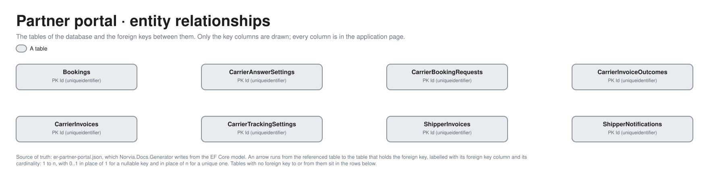

# Partner portal

Part of the [applications](README.md).

## APIs

The Partner portal has no API of its own to the estate and publishes no OpenAPI document. It plays every Shipper and Carrier as a Persona, so what it exposes are the **Persona endpoints** the Shipper and Carrier systems would have: the doors Norvia's Logic Apps send to, and two read endpoints and a reset for the Simulator. They are outside Norvia's integration layer on purpose, as a real party's systems are ([c4.md](../architecture/c4.md#l2-containers)). The portal's own pages, the Persona switcher (`GET /`, `POST /persona`) and the Proof of delivery file download its browser uses are not listed as APIs; the rest of the portal is a Blazor UI.

- **Credential.** There is no Entra on these endpoints and no app role: each takes the Persona's own endpoint key in `X-Api-Key`, which must be the key of the Persona in the route (a Shipper's key for `/shipper/v1/{shipperId}`, a Carrier's for `/carrier/v1/{carrierId}`). Keys live in the portal's Key Vault; the callers below read them from the same vault ([identity-and-access.md](../architecture/identity-and-access.md)). A wrong key answers 401, an unknown Persona 404, a message that breaks the format 400.
- **Acknowledge only.** The receiving endpoints answer a success once the document is stored, and the same for one already stored, by its own key (Carrier booking number, notification ID, document number, invoice number). The Persona can't refuse or reply on these routes; a Carrier answers a booking by calling the Norvia Partner API, not by replying.
- **Every send carries `X-Correlation-ID`**, the Message trail of the document.
- **Outbound.** What a Persona sends Norvia (bookings, answers, Tracking events, Proofs of delivery, Carrier invoices, tracking reads) goes through the Norvia Partner API in API Management with the Persona's token and subscription key. Those are calls from the portal, described by [TMS](tms.md) and [ERP](erp.md).
- **Locally.** The portal is the same under Aspire, and hosted workers play the Logic Apps that call it ([ADR 0030](../adr/0030-locally-a-hosted-worker-plays-the-p4-booking-logic-app.md), [ADR 0033](../adr/0033-locally-a-hosted-worker-plays-the-p7-shipper-notification-logic-app.md), [ADR 0034](../adr/0034-locally-a-hosted-worker-plays-the-p7-carrier-cancellation-logic-app.md), [ADR 0043](../adr/0043-locally-a-hosted-worker-plays-the-e1-billing-logic-app.md) and its siblings).

### Consumers

Every consumer reaches the portal **directly**: API Management never calls it. A Logic App reads Service Bus and then calls the Persona's endpoint, which is the integration layer's outbound edge.

| Consumer | Identity and credential | Process | Through API Management? |
|---|---|---|---|
| **Carrier booking Logic App** | `booking`; reads each Carrier's endpoint key | [P4](../processes/tms/p4-carrier-booking.md) | No: reads the `carrier-booking` subscription, then sends direct |
| **Carrier cancellation Logic App** | `carrier-cancellation`; reads each Carrier's endpoint key | [P7](../processes/tms/p7-exception-handling.md) | No: reads the `carrier-cancellation` subscription, then sends direct |
| **Shipper notification Logic App** | `shipper-notification`; reads each Shipper's endpoint key | [P7](../processes/tms/p7-exception-handling.md) | No: reads the `shipper-notification` subscription, then sends direct |
| **Shipper invoice Logic App** | `shipper-invoice`; reads each Shipper's endpoint key | [E1](../processes/erp/e1-invoicing.md#partner-portal) | No: reads the `shipper-invoice` subscription, then sends direct |
| **Carrier invoice outcome Logic App** | `carrier-invoice-outcome`; reads each Carrier's endpoint key | [E2](../processes/erp/e2-carrier-invoice-matching.md#partner-portal) | No: reads the `carrier-invoice-outcome` subscription, then sends direct |
| **Simulator** | `simulator`; reads the Shippers' endpoint keys, the Carriers' endpoint keys and the portal's reset key | [E1](../processes/erp/e1-invoicing.md#partner-portal), [E2](../processes/erp/e2-carrier-invoice-matching.md#partner-portal), Reset estate | No: direct ([ADR 0039](../adr/0039-the-simulator-books-only-through-the-estates-real-doors.md)) |
| **Agents (planned)** | None | None yet | The portal is not read by Agents; they read through API Management's MCP server ([ADR 0040](../adr/0040-agents-read-the-estate-through-api-management-have-no-write-tools-and-their-own-identity.md)) |

### Carrier Persona endpoints

| Method and route | Purpose | Credential | Request and response | Consumers |
|---|---|---|---|---|
| `POST /carrier/v1/{carrierId}/bookings` | Take a booking request into the Carrier's inbox. A repeat of the same Carrier booking number is acknowledged. | Carrier's `X-Api-Key` | Carrier booking format (`X-Correlation-ID`) → `ReceiveCarrierBookingResult` | Carrier booking Logic App (P4) |
| `GET /carrier/v1/{carrierId}/bookings` | List the bookings in the Carrier's inbox with the price Norvia offered for each, which is what the Carrier invoices. Changes nothing. | Carrier's `X-Api-Key` | → `[CarrierInboxBooking]` | Simulator (E2), playing the Carrier's invoicing |
| `POST /carrier/v1/{carrierId}/cancellations` | Tell the Carrier Norvia withdrew an Open request or cancelled a Confirmed booking. The Carrier can't refuse; a repeat changes nothing. | Carrier's `X-Api-Key` | Cancellation message (`X-Correlation-ID`) → `ReceiveCarrierCancellationResult` | Carrier cancellation Logic App (P7) |
| `POST /carrier/v1/{carrierId}/invoice-outcomes` | Tell the Carrier the outcome of an Approved Carrier invoice, line by line. Stored once per invoice number. | Carrier's `X-Api-Key` | Carrier invoice outcome format (`X-Correlation-ID`) → `ReceiveCarrierInvoiceOutcomeResult` | Carrier invoice outcome Logic App (E2) |
| `GET /carrier/v1/{carrierId}/invoice-outcomes` | List the outcomes the Carrier has been told, latest first. Changes nothing. | Carrier's `X-Api-Key` | → `[CarrierInboxOutcome]` | Simulator (E2) |

### Shipper Persona endpoints

| Method and route | Purpose | Credential | Request and response | Consumers |
|---|---|---|---|---|
| `POST /shipper/v1/{shipperId}/notifications` | Take a notification about an Exception into the Shipper's inbox. A repeat of the same notification ID is acknowledged. | Shipper's `X-Api-Key` | Shipper notification format (`X-Correlation-ID`) → `ReceiveShipperNotificationResult` | Shipper notification Logic App (P7) |
| `POST /shipper/v1/{shipperId}/invoices` | Take a Shipper invoice or Credit note into the Shipper's invoices inbox, once it passes the Shipper invoice format's rules. A repeat of the same document number is acknowledged. | Shipper's `X-Api-Key` | Shipper invoice format (`X-Correlation-ID`) → `ReceiveShipperInvoiceResult` (`documentNumber`, `repeated`) | Shipper invoice Logic App (E1) |
| `GET /shipper/v1/{shipperId}/invoices` | List what the invoices inbox holds, latest first, so the Simulator can see what reached the Shipper. Changes nothing. | Shipper's `X-Api-Key` | → `[ShipperInboxDocument]` | Simulator (E1) |

### Reset

| Method and route | Purpose | Credential | Request and response | Consumers |
|---|---|---|---|---|
| `GET /reset/v1` | Whether a reset would be taken now. | Portal reset key in `X-Api-Key` (`reset-endpoint-key`), since the portal validates no token | → `ResetReadiness` | Simulator (Reset estate) |
| `POST /reset/v1` | Delete what each Persona sent and received (bookings, inboxes, invoices, notifications) and the answer and tracking settings, which fall back to the seed file's. Refused with a 403 problem while the `Reset:Enabled` setting is off. | Portal reset key in `X-Api-Key` | → `ResetReport` | Simulator (Reset estate) |

## Database

The database's tables are generated from its EF Core model by `Norvia.Docs.Generator`; do not edit between the markers. Table and column descriptions are written in [descriptions/partner-portal.json](descriptions/partner-portal.json) and use the terms in [GLOSSARY.md](../../GLOSSARY.md).

<!-- generated:database -->

### Entity relationships

Only the key columns are drawn; every column is in the tables below. The picture is drawn from [the model](../architecture/diagrams/er-partner-portal.json) by `docs/architecture/diagrams/entities.py`, and its [Excalidraw file](../architecture/diagrams/er-partner-portal.excalidraw) opens in Excalidraw.

### Tables

#### `Bookings`

A booking a Persona sent Norvia through the Norvia Partner API, with Norvia's answer: the outside party's own record of it. Norvia owns the Transport Order (ADR 0002); the portal keeps only what the party sent and heard back, every attempt included (P1).

| Column | Type | Nullable | Default | Key | Description |
|---|---|---|---|---|---|
| `Id` | `uniqueidentifier` | no |  | PK | The portal's own ID for the attempt. |
| `Answer` | `nvarchar(max)` | no |  |  | Norvia's answer as the party got it, as JSON: the result (booked, rejected, not received or refused), the Message ID, the Transport Order number when booked and every reason when rejected. |
| `PersonaId` | `nvarchar(100)` | no |  |  | The Shipper Persona that sent the booking. |
| `SentAt` | `datetimeoffset` | no |  |  | When the Persona sent it. |
| `ShipperReference` | `nvarchar(100)` | yes |  |  | The Shipper's own reference for the booking; null when it sent none, which Norvia rejects. |

Primary key `PK_Bookings`: `Id`.

| Index | Columns | Unique | Filter |
|---|---|---|---|
| `IX_Bookings_PersonaId_SentAt` | `PersonaId`, `SentAt` | no |  |

#### `CarrierAnswerSettings`

How one Carrier Persona answers booking requests, as the presenter chose on its page (P4). A Persona never changed has no row and follows the seed file's default.

| Column | Type | Nullable | Default | Key | Description |
|---|---|---|---|---|---|
| `Id` | `uniqueidentifier` | no |  | PK | The setting's own ID. |
| `DelayMilliseconds` | `bigint` | no |  |  | How long an automatic answer waits after the request arrives. |
| `Mode` | `nvarchar(30)` | no |  |  | `Manual`, `AutoConfirm` or `AutoReject`. |
| `PersonaId` | `nvarchar(100)` | no |  |  | The Carrier Persona; unique, one setting per Persona. |
| `RejectionReason` | `nvarchar(30)` | no |  |  | The reason code an automatic rejection carries: `NoCapacity`, `LaneNotServed`, `WindowNotFeasible`, `GoodsNotAccepted`, `PriceNotAccepted` or `Other`. |

Primary key `PK_CarrierAnswerSettings`: `Id`.

| Index | Columns | Unique | Filter |
|---|---|---|---|
| `IX_CarrierAnswerSettings_PersonaId` | `PersonaId` | yes |  |

#### `CarrierBookingRequests`

A request Norvia sent a Carrier Persona to carry a Shipment, in the Carrier's inbox (P4). It stays after the Carrier answers, to carry what became of the booking: its answer, any cancellation by Norvia, and the schedule of automatic Tracking events and Proof of delivery that follow a confirmation (P5, P6).

| Column | Type | Nullable | Default | Key | Description |
|---|---|---|---|---|---|
| `Id` | `uniqueidentifier` | no |  | PK | The portal's own ID for the request. |
| `AnswerCorrelationId` | `nvarchar(200)` | yes |  |  | Message trail Norvia gave the answer that closed the request; null while Open or when Norvia never replied. |
| `AutoAnswerDueAt` | `datetimeoffset` | yes |  |  | When the automatic answer is due; null for a request answered by hand and once closed. |
| `AutoAnswerMode` | `nvarchar(30)` | yes |  |  | The answer mode the Persona's policy had when the request arrived, if automatic. It stays the request's whatever the policy becomes. |
| `AutoAnswerReason` | `nvarchar(30)` | yes |  |  | The rejection reason an automatic rejection carries. |
| `AutoProgressDelayMilliseconds` | `bigint` | yes |  |  | Delay between the automatic Tracking events, if the policy was auto-progress when the Carrier confirmed. |
| `AutoProgressDueAt` | `datetimeoffset` | yes |  |  | When the next automatic Tracking event (or, once Delivered, the Proof of delivery) is due; null for a Shipment tracked by hand and once the Proof of delivery has gone. |
| `CancellationText` | `nvarchar(500)` | yes |  |  | Why Norvia cancelled the confirmed booking; null unless it did. |
| `CancelledAt` | `datetimeoffset` | yes |  |  | When Norvia's cancellation arrived; null unless Cancelled. |
| `CarrierBookingNumber` | `nvarchar(50)` | no |  |  | Norvia's number for the Carrier booking, the request's key: the same request received again is the one the inbox already has. |
| `CarrierBookingReference` | `nvarchar(200)` | yes |  |  | The Carrier's own reference for the booking, set when it confirms. It is what the Carrier's tracking events and invoice lines quote. |
| `ClosedAt` | `datetimeoffset` | yes |  |  | When the request left Open: answered, or found withdrawn by Norvia. |
| `CorrelationId` | `nvarchar(200)` | no |  |  | The release's Message trail, which the request arrived with. |
| `Details` | `nvarchar(max)` | no |  |  | What the request asks of the Carrier, as JSON in the Carrier booking format: collection and delivery addresses and windows, the Consignee's name, the goods lines and the Carrier cost Norvia offers. It never names the Shipper. |
| `LastProgress` | `nvarchar(30)` | yes |  |  | The last progress Tracking event the Persona sent for the Shipment; null until it sends one. |
| `PersonaId` | `nvarchar(100)` | no |  |  | The Carrier Persona whose inbox holds the request. |
| `PlannedCollection` | `datetimeoffset` | yes |  |  | The collection time the Carrier confirmed. |
| `ReceivedAt` | `datetimeoffset` | no |  |  | When the request reached the inbox. |
| `RejectionReason` | `nvarchar(30)` | yes |  |  | The reason code the Carrier rejected with. |
| `RejectionText` | `nvarchar(1000)` | yes |  |  | The Carrier's reason text; needed for `Other`. |
| `ShipmentNumber` | `nvarchar(50)` | no |  |  | The Shipment to carry (a logical reference to the TMS). |
| `Status` | `nvarchar(30)` | no |  |  | `Open`, `Confirmed`, `Rejected`, `WithdrawnByNorvia` or `CancelledByNorvia`. |

Primary key `PK_CarrierBookingRequests`: `Id`.

| Index | Columns | Unique | Filter |
|---|---|---|---|
| `IX_CarrierBookingRequests_AutoAnswerDueAt` | `AutoAnswerDueAt` | no |  |
| `IX_CarrierBookingRequests_AutoProgressDueAt` | `AutoProgressDueAt` | no |  |
| `IX_CarrierBookingRequests_PersonaId_CarrierBookingNumber` | `PersonaId`, `CarrierBookingNumber` | yes |  |
| `IX_CarrierBookingRequests_PersonaId_ReceivedAt` | `PersonaId`, `ReceivedAt` | no |  |

#### `CarrierInvoiceOutcomes`

What Norvia told a Carrier Persona about an Approved Carrier invoice, through the Persona's invoice outcome endpoint (E2): the approved amount and the result of each line. It stands on its own, not inside CarrierInvoices, because Norvia can tell the outcome of an invoice approved on receipt before the Persona has stored the invoice's own row.

| Column | Type | Nullable | Default | Key | Description |
|---|---|---|---|---|---|
| `Id` | `uniqueidentifier` | no |  | PK | The portal's own ID for the outcome. |
| `ApprovedAmount` | `decimal(18,2)` | no |  |  | The sum of the Matched and Accepted amounts, in EUR without VAT. |
| `CorrelationId` | `nvarchar(200)` | no |  |  | The Carrier invoice's Message trail, which the outcome arrived with. |
| `InvoiceNumber` | `nvarchar(50)` | no |  |  | The Carrier's own invoice number, the outcome's key: the same outcome told again is stored once. |
| `Lines` | `nvarchar(max)` | no |  |  | The result of each line as JSON: the Carrier booking reference, whether it was accepted or rejected, the amount and the reason. |
| `PersonaId` | `nvarchar(100)` | no |  |  | The Carrier Persona that was told. |
| `ReceivedAt` | `datetimeoffset` | no |  |  | When the outcome reached the endpoint. |

Primary key `PK_CarrierInvoiceOutcomes`: `Id`.

| Index | Columns | Unique | Filter |
|---|---|---|---|
| `IX_CarrierInvoiceOutcomes_PersonaId_InvoiceNumber` | `PersonaId`, `InvoiceNumber` | yes |  |

#### `CarrierInvoices`

A Carrier invoice a Carrier Persona sent Norvia through the Norvia Partner API, with how it stands at Norvia (E2). The Carrier's own record of its claim; the ERP owns the invoice once received (ADR 0002).

| Column | Type | Nullable | Default | Key | Description |
|---|---|---|---|---|---|
| `Id` | `uniqueidentifier` | no |  | PK | The portal's own ID for the invoice. |
| `ApprovedAmount` | `decimal(18,2)` | yes |  |  | The approved amount in EUR without VAT, once Norvia approved the invoice; null before. |
| `CorrelationId` | `nvarchar(200)` | no |  |  | The Message trail the portal gave the submission. |
| `InvoiceDate` | `date` | no |  |  | The date on the invoice. |
| `InvoiceNumber` | `nvarchar(50)` | no |  |  | The Carrier's own invoice number; unique per Persona. |
| `Lines` | `nvarchar(max)` | no |  |  | The lines as JSON: the Carrier booking reference, the amount claimed, a description and the result Norvia's Matching gave. |
| `PersonaId` | `nvarchar(100)` | no |  |  | The Carrier Persona that sent the invoice. |
| `Status` | `nvarchar(30)` | no |  |  | Where the invoice stands at Norvia as it last told the Carrier: a line waits for Finance, or every line is decided (Approved). |
| `SubmittedAt` | `datetimeoffset` | no |  |  | When the Persona sent it. |

Primary key `PK_CarrierInvoices`: `Id`.

| Index | Columns | Unique | Filter |
|---|---|---|---|
| `IX_CarrierInvoices_PersonaId_InvoiceNumber` | `PersonaId`, `InvoiceNumber` | yes |  |
| `IX_CarrierInvoices_PersonaId_SubmittedAt` | `PersonaId`, `SubmittedAt` | no |  |

#### `CarrierTrackingSettings`

How one Carrier Persona sends Tracking events for the Shipments it confirmed, as the presenter chose on its page (P5). A Persona never changed has no row and follows the seed file's default.

| Column | Type | Nullable | Default | Key | Description |
|---|---|---|---|---|---|
| `Id` | `uniqueidentifier` | no |  | PK | The setting's own ID. |
| `DelayMilliseconds` | `bigint` | no |  |  | The delay between automatic Tracking events. |
| `Mode` | `nvarchar(30)` | no |  |  | `Manual` (the presenter sends each event) or `AutoProgress` (Collected, Departed, Out for delivery and Delivered in turn). |
| `PersonaId` | `nvarchar(100)` | no |  |  | The Carrier Persona; unique, one setting per Persona. |

Primary key `PK_CarrierTrackingSettings`: `Id`.

| Index | Columns | Unique | Filter |
|---|---|---|---|
| `IX_CarrierTrackingSettings_PersonaId` | `PersonaId` | yes |  |

#### `ShipperInvoices`

An invoice or Credit note Norvia sent a Shipper Persona, in the Shipper's invoices inbox (E1). The Shipper's own copy of what the ERP issued; it only acknowledges and can't reply. The Simulator reads it to check that documents arrive.

| Column | Type | Nullable | Default | Key | Description |
|---|---|---|---|---|---|
| `Id` | `uniqueidentifier` | no |  | PK | The portal's own ID for the document. |
| `Content` | `nvarchar(max)` | no |  |  | The document as JSON, in the Shipper invoice format: invoice or Credit note, dates, lines with charge lines, totals, and for a Credit note the invoice, line and reason it corrects. |
| `CorrelationId` | `nvarchar(200)` | no |  |  | The Message trail the document arrived with. |
| `DocumentNumber` | `nvarchar(50)` | no |  |  | Norvia's number of the invoice or Credit note, the inbox's key: the same document received again is the one the inbox already has. |
| `PersonaId` | `nvarchar(100)` | no |  |  | The Shipper Persona the document was sent to. |
| `ReceivedAt` | `datetimeoffset` | no |  |  | When it reached the inbox. |

Primary key `PK_ShipperInvoices`: `Id`.

| Index | Columns | Unique | Filter |
|---|---|---|---|
| `IX_ShipperInvoices_PersonaId_DocumentNumber` | `PersonaId`, `DocumentNumber` | yes |  |
| `IX_ShipperInvoices_PersonaId_ReceivedAt` | `PersonaId`, `ReceivedAt` | no |  |

#### `ShipperNotifications`

A notification Norvia sent a Shipper Persona about an Exception, in the Shipper's inbox (P7). The Shipper can't reply.

| Column | Type | Nullable | Default | Key | Description |
|---|---|---|---|---|---|
| `Id` | `uniqueidentifier` | no |  | PK | The portal's own ID for the notification. |
| `Content_BookingRef` | `nvarchar(200)` | no |  |  | The Shipper's own reference for the booking. |
| `Content_Contact` | `nvarchar(200)` | no |  |  | Who at Norvia to contact. |
| `Content_ExceptionCode` | `nvarchar(30)` | no |  |  | What went wrong, as a stable code. |
| `Content_Message` | `nvarchar(4000)` | no |  |  | The message the Planner sent the Shipper. |
| `Content_TransportOrderNumber` | `nvarchar(50)` | no |  |  | The Transport Order concerned (a logical reference to the TMS). |
| `CorrelationId` | `nvarchar(200)` | no |  |  | The Message trail the notification arrived with. |
| `DeliverFrom` | `datetime2` | yes |  |  | Start of the agreed delivery window, local time at the delivery address; null when none was agreed. |
| `DeliverUntil` | `datetime2` | yes |  |  | End of the agreed delivery window, local time at the delivery address. |
| `Eta` | `datetime2` | yes |  |  | The current ETA, local time at the delivery address; never set together with a delivery window. |
| `NotificationId` | `uniqueidentifier` | no |  |  | Norvia's ID of the notification, the inbox's key. |
| `PersonaId` | `nvarchar(100)` | no |  |  | The Shipper Persona notified. |
| `ReceivedAt` | `datetimeoffset` | no |  |  | When it reached the inbox. |

Primary key `PK_ShipperNotifications`: `Id`.

| Index | Columns | Unique | Filter |
|---|---|---|---|
| `IX_ShipperNotifications_PersonaId_NotificationId` | `PersonaId`, `NotificationId` | yes |  |
| `IX_ShipperNotifications_PersonaId_ReceivedAt` | `PersonaId`, `ReceivedAt` | no |  |

<!-- /generated:database -->

### Logical references

Identifiers the Partner portal stores from other applications. The database enforces none of them: the owning application is the source of truth ([ADR 0002](../adr/0002-one-system-of-record-per-concept.md)). The portal keeps only what each Persona sent and heard back.

| Column | Target application and concept |
|---|---|
| `Bookings.PersonaId`, `ShipperInvoices.PersonaId`, `ShipperNotifications.PersonaId` | [ERP](erp.md): the Shipper (`SHP-0001`) the Persona plays. The Persona list is the portal's seed file, not a table |
| `CarrierAnswerSettings.PersonaId`, `CarrierBookingRequests.PersonaId`, `CarrierInvoiceOutcomes.PersonaId`, `CarrierInvoices.PersonaId`, `CarrierTrackingSettings.PersonaId` | [ERP](erp.md): the Carrier (`CAR-0001`) the Persona plays |
| `Bookings.Answer` (JSON, `TransportOrderNumber` and Message ID) | [TMS](tms.md): the Transport Order Norvia booked and the Message trail of the attempt |
| `CarrierBookingRequests.CarrierBookingNumber`, `ShipmentNumber`, `CorrelationId`, `AnswerCorrelationId` | [TMS](tms.md): the Carrier booking, its Shipment and the Message trails of the release and of Norvia's answer |
| `CarrierBookingRequests.Details` (JSON, the Carrier cost offered) | [ERP](erp.md): the Carrier cost the TMS calculated from the Carrier Rate Card ([ADR 0013](../adr/0013-the-tms-rates-carrier-bookings-the-erp-owns-carrier-rate-cards.md)) |
| `CarrierInvoiceOutcomes.InvoiceNumber`, `CarrierInvoiceOutcomes.Lines`, `CarrierInvoices.Lines` (JSON, the Matching result) | [ERP](erp.md): the Carrier invoice and its lines as the ERP matched them |
| `ShipperInvoices.DocumentNumber`, `ShipperInvoices.Content` (JSON, credited invoice and Transport Order number) | [ERP](erp.md): the Shipper invoice (`INV-2026-000001`) or Credit note (`CN-2026-000001`), and for a Credit note the [TMS](tms.md) Transport Order of the credited line |
| `ShipperNotifications.NotificationId`, `Content_TransportOrderNumber` | [TMS](tms.md): the Shipper notification and the Transport Order it concerns |
| `CarrierBookingRequests.CarrierBookingReference`, `CarrierInvoices.InvoiceNumber` | The Carrier's own references. They are the Carrier's identifiers, not another application's records |
