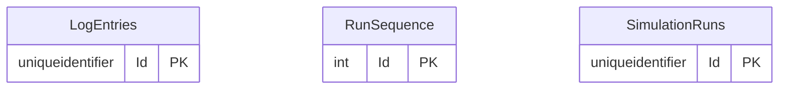

# Simulator

Part of the [applications](README.md).

## APIs

Not written yet: #659. The Simulator publishes no OpenAPI document.

## Database

The database's tables are generated from its EF Core model by `Norvia.Docs.Generator`; do not edit between the markers. Table and column descriptions are written in [descriptions/simulator.json](descriptions/simulator.json) and use the terms in [GLOSSARY.md](../../GLOSSARY.md).

<!-- generated:database -->

### Entity relationships

Only the key columns are drawn; every column is in the tables below.

### Tables

#### `LogEntries`

| Column | Type | Nullable | Default | Key | Description |
|---|---|---|---|---|---|
| `Id` | `uniqueidentifier` | no |  | PK |  |
| `Action` | `nvarchar(300)` | no |  |  |  |
| `Actor` | `nvarchar(200)` | no |  |  |  |
| `At` | `datetimeoffset` | no |  |  |  |
| `CorrelationId` | `nvarchar(100)` | yes |  |  |  |
| `Detail` | `nvarchar(500)` | yes |  |  |  |
| `Outcome` | `nvarchar(20)` | no |  |  |  |
| `RunId` | `uniqueidentifier` | no |  |  |  |
| `Sequence` | `int` | no |  |  |  |
| `ShipmentNumber` | `nvarchar(50)` | yes |  |  |  |
| `ShipperReference` | `nvarchar(100)` | yes |  |  |  |
| `TransportOrderNumber` | `nvarchar(50)` | yes |  |  |  |
| `TripNumber` | `nvarchar(50)` | yes |  |  |  |

Primary key `PK_LogEntries`: `Id`.

| Index | Columns | Unique | Filter |
|---|---|---|---|
| `IX_LogEntries_RunId_Sequence` | `RunId`, `Sequence` | no |  |

#### `RunSequence`

| Column | Type | Nullable | Default | Key | Description |
|---|---|---|---|---|---|
| `Id` | `int` | no |  | PK |  |
| `Last` | `int` | no |  |  |  |

Primary key `PK_RunSequence`: `Id`.

#### `SimulationRuns`

| Column | Type | Nullable | Default | Key | Description |
|---|---|---|---|---|---|
| `Id` | `uniqueidentifier` | no |  | PK |  |
| `FinishedAt` | `datetimeoffset` | yes |  |  |  |
| `Mode` | `nvarchar(20)` | no |  |  |  |
| `Number` | `int` | no |  |  |  |
| `Plan` | `nvarchar(max)` | no |  |  |  |
| `PlannedCount` | `int` | no |  |  |  |
| `PresetName` | `nvarchar(100)` | yes |  |  |  |
| `RowVersion` | `rowversion` | yes |  |  |  |
| `Seed` | `int` | no |  |  |  |
| `StartedAt` | `datetimeoffset` | no |  |  |  |
| `StartedBy` | `nvarchar(200)` | no |  |  |  |
| `Status` | `nvarchar(20)` | no |  |  |  |

Primary key `PK_SimulationRuns`: `Id`.

| Index | Columns | Unique | Filter |
|---|---|---|---|
| `IX_SimulationRuns_Number` | `Number` | yes |  |
| `IX_SimulationRuns_OneActive` | `Status` | yes | `[Status] = 'Running'` |
| `IX_SimulationRuns_StartedAt` | `StartedAt` | no |  |

<!-- /generated:database -->

### Logical references

Not written yet: #659.
