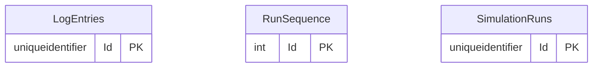

# Simulator

Part of the [applications](README.md).

## APIs

The Simulator has **no API of its own**. It is a Blazor UI the presenter signs in to (Easy Auth with the `Simulator.Run` and `Simulator.Read` roles in Azure, a local operator under Aspire; see [identity-and-access.md](../architecture/identity-and-access.md)), and it publishes no OpenAPI document. Its only HTTP endpoint besides the UI's own assets is the `/health` check that Aspire and Container Apps call. Nothing in the estate calls the Simulator, so there are no consumers to list, and it publishes nothing to Service Bus ([ADR 0039](../adr/0039-the-simulator-books-only-through-the-estates-real-doors.md)).

It is a **caller** of the estate, through the same doors a real party would use. Each page below describes those endpoints and lists the Simulator among their consumers:

| What the Simulator plays | Calls | Identity | Process | Described in |
|---|---|---|---|---|
| **Shipper Personas** (booking) | Norvia Partner API, through API Management | The Persona's client app token and subscription key | [P1](../processes/tms/p1-transport-order-intake.md) | The Partner API is not an application of its own; see [c4.md](../architecture/c4.md#l2-containers) |
| **The Planner** | TMS API | `simulator`, `TransportOrders.Manage` | [P3](../processes/tms/p3-transport-planning.md), [P7](../processes/tms/p7-exception-handling.md), [P10](../processes/tms/p10-fleet-capacity-planning.md), [P11](../processes/tms/p11-trip-dispatch.md) | [TMS](tms.md#consumers) |
| **Carrier Personas** (answers, tracking, Proofs of delivery) | Norvia Partner API, through API Management | The Persona's client app token and subscription key | [P4](../processes/tms/p4-carrier-booking.md), [P5](../processes/tms/p5-shipment-tracking.md), [P6](../processes/tms/p6-proof-of-delivery.md) | As above |
| **Drivers** | Driver app API | One client app per Driver, holding the Driver ID as its one app role | [P12](../processes/tms/p12-trip-execution.md) | [Driver app](driver-app.md#consumers) |
| **Finance** | ERP API | `simulator`, `ShipperInvoices.Manage` and `CarrierInvoices.Manage` | [E1](../processes/erp/e1-invoicing.md), [E2](../processes/erp/e2-carrier-invoice-matching.md) | [ERP](erp.md#consumers) |
| **Shippers' and Carriers' inboxes** (reads) | Partner portal endpoints | Each Persona's endpoint key | [E1](../processes/erp/e1-invoicing.md#partner-portal), [E2](../processes/erp/e2-carrier-invoice-matching.md#partner-portal) | [Partner portal](partner-portal.md#consumers) |
| **Reset estate** | The reset endpoint of the TMS, Driver app, ERP and Partner portal | `simulator`, `Estate.Reset` on the first three; the portal's reset key | none | Each page's Reset section |

The Simulator never writes to another application's database, so it has no logical references to enforce beyond the keys in its log.

## Database

The database's tables are generated from its EF Core model by `Norvia.Docs.Generator`; do not edit between the markers. Table and column descriptions are written in [descriptions/simulator.json](descriptions/simulator.json) and use the terms in [GLOSSARY.md](../../GLOSSARY.md).

<!-- generated:database -->

### Entity relationships

Only the key columns are drawn; every column is in the tables below.

### Tables

#### `LogEntries`

One line of a Simulation run's log: what an actor did, how Norvia answered, and the keys that find its Message trail in the Integration console. It never holds what was booked, which has personal data in it (coding guidelines §7). The Simulator keeps no copy of the estate's records; the owners do (ADR 0002, ADR 0039).

| Column | Type | Nullable | Default | Key | Description |
|---|---|---|---|---|---|
| `Id` | `uniqueidentifier` | no |  | PK | The line's own ID. |
| `Action` | `nvarchar(300)` | no |  |  | What the actor did, such as a booking, an assignment, a Carrier's answer, a Driver's report or Finance's Invoice now. |
| `Actor` | `nvarchar(200)` | no |  |  | Who acted: the Persona's or Driver's name, or the simulated Planner or Finance. |
| `At` | `datetimeoffset` | no |  |  | When it happened. |
| `CorrelationId` | `nvarchar(100)` | yes |  |  | The `X-Correlation-ID` Norvia answered with, by which the Integration console finds the Message trail (ADR 0017); null when Norvia never answered. |
| `Detail` | `nvarchar(500)` | yes |  |  | What the plan intended and what Norvia said, such as the codes of a rejection; never the booking's content. |
| `Outcome` | `nvarchar(20)` | no |  |  | How Norvia answered the call: whether it took it, refused it or couldn't be reached. |
| `RunId` | `uniqueidentifier` | no |  |  | The Simulation run the line belongs to. |
| `Sequence` | `int` | no |  |  | The line's place in its run, from 1. |
| `ShipmentNumber` | `nvarchar(50)` | yes |  |  | The Shipment the line is about, when it is about one (a logical reference to the TMS). |
| `ShipperReference` | `nvarchar(100)` | yes |  |  | The Shipper reference the run gave the booking (`SIM-<run number>-<n>`). |
| `TransportOrderNumber` | `nvarchar(50)` | yes |  |  | The Transport Order the line is about, once Norvia numbered it (a logical reference to the TMS). |
| `TripNumber` | `nvarchar(50)` | yes |  |  | The Trip the line is about, when it is about one (a logical reference to the TMS). |

Primary key `PK_LogEntries`: `Id`.

| Index | Columns | Unique | Filter |
|---|---|---|---|
| `IX_LogEntries_RunId_Sequence` | `RunId`, `Sequence` | no |  |

#### `RunSequence`

The last Simulation run number taken, one row for the whole app, so run numbers (and the Shipper references that carry them) don't repeat. Reset estate clears it and the next run is number 1 again.

| Column | Type | Nullable | Default | Key | Description |
|---|---|---|---|---|---|
| `Id` | `int` | no |  | PK | Always 1: there is one row. |
| `Last` | `int` | no |  |  | The last run number taken. |

Primary key `PK_RunSequence`: `Id`.

#### `SimulationRuns`

A Simulation run: the plan that was made and how far it got. Only one run is active at a time; a run can be cancelled but not resumed after a restart.

| Column | Type | Nullable | Default | Key | Description |
|---|---|---|---|---|---|
| `Id` | `uniqueidentifier` | no |  | PK | The run's own ID. |
| `FinishedAt` | `datetimeoffset` | yes |  |  | When the run ended; null while Running. |
| `Mode` | `nvarchar(20)` | no |  |  | `Burst` (sent as fast as the estate accepts) or `Paced` (spread over the run's window). |
| `Number` | `int` | no |  |  | The run's number, unique, which its Shipper references carry. |
| `Plan` | `nvarchar(max)` | no |  |  | The plan as JSON: the mix of Shippers and Carriers, the shares of failures and exceptions, and the settings for the Planner, Carriers, Drivers and Finance. |
| `PlannedCount` | `int` | no |  |  | How many Transport Orders the plan intended to book. |
| `PresetName` | `nvarchar(100)` | yes |  |  | The preset the plan started from; null for a plan configured by hand. |
| `RowVersion` | `rowversion` | yes |  |  | Concurrency token: a cancel and the run's own progress don't both land. |
| `Seed` | `int` | no |  |  | The random seed, so the same plan and seed play the same run. |
| `StartedAt` | `datetimeoffset` | no |  |  | When the run started. |
| `StartedBy` | `nvarchar(200)` | no |  |  | Who started it: the presenter, or the local operator under Aspire. |
| `Status` | `nvarchar(20)` | no |  |  | `Running`, `Completed`, `Cancelled` or `Failed` (for example because the Simulator was restarted). |

Primary key `PK_SimulationRuns`: `Id`.

| Index | Columns | Unique | Filter |
|---|---|---|---|
| `IX_SimulationRuns_Number` | `Number` | yes |  |
| `IX_SimulationRuns_OneActive` | `Status` | yes | `[Status] = 'Running'` |
| `IX_SimulationRuns_StartedAt` | `StartedAt` | no |  |

<!-- /generated:database -->

### Logical references

Identifiers the Simulator keeps from the applications it calls. They are there to find a Message trail, not to describe the records: the owning application is the source of truth ([ADR 0002](../adr/0002-one-system-of-record-per-concept.md)), and the log never holds what was booked.

| Column | Target application and concept |
|---|---|
| `LogEntries.TransportOrderNumber` | [TMS](tms.md): the Transport Order the line is about |
| `LogEntries.ShipmentNumber` | [TMS](tms.md): the Shipment the Planner's assignment planned, or a Carrier or Driver acted on |
| `LogEntries.TripNumber` | [TMS](tms.md): the Trip the Planner built or a Driver worked, which the [Driver app](driver-app.md) holds a copy of |
| `LogEntries.CorrelationId` | The Message trail Norvia answered with. It belongs to the estate's telemetry, found in the Integration console ([ADR 0017](../adr/0017-the-integration-console-reads-the-estates-telemetry-and-stores-nothing.md)), not to one application's table |
| `LogEntries.ShipperReference` | The Shipper reference the run gave the booking (`SIM-<run number>-<n>`). The Simulator invents it; the [TMS](tms.md) stores it on the Transport Order |
| `LogEntries.Actor` | The Persona or Driver played: a name, not an ID; the Shippers and Carriers are [ERP](erp.md) master data, and the Drivers are the ERP's too ([ADR 0014](../adr/0014-the-erp-owns-vehicles-and-drivers-the-tms-owns-their-availability.md)) |
