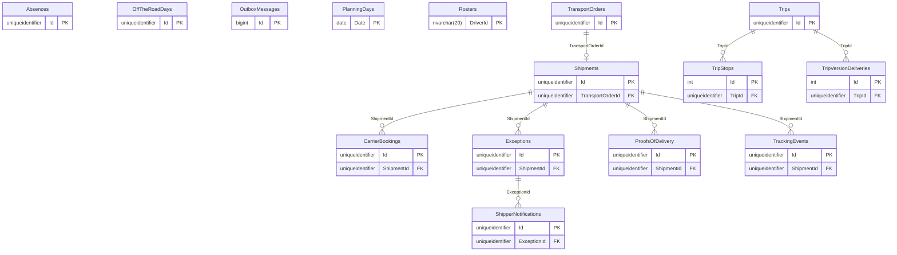

# TMS

Part of the [applications](README.md).

## APIs

Not written yet: #655. The OpenAPI documents the TMS API publishes: [v1](openapi/tms.v1.json).

## Database

The database's tables are generated from its EF Core model by `Norvia.Docs.Generator`; do not edit between the markers. Table and column descriptions are written in [descriptions/tms.json](descriptions/tms.json) and use the terms in [GLOSSARY.md](../../GLOSSARY.md).

<!-- generated:database -->

### Entity relationships

Only the key columns are drawn; every column is in the tables below.

### Tables

#### `Absences`

| Column | Type | Nullable | Default | Key | Description |
|---|---|---|---|---|---|
| `Id` | `uniqueidentifier` | no |  | PK |  |
| `Date` | `date` | no |  |  |  |
| `DriverId` | `nvarchar(20)` | no |  |  |  |
| `Reason` | `nvarchar(10)` | no |  |  |  |
| `Remark` | `nvarchar(500)` | no |  |  |  |
| `RowVersion` | `rowversion` | yes |  |  |  |

Primary key `PK_Absences`: `Id`.

| Index | Columns | Unique | Filter |
|---|---|---|---|
| `IX_Absences_Date` | `Date` | no |  |
| `IX_Absences_DriverId_Date` | `DriverId`, `Date` | yes |  |

#### `CarrierBookings`

| Column | Type | Nullable | Default | Key | Description |
|---|---|---|---|---|---|
| `Id` | `uniqueidentifier` | no |  | PK |  |
| `AnswerCorrelationId` | `nvarchar(128)` | yes |  |  |  |
| `AnsweredAt` | `datetimeoffset` | yes |  |  |  |
| `CancellationCorrelationId` | `nvarchar(128)` | yes |  |  |  |
| `CancellationExceptionNumber` | `nvarchar(10)` | yes |  |  |  |
| `CancellationKey` | `nvarchar(100)` | yes |  |  |  |
| `CancellationReasonText` | `nvarchar(500)` | yes |  |  |  |
| `CancelledAt` | `datetimeoffset` | yes |  |  |  |
| `CarrierBookingReference` | `nvarchar(50)` | yes |  |  |  |
| `CarrierCost` | `nvarchar(max)` | yes |  |  |  |
| `CarrierId` | `nvarchar(50)` | no |  |  |  |
| `CarrierNotToldAt` | `datetimeoffset` | yes |  |  |  |
| `CarrierNotToldMessage` | `nvarchar(500)` | yes |  |  |  |
| `CarrierNotToldStatusCode` | `int` | yes |  |  |  |
| `CarrierToldAt` | `datetimeoffset` | yes |  |  |  |
| `CorrelationId` | `nvarchar(128)` | no |  |  |  |
| `NotDeliveredAt` | `datetimeoffset` | yes |  |  |  |
| `NotDeliveredMessage` | `nvarchar(500)` | yes |  |  |  |
| `NotDeliveredStatusCode` | `int` | yes |  |  |  |
| `Number` | `nvarchar(10)` | no |  |  |  |
| `PlannedCollectionTime` | `datetimeoffset` | yes |  |  |  |
| `RejectionReason` | `nvarchar(30)` | yes |  |  |  |
| `RejectionReasonText` | `nvarchar(500)` | yes |  |  |  |
| `RequestedAt` | `datetimeoffset` | no |  |  |  |
| `SentAt` | `datetimeoffset` | yes |  |  |  |
| `ShipmentId` | `uniqueidentifier` | no |  | FK |  |
| `ShipmentNumber` | `nvarchar(10)` | no |  |  |  |
| `Status` | `nvarchar(20)` | no |  |  |  |
| `WithdrawalCorrelationId` | `nvarchar(128)` | yes |  |  |  |
| `WithdrawalKey` | `nvarchar(100)` | yes |  |  |  |
| `WithdrawnAt` | `datetimeoffset` | yes |  |  |  |

Primary key `PK_CarrierBookings`: `Id`.

| Foreign key | Columns | References | On delete |
|---|---|---|---|
| `FK_CarrierBookings_Shipments_ShipmentId` | `ShipmentId` | `Shipments` (`Id`) | restrict |

| Index | Columns | Unique | Filter |
|---|---|---|---|
| `IX_CarrierBookings_Number` | `Number` | yes |  |
| `IX_CarrierBookings_ShipmentId` | `ShipmentId` | no |  |

#### `Exceptions`

| Column | Type | Nullable | Default | Key | Description |
|---|---|---|---|---|---|
| `Id` | `uniqueidentifier` | no |  | PK |  |
| `AfterDelivered` | `bit` | no |  |  |  |
| `CarrierId` | `nvarchar(50)` | yes |  |  |  |
| `CauseCleared` | `bit` | no |  |  |  |
| `Causes` | `nvarchar(max)` | no |  |  |  |
| `CorrelationId` | `nvarchar(128)` | no |  |  |  |
| `Notes` | `nvarchar(max)` | no | N'[]' |  |  |
| `Number` | `nvarchar(10)` | no |  |  |  |
| `OpenedAt` | `datetimeoffset` | no |  |  |  |
| `Outcome` | `nvarchar(30)` | yes |  |  |  |
| `Remark` | `nvarchar(2000)` | yes |  |  |  |
| `ResolutionCorrelationId` | `nvarchar(128)` | yes |  |  |  |
| `ResolvedAt` | `datetimeoffset` | yes |  |  |  |
| `RowVersion` | `rowversion` | yes |  |  |  |
| `ShipmentId` | `uniqueidentifier` | no |  | FK |  |
| `ShipmentNumber` | `nvarchar(10)` | no |  |  |  |
| `ShipperId` | `nvarchar(50)` | no |  |  |  |
| `Status` | `nvarchar(20)` | no |  |  |  |
| `TransportOrderNumber` | `nvarchar(10)` | no |  |  |  |
| `Type` | `nvarchar(30)` | no |  |  |  |

Primary key `PK_Exceptions`: `Id`.

| Foreign key | Columns | References | On delete |
|---|---|---|---|
| `FK_Exceptions_Shipments_ShipmentId` | `ShipmentId` | `Shipments` (`Id`) | restrict |

| Index | Columns | Unique | Filter |
|---|---|---|---|
| `IX_Exceptions_Number` | `Number` | yes |  |
| `IX_Exceptions_ShipmentId_Type` | `ShipmentId`, `Type` | yes | `[Status] = 'Open'` |
| `IX_Exceptions_Status_OpenedAt` | `Status`, `OpenedAt` | no |  |

#### `OffTheRoadDays`

| Column | Type | Nullable | Default | Key | Description |
|---|---|---|---|---|---|
| `Id` | `uniqueidentifier` | no |  | PK |  |
| `Date` | `date` | no |  |  |  |
| `Reason` | `nvarchar(12)` | no |  |  |  |
| `Remark` | `nvarchar(500)` | no |  |  |  |
| `RowVersion` | `rowversion` | yes |  |  |  |
| `VehicleId` | `nvarchar(20)` | no |  |  |  |

Primary key `PK_OffTheRoadDays`: `Id`.

| Index | Columns | Unique | Filter |
|---|---|---|---|
| `IX_OffTheRoadDays_Date` | `Date` | no |  |
| `IX_OffTheRoadDays_VehicleId_Date` | `VehicleId`, `Date` | yes |  |

#### `OutboxMessages`

| Column | Type | Nullable | Default | Key | Description |
|---|---|---|---|---|---|
| `Id` | `bigint` | no | identity | PK |  |
| `ApplicationProperties` | `nvarchar(max)` | no |  |  |  |
| `Body` | `nvarchar(max)` | no |  |  |  |
| `CorrelationId` | `nvarchar(128)` | no |  |  |  |
| `CreatedAt` | `datetimeoffset` | no |  |  |  |
| `EventId` | `uniqueidentifier` | no |  |  |  |
| `EventType` | `nvarchar(100)` | no |  |  |  |
| `PublishedAt` | `datetimeoffset` | yes |  |  |  |
| `Topic` | `nvarchar(260)` | no |  |  |  |
| `TraceParent` | `nvarchar(55)` | yes |  |  |  |

Primary key `PK_OutboxMessages`: `Id`.

| Index | Columns | Unique | Filter |
|---|---|---|---|
| `IX_OutboxMessages_EventId` | `EventId` | yes |  |
| `IX_OutboxMessages_Unpublished` | `Id` | no | `[PublishedAt] IS NULL` |

#### `PlanningDays`

| Column | Type | Nullable | Default | Key | Description |
|---|---|---|---|---|---|
| `Date` | `date` | no |  | PK |  |
| `AvailableVehicles` | `nvarchar(max)` | no |  |  |  |
| `RowVersion` | `rowversion` | yes |  |  |  |
| `Shifts` | `nvarchar(max)` | no |  |  |  |
| `Status` | `nvarchar(10)` | no |  |  |  |

Primary key `PK_PlanningDays`: `Date`.

#### `ProofsOfDelivery`

| Column | Type | Nullable | Default | Key | Description |
|---|---|---|---|---|---|
| `Id` | `uniqueidentifier` | no |  | PK |  |
| `CarrierBookingReference` | `nvarchar(50)` | yes |  |  |  |
| `Condition` | `nvarchar(20)` | no |  |  |  |
| `CorrelationId` | `nvarchar(128)` | no |  |  |  |
| `DeliveryTime` | `datetimeoffset` | no |  |  |  |
| `DocumentId` | `nvarchar(100)` | no |  |  |  |
| `DriverId` | `nvarchar(50)` | yes |  |  |  |
| `Files` | `nvarchar(max)` | no |  |  |  |
| `IsCurrent` | `bit` | no |  |  |  |
| `LocationCountryCode` | `nvarchar(2)` | no |  |  |  |
| `LocationPlace` | `nvarchar(100)` | no |  |  |  |
| `LocationPostcode` | `nvarchar(20)` | no |  |  |  |
| `ReceivedAt` | `datetimeoffset` | no |  |  |  |
| `ReceivedBy` | `nvarchar(200)` | no |  |  |  |
| `Remark` | `nvarchar(500)` | yes |  |  |  |
| `ShipmentId` | `uniqueidentifier` | no |  | FK |  |
| `ShipmentNumber` | `nvarchar(10)` | no |  |  |  |
| `SourceId` | `nvarchar(50)` | no |  |  |  |
| `TripNumber` | `nvarchar(10)` | yes |  |  |  |
| `TripVersion` | `int` | yes |  |  |  |

Primary key `PK_ProofsOfDelivery`: `Id`.

| Foreign key | Columns | References | On delete |
|---|---|---|---|
| `FK_ProofsOfDelivery_Shipments_ShipmentId` | `ShipmentId` | `Shipments` (`Id`) | restrict |

| Index | Columns | Unique | Filter |
|---|---|---|---|
| `IX_ProofsOfDelivery_ShipmentId` | `ShipmentId` | no |  |
| `IX_ProofsOfDelivery_SourceId_DocumentId` | `SourceId`, `DocumentId` | yes |  |

#### `Rosters`

| Column | Type | Nullable | Default | Key | Description |
|---|---|---|---|---|---|
| `DriverId` | `nvarchar(20)` | no |  | PK |  |
| `Weekdays` | `nvarchar(max)` | no |  |  |  |

Primary key `PK_Rosters`: `DriverId`.

#### `Shipments`

| Column | Type | Nullable | Default | Key | Description |
|---|---|---|---|---|---|
| `Id` | `uniqueidentifier` | no |  | PK |  |
| `AgreedDeliveryWindows` | `nvarchar(max)` | no | N'[]' |  |  |
| `Assignments` | `nvarchar(max)` | no |  |  |  |
| `AwaitingRedelivery` | `bit` | no | False |  |  |
| `CarrierBookingNumber` | `nvarchar(10)` | yes |  |  |  |
| `CarrierId` | `nvarchar(50)` | yes |  |  |  |
| `CorrelationId` | `nvarchar(128)` | no |  |  |  |
| `Number` | `nvarchar(10)` | no |  |  |  |
| `PlannedAt` | `datetimeoffset` | no |  |  |  |
| `ReleaseCorrelationId` | `nvarchar(128)` | yes |  |  |  |
| `ReleaseKey` | `nvarchar(100)` | yes |  |  |  |
| `ReleasedAt` | `datetimeoffset` | yes |  |  |  |
| `RowVersion` | `rowversion` | yes |  |  |  |
| `ShipperId` | `nvarchar(50)` | no |  |  |  |
| `Status` | `nvarchar(20)` | no |  |  |  |
| `TransportOrderId` | `uniqueidentifier` | no |  | FK |  |
| `TransportOrderNumber` | `nvarchar(10)` | no |  |  |  |

Primary key `PK_Shipments`: `Id`.

| Foreign key | Columns | References | On delete |
|---|---|---|---|
| `FK_Shipments_TransportOrders_TransportOrderId` | `TransportOrderId` | `TransportOrders` (`Id`) | restrict |

| Index | Columns | Unique | Filter |
|---|---|---|---|
| `IX_Shipments_Number` | `Number` | yes |  |
| `IX_Shipments_TransportOrderId` | `TransportOrderId` | yes |  |

#### `ShipperNotifications`

| Column | Type | Nullable | Default | Key | Description |
|---|---|---|---|---|---|
| `Id` | `uniqueidentifier` | no |  | PK |  |
| `AgreedDeliveryEarliest` | `datetimeoffset` | yes |  |  |  |
| `AgreedDeliveryLatest` | `datetimeoffset` | yes |  |  |  |
| `CorrelationId` | `nvarchar(128)` | no |  |  |  |
| `Eta` | `datetimeoffset` | yes |  |  |  |
| `ExceptionId` | `uniqueidentifier` | no |  | FK |  |
| `ExceptionNumber` | `nvarchar(10)` | no |  |  |  |
| `Message` | `nvarchar(2000)` | no |  |  |  |
| `NotDeliveredAt` | `datetimeoffset` | yes |  |  |  |
| `NotDeliveredMessage` | `nvarchar(1000)` | yes |  |  |  |
| `NotDeliveredStatusCode` | `int` | yes |  |  |  |
| `Planner` | `nvarchar(200)` | no |  |  |  |
| `RequestedAt` | `datetimeoffset` | no |  |  |  |
| `RowVersion` | `rowversion` | yes |  |  |  |
| `SentAt` | `datetimeoffset` | yes |  |  |  |
| `ShipmentNumber` | `nvarchar(10)` | no |  |  |  |
| `ShipperId` | `nvarchar(50)` | no |  |  |  |
| `ShipperReference` | `nvarchar(100)` | yes |  |  |  |
| `Status` | `nvarchar(20)` | no |  |  |  |
| `TransportOrderNumber` | `nvarchar(10)` | no |  |  |  |
| `Type` | `nvarchar(30)` | no |  |  |  |

Primary key `PK_ShipperNotifications`: `Id`.

| Foreign key | Columns | References | On delete |
|---|---|---|---|
| `FK_ShipperNotifications_Exceptions_ExceptionId` | `ExceptionId` | `Exceptions` (`Id`) | restrict |

| Index | Columns | Unique | Filter |
|---|---|---|---|
| `IX_ShipperNotifications_ExceptionId_RequestedAt` | `ExceptionId`, `RequestedAt` | no |  |

#### `TrackingEvents`

| Column | Type | Nullable | Default | Key | Description |
|---|---|---|---|---|---|
| `Id` | `uniqueidentifier` | no |  | PK |  |
| `CarrierBookingReference` | `nvarchar(50)` | yes |  |  |  |
| `CorrelationId` | `nvarchar(128)` | no |  |  |  |
| `DriverId` | `nvarchar(50)` | yes |  |  |  |
| `Eta` | `datetimeoffset` | yes |  |  |  |
| `EventTime` | `datetimeoffset` | no |  |  |  |
| `LocationCountryCode` | `nvarchar(2)` | no |  |  |  |
| `LocationPlace` | `nvarchar(100)` | no |  |  |  |
| `LocationPostcode` | `nvarchar(20)` | no |  |  |  |
| `MovedShipment` | `bit` | no |  |  |  |
| `ReceivedAt` | `datetimeoffset` | no |  |  |  |
| `Remark` | `nvarchar(500)` | yes |  |  |  |
| `ShipmentId` | `uniqueidentifier` | no |  | FK |  |
| `ShipmentNumber` | `nvarchar(10)` | no |  |  |  |
| `SourceEventId` | `nvarchar(100)` | no |  |  |  |
| `SourceId` | `nvarchar(50)` | no |  |  |  |
| `TripNumber` | `nvarchar(10)` | yes |  |  |  |
| `TripVersion` | `int` | yes |  |  |  |
| `Type` | `nvarchar(30)` | no |  |  |  |

Primary key `PK_TrackingEvents`: `Id`.

| Foreign key | Columns | References | On delete |
|---|---|---|---|
| `FK_TrackingEvents_Shipments_ShipmentId` | `ShipmentId` | `Shipments` (`Id`) | restrict |

| Index | Columns | Unique | Filter |
|---|---|---|---|
| `IX_TrackingEvents_ShipmentId` | `ShipmentId` | no |  |
| `IX_TrackingEvents_SourceId_SourceEventId` | `SourceId`, `SourceEventId` | yes |  |
| `IX_TrackingEvents_TripNumber` | `TripNumber` | no |  |

#### `TransportOrders`

| Column | Type | Nullable | Default | Key | Description |
|---|---|---|---|---|---|
| `Id` | `uniqueidentifier` | no |  | PK |  |
| `BecameBillableAt` | `datetimeoffset` | yes |  |  |  |
| `BillingCorrelationId` | `nvarchar(128)` | yes |  |  |  |
| `BillingState` | `nvarchar(30)` | yes |  |  |  |
| `Channel` | `nvarchar(20)` | no |  |  |  |
| `CorrelationId` | `nvarchar(128)` | no |  |  |  |
| `DeliveredAt` | `datetimeoffset` | yes |  |  |  |
| `Details` | `nvarchar(max)` | no |  |  |  |
| `FreightCharge` | `nvarchar(max)` | yes |  |  |  |
| `LastReRateKey` | `nvarchar(100)` | yes |  |  |  |
| `Number` | `nvarchar(10)` | yes |  |  |  |
| `NumberText` | `nvarchar(10)` | yes | computed: [Number] |  |  |
| `PlanningKey` | `nvarchar(100)` | yes |  |  |  |
| `RatedAt` | `datetimeoffset` | yes |  |  |  |
| `RatingFailedAt` | `datetimeoffset` | yes |  |  |  |
| `RatingFailure` | `nvarchar(max)` | yes |  |  |  |
| `RatingResult` | `nvarchar(30)` | yes |  |  |  |
| `ReceivedAt` | `datetimeoffset` | no |  |  |  |
| `RejectionReasons` | `nvarchar(max)` | no |  |  |  |
| `ReleaseRemark` | `nvarchar(2000)` | yes |  |  |  |
| `ReleasedAt` | `datetimeoffset` | yes |  |  |  |
| `ReleasedBy` | `nvarchar(200)` | yes |  |  |  |
| `ReleasedWithoutProofOfDelivery` | `bit` | no |  |  |  |
| `RowVersion` | `rowversion` | yes |  |  |  |
| `ShipmentNumber` | `nvarchar(10)` | yes |  |  |  |
| `ShipmentNumberText` | `nvarchar(10)` | yes | computed: [ShipmentNumber] |  |  |
| `ShipperId` | `nvarchar(50)` | no |  |  |  |
| `ShipperReference` | `nvarchar(100)` | yes |  |  |  |
| `Status` | `nvarchar(20)` | no |  |  |  |

Primary key `PK_TransportOrders`: `Id`.

| Index | Columns | Unique | Filter |
|---|---|---|---|
| `IX_TransportOrders_BillingState_ReceivedAt` | `BillingState`, `ReceivedAt` | no |  |
| `IX_TransportOrders_Number` | `Number` | yes | `[Number] IS NOT NULL` |
| `IX_TransportOrders_RatingResult_ReceivedAt` | `RatingResult`, `ReceivedAt` | no |  |
| `IX_TransportOrders_ShipperId_ShipperReference` | `ShipperId`, `ShipperReference` | yes | `[ShipperReference] IS NOT NULL` |
| `IX_TransportOrders_Status_ReceivedAt` | `Status`, `ReceivedAt` | no |  |

#### `TripStops`

| Column | Type | Nullable | Default | Key | Description |
|---|---|---|---|---|---|
| `Id` | `int` | no | identity | PK |  |
| `Kind` | `nvarchar(10)` | no |  |  |  |
| `Position` | `int` | no |  |  |  |
| `ShipmentId` | `uniqueidentifier` | no |  |  |  |
| `TripId` | `uniqueidentifier` | no |  | FK |  |

Primary key `PK_TripStops`: `Id`.

| Foreign key | Columns | References | On delete |
|---|---|---|---|
| `FK_TripStops_Trips_TripId` | `TripId` | `Trips` (`Id`) | cascade |

| Index | Columns | Unique | Filter |
|---|---|---|---|
| `IX_TripStops_ShipmentId_Kind` | `ShipmentId`, `Kind` | yes |  |
| `IX_TripStops_TripId_Position` | `TripId`, `Position` | yes |  |

#### `TripVersionDeliveries`

| Column | Type | Nullable | Default | Key | Description |
|---|---|---|---|---|---|
| `Id` | `int` | no | identity | PK |  |
| `Cause` | `nvarchar(2000)` | yes |  |  |  |
| `ReportedAt` | `datetimeoffset` | yes |  |  |  |
| `State` | `nvarchar(15)` | no |  |  |  |
| `TripId` | `uniqueidentifier` | no |  | FK |  |
| `Version` | `int` | no |  |  |  |

Primary key `PK_TripVersionDeliveries`: `Id`.

| Foreign key | Columns | References | On delete |
|---|---|---|---|
| `FK_TripVersionDeliveries_Trips_TripId` | `TripId` | `Trips` (`Id`) | cascade |

| Index | Columns | Unique | Filter |
|---|---|---|---|
| `IX_TripVersionDeliveries_TripId_Version` | `TripId`, `Version` | yes |  |

#### `Trips`

| Column | Type | Nullable | Default | Key | Description |
|---|---|---|---|---|---|
| `Id` | `uniqueidentifier` | no |  | PK |  |
| `Day` | `date` | no |  |  |  |
| `DriverId` | `nvarchar(20)` | yes |  |  |  |
| `IdempotencyKey` | `nvarchar(100)` | no |  |  |  |
| `Number` | `nvarchar(10)` | no |  |  |  |
| `PlannedDrivingDuration` | `time` | yes |  |  |  |
| `PlannedStart` | `time` | yes |  |  |  |
| `RowVersion` | `rowversion` | yes |  |  |  |
| `StartedByEventId` | `nvarchar(64)` | yes |  |  |  |
| `Status` | `nvarchar(10)` | no |  |  |  |
| `VehicleId` | `nvarchar(20)` | yes |  |  |  |
| `Version` | `int` | no |  |  |  |

Primary key `PK_Trips`: `Id`.

| Index | Columns | Unique | Filter |
|---|---|---|---|
| `IX_Trips_Day` | `Day` | no |  |
| `IX_Trips_Day_DriverId` | `Day`, `DriverId` | yes | `[DriverId] IS NOT NULL` |
| `IX_Trips_Day_VehicleId` | `Day`, `VehicleId` | yes | `[VehicleId] IS NOT NULL` |
| `IX_Trips_IdempotencyKey` | `IdempotencyKey` | yes |  |
| `IX_Trips_Number` | `Number` | yes |  |

### Sequences

| Sequence | Type | Starts at | Increments by |
|---|---|---|---|
| `CarrierBookingNumbers` | `bigint` | 1 | 1 |
| `ExceptionNumbers` | `bigint` | 1 | 1 |
| `ShipmentNumbers` | `bigint` | 1 | 1 |
| `TransportOrderNumbers` | `bigint` | 1 | 1 |
| `TripNumbers` | `bigint` | 1 | 1 |

<!-- /generated:database -->

### Logical references

Not written yet: #655.
