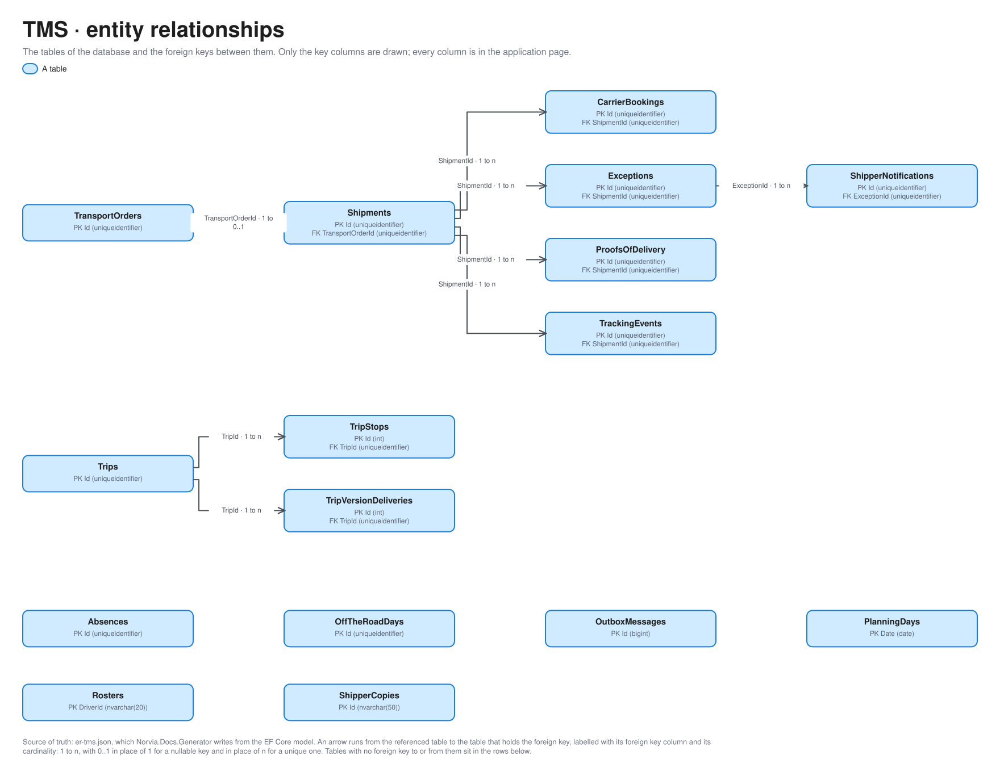

# TMS

Part of the [applications](README.md).

## APIs

The TMS API (`tms-api`) takes every command and every Shipper query as HTTP, checks the caller's app role and publishes what happened through its transactional outbox ([ADR 0003](../adr/0003-http-in-events-out.md)). Shapes come from the OpenAPI document [v1](openapi/tms.v1.json). Who holds which app role is in [identity-and-access.md](../architecture/identity-and-access.md#tms-api-roles); it is not copied here.

- **Refusals.** A command that breaks a rule answers a problem with a stable `code` and the call's `correlationId`, which is the key to its Message trail. The routes below list the success shape only.
- **Idempotency.** Commands from the Planner's side take an `Idempotency-Key` header and answer a repeat as before. Commands from the integration layer take an `X-Correlation-ID` header and recognise a repeat by the sender's own ID in the body.
- **Queries ask only for a valid token.** Entra issues one only to a principal that holds one of the roles, so in practice the callers are the consumers below. The TMS UI doesn't call the queries: it reads in process ([ADR 0028](../adr/0028-the-tms-ui-reads-in-process-and-changes-things-through-the-tms-api.md)).
- **Locally.** There is no Entra under Aspire: every caller asks for a token with its own client ID and roles, signed with one key, and the TMS API trusts that issuer. Hosted workers play the Logic Apps ([ADR 0030](../adr/0030-locally-a-hosted-worker-plays-the-p4-booking-logic-app.md) and its siblings), and a stand-in plays API Management ([ADR 0023](../adr/0023-locally-a-stand-in-plays-the-norvia-partner-api.md)). The consumers and roles are the same.

### Consumers

Every consumer reaches the TMS API **directly**, with a token for its own identity, except API Management, which is the only one that calls it through the integration layer's front door. A Logic App is never called by the TMS: it reads Service Bus (or is called by API Management) and then calls the TMS API.

| Consumer | Identity and app role | Process | Through API Management? |
|---|---|---|---|
| **TMS UI** (`tms-web`) | `tms-ui`, `TransportOrders.Manage`. Plays the Planner and Customer service | [P2](../processes/tms/p2-rating.md), [P3](../processes/tms/p3-transport-planning.md), [P4](../processes/tms/p4-carrier-booking.md), [P7](../processes/tms/p7-exception-handling.md), [P9](../processes/tms/p9-freight-settlement.md), [P10](../processes/tms/p10-fleet-capacity-planning.md), [P11](../processes/tms/p11-trip-dispatch.md) | No: direct |
| **Simulator** | `simulator`, `TransportOrders.Manage` and `Estate.Reset`. Plays the Planner ([ADR 0039](../adr/0039-the-simulator-books-only-through-the-estates-real-doors.md)) | [P3](../processes/tms/p3-transport-planning.md), [P7](../processes/tms/p7-exception-handling.md), [P11](../processes/tms/p11-trip-dispatch.md), Reset estate | No: direct. Its Shipper bookings go to the Norvia Partner API instead, which is P1 below |
| **Intake Logic App** | `intake`, `TransportOrders.Intake` | [P1](../processes/tms/p1-transport-order-intake.md) | The Logic App is called by API Management ([ADR 0020](../adr/0020-only-api-management-may-call-the-intake-logic-app.md)); its call to the TMS is direct |
| **Carrier-answer Logic App** | `answer`, `CarrierBookings.Answer` | [P4](../processes/tms/p4-carrier-booking.md) | Called by API Management; its call to the TMS is direct |
| **Carrier booking Logic App** | `booking`, `CarrierBookings.Report` | [P4](../processes/tms/p4-carrier-booking.md) | No: reads the `carrier-booking` subscription, then calls direct |
| **Carrier cancellation Logic App** | `carrier-cancellation`, `CarrierBookings.Report` | [P7](../processes/tms/p7-exception-handling.md) | No: reads the `carrier-cancellation` subscription, then calls direct |
| **Shipper notification Logic App** | `shipper-notification`, `ShipperNotifications.Report` | [P7](../processes/tms/p7-exception-handling.md) | No: reads the `shipper-notification` subscription, then calls direct |
| **Trip dispatch Logic App** | `trip-dispatch`, `Trips.ReportDelivery` | [P11](../processes/tms/p11-trip-dispatch.md) | No: reads the `trip-dispatch` subscription, then calls direct |
| **Driver reports Logic App** | `driver-reports`, `Trips.Start`, `Trips.End`, `TrackingEvents.Record` and `ProofsOfDelivery.Record` | [P12](../processes/tms/p12-trip-execution.md) | No: reads the `driver-reports` subscription, then calls direct |
| **Carrier tracking Logic App** | `tracking`, `TrackingEvents.Record` | [P5](../processes/tms/p5-shipment-tracking.md) | API Management fills the `carrier-tracking` queue; the Logic App reads it and calls direct |
| **Carrier Proof of delivery Logic App** | `proof-of-delivery`, `ProofsOfDelivery.Record` | [P6](../processes/tms/p6-proof-of-delivery.md) | API Management fills the `carrier-proof-of-delivery` queue and the inbound container; the Logic App reads them and calls direct |
| **API Management** | `apim`, `ShipperTracking.Read` | [P8](../processes/tms/p8-shipper-visibility.md) | Yes: the Norvia Partner API's Shipper tracking operations call `tms-api` as a backend |
| **Agents (planned)** | One read role per Agent, none for the TMS yet | None yet | Yes, through API Management's MCP server, read-only ([ADR 0040](../adr/0040-agents-read-the-estate-through-api-management-have-no-write-tools-and-their-own-identity.md)) |

No Agent calls the TMS today, so no endpoint below lists one. [c4.md](../architecture/c4.md#l2-containers) draws the same callers.

### Transport Orders

| Method and route | Purpose | App role | Request and response | Consumers |
|---|---|---|---|---|
| `POST /v1/transport-orders` | Submit a Transport Order on behalf of the Shipper it names. A repeat of the same booking gets the original back (200); a booking that breaks the rules is kept as a Rejected booking (422). | `TransportOrders.Intake` | `CanonicalTransportOrder` (`X-Correlation-ID`) → `AcceptedTransportOrder` (201, or 200 for a repeat) | Intake Logic App (P1); upstream of it a Shipper Persona through API Management |
| `GET /v1/transport-orders` | List Transport Orders by `status`. | any valid token | → `[TransportOrderSummary]` | None over HTTP: the TMS UI reads in process |
| `GET /v1/agent/customer-service/rejected-bookings/{id}` | The Customer service agent's view of a Rejected booking (ADR 0040): when it was received, the Shipper's business name, every rejection reason with its code, message and the submitted field that failed, and the submitted content with the Consignee fields removed (an allowlist: a new field stays out until someone adds it; no Consignee name, delivery address or contact, no instructions, no file contents). Read only. | `TransportOrders.CustomerServiceAgent.Read` | → `AgentRejectedBookingView` (`X-Correlation-ID`, `X-Tool-Name`) | The Customer service agent, through the MCP stand-in locally and through API Management's `customer-service` MCP server in Azure, with a token of the `AgentToken` scheme (audience the TMS agent API, Entra's keys; the gateway names the Agent in `X-Agent-ID`) |
| `GET /v1/transport-orders/{id}` | Read a Transport Order or a Rejected booking by its ID, the instance a rejection's problem points to. | any valid token | → `TransportOrderView` | None over HTTP |
| `GET /v1/transport-orders/{transportOrderNumber}` | Read a Transport Order by its number. | any valid token | → `TransportOrderView` | None over HTTP |
| `GET /v1/transport-orders/rating-exceptions` | List the Transport Orders whose Rating failed, with their failure code and message. | any valid token | → `[RatingExceptionSummary]` | None over HTTP: the TMS UI reads in process |
| `GET /v1/transport-orders/not-yet-billable` | List the Delivered Transport-only orders that aren't Billable yet, oldest delivery first, with what blocks each. | any valid token | → `[TransportOrderNotYetBillableSummary]` | None over HTTP: the TMS UI reads in process |
| `POST /v1/transport-orders/{transportOrderNumber}/re-rate` | Re-rate an order whose Rating failed, typically after its Rate Card was corrected. | `TransportOrders.Manage` | `Idempotency-Key` → `RateTransportOrderResult` | TMS UI (P2) |
| `POST /v1/transport-orders/{transportOrderNumber}/assign` | Assign an Accepted order to Own fleet or a Carrier, which plans its one Shipment. | `TransportOrders.Manage` | `AssignTransportOrderRequest` (`Idempotency-Key`) → `AssignTransportOrderResult` (201, or 200 for a repeat) | TMS UI (P3); Simulator (P3) |
| `POST /v1/transport-orders/{transportOrderNumber}/release-without-proof-of-delivery` | Make a Delivered, Not yet billable order Billable without a Proof of delivery. | `TransportOrders.Manage` | `ReleaseWithoutProofOfDeliveryRequest` → `ReleaseWithoutProofOfDeliveryResult` | TMS UI (P9) |

### Shipments

| Method and route | Purpose | App role | Request and response | Consumers |
|---|---|---|---|---|
| `GET /v1/shipments/to-release` | List the Planned Shipments, with who carries each, in planning order. | any valid token | → `[ShipmentToReleaseSummary]` | None over HTTP: the TMS UI reads in process |
| `GET /v1/shipments/to-put-on-trips` | List the Released Own fleet Shipments not on a Trip yet, by collection time, optionally for one `day`. | any valid token | → `[ShipmentToPutOnTripSummary]` | None over HTTP: the TMS UI reads in process |
| `GET /v1/shipments/bookings-awaiting-answer` | List the Requested Carrier bookings awaiting an answer, by earliest collection time. | any valid token | → `[CarrierBookingAwaitingAnswerSummary]` | None over HTTP: the TMS UI reads in process |
| `GET /v1/shipments/in-progress` | List the Shipments on their way (Booked, Collected, In transit), Stale ones first, then by ETA. | any valid token | → `[ShipmentInProgressSummary]` | None over HTTP: the TMS UI reads in process |
| `GET /v1/shipments/delivered-without-proof-of-delivery` | List the Delivered Shipments without a current Proof of delivery, flagged ones first. | any valid token | → `[DeliveredShipmentWithoutProofOfDeliverySummary]` | None over HTTP: the TMS UI reads in process |
| `GET /v1/shipments/{shipmentNumber}` | Read a Shipment: status, Transport Order, who carries it, history of assignments and Carrier bookings. | any valid token | → `ShipmentView` | None over HTTP |
| `GET /v1/shipments/{shipmentNumber}/tracking-events` | Read a Shipment's timeline: what the Carriers reported and the Proofs of delivery that came in. | any valid token | → `ShipmentTimeline` | None over HTTP |
| `POST /v1/shipments/{shipmentNumber}/reassign` | Reassign a Planned Shipment to Own fleet or another Carrier, to fix a mistake before release. | `TransportOrders.Manage` | `ReassignShipmentRequest` (`Idempotency-Key`) → `ReassignShipmentResult` | TMS UI (P3); Simulator (P3) |
| `POST /v1/shipments/{shipmentNumber}/release` | Release a Planned Shipment to its Carrier (P4) or to Own fleet's Trips (P11). | `TransportOrders.Manage` | `Idempotency-Key` → `ReleaseShipmentResult` | TMS UI (P3, P4); Simulator (P3) |
| `POST /v1/shipments/{shipmentNumber}/release-with-spot-price` | Release a Carrier Shipment its Carrier Rate Card can't price, at a Spot price the Planner enters. | `TransportOrders.Manage` | `ReleaseWithSpotPriceRequest` (`Idempotency-Key`) → `ReleaseShipmentResult` | TMS UI (P9) |

### Carrier bookings

| Method and route | Purpose | App role | Request and response | Consumers |
|---|---|---|---|---|
| `POST /v1/carrier-bookings/{carrierBookingNumber}/answer` | Record the Carrier's confirmation or rejection of a Requested booking. | `CarrierBookings.Answer` | `CarrierBookingAnswerRequest` (`X-Correlation-ID`) → `CarrierBookingAnswerResult` | Carrier-answer Logic App (P4); upstream of it a Carrier Persona through API Management |
| `POST /v1/carrier-bookings/{carrierBookingNumber}/report-sent` | Report that a Requested booking's request reached the Carrier. | `CarrierBookings.Report` | `X-Correlation-ID` → `CarrierBookingReportResult` | Carrier booking Logic App (P4) |
| `POST /v1/carrier-bookings/{carrierBookingNumber}/report-not-delivered` | Report that the request never reached the Carrier, with its technical cause. | `CarrierBookings.Report` | `CarrierBookingNotDeliveredRequest` (`X-Correlation-ID`) → `CarrierBookingReportResult` | Carrier booking Logic App (P4) |
| `POST /v1/carrier-bookings/{carrierBookingNumber}/report-cancellation-told` | Report that the cancellation or withdrawal message reached the Carrier. | `CarrierBookings.Report` | `X-Correlation-ID` → `CarrierBookingReportResult` | Carrier cancellation Logic App (P7) |
| `POST /v1/carrier-bookings/{carrierBookingNumber}/report-cancellation-not-delivered` | Report that the cancellation or withdrawal message never reached the Carrier (Carrier not told). | `CarrierBookings.Report` | `CarrierBookingNotDeliveredRequest` (`X-Correlation-ID`) → `CarrierBookingReportResult` | Carrier cancellation Logic App (P7) |
| `POST /v1/carrier-bookings/{carrierBookingNumber}/withdraw` | Withdraw a Requested booking before the Carrier answers. | `TransportOrders.Manage` | `Idempotency-Key` → `CarrierBookingWithdrawResult` | TMS UI (P4) |

### Tracking events and Proofs of delivery

| Method and route | Purpose | App role | Request and response | Consumers |
|---|---|---|---|---|
| `POST /v1/tracking-events` | Record a Tracking event a Carrier or a Driver reported for a Shipment. | `TrackingEvents.Record` | `TrackingEventRequest` (`X-Correlation-ID`) → `RecordTrackingResult` | Carrier tracking Logic App (P5), with a Carrier's events; Driver reports Logic App (P12), with a Driver's Stop reports. Both direct |
| `POST /v1/proofs-of-delivery` | Record a Proof of delivery with its files, sent by a Carrier or a Driver. | `ProofsOfDelivery.Record` | multipart `ProofOfDeliveryRequest` (`X-Correlation-ID`) → `RecordProofOfDeliveryResult` | Carrier Proof of delivery Logic App (P6), with a Carrier's; Driver reports Logic App (P12), with a Driver's. Both direct |
| `GET /v1/shipments/{shipmentNumber}/proof-of-delivery` | Read a Shipment's current Proof of delivery: who signed, when and where, the condition and its files. | any valid token | → `ProofOfDeliveryView` | None over HTTP: the TMS UI reads in process |
| `GET /v1/shipments/{shipmentNumber}/proof-of-delivery/files/{fileId}` | Read one file of a Shipment's Proofs of delivery, current or superseded, with the content type it was sent with. | any valid token | → file stream | None over HTTP: the TMS UI reads the files in process |

### Exceptions

| Method and route | Purpose | App role | Request and response | Consumers |
|---|---|---|---|---|
| `GET /v1/exceptions/open` | List the Open Exceptions, oldest first. | any valid token | → `[OpenExceptionSummary]` | Simulator (P7), to find the Exceptions it plays the Planner on |
| `POST /v1/exceptions/{exceptionNumber}/resolve` | Resolve an Open Exception with an outcome and a remark. | `TransportOrders.Manage` | `ResolveExceptionRequest` → `ResolveExceptionResult` | TMS UI (P7); Simulator (P7) |
| `POST /v1/exceptions/{exceptionNumber}/notes` | Add a note to an Open Exception. | `TransportOrders.Manage` | `AddExceptionNoteRequest` → `AddExceptionNoteResult` | TMS UI (P7) |
| `POST /v1/exceptions/{exceptionNumber}/delivery-window` | Agree a delivery window for the Shipment of an Open Exception. | `TransportOrders.Manage` | `AgreeDeliveryWindowRequest` (`Idempotency-Key`) → `AgreeDeliveryWindowResult` | TMS UI (P7) |
| `POST /v1/exceptions/{exceptionNumber}/cancel-carrier-booking` | Cancel the Confirmed Carrier booking of the Exception's Shipment before collection. | `TransportOrders.Manage` | `CancelCarrierBookingRequest` (`Idempotency-Key`) → `CancelCarrierBookingResult` | TMS UI (P7); Simulator (P7) |
| `GET /v1/exceptions/{exceptionNumber}/shipper-notification-template` | Get the message Notify Shipper starts with for the Exception's type. | `TransportOrders.Manage` | → `ShipperNotificationTemplateResult` | None over HTTP: the TMS UI builds it in process. The planned Planner notification agent is meant to call it ([ADR 0040](../adr/0040-agents-read-the-estate-through-api-management-have-no-write-tools-and-their-own-identity.md)) |
| `POST /v1/exceptions/{exceptionNumber}/notify-shipper` | Notify the Shipper from an Open Exception. | `TransportOrders.Manage` | `NotifyShipperRequest` → `NotifyShipperResult` | TMS UI (P7) |
| `POST /v1/shipper-notifications/{notificationId}/report-sent` | Report that a Requested Shipper notification was acknowledged by the Shipper's endpoint. | `ShipperNotifications.Report` | `X-Correlation-ID` → `ShipperNotificationReportResult` | Shipper notification Logic App (P7) |
| `POST /v1/shipper-notifications/{notificationId}/report-not-delivered` | Report that a Shipper notification never reached the Shipper, with its technical cause. | `ShipperNotifications.Report` | `ShipperNotificationNotDeliveredRequest` (`X-Correlation-ID`) → `ShipperNotificationReportResult` | Shipper notification Logic App (P7) |

### Fleet capacity

| Method and route | Purpose | App role | Request and response | Consumers |
|---|---|---|---|---|
| `GET /v1/capacity/days` | List the open days of the Planning horizon, earliest first, with their Shifts and available Vehicles. | any valid token | → `[PlanningDayView]` | Simulator (P10), to see which Drivers and Vehicles it may put on a Trip |
| `PUT /v1/capacity/days/{date}/shifts/{id}` | Set one Driver's Shift on an open day. | `TransportOrders.Manage` | `EditShiftRequest` → `EditShiftResult` | TMS UI (P10) |
| `GET /v1/capacity/absences` | List the Absences of today and later. | any valid token | → `[AbsenceView]` | None over HTTP: the TMS UI reads in process |
| `POST /v1/capacity/absences` | Record a Driver's Absence for one day or several. | `TransportOrders.Manage` | `RecordPeriodRequest` → `RecordAbsenceResult` | TMS UI (P10) |
| `DELETE /v1/capacity/absences/{id}` | Remove an Absence: the Driver works their Roster's Shift again. | `TransportOrders.Manage` | → 204 | TMS UI (P10) |
| `GET /v1/capacity/off-the-road-days` | List the Off the road days of today and later. | any valid token | → `[OffTheRoadDayView]` | None over HTTP: the TMS UI reads in process |
| `POST /v1/capacity/off-the-road-days` | Take a Vehicle off the road for one day or several. | `TransportOrders.Manage` | `RecordPeriodRequest` → `RecordOffTheRoadResult` | TMS UI (P10) |
| `DELETE /v1/capacity/off-the-road-days/{id}` | Remove an Off the road day: the Vehicle is available again. | `TransportOrders.Manage` | → 204 | TMS UI (P10) |
| `GET /v1/capacity/rosters` | List each active Driver's Roster. | any valid token | → `[RosterView]` | None over HTTP: the TMS UI reads in process |
| `PUT /v1/capacity/rosters/{id}` | Change a Driver's Roster, which rewrites the open days not edited by hand. | `TransportOrders.Manage` | `ChangeRosterRequest` → `ChangeRosterResult` | TMS UI (P10) |

### Trips

| Method and route | Purpose | App role | Request and response | Consumers |
|---|---|---|---|---|
| `GET /v1/trips` | List the Trips of today and later, by day. | any valid token | → `[TripView]` | None over HTTP: the TMS UI reads in process |
| `GET /v1/trips/{number}` | Show one Trip with its Stops in order, its load against the Vehicle's capacity, the rules it breaks and its warnings. | any valid token | → `TripDetailView` | None over HTTP: the TMS UI reads in process |
| `POST /v1/trips` | Create a Draft Trip for an open day, with or without a Vehicle, Driver, planned start and duration (the Simulator also sends the Shipments). | `TransportOrders.Manage` | `CreateTripRequest` (`Idempotency-Key`) → `CreateDraftTripResult` (201) | TMS UI (P11); Simulator (P11) |
| `PUT /v1/trips/{number}` | Pick the Vehicle, Driver, planned start and planned driving duration of a Draft or Dispatched Trip. | `TransportOrders.Manage` | `ChangeTripRequest` → 204 | TMS UI (P11) |
| `DELETE /v1/trips/{number}` | Discard a Draft Trip, which gives its Vehicle and Driver back. | `TransportOrders.Manage` | → 204 | TMS UI (P11) |
| `POST /v1/trips/{number}/shipments` | Put Shipments on a Draft or Dispatched Trip: each adds its two Stops at the end of the sequence. | `TransportOrders.Manage` | `AddShipmentsRequest` → `AddShipmentsToTripResult` | TMS UI (P11) |
| `POST /v1/trips/{number}/shipments/{shipmentNumber}/take-off` | Take a Shipment off its Trip until it is Collected, with a reason; it goes back to Planned. | `TransportOrders.Manage` | `TakeShipmentOffRequest` → `TakeShipmentOffTripResult` | TMS UI (P11) |
| `PUT /v1/trips/{number}/stops` | Put the Stops of a Draft or Dispatched Trip in order. | `TransportOrders.Manage` | `ReorderStopsRequest` → 204 | TMS UI (P11) |
| `POST /v1/trips/{number}/dispatch` | Dispatch a Draft Trip to its Driver. | `TransportOrders.Manage` | → `DispatchTripResult` | TMS UI (P11); Simulator (P11) |
| `POST /v1/trips/{number}/versions/{tripVersion}/send-again` | Send a Not delivered version of a Trip to the Driver app again. | `TransportOrders.Manage` | → `SendTripAgainResult` | TMS UI (P11) |
| `POST /v1/trips/{number}/versions/{tripVersion}/report-delivered` | Report that the Driver app accepted a version of a Trip. | `Trips.ReportDelivery` | `X-Correlation-ID` → `TripDeliveryReportResult` | Trip dispatch Logic App (P11) |
| `POST /v1/trips/{number}/versions/{tripVersion}/report-not-delivered` | Report that a version never reached the Driver app, with its technical cause. | `Trips.ReportDelivery` | `TripNotDeliveredRequest` (`X-Correlation-ID`) → `TripDeliveryReportResult` | Trip dispatch Logic App (P11) |
| `POST /v1/trips/{number}/start` | Start a Dispatched Trip on its day, as the Driver reported it. | `Trips.Start` | `StartTripRequest` (`X-Correlation-ID`) → `StartTripResult` | Driver reports Logic App (P12) |
| `POST /v1/trips/{number}/end` | End an In progress Trip once every Stop has an outcome, as the Driver reported it. | `Trips.End` | `EndTripRequest` (`X-Correlation-ID`) → `EndTripResult` | Driver reports Logic App (P12) |

### Shipper tracking

The Shipper ID comes in the `X-Shipper-ID` header, which the TMS trusts from API Management only: `ShipperTracking.Read` is the role that makes it so ([ADR 0005](../adr/0005-partner-identity-comes-from-the-token.md), [ADR 0011](../adr/0011-shippers-see-a-tracking-status-not-the-shipments-workings.md)). All four take `X-Correlation-ID` too.

| Method and route | Purpose | App role | Request and response | Consumers |
|---|---|---|---|---|
| `GET /v1/shipper-tracking/transport-orders` | List a Shipper's Transport Orders with their Tracking status (Canonical Model), newest collection first. | `ShipperTracking.Read` | `trackingStatus`, `collectionFrom`, `collectionTo`, `page`, `pageSize` → `[ShipperTransportOrderListItem]` | API Management (P8), for a Shipper Persona's `Tracking.Read` call, which the Partner portal makes as the Persona |
| `GET /v1/shipper-tracking/transport-orders/find` | Find one of a Shipper's Transport Orders by the Shipper's own reference. | `ShipperTracking.Read` | `shipperReference` → `ShipperTransportOrderDetail` | API Management (P8), as above |
| `GET /v1/shipper-tracking/transport-orders/{transportOrderNumber}` | Get one of a Shipper's Transport Orders by Norvia's number, with its tracking. | `ShipperTracking.Read` | → `ShipperTransportOrderDetail` | API Management (P8), as above |
| `GET /v1/shipper-tracking/transport-orders/{transportOrderNumber}/proof-of-delivery/files/{fileId}` | Read one file of the order's current Proof of delivery, streamed with the content type it was sent with. | `ShipperTracking.Read` | → file stream | API Management (P8), as above |

### Faults

The TMS owns three faults (`tms-unavailable`, `tms-tracking-event-api-failing`, `tms-shipper-tracking-api-failing`). Every fault switch is the one contract of `Norvia.ServiceDefaults` ([as-found.md](../operations/as-found.md#faults)): off by default, switched on for a duration and expiring by itself, and guarded by the app role `Demo.Fault`. A caller without a token gets 401, one without the role 403. While a fault is on, a middleware answers the calls it breaks with a 503 ([as-found.md](../operations/as-found.md#faults-of-the-tms-and-the-driver-app)); the fault endpoints themselves are never gated.

| Method and route | Purpose | App role | Request and response | Consumers |
|---|---|---|---|---|
| `GET /v1/faults` | List the faults the TMS owns, with whether each is on, when it expires and how many seconds it has left. | `Demo.Fault` | → fault list | Partner portal's presenter panel (P5, P8, P12) |
| `PUT /v1/faults/{name}` | Switch a fault on, for `durationSeconds` (the default when left out, at most a few minutes), or off. A duration over the limit is refused with 400, an unknown fault with 404. | `Demo.Fault` | `SwitchFaultRequest` → the fault | Partner portal's presenter panel (P5, P8, P12) |

### Reset

| Method and route | Purpose | App role | Request and response | Consumers |
|---|---|---|---|---|
| `GET /v1/reset` | Whether a reset would be taken now. | `Estate.Reset` | → `ResetReadiness` | Simulator (Reset estate) |
| `POST /v1/reset` | Delete the TMS's transactional records and put the seed file's Rosters back in force. Honoured only while `Reset:Enabled` is on, which the estate switches on. | `Estate.Reset` | → `ResetReport` | Simulator (Reset estate) |

## Database

The database's tables are generated from its EF Core model by `Norvia.Docs.Generator`; do not edit between the markers. Table and column descriptions are written in [descriptions/tms.json](descriptions/tms.json) and use the terms in [GLOSSARY.md](../../GLOSSARY.md).

<!-- generated:database -->

### Entity relationships

Only the key columns are drawn; every column is in the tables below. The picture is drawn from [the model](../architecture/diagrams/er-tms.json) by `docs/architecture/diagrams/entities.py`, and its [Excalidraw file](../architecture/diagrams/er-tms.excalidraw) opens in Excalidraw.

### Tables

#### `Absences`

A whole day on which one Driver can't work, for leave, sickness or training (an Absence). It takes the Driver's Shift off that day's Planning day. A Driver is absent a day or isn't, so recording one twice is one record.

| Column | Type | Nullable | Default | Key | Description |
|---|---|---|---|---|---|
| `Id` | `uniqueidentifier` | no |  | PK | The Absence's own ID. |
| `Date` | `date` | no |  |  | The day the Driver can't work. |
| `DriverId` | `nvarchar(20)` | no |  |  | The Driver who is absent: their Driver ID (`DRV-0001`), owned by the ERP (ADR 0014). |
| `Reason` | `nvarchar(10)` | no |  |  | Why: `Leave`, `Sickness` or `Training`. |
| `Remark` | `nvarchar(500)` | no |  |  | The Planner's free-text remark (empty when there is none). |
| `RowVersion` | `rowversion` | yes |  |  | Concurrency token: two Planners' changes to one Absence don't both land. |

Primary key `PK_Absences`: `Id`.

| Index | Columns | Unique | Filter |
|---|---|---|---|
| `IX_Absences_Date` | `Date` | no |  |
| `IX_Absences_DriverId_Date` | `DriverId`, `Date` | yes |  |

#### `CarrierBookings`

A Carrier booking: one request to one Carrier to carry one Shipment, with the Carrier's answer, its Carrier cost and what became of any withdrawal or cancellation message (P4, P7, P9). A Shipment has several over its life, one after each that ends without being carried out, but only one open at a time.

| Column | Type | Nullable | Default | Key | Description |
|---|---|---|---|---|---|
| `Id` | `uniqueidentifier` | no |  | PK | The Carrier booking's own ID. |
| `AnswerCorrelationId` | `nvarchar(128)` | yes |  |  | Message trail of the call that recorded the Carrier's answer; null while Requested. |
| `AnsweredAt` | `datetimeoffset` | yes |  |  | When the TMS recorded the Carrier's answer; null while Requested. |
| `CancellationCorrelationId` | `nvarchar(128)` | yes |  |  | Message trail of the Planner's cancellation of the Confirmed booking; null unless Cancelled. |
| `CancellationExceptionNumber` | `nvarchar(10)` | yes |  |  | Number of the Exception the Planner cancelled the booking from; null unless Cancelled. |
| `CancellationKey` | `nvarchar(100)` | yes |  |  | Idempotency key of the cancellation, so the same call sent again is a repeat; null unless Cancelled. |
| `CancellationReasonText` | `nvarchar(500)` | yes |  |  | The Planner's reason for cancelling, which the Carrier is told; null unless Cancelled. |
| `CancelledAt` | `datetimeoffset` | yes |  |  | When the Planner cancelled the Confirmed booking; null unless Cancelled. |
| `CarrierBookingReference` | `nvarchar(50)` | yes |  |  | The Carrier's own reference for the booking, given in its answer; null until it answers. |
| `CarrierCost` | `nvarchar(max)` | yes |  |  | The Carrier cost frozen at release, as JSON: charge lines, total, source (Carrier Rate Card or Spot price) and when it was calculated. Never changes after release. See ADR 0013. |
| `CarrierId` | `nvarchar(50)` | no |  |  | The Carrier asked to carry the Shipment, owned by the ERP (ADR 0002). |
| `CarrierNotToldAt` | `datetimeoffset` | yes |  |  | When the cancellation or withdrawal message was reported not delivered; null unless the Carrier was not told. |
| `CarrierNotToldMessage` | `nvarchar(500)` | yes |  |  | The technical cause of that failure; null unless the Carrier was not told. |
| `CarrierNotToldStatusCode` | `int` | yes |  |  | The HTTP status code of that failure, if the Carrier's endpoint answered; null unless the Carrier was not told. |
| `CarrierToldAt` | `datetimeoffset` | yes |  |  | When the Carrier acknowledged the cancellation or withdrawal message; null until it is told. |
| `CorrelationId` | `nvarchar(128)` | no |  |  | Message trail of the release that asked the Carrier. |
| `NotDeliveredAt` | `datetimeoffset` | yes |  |  | When the request was reported not delivered to the Carrier; null unless NotDelivered. |
| `NotDeliveredMessage` | `nvarchar(500)` | yes |  |  | The technical cause of that failure; null unless NotDelivered. |
| `NotDeliveredStatusCode` | `int` | yes |  |  | The HTTP status code of that failure, if the Carrier's endpoint answered; null unless NotDelivered. |
| `Number` | `nvarchar(10)` | no |  |  | The Carrier booking number, such as `CB-0000042`, from the `CarrierBookingNumbers` sequence. |
| `PlannedCollectionTime` | `datetimeoffset` | yes |  |  | The collection time the Carrier confirmed; null unless Confirmed. |
| `RejectionReason` | `nvarchar(30)` | yes |  |  | Why the Carrier rejected: `NoCapacity`, `LaneNotServed`, `WindowNotFeasible`, `GoodsNotAccepted`, `PriceNotAccepted` or `Other`; null unless Rejected. |
| `RejectionReasonText` | `nvarchar(500)` | yes |  |  | The Carrier's own words for the rejection; null unless Rejected. |
| `RequestedAt` | `datetimeoffset` | no |  |  | When the Planner released the Shipment and so asked the Carrier. |
| `SentAt` | `datetimeoffset` | yes |  |  | When the request was reported as reaching the Carrier; null until then. |
| `ShipmentId` | `uniqueidentifier` | no |  | FK | The Shipment the Carrier is asked to carry. |
| `ShipmentNumber` | `nvarchar(10)` | no |  |  | That Shipment's number, kept beside its ID for lists and the Message trail. |
| `Status` | `nvarchar(20)` | no |  |  | `Requested`, `Confirmed`, `Rejected`, `NotDelivered`, `Withdrawn` or `Cancelled`. |
| `WithdrawalCorrelationId` | `nvarchar(128)` | yes |  |  | Message trail of the Planner's withdrawal; null unless Withdrawn. |
| `WithdrawalKey` | `nvarchar(100)` | yes |  |  | Idempotency key of the withdrawal, so the same call sent again is a repeat; null unless Withdrawn. |
| `WithdrawnAt` | `datetimeoffset` | yes |  |  | When the Planner withdrew the booking before the Carrier answered; null unless Withdrawn. |

Primary key `PK_CarrierBookings`: `Id`.

| Foreign key | Columns | References | On delete |
|---|---|---|---|
| `FK_CarrierBookings_Shipments_ShipmentId` | `ShipmentId` | `Shipments` (`Id`) | restrict |

| Index | Columns | Unique | Filter |
|---|---|---|---|
| `IX_CarrierBookings_Number` | `Number` | yes |  |
| `IX_CarrierBookings_ShipmentId` | `ShipmentId` | no |  |

#### `Exceptions`

An Exception: something that went wrong with one Shipment on its way and needs the Planner's decision (P7). A Shipment has many over its life, but at most one open of each type. The TMS opens it; only the Planner resolves it. Not to be confused with a rating exception, which is a Transport Order whose Rating failed.

| Column | Type | Nullable | Default | Key | Description |
|---|---|---|---|---|---|
| `Id` | `uniqueidentifier` | no |  | PK | The Exception's own ID. |
| `AfterDelivered` | `bit` | no |  |  | Whether the Exception was opened after the Shipment was Delivered (a Proof of delivery with reservations, or damage found at delivery). |
| `CarrierId` | `nvarchar(50)` | yes |  |  | The Carrier that carried the Shipment when the Exception opened; null for Own fleet. |
| `CauseCleared` | `bit` | no |  |  | Whether the cause no longer holds (Cause cleared), such as a Collection failed Exception once the Shipment is Collected. The TMS never closes an Exception itself. |
| `Causes` | `nvarchar(max)` | no |  |  | What opened the Exception, as a JSON list, one entry per cause: a Tracking event, a Proof of delivery or the delivery window passing. Never empty. |
| `CorrelationId` | `nvarchar(128)` | no |  |  | Message trail of the work that opened the Exception. |
| `Notes` | `nvarchar(max)` | no | N'[]' |  | The Planner's notes, as a JSON list; empty until one is added. |
| `Number` | `nvarchar(10)` | no |  |  | The Exception number, such as `EX-0000042`, from the `ExceptionNumbers` sequence. |
| `OpenedAt` | `datetimeoffset` | no |  |  | When the TMS opened the Exception. |
| `Outcome` | `nvarchar(30)` | yes |  |  | How the Planner resolved it: `NoActionNeeded`, `Redelivered`, `Replanned`, `ReturnedToShipper` or `ClaimHandledOutsideTms`; null while Open. |
| `Remark` | `nvarchar(2000)` | yes |  |  | The Planner's remark on the resolution; null while Open. |
| `ResolutionCorrelationId` | `nvarchar(128)` | yes |  |  | Message trail of the resolution; null while Open. |
| `ResolvedAt` | `datetimeoffset` | yes |  |  | When the Planner resolved it; null while Open. |
| `RowVersion` | `rowversion` | yes |  |  | Concurrency token: two Planners' changes to one Exception don't both land. |
| `ShipmentId` | `uniqueidentifier` | no |  | FK | The Shipment the Exception is about. |
| `ShipmentNumber` | `nvarchar(10)` | no |  |  | That Shipment's number, kept beside its ID for lists and the Message trail. |
| `ShipperId` | `nvarchar(50)` | no |  |  | The Shipper whose Transport Order the Shipment carries, owned by the ERP (ADR 0002). |
| `Status` | `nvarchar(20)` | no |  |  | `Open` or `Resolved`. |
| `TransportOrderNumber` | `nvarchar(10)` | no |  |  | The number of the Shipment's Transport Order. |
| `Type` | `nvarchar(30)` | no |  |  | `DeliveryFailed`, `CollectionFailed`, `Damaged`, `Reservations` or `LateDelivery`. |

Primary key `PK_Exceptions`: `Id`.

| Foreign key | Columns | References | On delete |
|---|---|---|---|
| `FK_Exceptions_Shipments_ShipmentId` | `ShipmentId` | `Shipments` (`Id`) | restrict |

| Index | Columns | Unique | Filter |
|---|---|---|---|
| `IX_Exceptions_Number` | `Number` | yes |  |
| `IX_Exceptions_ShipmentId_Type` | `ShipmentId`, `Type` | yes | `[Status] = 'Open'` |
| `IX_Exceptions_Status_OpenedAt` | `Status`, `OpenedAt` | no |  |

#### `OffTheRoadDays`

A day on which one Vehicle can't be used, for maintenance or repair (Off the road). It takes the Vehicle off that day's Planning day. Recording one twice is one record.

| Column | Type | Nullable | Default | Key | Description |
|---|---|---|---|---|---|
| `Id` | `uniqueidentifier` | no |  | PK | The Off the road day's own ID. |
| `Date` | `date` | no |  |  | The day the Vehicle can't be used. |
| `Reason` | `nvarchar(12)` | no |  |  | Why: `Maintenance` or `Repair`. |
| `Remark` | `nvarchar(500)` | no |  |  | The Planner's free-text remark (empty when there is none). |
| `RowVersion` | `rowversion` | yes |  |  | Concurrency token: two Planners' changes to one record don't both land. |
| `VehicleId` | `nvarchar(20)` | no |  |  | The Vehicle that is off the road, owned by the ERP (ADR 0014). |

Primary key `PK_OffTheRoadDays`: `Id`.

| Index | Columns | Unique | Filter |
|---|---|---|---|
| `IX_OffTheRoadDays_Date` | `Date` | no |  |
| `IX_OffTheRoadDays_VehicleId_Date` | `VehicleId`, `Date` | yes |  |

#### `OutboxMessages`

The transactional outbox (ADR 0003): an integration event stored in the same transaction as the change that caused it, until a background publisher sends it to Service Bus. Not a business concept; the TMS never reads its own events back.

| Column | Type | Nullable | Default | Key | Description |
|---|---|---|---|---|---|
| `Id` | `bigint` | no | identity | PK | Position in the outbox. Events are published in this order. |
| `ApplicationProperties` | `nvarchar(max)` | no |  |  | The message's Service Bus application properties, as a JSON object. |
| `Body` | `nvarchar(max)` | no |  |  | The event as a JSON document (Canonical Model). |
| `CorrelationId` | `nvarchar(128)` | no |  |  | Message trail of the work that raised the event. |
| `CreatedAt` | `datetimeoffset` | no |  |  | When the event was stored. |
| `EventId` | `uniqueidentifier` | no |  |  | The event's own ID, unique, so a message is never stored twice. |
| `EventType` | `nvarchar(100)` | no |  |  | The event's name, such as `ShipmentReleased`. |
| `PublishedAt` | `datetimeoffset` | yes |  |  | When it was sent to Service Bus; null while it waits. |
| `Topic` | `nvarchar(260)` | no |  |  | The Service Bus topic it is sent to (`shipment-events`, `transport-order-events` or `trip-events`). |
| `TraceParent` | `nvarchar(55)` | yes |  |  | The W3C trace context of the work that raised the event, which publishing continues; null when there was none. |

Primary key `PK_OutboxMessages`: `Id`.

| Index | Columns | Unique | Filter |
|---|---|---|---|
| `IX_OutboxMessages_EventId` | `EventId` | yes |  |
| `IX_OutboxMessages_Unpublished` | `Id` | no | `[PublishedAt] IS NULL` |

#### `PlanningDays`

One day of the Planning horizon: which Drivers work it, when, and which Vehicles are available (P10). A daily job opens each new day from the Rosters; a day before today is Closed and read-only. The key is the date itself, so two jobs can't open a day twice.

| Column | Type | Nullable | Default | Key | Description |
|---|---|---|---|---|---|
| `Date` | `date` | no |  | PK | The day. |
| `AvailableVehicles` | `nvarchar(max)` | no |  |  | The Vehicles the Own fleet can use that day, as a JSON list of Vehicle IDs; a Vehicle that is Off the road isn't in it. |
| `RowVersion` | `rowversion` | yes |  |  | Concurrency token: two Planners' edits of one day don't both land. |
| `Shifts` | `nvarchar(max)` | no |  |  | The Drivers who work that day, as a JSON list of Driver ID, start, end and whether the Planner edited the Shift by hand; a Driver without a Shift doesn't work it. |
| `Status` | `nvarchar(10)` | no |  |  | `Open` (the Planner can still change it) or `Closed` (before today, read-only). |

Primary key `PK_PlanningDays`: `Date`.

#### `ProofsOfDelivery`

A Proof of delivery: the Consignee's confirmation that a Shipment's goods arrived, sent by a Carrier (P6) or by a Driver (P12), with descriptions of its files. A Shipment has at most one current one; a later one replaces it and the earlier one is kept as superseded. The files themselves are in the TMS's blob container (ADR 0009).

| Column | Type | Nullable | Default | Key | Description |
|---|---|---|---|---|---|
| `Id` | `uniqueidentifier` | no |  | PK | The Proof of delivery's own ID. |
| `CarrierBookingReference` | `nvarchar(50)` | yes |  |  | The Carrier's own reference for the booking it matched; null for an Own fleet one. |
| `Condition` | `nvarchar(20)` | no |  |  | `Clean`, or `Reservations` when the goods were taken with reservations, which opens an Exception. |
| `CorrelationId` | `nvarchar(128)` | no |  |  | Message trail of the call that recorded it. |
| `DeliveryTime` | `datetimeoffset` | no |  |  | When the goods were delivered, with the offset of where. |
| `DocumentId` | `nvarchar(100)` | no |  |  | The sender's own ID for the document, unique per source, so one sent twice is one Proof of delivery. |
| `DriverId` | `nvarchar(50)` | yes |  |  | The Driver who reported it, from their token; null for a Carrier's. Owned by the ERP (ADR 0014). |
| `Files` | `nvarchar(max)` | no |  |  | The files it is backed by (signed CMR, signature, photos), as a JSON list of file ID, name, content type and size. The bytes are in the blob container. |
| `IsCurrent` | `bit` | no |  |  | Whether this is the Shipment's current Proof of delivery. False once a later one replaced it. |
| `LocationCountryCode` | `nvarchar(2)` | no |  |  | Country code of where the goods were delivered. |
| `LocationPlace` | `nvarchar(100)` | no |  |  | Place where the goods were delivered. |
| `LocationPostcode` | `nvarchar(20)` | no |  |  | Postcode where the goods were delivered. |
| `ReceivedAt` | `datetimeoffset` | no |  |  | When the TMS recorded it, apart from when it was delivered. |
| `ReceivedBy` | `nvarchar(200)` | no |  |  | Who signed for the goods. |
| `Remark` | `nvarchar(500)` | yes |  |  | Free-text remark from the sender; null when there is none. |
| `ShipmentId` | `uniqueidentifier` | no |  | FK | The Shipment the goods belong to. |
| `ShipmentNumber` | `nvarchar(10)` | no |  |  | That Shipment's number, kept beside its ID for lists and the Message trail. |
| `SourceId` | `nvarchar(50)` | no |  |  | Who sent it: the Carrier's ID, or `OWN-FLEET`. |
| `TripNumber` | `nvarchar(10)` | yes |  |  | The Trip it was reported on; null for a Carrier's. A number, not a foreign key. |
| `TripVersion` | `int` | yes |  |  | The version of the Trip the Driver app held when it reported, kept for tracing only; null for a Carrier's. |

Primary key `PK_ProofsOfDelivery`: `Id`.

| Foreign key | Columns | References | On delete |
|---|---|---|---|
| `FK_ProofsOfDelivery_Shipments_ShipmentId` | `ShipmentId` | `Shipments` (`Id`) | restrict |

| Index | Columns | Unique | Filter |
|---|---|---|---|
| `IX_ProofsOfDelivery_ShipmentId` | `ShipmentId` | no |  |
| `IX_ProofsOfDelivery_SourceId_DocumentId` | `SourceId`, `DocumentId` | yes |  |

#### `Rosters`

A Driver's standard weekly working pattern, as the Planner changed it (Roster). Only Drivers whose Roster was changed have a row here; the others use the Roster in the seed file. A Roster is copied onto each Planning day as it opens.

| Column | Type | Nullable | Default | Key | Description |
|---|---|---|---|---|---|
| `DriverId` | `nvarchar(20)` | no |  | PK | The Driver the Roster is for, owned by the ERP (ADR 0014). |
| `Weekdays` | `nvarchar(max)` | no |  |  | The Shift for each weekday the Driver works, as a JSON object from weekday name to start and end. |

Primary key `PK_Rosters`: `DriverId`.

#### `Shipments`

A Shipment: the physical movement that carries out one Transport Order (ADR 0007), made when the Planner assigns the order (P3). It records who carries it, its history of assignments and where it stands from planning to delivery.

| Column | Type | Nullable | Default | Key | Description |
|---|---|---|---|---|---|
| `Id` | `uniqueidentifier` | no |  | PK | The Shipment's own ID. |
| `AgreedDeliveryWindows` | `nvarchar(max)` | no | N'[]' |  | Delivery windows the Planner agreed from an Exception, as a JSON list; the last one counts. Empty until one is agreed. The Transport Order keeps the Shipper's original window. |
| `Assignments` | `nvarchar(max)` | no |  |  | The history of who carried the Shipment, as a JSON list of Carrier ID (null for Own fleet), when and under which Message trail. Never empty. |
| `AwaitingRedelivery` | `bit` | no | False |  | Set when a Driver ended a Trip without delivering a collected Shipment; a flag, not a status, since Norvia still holds the goods (Re-delivery). |
| `CarrierBookingNumber` | `nvarchar(10)` | yes |  |  | The number of the Carrier booking made at the last release; null for Own fleet or while Planned. |
| `CarrierId` | `nvarchar(50)` | yes |  |  | The Carrier that carries the Shipment, owned by the ERP (ADR 0002); null for Own fleet. |
| `CorrelationId` | `nvarchar(128)` | no |  |  | Message trail of the assignment that planned it. |
| `Number` | `nvarchar(10)` | no |  |  | The Shipment number, such as `SH-0000042`, from the `ShipmentNumbers` sequence. |
| `PlannedAt` | `datetimeoffset` | no |  |  | When the Planner assigned the Transport Order. |
| `ReleaseCorrelationId` | `nvarchar(128)` | yes |  |  | Message trail of the last release; null while Planned. |
| `ReleaseKey` | `nvarchar(100)` | yes |  |  | Idempotency key of the last release, so the same call sent again is a repeat; null while Planned. |
| `ReleasedAt` | `datetimeoffset` | yes |  |  | When the Planner last released the Shipment; null while Planned. |
| `RowVersion` | `rowversion` | yes |  |  | Concurrency token: two Planners' changes to one Shipment don't both land. |
| `ShipperId` | `nvarchar(50)` | no |  |  | The Shipper whose Transport Order it carries, owned by the ERP (ADR 0002). |
| `Status` | `nvarchar(20)` | no |  |  | `Planned`, `Released`, `Booked`, `Dispatched`, `Collected`, `InTransit` or `Delivered`. |
| `TransportOrderId` | `uniqueidentifier` | no |  | FK | The Transport Order the Shipment carries. Unique: one Shipment per Transport Order (ADR 0007). |
| `TransportOrderNumber` | `nvarchar(10)` | no |  |  | That Transport Order's number, kept beside its ID for lists and the Message trail. |

Primary key `PK_Shipments`: `Id`.

| Foreign key | Columns | References | On delete |
|---|---|---|---|
| `FK_Shipments_TransportOrders_TransportOrderId` | `TransportOrderId` | `TransportOrders` (`Id`) | restrict |

| Index | Columns | Unique | Filter |
|---|---|---|---|
| `IX_Shipments_Number` | `Number` | yes |  |
| `IX_Shipments_TransportOrderId` | `TransportOrderId` | yes |  |

#### `ShipperNotifications`

A Shipper notification: a message the Planner sent the Shipper about an open Exception (P7). It is Requested until the Shipper notification Logic App reports it Sent or Not delivered. One-way: the Shipper can't reply through the TMS.

| Column | Type | Nullable | Default | Key | Description |
|---|---|---|---|---|---|
| `Id` | `uniqueidentifier` | no |  | PK | The notification ID. |
| `AgreedDeliveryEarliest` | `datetimeoffset` | yes |  |  | Start of the Agreed delivery window the message states; null when it states none. |
| `AgreedDeliveryLatest` | `datetimeoffset` | yes |  |  | End of the Agreed delivery window the message states; null when it states none. |
| `CorrelationId` | `nvarchar(128)` | no |  |  | Message trail of the Planner's Notify Shipper call. |
| `Eta` | `datetimeoffset` | yes |  |  | The Shipment's ETA the message states; null when it states none. |
| `ExceptionId` | `uniqueidentifier` | no |  | FK | The Exception the message is about. |
| `ExceptionNumber` | `nvarchar(10)` | no |  |  | That Exception's number. |
| `Message` | `nvarchar(2000)` | no |  |  | The text sent to the Shipper, which the Planner started from the template for the Exception's type. |
| `NotDeliveredAt` | `datetimeoffset` | yes |  |  | When it was reported not delivered to the Shipper; null unless NotDelivered. |
| `NotDeliveredMessage` | `nvarchar(1000)` | yes |  |  | The technical cause of that failure; null unless NotDelivered. |
| `NotDeliveredStatusCode` | `int` | yes |  |  | The HTTP status code of that failure, if the Shipper's endpoint answered; null unless NotDelivered. |
| `Planner` | `nvarchar(200)` | no |  |  | The name of the Planner who sent it. |
| `RequestedAt` | `datetimeoffset` | no |  |  | When the Planner asked for it to be sent. |
| `RowVersion` | `rowversion` | yes |  |  | Concurrency token: a report of the outcome and another change don't both land. |
| `SentAt` | `datetimeoffset` | yes |  |  | When the Shipper's endpoint acknowledged it; null until then. |
| `ShipmentNumber` | `nvarchar(10)` | no |  |  | The number of the Exception's Shipment. |
| `ShipperId` | `nvarchar(50)` | no |  |  | The Shipper it is sent to, owned by the ERP (ADR 0002). |
| `ShipperReference` | `nvarchar(100)` | yes |  |  | The Shipper's own reference for the Transport Order, so the Shipper can tell which one it concerns; null when none. |
| `Status` | `nvarchar(20)` | no |  |  | `Requested`, `Sent` or `NotDelivered`. |
| `TransportOrderNumber` | `nvarchar(10)` | no |  |  | The number of the Exception's Transport Order. |
| `Type` | `nvarchar(30)` | no |  |  | The type of the Exception when it was sent (`DeliveryFailed`, `CollectionFailed`, `Damaged`, `Reservations` or `LateDelivery`). |

Primary key `PK_ShipperNotifications`: `Id`.

| Foreign key | Columns | References | On delete |
|---|---|---|---|
| `FK_ShipperNotifications_Exceptions_ExceptionId` | `ExceptionId` | `Exceptions` (`Id`) | restrict |

| Index | Columns | Unique | Filter |
|---|---|---|---|
| `IX_ShipperNotifications_ExceptionId_RequestedAt` | `ExceptionId`, `RequestedAt` | no |  |

#### `TrackingEvents`

A Tracking event: one report from a Carrier (P5) or a Driver (P12) that something happened to a Shipment. The TMS keeps every one it accepts as a log, apart from what it concluded from it, and never changes or deletes it.

| Column | Type | Nullable | Default | Key | Description |
|---|---|---|---|---|---|
| `Id` | `uniqueidentifier` | no |  | PK | The Tracking event's own ID. |
| `CarrierBookingReference` | `nvarchar(50)` | yes |  |  | The Carrier's own reference for the booking the event was matched by; null for an Own fleet event. |
| `CorrelationId` | `nvarchar(128)` | no |  |  | Message trail of the call that reported it. |
| `DriverId` | `nvarchar(50)` | yes |  |  | The Driver who reported an Own fleet event, from their token; null for a Carrier's. Owned by the ERP (ADR 0014). |
| `Eta` | `datetimeoffset` | yes |  |  | The reporter's estimated time of arrival, if it gave one. |
| `EventTime` | `datetimeoffset` | no |  |  | When it happened, with the offset of where. |
| `LocationCountryCode` | `nvarchar(2)` | no |  |  | Country code of where it happened. |
| `LocationPlace` | `nvarchar(100)` | no |  |  | Place where it happened. |
| `LocationPostcode` | `nvarchar(20)` | no |  |  | Postcode where it happened. |
| `MovedShipment` | `bit` | no |  |  | Whether the event moved the Shipment's status; an event that didn't is only logged. |
| `ReceivedAt` | `datetimeoffset` | no |  |  | When the TMS recorded it, apart from when it happened. |
| `Remark` | `nvarchar(500)` | yes |  |  | Free-text remark from the reporter; null when there is none. |
| `ShipmentId` | `uniqueidentifier` | no |  | FK | The Shipment it is about. |
| `ShipmentNumber` | `nvarchar(10)` | no |  |  | That Shipment's number, kept beside its ID for lists and the Message trail. |
| `SourceEventId` | `nvarchar(100)` | no |  |  | The reporter's own ID for the event, unique per source, so one sent twice is one event. For a Driver it is the Driver app event ID. |
| `SourceId` | `nvarchar(50)` | no |  |  | Who reported it: the Carrier's ID, or `OWN-FLEET`. |
| `TripNumber` | `nvarchar(10)` | yes |  |  | The Trip an Own fleet event was reported on; null for a Carrier's. A Trip's Stop outcomes are read from these. A number, not a foreign key. |
| `TripVersion` | `int` | yes |  |  | The version of the Trip the Driver app held when it reported, kept for tracing only; null for a Carrier's. |
| `Type` | `nvarchar(30)` | no |  |  | `Collected`, `Departed`, `Arrived`, `OutForDelivery`, `Delivered`, `CollectionFailed`, `DeliveryFailed` or `Damaged`. |

Primary key `PK_TrackingEvents`: `Id`.

| Foreign key | Columns | References | On delete |
|---|---|---|---|
| `FK_TrackingEvents_Shipments_ShipmentId` | `ShipmentId` | `Shipments` (`Id`) | restrict |

| Index | Columns | Unique | Filter |
|---|---|---|---|
| `IX_TrackingEvents_ShipmentId` | `ShipmentId` | no |  |
| `IX_TrackingEvents_SourceId_SourceEventId` | `SourceId`, `SourceEventId` | yes |  |
| `IX_TrackingEvents_TripNumber` | `TripNumber` | no |  |

#### `TransportOrders`

A Transport Order: a Shipper's instruction to move goods from an origin to a destination (P1). It also keeps a Rejected booking, with its rejection reasons and no number. It carries where the order stands in Rating (P2), planning (P3) and billing (P9).

| Column | Type | Nullable | Default | Key | Description |
|---|---|---|---|---|---|
| `Id` | `uniqueidentifier` | no |  | PK | The Transport Order's own ID, given at intake. It is also the ID of a Rejected booking. |
| `BecameBillableAt` | `datetimeoffset` | yes |  |  | When it became Billable; null until then. Once Billable, it stays Billable. |
| `BillingCorrelationId` | `nvarchar(128)` | yes |  |  | Message trail of the delivery or release that made it Billable; null until then. |
| `BillingState` | `nvarchar(30)` | yes |  |  | Where it stands for billing: `NotBilledSeparately` (a Fulfilment order), `NotYetBillable` or `Billable`; null for a Rejected booking. |
| `Channel` | `nvarchar(20)` | no |  |  | The Intake channel it came through: `ShipperApi` (Transport-only) or `Wms` (Fulfilment). |
| `CorrelationId` | `nvarchar(128)` | no |  |  | Message trail of the intake call. |
| `DeliveredAt` | `datetimeoffset` | yes |  |  | When its Shipment was delivered; null until then. |
| `Details` | `nvarchar(max)` | no |  |  | Everything the Shipper submitted, kept as received, as a JSON document: collection and delivery addresses and windows, goods lines and instructions. |
| `FreightCharge` | `nvarchar(max)` | yes |  |  | The Freight Charge Rating calculated, frozen whole as JSON: charge lines, total and the Rate Card version used. Null until Rated. |
| `LastReRateKey` | `nvarchar(100)` | yes |  |  | Idempotency key of the last re-rate, so the same call sent again is a repeat. |
| `Number` | `nvarchar(10)` | yes |  |  | The Transport Order number, such as `TO-0000042`, from the `TransportOrderNumbers` sequence; null for a Rejected booking. |
| `NumberText` | `nvarchar(10)` | yes | computed: [Number] |  | The number as text, computed by the database so the list's search can match part of it in SQL. |
| `PlanningKey` | `nvarchar(100)` | yes |  |  | Idempotency key of the assignment that planned it, so the same call sent again is a repeat. |
| `RatedAt` | `datetimeoffset` | yes |  |  | When Rating last succeeded; null until then. |
| `RatingFailedAt` | `datetimeoffset` | yes |  |  | When Rating last failed; null unless Rating failed. |
| `RatingFailure` | `nvarchar(max)` | yes |  |  | Why Rating failed, as JSON: a stable code (`NoRateCard`, `NoValidRateCardVersion`, `NoMatchingLane` or `WeightAboveHighestBreak`) and a message. Null unless Rating failed. |
| `RatingResult` | `nvarchar(30)` | yes |  |  | `NotYetRated`, `Rated`, `RatingFailed` or `NotRatedSeparately`; null for a Rejected booking. |
| `ReceivedAt` | `datetimeoffset` | no |  |  | When the TMS took the booking in. |
| `RejectionReasons` | `nvarchar(max)` | no |  |  | Why a Rejected booking was rejected, as a JSON list of stable code and message; `[]` for an Accepted order. |
| `ReleaseRemark` | `nvarchar(2000)` | yes |  |  | Customer service's remark when it released the order without a Proof of delivery; null otherwise. |
| `ReleasedAt` | `datetimeoffset` | yes |  |  | When Customer service released it without a Proof of delivery; null otherwise. |
| `ReleasedBy` | `nvarchar(200)` | yes |  |  | Who released it without a Proof of delivery; null otherwise. |
| `ReleasedWithoutProofOfDelivery` | `bit` | no |  |  | Whether Customer service made it Billable without a Proof of delivery. |
| `RowVersion` | `rowversion` | yes |  |  | Concurrency token: two TMS instances that rate or plan one order don't both land. |
| `ShipmentNumber` | `nvarchar(10)` | yes |  |  | The number of its one Shipment, once Planned; null while Waiting for planning. |
| `ShipmentNumberText` | `nvarchar(10)` | yes | computed: [ShipmentNumber] |  | The Shipment number as text, computed by the database so the list's search can match part of it in SQL. |
| `ShipperId` | `nvarchar(50)` | no |  |  | The Shipper who sent the booking, taken from the caller's token (ADR 0005); owned by the ERP (ADR 0002). |
| `ShipperReference` | `nvarchar(100)` | yes |  |  | The Shipper's own reference. Unique per Shipper among Accepted orders, so the same booking sent again gets the original back; null for a Rejected booking. |
| `Status` | `nvarchar(20)` | no |  |  | `Accepted`, `Planned` or `Rejected`. |

Primary key `PK_TransportOrders`: `Id`.

| Index | Columns | Unique | Filter |
|---|---|---|---|
| `IX_TransportOrders_BillingState_ReceivedAt` | `BillingState`, `ReceivedAt` | no |  |
| `IX_TransportOrders_Number` | `Number` | yes | `[Number] IS NOT NULL` |
| `IX_TransportOrders_RatingResult_ReceivedAt` | `RatingResult`, `ReceivedAt` | no |  |
| `IX_TransportOrders_ShipperId_ShipperReference` | `ShipperId`, `ShipperReference` | yes | `[ShipperReference] IS NOT NULL` |
| `IX_TransportOrders_Status_ReceivedAt` | `Status`, `ReceivedAt` | no |  |

#### `TripStops`

One Stop of a Trip: which Shipment, whether its collection or its delivery, and its place in the sequence. A Stop is derived from its Shipment and holds no outcome of its own (ADR 0007); the outcome is read from the Tracking events the Trip recorded.

| Column | Type | Nullable | Default | Key | Description |
|---|---|---|---|---|---|
| `Id` | `int` | no | identity | PK | Row ID. |
| `Kind` | `nvarchar(10)` | no |  |  | `Collection` or `Delivery`. |
| `Position` | `int` | no |  |  | Place in the Trip's sequence. Unique within the Trip. |
| `ShipmentId` | `uniqueidentifier` | no |  |  | The Shipment visited. A Shipment's Stop of one kind is on at most one Trip. Not a foreign key. |
| `TripId` | `uniqueidentifier` | no |  | FK | The Trip the Stop belongs to. Stops are deleted with it. |

Primary key `PK_TripStops`: `Id`.

| Foreign key | Columns | References | On delete |
|---|---|---|---|
| `FK_TripStops_Trips_TripId` | `TripId` | `Trips` (`Id`) | cascade |

| Index | Columns | Unique | Filter |
|---|---|---|---|
| `IX_TripStops_ShipmentId_Kind` | `ShipmentId`, `Kind` | yes |  |
| `IX_TripStops_TripId_Position` | `TripId`, `Position` | yes |  |

#### `TripVersionDeliveries`

Whether the Driver app has each version of a Dispatched Trip (P11). Every version sent has one row, which starts as Sending and is settled by the Trip dispatch Logic App's report.

| Column | Type | Nullable | Default | Key | Description |
|---|---|---|---|---|---|
| `Id` | `int` | no | identity | PK | Row ID. |
| `Cause` | `nvarchar(2000)` | yes |  |  | The technical cause when the version was not delivered; null otherwise. |
| `ReportedAt` | `datetimeoffset` | yes |  |  | When the Trip dispatch Logic App reported the outcome; null while Sending. |
| `State` | `nvarchar(15)` | no |  |  | `Sending`, `Delivered` or `NotDelivered`. |
| `TripId` | `uniqueidentifier` | no |  | FK | The Trip the version belongs to. Rows are deleted with it. |
| `Version` | `int` | no |  |  | The Trip's version. Unique within the Trip. |

Primary key `PK_TripVersionDeliveries`: `Id`.

| Foreign key | Columns | References | On delete |
|---|---|---|---|
| `FK_TripVersionDeliveries_Trips_TripId` | `TripId` | `Trips` (`Id`) | cascade |

| Index | Columns | Unique | Filter |
|---|---|---|---|
| `IX_TripVersionDeliveries_TripId_Version` | `TripId`, `Version` | yes |  |

#### `Trips`

A Trip: one run on one day by one Vehicle and Driver that visits an ordered sequence of Stops (P11, P12). A Draft is still being built; a Dispatched Trip is sent to the Driver as whole versions and never deleted. A Vehicle or Driver has at most one Trip a day.

| Column | Type | Nullable | Default | Key | Description |
|---|---|---|---|---|---|
| `Id` | `uniqueidentifier` | no |  | PK | The Trip's own ID. |
| `Day` | `date` | no |  |  | The day of the run. |
| `DriverId` | `nvarchar(20)` | yes |  |  | The Driver, owned by the ERP (ADR 0014); null while a Draft has none. |
| `IdempotencyKey` | `nvarchar(100)` | no |  |  | Idempotency key of the call that created the Draft, so the same call sent again is a repeat. |
| `Number` | `nvarchar(10)` | no |  |  | The Trip number, such as `TRIP-0000007`, from the `TripNumbers` sequence. |
| `PlannedDrivingDuration` | `time` | yes |  |  | The Planned driving duration, which uses up the Driver's Driving-hour budget; null while not yet entered. |
| `PlannedStart` | `time` | yes |  |  | The Planned start on the Trip's day, inside the Driver's Shift; null while not yet entered. |
| `RowVersion` | `rowversion` | yes |  |  | Concurrency token: two Planners' changes to one Trip don't both land. |
| `StartedByEventId` | `nvarchar(64)` | yes |  |  | The Driver app event ID of the Start Trip report that started it, so a repeat of that report is recognised; null until started. |
| `Status` | `nvarchar(10)` | no |  |  | `Draft`, `Dispatched`, `InProgress` or `Completed`. |
| `VehicleId` | `nvarchar(20)` | yes |  |  | The Vehicle, owned by the ERP (ADR 0014); null while a Draft has none. |
| `Version` | `int` | no |  |  | The version of the Trip last sent to the Driver. Each Amend sends a new whole version. |

Primary key `PK_Trips`: `Id`.

| Index | Columns | Unique | Filter |
|---|---|---|---|
| `IX_Trips_Day` | `Day` | no |  |
| `IX_Trips_Day_DriverId` | `Day`, `DriverId` | yes | `[DriverId] IS NOT NULL` |
| `IX_Trips_Day_VehicleId` | `Day`, `VehicleId` | yes | `[VehicleId] IS NOT NULL` |
| `IX_Trips_IdempotencyKey` | `IdempotencyKey` | yes |  |
| `IX_Trips_Number` | `Number` | yes |  |

### Sequences

| Sequence | Type | Starts at | Increments by |
|---|---|---|---|
| `CarrierBookingNumbers` | `bigint` | 1 | 1 |
| `ExceptionNumbers` | `bigint` | 1 | 1 |
| `ShipmentNumbers` | `bigint` | 1 | 1 |
| `TransportOrderNumbers` | `bigint` | 1 | 1 |
| `TripNumbers` | `bigint` | 1 | 1 |

<!-- /generated:database -->

### Logical references

Identifiers the TMS stores from other applications. The database enforces none of them: the owner is the source of truth ([ADR 0002](../adr/0002-one-system-of-record-per-concept.md)), and the TMS keeps a replicated read copy, loaded from the seed file until the sync exists.

| Column | Target application and concept |
|---|---|
| `TransportOrders.ShipperId`, `Shipments.ShipperId`, `Exceptions.ShipperId`, `ShipperNotifications.ShipperId` | [ERP](erp.md): the Shipper (`SHP-0001`). For a Transport Order it comes from the caller's token, never from the payload ([ADR 0005](../adr/0005-partner-identity-comes-from-the-token.md)) |
| `Shipments.CarrierId`, `CarrierBookings.CarrierId`, `Exceptions.CarrierId` | [ERP](erp.md): the Carrier (`CAR-0001`) |
| `Shipments.Assignments` (JSON, `CarrierId`) | [ERP](erp.md): the Carrier of each earlier assignment |
| `TrackingEvents.SourceId`, `ProofsOfDelivery.SourceId` | [ERP](erp.md): the Carrier that reported, or the marker `OWN-FLEET` |
| `Trips.DriverId`, `Rosters.DriverId`, `Absences.DriverId`, `TrackingEvents.DriverId`, `ProofsOfDelivery.DriverId`, `PlanningDays.Shifts` (JSON) | [ERP](erp.md): the Driver (`DRV-0001`). The ERP owns Drivers, the TMS owns their availability ([ADR 0014](../adr/0014-the-erp-owns-vehicles-and-drivers-the-tms-owns-their-availability.md)). The same ID is the Driver's app role in the [Driver app](driver-app.md) |
| `Trips.VehicleId`, `OffTheRoadDays.VehicleId`, `PlanningDays.AvailableVehicles` (JSON) | [ERP](erp.md): the Vehicle ([ADR 0014](../adr/0014-the-erp-owns-vehicles-and-drivers-the-tms-owns-their-availability.md)) |
| `TransportOrders.FreightCharge` (JSON, the Rate Card version) | [ERP](erp.md): the Shipper's Rate Card the Freight Charge was rated from. The ERP owns Rate Cards, the TMS rates ([ADR 0006](../adr/0006-the-tms-rates-the-erp-owns-rate-cards.md)) |
| `CarrierBookings.CarrierCost` (JSON, the Carrier Rate Card version) | [ERP](erp.md): the Carrier Rate Card the Carrier cost was calculated from ([ADR 0013](../adr/0013-the-tms-rates-carrier-bookings-the-erp-owns-carrier-rate-cards.md)) |
| `Trips.StartedByEventId`, `TrackingEvents.SourceEventId` and `ProofsOfDelivery.DocumentId` for an Own fleet source | [Driver app](driver-app.md): the Driver app event ID of the Driver's report ([ADR 0016](../adr/0016-driver-reports-travel-as-driver-app-events-in-order-per-trip.md)) |
| `TrackingEvents.SourceEventId`, `ProofsOfDelivery.DocumentId` and `CarrierBookings.CarrierBookingReference` for a Carrier source | The Carrier's own IDs, sent through the Norvia Partner API. They are the Carrier's identifiers, not another application's records |
