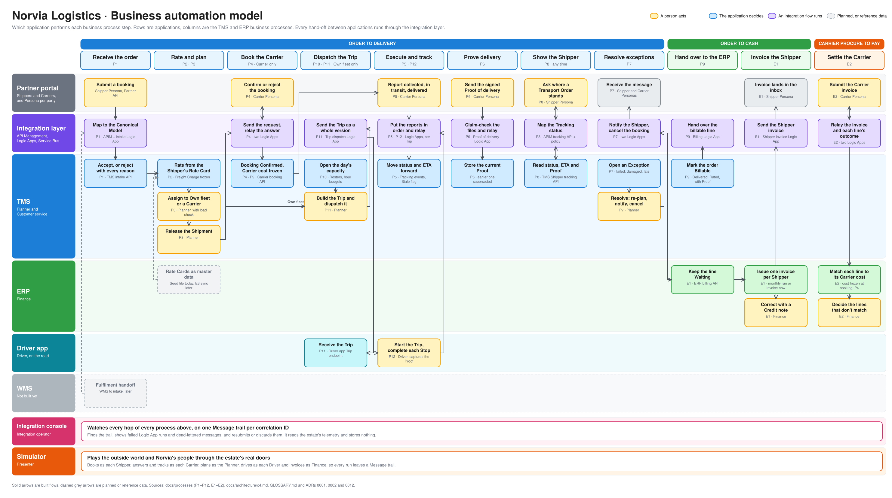

# Business automation model

Which application performs each step of Norvia's business processes, and who or what does it: a person, the application itself, or an integration flow. It is a map of the whole estate on one page. Terms are defined in [GLOSSARY.md](../../GLOSSARY.md), and each process is documented in full in [the TMS](../processes/tms/README.md) and [ERP](../processes/erp/README.md) process catalogues.

The editable source is [business-automation-model.excalidraw](diagrams/business-automation-model.excalidraw), generated from [a spec](diagrams/business-automation-model.py) in the [Excalidraw matrix style](diagrams/README.md). The PNG is rendered from the same spec.

## How to read it

- **Rows are applications.** From the top: the Partner portal (every Shipper and Carrier outside Norvia, as Personas), the integration layer (API Management, Logic Apps and Service Bus), the TMS, the ERP, the Driver app, and the WMS, which is not built yet. Two bands underneath cut across all of them: the Integration console and the Simulator.
- **Columns are process steps.** Each column is one business process, named by its outcome and tagged with its process IDs. The coloured bands group the columns into three value streams.
- **A box sits in the row of the application that performs the step.** Its colour says how: yellow for a person acting, the row's own colour for a step the application or an integration flow does by itself, and grey dashed for something planned or reference data.
- **Arrows are hand-offs.** Dashed grey arrows are planned flows or reference data.

## What the model shows

**Applications never call each other.** Every arrow between two applications goes through the integration layer row, in both directions ([ADR 0001](../adr/0001-realistic-applications-integrated-only-through-ais.md)). Nothing leaves the Partner portal, the TMS, the ERP or the Driver app except through a violet box, and each of those is a flow with a [Message trail](../../GLOSSARY.md#integration).

**Each concept has one owner.** The TMS holds almost every step in the middle of the model: Transport Orders, Shipments, Trips, Carrier bookings, Tracking events, Proofs of delivery and Exceptions. The ERP appears only where money is involved: Rate Cards as master data, the Shipper invoice, Credit notes and Carrier invoice matching ([ADR 0002](../adr/0002-one-system-of-record-per-concept.md), [ADR 0012](../adr/0012-the-tms-decides-when-to-bill-the-erp-invoices.md)). The Driver app owns nothing: it holds a Driver's reports only until the TMS records them.

**Thirteen steps are manual.** Six are partners acting through their Personas, and seven are Norvia's own people: the Planner assigns, releases, builds Trips and resolves Exceptions (four steps), the Driver starts the Trip and completes each Stop (one), and Finance issues Credit notes and decides the Carrier invoice lines that don't match (two). Everything else runs without a person. These manual steps are where the model shows a person deciding or acting by hand.

**One decision splits the flow.** The Planner's Release step leads either to Book the Carrier (P4) or to Dispatch the Trip (P10, P11), depending on whether the Shipment goes to a Carrier or to the Own fleet. After that the two paths meet again at Execute and track (P5, P12).

**Two things are not built.** The WMS handoff, where Fulfilment orders would enter the intake flow, and the sync of Rate Cards from the ERP to the TMS (E3), which today goes through the seed file.

## The processes, left to right

| Stream | Column | Process | What happens, and who does it |
|---|---|---|---|
| Order to delivery | Receive the order | [P1](../processes/tms/p1-transport-order-intake.md) | A Shipper submits a booking. API Management and the intake Logic App map it to the Canonical Model, and the TMS accepts it or rejects it with every reason |
| | Rate and plan | [P2](../processes/tms/p2-rating.md), [P3](../processes/tms/p3-transport-planning.md) | The TMS rates the order from the Shipper's Rate Card. The Planner assigns it to the Own fleet or a Carrier and releases the Shipment |
| | Book the Carrier | [P4](../processes/tms/p4-carrier-booking.md) | Carrier only. A Logic App sends the request to the Carrier's Persona and relays its answer. The TMS confirms the booking and freezes the Carrier cost |
| | Dispatch the Trip | [P10](../processes/tms/p10-fleet-capacity-planning.md), [P11](../processes/tms/p11-trip-dispatch.md) | Own fleet only. The TMS opens each day's capacity, the Planner builds the Trip and dispatches it, and a Logic App sends it to the Driver app |
| | Execute and track | [P5](../processes/tms/p5-shipment-tracking.md), [P12](../processes/tms/p12-trip-execution.md) | Carriers and Drivers report what happened. A Logic App puts the reports in order and relays them, and the TMS moves the Shipment's status and ETA forward |
| | Prove delivery | [P6](../processes/tms/p6-proof-of-delivery.md) | A Carrier sends the signed Proof of delivery. A Logic App claim-checks its files and the TMS stores it as the current one |
| | Show the Shipper | [P8](../processes/tms/p8-shipper-visibility.md) | Any time. A Shipper asks where its order stands, and API Management maps the TMS's answer to a Tracking status |
| | Resolve exceptions | [P7](../processes/tms/p7-exception-handling.md) | The TMS opens an Exception, the Planner resolves it, and Logic Apps notify the Shipper or cancel the Carrier booking |
| Order to cash | Hand over to the ERP | [P9](../processes/tms/p9-freight-settlement.md) | The TMS marks a delivered, rated order Billable, and the Billing Logic App hands the line to the ERP |
| | Invoice the Shipper | [E1](../processes/erp/e1-invoicing.md) | The ERP issues one invoice per Shipper, monthly or on Invoice now, and a Logic App sends it to the Shipper's inbox. Finance corrects with a Credit note |
| Carrier procure to pay | Settle the Carrier | [E2](../processes/erp/e2-carrier-invoice-matching.md) | A Carrier submits an invoice, Logic Apps relay it and each line's outcome, the ERP matches each line to its Carrier cost, and Finance decides the mismatches |

## The two bands underneath

The **Integration console** is for the Integration operator. It watches every hop of every process above, on one Message trail per correlation ID, and resubmits or discards failed runs and dead-lettered messages. It reads the estate's telemetry and stores nothing ([ADR 0017](../adr/0017-the-integration-console-reads-the-estates-telemetry-and-stores-nothing.md)).

The **Simulator** plays the outside world and Norvia's people, as each Shipper, Carrier, Planner, Driver and Finance user, and only through the estate's real doors, so everything it does leaves a Message trail ([ADR 0039](../adr/0039-the-simulator-books-only-through-the-estates-real-doors.md)).

## Keeping it current

Change a process, an application or a flow, and the spec changes with it: edit [business-automation-model.py](diagrams/business-automation-model.py), run it, and regenerate the PNG, as the [style guide](diagrams/README.md#regenerating) describes. Do it in the same PR as the change, like the other pages here.
