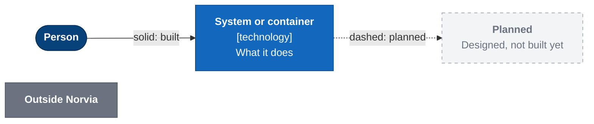
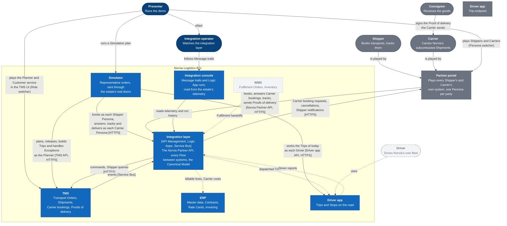
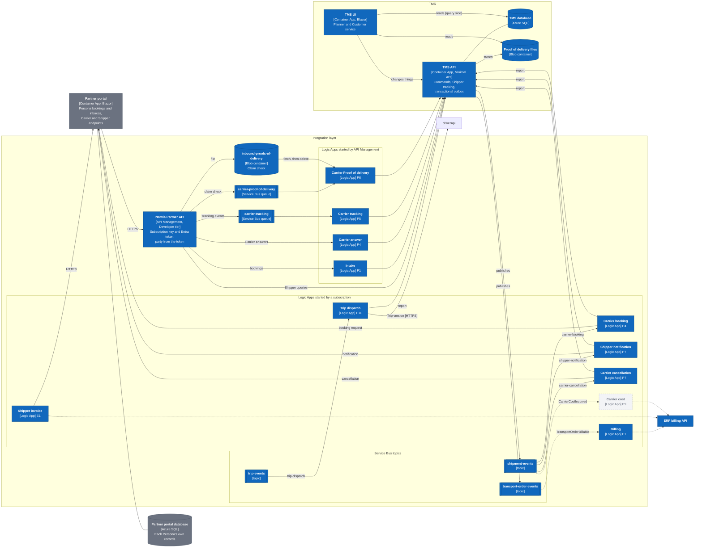
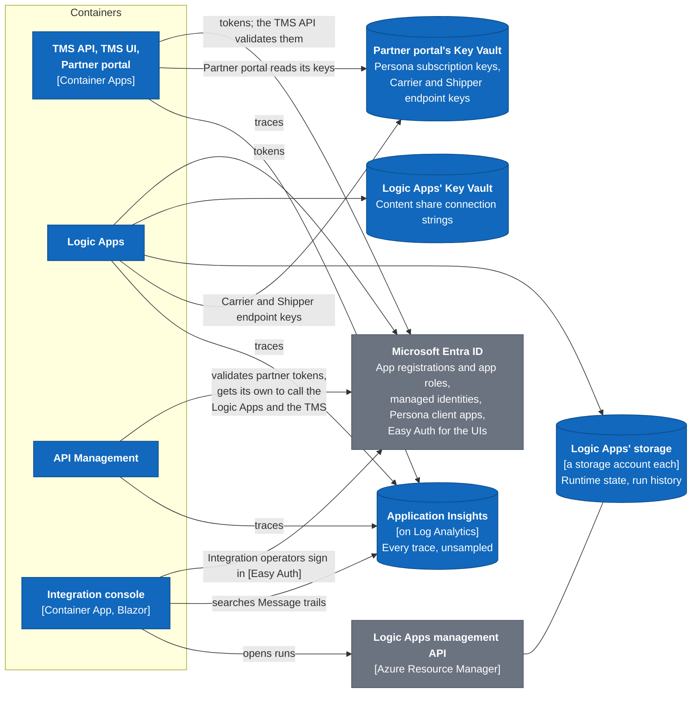

# C4: system context, containers and the integration layer

Norvia's estate at three levels of the [C4 model](https://c4model.com/): who and what Norvia's systems deal with (L1), the deployable pieces inside them and how they talk (L2), and the components of the integration layer (L3). The diagrams show the estate as deployed to Azure. What plays each piece locally under Aspire is in [local-vs-azure.md](local-vs-azure.md). Terms are defined in [GLOSSARY.md](../../GLOSSARY.md).

The diagrams are Mermaid flowcharts drawn in a C4 style, so they render on GitHub with no build step.

## Legend

Blue is Norvia's, grey is outside Norvia, and dashed grey is designed in a process doc but not built yet.

## L1: System context

Norvia's own systems, the parties outside Norvia and the people who use them. Applications never call each other directly: everything between them goes through the integration layer ([ADR 0001](../adr/0001-realistic-applications-integrated-only-through-ais.md)).

- **Shippers and Carriers** are outside Norvia. In the sandbox the Partner portal plays the systems each of them would run, and reaches Norvia only through the Norvia Partner API, with each Persona's own subscription key and Entra token ([ADR 0005](../adr/0005-partner-identity-comes-from-the-token.md)).
- **Consignees** have no system of their own here. They sign the Proof of delivery a Carrier sends ([P6](../processes/tms/p6-proof-of-delivery.md)); Consignee tracking is deferred ([P8](../processes/tms/p8-shipper-visibility.md#deferred)).
- **The Presenter** plays Norvia's users, and its Shippers and Carriers. In Azure they are the one person the Demo UIs let in ([ADR 0024](../adr/0024-the-demo-uis-are-public-behind-an-entra-gate-for-the-presenter.md)), and they hold the Integration console's app roles ([ADR 0026](../adr/0026-the-integration-console-signs-operators-in-with-easy-auth-and-checks-their-app-role.md)).
- **The WMS** is designed but not built, and so is the ERP apart from its master data ([E1](../processes/erp/e1-invoicing.md#implementation)), and so is most of the TMS's Trip dispatch: Own fleet availability is built ([P10](../processes/tms/p10-fleet-capacity-planning.md)), and [P11](../processes/tms/p11-trip-dispatch.md) so far builds Draft Trips, the delivery state of each Trip version, the Driver app's smallest form (its Trip endpoint and a read-only list of a Driver's Trips) and the Trip dispatch Logic App that pushes Trips to it. Until the ERP's master-data sync exists, the seed file supplies its master data ([ADR 0002](../adr/0002-one-system-of-record-per-concept.md)). The ERP side of billing is [E1](../processes/erp/e1-invoicing.md) and [E2](../processes/erp/e2-carrier-invoice-matching.md); the Driver app's rest is [P12](../processes/tms/p12-trip-execution.md).

## L2: Containers

The deployable pieces, all in the resource group `rg-<environment>`. The estate Bicep in [infra/](../../infra/) owns API Management, the Logic Apps, Service Bus, the inbound storage, Key Vault, monitoring and Entra. The AppHost in [src/Norvia.AppHost](../../src/Norvia.AppHost/AppHost.cs) owns the applications, Azure SQL and the TMS's storage ([ADR 0004](../adr/0004-bicep-owns-the-estate-aspire-owns-the-apps.md)).

### Messages

How a message moves between the applications. An application takes commands as HTTP calls and publishes what happened to Service Bus; it never consumes from Service Bus. Shipper queries go from API Management straight to the TMS ([ADR 0003](../adr/0003-http-in-events-out.md)). Each Logic App runs one Flow, and every Logic App ends in a call to the TMS API: to submit, to record, or to report what it sent.

| Container | Built from | Does |
|---|---|---|
| TMS API | [src/Tms/Norvia.Tms.Api](../../src/Tms/Norvia.Tms.Api/) | Takes every command and Shipper query as HTTP, checks the caller's app role, and publishes events through its transactional outbox. Reachable from outside the Container Apps environment, since the Logic Apps and API Management run outside it |
| TMS UI | [src/Tms/Norvia.Tms.Web](../../src/Tms/Norvia.Tms.Web/) | Reads in process and changes things through the TMS API as its own identity ([ADR 0028](../adr/0028-the-tms-ui-reads-in-process-and-changes-things-through-the-tms-api.md)) |
| TMS migrations | [src/Tms/Norvia.Tms.Migrations](../../src/Tms/Norvia.Tms.Migrations/) | A Container Apps job that applies the TMS database's migrations; azd's postdeploy hook runs it |
| TMS database | AppHost, Azure SQL serverless | The TMS's records and its outbox |
| Proof of delivery files | AppHost, a storage account with a lifecycle rule to cool after 30 days | The TMS's copy of each Proof of delivery file ([ADR 0009](../adr/0009-carrier-proofs-of-delivery-use-a-claim-check.md)) |
| ERP UI and its migrations | [src/Erp](../../src/Erp/) | The ERP's own application: seed-loaded Shipper, Carrier, Rate Card and Carrier Rate Card master data, shown read-only to Finance, with its own database and transactional outbox. Finance's **Invoice now** issues a Shipper invoice and publishes `ShipperInvoiceIssued` to `invoicing-events` through the outbox; **Credit note**, on an invoice line, issues a Credit note and publishes `CreditNoteIssued` the same way; the Shipper invoice Logic App sends them like invoices ([E1](../processes/erp/e1-invoicing.md#implementation)) |
| ERP billing API | [src/Erp/Norvia.Erp.Api](../../src/Erp/Norvia.Erp.Api/) | Records the Billable line `TransportOrderBillable` carries, as Waiting. It accepts only the Canonical Model, needs the `BillableLines.Record` role, is idempotent on the Transport Order number and publishes nothing. The Billing Logic App calls it ([E1](../processes/erp/e1-invoicing.md#implementation)). `POST /v1/shipper-invoices/{number}/report-sent` marks an Issued Shipper invoice Sent with the time, and `/v1/credit-notes/{number}/report-sent` a Credit note; it needs the `ShipperInvoices.Report` role, which the Shipper invoice Logic App holds |
| ERP database | AppHost, Azure SQL serverless | The ERP's master data, its Billable lines and its outbox |
| Partner portal and its migrations | [src/PartnerPortal](../../src/PartnerPortal/) | Plays every Shipper and Carrier as a Persona. Books through the Norvia Partner API, and hosts each Carrier Persona's booking and cancellation endpoints and each Shipper Persona's notification endpoint |
| Partner portal database | AppHost, Azure SQL serverless | What each Persona sent Norvia and what Norvia answered, as the outside party's records |
| Norvia Partner API | [infra/estate/partner-api.bicep](../../infra/estate/partner-api.bicep) and its [policies](../../infra/estate/partner-api/) | Checks the subscription key and the Entra token, takes the party from the token, and passes each operation on as API Management's identity. Maps the TMS's Shipper tracking to the partner format ([ADR 0035](../adr/0035-the-shipper-tracking-map-is-liquid-with-the-clock-rules-written-out.md)) |
| Logic Apps | [src/Integration](../../src/Integration/), one `*LogicApp` folder each, and `infra/estate/*-logic-app.bicep` | One Flow each. Each calls the TMS as a managed identity of its own, holding only the role it needs, and keeps its maps in .NET local functions ([ADR 0019](../adr/0019-the-intake-map-is-dotnet-code-run-as-a-logic-apps-local-function.md)). Only API Management may call the intake and Carrier-answer triggers ([ADR 0020](../adr/0020-only-api-management-may-call-the-intake-logic-app.md)) |
| Service Bus | [infra/estate/messaging.bicep](../../infra/estate/messaging.bicep) | Three topics the TMS publishes to, with a filtered subscription per Logic App and a `monitoring` subscription each, and two queues API Management fills for the Carrier tracking and Proof of delivery Flows ([ADR 0008](../adr/0008-carrier-tracking-events-are-accepted-asynchronously.md), [ADR 0009](../adr/0009-carrier-proofs-of-delivery-use-a-claim-check.md)) |
| Inbound storage | [infra/estate/inbound-storage.bicep](../../infra/estate/inbound-storage.bicep) | The claim-check container API Management stores a Carrier's Proof of delivery in, until the Logic App has handed it to the TMS |

The Billing and Shipper invoice Logic Apps and the ERP API are built ([E1](../processes/erp/e1-invoicing.md)); the Carrier cost Logic App is designed in [P9](../processes/tms/p9-freight-settlement.md), and `CarrierCostIncurred` is planned with it. The WMS, the Driver app's own parts and their Flows are not drawn here; see L1.

### Identity, secrets and telemetry

What every container leans on. No application holds a secret: each reaches Azure and the TMS with a managed identity.

| Container | Built from | Does |
|---|---|---|
| Simulator | [src/Simulator](../../src/Simulator/) | Sends a Simulation plan to the estate, Shipper bookings to the Norvia Partner API as each Shipper's Persona, the Planner's assignments, releases and Exception handling to the TMS API, and the Carriers' answers, tracking and Proofs of delivery to the Partner API as each Carrier's Persona, the Planner's Trips to the TMS API, and the Drivers' work on the Trips of today to the Driver app API as each Driver, and keeps its runs and logs in a database of its own. It never writes to another database or publishes to Service Bus ([ADR 0039](../adr/0039-the-simulator-books-only-through-the-estates-real-doors.md)). Local only until its Azure slice; see [operations/simulator.md](../operations/simulator.md) |
| Integration console | [src/IntegrationConsole](../../src/IntegrationConsole/) | Searches Message trails in the Log Analytics workspace and opens Logic App runs through the management API, as its own managed identity. It has no database ([ADR 0017](../adr/0017-the-integration-console-reads-the-estates-telemetry-and-stores-nothing.md)); resubmitting and discarding dead-lettered messages is [planned](../operations/integration-console.md#resubmit-and-discard) |
| Microsoft Entra ID | [infra/estate/identities.bicep](../../infra/estate/identities.bicep) | The app registrations of the TMS API, the Norvia Partner API and the Logic Apps' triggers with their roles; one client app per Persona trusting the Partner portal's identity; a managed identity per caller; the Demo UIs' gate; and the Integration console's registration with `IntegrationConsole.Read` and `IntegrationConsole.Resubmit` |
| Key Vaults | [infra/estate/intake-logic-app.bicep](../../infra/estate/intake-logic-app.bicep), [infra/estate/partner-api.bicep](../../infra/estate/partner-api.bicep) | The one key Logic Apps Standard still needs, for its content share; and each Persona's subscription key and each Carrier and Shipper endpoint's credential |
| Application Insights and Log Analytics | [infra/estate/monitoring.bicep](../../infra/estate/monitoring.bicep) | Everything the estate traced, kept for `integrationRetentionDays` ([ADR 0029](../adr/0029-the-applications-send-application-insights-every-trace-unsampled.md), [coding guidelines §7](../coding-guidelines.md#7-observability)) |

## L3: Components of the integration layer

The integration layer is the only container with its own L3. The .NET applications don't get one: Clean Architecture and the architecture tests already fix their shape ([coding guidelines](../coding-guidelines.md)). Here the components are API Management's operation policies, the Logic Apps and the .NET local functions they call ([ADR 0019](../adr/0019-the-intake-map-is-dotnet-code-run-as-a-logic-apps-local-function.md)), the Service Bus subscriptions and queues, and the TMS API operations they call. It is the estate as deployed to Azure; [local-vs-azure.md](local-vs-azure.md) says what plays each piece locally.

Every Flow has the same shape: **take it in, map it with a local function, call the TMS**. What differs is the trigger: an HTTP call from API Management, a Service Bus queue API Management fills, or a subscription the TMS's events reach. Shipper queries have no Logic App at all, because Logic Apps are never used on a read path ([ADR 0003](../adr/0003-http-in-events-out.md)).

### Flows that come in through API Management

```mermaid
flowchart LR
    portal["<b>Partner portal</b><br/>[outside Norvia]"]:::external

    subgraph apim["Norvia Partner API [API Management]"]
        pSubmit["<b>submit-transport-order</b><br/>[policy]<br/>POST /transport-orders"]:::system
        pAnswer["<b>answer-carrier-booking</b><br/>[policy]<br/>POST /carrier-answers"]:::system
        pTrack["<b>submit-carrier-tracking</b><br/>[policy]<br/>POST /carrier-tracking"]:::system
        pPod["<b>submit-carrier-proof-of-delivery</b><br/>[policy]<br/>POST /carrier-proofs-of-delivery"]:::system
        pQuery["<b>Shipper tracking</b><br/>[4 policies, Liquid maps]<br/>GET /transport-orders, /find,<br/>/&#123;number&#125;, /&#123;number&#125;/proof-of-delivery/files/&#123;id&#125;"]:::system
    end

    subgraph intake["Intake [Logic App] P1"]
        intakeLa["<b>transport-order-intake</b><br/>[workflow, HTTP trigger]"]:::system
        intakeFn["<b>MapPartnerBooking,<br/>RelayTmsOutcome</b><br/>[local functions]"]:::system
    end

    subgraph answerG["Carrier answer [Logic App] P4"]
        answerLa["<b>carrier-answer</b><br/>[workflow, HTTP trigger]"]:::system
        answerFn["<b>MapCarrierAnswer,<br/>RelayTmsAnswer</b><br/>[local functions]"]:::system
    end

    subgraph trackG["Carrier tracking [Logic App] P5"]
        trackQ[["<b>carrier-tracking</b><br/>[queue]"]]:::system
        trackLa["<b>carrier-tracking</b><br/>[workflow, queue trigger]"]:::system
        trackFn["<b>MapCarrierTracking</b><br/>[local function]"]:::system
    end

    subgraph podG["Carrier Proof of delivery [Logic App] P6"]
        inbound[("<b>inbound-proofs-of-delivery</b><br/>[Blob container]")]:::system
        podQ[["<b>carrier-proof-of-delivery</b><br/>[queue]"]]:::system
        podLa["<b>carrier-proof-of-delivery</b><br/>[workflow, queue trigger]"]:::system
        podFn["<b>MapCarrierProofOfDelivery</b><br/>[local function]"]:::system
    end

    subgraph tms["TMS API"]
        tIntake["POST /v1/transport-orders"]:::system
        tAnswer["POST /v1/carrier-bookings/&#123;number&#125;/answer"]:::system
        tTrack["POST /v1/tracking-events"]:::system
        tPod["POST /v1/proofs-of-delivery"]:::system
        tQuery["GET /v1/shipper-tracking/..."]:::system
    end

    portal -- "HTTPS" --> pSubmit
    portal -- "HTTPS" --> pAnswer
    portal -- "HTTPS" --> pTrack
    portal -- "HTTPS" --> pPod
    portal -- "HTTPS" --> pQuery

    pSubmit -- "managed identity" --> intakeLa
    pAnswer -- "managed identity" --> answerLa
    pTrack -- "message, 202" --> trackQ
    pPod -- "1. file" --> inbound
    pPod -- "2. claim check, 202" --> podQ
    pQuery -- "managed identity" --> tQuery

    intakeLa --- intakeFn
    answerLa --- answerFn
    trackQ --> trackLa
    trackLa --- trackFn
    podQ --> podLa
    inbound -- "fetch, delete once recorded" --> podLa
    podLa --- podFn

    intakeLa -- "own managed identity" --> tIntake
    answerLa -- "own managed identity" --> tAnswer
    trackLa -- "own managed identity" --> tTrack
    podLa -- "own managed identity" --> tPod

    classDef system fill:#1168bd,stroke:#0b4884,color:#fff
    classDef external fill:#6b7280,stroke:#4b5563,color:#fff
```

- **Every policy** checks the subscription key and the Entra token, takes the party (Shipper or Carrier) from the token's `azp`, creates the correlation ID and refuses what the operation's role doesn't allow ([ADR 0005](../adr/0005-partner-identity-comes-from-the-token.md), [coding guidelines §7](../coding-guidelines.md#7-observability)).
- **Intake and Carrier answer** answer the caller in the same run, so API Management waits. The two Logic Apps refuse any caller other than API Management ([ADR 0020](../adr/0020-only-api-management-may-call-the-intake-logic-app.md)), and relay the TMS's outcome, refusals included, with a `Relay...` function.
- **Carrier tracking and Proof of delivery** answer `202 Accepted` once the message is stored ([ADR 0008](../adr/0008-carrier-tracking-events-are-accepted-asynchronously.md), [ADR 0009](../adr/0009-carrier-proofs-of-delivery-use-a-claim-check.md)); the Logic App records it with the TMS later. The Logic App dead-letters a message the TMS refuses or that can't be mapped, with the failure code, and abandons one it couldn't deliver so the queue tries again, up to the maximum delivery count.
- **Shipper queries** are rewritten by the policy to the TMS API's Shipper tracking operations as API Management's identity, and mapped to the partner format by Liquid in `set-body` ([ADR 0035](../adr/0035-the-shipper-tracking-map-is-liquid-with-the-clock-rules-written-out.md)).

### Flows that start from a subscription

```mermaid
flowchart LR
    tmsEvents["<b>TMS API</b><br/>[transactional outbox]<br/>publishes events"]:::system

    subgraph topics["Service Bus"]
        sh[["<b>shipment-events</b><br/>[topic]"]]:::system
        subBooking[["<b>carrier-booking</b><br/>[subscription]<br/>assignedTo = Carrier"]]:::system
        subNotify[["<b>shipper-notification</b><br/>[subscription]<br/>eventType = ShipperNotificationRequested"]]:::system
        subCancel[["<b>carrier-cancellation</b><br/>[subscription]<br/>eventType = CarrierBookingCancelled<br/>or CarrierBookingWithdrawn"]]:::system
        subMon[["<b>monitoring</b><br/>[subscription, on every topic]"]]:::system
        trip[["<b>trip-events</b><br/>[topic]"]]:::system
        subTrip[["<b>trip-dispatch</b><br/>[subscription]<br/>eventType = TripDispatched"]]:::system
    end

    subgraph booking["Carrier booking [Logic App] P4"]
        bookingLa["<b>carrier-booking</b><br/>[workflow]"]:::system
        bookingFn["<b>MapShipmentReleased</b><br/>[local function]"]:::system
    end
    subgraph notify["Shipper notification [Logic App] P7"]
        notifyLa["<b>shipper-notification</b><br/>[workflow]"]:::system
        notifyFn["<b>MapShipperNotificationRequested</b><br/>[local function]"]:::system
    end
    subgraph cancel["Carrier cancellation [Logic App] P7"]
        cancelLa["<b>carrier-cancellation</b><br/>[workflow]"]:::system
        cancelFn["<b>MapCarrierCancellation</b><br/>[local function]"]:::system
    end

    subgraph tripDispatch["Trip dispatch [Logic App] P11"]
        tripLa["<b>trip-dispatch</b><br/>[workflow, no local function]"]:::system
    end
    driverKv[("<b>Driver app's Key Vault</b><br/>endpoint credential")]:::system
    driverApi["<b>Driver app</b><br/>Trip endpoint"]:::external

    kv[("<b>Partner portal's Key Vault</b><br/>endpoint credential<br/>per Carrier and Shipper")]:::system
    portal["<b>Partner portal</b><br/>Carrier booking and cancellation endpoints,<br/>Shipper notification endpoint"]:::external

    subgraph tms["TMS API"]
        tBooking["POST /v1/carrier-bookings/&#123;number&#125;/<br/>report-sent, report-not-delivered"]:::system
        tCancel["POST /v1/carrier-bookings/&#123;number&#125;/<br/>report-cancellation-told,<br/>report-cancellation-not-delivered"]:::system
        tTrip["POST /v1/trips/&#123;number&#125;/versions/&#123;version&#125;/<br/>report-delivered, report-not-delivered"]:::system
        tNotify["POST /v1/shipper-notifications/&#123;id&#125;/<br/>report-sent, report-not-delivered"]:::system
    end

    billing["<b>Billing, Carrier cost</b><br/>[Logic Apps] P9"]:::planned

    tmsEvents -- "publishes" --> sh
    sh --> subBooking
    sh --> subNotify
    sh --> subCancel
    sh --> subMon
    subBooking --> bookingLa
    subNotify --> notifyLa
    subCancel --> cancelLa
    bookingLa --- bookingFn
    notifyLa --- notifyFn
    cancelLa --- cancelFn

    bookingLa -- "credential" --> kv
    notifyLa -- "credential" --> kv
    cancelLa -- "credential" --> kv
    bookingLa -- "booking request" --> portal
    notifyLa -- "notification" --> portal
    cancelLa -- "cancellation" --> portal

    bookingLa -- "report" --> tBooking
    cancelLa -- "report" --> tCancel
    notifyLa -- "report" --> tNotify

    tmsEvents -- "publishes" --> trip
    trip --> subTrip
    trip --> subMon
    subTrip --> tripLa
    tripLa -- "credential" --> driverKv
    tripLa -- "Trip version" --> driverApi
    tripLa -- "report" --> tTrip

    sh -. "CarrierCostIncurred" .-> billing

    classDef system fill:#1168bd,stroke:#0b4884,color:#fff
    classDef external fill:#6b7280,stroke:#4b5563,color:#fff
    classDef planned fill:#f3f4f6,stroke:#9ca3af,color:#6b7280,stroke-dasharray:5 5
```

- **Each Logic App reads only its own subscription**, and holds the Service Bus data receiver role on that subscription alone. The `transport-order-events` topic has the `monitoring` subscription and the Billing Logic App's `billing`, which takes `TransportOrderBillable`; the `invoicing-events` topic has `monitoring` and the Shipper invoice Logic App's `shipper-invoice`, which takes `ShipperInvoiceIssued` and `CreditNoteIssued` ([E1](../processes/erp/e1-invoicing.md)).
- **Every subscription's filter also admits a resubmit** aimed at it (`resubmitTo`), so a message resubmitted from the Integration console reaches only the subscription it was dead-lettered from ([coding guidelines §7](../coding-guidelines.md#7-observability)). The filters live in [messaging.bicep](../../infra/estate/messaging.bicep) and, a second time, in the AppHost; see [local-vs-azure.md](local-vs-azure.md#where-the-two-can-differ).
- **The workflows end in a report to the TMS**, never in a write of their own: the TMS records that the Carrier was sent the booking, told of the cancellation, or the Shipper notified, or that it wasn't delivered and why. If the report fails, the run fails and the TMS keeps the item as Requested ([ADR 0030](../adr/0030-locally-a-hosted-worker-plays-the-p4-booking-logic-app.md) to [0034](../adr/0034-locally-a-hosted-worker-plays-the-p7-carrier-cancellation-logic-app.md) describe each).
- **Each Logic App calls the TMS as a managed identity of its own**, holding only the role its calls need.
