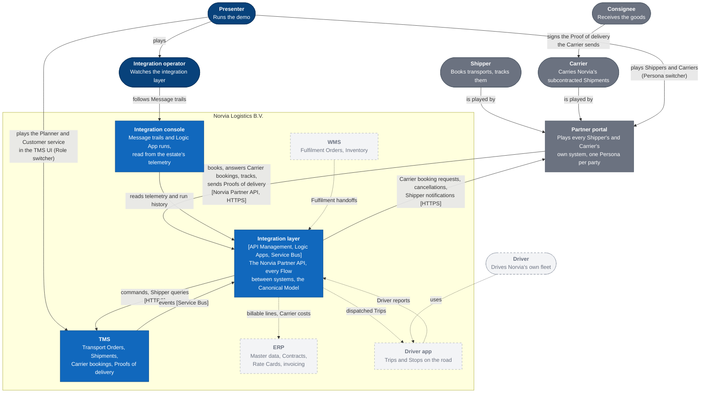
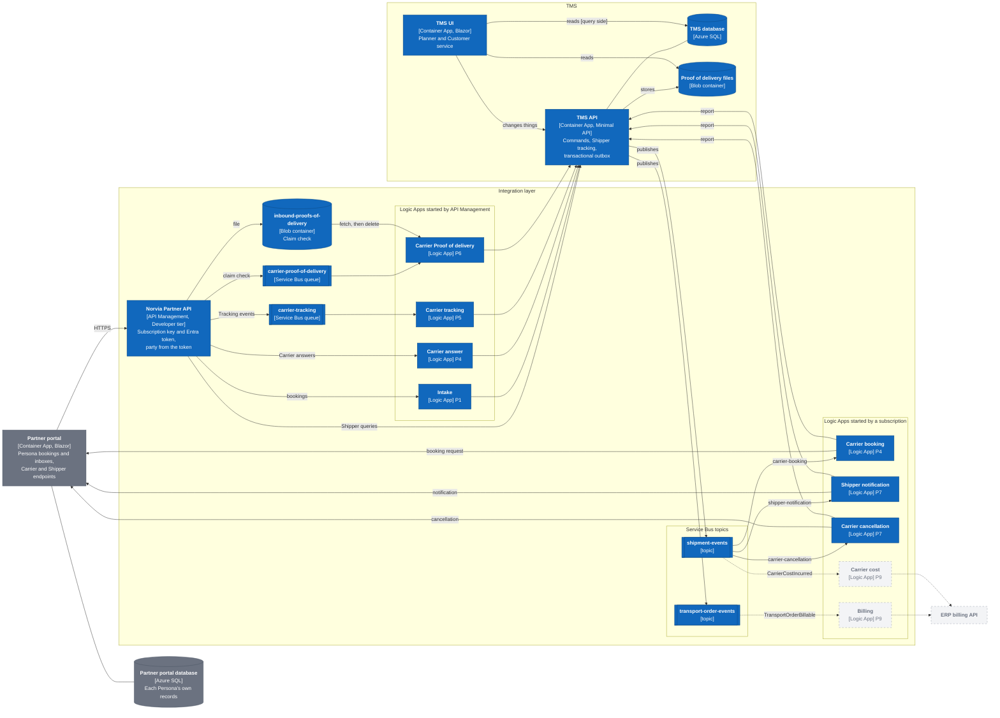
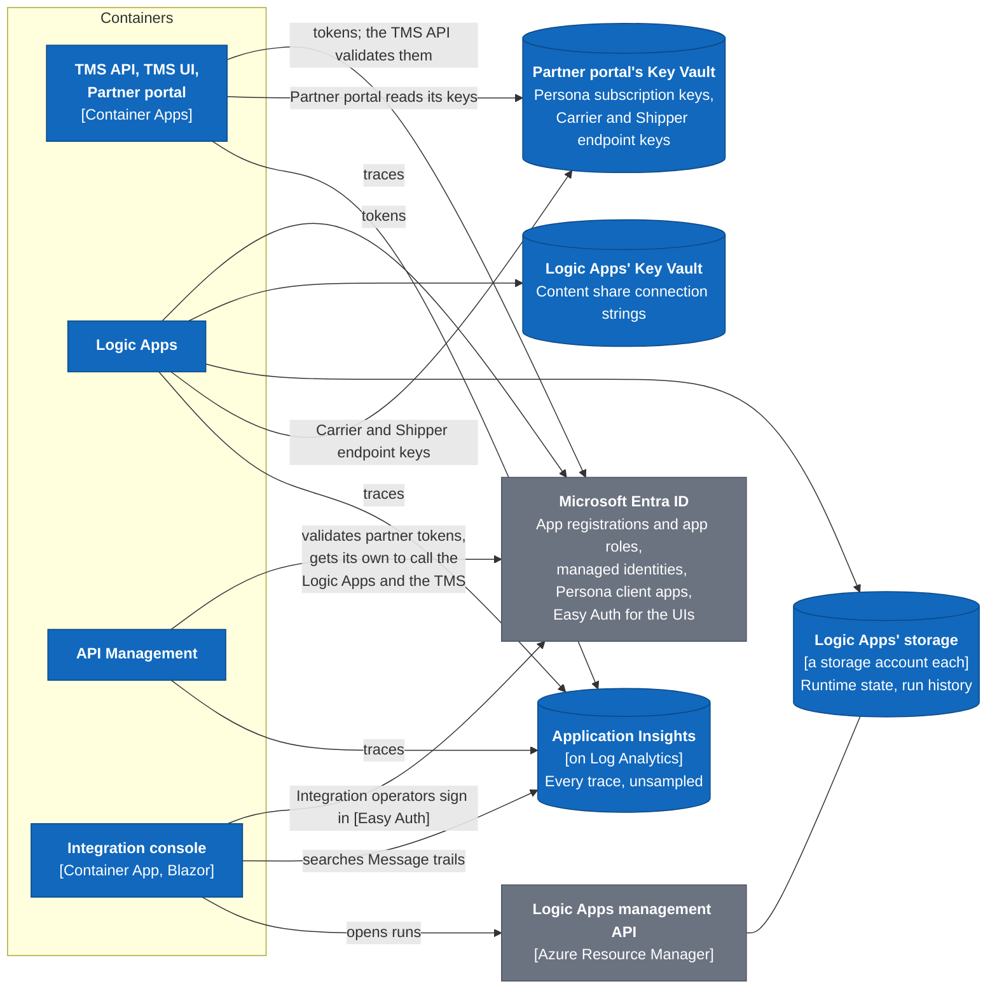

# C4: system context and containers

Norvia's estate at two levels of the [C4 model](https://c4model.com/): who and what Norvia's systems deal with (L1), and the deployable pieces inside them and how they talk (L2). The diagrams show the estate as deployed to Azure. What plays each piece locally under Aspire is in the README's [Running it locally](../../README.md#running-it-locally) and the local stand-in ADRs (0023, 0027, 0030 to 0034). Terms are defined in [CONTEXT.md](../../CONTEXT.md).

The diagrams are Mermaid flowcharts drawn in a C4 style, so they render on GitHub with no build step.

## Legend

Blue is Norvia's, grey is outside Norvia, and dashed grey is designed in a process doc but not built yet.

## L1: System context

Norvia's own systems, the parties outside Norvia and the people who use them. Applications never call each other directly: everything between them goes through the integration layer ([ADR 0001](../adr/0001-realistic-applications-integrated-only-through-ais.md)).

- **Shippers and Carriers** are outside Norvia. In the sandbox the Partner portal plays the systems each of them would run, and reaches Norvia only through the Norvia Partner API, with each Persona's own subscription key and Entra token ([ADR 0005](../adr/0005-partner-identity-comes-from-the-token.md)).
- **Consignees** have no system of their own here. They sign the Proof of delivery a Carrier sends ([P6](../processes/tms/p6-proof-of-delivery.md)); Consignee tracking is deferred ([P8](../processes/tms/p8-shipper-visibility.md#deferred)).
- **The Presenter** plays Norvia's users, and its Shippers and Carriers. In Azure they are the one person the Demo UIs let in ([ADR 0024](../adr/0024-the-demo-uis-are-public-behind-an-entra-gate-for-the-presenter.md)), and they hold the Integration console's app roles ([ADR 0026](../adr/0026-the-integration-console-signs-operators-in-with-easy-auth-and-checks-their-app-role.md)).
- **The WMS, the ERP and the Driver app** are designed but not built, and so are the TMS's Trips and Own fleet availability ([P10](../processes/tms/p10-fleet-capacity-planning.md), [P11](../processes/tms/p11-trip-dispatch.md)). Until the ERP's master-data sync exists, the seed file supplies its master data ([ADR 0002](../adr/0002-one-system-of-record-per-concept.md)). The ERP side of billing is [E1](../processes/erp/e1-invoicing.md) and [E2](../processes/erp/e2-carrier-invoice-matching.md); the Driver app's is [P11](../processes/tms/p11-trip-dispatch.md) and [P12](../processes/tms/p12-trip-execution.md).

## L2: Containers

The deployable pieces, all in the resource group `rg-<environment>`. The estate Bicep in [infra/](../../infra/) owns API Management, the Logic Apps, Service Bus, the inbound storage, Key Vault, monitoring and Entra. The AppHost in [src/Norvia.AppHost](../../src/Norvia.AppHost/AppHost.cs) owns the applications, Azure SQL and the TMS's storage ([ADR 0004](../adr/0004-bicep-owns-the-estate-aspire-owns-the-apps.md)).

### Messages

How a message moves between the applications. An application takes commands as HTTP calls and publishes what happened to Service Bus; it never consumes from Service Bus. Shipper queries go from API Management straight to the TMS ([ADR 0003](../adr/0003-http-in-events-out.md)). Each Logic App runs one Flow, and every Logic App ends in a call to the TMS API: to submit, to record, or to report what it sent.

| Container | Built from | Does |
|---|---|---|
| TMS API | [src/Tms/Norvia.Tms.Api](../../src/Tms/Norvia.Tms.Api/) | Takes every command and Shipper query as HTTP, checks the caller's app role, and publishes events through its transactional outbox. Reachable from outside the Container Apps environment, since the Logic Apps and API Management run outside it |
| TMS UI | [src/Tms/Norvia.Tms.Web](../../src/Tms/Norvia.Tms.Web/) | Reads in process and changes things through the TMS API as its own identity ([ADR 0028](../adr/0028-the-tms-ui-reads-in-process-and-changes-things-through-the-tms-api.md)) |
| TMS migrations | [src/Tms/Norvia.Tms.Migrations](../../src/Tms/Norvia.Tms.Migrations/) | A Container Apps job that applies the TMS database's migrations; azd's postdeploy hook runs it |
| TMS database | AppHost, Azure SQL serverless | The TMS's records and its outbox |
| Proof of delivery files | AppHost, a storage account with a lifecycle rule to cool after 30 days | The TMS's copy of each Proof of delivery file ([ADR 0009](../adr/0009-carrier-proofs-of-delivery-use-a-claim-check.md)) |
| Partner portal and its migrations | [src/PartnerPortal](../../src/PartnerPortal/) | Plays every Shipper and Carrier as a Persona. Books through the Norvia Partner API, and hosts each Carrier Persona's booking and cancellation endpoints and each Shipper Persona's notification endpoint |
| Partner portal database | AppHost, Azure SQL serverless | What each Persona sent Norvia and what Norvia answered, as the outside party's records |
| Norvia Partner API | [infra/estate/partner-api.bicep](../../infra/estate/partner-api.bicep) and its [policies](../../infra/estate/partner-api/) | Checks the subscription key and the Entra token, takes the party from the token, and passes each operation on as API Management's identity. Maps the TMS's Shipper tracking to the partner format ([ADR 0035](../adr/0035-the-shipper-tracking-map-is-liquid-with-the-clock-rules-written-out.md)) |
| Logic Apps | [src/Integration](../../src/Integration/), one `*LogicApp` folder each, and `infra/estate/*-logic-app.bicep` | One Flow each. Each calls the TMS as a managed identity of its own, holding only the role it needs, and keeps its maps in .NET local functions ([ADR 0019](../adr/0019-the-intake-map-is-dotnet-code-run-as-a-logic-apps-local-function.md)). Only API Management may call the intake and Carrier-answer triggers ([ADR 0020](../adr/0020-only-api-management-may-call-the-intake-logic-app.md)) |
| Service Bus | [infra/estate/messaging.bicep](../../infra/estate/messaging.bicep) | Two topics the TMS publishes to, with a filtered subscription per Logic App and a `monitoring` subscription each, and two queues API Management fills for the Carrier tracking and Proof of delivery Flows ([ADR 0008](../adr/0008-carrier-tracking-events-are-accepted-asynchronously.md), [ADR 0009](../adr/0009-carrier-proofs-of-delivery-use-a-claim-check.md)) |
| Inbound storage | [infra/estate/inbound-storage.bicep](../../infra/estate/inbound-storage.bicep) | The claim-check container API Management stores a Carrier's Proof of delivery in, until the Logic App has handed it to the TMS |

The Billing and Carrier cost Logic Apps and the ERP billing API are designed in [P9](../processes/tms/p9-freight-settlement.md). The TMS already publishes `TransportOrderBillable`; `CarrierCostIncurred` is planned with them. The WMS, the Driver app and their Flows are not drawn here; see L1.

### Identity, secrets and telemetry

What every container leans on. No application holds a secret: each reaches Azure and the TMS with a managed identity.

| Container | Built from | Does |
|---|---|---|
| Integration console | [src/IntegrationConsole](../../src/IntegrationConsole/) | Searches Message trails in the Log Analytics workspace and opens Logic App runs through the management API, as its own managed identity. It has no database ([ADR 0017](../adr/0017-the-integration-console-reads-the-estates-telemetry-and-stores-nothing.md)); resubmitting and discarding dead-lettered messages is [planned](../operations/integration-console.md#resubmit-and-discard) |
| Microsoft Entra ID | [infra/estate/identities.bicep](../../infra/estate/identities.bicep) | The app registrations of the TMS API, the Norvia Partner API and the Logic Apps' triggers with their roles; one client app per Persona trusting the Partner portal's identity; a managed identity per caller; the Demo UIs' gate; and the Integration console's registration with `IntegrationConsole.Read` and `IntegrationConsole.Resubmit` |
| Key Vaults | [infra/estate/intake-logic-app.bicep](../../infra/estate/intake-logic-app.bicep), [infra/estate/partner-api.bicep](../../infra/estate/partner-api.bicep) | The one key Logic Apps Standard still needs, for its content share; and each Persona's subscription key and each Carrier and Shipper endpoint's credential |
| Application Insights and Log Analytics | [infra/estate/monitoring.bicep](../../infra/estate/monitoring.bicep) | Everything the estate traced, kept for `integrationRetentionDays` ([ADR 0029](../adr/0029-the-applications-send-application-insights-every-trace-unsampled.md), [coding guidelines §7](../coding-guidelines.md#7-observability)) |
