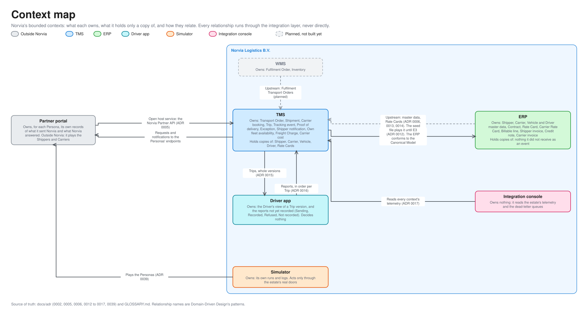

# Context map

The estate's bounded contexts: what each one owns, what it holds only a copy of, and how they relate. For engineers and coding agents working on the estate and for the technical audience of a demo. [c4.md](c4.md) draws what talks to what; this page says who is responsible for what. Terms are defined in [GLOSSARY.md](../../GLOSSARY.md).

The editable source is [context-map.excalidraw](diagrams/context-map.excalidraw), generated from [bounded_contexts.py](diagrams/bounded_contexts.py) in the [graph style](diagrams/README.md#graph-style).

## One context per application

Each application is a bounded context with its own domain model, database and language ([ADR 0001](../adr/0001-realistic-applications-integrated-only-through-ais.md)). Applications never reference each other's projects, and they meet only through the integration layer in the Canonical Model. The integration layer is not a context of its own: it has no domain and owns no concept. It translates, in the way an anti-corruption layer does, between each context and the others.

| Context | Owns | Holds copies of | Built as |
|---|---|---|---|
| **TMS** | Transport Order, Shipment, Carrier booking, Trip, Tracking event, Proof of delivery, Exception, Shipper notification, Own fleet availability (Rosters, Shifts, Absences, Off the road days, Driving-hour budgets), Freight Charge, Carrier cost | Shipper, Carrier, Vehicle, Driver, Rate Card, Carrier Rate Card | [src/Tms](../../src/Tms/): Domain, Application, Infrastructure, Api and Web: [hexagon](tms-architecture.md), [lifecycles](tms-lifecycles.md) |
| **ERP** | Shipper, Carrier, Vehicle and Driver master data, Contract, Rate Card, Carrier Rate Card, Billable line, Shipper invoice, Credit note, Carrier invoice | Nothing it did not receive as an event: the Billable lines and Carrier costs it was handed are its own records | [src/Erp](../../src/Erp/): Domain, Application, Infrastructure, Api and Web: [hexagon](erp-architecture.md), [lifecycles](erp-lifecycles.md) |
| **Driver app** | The Driver's view of a Trip version, and each Driver report until the TMS has recorded it (Sending, Recorded, Refused, Not recorded) | Trip versions the TMS sent | [src/DriverApp](../../src/DriverApp/): Domain, Application, Infrastructure, Api and Web: [hexagon](driver-app-architecture.md) |
| **Partner portal** | For each Persona, its own records of what it sent Norvia and what Norvia answered. It is outside Norvia: it plays every Shipper and Carrier | Nothing | [src/PartnerPortal](../../src/PartnerPortal/): Domain, Application, Infrastructure and Web, with no Api of its own: [hexagon](partner-portal-architecture.md) |
| **Simulator** | Its own runs and logs | Nothing | [src/Simulator](../../src/Simulator/): Domain, Application, Infrastructure and Web: [hexagon](simulator-architecture.md) |
| **Integration console** | Nothing | Nothing: it reads the estate's telemetry and the dead-letter queues | [src/IntegrationConsole](../../src/IntegrationConsole/): Application, Infrastructure and Web, with no Domain and no database: [hexagon](integration-console-architecture.md) |
| **WMS** (planned) | Fulfilment Order, Inventory | Nothing yet | Not built |

Each concept has exactly one owner ([ADR 0002](../adr/0002-one-system-of-record-per-concept.md)). A copy is read-only, comes from the owner and is never edited where it is held.

## How they relate

| Relationship | Pattern | Direction and what moves | Decided in |
|---|---|---|---|
| ERP to TMS | Customer and supplier | The ERP is upstream for Shipper, Carrier, Vehicle and Driver master data and for Rate Cards. The TMS rates and prices from its copies. Until the sync (E3) exists, a seed file plays the ERP for both | [ADR 0006](../adr/0006-the-tms-rates-the-erp-owns-rate-cards.md), [0013](../adr/0013-the-tms-rates-carrier-bookings-the-erp-owns-carrier-rate-cards.md), [0014](../adr/0014-the-erp-owns-vehicles-and-drivers-the-tms-owns-their-availability.md) |
| TMS to ERP | Customer and supplier | The TMS is upstream for billing facts: it decides when an order is Billable and when a Carrier cost is incurred, and publishes `TransportOrderBillable` and `CarrierCostIncurred`. The ERP invoices and matches, and conforms to the Canonical Model | [ADR 0012](../adr/0012-the-tms-decides-when-to-bill-the-erp-invoices.md) |
| Partner portal to TMS | Open host service, published language | The Norvia Partner API in API Management, in the partner's format, translated at the edge. The party is the one the token names | [ADR 0005](../adr/0005-partner-identity-comes-from-the-token.md) |
| TMS to Partner portal | Customer and supplier | Carrier booking requests, cancellations and Shipper notifications to each Persona's own endpoints | [P4](../processes/tms/p4-carrier-booking.md), [P7](../processes/tms/p7-exception-handling.md) |
| TMS and Driver app | Partnership | The TMS sends each Trip as a whole version, and the Driver app reports what the Driver did as events, in order per Trip. The TMS decides and the Driver app reports | [ADR 0015](../adr/0015-a-dispatched-trip-is-sent-as-whole-versions.md), [0016](../adr/0016-driver-reports-travel-as-driver-app-events-in-order-per-trip.md) |
| WMS to TMS (planned) | Customer and supplier | The WMS is upstream for Fulfilment Transport Orders | [P1](../processes/tms/p1-transport-order-intake.md) |
| Simulator to the rest | Caller of the published doors | It plays the Personas, the Planner, the Drivers and Finance only through the doors a real party would use, so everything it does leaves a Message trail | [ADR 0039](../adr/0039-the-simulator-books-only-through-the-estates-real-doors.md) |
| Integration console to the rest | Conformist reader | It reads every context's telemetry and the dead-letter queues, and changes only Service Bus, by resubmitting or discarding | [ADR 0017](../adr/0017-the-integration-console-reads-the-estates-telemetry-and-stores-nothing.md) |

## What the map is for

- **Putting a rule in the right place.** A rule about when an order can be billed is the TMS's, because every fact it needs is TMS data. A rule about what an invoice contains is the ERP's. If a change seems to need both, the owner of the concept decides and the other context reacts to its event.
- **Seeing what changes when something is built.** When the WMS arrives, the TMS gains an upstream. When E3 is built, the seed file is replaced by an event stream from the ERP, and the TMS's copies stay read-only.
- **Reading the code.** Each context's structure follows [the coding guidelines](../coding-guidelines.md#1-architecture-clean-architecture), with differences that are deliberate: the Integration console has no Domain because it owns nothing, and the Partner portal and the Simulator have no Api because nothing calls them. Each context has its own hexagon page, listed in the last column above; the [TMS](tms-architecture.md) is the one to read first.
