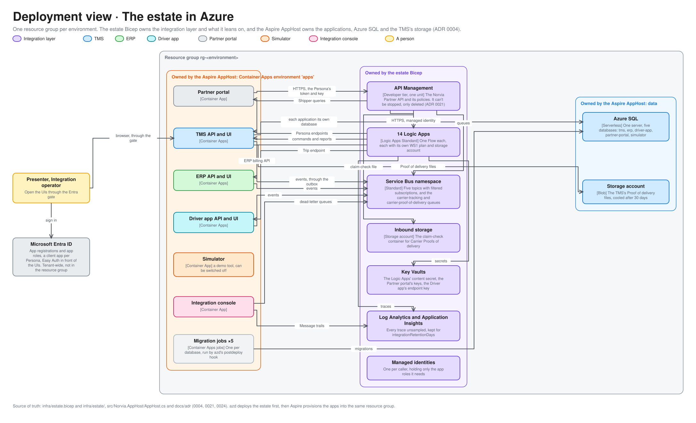

# Deployment view

What is deployed to Azure, what owns each piece, and in what order it goes up. For engineers and coding agents working on the estate and for the technical audience of a demo. [c4.md](c4.md) shows what the pieces do and how they talk, and [local-vs-azure.md](local-vs-azure.md) what plays each one on a developer's machine. Terms are defined in [GLOSSARY.md](../../GLOSSARY.md).

The editable source is [deployment.excalidraw](diagrams/deployment.excalidraw), generated from [deployment.py](diagrams/deployment.py) in the [graph style](diagrams/README.md#graph-style).

## Two owners, one resource group

Everything lives in the resource group `rg-<environment>`. Two layers own it, so a change goes in the layer that owns the piece ([ADR 0004](../adr/0004-bicep-owns-the-estate-aspire-owns-the-apps.md)).

| Owner | Where | Owns | Why it is here |
|---|---|---|---|
| **The estate Bicep** | [infra/estate.bicep](../../infra/estate.bicep) and [infra/estate/](../../infra/estate/) | API Management, the 14 Logic Apps, Service Bus, the inbound storage, the Key Vaults, Log Analytics and Application Insights, the managed identities, and the Entra app registrations and app roles | API Management and Logic Apps Standard have no first-class Aspire support, and every as-found toggle is a Bicep switch |
| **The Aspire AppHost** | [src/Norvia.AppHost](../../src/Norvia.AppHost/AppHost.cs) | The Container Apps environment and the applications in it, the migration jobs, Azure SQL with a database per application, and the TMS's storage account | The applications and their databases are what developers run and change |

The AppHost references what the Bicep owns (Service Bus, Application Insights, Log Analytics, the identities and the Key Vaults) instead of creating it.

## What is deployed

| Piece | Kind | Notes |
|---|---|---|
| Container Apps environment `apps` | Container Apps | Holds the TMS API and UI, the ERP API and UI, the Driver app API and UI, the Partner portal, the Simulator, the Integration console and, for the Intake agent, the Booking draft host (`booking-draft-api`, which only API Management may call). They run as managed-identity callers and are built from the same code locally |
| Migration jobs | Container Apps jobs | One per database: the TMS's, the Partner portal's, the Driver app's, the Simulator's and the ERP's. azd's postdeploy hook runs each and fails the deployment if one fails |
| Azure SQL | Serverless, one server | Five databases: `tms`, `erp`, `driver-app`, `partner-portal` and `simulator`. The Integration console has none |
| Storage account | Blob | The TMS's Proof of delivery files, with a lifecycle rule to cool them after 30 days |
| API Management | Developer tier, one unit | The Norvia Partner API and its policies. It costs money whenever it exists and can only be deleted and deployed again, which takes 45 minutes ([ADR 0021](../adr/0021-api-management-runs-on-the-developer-tier.md)) |
| Logic Apps | Logic Apps Standard, 14 | One Flow each, each with its own WS1 plan and its own storage account. They sit outside the Container Apps environment, so the TMS API is reachable from outside it |
| Service Bus | Standard, one namespace | Five topics with filtered subscriptions, and the `carrier-tracking` and `carrier-proof-of-delivery` queues |
| Inbound storage | Storage account | The claim-check container API Management stores a Carrier's Proof of delivery in, until a Logic App has handed it to the TMS |
| Key Vaults | Key Vault | The Logic Apps' content-share secret, the Partner portal's Persona and endpoint keys, and the Driver app's endpoint key. No application holds a secret otherwise |
| Foundry account and project | Cognitive Services `AIServices` | One account, two projects (`norvia`, connected to Application Insights; `norvia-intake` for the Intake agent, not connected) and one shared `DataZoneStandard` model deployment (processing stays in the EU Data Boundary), capped and cost-tagged. No Agent runs on it yet ([operations/foundry.md](../operations/foundry.md)) |
| Log Analytics and Application Insights | Monitoring | Every trace, unsampled, kept for `integrationRetentionDays` (30 to 730 days, 90 by default). The one place retention is set |
| Managed identities | User-assigned | One per caller, each holding only the app roles it needs ([identity-and-access.md](identity-and-access.md)) |
| Microsoft Entra ID | Tenant | App registrations and app roles, a client app per Persona, and Easy Auth in front of the UIs. It is not in the resource group |

Who may open what: the Demo UIs are public behind an Entra gate that admits only the Presenter ([ADR 0024](../adr/0024-the-demo-uis-are-public-behind-an-entra-gate-for-the-presenter.md)), and the Integration console signs operators in with Easy Auth and checks their app role ([ADR 0026](../adr/0026-the-integration-console-signs-operators-in-with-easy-auth-and-checks-their-app-role.md)).

## How it goes up

`azd up` deploys in this order, because each step needs an address or an identity the one before it makes ([azure.yaml](../../azure.yaml)):

1. **The estate Bicep** ([infra/provision-estate.ps1](../../infra/provision-estate.ps1), azd's `preup` and `preprovision` hooks). It deploys with the Azure CLI, as a user who may create app registrations, and stores its outputs in the azd environment for the AppHost.
2. **The applications and their databases**, provisioned by Aspire into the same resource group, referencing what the estate made.
3. **The migrations** (azd's `postdeploy` hook), one script per database.
4. **The Logic Apps' workflows and local functions**, one `infra/deploy-*-logic-app.sh` each. The estate can't do this itself: it is deployed before the TMS, whose address a Logic App needs.
5. **The sign-in callbacks** of the Demo UIs, the Integration console, the Driver app, the Simulator and the ERP, stored so the app registrations keep them when the estate is deployed again.

## Settings the estate decides

The Simulator sends orders into the estate, so it is a demo tool and the estate controls it: `simulatorEnabled` switches it off, making the deployed Simulator answer everything but its health checks with 404. `simulatorMaxOrdersPerRun` (200 by default) and `simulatorMaxConcurrentRequests` (4) cap a run, because API Management runs on the Developer tier and Logic Apps bill by action. `agentsEnabled` (off by default) is `Agents:Enabled`, and `foundryModelDeployed` and `foundryModelCapacity` switch and cap the shared model ([operations/foundry.md](../operations/foundry.md)).

## Keeping it true

A PR that adds a deployed piece, or moves one between the Bicep and the AppHost, updates the picture and this table in the same PR. Edit the spec in [deployment.py](diagrams/deployment.py) and run it.
