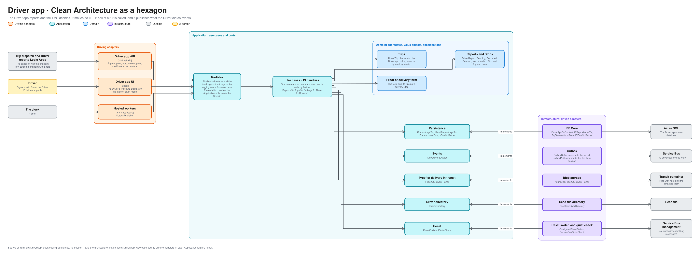
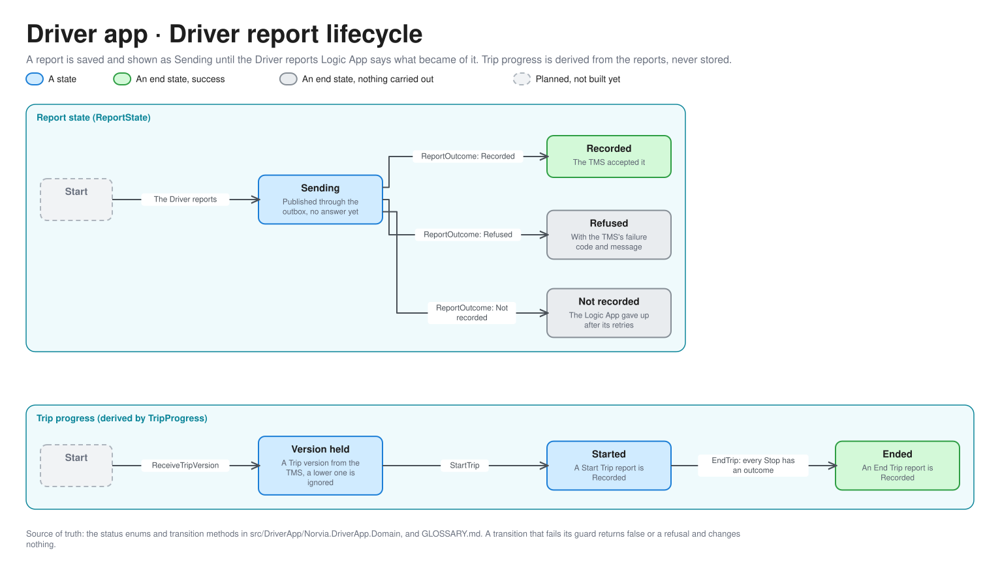

# Driver app architecture

How the Driver app is built inside, in the same hexagon as the [TMS](tms-architecture.md). For engineers and coding agents working on the Driver app. It reports and the TMS decides ([context map](context-map.md)). Terms are defined in [GLOSSARY.md](../../GLOSSARY.md).

The editable source is [driver-app-hexagon.excalidraw](diagrams/driver-app-hexagon.excalidraw), generated from [bounded_contexts.py](diagrams/bounded_contexts.py).

## What differs from the TMS

- **It makes no HTTP call at all.** It is called by the Trip dispatch Logic App and the Driver reports Logic App, and it tells the world what the Driver did by publishing events through its own outbox. It never calls the TMS ([ADR 0001](../adr/0001-realistic-applications-integrated-only-through-ais.md), [ADR 0016](../adr/0016-driver-reports-travel-as-driver-app-events-in-order-per-trip.md)). The tests hold both.
- **Presentation reaches the Application only, never the Domain.** The API and the UI send commands and queries and receive DTOs, with no domain type in sight.
- **It owns very little.** Only the Driver's view of a Trip version, and each report until the TMS has recorded it. Which Trip a Driver has, and whether a report is accepted, are the TMS's to say.
- **Three kinds of caller credential.** The Trip endpoint takes the Driver app's endpoint key (`X-Api-Key`). The outcome endpoint takes a token with the role `DriverReports.ReportOutcome`. The Driver's own actions take a token whose one app role is the Driver ID, and the API takes the Driver from that role and nowhere else ([ADR 0037](../adr/0037-drivers-sign-in-to-the-driver-app-with-entra-and-the-driver-id-is-their-app-role.md)).
- **It owns one Fault, `driver-app-unavailable`,** which makes it refuse every Trip version with a 503. The Fault contract is `Norvia.ServiceDefaults`' (off by default, expires by itself, `Demo.Fault` on `GET /v1/faults` and `PUT /v1/faults/{name}`); the Driver app only names its Fault and asks `IDriverAppFaults` whether it is on. The state is held in the process, so a restart switches it off.
- **Its events go to a topic of their own.** `driver-app-events`, with a session per Trip number, so one Trip's reports are read one at a time and in order.

## Use cases

11 handlers in 4 feature folders.

| Feature folder | Handlers | What they do |
|---|---|---|
| `Reports` | 5 | Start a Trip, report a Stop (Collected, Collection failed, Delivery failed, Damaged), deliver with a Proof of delivery, end a Trip, and record the outcome the Logic App reports |
| `Trips` | 3 | Receive a Trip version (taken, or ignored if it is not newer), and read a Driver's Trips and one Stop |
| `Reset` | 2 | Report whether a reset is allowed, and reset |
| `Drivers` | 1 | List the Drivers the sign-in page offers |

Pipeline behaviours add the tracking-contract keys to the logging scope for the commands that start, report, deliver, end, receive a version or record an outcome.

## Ports and adapters

| Port | Adapter | Talks to |
|---|---|---|
| `IRepository<T>`, `IReadRepository<T>`, `ITransactionalData`, `IConflictRetrier` | `EfRepository<T>`, `SqlTransactionalData`, `EfConflictRetrier` on `DriverAppDbContext` | The Driver app's own Azure SQL database |
| `IDriverEventOutbox` | `OutboxBuffer` saves the report with its event, `OutboxPublisher` sends it in the Trip's session | Service Bus, `driver-app-events` |
| `IProofOfDeliveryTransit` | `AzureBlobProofOfDeliveryTransit` | The transit container, where files wait until the TMS has them |
| `IDriverDirectory` | `SeedFileDriverDirectory` | The seed file |
| `IResetSwitch`, `IQuietCheck` | `ConfiguredResetSwitch`, `ServiceBusQuietCheck` | Service Bus management |

## Reports

| Move | By | Guard |
|---|---|---|
| Report, Sending to Recorded, Refused or Not recorded | `ReportOutcome` | The Driver reports Logic App says what became of it. Only a report that is still Sending takes an outcome: a second outcome for the same report is acknowledged and ignored |
| Trip progress, to Version held | `ReceiveTripVersion` | The TMS sent a version. A repeat, or a lower version after a higher one, is acknowledged and ignored |
| Trip progress, to Started | `StartTrip` | A Start Trip report is Recorded. Until then a Stop cannot be completed |
| Trip progress, to Ended | `EndTrip` | An End Trip report is Recorded, which the TMS accepts only once every Stop has an outcome |

A Stop counts as completed once its outcome is Sending or Recorded, so the Driver can move on while the Logic App catches up. Trip progress is derived from the reports and never stored.

## Where a change goes

| You are adding | It goes in |
|---|---|
| A thing the Driver can report | A report kind and its rules in the Domain, a use case, a Canonical Model event, a row in [events.md](events.md), and the TMS side in [P12](../processes/tms/p12-trip-execution.md) |
| Something that needs the TMS | Not an HTTP call: an event the Driver reports Logic App turns into a TMS call |
