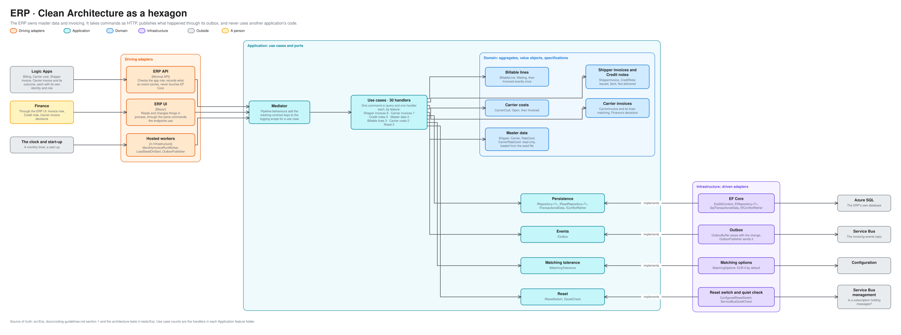

# ERP architecture

How the ERP is built inside, in the same hexagon as the [TMS](tms-architecture.md). For engineers and coding agents working on the ERP. The ERP owns master data, Contracts, Rate Cards and invoicing ([context map](context-map.md)), and its states are in [erp-lifecycles.md](erp-lifecycles.md). Terms are defined in [GLOSSARY.md](../../GLOSSARY.md).

The editable source is [erp-hexagon.excalidraw](diagrams/erp-hexagon.excalidraw), generated from [bounded_contexts.py](diagrams/bounded_contexts.py). The layers and the dependency rule are as for the TMS; this page covers what differs.

## What differs from the TMS

- **The UI changes things in process.** The TMS UI changes things through the TMS API ([ADR 0028](../adr/0028-the-tms-ui-reads-in-process-and-changes-things-through-the-tms-api.md)). The ERP UI sends the same commands the endpoints use, through its own mediator, and nothing reads the ERP over HTTP. There are no queries on the ERP API at all.
- **The API takes events and reports, not people's commands.** It records what a Canonical Model event carries (`TransportOrderBillable`, `CarrierCostIncurred`, a Carrier invoice) and the reports that say whether a document reached its recipient. Every endpoint needs an app role, and a repeat of a recording is idempotent on the sender's own key.
- **Master data comes from the seed file, and Finance edits the Shipper, the Carrier, the Rate Card, the Carrier Rate Card, the Vehicle and the Driver.** The ERP loads Shippers, Carriers, Rate Cards, Carrier Rate Cards, Vehicles and Drivers from the seed file at start-up, at Master-data revision 1, and shows them to Finance. A Shipper, a Carrier, a Rate Card, a Carrier Rate Card, a Vehicle or a Driver is edited through `PUT /v1/shippers/{id}`, `PUT /v1/carriers/{id}`, `PUT /v1/rate-cards/{id}`, `PUT /v1/carrier-rate-cards/{id}`, `PUT /v1/vehicles/{id}` or `PUT /v1/drivers/{id}` (role `MasterData.Manage`; a Rate Card is saved with its whole list of dated versions, which must not overlap) and replicated to the TMS ([E3](../processes/erp/e3-master-data-sync.md), [ADR 0050](../adr/0050-the-erp-replicates-each-master-data-change-to-the-tms-as-one-whole-record-event-with-a-revision.md)). That endpoint is the one exception to "the API takes events and reports, not people's commands". Finance's forms in the ERP UI send these saves through the API as the ERP's own identity.
- **One more worker.** `MonthlyInvoiceRunWorker` runs the monthly Invoice run. Finance's **Invoice now** runs the same use case for one Shipper.

## Use cases

30 handlers in 7 feature folders.

| Feature folder | Handlers | What they do |
|---|---|---|
| `ShipperInvoices` | 6 | Issue an invoice in an Invoice run, list and open invoices, record that one was sent or not delivered, send it again |
| `CarrierInvoices` | 7 | Receive an invoice and match each line, list the ones to decide, accept or reject a line, record that the Carrier was told |
| `CreditNotes` | 5 | Issue a Credit note on an invoice line, list them, record that one was sent or not delivered, send it again |
| `MasterData` | 5 | Load master data from the seed file, and list Shippers, Carriers and both kinds of Rate Card |
| `BillableLines` | 3 | Record a Billable line as Waiting, and list the ones waiting for an Invoice run |
| `CarrierCosts` | 2 | Record a Carrier cost as Open, and list the open ones |
| `Reset` | 2 | Report whether a reset is allowed, and reset the estate |

Pipeline behaviours add the tracking-contract keys to the logging scope for the use cases that record, report or receive.

## Ports and adapters

| Port | Adapter | Talks to |
|---|---|---|
| `IRepository<T>`, `IReadRepository<T>`, `ITransactionalData`, `IConflictRetrier` | `EfRepository<T>`, `SqlTransactionalData`, `EfConflictRetrier` on `ErpDbContext` | The ERP's own Azure SQL database |
| `IOutbox` | `OutboxBuffer` saves the message with the change, `OutboxPublisher` sends it | Service Bus, the `invoicing-events` topic |
| `IMatchingTolerance` | `MatchingOptions`, EUR 0 by default | Configuration |
| `IResetSwitch`, `IQuietCheck` | `ConfiguredResetSwitch`, `ServiceBusQuietCheck` | Service Bus management |

## What the architecture tests hold

On top of the layer rules every application has, [the ERP's tests](../../tests/Erp/Norvia.Erp.ArchitectureTests/) hold that the API does not use Entity Framework, so every read and write goes through a use case, and that the ERP never uses another application's code (ADR 0001).

## Where a change goes

| You are adding | It goes in |
|---|---|
| A rule about invoices, Credit notes or matching | The aggregate or a rules class in the Domain, and a transition in [erp-lifecycles.md](erp-lifecycles.md) |
| A new event the ERP publishes | A schema in the Canonical Model, a row in [events.md](events.md), and an outbox message in the handler |
| Something that arrives from the TMS | A Logic App that calls a new endpoint with its own role, never a subscription the ERP reads |
