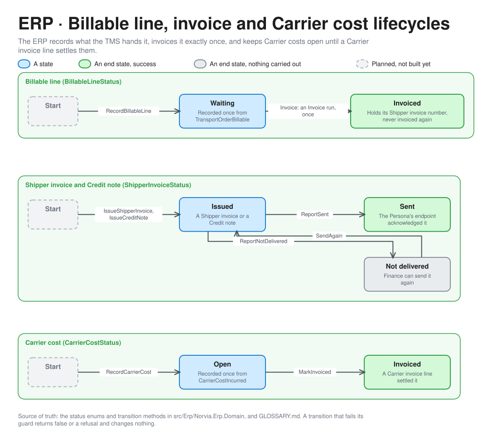
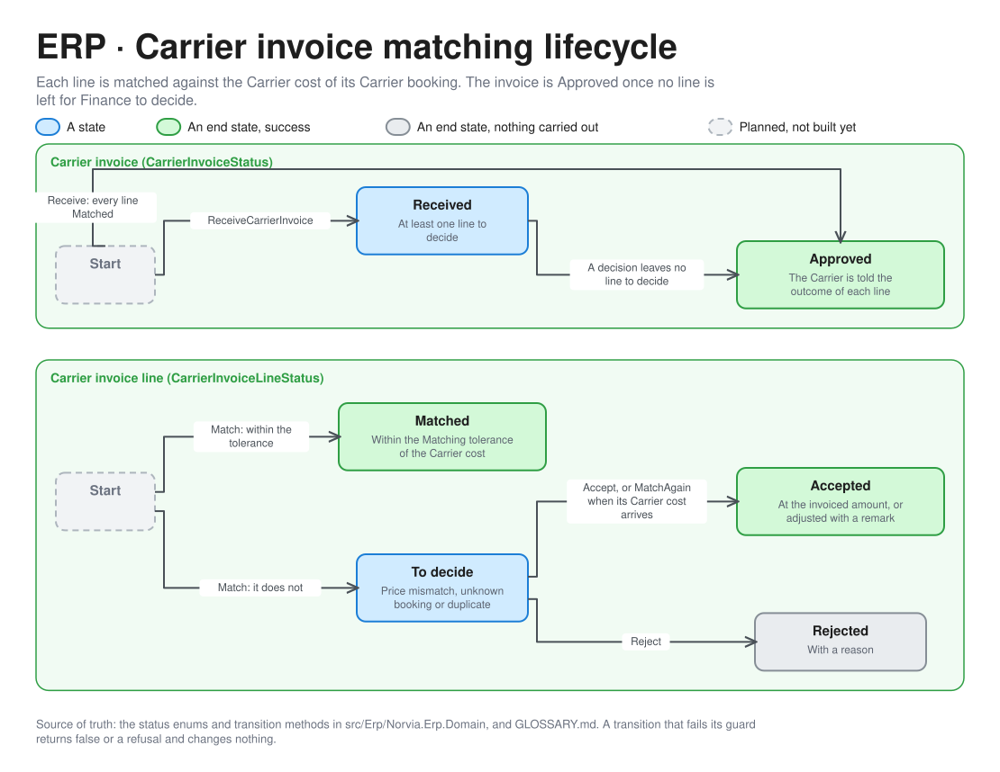

# ERP lifecycles

How the ERP's aggregates move through their states, with the domain method behind each move and its guard. For engineers and coding agents working on the ERP, and for Finance's view of what a status means. These are the Domain at the centre of the [ERP hexagon](erp-architecture.md). Terms are defined in [GLOSSARY.md](../../GLOSSARY.md). A transition that fails its guard returns `false` or a refusal with a stable code and changes nothing.

## Billable lines, invoices and Carrier costs

| Aggregate | Moves | By | Guard |
|---|---|---|---|
| Billable line | Start to Waiting | `RecordBillableLine` | `TransportOrderBillable` arrives. Recording is idempotent on the Transport Order number, and the Freight Charge is never recalculated ([ADR 0012](../adr/0012-the-tms-decides-when-to-bill-the-erp-invoices.md)) |
| Billable line | Waiting to Invoiced | `Invoice` | An Invoice run, monthly or Finance's **Invoice now**, puts it on a Shipper invoice. It holds that invoice's number and is never invoiced again |
| Shipper invoice, Credit note | Start to Issued | `IssueShipperInvoice`, `IssueCreditNote` | An invoice has one line per Transport Order and a number `INV-<year>-<6 digits>` from a gapless sequence. A Credit note reverses all or part of an invoice line, with a reason |
| Shipper invoice, Credit note | Issued to Sent | `ReportSent` | The Shipper invoice Logic App delivered it to the Persona's endpoint |
| Shipper invoice, Credit note | Issued to Not delivered | `ReportNotDelivered` | It gave up, after its retries or on a client error. `ShipperInvoiceNotDelivered` is published |
| Shipper invoice, Credit note | Not delivered to Issued | `SendAgain` | Finance sends it again |
| Carrier cost | Start to Open | `RecordCarrierCost` | `CarrierCostIncurred` arrives. Idempotent on the Carrier booking number |
| Carrier cost | Open to Invoiced | `MarkInvoiced` | A Carrier invoice line was Matched or accepted against it |

## Carrier invoices

| Aggregate | Moves | By | Guard |
|---|---|---|---|
| Line | Start to Matched, or to To decide | Matching, on receipt | The line's amount is within the Matching tolerance (EUR 0 by default) of the Carrier cost of its Carrier booking. Otherwise its result says why: Price mismatch, Unknown booking or Duplicate |
| Line | To decide to Accepted | `Accept` | Finance accepts at the invoiced amount, or with a remark at an adjusted one. The Carrier cost becomes Invoiced |
| Line | To decide to Accepted | `MatchAgain` | An Unknown booking line whose Carrier cost has now arrived is matched again, and a Matched line is accepted at once. Lines Finance already decided are left alone |
| Line | To decide to Rejected | `Reject` | Finance rejects with a reason |
| Invoice | Start to Approved, or to Received | `ReceiveCarrierInvoice` | Approved on receipt if every line Matched. Idempotent on the Carrier and its invoice number |
| Invoice | Received to Approved | `ApproveWhenDecided` | No line is left To decide. `CarrierInvoiceApproved` is published once, and the Carrier is told the outcome of each line |

## Keeping it true

The states and moves come from the status enums and transition methods in [src/Erp/Norvia.Erp.Domain](../../src/Erp/Norvia.Erp.Domain/). A PR that adds a status or a transition updates the picture and its table in the same PR. Edit the spec in [bounded_contexts.py](diagrams/bounded_contexts.py) and run it.
