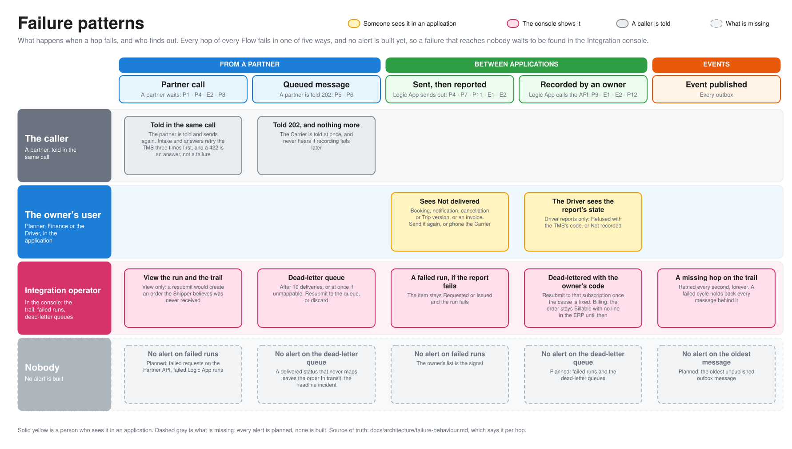

# Failure behaviour per Flow

What happens when each hop of each Flow fails: how often it is retried, where a message that can't be delivered ends up and with which `failureCode`, who is told, what the Integration console can do about it, and which as-found toggle breaks it. For engineers and coding agents working on the estate and for the technical audience of a demo. Azure is the estate [c4.md](c4.md) draws; what plays each piece locally is in [local-vs-azure.md](local-vs-azure.md). Terms are defined in [GLOSSARY.md](../../GLOSSARY.md), **Flow** included.

The page is also the as-found backlog. Everything marked *planned* is designed in a process doc or an ADR and not built yet, and that includes **every alert and every toggle**: the alerts and the toggles that remove them are built ([as-found](../operations/as-found.md)): every Logic App has a failed-run alert and every queue and subscription a Logic App reads has a dead-letter alert, and `infra/as-found.ps1 as-found` leaves some of them out. What is still *planned* is every other toggle, and the alerts for the hops that are not a Logic App or a queue (APIM, the outboxes, the workers).

## Reading the tables

One table per process, one row per Flow and hop type. A hop type is one of: an API Management policy (**APIM**), a Logic App run (**Logic App**), a Service Bus queue or subscription (**Subscription**, **Queue**), and the TMS's **outbox**, which publishes the events the subscriptions receive.

| Column | Holds |
|---|---|
| Retry | What tries again, how often, and what it does not retry. Logic App HTTP actions retry with `exponential`, 3 times, 5 s to 20 s, on a timeout, a 429 and a 5xx. A 4xx other than 408 and 429 is the answer and is not retried |
| Dead letter and `failureCode` | Where a message goes when the hop gives up, and the stable `failureCode` of the hop's `outcome` ([tracking contract](../coding-guidelines.md#tracking-contract)). `Refused` is the answer the caller was meant to get; `Failed` and `DeadLettered` are failures |
| Alert | The alert that tells Norvia. The failed-run and dead-letter alerts are built; *None built* is a hop that is not a Logic App or a queue, and the planned one is named |
| Console | What the [Integration console](../operations/integration-console.md) can do. All of it is built: finding the hop on its Message trail, opening a Logic App run, the failed runs and dead-letter queue panels, and resubmit and discard |
| Toggle | The as-found toggle that makes the row worse: a Bicep switch (or a presenter-panel fault, a switch in the Partner portal's presenter panel) that reproduces what a health check would find. The alert toggles name their list; the others are *planned*. *None yet* means no process doc names one. A toggle that is built links to the [Check](../operations/estate-health-check.md#the-checklist) of the Estate health check that finds it |

Every command the TMS takes is idempotent ([coding guidelines §6](../coding-guidelines.md)), so a retry, a redelivery or a console resubmit that repeats something that already took effect is recorded once.

Hops that only fail in one place and look alike are written once: a Logic App whose first step maps with a .NET local function fails there with the run `Failed` and nothing sent to the TMS.

## Failure patterns

The editable source is [failure-patterns.excalidraw](diagrams/failure-patterns.excalidraw), generated from [resilience.py](diagrams/resilience.py). Every row in the tables below fails in one of these ways, which is the quickest way to know what to expect of a hop you have not read yet.

| Pattern | Hops | What happens | Who finds out |
|---|---|---|---|
| **A partner calls and waits** | The intake, the Carrier answer and the Carrier invoice, and a Shipper's queries | The Logic App retries the TMS or the ERP, and the answer goes back in the same call. A query has no Logic App | The caller, who sends again. The console shows the trail and the run, view only |
| **A partner's message is queued** | Carrier tracking and Proof of delivery | API Management answers `202` once the message is stored, and the Logic App records it later. It is dead-lettered with a failure code or redelivered up to the maximum delivery count | Nobody, until someone opens the dead-letter queue in the console |
| **Norvia sends outside and reports** | Carrier booking, Shipper notification, Carrier cancellation, Trip dispatch, the Shipper invoice and the Carrier invoice outcome | The message is completed first. The send is retried, and what became of it is reported to the owner as Not delivered | The Planner or Finance, in the owner's list, who sends again. A failed report fails the run |
| **A Logic App records into an owner** | Billing, Carrier cost and Driver reports | A refusal or a used-up retry dead-letters the message with the owner's code | The operator, in the console. A Driver also sees the report's state |
| **An application publishes an event** | Every outbox | Retried every second, forever, and a failed cycle holds back every message behind it | Nobody: the trail shows a hop that never happened |

Alerts are built for the Logic Apps and the dead-letter queues in the tables below ([as-found](../operations/as-found.md)); none for the rest, which is the as-found backlog.

## P1: Transport Order intake

Flow `transport-order-intake`, request-response ([ADR 0003](../adr/0003-http-in-events-out.md)). The Shipper is told the outcome in the answer, so nothing is dead-lettered.

| Hop | Retry | Dead letter and `failureCode` | Alert | Console | Toggle |
|---|---|---|---|---|---|
| **APIM** `submit-transport-order` | None. A call to the intake Logic App that fails is answered `BookingNotReceived` | No queue. `NoShipperForClient` and `NotAllowedToSubmit` (`Refused`, 403). `TransportOrderRejected` (`Refused`, 422, the Shipper's answer). `BookingNotReceived` (`Failed`) for any other answer. An error before the policy runs (a bad key or token) is traced with the error's reason as `failureCode` | None built. Planned: failed requests on the Partner API | View on the trail | *Planned*: none yet |
| **Logic App** `transport-order-intake` | `Submit_to_the_TMS` retries as above. The map, the caller check and a 4xx are not retried | The run fails with `CallerNotApiManagement` (not called by API Management, [ADR 0020](../adr/0020-only-api-management-may-call-the-intake-logic-app.md)), `TmsUnavailable` (retries used up) or `TmsCallRefused` (a 4xx other than 422). The Shipper is told `NOT_RECEIVED` and to send again. A 422 is a successful run | `alert-failed-runs-transport-order-intake`, a metric alert on the workflow's failed runs, emailed to `ESTATE_ALERT_EMAIL` ([as-found](../operations/as-found.md)) | View the run only. A resubmit would create a Transport Order the Shipper believes was not received | [`flowsWithoutFailedRunAlert`](../operations/estate-health-check.md#check-failed-run-alert) lists `transport-order-intake`: the rule is absent
| **TMS outbox** (`TransportOrderAccepted`, `TransportOrderRejected`) | Every second, oldest first, forever. See [the outbox](#the-tms-outbox) | Never dead-letters. A failed send logs `Publishing outbox messages failed` and records no outcome | None built | The publish shows as a hop only once it succeeded | *Planned*: see [the outbox](#the-tms-outbox) |
| **Subscription** `monitoring` on `transport-order-events` | Service Bus default: 10 deliveries | Service Bus dead-letters it with `MaxDeliveryCountExceeded`. Nobody reads the subscription, so nothing is delivered to fail | None built, on purpose: nothing reads the subscription, so the drift guard exempts it ([as-found](../operations/as-found.md#the-drift-guard)) | Resubmit to this subscription only, or discard | *Planned*: none |

## P2: Rating

The rating worker is inside the TMS and has no hop of its own on the integration layer.

| Hop | Retry | Dead letter and `failureCode` | Alert | Console | Toggle |
|---|---|---|---|---|---|
| **TMS rating worker** | The worker sweeps again on a timer, so a crash only delays rating | No dead letter. A Transport Order the Rate Card can't price is *Rating failed* with a stable code such as `NoMatchingLane`, `outcome` `Succeeded`: it is the rating's answer. The order stays Accepted | None built. Customer service's rating exceptions list is the safety net | Find it on the intake's trail by its `failureCode`. Re-rating is in the TMS UI, not the console | *Planned*: no alert on `TransportOrderRatingFailed` |
| **TMS outbox** (`TransportOrderRated`, `TransportOrderRatingFailed`) | As [the outbox](#the-tms-outbox) | As [the outbox](#the-tms-outbox) | None built | As P1 | *Planned*: an event nobody subscribes to |

## P3: Transport planning

| Hop | Retry | Dead letter and `failureCode` | Alert | Console | Toggle |
|---|---|---|---|---|---|
| **TMS outbox** (`ShipmentPlanned`, `ShipmentReassigned`, `ShipmentReleased`) | As [the outbox](#the-tms-outbox) | As [the outbox](#the-tms-outbox) | None built | As P1 | As [the outbox](#the-tms-outbox) |
| **Subscription** `carrier-booking` on `shipment-events` | The P4 Logic App's trigger is `receiveTopicMessages`, the auto-complete trigger, which completes the message when it takes it, so a failed run is not redelivered. Default 10 deliveries applies to a message no run takes | Service Bus dead-letters a message nobody takes with `MaxDeliveryCountExceeded`. A run that fails after the trigger leaves no message to dead-letter | `alert-dead-letter-carrier-booking`, a metric alert on the dead-lettered messages of the subscription, emailed to `ESTATE_ALERT_EMAIL` ([as-found](../operations/as-found.md)) | Resubmit to this subscription only, or discard | [`entitiesWithoutDeadLetterAlert`](../operations/estate-health-check.md#check-dlq-alert) lists `carrier-booking`: the rule is absent

## P4: Carrier booking

| Hop | Retry | Dead letter and `failureCode` | Alert | Console | Toggle |
|---|---|---|---|---|---|
| **Logic App** `carrier-booking`, map and credential | None | The map's hop is `Failed` with `ShipmentReleasedUnreadable` (the message isn't the release of a Carrier booking). The run fails and nothing is sent. The trigger completed the message, so there is no message to resubmit: the booking stays Requested, shows "not yet sent" and becomes overdue | `alert-failed-runs-carrier-booking`, a metric alert on the workflow's failed runs, emailed to `ESTATE_ALERT_EMAIL` ([as-found](../operations/as-found.md)) | View the run | [`flowsWithoutFailedRunAlert`](../operations/estate-health-check.md#check-failed-run-alert) lists `carrier-booking`: the rule is absent. [`carrierSecretInlined`](../operations/estate-health-check.md#check-secret-inlined) copies one Carrier's endpoint credential into the app's settings in clear text (P4); the workflow still reads from Key Vault
| **Logic App** `carrier-booking`, `Send_to_the_Carrier` | Retried as above. A 4xx from the Carrier is not | The Logic App reports the booking to the TMS as **Not delivered** with the status code and message, and the Planner sees it. The send's own hop is `Failed` with `CarrierUnavailable` (no answer, 408, 429 or 5xx) or `CarrierRefused` (another 4xx) | As above. The Planner's list is the signal too | View the run | As above. Presenter-panel fault `carrier-booking-endpoint-down`: a Carrier's booking endpoint answers 503 ([as-found](../operations/as-found.md#faults-of-the-partner-portal))
| **Logic App** `carrier-booking`, report to the TMS | Retried as above | `TmsUnavailable` (retries used up) or `TmsCallRefused` (a 4xx), outcome `Failed`. The booking stays Requested until overdue | As above | View the run | As above
| **APIM** `answer-carrier-booking` | None | `NoCarrierForClient`, `NotAllowedToRespond` (`Refused`, 403); `CarrierAnswerUnreadable`, `CarrierNotAllowed`, `BookingNotFound` and `BookingNotOpen` (`Refused`, from the Logic App's 400, 403, 404 and 409); `AnswerNotReceived` (`Failed`) for any other answer, so when the Logic App can't be reached, and also for a 422 `ReferenceInUse`, which the Logic App's own run records as the code it names | None built | View on the trail | *Planned* |
| **Logic App** `carrier-answer` | `Answer_to_the_TMS` retries as above | The Carrier is told in the answer, so nothing is dead-lettered. The run fails with `CarrierAnswerUnreadable` (400), `CarrierNotAllowed` (403), `BookingNotFound` (404), `BookingNotOpen` (409), `ReferenceInUse` (422), `TmsCallRefused` or `TmsUnavailable`. `CallerNotApiManagement` as P1 | `alert-failed-runs-carrier-answer`, a metric alert on the workflow's failed runs, emailed to `ESTATE_ALERT_EMAIL` ([as-found](../operations/as-found.md)) | View the run only: the Carrier already has its answer | [`flowsWithoutFailedRunAlert`](../operations/estate-health-check.md#check-failed-run-alert) lists `carrier-answer`: the rule is absent. Presenter-panel fault `carrier-answer-unmapped-reason`: a reason code the map can't read ([as-found](../operations/as-found.md#faults-of-the-partner-portal))
| **TMS outbox** (`CarrierBooking*`) | As [the outbox](#the-tms-outbox) | As [the outbox](#the-tms-outbox) | None built | As P1 | As [the outbox](#the-tms-outbox) |

## P5: Shipment tracking

Flow `carrier-tracking`. The Carrier gets `202 Accepted` and never learns what happens next ([ADR 0008](../adr/0008-carrier-tracking-events-are-accepted-asynchronously.md)), so the hops after the queue are where the headline incident hides.

| Hop | Retry | Dead letter and `failureCode` | Alert | Console | Toggle |
|---|---|---|---|---|---|
| **APIM** `submit-carrier-tracking` | None. The Carrier retries a `503` | `TrackingNotQueued` (`Failed`, 503). `NoCarrierForClient`, `NotAllowedToSubmitTracking` (`Refused`, 403) | None built | View on the trail | *Planned*: none |
| **Queue** `carrier-tracking` | Lock 1 minute, maximum delivery count 10 | After 10 deliveries Service Bus dead-letters with `MaxDeliveryCountExceeded`. An expired message is dead-lettered too | `alert-dead-letter-carrier-tracking`, a metric alert on the namespace's dead-lettered messages, emailed to `ESTATE_ALERT_EMAIL` ([as-found](../operations/as-found.md)) | Resubmit to the queue, or discard with a reason | [`entitiesWithoutDeadLetterAlert`](../operations/estate-health-check.md#check-dlq-alert) lists `carrier-tracking`: the rule is absent ([as-found](../operations/as-found.md)) |
| **Logic App** `carrier-tracking`, map | None | Dead-lettered by the Logic App as `UnmappableTrackingMessage`: the Carrier's status code is not in the code list. The run fails | `alert-failed-runs-carrier-tracking`, a metric alert on the workflow's failed runs, emailed to `ESTATE_ALERT_EMAIL` ([as-found](../operations/as-found.md)) | View the run; resubmit the message once the map is fixed | [`flowsWithoutFailedRunAlert`](../operations/estate-health-check.md#check-failed-run-alert) lists `carrier-tracking`: the rule is absent. Presenter-panel fault `carrier-tracking-unmapped-code`: a Delivered event sent as `DLV`, which the Carrier still hears `202` for ([as-found](../operations/as-found.md#faults-of-the-partner-portal)) |
| **Logic App** `carrier-tracking`, `Record_in_the_TMS` | None in the action. The queue redelivers | A 4xx from the TMS: dead-lettered with the TMS's own code (such as `ShipmentNotFound`) or `TmsCallRefused`. No answer, 408, 429 or 5xx: abandoned back to the queue, run fails with `TmsUnavailable`, then `MaxDeliveryCountExceeded` | As above | As above | Presenter-panel fault `tms-tracking-event-api-failing`: the Tracking event API answers 503 for a few minutes, so messages wait on the queue and are retried; `tms-unavailable` does the same with the whole TMS ([as-found](../operations/as-found.md#faults-of-the-tms-and-the-driver-app)) |
| **TMS outbox** (`Shipment*`, `ShipmentExceptionReported`) | As [the outbox](#the-tms-outbox) | As [the outbox](#the-tms-outbox) | None built | As P1 | [`staleThresholdsUnset`](../operations/estate-health-check.md#check-stale-thresholds): the Stale thresholds are unset, so a quiet Shipment is never flagged Stale and the business side is not told either ([as-found](../operations/as-found.md#business-safety-nets-and-api-management)) |

## P6: Proof of delivery

Flow `carrier-proof-of-delivery`: a claim check, so the message is a reference to a blob in the inbound container ([ADR 0009](../adr/0009-carrier-proofs-of-delivery-use-a-claim-check.md)).

| Hop | Retry | Dead letter and `failureCode` | Alert | Console | Toggle |
|---|---|---|---|---|---|
| **APIM** `submit-carrier-proof-of-delivery` | None | `ProofOfDeliveryTooLarge` (`Failed`, 413, over 25 MB), `ProofOfDeliveryNotStored` and `ProofOfDeliveryNotQueued` (`Failed`, 503; the blob is written before the message is queued, so a blob can be left behind). `NoCarrierForClient`, `NotAllowedToSubmitProofOfDelivery` (`Refused`, 403) | None built | View on the trail | [`noInboundLifecycleRule`](../operations/estate-health-check.md#check-lifecycle-inbound) leaves the container without its lifecycle rule, so a blob left behind is never deleted (P6); [`noMalwareScanning`](../operations/estate-health-check.md#check-malware-scanning) leaves it without Defender for Storage malware scanning (P6) |
| **Queue** `carrier-proof-of-delivery` | Lock 5 minutes, maximum delivery count 10 | As the tracking queue: `MaxDeliveryCountExceeded` | `alert-dead-letter-carrier-proof-of-delivery`, a metric alert on the dead-lettered messages of the queue, emailed to `ESTATE_ALERT_EMAIL` ([as-found](../operations/as-found.md)) | Resubmit or discard | [`entitiesWithoutDeadLetterAlert`](../operations/estate-health-check.md#check-dlq-alert) lists `carrier-proof-of-delivery`: the rule is absent
| **Logic App** `carrier-proof-of-delivery`, blob and map | None | Dead-lettered as `ProofOfDeliveryBlobMissing` or `UnmappableProofOfDelivery`. The run fails | `alert-failed-runs-carrier-proof-of-delivery`, a metric alert on the workflow's failed runs, emailed to `ESTATE_ALERT_EMAIL` ([as-found](../operations/as-found.md)) | View the run; resubmit the message | [`flowsWithoutFailedRunAlert`](../operations/estate-health-check.md#check-failed-run-alert) lists `carrier-proof-of-delivery`: the rule is absent. Presenter-panel fault `carrier-proof-heic-photo`: a `.heic` photo, which the TMS refuses ([as-found](../operations/as-found.md#faults-of-the-partner-portal))
| **Logic App** `carrier-proof-of-delivery`, `Record_in_the_TMS` | None in the action. The queue redelivers | A 4xx: dead-lettered with the TMS's code (such as `FileNotAccepted`) or `TmsCallRefused`, and the blob kept. No answer, 408, 429 or 5xx: abandoned, run fails with `TmsUnavailable`. Success deletes the blob, then completes the message | As above | As above | As above, and the presenter-panel fault `tms-unavailable` for a TMS that is down. [`noInboundLifecycleRule`](../operations/estate-health-check.md#check-lifecycle-inbound) also leaves the blobs a failed message left behind to grow silently. *Planned*: the missing threshold unset

## P7: Exception handling

Flows `shipper-notification` and `carrier-cancellation`. Both complete their message as soon as it is mapped, then call the outside endpoint, so a failure past that point is reported to the TMS rather than dead-lettered, and nothing is retried beyond the Logic App's own retries.

| Hop | Retry | Dead letter and `failureCode` | Alert | Console | Toggle |
|---|---|---|---|---|---|
| **Subscription** `shipper-notification` | Default 10 deliveries | A message the map can't read is dead-lettered by the Logic App as `ShipperNotificationRequestedUnreadable`. Otherwise `MaxDeliveryCountExceeded` | `alert-dead-letter-shipper-notification`, a metric alert on the dead-lettered messages of the subscription, emailed to `ESTATE_ALERT_EMAIL` ([as-found](../operations/as-found.md)) | Resubmit to this subscription only, or discard | [`entitiesWithoutDeadLetterAlert`](../operations/estate-health-check.md#check-dlq-alert) lists `shipper-notification`: the rule is absent
| **Logic App** `shipper-notification`, `Send_to_the_Shipper` | Retried as above | The send's own hop is `Failed` with `ShipperUnavailable` (no answer, 408, 429 or 5xx) or `ShipperRefused` (another 4xx). The notification is reported **Not delivered** with the technical cause; the TMS publishes `ShipperNotificationNotDelivered` | `alert-failed-runs-shipper-notification`, a metric alert on the workflow's failed runs, emailed to `ESTATE_ALERT_EMAIL` ([as-found](../operations/as-found.md)) | View the run | [`flowsWithoutFailedRunAlert`](../operations/estate-health-check.md#check-failed-run-alert) lists `shipper-notification`: the rule is absent. Presenter-panel fault `shipper-notification-endpoint-down`: the Shipper endpoint answers 503 ([as-found](../operations/as-found.md#faults-of-the-partner-portal))
| **Logic App** `shipper-notification`, report to the TMS | Retried as above | `TmsUnavailable` or `TmsCallRefused`, outcome `Failed`. The notification stays Requested | As above | View the run | As above |
| **Subscription** `carrier-cancellation` | Default 10 deliveries | Unreadable: `CarrierCancellationUnreadable`. Otherwise `MaxDeliveryCountExceeded` | `alert-dead-letter-carrier-cancellation`, a metric alert on the dead-lettered messages of the subscription, emailed to `ESTATE_ALERT_EMAIL` ([as-found](../operations/as-found.md)) | Resubmit to this subscription only, or discard | [`entitiesWithoutDeadLetterAlert`](../operations/estate-health-check.md#check-dlq-alert) lists `carrier-cancellation`: the rule is absent
| **Logic App** `carrier-cancellation`, `Send_to_the_Carrier` | Retried as above | The send's own hop is `Failed` with `CarrierUnavailable` or `CarrierRefused`, as for a booking. The cancellation or withdrawal is reported not delivered: the Carrier booking is flagged **Carrier not told** and the Planner phones the Carrier. `CarrierCancellationNotDelivered` is published | `alert-failed-runs-carrier-cancellation`, a metric alert on the workflow's failed runs, emailed to `ESTATE_ALERT_EMAIL` ([as-found](../operations/as-found.md)) | View the run | [`flowsWithoutFailedRunAlert`](../operations/estate-health-check.md#check-failed-run-alert) lists `carrier-cancellation`: the rule is absent. Presenter-panel fault `carrier-cancellation-endpoint-down`: a Carrier's cancellation endpoint answers 503 ([as-found](../operations/as-found.md#faults-of-the-partner-portal))
| **Logic App** `carrier-cancellation`, report to the TMS | Retried as above | `TmsUnavailable` or `TmsCallRefused`, outcome `Failed` | As above | View the run | As above |
| **TMS outbox** (`Exception*`, `Shipper*`, `Carrier*`) | As [the outbox](#the-tms-outbox) | As [the outbox](#the-tms-outbox) | None built | As P1 | [`lateDeliveryCheckOff`](../operations/estate-health-check.md#check-late-delivery-check): the time-based Late delivery check is off, so a window that passes opens no Exception ([as-found](../operations/as-found.md#business-safety-nets-and-api-management)) |

## P8: Shipper visibility

Flow `shipper-tracking`. Queries go from API Management straight to the TMS, with no Logic App and no queue ([ADR 0003](../adr/0003-http-in-events-out.md)), so a failure is the caller's answer and is never kept.

| Hop | Retry | Dead letter and `failureCode` | Alert | Console | Toggle |
|---|---|---|---|---|---|
| **APIM** `list`, `get` and `find` Transport Orders, and `get` a Proof of delivery file | None. The Shipper polls again. 120 calls a minute per subscription | `NoShipperForClient`, `NotAllowedToReadTracking` (`Refused`, 403), a rate-limited call (`Refused`, 429), `TmsUnavailable` (`Failed`, 503, after the 5 s timeout or a 5xx), `TmsRefused` (the TMS's 4xx) and `TrackingNotMapped` (the TMS answered with a status or event the Shipper format has no code for; `Failed`) | None built | View on the trail. No panel: APIM's failures are findable by search only | Presenter-panel fault `tms-shipper-tracking-api-failing`: the TMS answers 503 for a few minutes and the Shipper sees `TmsUnavailable` at once. [`shipperTrackingCached`](../operations/estate-health-check.md#check-apim-cache): the three reads are answered from a cache that keeps the answer for a day, per Shipper, so the Shipper sees an old status after the TMS changed (`Answered the Shipper from the cache`, outcome `Succeeded`). [`noShipperRateLimit`](../operations/estate-health-check.md#check-apim-rate-limit): the policies have no rate limit ([as-found](../operations/as-found.md#business-safety-nets-and-api-management)) |

## P9: Freight settlement

Flows `billing` and `carrier-costs`. P9 hands the ERP two things: Billable Transport Orders and Carrier costs. The hops that carry them are the Billing and Carrier cost Logic Apps and their subscriptions, in the [E1](#e1-invoicing) and [E2](#e2-carrier-invoice-matching) tables below. The TMS's own part, publishing the events, is [the outbox](#the-tms-outbox).

## P10: Fleet capacity planning

No hops. [P10](../processes/tms/p10-fleet-capacity-planning.md) runs inside the TMS and leaves nothing at runtime, so there is nothing in the integration layer that can fail.

## P11: Trip dispatch

Flow `trip-dispatch`. The Logic App sends each Trip version to the Driver app and reports what became of it to the TMS, which shows the version Sending, Delivered or Not delivered.

| Hop | Retry | Dead letter and `failureCode` | Alert | Console | Toggle |
|---|---|---|---|---|---|
| **Subscription** `trip-dispatch` (P11) | Default 10 deliveries | Unreadable: `TripDispatchUnreadable`. Otherwise `MaxDeliveryCountExceeded` | `alert-dead-letter-trip-dispatch`, a metric alert on the dead-lettered messages of the subscription, emailed to `ESTATE_ALERT_EMAIL` ([as-found](../operations/as-found.md)) | Resubmit to this subscription only, or discard | [`entitiesWithoutDeadLetterAlert`](../operations/estate-health-check.md#check-dlq-alert) lists `trip-dispatch`: the rule is absent
| **Logic App** `trip-dispatch`, `Send_to_the_Driver_app` | Retried as above: exponential, 3 retries from 5 s up to 20 s, on a timeout, 408, 429 and 5xx | The send's own hop is `Failed` with `DriverAppUnavailable` or `DriverAppRefused`. The version is reported **Not delivered** with the technical cause and the TMS publishes `TripNotDelivered`. The Planner sends it again once the Driver app is back | `alert-failed-runs-trip-dispatch`, a metric alert on the workflow's failed runs, emailed to `ESTATE_ALERT_EMAIL` ([as-found](../operations/as-found.md)) | View the run | [`flowsWithoutFailedRunAlert`](../operations/estate-health-check.md#check-failed-run-alert) lists `trip-dispatch`: the rule is absent. Presenter-panel Fault `driver-app-unavailable` (`/presenter` in the Partner portal, [Faults](../operations/as-found.md#faults)): the Driver app refuses every Trip for the chosen few minutes, and the hop carries `fault`
| **Logic App** `trip-dispatch`, report to the TMS | Retried as above | `TmsUnavailable` or `TmsCallRefused`, outcome `Failed`. The version stays Sending | As above | View the run | As above |

## P12: Trip execution

Flow `trip-execution`. A Driver's reports leave the Driver app's outbox for a topic with sessions keyed by Trip number, so one Trip's reports are read one at a time and in order ([ADR 0016](../adr/0016-driver-reports-travel-as-driver-app-events-in-order-per-trip.md)). The Logic App records each in the TMS and tells the Driver app the outcome.

| Hop | Retry | Dead letter and `failureCode` | Alert | Console | Toggle |
|---|---|---|---|---|---|
| **Subscription** `driver-reports` (P12) | Default 10 deliveries | Unreadable: `DriverReportUnreadable`; a refusal keeps the TMS's code (`NotTripDay`, `TripNotDispatched`, ...) and `TmsUnavailable` is a TMS that was down; otherwise `MaxDeliveryCountExceeded` | `alert-dead-letter-driver-reports`, a metric alert on the dead-lettered messages of the subscription, emailed to `ESTATE_ALERT_EMAIL` ([as-found](../operations/as-found.md)) | Resubmit to this subscription only, or discard | [`entitiesWithoutDeadLetterAlert`](../operations/estate-health-check.md#check-dlq-alert) lists `driver-reports`: the rule is absent
| **Logic App** `driver-reports` (Flow `trip-execution`), `Send_the_report_to_the_TMS` (Start a Trip, Record a Tracking event for a Stop report, or Record a Proof of delivery with its files) | Retried as above, and the Trip's later reports wait behind it in the session | A refusal (client error) is dead-lettered with the TMS's code and message and reported **Refused**; a TMS that stays down is dead-lettered as `TmsUnavailable` and reported **Not recorded**, and the session moves on. A repeat of a Start or Stop report the TMS recorded is recognised by its Driver app event ID, a repeat of a Proof of delivery by its document ID. A refused Proof of delivery (a HEIC photo, `FileNotAccepted`) keeps its files in the transit container; an accepted one has them deleted | `alert-failed-runs-driver-reports`, a metric alert on the workflow's failed runs, emailed to `ESTATE_ALERT_EMAIL` ([as-found](../operations/as-found.md)) | View the run | [`flowsWithoutFailedRunAlert`](../operations/estate-health-check.md#check-failed-run-alert) lists `driver-reports`: the rule is absent. Presenter-panel faults: `tms-unavailable` (the TMS answers 503: the reports wait behind the first and go through in order if the retries outlast the fault) and `driver-app-heic-photo` (a Proof of delivery with an HEIC photo, refused with `FileNotAccepted`) ([as-found](../operations/as-found.md#faults-of-the-tms-and-the-driver-app))
| **Logic App** `driver-reports`, report to the Driver app | Retried as above | `DriverAppUnavailable` or `DriverAppRefused`, outcome `Failed`. The message is settled already, so the report stays **Sending** in the Driver app; the TMS has it anyway | As above | View the run | [`noReportBackToDriverApp`](../operations/estate-health-check.md#check-driver-report-back): the call is never made, so the report stays **Sending** in the Driver app although the TMS recorded it ([as-found](../operations/as-found.md#business-safety-nets-and-api-management)) |
| **Logic App** `driver-reports`, `Fetch_the_files` (a Proof of delivery's files) | None: a file that is gone fails the step | The run fails: the message is dead-lettered as `ProofOfDeliveryFilesGone` and the Driver app is told the Proof of delivery is **Not recorded**. Nothing was sent to the TMS | As above | View the run | As above |
| **Driver app outbox** (`TripStartReported`, `TripEndReported`, `StopCompletedReported`, `ProofOfDeliveryCaptured`) | Published every second, oldest first; a failed send is retried on the next cycle | The report is saved and shows Sending until the Logic App answers | None built | The outbox publishes it when Service Bus is back | *Planned* |

## E1: Invoicing

Flow `invoicing`, and the Billing Logic App that hands Billable Transport Orders to the ERP. The ERP issues Shipper invoices and Credit notes, and the Shipper invoice Logic App sends them to the Shipper.

| Hop | Retry | Dead letter and `failureCode` | Alert | Console | Toggle |
|---|---|---|---|---|---|
| **Subscription** `billing` (E1) | Default 10 deliveries; the lock lasts 5 minutes, long enough for the Logic App's retries | Unreadable: `BillableLineUnreadable`. A refusal keeps the ERP's code (`ShipperNotFound`, `BillableLineConflict`, `FreightChargeWithoutChargeLines`, `FreightChargeTotalMismatch`), a body the ERP can't read is `ErpCallRefused` and `ErpUnavailable` is an ERP that stayed down through the retries. Otherwise `MaxDeliveryCountExceeded` | `alert-dead-letter-billing`, a metric alert on the dead-lettered messages of the subscription, emailed to `ESTATE_ALERT_EMAIL` ([as-found](../operations/as-found.md)) (also listed in [P9](../processes/tms/p9-freight-settlement.md#deferred)) | Resubmit to this subscription only, or discard | [`entitiesWithoutDeadLetterAlert`](../operations/estate-health-check.md#check-dlq-alert) lists `billing`: the rule is absent
| **Subscription** `shipper-invoice` (E1) | Default 10 deliveries; the message is completed once it is mapped, so a later failure is not redelivered | Unreadable (an invoice or a Credit note): `ShipperInvoiceIssuedUnreadable`. Otherwise `MaxDeliveryCountExceeded` | `alert-dead-letter-shipper-invoice`, a metric alert on the dead-lettered messages of the subscription, emailed to `ESTATE_ALERT_EMAIL` ([as-found](../operations/as-found.md)) | Resubmit to this subscription only, or discard | [`entitiesWithoutDeadLetterAlert`](../operations/estate-health-check.md#check-dlq-alert) lists `shipper-invoice`: the rule is absent
| **Logic App** `shipper-invoice` (flow `invoicing`), `Send_to_the_Shipper` and the reports to the ERP | Exponential, 3 retries from 5 s up to 20 s, on a timeout, 408, 429 and 5xx. Another 4xx is not retried | The send's own hop is `Failed` with `ShipperUnavailable` (no answer, 408, 429 or 5xx) or `ShipperRefused` (another 4xx). The invoice or Credit note is then reported **Not delivered** to the ERP (`Report_the_invoice_not_delivered`) with the status code and a message of at most 500 characters, and the ERP publishes `ShipperInvoiceNotDelivered`; the Shipper invoices list shows "Not delivered" and Finance can **send again**. A report the ERP can't take (`ErpUnavailable`, `ErpCallRefused`) fails the run, and the invoice stays Issued without a sent time, which the list shows. A late or repeated report is ignored and logged by the ERP | Monitoring gets `ShipperInvoiceNotDelivered`. `alert-failed-runs-shipper-invoice`, a metric alert on the workflow's failed runs, emailed to `ESTATE_ALERT_EMAIL` ([as-found](../operations/as-found.md)) | View the run | [`flowsWithoutFailedRunAlert`](../operations/estate-health-check.md#check-failed-run-alert) lists `shipper-invoice`: the rule is absent. *Planned*: no alert on `ShipperInvoiceNotDelivered`
| **Logic App** `billing`, `Record_the_billable_line` | Exponential, 3 retries from 5 s up to 20 s, on a timeout, 408, 429 and 5xx. Another 4xx, a `409` conflict included, is not retried | Outcome `Failed` with the failure code above. The message is **dead-lettered** with `DeadLetterReason` the code and `DeadLetterErrorDescription` the ERP's message, and the run fails with `BillableLineNotRecorded`. The Transport Order stays Billable in the TMS and has no line in the ERP until the message is resubmitted | `alert-failed-runs-billing`, a metric alert on the workflow's failed runs, emailed to `ESTATE_ALERT_EMAIL` ([as-found](../operations/as-found.md)) | View the run | [`flowsWithoutFailedRunAlert`](../operations/estate-health-check.md#check-failed-run-alert) lists `billing`: the rule is absent

## E2: Carrier invoice matching

Flows `carrier-costs`, `carrier-invoice` and `carrier-invoices`. The ERP takes each Carrier cost from the TMS, matches Carrier invoices against them and tells the Carrier the outcome of each line.

| Hop | Retry | Dead letter and `failureCode` | Alert | Console | Toggle |
|---|---|---|---|---|---|
| **Subscription** `carrier-invoice-outcome` (E2) | Default 10 deliveries; the message is completed once it is mapped, so a later failure is not redelivered | Unreadable: `CarrierInvoiceApprovedUnreadable`. Dead-lettered with that reason; the run fails | `alert-dead-letter-carrier-invoice-outcome`, a metric alert on the dead-lettered messages of the subscription, emailed to `ESTATE_ALERT_EMAIL` ([as-found](../operations/as-found.md)) | View the run in the Integration console | [`entitiesWithoutDeadLetterAlert`](../operations/estate-health-check.md#check-dlq-alert) lists `carrier-invoice-outcome`: the rule is absent |
| **Logic App** `carrier-invoice-outcome` (flow `carrier-invoices`), `Send_to_the_Carrier` and the reports to the ERP | Exponential, 3 retries from 5 s up to 20 s, on a timeout, 408, 429 and 5xx. Another 4xx is not retried | The send's own hop is `Failed` with `CarrierUnavailable` (no answer, 408, 429 or 5xx) or `CarrierRefused` (another 4xx). The outcome is then reported **not delivered** to the ERP (`Report_the_outcome_not_delivered`) with the status code and a message of at most 500 characters; the ERP flags the Carrier invoice **Carrier not told** and publishes `CarrierInvoiceOutcomeNotDelivered`, and the Carrier invoices list shows the flag so Finance can phone the Carrier. A report the ERP can't take (`ErpUnavailable`, `ErpCallRefused`) fails the run, and the invoice shows neither a told time nor the flag. A late or repeated report is ignored and logged by the ERP | Monitoring gets `CarrierInvoiceOutcomeNotDelivered`. `alert-failed-runs-carrier-invoice-outcome`, a metric alert on the workflow's failed runs, emailed to `ESTATE_ALERT_EMAIL` ([as-found](../operations/as-found.md)) | View the run | [`flowsWithoutFailedRunAlert`](../operations/estate-health-check.md#check-failed-run-alert) lists `carrier-invoice-outcome`: the rule is absent. *Planned*: no alert on `CarrierInvoiceOutcomeNotDelivered`
| **Subscription** `carrier-cost` (E2) | Default 10 deliveries; the lock lasts 5 minutes, long enough for the Logic App's retries | Unreadable: `CarrierCostUnreadable`. A refusal keeps the ERP's code (`CarrierNotFound`, `CarrierCostConflict`, `CarrierCostWithoutChargeLines`, `CarrierCostTotalMismatch`), a body the ERP can't read is `ErpCallRefused` and `ErpUnavailable` is an ERP that stayed down through the retries. Otherwise `MaxDeliveryCountExceeded` | `alert-dead-letter-carrier-cost`, a metric alert on the dead-lettered messages of the subscription, emailed to `ESTATE_ALERT_EMAIL` ([as-found](../operations/as-found.md)) | Resubmit to this subscription only, or discard | [`entitiesWithoutDeadLetterAlert`](../operations/estate-health-check.md#check-dlq-alert) lists `carrier-cost`: the rule is absent
| **Logic App** `carrier-cost` (flow `carrier-costs`), `Record_the_carrier_cost` | Exponential, 3 retries from 5 s up to 20 s, on a timeout, 408, 429 and 5xx. Another 4xx, a `409` conflict included, is not retried | Outcome `Failed` with the failure code above. The message is **dead-lettered** with `DeadLetterReason` the code and `DeadLetterErrorDescription` the ERP's message, and the run fails with `CarrierCostNotRecorded`. The Carrier cost stays incurred in the TMS and is missing from the ERP until the message is resubmitted | `alert-failed-runs-carrier-cost`, a metric alert on the workflow's failed runs, emailed to `ESTATE_ALERT_EMAIL` ([as-found](../operations/as-found.md)) | View the run | [`flowsWithoutFailedRunAlert`](../operations/estate-health-check.md#check-failed-run-alert) lists `carrier-cost`: the rule is absent
| **APIM** `submit-carrier-invoice` (flow `carrier-invoice`, E2) | None | `NoCarrierForClient`, `NotAllowedToSubmit` (`Refused`, 403); `CarrierInvoiceUnreadable`, `CarrierNotAllowed`, `InvoiceNumberUsed` and `CarrierNotFound` (`Refused`, from the Logic App's 400, 403, 409 and 422); `InvoiceNotReceived` (`Failed`) for any other answer, so when the Logic App can't be reached | None built | View on the trail | *Planned* |
| **Logic App** `carrier-invoice`, `Receive_at_the_ERP` | Exponential, 3 retries from 5 s up to 20 s, on a timeout, 408, 429 and 5xx. Another 4xx is not retried | The Carrier is told in the answer, so nothing is dead-lettered: `INVOICE_NUMBER_USED` (409), `CARRIER_NOT_FOUND` (422), `INVALID` (400) or `NOT_RECEIVED` (502), each with a readable message. The call's hop is `Refused` with `CarrierInvoiceRefused`, `InvoiceNumberUsed` or `CarrierNotFound`, and `Failed` with `ErpCallRefused` or `ErpUnavailable`. The run fails with `CarrierInvoiceUnreadable` (the map refused the invoice, so the ERP wasn't called), `ErpCallRefused` or `ErpUnavailable`; a refusal the ERP gave is a business outcome the Carrier has been told, so its run succeeds. `CallerNotApiManagement` as P1 | `alert-failed-runs-carrier-invoice`, a metric alert on the workflow's failed runs, emailed to `ESTATE_ALERT_EMAIL` ([as-found](../operations/as-found.md)) | View the run only: the Carrier already has its answer | [`flowsWithoutFailedRunAlert`](../operations/estate-health-check.md#check-failed-run-alert) lists `carrier-invoice`: the rule is absent. *Planned* presenter-panel fault: a booking reference the map mangles, so every line is Unknown booking

## The TMS outbox

Every event in [events.md](events.md) leaves the TMS through its outbox ([ADR 0003](../adr/0003-http-in-events-out.md)), so every process above shares this row.

| Hop | Retry | Dead letter and `failureCode` | Alert | Console | Toggle |
|---|---|---|---|---|---|
| **TMS outbox** | Polled every second (`Outbox:PollingInterval`), 50 messages a batch (`Outbox:BatchSize`), oldest first. A send that fails is retried on the next cycle, without a limit. A send that succeeded but wasn't marked goes again with the same message ID | None. A failed cycle logs `Publishing outbox messages failed` and stops the batch, so one message Service Bus won't take holds back every message behind it. No `outcome` is recorded for a failed send. The `Succeeded` publish is a hop of its own named after the event | None built. Planned: the oldest unpublished outbox message | A message that isn't published shows as a missing hop, not a failed one | *Planned*: none yet |

## As-found candidates for P9 to P12, E1 and E2

The hops of P9 to P12, E1 and E2 are in the tables above. The as-found candidates their process docs name are built only where the table says so; the rest are not built yet. They join the Toggle column of the rows they break when they are:

| Process | Toggles not built |
|---|---|
| [P9](../processes/tms/p9-freight-settlement.md) | None left: the dead-letter alerts of `billing` and `carrier-cost` are built (`entitiesWithoutDeadLetterAlert`) |
| [P10](../processes/tms/p10-fleet-capacity-planning.md) | None named yet |
| [P11](../processes/tms/p11-trip-dispatch.md) | None left: the failed-run alert of `trip-dispatch` is built (`flowsWithoutFailedRunAlert`) |
| [P12](../processes/tms/p12-trip-execution.md) | None left: no report back to the Driver app is built (`noReportBackToDriverApp`), and so are the lifecycle rule on the transit container (`noTransitLifecycleRule`) and the alerts on failed Driver reports runs and their dead-letter queue |
| [E1](../processes/erp/e1-invoicing.md) | No alert on `ShipperInvoiceNotDelivered`. The alerts on failed Shipper invoice runs and the `billing` dead-letter queue are built |
| [E2](../processes/erp/e2-carrier-invoice-matching.md) | No alert on `CarrierInvoiceOutcomeNotDelivered`. The alert on the dead-letter queue of `carrier-cost` is built |

The Integration console's own candidates, Logic Apps without tracked properties and Application Insights retention shorter than run history, are built (`logicAppsWithoutTrackedProperties`, `appInsightsRetentionShort`; [as-found](../operations/as-found.md#storage-secrets-and-retention)).

## Agents

Agents ([ADR 0040](../adr/0040-agents-read-the-estate-through-api-management-have-no-write-tools-and-their-own-identity.md)) are built for the Estate health check's narration, the Customer service agent's Explain button on a Rejected booking and on a Transport Order (locally and in Azure, where the TMS UI asks the Agent published in Foundry as its own identity and the Agent reaches the TMS API's agent view through API Management) and the Integration operations agent's Explain buttons (on a Message trail, a failed run and a dead-lettered message) and its "what needs attention" summary, locally (the console's in-process runner and MCP stand-in, [ADR 0041](../adr/0041-locally-an-in-process-runner-and-an-mcp-stand-in-play-foundry-and-api-managements-mcp-server.md)) and in Azure (the console asks the Agent published in Foundry, which calls API Management's MCP server); the *planned* cells are alerts and toggles no slice has built yet. An Agent is never on a critical path: when a hop below fails, the host UI says "Assistant unavailable" and everything else works. There is a short timeout (20 seconds for a run) and no automatic retry. On the Estate health check the Findings are the Checks' own and stay on the page whatever the Agent does: only the narration says "Assistant unavailable", and a narration that explains a Finding the tool did not return is `AgentUnavailable` too.

| Hop | Retry | `failureCode` | Alert | Console | Toggle |
|---|---|---|---|---|---|
| **Foundry** (the model and the Agent loop; locally the in-process runner and its model) | None | `AgentUnavailable`, outcome `Failed`. The host application's Agent run span is marked `Failed`. In Azure that is Foundry answering anything but a completed response, a response that carries an error, or no answer within the timeout. A reply that does not match the expected schema (including an action other than resubmit, discard, fix-the-cause-first or needs-a-person), or that cites a result the run never had, is `AgentUnavailable` too | *Planned*: none | The failed run on the host's trail | *Planned*: no content filter or prompt shield, an unlimited model quota |
| **APIM** MCP server (a tool call; locally `Norvia.Integration.LocalAgentMcp`) | None | `AgentToolRefused` (`Refused`): no token, the wrong role, a rate limit (429) or a tool the Agent's definition does not list. The runner ends the run on a refused call, and on a call over the definition's cap; in Azure the Foundry client does the same from the tool calls the response lists (a call that carries an error, a tool the definition does not list, more calls than `maxToolCalls`) | *Planned*: none | The tool-call hop, tagged with the Agent's identity and the tool name | *Planned*: an Agent identity with a role wider than read, no per-Agent cap or rate limit |
| **Agent view** (the application's narrow read API) | As the application's own read API | The application's own failure codes. A 5xx is `AgentToolRefused` to the Agent, which says it could not read | None | The application's hop on the trail | *Planned*: none |
| **Host application**, the Agent run (the Integration console's Explain buttons and summary, the Estate health check's narration, the TMS UI's Explain buttons on a Rejected booking and a Transport Order, the ERP UI's Explain button on a Carrier invoice line that is To decide) | None | `AgentUnavailable` when the port times out or fails for any other reason. No dead letter, no queue | None | The Agent run span | *Planned*: `Agents:Enabled` on in a public Demo UI, no cost tag |
| **Foundry**, deleting the run's conversation (`IConversationCleanup`; for the Intake agent, before the draft is returned) | None. Best effort | `ConversationNotDeleted` on the run's span. The answer (or the draft) is still returned: the user is not punished for the cleanup | None. The sweeper deletes it that night | The Agent run span | [`noConversationSweeper`](../operations/estate-health-check.md#check-conversation-sweeper) (below) |
| **Logic App** `conversation-sweeper` (nightly, deletes every conversation and response older than a day) | Each delete three times, exponential | `ConversationNotDeleted`, outcome `Failed`, when a delete still fails: the run fails, with `deleted` and `notDeleted` counts | `alert-failed-runs-conversation-sweeper` | View the run | [`noConversationSweeper`](../operations/estate-health-check.md#check-conversation-sweeper): the Logic App is built stopped, so no run, no alert and the conversations pile up silently ([as-found](../operations/as-found.md#conversation-sweeper)) |

## Keeping it true

[FailureBehaviourTests](../../tests/Tms/Norvia.Tms.ArchitectureTests/FailureBehaviourTests.cs) fails when the estate declares something this page doesn't name:

- every `failureCode`, run error code and dead-letter reason in an APIM policy or a Logic App workflow;
- every Flow name in them;
- every queue and subscription in `messaging.bicep`.

What a row says about them is not checked, and neither are the AppHost's queues. The [coding guidelines §11](../coding-guidelines.md#11-workflow) rule that a PR changing a Flow, a Logic App or a subscription updates the matching architecture page keeps it current; so does a PR that builds an alert, a toggle or a console panel: it removes the *planned* from the rows it builds.
