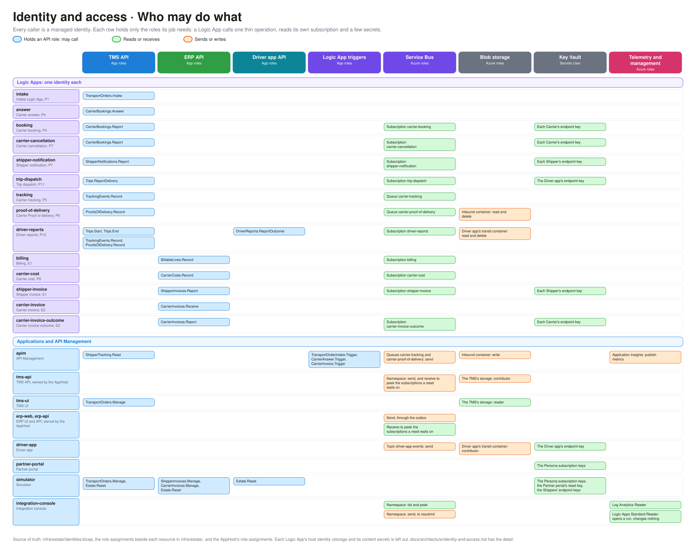
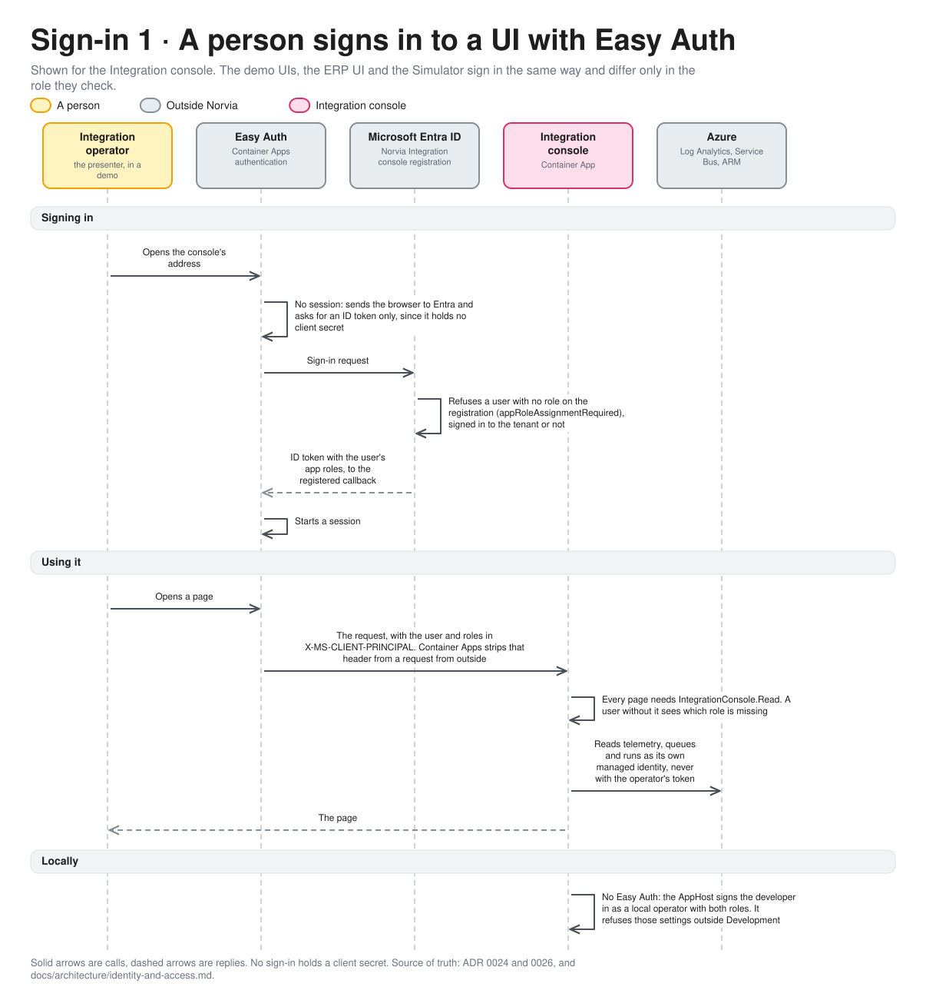
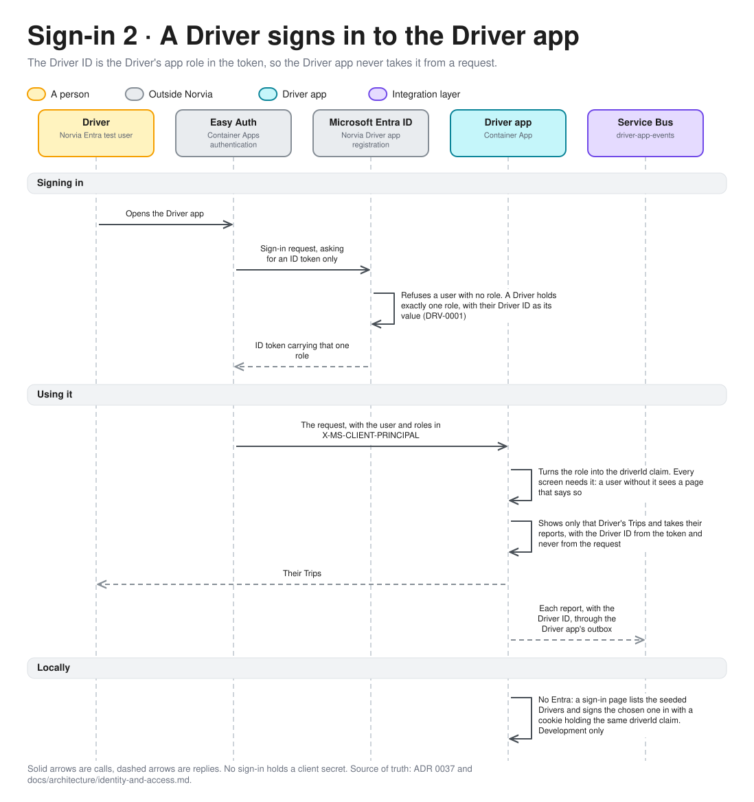
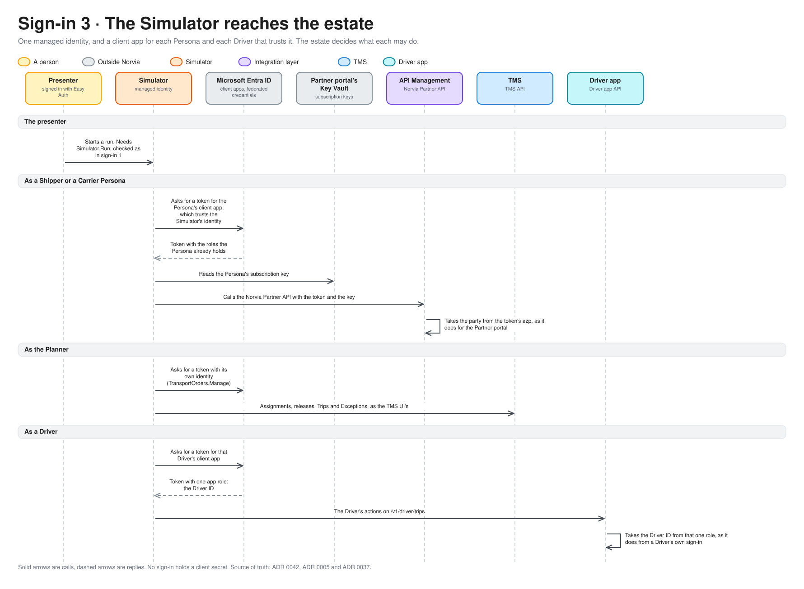

# Identity and access

Who each identity is in Entra, which app roles it holds, which APIs it may call, and which Service Bus subscriptions, containers and secrets it may read. For engineers and coding agents working on the estate and for the technical audience of a demo. Azure is the estate [c4.md](c4.md) draws; what plays Entra locally is in [local-vs-azure.md](local-vs-azure.md#the-map). Terms are defined in [GLOSSARY.md](../../GLOSSARY.md).

Everything is declared in [identities.bicep](../../infra/estate/identities.bicep) and the role assignments beside each resource in [infra/estate/](../../infra/estate/). No application holds a client secret: every caller is a managed identity, and the Persona client apps trust the Partner portal's managed identity, and the Simulator's, through federated credentials ([ADR 0005](../adr/0005-partner-identity-comes-from-the-token.md), [ADR 0042](../adr/0042-the-simulator-signs-in-with-easy-auth-reaches-the-estate-as-its-own-identity-and-plays-the-personas-and-drivers-through-entra-client-apps.md)). There is no drift test for this page; the [coding guidelines §11](../coding-guidelines.md#11-workflow) rule that a PR changing an app role updates the matching architecture page keeps it current.

## The access grid

The editable source is [identity-access.excalidraw](diagrams/identity-access.excalidraw), generated from [access.py](diagrams/access.py) in the [grid style](diagrams/README.md#grid-style). Read a row to see everything one identity may do, and a column to see who may reach one resource. The tables below have the detail and the reasons.

## The API audiences

An app role belongs to the app registration of the API it guards. Each registration is an audience; the caller asks Entra for a token for that audience.

| App registration | Audience | Who may get a token | Roles it defines |
|---|---|---|---|
| **Norvia TMS API** | `api://<tenant>/norvia-tms-<env>` | Only principals granted one of its roles (`appRoleAssignmentRequired`) | The [TMS API roles](#tms-api-roles) |
| **Norvia ERP API** | `api://<tenant>/norvia-erp-api-<env>` | Only principals granted its role (`appRoleAssignmentRequired`) | `BillableLines.Record`, which the [Billing Logic App](../processes/erp/e1-invoicing.md#erp-api) holds, `ShipperInvoices.Report`, which the Shipper invoice Logic App holds, `ShipperInvoices.Manage` and `CarrierInvoices.Manage`, which the Simulator holds, `CarrierCosts.Record`, which the Carrier cost Logic App holds, `CarrierInvoices.Receive`, which the Carrier invoice Logic App holds, and `CarrierInvoices.Report`, which the Carrier invoice outcome Logic App holds |
| **Norvia Partner API** | `api://<tenant>/norvia-partner-api-<env>` | Any Persona, holding a role or not, so a Carrier Persona calling a Shipper operation gets 403 from API Management, which the demo shows | The [Partner API roles](#partner-api-roles) |
| **Norvia booking draft API** | `api://<tenant>/norvia-booking-draft-api-<env>` | Only API Management (`appRoleAssignmentRequired`) | `BookingDrafts.Create`, which only API Management's identity holds. The Booking draft host takes this token and nothing else, and checks the token's `azp` is API Management's too |
| **Norvia intake Logic App trigger** | `api://<tenant>/norvia-intake-trigger-<env>` | Only API Management | `TransportOrderIntake.Trigger` |
| **Norvia Carrier-answer Logic App trigger** | `api://<tenant>/norvia-answer-trigger-<env>` | Only API Management | `CarrierAnswer.Trigger` |
| **Norvia Carrier invoice Logic App trigger** | `api://<tenant>/norvia-carrier-invoice-trigger-<env>` | Only API Management | `CarrierInvoice.Trigger` |

The three Logic App triggers sit behind Easy Auth, and the workflow's first step refuses a call that Easy Auth didn't authenticate as API Management ([ADR 0020](../adr/0020-only-api-management-may-call-the-intake-logic-app.md)). The other Logic Apps have no HTTP caller: they read a Service Bus subscription or queue.

## Managed identities

| Identity (`id-…`) | Is | Holds in the TMS API | Other access |
|---|---|---|---|
| `intake` | The intake Logic App (P1) | `TransportOrders.Intake` | |
| `answer` | The Carrier-answer Logic App (P4) | `CarrierBookings.Answer` | |
| `booking` | The Carrier booking Logic App (P4) | `CarrierBookings.Report` | Receives the `carrier-booking` subscription. Reads each Carrier's endpoint key |
| `carrier-cancellation` | The Carrier cancellation Logic App (P7) | `CarrierBookings.Report` | Receives the `carrier-cancellation` subscription. Reads each Carrier's endpoint key |
| `shipper-notification` | The Shipper notification Logic App (P7) | `ShipperNotifications.Report` | Receives the `shipper-notification` subscription. Reads each Shipper's endpoint key |
| `trip-dispatch` | The Trip dispatch Logic App (P11) | `Trips.ReportDelivery` | Receives the `trip-dispatch` subscription. Reads the Driver app's endpoint key |
| `shipper-invoice` | The Shipper invoice Logic App (E1) | `ShipperInvoices.Report` on the ERP API; nothing on the TMS | Receives the `shipper-invoice` subscription. Reads each Shipper's endpoint key |
| `carrier-invoice` | The Carrier invoice Logic App (E2) | `CarrierInvoices.Receive` on the ERP billing API; nothing on the TMS | Reads no secret and no queue: API Management calls it |
| `carrier-invoice-outcome` | The Carrier invoice outcome Logic App (E2) | `CarrierInvoices.Report` on the ERP API; nothing on the TMS | Receives the `carrier-invoice-outcome` subscription. Reads each Carrier's endpoint key |
| `carrier-cost` | The Carrier cost Logic App (P9, E2) | `CarrierCosts.Record` on the ERP billing API; nothing on the TMS | Receives the `carrier-cost` subscription. Reads no secret |
| `billing` | The Billing Logic App (E1) | `BillableLines.Record` on the ERP billing API; nothing on the TMS | Receives the `billing` subscription. Reads no secret |
| `driver-reports` | The Driver reports Logic App (P12) | `Trips.Start`, `Trips.End`, `TrackingEvents.Record` and `ProofsOfDelivery.Record` on the TMS; `DriverReports.ReportOutcome` on the Driver app | Receives the `driver-reports` subscription. Reads and deletes files in the Driver app's transit container |
| `driver-app` | The Driver app (P11) | None: it reaches the TMS only through the integration layer | Reads the Driver app's endpoint key. Sends to the `driver-app-events` topic (P12). Its screens store Proof of delivery files in the Driver app's transit container |
| `tracking` | The Carrier-tracking Logic App (P5) | `TrackingEvents.Record` | Receives the `carrier-tracking` queue |
| `proof-of-delivery` | The Carrier Proof of delivery Logic App (P6) | `ProofsOfDelivery.Record` | Receives the `carrier-proof-of-delivery` queue. Reads and deletes blobs in the inbound container |
| `tms-ui` | The TMS UI | `TransportOrders.Manage` | |
| `apim` | API Management | `ShipperTracking.Read` | Holds `TransportOrderIntake.Trigger`, `CarrierAnswer.Trigger` and `CarrierInvoice.Trigger`. Sends to the `carrier-tracking` and `carrier-proof-of-delivery` queues. Writes blobs in the inbound container. Publishes telemetry to Application Insights |
| `partner-portal` | The Partner portal | `Demo.Fault` on the Driver app API and the TMS API | Reads the Persona subscription keys. Each Persona client app trusts it. Holds the custom role `Norvia Logic App Switch` on the Driver reports Logic App, and on nothing else in Azure Resource Manager (below). The presenter panel switches the Driver app's and the TMS's Faults as this identity, since the portal is the presenter's gate ([ADR 0024](../adr/0024-the-demo-uis-are-public-behind-an-entra-gate-for-the-presenter.md)) |
| `simulator` | The Simulator | `TransportOrders.Manage` and `Estate.Reset` on the TMS; `Estate.Reset` on the Driver app; `ShipperInvoices.Manage`, `CarrierInvoices.Manage` and `Estate.Reset` on the ERP API | Reads the Persona subscription keys, the Partner portal's reset key and the Shippers' endpoint keys, to read their invoices inboxes. Each Persona client app and each Driver client app trusts it ([ADR 0042](../adr/0042-the-simulator-signs-in-with-easy-auth-reaches-the-estate-as-its-own-identity-and-plays-the-personas-and-drivers-through-entra-client-apps.md)) |
| `integration-console` | The Integration console | | Reads the Log Analytics workspace. Reads the run history of every Logic App. On the Service Bus namespace it lists the queues and subscriptions (Reader), peeks dead-lettered messages (Data Receiver) and resubmits them (Data Sender) |

Each Logic App also has a **host identity** (`id-<name>-host-…`) that only the Logic Apps runtime uses: it owns the Logic App's own storage account and reads the one Key Vault secret holding that account's connection string, which Logic Apps Standard still needs for its content share. Nothing else uses it. The identities are separate on purpose: a Logic App's role in the TMS API is never the same principal as the one that runs its runtime.

Each role below is held by one principal, or by two where the process says so (`CarrierBookings.Report`, and `TrackingEvents.Record` and `ProofsOfDelivery.Record` with the Driver reports Logic App). That is the point of ADR 0005: nothing reaches the TMS without passing the integration layer, and a stolen identity can do one thing.

## TMS API roles

The TMS validates the token and the role; the Shipper or Carrier a call is for comes from API Management through the Logic App, never from a payload. The process docs' TMS API tables list the operations per process and link here for the holders.

| Role | Held by | Guards | Process |
|---|---|---|---|
| `TransportOrders.Intake` | `intake` | Submit a Transport Order | [P1](../processes/tms/p1-transport-order-intake.md) |
| `TransportOrders.Manage` | `tms-ui`, `simulator` | What the Planner and Customer service change in the TMS UI: re-rate, assign, release a Shipment, reassign, release without Proof of delivery, withdraw a Carrier booking, and every action on an Exception | [P2](../processes/tms/p2-rating.md), [P3](../processes/tms/p3-transport-planning.md), [P7](../processes/tms/p7-exception-handling.md) |
| `Estate.Reset` (on the TMS API, the Driver app API and the ERP API) | `simulator` | Reset the application to a clean sheet for the Simulator's Reset estate. Honoured only while the application's `Reset:Enabled` setting is on, which the estate switches on and which is off by default. The Partner portal has no token validation, so its reset takes an API key from the portal's vault (`reset-endpoint-key`) instead | [ADR 0039](../adr/0039-the-simulator-books-only-through-the-estates-real-doors.md#reset-estate) |
| `CarrierBookings.Answer` | `answer` | Record a Carrier's confirmation or rejection | [P4](../processes/tms/p4-carrier-booking.md) |
| `CarrierBookings.Report` | `booking`, `carrier-cancellation` | Report a Carrier booking's request, cancellation or withdrawal as sent or not delivered | [P4](../processes/tms/p4-carrier-booking.md), [P7](../processes/tms/p7-exception-handling.md) |
| `ShipperNotifications.Report` | `shipper-notification` | Report a Shipper notification as sent or not delivered | [P7](../processes/tms/p7-exception-handling.md) |
| `Trips.ReportDelivery` | `trip-dispatch` | Report a Trip version as delivered to the Driver app or not delivered | [P11](../processes/tms/p11-trip-dispatch.md#tms-api) |
| `DriverReports.ReportOutcome` (on the Driver app API) | `driver-reports` | Tell the Driver app whether the TMS recorded a Driver's report, refused it, or was never reached | [P12](../processes/tms/p12-trip-execution.md#driver-app) |
| One role per active Driver, its value the Driver ID (`DRV-0001`; on the Driver app API) | The Simulator's client app for that Driver, one each, which trusts `simulator` | Call the Driver app API's Driver actions (`/v1/driver/trips`) as that Driver. The API takes the Driver ID from the token's one role and nowhere else | [P12](../processes/tms/p12-trip-execution.md#driver-app), [ADR 0042](../adr/0042-the-simulator-signs-in-with-easy-auth-reaches-the-estate-as-its-own-identity-and-plays-the-personas-and-drivers-through-entra-client-apps.md) |
| `Demo.Fault` (on the Driver app API and the TMS API, and on any application that owns a Fault) | `partner-portal` | Switch the application's Faults on, for a few minutes, or off, from the presenter panel: `GET /v1/faults` and `PUT /v1/faults/{name}`. A caller with no token gets 401, one without the role 403. Locally the AppHost signs the presenter's token in with it ([Faults](../operations/as-found.md#faults)) | [P11](../processes/tms/p11-trip-dispatch.md), [P5](../processes/tms/p5-shipment-tracking.md), [P8](../processes/tms/p8-shipper-visibility.md), [P12](../processes/tms/p12-trip-execution.md) |
| `Trips.Start` | `driver-reports` | Start a Dispatched Trip for its Driver on the Trip's day | [P12](../processes/tms/p12-trip-execution.md#tms-api) |
| `Trips.End` | `driver-reports` | End an In progress Trip for its Driver once every Stop has an outcome | [P12](../processes/tms/p12-trip-execution.md#tms-api) |
| `TrackingEvents.Record` | `tracking` and `driver-reports` | Record a Tracking event, a Carrier's or a Driver's Stop report | [P5](../processes/tms/p5-shipment-tracking.md) |
| `ProofsOfDelivery.Record` | `proof-of-delivery` and `driver-reports` | Record a Proof of delivery with its files, a Carrier's or a Driver's | [P6](../processes/tms/p6-proof-of-delivery.md) |
| `ShipperTracking.Read` | `apim` | List, get and find a Shipper's Transport Orders, and read a current Proof of delivery file. The TMS trusts the Shipper ID header only from this caller | [P8](../processes/tms/p8-shipper-visibility.md) |

The TMS API's queries (Transport Orders, Shipments, Exceptions, Proof of delivery files) ask only for a valid token. Because Entra issues one only to a principal holding one of the roles above, in practice the callers are these identities. The TMS UI reads in process and uses the API to change things ([ADR 0028](../adr/0028-the-tms-ui-reads-in-process-and-changes-things-through-the-tms-api.md)).

## ERP API roles

The ERP billing API validates the token and the role, and takes everything else from the Canonical Model body.

| Role | Held by | Guards | Process |
|---|---|---|---|
| `BillableLines.Record` | The Billing Logic App's identity (`billing`) | Record a Billable line from `TransportOrderBillable` | [E1](../processes/erp/e1-invoicing.md#erp-api) |
| `CarrierCosts.Record` | The Carrier cost Logic App's identity | Record a Carrier cost from `CarrierCostIncurred` | [E2](../processes/erp/e2-carrier-invoice-matching.md#erp-api) |
| `CarrierInvoices.Receive` | The Carrier invoice Logic App's identity | Receive a Carrier invoice and match its lines. The Carrier ID in the body is the one API Management took from the token. | [E2](../processes/erp/e2-carrier-invoice-matching.md#erp-api) |
| `CarrierInvoices.Report` | The Carrier invoice outcome Logic App's identity (`carrier-invoice-outcome`) | Report the outcome of a Carrier invoice as told to the Carrier, or not delivered | [E2](../processes/erp/e2-carrier-invoice-matching.md#erp-api) |
| `ShipperInvoices.Report` | The Shipper invoice Logic App's identity (`shipper-invoice`) | Report a Shipper invoice as sent | [E1](../processes/erp/e1-invoicing.md#erp-api) |
| `CarrierInvoices.Manage` | The Simulator's identity (`simulator`) | Accept (at the invoiced or an adjusted amount) or reject a Carrier invoice line that waits for Finance, the Finance decisions the Simulator plays | [E2](../processes/erp/e2-carrier-invoice-matching.md#erp-api) |
| `CarrierInvoices.FinanceRejectionReasonAgent.Read` | The Carrier invoice rejection reason agent's identity only (locally `norvia-local-agent-finance-rejection-reason`, signed by the MCP stand-in) | Read what the Carrier can see of one of its Carrier invoice lines (`GET /v1/agent/finance-rejection-reason/…`). Read only; no endpoint on the view writes. A role of its own so the Agent that drafts a text for the Carrier cannot reach the Finance agent view | [E2](../processes/erp/e2-carrier-invoice-matching.md#draft-the-rejection-reason) |
| `CarrierInvoices.FinanceAgent.Read` | The Carrier invoice matching agent's identity only (locally `norvia-local-agent-finance-matching`, signed by the MCP stand-in) | Read the narrow agent view of one Carrier invoice line or of a whole Carrier invoice (`GET /v1/agent/finance/…`). Read only; no endpoint on the view writes | [E2](../processes/erp/e2-carrier-invoice-matching.md#explain-a-line-that-is-to-decide) |
| `ShipperInvoices.Manage` | The Simulator's identity (`simulator`) | Run Invoice now for a Shipper and issue a Credit note on an invoice line, the Finance actions the Simulator plays | [E1](../processes/erp/e1-invoicing.md#erp-api) |

## Partner API roles

API Management validates the Persona's token for each operation, takes the Shipper or Carrier from the token's `azp` claim, and passes it on. A Persona's client app holds only the roles its party needs.

| Role | Held by | Guards (Norvia Partner API) | Process |
|---|---|---|---|
| `TransportOrders.Submit` | Shipper Personas | Book a Transport Order | [P1](../processes/tms/p1-transport-order-intake.md) |
| `TransportOrders.Draft` | Shipper Personas | Ask the Intake agent for a Booking draft from pasted text. Locally the AppHost grants it to the Shipper Personas and the Partner API stand-in checks it; in Azure it is an app role of `Norvia Partner API (<env>)` (`identities.bicep`), granted to the Shipper Personas only, and the `booking-drafts` policy checks it | [P1](../processes/tms/p1-transport-order-intake.md#booking-draft-from-pasted-text) |
| `Tracking.Read` | Shipper Personas | Read a Shipper's Transport Orders with their Tracking status, and Proof of delivery files | [P8](../processes/tms/p8-shipper-visibility.md) |
| `CarrierBookings.Respond` | Carrier Personas | Confirm or reject a Carrier booking | [P4](../processes/tms/p4-carrier-booking.md) |
| `Tracking.Submit` | Carrier Personas | Report a Tracking event | [P5](../processes/tms/p5-shipment-tracking.md) |
| `ProofsOfDelivery.Submit` | Carrier Personas | Submit a Proof of delivery with its files | [P6](../processes/tms/p6-proof-of-delivery.md) |
| `CarrierInvoices.Submit` | Carrier Personas | Send a Carrier invoice and get each line's result. A Shipper Persona gets 403 | [E2](../processes/erp/e2-carrier-invoice-matching.md#carrier-invoice-format) |

The Personas come from [norvia.seed.json](../../seed/norvia.seed.json); each is a client app registration (`norvia-persona-<id>`) with no secret.

| Persona | Party | Roles |
|---|---|---|
| Brouwer Dranken | Shipper SHP-0001 | `TransportOrders.Submit`, `Tracking.Read` (and, locally, `TransportOrders.Draft`) |
| Tuincentrum Groenrijk | Shipper SHP-0003 | `TransportOrders.Submit`, `Tracking.Read` (and, locally, `TransportOrders.Draft`) |
| Van Dijk Transport | Carrier CAR-0001 | `CarrierBookings.Respond`, `Tracking.Submit`, `ProofsOfDelivery.Submit` |
| Kessler Spedition | Carrier CAR-0002 | as Van Dijk Transport |
| PakketPunt Express | Carrier CAR-0003 | as Van Dijk Transport |

A Persona also needs its own subscription key in API Management, which the Partner portal reads from its Key Vault. The key picks the product and the rate limit; the token supplies the identity.

## People

Users are assigned app roles on the enterprise application, not on an API. Entra refuses a user without a role before the app runs (`appRoleAssignmentRequired`).

| App registration | Role | Lets the user | Held by |
|---|---|---|---|
| **Norvia demo UIs** | `DemoUis.Use` | Open the TMS UI and the Partner portal in Azure ([ADR 0024](../adr/0024-the-demo-uis-are-public-behind-an-entra-gate-for-the-presenter.md)). The apps read no roles and don't know who signed in | The presenter, who ran `azd up` |
| **Norvia Integration console** | `IntegrationConsole.Read` | Search Message trails and open run details and message bodies. The console refuses a user without it ([ADR 0026](../adr/0026-the-integration-console-signs-operators-in-with-easy-auth-and-checks-their-app-role.md)) | The presenter, who plays the Integration operator |
| | `IntegrationConsole.Resubmit` | Also resubmit and discard dead-lettered messages ([resubmit and discard](../operations/integration-console.md#resubmit-and-discard)) | The presenter |
| **Norvia Simulator** | `Simulator.Run` | Configure, preview and start Simulation runs, cancel them and clear the history. A run sends orders, Shipments and Trips into the estate ([ADR 0042](../adr/0042-the-simulator-signs-in-with-easy-auth-reaches-the-estate-as-its-own-identity-and-plays-the-personas-and-drivers-through-entra-client-apps.md)) | The presenter, who plays the Simulator operator |
| | `Simulator.Read` | See runs and their logs | The presenter |
| **Norvia ERP** | `Finance` | Use the ERP's UI: its read-only master data, Invoice now and Credit notes ([E1](../processes/erp/e1-invoicing.md)), and the Carrier costs and Carrier invoices with the decisions on their lines ([E2](../processes/erp/e2-carrier-invoice-matching.md)). The ERP refuses a user without it | The presenter, who plays Finance |
| **Norvia Driver app** | One role per active seeded Driver, its value the Driver ID (`DRV-0001`) | Sign in to the Driver app as that Driver and see their Trips. The Driver app takes the Driver ID from this role and nowhere else ([ADR 0037](../adr/0037-drivers-sign-in-to-the-driver-app-with-entra-and-the-driver-id-is-their-app-role.md)), on its screens and on its API for the Driver's actions (`/v1/driver/trips`), where a caller that acts as the Driver, the Simulator, brings a token whose one app role is the Driver ID (in Azure from the Driver's client app for the Simulator, see the TMS API roles above) | The Driver's Entra test user, one per seeded Driver |

Someone else presenting or operating needs the role assigned in Entra ID. The presenter also holds two Azure RBAC roles for looking behind the scenes, both optional (`presenterPrincipalId` empty for none): **Azure Service Bus Data Receiver** on the namespace, to read messages in the Service Bus Explorer, and **Storage Blob Data Reader** on the inbound container.

## How people sign in

Three patterns, none with a client secret. Easy Auth asks Entra for an ID token only, which is all it needs, because it carries the user's app roles. In every picture, **Locally** is the last phase: no Entra and no Easy Auth, a stand-in signs a local user in, in Development only.

**1. A person signs in to a UI** (the demo UIs, the Integration console, the ERP UI, the Simulator). Easy Auth sends the browser to Entra, Entra refuses a user with no role on the registration, and the app reads the user and roles from `X-MS-CLIENT-PRINCIPAL`, which Container Apps strips from a request from outside. The pictures show the Integration console; the others differ only in the role they check, listed under [People](#people). The demo UIs read no role.

*Editable source: [sign-in-easy-auth.excalidraw](diagrams/sign-in-easy-auth.excalidraw), generated from [sign_in.py](diagrams/sign_in.py).*

**2. A Driver signs in to the Driver app.** The same Easy Auth, but the Driver's one app role has their Driver ID as its value, and the Driver app turns it into the `driverId` claim. The Driver ID is never taken from a request ([ADR 0037](../adr/0037-drivers-sign-in-to-the-driver-app-with-entra-and-the-driver-id-is-their-app-role.md)).

*Editable source: [sign-in-driver.excalidraw](diagrams/sign-in-driver.excalidraw).*

**3. The Simulator reaches the estate.** It signs in as in pattern 1, then asks Entra for a token as its own managed identity or, through a federated credential, as a Persona's or a Driver's client app. What each may do is what the estate granted that client app ([ADR 0042](../adr/0042-the-simulator-signs-in-with-easy-auth-reaches-the-estate-as-its-own-identity-and-plays-the-personas-and-drivers-through-entra-client-apps.md)).

*Editable source: [sign-in-simulator.excalidraw](diagrams/sign-in-simulator.excalidraw).*

## What each identity may read

Azure RBAC, scoped as narrowly as the resource allows, so an identity sees its own messages and nothing else.

| Resource | Scope | Identity | Azure role |
|---|---|---|---|
| Service Bus subscription `carrier-booking` | The subscription | `booking` | Data Receiver |
| Service Bus subscription `shipper-notification` | The subscription | `shipper-notification` | Data Receiver |
| Service Bus subscription `carrier-cancellation` | The subscription | `carrier-cancellation` | Data Receiver |
| Service Bus subscription `trip-dispatch` | The subscription | `trip-dispatch` | Data Receiver |
| Service Bus subscription `billing` | The subscription | `billing` | Data Receiver |
| Service Bus subscription `carrier-cost` | The subscription | `carrier-cost` | Data Receiver |
| Service Bus subscription `shipper-invoice` | The subscription | `shipper-invoice` | Data Receiver |
| Service Bus subscription `driver-reports` | The subscription | `driver-reports` | Data Receiver |
| Service Bus topic `driver-app-events` | The topic | `driver-app` | Data Sender |
| Service Bus queue `carrier-tracking` | The queue | `apim` | Data Sender |
| | | `tracking` | Data Receiver |
| Service Bus queue `carrier-proof-of-delivery` | The queue | `apim` | Data Sender |
| | | `proof-of-delivery` | Data Receiver |
| Inbound container for Proof of delivery files | The container | `apim`, `proof-of-delivery` | Storage Blob Data Contributor |
| Driver app's transit container for Proof of delivery files | The container | `driver-app`, `driver-reports` | Storage Blob Data Contributor |
| Partner portal's Key Vault | The vault | `partner-portal`, `simulator` | Key Vault Secrets User |
| Each Carrier endpoint key | The secret | `booking`, `carrier-cancellation` | Key Vault Secrets User |
| Each Shipper endpoint key | The secret | `shipper-notification`, `shipper-invoice` | Key Vault Secrets User |
| The Driver app's endpoint key (`driver-app-endpoint-key`, in the Driver app's Key Vault) | The secret | `driver-app`, `trip-dispatch` | Key Vault Secrets User |
| Logic App's content connection string | The secret | The Logic App's host identity | Key Vault Secrets User |
| Logic App's storage account | The account | The Logic App's host identity | Blob Data Owner, Queue and Table Data Contributor, Account Contributor |
| Log Analytics workspace | The workspace | `integration-console` | Log Analytics Reader |
| Each Logic App | The app | `integration-console` | Logic Apps Standard Reader, so it opens a run and changes nothing |
| Application Insights | The component | `apim` | Monitoring Metrics Publisher |
| Service Bus namespace | The namespace | `integration-console` | Reader, Data Receiver and Data Sender |

The one wide grant is the Integration console's on the Service Bus namespace. It has to find a dead-lettered message in any queue or subscription, and resubmit or discard it, so it holds Reader to list them, Data Receiver to peek and to complete the original, and Data Sender to send the copy ([ADR 0017](../adr/0017-the-integration-console-reads-the-estates-telemetry-and-stores-nothing.md)). It peeks and never receives to process a message, and it changes only Service Bus.

The scoping is the design: the booking Logic App cannot read a Persona's subscription key or a Shipper's credential, API Management cannot read the queue it sends to, and the Integration console cannot change a Logic App. The Integration console calls Azure as its own identity and never with the operator's token ([ADR 0017](../adr/0017-the-integration-console-reads-the-estates-telemetry-and-stores-nothing.md)).

## Roles the AppHost grants the applications

The applications are owned by the Aspire AppHost, not the estate Bicep ([ADR 0004](../adr/0004-bicep-owns-the-estate-aspire-owns-the-apps.md)), so their Azure roles are declared in [AppHost.cs](../../src/Norvia.AppHost/AppHost.cs). They hold no API role of their own beyond the ones above.

| Application | Azure role | On | Why |
|---|---|---|---|
| TMS API | Data Sender | The Service Bus namespace | Publishes its events through the outbox |
| TMS API | Data Receiver | The Service Bus namespace | Peeks the subscriptions a reset waits on ([ADR 0039](../adr/0039-the-simulator-books-only-through-the-estates-real-doors.md)). It never receives from them |
| TMS API | Storage Blob Data Contributor | The TMS's storage | Stores each Proof of delivery file |
| TMS UI | Storage Blob Data Reader | The TMS's storage | Shows a Proof of delivery file |
| ERP UI | Data Sender | The Service Bus namespace | Publishes its events through the outbox |
| ERP API | Data Receiver | The Service Bus namespace | Peeks the subscriptions a reset waits on. It publishes nothing |
| Driver app API | Data Sender | The Service Bus namespace | Publishes the Driver's reports through its outbox |

## Agents

The Estate health-check agent is built, locally and in Azure. The Estate health check's agent API (`/agent/v1/checks`) takes an Agent's token holding `HealthCheck.Agent.Read` and nothing else. Locally the MCP stand-in's `health-check` server checks the same token and role in the policy's order against its own audience (`api://norvia-health-check-agent`). In Azure the Agent's identity holds the role on the app registration `Norvia health-check agent view (<env>)`, API Management's identity holds it on `Norvia Estate health check agent API (<env>)` (the audience of the token the app takes), and Entra issues no token for either to an identity without it. The Agent's identity holds **no Azure role**: Reader on the estate's resource group belongs to the app's own managed identity ([health-check.bicep](../../infra/estate/health-check.bicep)), so the privileged role is the app's, never the Agent's.

The Integration operations agent is built, locally and in Azure. Its five tools are reads on that one role: the three that explain what is failing now (`list_failed_runs`, `list_dead_letter_queues`, `peek_dead_letters`) take no new role, and a peek receives, resubmits and discards nothing. Locally the console's agent API takes an Agent's token holding `IntegrationConsole.Agent.Read` and nothing else, the local MCP stand-in checks the same token and role in the policy's order, and the AppHost's `Agents:Enabled` (off by default) turns both on. In Azure two app registrations carry the role, both made by [integration-operations-mcp.bicep](../../infra/estate/integration-operations-mcp.bicep) and both requiring an assignment: **Norvia integration-operations agent view** is the audience of the Agent's token, and its role is held by the published Agent's identity alone (`infra/assign-agent-roles.ps1` assigns it after every publish); **Norvia Integration console agent API** is the audience of the token API Management's identity (`id-apim-<token>`) sends the console for the Agent, and API Management's identity alone holds its role, so the Agent's own token opens nothing on the console. The console validates that token and the role on `/agent/v1`, which is outside Easy Auth's gate and is the only path that takes it; it reads the Agent's identity for the Message trail from the `X-Agent-ID` header the gateway's policy sets, and believes the header only on a token from API Management's identity. The console calls Foundry as its own managed identity, which holds Foundry User on the `norvia` project. `infra/smoke-test-integration-operations-agent.ps1` checks that the Agent's identity holds exactly the one role, that it is the only role on the agent API, and that the project's shared identity holds none.

The Carrier invoice matching agent is built the same way for the ERP ([finance-matching-mcp.bicep](../../infra/estate/finance-matching-mcp.bicep), #470). **Norvia finance-matching agent view** is the audience of the Agent's token, and the published Agent's identity alone holds its role `CarrierInvoices.FinanceAgent.Read`. **Norvia ERP agent API** is the audience of the token API Management's identity sends the ERP API, and API Management's identity alone holds the same role on it. The ERP API takes that token on the Finance agent view alone, from a scheme of its own, so none of the ERP API's other callers' tokens open the view and the Agent's token opens nothing else. The ERP UI's identity holds Foundry User on the `norvia` project to ask the Agent. Response payload logging stays off at API Management's global scope.

The Carrier invoice rejection reason agent is a second identity on the ERP, and the reason is the same as the Customer service reply agent's: its text leaves Norvia. The reason Finance gives when rejecting a Carrier invoice line is sent to the Carrier in the invoice outcome (E2), so the Agent that drafts it must be unable to name the Planner's Spot remark, a Rate Card version or another Carrier's reference, which an instruction cannot guarantee and a tool boundary does. It is its own Foundry agent (`finance-rejection-reason`) with one tool, behind its own MCP server (`finance-rejection-reason`), its own agent view app registration (**Norvia finance-rejection-reason agent view**, [finance-rejection-reason-mcp.bicep](../../infra/estate/finance-rejection-reason-mcp.bicep)) and its own role `CarrierInvoices.FinanceRejectionReasonAgent.Read`, which `infra/assign-agent-roles.ps1` gives its identity alone after each publish. The role is the second role of the **Norvia ERP agent API** registration, which API Management's identity holds as well, and the ERP API requires each role on its own agent view only: `/v1/agent/finance` requires `CarrierInvoices.FinanceAgent.Read`, `/v1/agent/finance-rejection-reason` requires `CarrierInvoices.FinanceRejectionReasonAgent.Read`. Neither Agent's token opens the other's view or MCP server, and Entra issues the rejection reason Agent no token for the Carrier invoice matching agent's tools. The ERP UI asks Foundry as its own managed identity and keeps holding no role of the agent views.

The Customer service agent is built the same way for the TMS ([customer-service-mcp.bicep](../../infra/estate/customer-service-mcp.bicep), #422). **Norvia customer-service agent view** is the audience of the Agent's token, and the published Agent's identity alone holds its role `TransportOrders.CustomerServiceAgent.Read`. **Norvia TMS agent API** is the audience of the token API Management's identity sends the TMS API for the Agent, and API Management's identity alone holds its role, which is the only one on it. The TMS API takes that token on `/v1/agent/customer-service` and nowhere else, from a bearer scheme of its own (`AgentToken`): the TMS API's other endpoints take the TMS API's own app registration as audience, so no token their callers hold opens the agent view, and the agent API's token opens nothing else. The TMS API reads the Agent's identity for the Message trail from the `X-Agent-ID` header the gateway's policy sets, and believes the header only on a token from API Management's identity. The TMS UI asks Foundry as its own managed identity (`id-tms-ui-<token>`), which also holds Foundry User on `norvia`, and keeps the `TransportOrders.Manage` role it calls the TMS API with; neither it nor any person holds the Agent's role. `infra/smoke-test-customer-service-agent.ps1` checks the same three things as the Integration operations agent's, plus that no Consignee field appears in the tool calls.

The Customer service reply agent is a second identity, and the reason is ADR 0011: a Shipper sees a Tracking status and not the Shipment's workings, so the Agent that drafts a reply to a Shipper must be unable to name the Carrier or an internal Exception, which an instruction cannot guarantee and a tool boundary does. It is its own Foundry agent (`customer-service-reply`) with one tool, behind its own MCP server (`customer-service-reply`), its own agent view app registration (**Norvia customer-service-reply agent view**, [customer-service-reply-mcp.bicep](../../infra/estate/customer-service-reply-mcp.bicep)) and its own role `TransportOrders.CustomerServiceReplyAgent.Read`, which `infra/assign-agent-roles.ps1` gives its published identity and not the Customer service agent's. Entra therefore issues neither Agent a token for the other's view. On the TMS side the role is the second role of **Norvia TMS agent API**, the audience of the token API Management's identity sends the TMS API; the TMS API's `/v1/agent/customer-service-reply` group requires that role alone, and the Customer service agent's group requires its own, so the two views are separate in the TMS API too. Locally the TMS UI holds a second local identity (`Agents:ReplyTokens`) and the MCP stand-in serves the second server at `/mcp/customer-service-reply`.

The Planner agent is a third identity on the same pattern (#440): its own Foundry agents (`planner`, with one read tool, `get_assignment_options`, and `planner-exception-note`, with one read tool, `get_exception_timeline`, #443) behind its own MCP server (`planner`), its own agent view app registration (**Norvia planner agent view**, [planner-mcp.bicep](../../infra/estate/planner-mcp.bicep)) and its own role `TransportOrders.PlannerAgent.Read`, which only its published identity holds. It is the third role of **Norvia TMS agent API**, and the TMS API's `/v1/agent/planner` group requires that role alone, so neither the Customer service agents' tokens nor the Planner agent's open each other's views. The Planner's view leaves out the street address, the Consignee and every file, and no tool can write: the Planner assigns under their own role. In Azure the TMS UI's `FoundryAgentClient` asks the published Agent (#441): [deploy-agents.ps1](../../infra/deploy-agents.ps1) points the `tms-planner-agent-api` backend at `/v1/agent/planner`, makes the project connection and gives the Agent's identity its one role ([assign-agent-roles.ps1](../../infra/assign-agent-roles.ps1)); API Management's identity holds the Planner role on the TMS agent API. [smoke-test-planner-agent.ps1](../../infra/smoke-test-planner-agent.ps1) checks that the identity holds only that role. Locally the TMS UI holds a third local identity (`Agents:PlannerTokens`) and the MCP stand-in serves the server at `/mcp/planner`.

The Planner notification agent is a fourth identity on the same pattern (#444, [ADR 0011](../adr/0011-shippers-see-a-tracking-status-not-the-shipments-workings.md)): its own Foundry agent (`planner-notification`) with two read tools behind its own MCP server (`planner-notification`), its own agent view app registration (**Norvia planner-notification agent view**, [planner-notification-mcp.bicep](../../infra/estate/planner-notification-mcp.bicep)) and its own role `TransportOrders.PlannerNotificationAgent.Read`. The boundary is the tool: nothing it can call returns the Carrier, an internal remark or an internal Exception, so its draft of a Notify Shipper message cannot name them. The TMS API's `/v1/agent/planner-notification` group requires that role alone, and no other Agent's token opens it. It has no write tool: the Planner sends the notification through Notify Shipper. [deploy-agents.ps1](../../infra/deploy-agents.ps1) points the `tms-planner-notification-agent-api` backend at `/v1/agent/planner-notification`; locally the TMS UI holds a fourth local identity (`Agents:PlannerNotificationTokens`) and the MCP stand-in serves the server at `/mcp/planner-notification`.

Each Agent ([ADR 0040](../adr/0040-agents-read-the-estate-through-api-management-have-no-write-tools-and-their-own-identity.md)) is its own Entra agent identity once it is published, and holds only the read role of the narrow view it calls. Foundry creates the identity on publish and gives a new one on every publish, so a script ([infra/assign-agent-roles.ps1](../../infra/assign-agent-roles.ps1), which credential: [operations/foundry.md](../operations/foundry.md#agent-roles-which-credential)) assigns the role after each publish. The project's shared identity, which unpublished agents use, holds no roles. The pattern is: the **agent view's app registration** is the audience of the Agent's token, it has one app role per read role (the value is the role named in the server's tool-list contract, `contracts/agent-mcp/<server>.tools.json`), and the view's service principal requires an assignment, so Entra issues a token for the view only to an identity that holds the role. API Management's MCP server validates the token for the audience, checks the `roles` claim again, and rate-limits and records the Agent by the token's `azp` ([operations/agent-mcp-servers.md](../operations/agent-mcp-servers.md)). The **example** server has an audience (`Norvia example agent view`), the role `AgentExample.Read`, an identity that holds it (`Norvia example agent identity`) and one that does not (`Norvia example identity without the role`), which the smoke run uses. Besides the Agents, the **conversation sweeper** Logic App (`id-conversation-sweeper-<token>`, [operations/foundry.md](../operations/foundry.md#conversation-cleanup)) runs as its own managed identity, which holds **Foundry User on the project** and nothing else, to list and delete conversations and responses; its host identity holds only the Logic App's own storage and Key Vault reference. The **presenter** holds the **Foundry User** role on both Foundry projects (`norvia` and the Intake agent's `norvia-intake`), as does any extra object ID the pipeline that will deploy the Agents is given (`ESTATE_FOUNDRY_USER_PRINCIPAL_IDS`): they may run agents and call the model, not manage the project. The Foundry account and projects have a system-assigned identity of their own that holds no role, and local keys are off, so only Entra gets in ([operations/foundry.md](../operations/foundry.md)). An Agent that writes Carrier-facing or Shipper-facing text is a separate identity with a single tool. No Agent holds an Azure role: reads of Azure itself go through an application's read-only API, which runs as the application's own identity.

| Agent identity | Calls | Holds |
|---|---|---|
| Integration operations agent | The Integration console's agent API, through API Management MCP: Message trails, Logic App runs, failed runs, dead-letter queue counts and a peek of dead-lettered messages, never a body | `IntegrationConsole.Agent.Read` |
| Estate health-check agent | The Estate health check's agent API (`/agent/v1/checks`, `/agent/v1/failed-runs` and `/agent/v1/dead-letter-queues`, the tools `run_checks`, `list_failed_runs` and `list_dead_letter_queues`) | `HealthCheck.Agent.Read`. The health-check app's own managed identity holds Reader on the estate's resource group, never the Agent |
| Customer service agent | The TMS API's agent view for Customer service (`/v1/agent/customer-service/…`, the tools `get_rejected_booking`, `get_transport_order`, `get_shipment_timeline`, `get_exceptions`, `get_proof_of_delivery_status` and `get_release_eligibility`): a Rejected booking's reasons and submitted content, and a Transport Order's rating, Shipment, tracking, Exceptions, Proof of delivery status and billing state, without the Consignee's name, address or contacts, never a file's contents. Built locally and in Azure (below) | `TransportOrders.CustomerServiceAgent.Read`, held by the agent's identity only, never by the TMS UI's `TransportOrders.Manage` identity or a person |
| Customer service reply agent | One tool, `get_shipper_view`: what the Shipper sees of a Transport Order (the TMS API's `/v1/agent/customer-service-reply/transport-orders/{transportOrderNumber}/shipper-view`: Tracking status, progress, Proof of delivery availability, the Shipper notifications already sent), never a Carrier, an Exception or a remark. Built locally and in Azure | `TransportOrders.CustomerServiceReplyAgent.Read`, a role of its own that only this Agent's identity holds and that opens none of the Customer service agent's tools |
| Planner agent (draft note, #443) | One tool, `get_exception_timeline`: an Exception's timeline for an internal note (the TMS API's `/v1/agent/planner/exceptions/{exceptionNumber}/timeline`: its type and causes, status, the Shipment's Tracking events with their sources and remarks, the Carrier bookings' state, the actions already taken and the notes so far), never a postcode, a Consignee's personal data or a file. A separate definition on the Planner's server and role | `TransportOrders.PlannerAgent.Read`, the Planner agent's own role (both definitions share one identity) |
| Planner agent | One tool, `get_assignment_options`: where a Transport Order waiting for planning can go (the TMS API's `/v1/agent/planner/transport-orders/{transportOrderNumber}/assignment-options`: the order narrowed to city, postcode area and country, goods totals and windows; whether Own fleet fits; each active Carrier's Carrier cost or why it cannot be priced; which Assignment rules each meets), never a street address, a Consignee or a file. Built locally (#440) and in Azure (#441) | `TransportOrders.PlannerAgent.Read`, a role of its own that only this Agent's identity holds and that opens none of the Customer service agents' tools |
| Planner agent | The TMS agent view for the Planner | `TransportOrders.PlannerAgent.Read` |
| Planner notification agent (#444) | Two tools, `get_shipper_notification_template` (the TMS API's `/v1/agent/planner-notification/exceptions/{exceptionNumber}/shipper-notification-template`: the template's words and nothing else) and `get_shipper_view` (`/v1/agent/planner-notification/transport-orders/{transportOrderNumber}/shipper-view`: what the Shipper sees of the order, the same projection as the reply agent's). Never a Carrier, a remark, an Exception or a price | `TransportOrders.PlannerNotificationAgent.Read`, a role of its own, the fourth role of **Norvia TMS agent API** |
| Carrier invoice matching agent | The ERP API's agent view for Finance (`/v1/agent/finance/carriers/{carrierId}/invoices/{invoiceNumber}/lines/{carrierBookingReference}`, the tool `get_invoice_line`; and `/v1/agent/finance/carriers/{carrierId}/invoices/{invoiceNumber}`, the tool `get_invoice_summary`, which counts a Carrier invoice's lines by result and names none): a Carrier invoice line's result, amounts, difference, tolerance, the Carrier cost's source as a label (never the Planner's remark of a Spot price), the earlier line of a Duplicate and the ranked likely candidates of an Unknown booking; no Shipper or Consignee personal data and no file contents. Built locally and in Azure (below) | `CarrierInvoices.FinanceAgent.Read`, held by the agent's identity only, never by the ERP UI's Finance users, the Simulator's `CarrierInvoices.Manage` identity or a person |
| Carrier invoice rejection reason agent | One tool, `get_carrier_visible_line_facts`: what the Carrier can see of its own Carrier invoice line (the ERP API's `/v1/agent/finance-rejection-reason/carriers/{carrierId}/invoices/{invoiceNumber}/lines/{carrierBookingReference}/carrier-visible-facts`: the Carrier's own invoice number, line and reference, the invoiced amount, the agreed Carrier cost, the likely correct reference only when it is one of that Carrier's own bookings, and for a Duplicate the Carrier's own earlier invoice number), never the Rate Card or its version, the source of a price, the Planner's remark, the Matching tolerance or another Carrier's data. Built locally and in Azure | `CarrierInvoices.FinanceRejectionReasonAgent.Read`, a role of its own that only this Agent's identity holds and that opens none of the Carrier invoice matching agent's tools |
| Intake agent | Nothing: it has no tools, and its identity holds no roles. The Shipper Persona's `TransportOrders.Draft` guards the operation that runs it | None |
| Simulator personas agent | Nothing: it has no tools | None |

People get roles for the Agents' screens too: `HealthCheck.Run` and `HealthCheck.Read` for the Estate health check (locally the AppHost signs in a local operator holding both; in Azure they are app roles of `Norvia Estate health check (<env>)`, for users only, and the presenter holds both), and `TransportOrders.Draft` on the Norvia Partner API for Shipper Personas that use the Intake agent's Booking drafts (granted locally by the AppHost and in Azure by `identities.bicep`). Every runtime Fault switch needs `Demo.Fault`, on the application that owns the Fault.

## The Logic App switch role

One Azure role is custom: **Norvia Logic App Switch** ([logic-app-switch-role.bicep](../../infra/estate/logic-app-switch-role.bicep)). The presenter panel's fault `driver-reports-logic-app-disabled` is Azure state rather than application code ([as-found.md](../operations/as-found.md#the-fault-that-is-azure-state)), so the portal's identity needs a right over a Logic App, and no built-in role is that small (Contributor and Website Contributor can change the app's configuration and settings, which hold its connections).

| Action | Why |
|---|---|
| `Microsoft.Web/sites/read` | The expiry task reads whether the Logic App is running, so it only starts or stops it when it must |
| `Microsoft.Web/sites/stop/action` | Disable the Logic App when the fault is switched on |
| `Microsoft.Web/sites/start/action` | Enable it again when the fault expires or is switched off |

No other action, no `notActions` and no data actions. It is assignable only in the estate's resource group and assigned only to `partner-portal`, on the Driver reports Logic App itself ([driver-reports-logic-app.bicep](../../infra/estate/driver-reports-logic-app.bicep)), never on the resource group. A template test ([LogicAppSwitchRoleTests](../../tests/Tms/Norvia.Tms.ArchitectureTests/LogicAppSwitchRoleTests.cs)) fails when the role gains an action, when the assignment moves off the Logic App, or when another template takes the portal's principal.

## Locally

There is no Entra under Aspire. Every caller still asks for a token with its own client ID and roles, signed with one key, and the TMS API trusts that issuer. A role a caller gets locally is therefore no proof Entra grants it: the tables above are the truth. The Integration console and the Simulator sign the developer in as a local operator holding both of their roles, and the ERP signs them in as a local user holding `Finance` ([ADR 0026](../adr/0026-the-integration-console-signs-operators-in-with-easy-auth-and-checks-their-app-role.md)). The Driver app's sign-in page lists the seeded Drivers and signs the chosen one in with the same Driver ID claim ([ADR 0037](../adr/0037-drivers-sign-in-to-the-driver-app-with-entra-and-the-driver-id-is-their-app-role.md)).

## Changing an identity

A PR that adds or changes an app role, a role assignment or an identity updates this page, the process doc's TMS API table and the [C4 identity diagram](c4.md#identity-secrets-and-telemetry) if a container's access changes, in the same PR. Give a new caller its own managed identity and the one role it needs; don't add a role to an existing identity because it already works.
