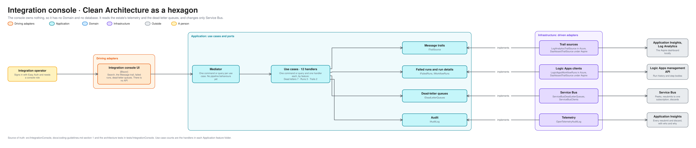

# Integration console architecture

How the Integration console is built inside. For engineers and coding agents working on the console. It owns nothing, so it is the one application without a Domain or a database ([context map](context-map.md)). Terms are defined in [GLOSSARY.md](../../GLOSSARY.md). What it offers its operators is in [operations/integration-console.md](../operations/integration-console.md).

The editable source is [integration-console-hexagon.excalidraw](integration-console-hexagon.excalidraw), generated from [bounded_contexts.py](diagrams/bounded_contexts.py).

## What differs from the other applications

- **There is no Domain.** The console has no rules of its own to protect and no state to keep: it reads what the estate already records. The Application is where its logic lives, and the architecture tests have no Domain rules to hold.
- **It keeps no database, and a test holds that.** It reads Application Insights and Log Analytics for the Message trail ([ADR 0017](../adr/0017-the-integration-console-reads-the-estates-telemetry-and-stores-nothing.md)), the Logic Apps management API for runs and step bodies, and Service Bus for dead-letter queues.
- **Each port has an Azure adapter and a local one.** `ITrailSource` is `LogAnalyticsTrailSource` in Azure and `DashboardTrailSource` under Aspire, which searches the Aspire dashboard's telemetry ([ADR 0027](../adr/0027-locally-the-integration-console-searches-the-aspire-dashboards-telemetry.md)). `IFailedRuns` is `LogicAppsWorkflowRuns` in Azure and the same `DashboardTrailSource` locally, where there are no Logic Apps and so no failing step and no run to open. The choice is made in `DependencyInjection`, and the console refuses to start with its local sign-in outside Development.
- **It changes only Service Bus.** An operator with the `IntegrationConsole.Resubmit` role can resubmit a dead-lettered message through its topic, aimed at the subscription it came from, or discard it with a reason. A Logic App run is never resubmitted. Every resubmit and discard is audited.
- **It calls none of the applications' APIs.** It reaches the estate as its own managed identity and never with the operator's token ([ADR 0026](../adr/0026-the-integration-console-signs-operators-in-with-easy-auth-and-checks-their-app-role.md)).

## Use cases

12 handlers in 3 feature folders.

| Feature folder | Handlers | What they do |
|---|---|---|
| `DeadLetters` | 7 | List queues and subscriptions with their dead-letter count and oldest age, list and open their messages, resubmit or discard one or several |
| `Runs` | 3 | List the failed runs, open a run and open one of its steps |
| `Trails` | 2 | Search Message trails, and open one: every hop under one correlation ID, with what happened to a dead-lettered hop |

## Ports and adapters

| Port | Adapter | Talks to |
|---|---|---|
| `ITrailSource` | `LogAnalyticsTrailSource` (Azure), `DashboardTrailSource` (Aspire) | Application Insights and Log Analytics, or the Aspire dashboard |
| `IFailedRuns`, `IWorkflowRuns` | `LogicAppsWorkflowRuns` (Azure), `DashboardTrailSource` for failed runs (Aspire) | The Logic Apps management API, or the dashboard |
| `IDeadLetterQueues` | `ServiceBusDeadLetterQueues`, with `ServiceBusClients` | Service Bus: peeks without receiving, resubmits to one subscription, discards |
| `IAuditLog` | `OpenTelemetryAuditLog` | Application Insights: who resubmitted or discarded what, and why |

The estate's one retention setting, `integrationRetentionDays`, is passed to the console as configuration and is not a port. The console has none of its own: it uses it to say that a run's body is no longer kept while its hop stays on the trail.

## Where a change goes

| You are adding | It goes in |
|---|---|
| A new thing to see | A query and a handler in the Application, a port if it needs a new source, and a page in the Web project |
| A new action on a message | A handler that changes only Service Bus, a role check, and an audit event |
| A new flow or hop | Nothing here: every flow follows the [tracking contract](../coding-guidelines.md#tracking-contract), and the console finds it |
