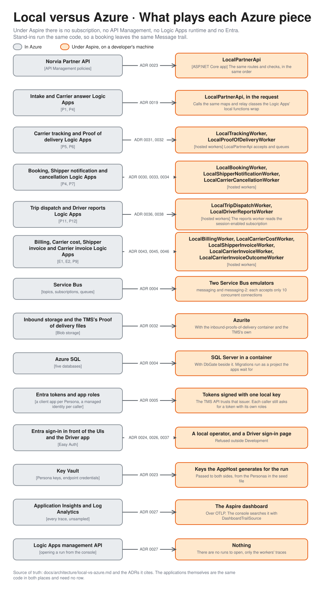

# Local vs Azure

What plays each Azure piece when the estate runs under Aspire on a developer's machine (`dotnet run` on the AppHost), and where the two can differ. Azure is the estate [c4.md](c4.md) draws. The estate Bicep in [infra/](../../infra/) owns it there, and the AppHost owns the applications in both ([ADR 0004](../adr/0004-bicep-owns-the-estate-aspire-owns-the-apps.md)). Terms are defined in [GLOSSARY.md](../../GLOSSARY.md).

Locally there is no Azure subscription, no API Management, no Logic Apps runtime and no Entra. The stand-ins run the same code the Azure pieces run (the maps in `Norvia.Integration.CarrierBooking`, `IntakeMap` and the rest), so a booking, an answer, a Tracking event or a Proof of delivery travels the same path through the applications and reaches the TMS the same way. The Partner portal, the TMS API, the TMS UI and the Integration console are the same applications in both. Neither stand-in runs in Azure: `azd` never deploys them.

## The map

The editable source is [local-vs-azure.excalidraw](diagrams/local-vs-azure.excalidraw), generated from [deployment.cs](diagrams/deployment.cs). The table below has the detail of each row.

| Azure piece | Under Aspire | On Kubernetes | Decided in |
|---|---|---|---|
| **Norvia Partner API** (API Management, the operation policies) | `Norvia.Integration.LocalPartnerApi`, an ASP.NET Core app. It answers the same `/partner/v1/...` routes and makes the same checks in the same order: subscription key, Entra token, role, party for the token's `azp`. It creates the correlation ID, and for Shipper queries it applies the rate limit and runs the Liquid maps with the same DotLiquid version | `LocalPartnerApi` as the `partner-api` Deployment (one replica: its rate limits are in memory) and a Service, behind an Ingress at `partner-api.<baseDomain>`. The same routes and checks as under Aspire | [0023](../adr/0023-locally-a-stand-in-plays-the-norvia-partner-api.md), [0035](../adr/0035-the-shipper-tracking-map-is-liquid-with-the-clock-rules-written-out.md) |
| **Intake Logic App** (P1) and **Carrier answer Logic App** (P4) | The same `LocalPartnerApi`, in the request. It calls `IntakeMap`, `CarrierAnswerMap` and the relay classes the Logic Apps' local functions wrap, and calls the TMS as the identity that Logic App has in Azure | The same `partner-api` pod, in the request | [0019](../adr/0019-the-intake-map-is-dotnet-code-run-as-a-logic-apps-local-function.md), [0023](../adr/0023-locally-a-stand-in-plays-the-norvia-partner-api.md) |
| **Carrier invoice Logic App** (E2) and its Norvia Partner API operation (in Azure: API Management's `POST /partner/v1/carrier-invoices` takes the Carrier invoice with the Persona's token, passes it to the Logic App's HTTP trigger with the Carrier from `azp` and a new correlation ID, and the Logic App maps it, receives it at the ERP and answers the Carrier at once with each line's result) | `LocalPartnerApi` makes the same checks (role `CarrierInvoices.Submit`, a Shipper Persona gets 403), creates the correlation ID and calls **`LocalCarrierInvoiceWorker`** over HTTP, as API Management calls the trigger. The worker runs `CarrierInvoiceMap` and `CarrierInvoiceResponses`, calls the ERP API as the one identity holding the receive role under the workflow's retry policy, and answers the Carrier's request with the relay's answer. It takes no caller but the stand-in | `LocalPartnerApi` calls the `carrier-invoice-worker` Deployment by its Service name; it is the one worker with a Service and probes, because only the Partner API may call its HTTP trigger | [0046](../adr/0046-locally-a-hosted-worker-plays-the-e2-carrier-invoice-logic-app.md), [E2](../processes/erp/e2-carrier-invoice-matching.md#implementation) |
| **Carrier invoice outcome Logic App** (E2) (in Azure: The Logic App `carrier-invoice-outcome`, which maps `CarrierInvoiceApproved`, sends the outcome to the Carrier Persona's invoice outcome endpoint with the Carrier's credential from Key Vault, and reports it told or not delivered to the ERP as its own identity) | **`LocalCarrierInvoiceOutcomeWorker`**, which reads the `carrier-invoice-outcome` subscription, sends with a credential the AppHost gives it for the run (the one the Carrier's booking endpoint asks for) and calls the ERP API with a token signed by the AppHost's local key as the one identity holding the report role | The `carrier-invoice-outcome-worker` Deployment, which reads `messaging-2`, sends with the key the `endpoint-keys` Secret holds for the Carrier and calls the ERP API with a token signed by `local-tokens/signing-key` | [E2](../processes/erp/e2-carrier-invoice-matching.md#implementation) |
| **Carrier tracking** path (P5): API Management accepts, the `carrier-tracking` queue holds, the Logic App records | `LocalPartnerApi` accepts and puts the message on the queue; **`LocalTrackingWorker`** plays the Logic App | The `partner-api` pod accepts and queues on `messaging-2`; the `tracking-worker` Deployment plays the Logic App | [0031](../adr/0031-locally-a-stand-in-and-a-hosted-worker-play-the-carrier-tracking-path.md) |
| **Carrier Proof of delivery** path (P6): API Management stores the file and queues the claim check, the Logic App records | `LocalPartnerApi` stores the body in Azurite and queues the reference; **`LocalProofOfDeliveryWorker`** plays the Logic App | The `partner-api` pod stores the body in Azurite and queues the reference on `messaging-2`; the `proof-of-delivery-worker` Deployment plays the Logic App | [0032](../adr/0032-locally-a-stand-in-and-a-hosted-worker-play-the-carrier-proof-of-delivery-path.md) |
| **Carrier booking Logic App** (P4) | **`LocalBookingWorker`** | The `booking-worker` Deployment | [0030](../adr/0030-locally-a-hosted-worker-plays-the-p4-booking-logic-app.md) |
| **Shipper notification Logic App** (P7) | **`LocalShipperNotificationWorker`** | The `shipper-notification-worker` Deployment | [0033](../adr/0033-locally-a-hosted-worker-plays-the-p7-shipper-notification-logic-app.md) |
| **Consignee notification Logic App** (P7) | The Logic App `consignee-notification`, which reads the event, asks the TMS for the Consignee's address and tracking code as its own identity, and posts the email with the link to an Azure Communication Services Email resource (an operator provides it) | **`LocalConsigneeNotificationWorker`**, which reads the `consignee-notification` subscription, asks the TMS with a token signed by the AppHost's local key as the one identity holding the read role, and writes the email as an `.eml` file to a folder (or sends it over SMTP when a host is set) | [0054](../adr/0054-the-consignee-is-told-by-email-from-its-own-logic-app-and-locally-the-email-is-a-file.md) |
| **Carrier cancellation Logic App** (P7) | **`LocalCarrierCancellationWorker`** | The `carrier-cancellation-worker` Deployment | [0034](../adr/0034-locally-a-hosted-worker-plays-the-p7-carrier-cancellation-logic-app.md) |
| **Trip dispatch Logic App** (P11) | **`LocalTripDispatchWorker`**, which sends the Trip to the Driver app's Trip endpoint with a generated `driver-app-endpoint-key` the AppHost gives it and the Driver app | The `trip-dispatch-worker` Deployment, which sends the Trip to the Driver app with the `DriverEndpoint__ApiKey` of the `endpoint-keys` Secret to `driver-app-api` | [0030](../adr/0030-locally-a-hosted-worker-plays-the-p4-booking-logic-app.md), [0033](../adr/0033-locally-a-hosted-worker-plays-the-p7-shipper-notification-logic-app.md), [0034](../adr/0034-locally-a-hosted-worker-plays-the-p7-carrier-cancellation-logic-app.md) |
| **Service Bus** (topics, subscriptions, queues) | Two Service Bus emulators, `messaging` and `messaging-2`, started by the AppHost (each emulator accepts only 10 concurrent connections and every app holds one, so `messaging-2` holds the Driver app's, the ERP's and the Carrier tracking path's topics and queues; the apps there ask for it as `messaging` too, and in Azure both are the one namespace) with the topics, subscriptions and queues declared in [AppHost.cs](../../src/Norvia.AppHost/AppHost.cs). [ResubmitAwareFilters](../../src/Norvia.AppHost/ResubmitAwareFilters.cs) writes each subscription's filter into the emulator's configuration | The same two emulators as Deployments, `messaging` and `messaging-2`, each with a Service and a ConfigMap holding its `Config.json`, built from `serviceBus.emulators` in the chart's `values.yaml`. Their state is in the `sql` StatefulSet. The lock durations are the Bicep's, which the AppHost leaves unset | [0004](../adr/0004-bicep-owns-the-estate-aspire-owns-the-apps.md), [0030](../adr/0030-locally-a-hosted-worker-plays-the-p4-booking-logic-app.md) |
| **Inbound storage** (the claim-check container) and the **TMS's Proof of delivery files** | Azurite, with the `inbound-proofs-of-delivery` container and the TMS's own container | Azurite as the `azurite` StatefulSet, blob service only, on its own PVC with no backup | [0032](../adr/0032-locally-a-stand-in-and-a-hosted-worker-play-the-carrier-proof-of-delivery-path.md) |
| **Entra tokens** (the TMS API's and the Partner API's audiences, app roles, a client app per Persona, a managed identity per caller) | Tokens signed with one key, the `local-token-signing-key` parameter. The TMS API trusts that issuer instead of Entra. The Partner portal issues each Persona's token itself with the roles Entra would grant; the TMS UI, the stand-in and every worker sign theirs with their own client ID | The same tokens, signed with `local-tokens/signing-key`, a Secret the chart generates at install and keeps on upgrade. Applications refuse to run it outside Development unless `LocalAuth:Allowed` is set | [0005](../adr/0005-partner-identity-comes-from-the-token.md), [0023](../adr/0023-locally-a-stand-in-plays-the-norvia-partner-api.md) |
| **Key Vault** (Persona subscription keys, Carrier and Shipper endpoint credentials) | Keys the AppHost generates for the run and passes to both sides, from the Personas in the seed file | The Secrets `subscription-keys` and `endpoint-keys`, generated at install and kept on upgrade; no key is in a values file | [0023](../adr/0023-locally-a-stand-in-plays-the-norvia-partner-api.md), [0030](../adr/0030-locally-a-hosted-worker-plays-the-p4-booking-logic-app.md) |
| **Application Insights and Log Analytics** | The Aspire dashboard, over OTLP. The Integration console searches Message trails through the dashboard's telemetry API with `DashboardTrailSource` instead of `LogAnalyticsTrailSource` | The Aspire dashboard as the `aspire-dashboard` Deployment, over OTLP at `http://aspire-dashboard:18889`, in memory, so history does not survive a restart. Its UI has no Ingress: `kubectl port-forward svc/aspire-dashboard 18888` | [0027](../adr/0027-locally-the-integration-console-searches-the-aspire-dashboards-telemetry.md), [0029](../adr/0029-the-applications-send-application-insights-every-trace-unsampled.md) |
| **Azure SQL** (the TMS and Partner portal databases) | SQL Server in a container, with DbGate beside it. Migrations run as a project the TMS waits for, not as a Container Apps job | SQL Server as the `sql` StatefulSet holding the five databases on one PVC of `persistence.storageClass`, with no backup and no DbGate. Each migrations project is a Job that creates its database, and an application waits for it in an init container | [0004](../adr/0004-bicep-owns-the-estate-aspire-owns-the-apps.md) |
| **Entra sign-in in front of the UIs** (the Demo UIs' gate, the Integration console's Easy Auth) | None. The AppHost signs the developer in as a local operator holding both console roles, and the console refuses to start with those settings outside Development | None, as under Aspire: the local operator sign-in, behind `LocalAuth:Allowed`, which is safe only when the ingress is not reachable from the public internet ([operations/kubernetes.md](../operations/kubernetes.md#localauthallowed)) | [0024](../adr/0024-the-demo-uis-are-public-behind-an-entra-gate-for-the-presenter.md), [0026](../adr/0026-the-integration-console-signs-operators-in-with-easy-auth-and-checks-their-app-role.md) |
| **Entra sign-in of the Driver app** (Easy Auth, the Driver ID as the user's app role) | A sign-in page in the Driver app that lists the seeded Drivers and signs the chosen one in with the same `driverId` claim. Refused outside Development unless `LocalAuth:Allowed` is set; while it is on, an Easy Auth header is not trusted | The same sign-in page, behind `LocalAuth:Allowed`, in the Driver app (`driver-app-web`) | [0037](../adr/0037-drivers-sign-in-to-the-driver-app-with-entra-and-the-driver-id-is-their-app-role.md) |
| **Logic Apps management API** (opening a run from the console) | Nothing: locally there are no runs to open, only the stand-ins' and workers' traces | Nothing, as under Aspire | [0027](../adr/0027-locally-the-integration-console-searches-the-aspire-dashboards-telemetry.md) |
| **Foundry account, project and model** (Agents) | Nothing runs locally: the in-process runner below plays the agent loop with a scripted fake model. **In Azure** the estate deploys one Foundry account and project with a shared `DataZoneStandard` (EU data zone) model deployment, capped and cost-tagged, connected to Application Insights, and `infra/deploy-agents.ps1` publishes each Agent into the `norvia` project as a prompt agent with its own identity; `Agents:Enabled` is off by default ([operations/foundry.md](../operations/foundry.md)) | Nothing, as under Aspire: `agents.enabled` is off and the scripted fakes run when it is on | [0040](../adr/0040-agents-read-the-estate-through-api-management-have-no-write-tools-and-their-own-identity.md) |
| **Foundry conversations and the conversation sweeper** (Agents) | Nothing runs locally: the in-process runner keeps no conversation on any server, so there is nothing to clean up and no sweeper. **In Azure** the console's Foundry client asks with `store: false` and no conversation, deletes the run's response afterwards, best effort (`ConversationNotDeleted` on the run's span), and a nightly Logic App, `conversation-sweeper`, deletes anything older than a day ([operations/foundry.md](../operations/foundry.md#conversation-cleanup)) | Nothing, as under Aspire | [0040](../adr/0040-agents-read-the-estate-through-api-management-have-no-write-tools-and-their-own-identity.md) |
| **Foundry agent loop and API Management's MCP servers** (Agents; built for the Integration operations agent) | `Norvia.Agents`' in-process runner with a scripted fake model, run by the Integration console, and `Norvia.Integration.LocalAgentMcp`, an MCP stand-in beside `LocalPartnerApi` that makes the API Management policy's checks and serves the Agents' tools (the Integration operations agent's at `/mcp`, the Estate health-check agent's at `/mcp/health-check` the Customer service agent's at `/mcp/customer-service`, which calls the TMS API's agent view, the Planner agent's at `/mcp/planner`, which calls the TMS API's `/v1/agent/planner` view, and the Carrier invoice matching agent's at `/mcp/finance-matching`, which calls the ERP API's agent view, run in process by the ERP UI) from the same tool-list contracts the Bicep reads: `/mcp` for the Integration operations agent and `/mcp/health-check` for the Estate health-check agent. `Agents:Enabled` in the AppHost's user secrets turns it on. A developer's own Foundry deployment (`Agents:Model:Endpoint`) can replace the fake. **In Azure** the console's `FoundryAgentClient` asks the published Agent (real model), Foundry's loop calls API Management's `integration-operations` MCP server as the Agent's identity, and API Management calls the console's agent API as its own; the tool list is the same contract file ([operations/integration-console.md](../operations/integration-console.md#explain-and-the-agent-api)). The TMS UI's `FoundryAgentClient` does the same for the Customer service agent with its own server, `customer-service`, over the TMS API's agent view, which API Management calls with a token for the TMS agent API ([applications/tms.md](../applications/tms.md)). The same client asks the Planner agent (#441) with its own server, `planner`, over the TMS API's `/v1/agent/planner` view. The ERP UI's `FoundryAgentClient` does the same for the Carrier invoice matching agent with its own server, `finance-matching`, over the ERP API's Finance agent view, which API Management calls with a token for the ERP agent API ([applications/erp.md](../applications/erp.md)). The Estate health check does the same with its own server, `health-check` ([operations/estate-health-check.md](../operations/estate-health-check.md#in-azure)), and again for the FinOps agent (#511) with `health-check-cost`, served locally at `/mcp/health-check-cost` | The `agent-mcp` Deployment, only when `agents.enabled` is true | [0040](../adr/0040-agents-read-the-estate-through-api-management-have-no-write-tools-and-their-own-identity.md), [0041](../adr/0041-locally-an-in-process-runner-and-an-mcp-stand-in-play-foundry-and-api-managements-mcp-server.md) |
| **The Intake agent** (Booking drafts from pasted text or a PDF with a text layer, read in .NET with PdfPig and no OCR, `POST /partner/v1/booking-drafts`) | The Partner API stand-in (`LocalPartnerApi`) runs `Norvia.Integration.BookingDraft` in process with the scripted fake `BookingIntakeScript` and the checks of the other operations. The agent has no tools. `Agents:Enabled` turns it on; the draft is stateless and no Foundry conversation exists, so nothing is deleted. **In Azure** (#459) the same library runs in a Container App, `Norvia.Integration.BookingDraft.Api`, with the Foundry client; the API Management policy `create-booking-draft.policy.xml` does the checks (key, token, `TransportOrders.Draft`, the Shipper from `azp`, a rate limit of 10 a minute, a 40 KB cap, 1 MB for a PDF) and only API Management's identity may call the host. The host asks the agent as its own identity (Foundry User on `norvia-intake` only), the agent is published into that project, and the host deletes the run's response before it returns the draft | The same in-process fake in the `partner-api` pod when `agents.enabled` is true | [0040](../adr/0040-agents-read-the-estate-through-api-management-have-no-write-tools-and-their-own-identity.md), [0041](../adr/0041-locally-an-in-process-runner-and-an-mcp-stand-in-play-foundry-and-api-managements-mcp-server.md) |
| **The Shipper tracking assistant** (the panel on the Partner portal's tracking screen, P8, #878) | The portal runs the Agent in process (`LocalAgentClient`) with the scripted fake `ShipperTrackingAssistantScript`, from the same definition file `agents/shipper-tracking-assistant.agent.yaml`. The Agent has no tool, so there is no MCP stand-in to start and no token for it. The portal fetches the tracking data from the Partner API stand-in with the Persona's own local token. `Agents:Enabled` turns it on (the AppHost does when the Agents are on locally); the limits are `Agents:Limits` and their counters live in the portal's memory. | The same as under Aspire, in the Partner portal (not in the chart yet) | The Foundry client (`FoundryAgentClient`, #879) asks the Agent published in the Intake project (`norvia-intake`, where a Shipper's text is not traced server-side) as the portal's own managed identity, with `store: false`, no conversation and the usage tokens read from the response for the budget counters. The portal's identity holds Foundry User on that project only; the Agent has no tool and its own identity holds no role. `Agents:Enabled`, the project endpoint and the limits (`Agents:Limits`) are estate parameters (`provision-estate.ps1`), and the portal runs one replica. The fetch goes through API Management as locally. The model's real answers can fail the output check where the script's never do |
| **The Simulator's personas agent** (pools of Carrier and Driver texts in the Simulation plan) | `Norvia.Agents`' in-process runner with the scripted fake `PersonaTextScript`, behind the Simulator's `IAgentClient` port. The agent has no tools, so there is no MCP stand-in. `Agents:Enabled` (AppHost user secrets) turns it on; off, every pool is the built-in one from the repo. **In Azure** the same definition is published to Foundry as a prompt agent without a tool by `infra/deploy-agents.ps1` (its identity holds no role), and the Simulator's Foundry client asks it as the Simulator's managed identity when the estate turns the Agents on (`Agents:Enabled`), with a cap on generations and on output tokens per plan, a short timeout, no retry and a fallback to the built-in pool. Generation happens when a plan is made, never while a run is sending ([operations/simulator.md](../operations/simulator.md#pools-of-carrier-and-driver-texts)) | The same as under Aspire, in the Simulator (not in the chart yet) | [0040](../adr/0040-agents-read-the-estate-through-api-management-have-no-write-tools-and-their-own-identity.md), [0041](../adr/0041-locally-an-in-process-runner-and-an-mcp-stand-in-play-foundry-and-api-managements-mcp-server.md), [0039](../adr/0039-the-simulator-books-only-through-the-estates-real-doors.md) |
| **The estate's configuration** (the Estate health check's reads of Resource Graph, Azure Monitor and the resources themselves) | A JSON snapshot kept in the repo, read by the snapshot adapter of `IEstateConfiguration`: the fixed estate, or the estate as one of the presets leaves it (`HealthCheck:Snapshot`: `fixed`, `as-found`, `contrast`, `look-alike` or `silent-carrier`; as found by default). **Local Findings come from a snapshot, not from the running estate**: there are no alerts to read under Aspire. A test keeps each snapshot giving exactly the Findings for the toggles its preset in `infra/presets` turns on, and holding the flows and entities `estate.bicep` alerts. In Azure the adapter reads what Reader can see; the facts it cannot read give no Finding ([operations/estate-health-check.md](../operations/estate-health-check.md)) | The same snapshot as under Aspire. The as-found toggles, the alerts and the real Estate health check stay Azure-only | [0040](../adr/0040-agents-read-the-estate-through-api-management-have-no-write-tools-and-their-own-identity.md) |

The **TMS API, TMS UI, Partner portal and Integration console** need no row: they run as projects locally and as Container Apps in Azure, built from the same code.

The **Simulator** ([ADR 0039](../adr/0039-the-simulator-books-only-through-the-estates-real-doors.md), [ADR 0042](../adr/0042-the-simulator-signs-in-with-easy-auth-reaches-the-estate-as-its-own-identity-and-plays-the-personas-and-drivers-through-entra-client-apps.md)) is the same code in both places and differs in its tokens and its sign-in. **Locally** the AppHost starts it with its own database, it signs the Personas' tokens itself as the Partner portal does (the Shippers' to book, the Carriers' to answer, track and deliver, with the Carrier app roles), signs its own token for the TMS API as the TMS UI does (the manage role, under its own local client ID) and each Driver's token for the Driver app API (the Driver ID as the one app role), and it signs you in as a local operator holding both roles. **In Azure** it runs behind Easy Auth on its own app registration (`Simulator.Run`, `Simulator.Read`, held by the presenter), as its own managed identity: that identity holds the TMS API's manage role and is trusted by every Persona's client app and by a client app for each seeded Driver, which holds the Driver ID as its one app role on the Driver app API, and it reads the Personas' subscription keys from Key Vault. The estate sets `Simulator:Enabled` and the caps, which are lower than the local ones. The Simulator refuses to start with local-operator settings outside Development.

The **ERP** is the same code in both places and differs in its sign-in. **Locally** the AppHost starts it with its own database, runs its migrations first, and signs you in as a local user holding `Finance`. **In Azure** it runs behind Easy Auth on its own app registration (`Finance`, held by the presenter), as the managed identity the estate made for it, which may send to Service Bus. Both load Shippers, Carriers, Rate Cards and Carrier Rate Cards from the seed file as the ERP starts: the repo's copy locally, the one each image carries in Azure. The ERP refuses to start with local-user settings outside Development. The **ERP billing API** is a second process of the same ERP, on the ERP's identity and database. Locally it trusts tokens signed with the AppHost's key, the Billing Logic App's client ID standing in for its managed identity; in Azure it trusts Entra and the audience of the ERP API's app registration, whose `BillableLines.Record` role the Billing Logic App will hold. It waits for the ERP UI, which loads the master data it checks Shippers against.

The **On Kubernetes** column is the same local topology on a Kubernetes cluster, as pods deployed by a hand-written Helm chart ([deploy/helm/norvia/](../../deploy/helm/norvia/), [ADR 0053](../adr/0053-kubernetes-runs-the-local-topology.md), [operations/kubernetes.md](../operations/kubernetes.md)): no Azure at runtime, the workers as Deployments, the emulators and Azurite kept, SQL Server and Azurite on PVCs with no backups, and `LocalAuth:Allowed` as the opt-in that is safe only when the ingress is not reachable from the public internet. It is not a third copy of the Azure estate: where a cell says "as under Aspire" the same code runs, and the chart does not yet deploy the Partner portal or the Simulator (see the page for what is in it today).

## Where the two can differ

Each stand-in is a second implementation of the Azure piece it plays ([ADR 0031](../adr/0031-locally-a-stand-in-and-a-hosted-worker-play-the-carrier-tracking-path.md#consequences)). A change to a policy's checks, headers or application properties, or to a workflow's settling rules or tracked properties, has to be made on both sides. Tests keep them close, but they cannot run the Azure side: the Logic Apps' Service Bus operations and API Management's policies only run in a deployed estate, so the unit tests read the definitions and the stand-ins' tests check the same list. These are the places a difference can hide.

| What | Azure | Locally | Why it can differ |
|---|---|---|---|
| **Driver reports Logic App** (P12) | **`LocalDriverReportsWorker`**, which reads the session-enabled `driver-reports` subscription, calls the TMS Start a Trip, Record a Tracking event or Record a Proof of delivery operation (fetching a Proof of delivery's files from the Driver app's transit container on Azurite and deleting them once the TMS accepted it) and tells the Driver app the outcome, with tokens signed by the AppHost's local key as the one identity holding the roles | [0038](../adr/0038-locally-a-hosted-worker-plays-the-p12-driver-reports-logic-app.md) |
| **Shipper invoice Logic App** (E1) | The Logic App `shipper-invoice`, which maps `ShipperInvoiceIssued` and `CreditNoteIssued`, sends the invoice or Credit note to the Shipper Persona's invoice endpoint with the Shipper's credential from Key Vault, and reports it Sent to the ERP as its own identity | **`LocalShipperInvoiceWorker`**, which reads the `shipper-invoice` subscription, sends with a credential the AppHost gives it for the run and calls the ERP API with a token signed by the AppHost's local key as the one identity holding the report role | [0033](../adr/0033-locally-a-hosted-worker-plays-the-p7-shipper-notification-logic-app.md), [0043](../adr/0043-locally-a-hosted-worker-plays-the-e1-billing-logic-app.md) |
| **Billing Logic App** (E1) | The Logic App `billing`, which records the Billable line with the ERP billing API as its own identity | **`LocalBillingWorker`**, which reads the `billing` subscription and calls the ERP billing API with a token signed by the AppHost's local key as the one identity holding the record role | [0043](../adr/0043-locally-a-hosted-worker-plays-the-e1-billing-logic-app.md) |
| **Carrier cost Logic App** (P9, E2) | The Logic App `carrier-cost`, which records the Carrier cost with the ERP billing API as its own identity | **`LocalCarrierCostWorker`**, which reads the `carrier-cost` subscription and calls the ERP billing API with a token signed by the AppHost's local key as the one identity holding the Carrier cost record role | [0045](../adr/0045-locally-a-hosted-worker-plays-the-p9-carrier-cost-logic-app.md) |
| **Subscription filters** | A SQL filter on each subscription in [messaging.bicep](../../infra/estate/messaging.bicep): `carrier-booking`, `shipper-notification`, `consignee-notification` (`ConsigneeNotificationRequested`), `carrier-cancellation`, `trip-dispatch`, `billing` (`TransportOrderBillable`), `carrier-cost` (`CarrierCostIncurred`), `shipper-invoice` (`ShipperInvoiceIssued` and `CreditNoteIssued`) and `driver-reports` (`TripStartReported`, `TripEndReported`, `StopCompletedReported` and `ProofOfDeliveryCaptured`) take only some events, and every subscription also admits a resubmit aimed at it | The same conditions, written a second time in [ResubmitAwareFilters](../../src/Norvia.AppHost/ResubmitAwareFilters.cs), because Aspire's subscription rules only model correlation filters | Nothing ties the two lists together. Change a condition in one and the local worker sees different messages from the Logic App. The Bicep comment and the class both point at the other |
| **Policy checks** | `*.policy.xml` in [infra/estate/partner-api/](../../infra/estate/partner-api/) | `LocalPartnerApi`'s edge checks and operations | `SubmitCarrierTrackingPolicyTests` reads the policy, and the stand-in's tests check the same list; a new check needs both |
| **Workflow settling** | The workflow's actions: complete, dead-letter with a failure code, or abandon for another delivery | Each worker's flow, which settles through `TmsTrackingOutcome`, `ProofOfDeliverySettlement` and the like | The workflow's expressions are tested against those classes, but the Service Bus operation IDs (`peekLockQueueMessages` and the rest) never run without a Logic Apps runtime |
| **Retries** | The Logic App's own retry policy on the HTTP actions | A bounded exponential policy in each worker, in code | The numbers are chosen separately |
| **Message locks** | `carrier-tracking` locks for 1 minute and `carrier-proof-of-delivery` for 5, so a 25 MB call finishes | The AppHost sets the maximum delivery count of 10 on the emulator's queues and no lock duration; the Kubernetes chart sets the Bicep's lock durations | The lock is not matched locally, so a slow Proof of delivery is only proved not to be redelivered in Azure |
| **Shipper tracking maps** | Liquid in `set-body`, run by API Management | The same templates, run by DotLiquid in the same mode | Tested against the same version, but a different host runs them |
| **Local functions** | The .NET functions the Logic Apps call (`MapPartnerBooking` and the rest) | The libraries behind them, called directly | The function projects only wrap the library, so a difference would be in the wrapper's input and output |
| **Telemetry** | Application Insights, every trace unsampled, kept for `integrationRetentionDays` | The Aspire dashboard, which holds only the current session | The console searches both through the same tracking-contract keys. History does not survive a restart locally |
| **Authorisation** | Entra enforces the app roles; each Logic App's identity holds only the roles it needs | One signing key; each caller still asks for its own client ID and roles | A role a caller gets locally isn't proof Entra grants it. The roles live in [identities.bicep](../../infra/estate/identities.bicep) |
| **Network** | Logic Apps and API Management sit outside the Container Apps environment, so the TMS API is reachable from outside it | Everything on localhost | A reachability or firewall fault shows only in Azure |

The smoke tests in [infra/](../../infra/) (`smoke-test-*.sh`) run against a deployed estate, so they cover the Azure side that a local run cannot.
