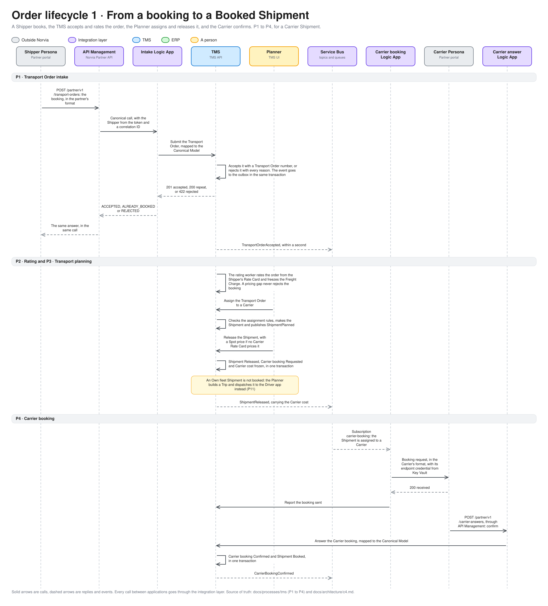
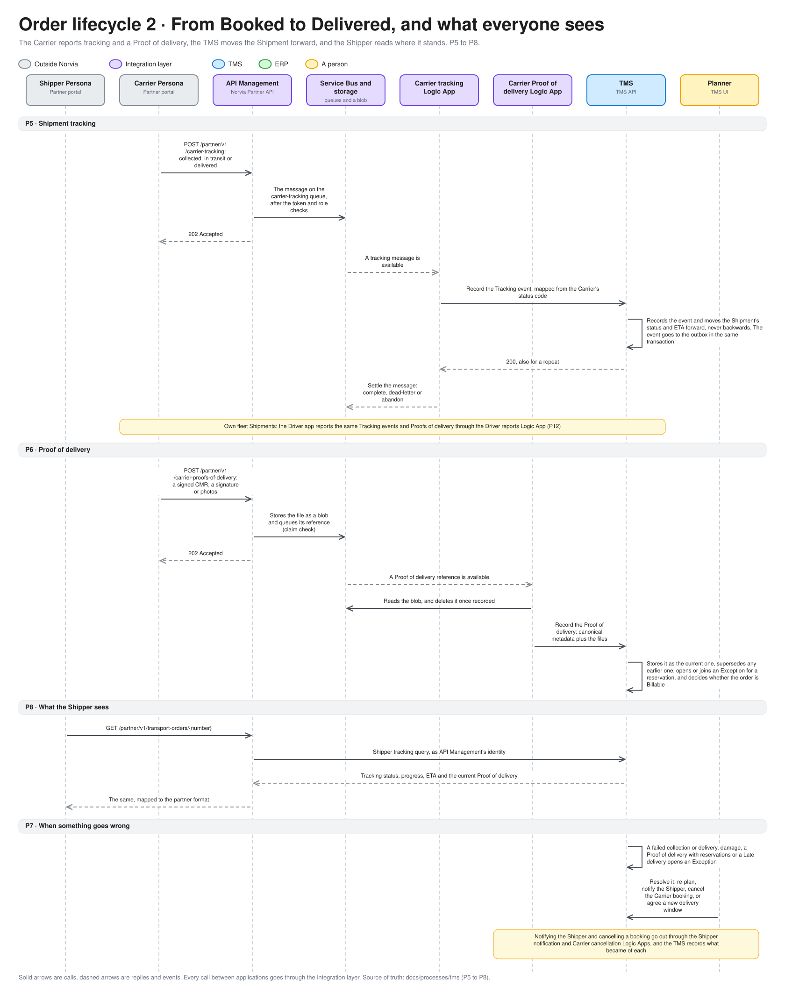
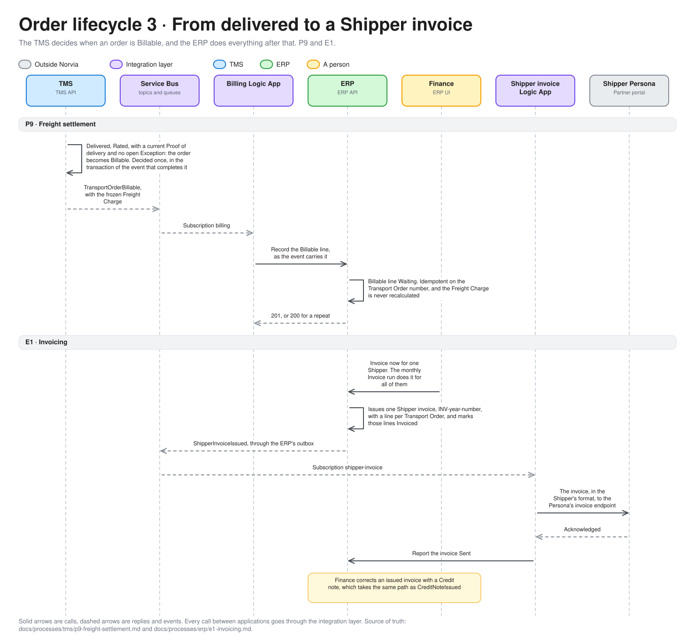
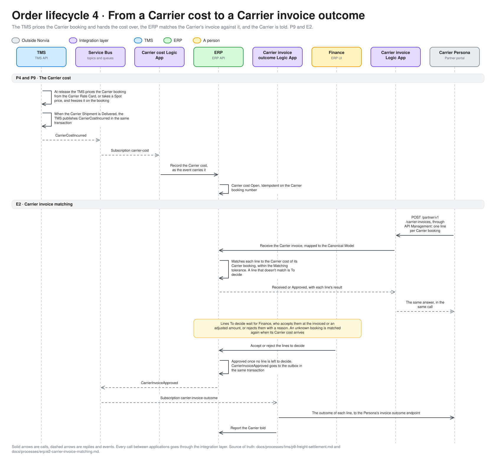

# The life of an order across the estate

One Transport Order, followed from a Shipper's booking to the invoices on both sides, in four sequence diagrams. For engineers and coding agents working on the estate and for the technical audience of a demo. The process docs draw each process by itself; this page joins them. Terms are defined in [GLOSSARY.md](../../GLOSSARY.md), and the [business automation model](business-automation-model.md) shows the same steps by application.

The order is a Transport-only booking carried by a Carrier. An Own fleet order differs after the release, where the Planner builds a Trip and the Driver app reports the same events ([P11](../processes/tms/p11-trip-dispatch.md), [P12](../processes/tms/p12-trip-execution.md)). A Fulfilment order differs at the start, through the WMS handoff, which is planned.

## What holds it together

- **A Message trail.** Everything the integration layer does under one correlation ID is one trail: the call that started it and every queue, subscription, Logic App run and application call that followed. A published event is reacted to by a new Flow on the same trail. An action by a Norvia employee in an application starts a new trail, except a re-rate, which continues the trail of its Transport Order's intake. The Integration console finds any of it from the correlation ID or a business key.
- **Applications never call each other.** Every arrow between two applications in these diagrams crosses the integration layer, and a command goes in as HTTP while an event comes out through the owner's outbox ([ADR 0003](../adr/0003-http-in-events-out.md)).
- **The owner decides.** The TMS decides when an order is Accepted, Booked, Delivered and Billable. The ERP decides what an invoice contains and whether a Carrier's invoice line matches. The Logic Apps translate and carry, and call the owner to record what became of it.

## 1. From a booking to a Booked Shipment

[P1](../processes/tms/p1-transport-order-intake.md) to [P4](../processes/tms/p4-carrier-booking.md). The editable source is [order-lifecycle-booked.excalidraw](diagrams/order-lifecycle-booked.excalidraw).

- The Shipper is answered in the same call. The intake Logic App waits for the TMS and retries it, so the Shipper hears *not received* only once the retries are spent ([ADR 0021](../adr/0021-api-management-runs-on-the-developer-tier.md)).
- A rating failure never rejects an order. It stays Accepted and the pricing gap goes to Customer service ([P2](../processes/tms/p2-rating.md)).
- The Planner's two steps are separate on purpose. Assign can be changed until Release, which freezes the Carrier cost and hands the Shipment over ([P3](../processes/tms/p3-transport-planning.md)).
- A Carrier answers by calling the Norvia Partner API, not by replying to the booking request. The request is only acknowledged.

## 2. From Booked to Delivered, and what everyone sees

[P5](../processes/tms/p5-shipment-tracking.md) to [P8](../processes/tms/p8-shipper-visibility.md). The editable source is [order-lifecycle-delivered.excalidraw](diagrams/order-lifecycle-delivered.excalidraw).

- Tracking and Proofs of delivery are accepted asynchronously: the Carrier gets `202` once the message is stored, and the Logic App records it later ([ADR 0008](../adr/0008-carrier-tracking-events-are-accepted-asynchronously.md)). A Proof of delivery travels as a claim check, the file in a blob and its reference on a queue ([ADR 0009](../adr/0009-carrier-proofs-of-delivery-use-a-claim-check.md)).
- A Shipment's status only moves forward, and the Shipper sees a simpler Tracking status than Norvia's own ([ADR 0011](../adr/0011-shippers-see-a-tracking-status-not-the-shipments-workings.md)).
- A Shipper's query never passes a Logic App. API Management reads the TMS and maps the answer, because a read path has no Logic App ([ADR 0003](../adr/0003-http-in-events-out.md)).
- An Exception is the TMS's, and the Planner resolves it. What the TMS never does is close one on its own.

## 3. From delivered to a Shipper invoice

[P9](../processes/tms/p9-freight-settlement.md) and [E1](../processes/erp/e1-invoicing.md). The editable source is [order-lifecycle-invoice.excalidraw](diagrams/order-lifecycle-invoice.excalidraw).

- "No Proof of delivery, no invoice": the order is Billable only when it is Delivered, Rated, has a current Proof of delivery and no open Exception, or Customer service releases it without a Proof. Once Billable it stays Billable ([ADR 0012](../adr/0012-the-tms-decides-when-to-bill-the-erp-invoices.md)).
- The Freight Charge is frozen in the TMS, and the ERP never recalculates it.
- The ERP invoices each Shipper's Billable lines once, either in the monthly run or when Finance chooses **Invoice now**, so a demo does not wait a month.

## 4. From a Carrier cost to a Carrier invoice outcome

[P9](../processes/tms/p9-freight-settlement.md) and [E2](../processes/erp/e2-carrier-invoice-matching.md). The editable source is [order-lifecycle-carrier-invoice.excalidraw](diagrams/order-lifecycle-carrier-invoice.excalidraw).

- The TMS prices the Carrier booking at release and freezes the cost. It hands the cost to the ERP when the Carrier Shipment is Delivered ([ADR 0013](../adr/0013-the-tms-rates-carrier-bookings-the-erp-owns-carrier-rate-cards.md)).
- Matching is automatic and exact by default: a line must equal its Carrier cost to the cent. Anything else waits for Finance, which is one of the few manual steps in the whole life of an order.
- The Carrier is told twice: at once, when it submits (Received or Approved), and again when the invoice is Approved, with the outcome of each line.

## Where things can go wrong

Each arrow is a hop that can fail, and [failure-behaviour.md](failure-behaviour.md) says for each one how often it is retried, where it ends up and who is told. The ones that never reach the person who caused them are the point of the Integration console: a Carrier's tracking message that dead-letters leaves the Shipper's order on *In transit* with nobody told.

## Keeping it true

A PR that changes the flow of a process updates its own process doc and, if the change shows in these pictures, the pictures. Edit the spec in [order_lifecycle.py](diagrams/order_lifecycle.py) and run it.
