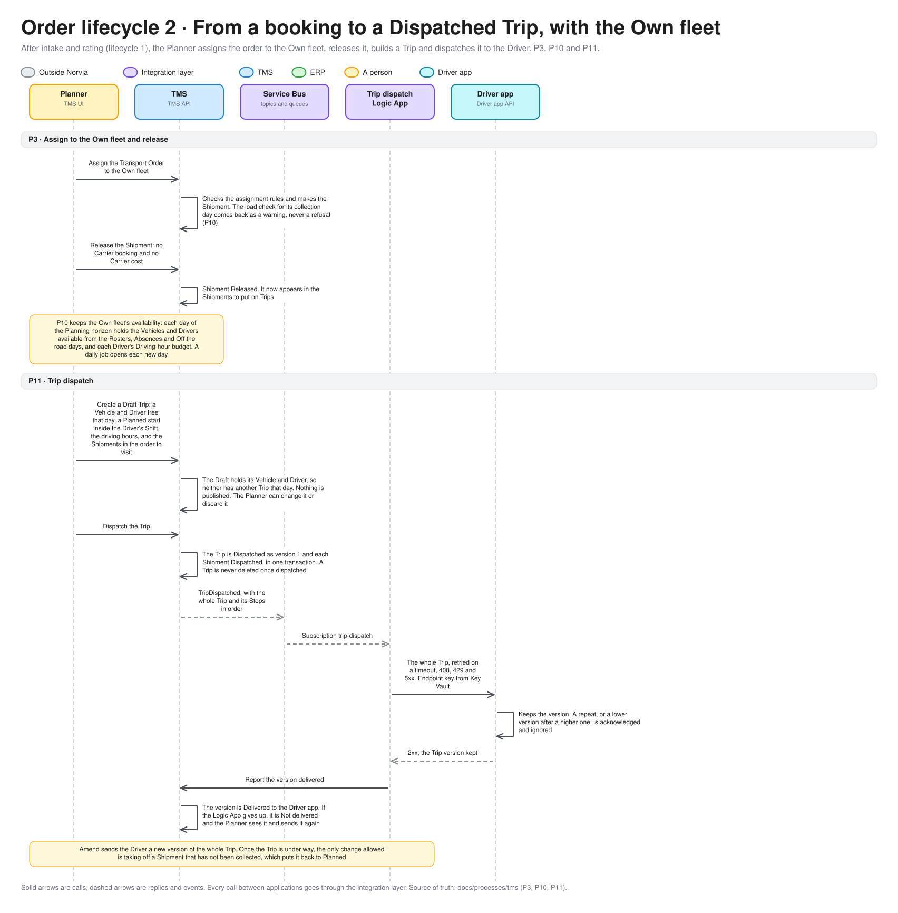
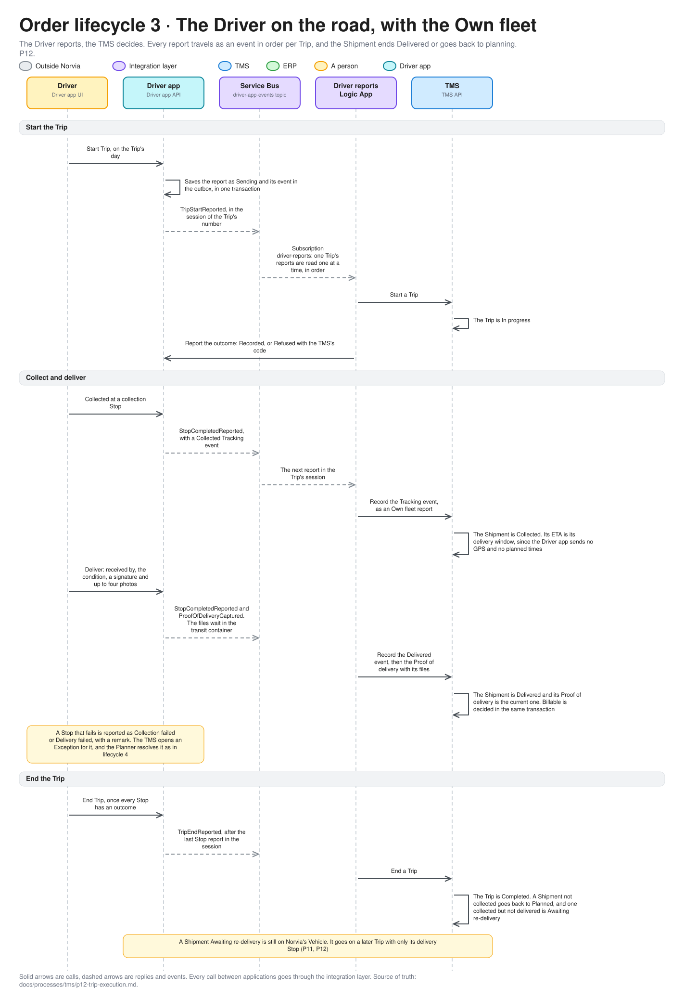

# The life of an order across the estate

One Transport Order, followed from a Shipper's booking to the invoices, in six sequence diagrams. For engineers and coding agents working on the estate and for the technical audience of a demo. The process docs draw each process by itself; this page joins them. Terms are defined in [GLOSSARY.md](../../GLOSSARY.md), and the [business automation model](business-automation-model.md) shows the same steps by application.

Norvia carries a Shipment in one of two ways, and the Planner chooses in [P3](../processes/tms/p3-transport-planning.md): a **Carrier** it subcontracts, or its own fleet (the **Own fleet**, its Vehicles and Drivers). The two share the start and the end of the story and differ in the middle:

| | Carrier | Own fleet |
|---|---|---|
| Booking in, rating, assigning | [Lifecycle 1](#1-from-a-booking-to-a-booked-shipment-with-a-carrier) | Lifecycle 1 up to the release, then [lifecycle 2](#2-from-a-booking-to-a-dispatched-trip-with-the-own-fleet) |
| Getting it carried | The Carrier booking (lifecycle 1) | A Trip dispatched to a Driver (lifecycle 2) |
| Who reports from the road | The Carrier, through the Partner API ([lifecycle 4](#4-from-booked-to-delivered-by-a-carrier-and-what-everyone-sees)) | The Driver, through the Driver app ([lifecycle 3](#3-the-driver-on-the-road-with-the-own-fleet)) |
| What the Shipper sees, and exceptions | Lifecycle 4 | The same: lifecycle 4's last two phases |
| The Shipper invoice | [Lifecycle 5](#5-from-delivered-to-a-shipper-invoice) | The same |
| The Carrier cost and invoice | [Lifecycle 6](#6-from-a-carrier-cost-to-a-carrier-invoice-outcome) | None: there is no Carrier |

A Fulfilment order differs at the start, through the WMS handoff, which is planned.

## What holds it together

- **A Message trail.** Everything the integration layer does under one correlation ID is one trail: the call that started it and every queue, subscription, Logic App run and application call that followed. A published event is reacted to by a new Flow on the same trail. An action by a Norvia employee in an application starts a new trail, except a re-rate, which continues the trail of its Transport Order's intake. The Integration console finds any of it from the correlation ID or a business key.
- **Applications never call each other.** Every arrow between two applications in these diagrams crosses the integration layer, and a command goes in as HTTP while an event comes out through the owner's outbox ([ADR 0003](../adr/0003-http-in-events-out.md)). The Driver app is the sharpest case: it makes no HTTP call at all, and reaches the TMS only through the Driver reports Logic App.
- **The owner decides.** The TMS decides when an order is Accepted, Booked, Dispatched, Delivered and Billable, whoever carried it. The ERP decides what an invoice contains and whether a Carrier's invoice line matches. The Logic Apps translate and carry, and call the owner to record what became of it. The Driver app reports and decides nothing.

## 1. From a booking to a Booked Shipment, with a Carrier

[P1](../processes/tms/p1-transport-order-intake.md) to [P4](../processes/tms/p4-carrier-booking.md). The editable source is [order-lifecycle-booked.excalidraw](diagrams/order-lifecycle-booked.excalidraw).

- The Shipper is answered in the same call. The intake Logic App waits for the TMS and retries it, so the Shipper hears *not received* only once the retries are spent ([ADR 0021](../adr/0021-api-management-runs-on-the-developer-tier.md)).
- A rating failure never rejects an order. It stays Accepted and the pricing gap goes to Customer service ([P2](../processes/tms/p2-rating.md)).
- The Planner's two steps are separate on purpose. Assign can be changed until Release, which freezes the Carrier cost and hands the Shipment over ([P3](../processes/tms/p3-transport-planning.md)).
- A Carrier answers by calling the Norvia Partner API, not by replying to the booking request. The request is only acknowledged.
- The first three phases (intake, rating, assigning) are the same for the Own fleet. Only the release and what follows differ.

## 2. From a booking to a Dispatched Trip, with the Own fleet

[P3](../processes/tms/p3-transport-planning.md), [P10](../processes/tms/p10-fleet-capacity-planning.md) and [P11](../processes/tms/p11-trip-dispatch.md). The editable source is [order-lifecycle-own-fleet-dispatch.excalidraw](diagrams/order-lifecycle-own-fleet-dispatch.excalidraw).

- Nothing is booked. A release to the Own fleet makes the Shipment available for a Trip, and no Carrier booking or Carrier cost exists.
- The load check at assignment is a warning for the Planner. It compares what the Own fleet can carry on the collection day with the work planned for it, and it never blocks an assignment ([P10](../processes/tms/p10-fleet-capacity-planning.md)).
- A Trip is one run on one day by one Vehicle and one Driver, and a Vehicle or Driver has at most one Trip a day. A Draft holds its Vehicle and Driver and publishes nothing, so the Planner can change or discard it. Dispatching it sends the Driver app the whole Trip as version 1, and a later Amend sends a new whole version ([ADR 0015](../adr/0015-a-dispatched-trip-is-sent-as-whole-versions.md)).
- A Trip the Driver app never received is visible. The Trip dispatch Logic App reports each version Delivered or Not delivered to the TMS, and the Planner sees it and sends it again.
- P11 does not choose between the Own fleet and a Carrier. That stays in P3.

## 3. The Driver on the road, with the Own fleet

[P12](../processes/tms/p12-trip-execution.md). The editable source is [order-lifecycle-own-fleet-road.excalidraw](diagrams/order-lifecycle-own-fleet-road.excalidraw).

- The Driver reports and the TMS decides. Each report is saved in the Driver app as *Sending* and published through its outbox on a topic of its own, in the session of the Trip's number, so one Trip's reports are read one at a time and in order ([ADR 0016](../adr/0016-driver-reports-travel-as-driver-app-events-in-order-per-trip.md)). The Driver reports Logic App calls the TMS and tells the Driver app the outcome: Recorded, Refused with the TMS's code, or Not recorded.
- A delivery needs a Proof of delivery: received by, the condition, a signature and up to four photos. The Delivered Tracking event and the Proof of delivery are two reports to two TMS operations, as for a Carrier.
- The Driver app sends no GPS, no Departed or Arrived and no planned times per Stop, so the ETA of an Own fleet Shipment is its delivery window.
- A failed Stop is reported with a remark, and it opens an Exception like a Carrier's failure does. A Shipment collected but not delivered is *Awaiting re-delivery* when the Trip ends: a flag, not a status, since Norvia still holds the goods, and it goes on a later Trip with only its delivery Stop.

## 4. From Booked to Delivered by a Carrier, and what everyone sees

[P5](../processes/tms/p5-shipment-tracking.md) to [P8](../processes/tms/p8-shipper-visibility.md). The editable source is [order-lifecycle-delivered.excalidraw](diagrams/order-lifecycle-delivered.excalidraw).

- Tracking and Proofs of delivery are accepted asynchronously: the Carrier gets `202` once the message is stored, and the Logic App records it later ([ADR 0008](../adr/0008-carrier-tracking-events-are-accepted-asynchronously.md)). A Proof of delivery travels as a claim check, the file in a blob and its reference on a queue ([ADR 0009](../adr/0009-carrier-proofs-of-delivery-use-a-claim-check.md)).
- For the Own fleet, the same Tracking events and Proofs of delivery reach the same TMS operations through lifecycle 3 instead of the queues.
- What the Shipper sees and what happens when something goes wrong are the same for both. A Shipment's status only moves forward, and the Shipper sees a simpler Tracking status than Norvia's own, which hides how it is carried ([ADR 0011](../adr/0011-shippers-see-a-tracking-status-not-the-shipments-workings.md)).
- A Shipper's query never passes a Logic App. API Management reads the TMS and maps the answer, because a read path has no Logic App ([ADR 0003](../adr/0003-http-in-events-out.md)).
- An Exception is the TMS's, and the Planner resolves it. What the TMS never does is close one on its own.

## 5. From delivered to a Shipper invoice

[P9](../processes/tms/p9-freight-settlement.md) and [E1](../processes/erp/e1-invoicing.md). The editable source is [order-lifecycle-invoice.excalidraw](diagrams/order-lifecycle-invoice.excalidraw).

- "No Proof of delivery, no invoice": the order is Billable only when it is Delivered, Rated, has a current Proof of delivery and no open Exception, or Customer service releases it without a Proof. Once Billable it stays Billable ([ADR 0012](../adr/0012-the-tms-decides-when-to-bill-the-erp-invoices.md)).
- It makes no difference who carried the goods. The Shipper pays Norvia's Freight Charge, which the TMS froze when it rated the order.
- The Freight Charge is frozen in the TMS, and the ERP never recalculates it.
- The ERP invoices each Shipper's Billable lines once, either in the monthly run or when Finance chooses **Invoice now**, so a demo does not wait a month.

## 6. From a Carrier cost to a Carrier invoice outcome

Carrier Shipments only. [P9](../processes/tms/p9-freight-settlement.md) and [E2](../processes/erp/e2-carrier-invoice-matching.md). The editable source is [order-lifecycle-carrier-invoice.excalidraw](diagrams/order-lifecycle-carrier-invoice.excalidraw).

- The TMS prices the Carrier booking at release and freezes the cost. It hands the cost to the ERP when the Carrier Shipment is Delivered ([ADR 0013](../adr/0013-the-tms-rates-carrier-bookings-the-erp-owns-carrier-rate-cards.md)).
- An Own fleet Shipment has no Carrier cost, so none of this happens for it.
- Matching is automatic and exact by default: a line must equal its Carrier cost to the cent. Anything else waits for Finance, which is one of the few manual steps in the whole life of an order.
- The Carrier is told twice: at once, when it submits (Received or Approved), and again when the invoice is Approved, with the outcome of each line.

## Where things can go wrong

Each arrow is a hop that can fail, and [failure-behaviour.md](failure-behaviour.md) says for each one how often it is retried, where it ends up and who is told. The ones that never reach the person who caused them are the point of the Integration console: a Carrier's tracking message that dead-letters leaves the Shipper's order on *In transit* with nobody told. For the Own fleet, a Driver report the TMS refuses shows to the Driver as *Refused* in the Driver app, which a Carrier never gets.

## Keeping it true

A PR that changes the flow of a process updates its own process doc and, if the change shows in these pictures, the pictures. Edit the spec in [order_lifecycle.py](diagrams/order_lifecycle.py) and run it.
