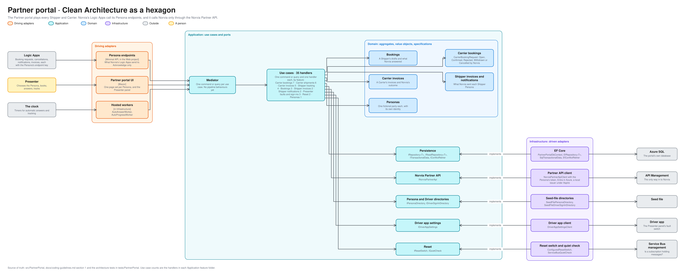

# Partner portal architecture

How the Partner portal is built inside, in the same hexagon as the [TMS](tms-architecture.md). For engineers and coding agents working on the portal and for a demo's technical audience. It plays every Shipper and Carrier as a Persona and sits outside Norvia ([context map](context-map.md)). Terms are defined in [GLOSSARY.md](../../GLOSSARY.md).

The editable source is [partner-portal-hexagon.excalidraw](diagrams/partner-portal-hexagon.excalidraw), generated from [bounded_contexts.py](diagrams/bounded_contexts.py).

## What differs from the TMS

- **There is no Api project.** The Persona endpoints, the doors Norvia's Logic Apps send to, live in the Web project beside the Blazor pages. They are outside Norvia's integration layer on purpose, as a real party's systems would be.
- **Its only way in to Norvia is the Norvia Partner API.** Everything a Persona sends (bookings, answers, Tracking events, Proofs of delivery, Carrier invoices, tracking reads) goes through API Management with the Persona's own token and subscription key. The test that the portal never uses another application's code holds the rest.
- **The endpoints only acknowledge.** Each takes the Persona's own endpoint key (`X-Api-Key`), answers a success once the document is stored and the same for one already stored, and cannot refuse or reply. A Carrier answers a booking by calling the Partner API, not by replying.
- **Two workers play the Persona when nobody is clicking.** `AutoAnswerWorker` answers booking requests for a Carrier Persona in Auto-confirm or Auto-reject mode, after a delay. `AutoProgressWorker` sends the Tracking events that are due.

## Use cases

36 handlers in 12 feature folders.

| Feature folder | Handlers | What they do |
|---|---|---|
| `CarrierBookings` | 7 | Receive a booking request or cancellation, answer it, answer the due ones automatically, and keep a Carrier's answer settings |
| `CarrierShipments` | 6 | List a Carrier's Shipments, send tracking and a Proof of delivery, send the due tracking, keep its tracking settings |
| `CarrierInvoices` | 5 | Draft and submit a Carrier invoice, and receive and list Norvia's outcome |
| `ShipperTracking` | 4 | List, find and get a Shipper's Transport Orders as Norvia reports them, and download a Proof of delivery file |
| `TrackingAssistant` | 1 | Answer a Shipper's question about its own Transport Orders: fetch the data with the Persona's token, run the Agent, check the answer ([ADR 0049](../adr/0049-the-shipper-tracking-assistant-has-no-tools-and-only-restates-what-the-portal-fetched-with-the-personas-token.md)) |
| `Bookings` | 3 | Draft, submit and list a Shipper's bookings |
| `ShipperInvoices`, `ShipperNotifications` | 4 | Receive and list what Norvia sends each Shipper Persona |
| `Faults`, `DriverSignIns`, `Personas` | 4 | The Presenter panel's list of Faults and their On and Off, the Driver sign-in list, and the Persona switcher |
| `Reset` | 2 | Report whether a reset is allowed, and reset |

## Ports and adapters

| Port | Adapter | Talks to |
|---|---|---|
| `IRepository<T>`, `IReadRepository<T>`, `ITransactionalData`, `IConflictRetrier` | `EfRepository<T>`, `SqlTransactionalData`, `EfConflictRetrier` on `PartnerPortalDbContext` | The portal's own database: what each Persona sent Norvia and what Norvia answered |
| `INorviaPartnerApi` | `NorviaPartnerApiClient`, with `EntraPersonaTokens` in Azure and `LocalPersonaTokens` under Aspire | API Management |
| `IPersonaDirectory`, `IDriverSignInDirectory` | `SeedFilePersonaDirectory`, `SeedFileDriverSignInDirectory` | The seed file |
| `IFaultSwitches` | `PartnerPortalFaultSwitches`: the portal's own Faults in process, the others through `FaultSwitchClient`, with `EntraFaultTokens` in Azure and `LocalFaultTokens` under Aspire | The fault endpoints of every other application that owns a Fault (today the Driver app's), as the portal's identity holding `Demo.Fault`, and the portal's own [Faults](../operations/as-found.md#faults-of-the-partner-portal) |
| `IPartnerPortalFaults` | `PartnerPortalFaults` over `IFaults` | Whether each of the portal's own Faults is on, asked where a Persona would misbehave |
| `IAutoAnswerSignal`, `IAutoProgressSignal`, `ISampleCmr` | In-process signals that make a worker look at the clock again, and the sample CMR an auto-progress Persona sends with its Proof of delivery | |
| `IAgentClient`, `IAssistantSwitch`, `IAssistantRunIds` | `LocalAgentClient` (the in-process runner with the scripted fake `ShipperTrackingAssistantScript`; no tool, no credential) or `DisabledAgentClient`, `ConfiguredAssistantSwitch`, `GuidAssistantRunIds` | Nothing outside the portal locally. The Foundry client is the Azure slice (#879) |
| `IResetSwitch`, `IQuietCheck` | `ConfiguredResetSwitch`, `ServiceBusQuietCheck` | Service Bus management |

## A Carrier's booking request

The portal keeps a Carrier's own record of each request, one step behind Norvia's [Carrier booking](tms-lifecycles.md#carrier-booking).

| Move | By | Guard |
|---|---|---|
| Start to Open | `ReceiveCarrierBooking` | Norvia's request arrives at the Persona's endpoint. A repeat, by Carrier booking number, is stored once |
| Open to Confirmed or Rejected | `Answer` | The request is Open. The answer goes to Norvia through the Partner API, as the Persona |
| Open to Withdrawn by Norvia | `WithdrawnByNorvia` | Norvia took the request back before an answer |
| Confirmed to Cancelled by Norvia | `CancelledByNorvia` | Norvia cancelled the Confirmed booking before collection |

## The Shipper tracking assistant

A panel on the Shipper tracking screen (P8, `TrackingAssistantPanel`) where a Persona asks about its own Transport Orders, in English or Dutch ([ADR 0049](../adr/0049-the-shipper-tracking-assistant-has-no-tools-and-only-restates-what-the-portal-fetched-with-the-personas-token.md)). It shows only while `Agents:Enabled` is on, which is off by default and which the AppHost switches on locally.

- **The portal fetches, the model restates.** `AskTrackingAssistantHandler` calls the Norvia Partner API as the Persona, with its own token and subscription key: the detail of the open order, the first page of the list (at most 20 orders) and, when the question names a Shipper reference or a number that neither holds, one more call for it (`TrackingFetchPlan`). Three calls a question at most. The Agent has no tool, no MCP connection and no credential, so another Shipper's order is not something it can ask for.
- **Input.** `AssistantInputBuilder` builds three delimited parts: the question with the last four turns of the conversation (kept in the Persona's circuit, never stored), the fetched data (at most 20 orders and 20 progress events an order) and the current date and time. An angle bracket in the question or in the data cannot close a delimiter.
- **Output check.** The Agent answers with the text and the input field behind each claim. `AnswerCheck` rejects the answer when a cited field is missing, or a date, time, number or Transport Order number in the text is not in the data. The Shipper then sees the fixed "I have no information about that" and the run is `Failed` with `AgentAnswerRejected`.
- **Limits** (`AssistantLimits`, the estate parameters `Agents:Limits`, counted in the portal's memory by `AssistantLimiter`): 6 questions a minute and 60 an hour a Persona, 500 characters a question, 400 output tokens, and daily token budgets of 50,000 a Persona and 500,000 for the estate (reset at midnight UTC). Over one: no model call, `AgentRateLimited` (`Refused`); with the estate budget used up every Persona sees "Assistant unavailable". The counters are in memory, so the portal runs one replica while the assistant is on.
- **Tracking.** A run is a span (`Ask tracking assistant`) of the application's activity source with `flow` `shipper-tracking-assistant`, `partyId`, `agentId`, `runId`, the correlation IDs of the fetches, the tokens and the `outcome` (`Answered`, `Refused`, `Failed`). Neither the question nor the answer is on a span or in a log.
- **Failure.** A failed tracking fetch (`TmsUnavailable`, a 429) makes no model call and shows "I can't reach tracking right now". The model down, or a reply that is not the Agent's result, shows "Assistant unavailable" (`AgentUnavailable`). The tracking screen keeps working whatever the assistant does.
