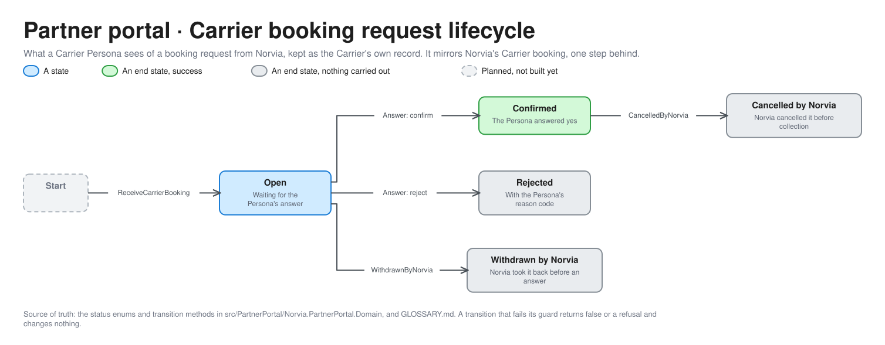

# Partner portal architecture

How the Partner portal is built inside, in the same hexagon as the [TMS](tms-architecture.md). For engineers and coding agents working on the portal and for a demo's technical audience. It plays every Shipper and Carrier as a Persona and sits outside Norvia ([context map](context-map.md)). Terms are defined in [GLOSSARY.md](../../GLOSSARY.md).

The editable source is [partner-portal-hexagon.excalidraw](partner-portal-hexagon.excalidraw), generated from [bounded_contexts.py](diagrams/bounded_contexts.py).

## What differs from the TMS

- **There is no Api project.** The Persona endpoints, the doors Norvia's Logic Apps send to, live in the Web project beside the Blazor pages. They are outside Norvia's integration layer on purpose, as a real party's systems would be.
- **Its only way in to Norvia is the Norvia Partner API.** Everything a Persona sends (bookings, answers, Tracking events, Proofs of delivery, Carrier invoices, tracking reads) goes through API Management with the Persona's own token and subscription key. The test that the portal never uses another application's code holds the rest.
- **The endpoints only acknowledge.** Each takes the Persona's own endpoint key (`X-Api-Key`), answers a success once the document is stored and the same for one already stored, and cannot refuse or reply. A Carrier answers a booking by calling the Partner API, not by replying.
- **Two workers play the Persona when nobody is clicking.** `AutoAnswerWorker` answers booking requests for a Carrier Persona in Auto-confirm or Auto-reject mode, after a delay. `AutoProgressWorker` sends the Tracking events that are due.

## Use cases

35 handlers in 11 feature folders.

| Feature folder | Handlers | What they do |
|---|---|---|
| `CarrierBookings` | 7 | Receive a booking request or cancellation, answer it, answer the due ones automatically, and keep a Carrier's answer settings |
| `CarrierShipments` | 6 | List a Carrier's Shipments, send tracking and a Proof of delivery, send the due tracking, keep its tracking settings |
| `CarrierInvoices` | 5 | Draft and submit a Carrier invoice, and receive and list Norvia's outcome |
| `ShipperTracking` | 4 | List, find and get a Shipper's Transport Orders as Norvia reports them, and download a Proof of delivery file |
| `Bookings` | 3 | Draft, submit and list a Shipper's bookings |
| `ShipperInvoices`, `ShipperNotifications` | 4 | Receive and list what Norvia sends each Shipper Persona |
| `DriverAppFault`, `DriverSignIns`, `Personas` | 4 | The Presenter panel's Driver app fault, the Driver sign-in list, and the Persona switcher |
| `Reset` | 2 | Report whether a reset is allowed, and reset |

## Ports and adapters

| Port | Adapter | Talks to |
|---|---|---|
| `IRepository<T>`, `IReadRepository<T>`, `ITransactionalData`, `IConflictRetrier` | `EfRepository<T>`, `SqlTransactionalData`, `EfConflictRetrier` on `PartnerPortalDbContext` | The portal's own database: what each Persona sent Norvia and what Norvia answered |
| `INorviaPartnerApi` | `NorviaPartnerApiClient`, with `EntraPersonaTokens` in Azure and `LocalPersonaTokens` under Aspire | API Management |
| `IPersonaDirectory`, `IDriverSignInDirectory` | `SeedFilePersonaDirectory`, `SeedFileDriverSignInDirectory` | The seed file |
| `IDriverAppSettings` | `DriverAppSettingsClient` | The Driver app's settings endpoint, for the Presenter panel's fault switch |
| `IAutoAnswerSignal`, `IAutoProgressSignal`, `ISampleCmr` | In-process signals that make a worker look at the clock again, and the sample CMR an auto-progress Persona sends with its Proof of delivery | |
| `IResetSwitch`, `IQuietCheck` | `ConfiguredResetSwitch`, `ServiceBusQuietCheck` | Service Bus management |

## A Carrier's booking request

The portal keeps a Carrier's own record of each request, one step behind Norvia's [Carrier booking](tms-lifecycles.md#carrier-booking).

| Move | By | Guard |
|---|---|---|
| Start to Open | `ReceiveCarrierBooking` | Norvia's request arrives at the Persona's endpoint. A repeat, by Carrier booking number, is stored once |
| Open to Confirmed or Rejected | `Answer` | The request is Open. The answer goes to Norvia through the Partner API, as the Persona |
| Open to Withdrawn by Norvia | `WithdrawnByNorvia` | Norvia took the request back before an answer |
| Confirmed to Cancelled by Norvia | `CancelledByNorvia` | Norvia cancelled the Confirmed booking before collection |
