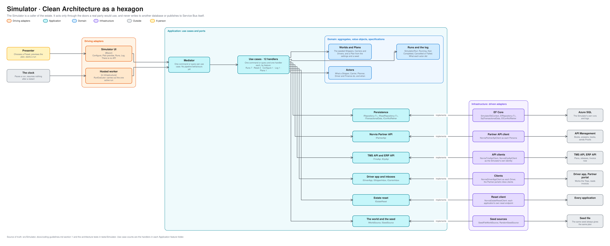
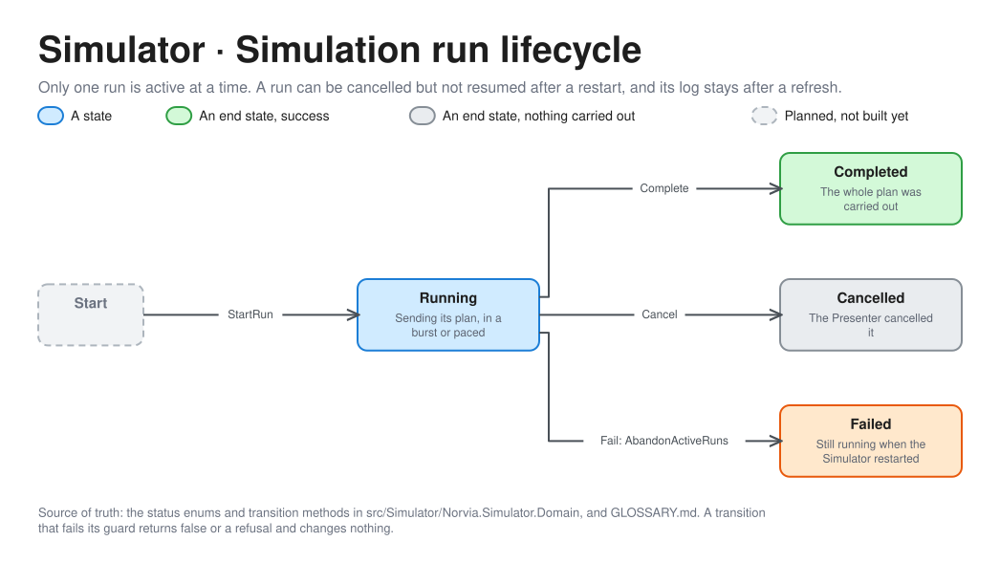

# Simulator architecture

How the Simulator is built inside, in the same hexagon as the [TMS](tms-architecture.md). For engineers and coding agents working on the Simulator and for a demo's technical audience. It is a caller of the estate and owns only its own runs and logs ([context map](context-map.md)). Terms are defined in [GLOSSARY.md](../../GLOSSARY.md).

The editable source is [simulator-hexagon.excalidraw](simulator-hexagon.excalidraw), generated from [bounded_contexts.py](diagrams/bounded_contexts.py). Operating it is in [operations/simulator.md](../operations/simulator.md).

## What differs from the TMS

- **Its driven side is the estate.** Most applications' ports lead to a database, a broker or a file. Most of the Simulator's lead to the other applications' real doors, which is the point: it books as each Shipper Persona and answers and tracks as each Carrier Persona through the Norvia Partner API, plans as the Planner through the TMS API, works the Trips as each Driver through the Driver app API, and runs Invoice now as Finance through the ERP API ([ADR 0039](../adr/0039-the-simulator-books-only-through-the-estates-real-doors.md), [ADR 0042](../adr/0042-the-simulator-signs-in-with-easy-auth-reaches-the-estate-as-its-own-identity-and-plays-the-personas-and-drivers-through-entra-client-apps.md)).
- **There is no Api, and nothing calls it.** It is a Blazor UI the Presenter signs in to, plus a hosted `RunExecutor` that carries out the one active run.
- **The tests hold the discipline.** The Simulator never uses another application's code, never publishes to Service Bus itself, and resets the estate only through each application's own reset endpoint, never through a database or Service Bus.
- **A plan is a pure function.** The same settings and seed always give the same Simulation plan, so a demo can be repeated. What the Carriers do with the Shipments that reached them is worked out when they have, from the same seed.
- **It has no pipeline behaviours.** What it does is tracked where it lands: every call goes through a real door, so everything it makes has a Message trail.

## Use cases

12 handlers in 5 feature folders.

| Feature folder | Handlers | What they do |
|---|---|---|
| `Runs` | 7 | Start a run, execute it, cancel it, abandon the runs a restart left behind, list and get runs, clear the history |
| `Reset` | 2 | Report whether a reset is allowed, and reset the whole estate through each application's own endpoint |
| `Configure`, `Plans`, `Log` | 3 | The settings page and its Presets, the Plan preview, and the log of what each actor did and how Norvia answered |

## Ports and adapters

| Port | Adapter | Talks to |
|---|---|---|
| `IRepository<T>`, `IReadRepository<T>` | `EfRepository<T>` on `SimulatorDbContext` | The Simulator's own database |
| `IPartnerApi` | `NorviaPartnerApiClient`, with `EntraPersonaTokens` or `LocalPersonaTokens` | API Management, as each Persona |
| `ITmsApi`, `IErpApi` | `NorviaTmsApiClient`, `NorviaErpApiClient`, with Entra or local tokens | The TMS API and the ERP API, as the Simulator's own identity |
| `IDriverApp` | `NorviaDriverAppClient`, with `EntraDriverTokens` or `LocalDriverTokens` | The Driver app API, as each Driver |
| `IShipperInbox`, `ICarrierInbox` | The Partner portal's inbox clients | The Partner portal's read endpoints, for invoices and answers |
| `IEstateReset` | `NorviaEstateResetClient` | Each application's reset endpoint |
| `IWorldSource`, `ISeedSource` | `SeedFileWorldSource`, `RandomSeedSource` | The seed file, and a seeded random source |
| `IRunExecution` | `RunExecutor`, a hosted worker | In process |

## A Simulation run

| Move | By | Guard |
|---|---|---|
| Start to Running | `StartRun` | No other run is active. The Shipper references are `SIM-<run>-<n>` |
| Running to Completed | `Complete` | The plan was carried out, either as fast as the estate accepts (burst) or spread over a window (paced) |
| Running to Cancelled | `Cancel` | The Presenter cancelled it. Only an active run can be cancelled |
| Running to Failed | `Fail`, through `AbandonActiveRuns` | A run still Running when the Simulator restarted. It cannot be resumed |
