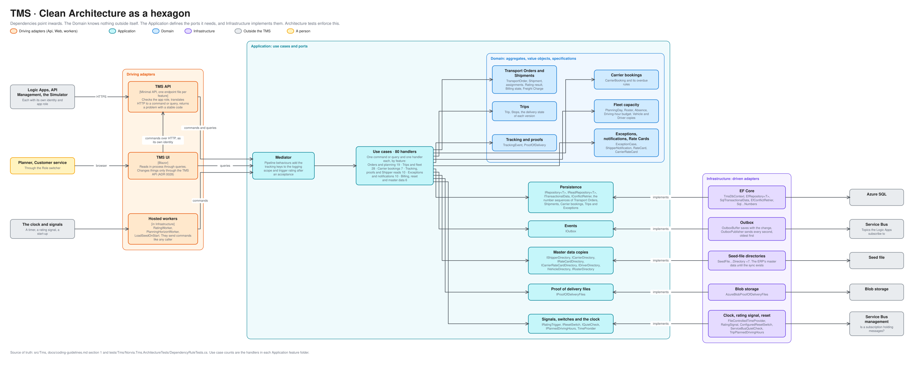

# TMS architecture: Clean Architecture as a hexagon

How the TMS is built inside: the Domain at the centre, the Application around it with the ports it needs, and the adapters at the edge. For engineers and coding agents working on the TMS. The other applications follow the same rule with fewer parts; the [context map](context-map.md) says which. Terms are defined in [GLOSSARY.md](../../GLOSSARY.md).

The editable source is [tms-hexagon.excalidraw](diagrams/tms-hexagon.excalidraw), generated from [bounded_contexts.py](diagrams/bounded_contexts.py). The layers are drawn as nested boundaries, not as a literal hexagon, so each can hold its parts.

## Reading the picture

Left to right is the way a request travels. Something outside calls a **driving adapter**, which translates the call into a command or query. The **Application** runs the use case with the **Domain**, and reaches everything outside through a **port**, an interface it defines. **Infrastructure** implements the port as a **driven adapter** that talks to the real thing.

| Layer | Project | Holds | May reference |
|---|---|---|---|
| Domain | `Norvia.Tms.Domain` | Aggregates, value objects, specifications and domain events, grouped by concept: Transport Orders, Shipments, Carrier bookings, Trips, Fleet, Tracking events, Proofs of delivery, Exceptions, Shipper notifications, Rate Cards | Ardalis building blocks, nothing else |
| Application | `Norvia.Tms.Application` | Use cases, one command or query and one handler each, in a feature folder; DTOs; the ports | Domain |
| Infrastructure | `Norvia.Tms.Infrastructure` | The adapters that implement the ports, the outbox, and the hosted workers | Application, Domain |
| Presentation | `Norvia.Tms.Api`, `Norvia.Tms.Web` | The driving adapters: the Minimal API and the Blazor UI | Application. Infrastructure only in `Program.cs`, to register it |

The dependency rule is enforced by [DependencyRuleTests](../../tests/Tms/Norvia.Tms.ArchitectureTests/DependencyRuleTests.cs): the Domain and Application depend on no outer layer and no framework, Infrastructure does not depend on Presentation, the Api and Web use Infrastructure only in their composition root, and the `DbContext` stays inside Infrastructure.

## Use cases

80 handlers in 14 feature folders. A command changes state and returns at most an ID or a result. A query returns DTOs and changes nothing.

| Area | Feature folders | Handlers | What they do |
|---|---|---|---|
| Orders and planning | `TransportOrders`, `Shipments` | 19 | Take in a booking, rate it, assign and release its Shipment, and list what the Planner has to act on |
| Trips and fleet | `Trips`, `Fleet` | 28 | Draft, change, dispatch, start and end Trips, take a Shipment off one, send a version again; rosters, absences, off-the-road days and planning days |
| Carrier bookings | `CarrierBookings` | 7 | Confirm, reject or withdraw a booking, and record what the Logic Apps report about sending it or a cancellation |
| Tracking, proofs and Shipper reads | `TrackingEvents`, `ProofsOfDelivery`, `ShipperTracking` | 10 | Record Tracking events and Proofs of delivery, and answer a Shipper's queries |
| Exceptions and notifications | `Exceptions`, `ShipperNotifications` | 10 | Resolve an Exception, agree a delivery window, cancel a booking, notify the Shipper, and record the notification report |
| Billing, reset and master data | `Billing`, `Reset`, `Carriers`, `Shippers` | 6 | Release an order without a Proof of delivery, reset the estate, list the copies of master data |

Cross-cutting behaviour is a mediator pipeline behaviour, not code in each handler. Today they add the [tracking contract's](../coding-guidelines.md#tracking-contract) keys to the logging scope for a use case, and trigger rating after an acceptance.

## Ports and adapters

| Port (Application) | Adapter (Infrastructure) | Talks to |
|---|---|---|
| `IRepository<T>`, `IReadRepository<T>`, `ITransactionalData` | `EfRepository<T>`, `SqlTransactionalData` on `TmsDbContext` | Azure SQL |
| `IConflictRetrier` | `EfConflictRetrier` | Azure SQL: retries a command that lost a race |
| `ITransportOrderNumbers`, `IShipmentNumbers`, `ICarrierBookingNumbers`, `ITripNumbers`, `IExceptionNumbers` | `Sql…Numbers`, one per concept | Azure SQL sequences |
| `IOutbox` | `OutboxBuffer` saves the message with the change, `OutboxPublisher` sends it every second, oldest first | Service Bus |
| `IShipperDirectory`, `ICarrierDirectory`, `IRateCardDirectory`, `ICarrierRateCardDirectory`, `IDriverDirectory`, `IVehicleDirectory`, `IRosterDirectory` | `SeedFile…Directory`, loaded by `LoadSeedOnStart` | The seed file, which plays the ERP until the sync exists |
| `IProofOfDeliveryFiles` | `AzureBlobProofOfDeliveryFiles` | Blob storage |
| `IRatingTrigger`, `IResetSwitch`, `IQuietCheck`, `IPlannedDrivingHours`, `TimeProvider` | `RatingSignal`, `ConfiguredResetSwitch`, `ServiceBusQuietCheck`, `TripPlannedDrivingHours`, `FileControlledTimeProvider` or the system clock | The clock, and Service Bus management |

## Things worth knowing

- **The TMS UI reads in process and changes things through the TMS API** ([ADR 0028](../adr/0028-the-tms-ui-reads-in-process-and-changes-things-through-the-tms-api.md)). It sends the Application's queries through its own mediator, straight to the database. For a command it calls the TMS API as its own identity, so every change passes the one place that checks roles, honours the `Idempotency-Key` and records the tracking. An architecture test holds the split, and a new command's namespace has to be added to it.
- **Events leave through the outbox.** A handler never publishes. It saves the change and the event's outbox message in one transaction, and the `OutboxPublisher` sends it later, so an event is published if and only if the change took effect ([ADR 0003](../adr/0003-http-in-events-out.md)). The TMS takes commands as HTTP and never consumes from Service Bus.
- **Hosted workers are driving adapters that live in Infrastructure.** `RatingWorker` rates accepted orders, `PlanningHorizonWorker` opens and closes planning days, and `LoadSeedOnStart` fills the copies. They send commands through the mediator like any caller, so a rule is checked in the same place whoever triggered it.
- **Domain rules stay in the Domain.** A handler loads aggregates, calls their methods, saves and returns. `ReleaseShipmentHandler`, for one, loads the Shipment, Transport Order and Carrier through repositories and directories, asks `AssignmentRules` to price the Carrier booking, and calls `Shipment.Release`. Adding the Carrier booking saves the release and the `ShipmentReleased` outbox message together.

## Where a change goes

| You are adding | It goes in |
|---|---|
| A business rule or a state change | The aggregate or a rules class in the Domain, with a unit test; the lifecycles are in [tms-lifecycles.md](tms-lifecycles.md) |
| A use case | A feature folder in the Application: the command or query, its handler, its result |
| Something the TMS needs from outside | A port in the Application, an adapter in Infrastructure, and a row in the table above |
| An endpoint | The feature's endpoint file in the Api, which only translates |
| A page | The Web, which reads through queries and changes things through the TMS API |
| An event | A schema in the Canonical Model, a row in [events.md](events.md), and an outbox message in the handler |
