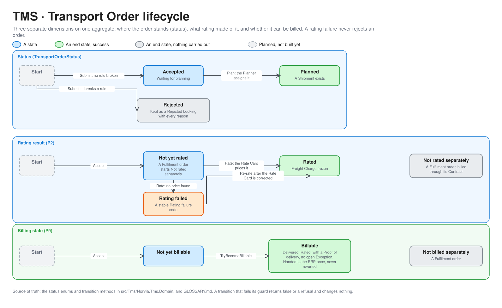
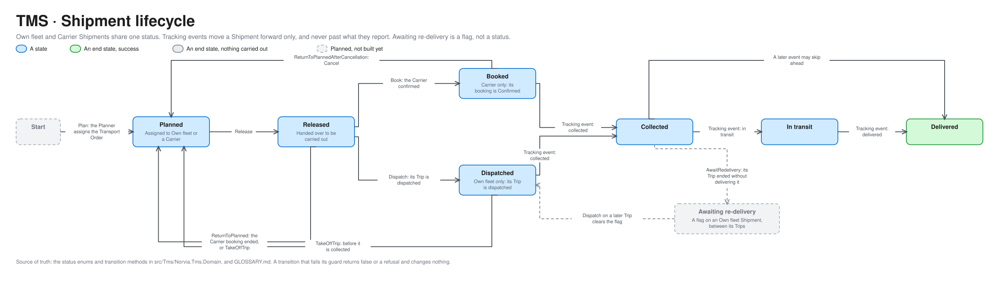
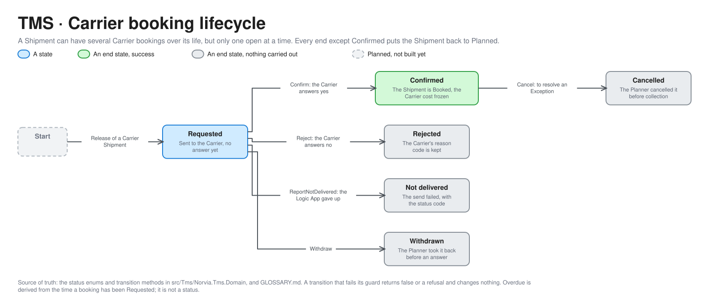
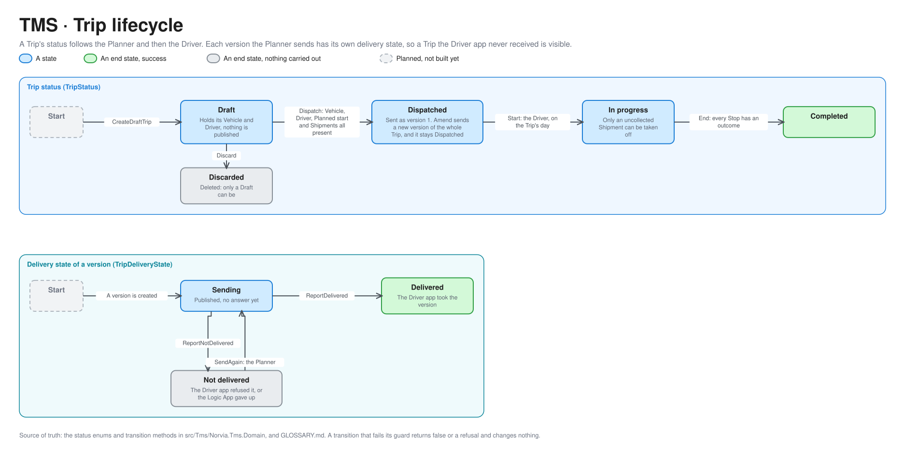
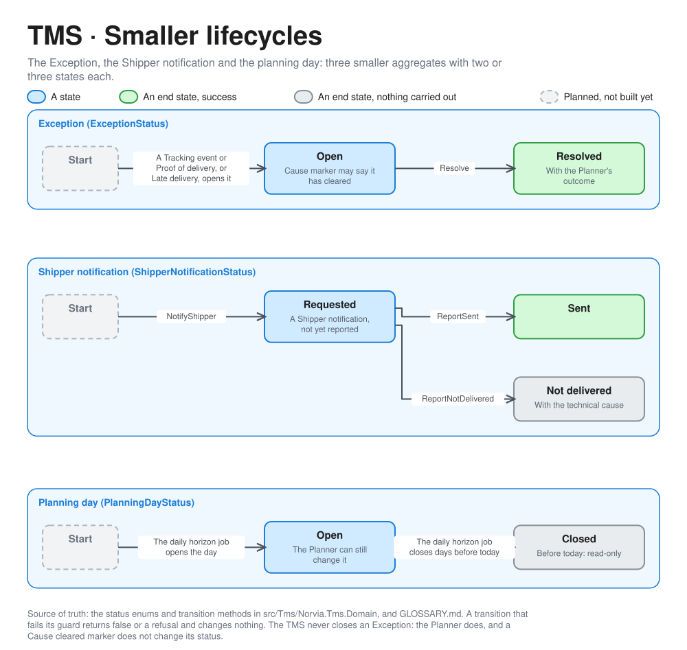

# TMS lifecycles

How each of the TMS's aggregates moves through its states, with the domain method that makes each move and the guard it must pass. For engineers and coding agents working on the TMS, and for anyone who needs to know what a status means before they change it. These are the Domain at the centre of the [TMS hexagon](tms-architecture.md). Terms are defined in [GLOSSARY.md](../../GLOSSARY.md).

A transition that fails its guard returns `false` or a refusal with a stable code, and changes nothing. Every command is idempotent, so a repeat of one that took effect is recorded once ([coding guidelines §6](../coding-guidelines.md)). The editable sources are the `.excalidraw` files next to each picture, generated from [bounded_contexts.py](diagrams/bounded_contexts.py).

## Transport Order

A Transport Order has three separate dimensions, so "Planned but Rating failed" and "Delivered but not yet Billable" are ordinary states ([TransportOrder](../../src/Tms/Norvia.Tms.Domain/TransportOrders/TransportOrder.cs)).

| Dimension | Moves | By | Guard |
|---|---|---|---|
| Status | Start to Accepted, or to Rejected | `Accept`, `Reject`, through the booking's submission | A Rejected booking keeps every rejection reason and gets no Transport Order number ([P1](../processes/tms/p1-transport-order-intake.md)) |
| Status | Accepted to Planned | `Plan` | The order is Accepted and not yet Planned, and the chosen Carrier is known and active ([P3](../processes/tms/p3-transport-planning.md)) |
| Rating result | Not yet rated to Rated, or to Rating failed | `ApplyRating` | The Rate Card prices the lane and weight. A rating failure keeps the order Accepted and carries a stable code ([P2](../processes/tms/p2-rating.md)) |
| Rating result | Rating failed to Rated | A re-rate | Customer service re-rates after the Rate Card was corrected. The re-rate continues the order's Message trail |
| Rating result | Starts as Not rated separately | `Accept` | A Fulfilment order (WMS channel) is billed through its Contract and has no Freight Charge of its own |
| Billing state | Not yet billable to Billable | `TryBecomeBillable` | Delivered, Rated, with a current Proof of delivery and no open Exception, or released by Customer service without a Proof of delivery. Once Billable, it stays Billable ([P9](../processes/tms/p9-freight-settlement.md)) |

## Shipment

One Shipment carries one Transport Order, carried by Own fleet or by a Carrier ([Shipment](../../src/Tms/Norvia.Tms.Domain/Shipments/Shipment.cs)). The two ways of carrying it share one status and split at Released.

| Move | By | Guard |
|---|---|---|
| Start to Planned | `Plan` | Raised by the Transport Order's `Plan` |
| Planned to Planned, to another carrier | `Reassign` | The Shipment is Planned and goes to someone other than who carries it |
| Planned to Released | `Release` | The Shipment is Planned. A Carrier Shipment needs a Carrier booking number, an Own fleet Shipment must not have one |
| Released to Booked | `Book` | The Carrier booking was Confirmed |
| Released to Dispatched | `Dispatch` | The Shipment is Own fleet and its Trip was dispatched |
| Booked or Dispatched to Collected, In transit or Delivered | `Record` of a Tracking event | The Shipment is Booked or later, and the event moves it forward. An event never moves a Shipment backwards and never past what it reports. Exceptions (a failed collection or delivery, damage) are recorded without moving it |
| Released to Planned | `ReturnToPlanned` | The Carrier booking was rejected, not delivered or withdrawn |
| Booked to Planned | `ReturnToPlannedAfterCancellation` | The Planner cancelled the Confirmed Carrier booking before collection |
| Released or Dispatched to Planned | `TakeOffTrip` | An Own fleet Shipment, taken off its Trip before collection |
| Collected or In transit, flagged | `AwaitRedelivery` | An Own fleet Shipment whose Trip ended without delivering it. The flag is cleared when a later Trip dispatches it. Norvia still holds the goods, so this is not a status |

The Shipper never sees any of this. Its Tracking status (Received, Scheduled, Collected, In transit, Delivered) is derived, hides how Norvia carries the goods and never moves backwards ([ADR 0011](../adr/0011-shippers-see-a-tracking-status-not-the-shipments-workings.md)).

## Carrier booking

A Shipment can have several Carrier bookings over its life, one after each that ends without being carried out, but only one open at a time ([CarrierBooking](../../src/Tms/Norvia.Tms.Domain/CarrierBookings/CarrierBooking.cs)).

| Move | By | Guard |
|---|---|---|
| Requested to Confirmed or Rejected | `Confirm`, `Reject` | The booking is Requested. The Carrier's answer arrives through the Partner API and the Carrier answer Logic App ([P4](../processes/tms/p4-carrier-booking.md)) |
| Requested to Not delivered | `ReportNotDelivered` | The Carrier booking Logic App gave up sending it, after its retries or on a client error. The status code is kept |
| Requested to Withdrawn | `Withdraw` | The Planner takes it back before the Carrier has answered |
| Confirmed to Cancelled | `Cancel` | Before collection. The Planner does it to resolve an Exception, and the Carrier is told ([P7](../processes/tms/p7-exception-handling.md), [ADR 0010](../adr/0010-a-confirmed-carrier-booking-can-be-cancelled-before-collection.md)) |

Overdue is derived from how long a booking has been Requested. It is a flag for the Planner, not a status.

## Trip

A Trip has two lifecycles that move independently: its own status, and the delivery state of each version the Planner sends ([Trip](../../src/Tms/Norvia.Tms.Domain/Trips/Trip.cs)).

| Move | By | Guard |
|---|---|---|
| Start to Draft | `CreateDraftTrip` | The Vehicle and Driver have no other Trip that day, and the Planned start is inside the Driver's Shift ([P10](../processes/tms/p10-fleet-capacity-planning.md)) |
| Draft to Dispatched | `Dispatch` | The Trip is a Draft with a Vehicle, a Driver, a Planned start and its Shipments, and each Shipment can be dispatched |
| Draft to gone | `Discard` | Only a Draft can be discarded, and it gives its Vehicle and Driver and their hours back |
| Dispatched to Dispatched | `Amend` | A new version of the whole Trip. Once the Trip is under way, the only change allowed is taking off an uncollected Shipment |
| Dispatched to In progress | `Start` | The Driver starts it, on its day |
| In progress to Completed | `End` | Every Stop has an outcome. Shipments not collected go back to Planned, and Shipments not delivered become Awaiting re-delivery |
| A version, Sending to Delivered | `ReportDelivered` | The Trip dispatch Logic App sent the version and the Driver app took it |
| A version, Sending to Not delivered | `ReportNotDelivered` | The Driver app refused it or the Logic App gave up. The cause is kept, and the Planner sees it |
| A version, Not delivered to Sending | `SendAgain` | The Planner sends the latest version again |

## Smaller lifecycles

| Aggregate | Moves | By | Notes |
|---|---|---|---|
| Exception | Open to Resolved | `Resolve` | Only an Open Exception resolves. The TMS never closes one: the Planner does, with an outcome. A Cause cleared marker says the cause no longer holds but changes no status ([P7](../processes/tms/p7-exception-handling.md)) |
| Shipper notification | Requested to Sent, or Not delivered | `ReportSent`, `ReportNotDelivered` | Reported by the Shipper notification Logic App, with the technical cause for a failure. The Planner can send as many as needed |
| Planning day | Open to Closed | The daily horizon job | A day before today closes and is read-only. The job opens each new day from the Drivers' Rosters |

## Keeping it true

The states and moves come from the status enums and transition methods in [src/Tms/Norvia.Tms.Domain](../../src/Tms/Norvia.Tms.Domain/). A PR that adds a status or a transition updates the picture, its table and, if the Shipper can see it, [P8](../processes/tms/p8-shipper-visibility.md), in the same PR. Edit the spec in [bounded_contexts.py](diagrams/bounded_contexts.py) and run it.
