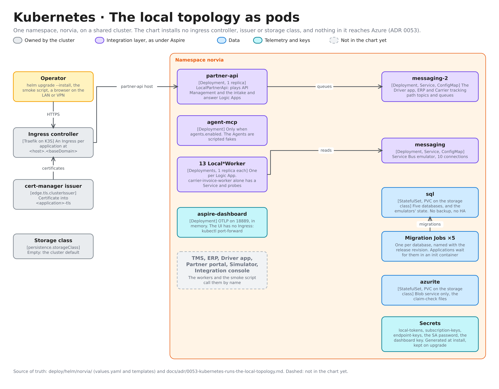

# Kubernetes

How to run the sandbox's local topology on a Kubernetes cluster, set the chart's values, decide whether `LocalAuth:Allowed` is safe on your cluster, and check a deployment with the smoke script. What plays each Azure piece there is the **On Kubernetes** column of [architecture/local-vs-azure.md](../architecture/local-vs-azure.md); why it is built this way is [ADR 0053](../adr/0053-kubernetes-runs-the-local-topology.md). What each piece of the chart is, is in [deploy/helm/norvia/README.md](../../deploy/helm/norvia/README.md).

The chart runs the **local topology**, not the Azure estate: no Azure account, Entra, Key Vault, Foundry or Application Insights, and the as-found toggles, the alerts and the real Estate health check stay Azure-only. Nodes must be amd64, because SQL Server and the Service Bus emulator have no ARM images.

## What is in the chart today



The editable source is [kubernetes.excalidraw](../architecture/diagrams/kubernetes.excalidraw), generated from [deployment.py](../architecture/diagrams/deployment.py).

In the chart: SQL Server and Azurite on PVCs, the migrations as Jobs, the two Service Bus emulators, the Partner API stand-in (`LocalPartnerApi`) and the agent MCP stand-in (when `agents.enabled`), the 13 `Local*Worker` Deployments, the standalone Aspire dashboard, and an Ingress per exposed application.

Not in the chart yet: the TMS API, the ERP, the UIs, the Integration console and the Driver app. The workers and the smoke script call them by name, so until they are deployed a worker starts and retries, and the smoke script fails at its first step that needs one, naming it. Two pieces of the namespace's protection, the default-deny `NetworkPolicy` with the internal-only ingress, and the `ResourceQuota`, are #938, and the `LocalAuth:Allowed` setting itself is #930; both are still open.

## Before you deploy

- **A cluster** with an ingress controller (Traefik on K3S is the tested default), a default storage class or one you name, and, if you want certificates, cert-manager with a `ClusterIssuer`. The chart installs none of these.
- **DNS:** a wildcard record for the base domain, pointing at the ingress controller. Each application is reached at `<host>.<baseDomain>`.
- **The images**, built and pushed to a registry the cluster can pull from (`image.registry`, `image.tag`).
- **Tools:** `helm`, `kubectl` and PowerShell 7.4 or later. The [dev container](dev-container.md) has them.

## Deploy

```bash
helm upgrade --install norvia deploy/helm/norvia -n norvia --create-namespace \
  --set edge.baseDomain=norvia.example.org \
  --set edge.tls.clusterIssuer=letsencrypt \
  --set image.registry=registry.example.org/norvia
```

Use `helm upgrade --install`, not `kubectl apply` of rendered manifests: only Helm orders the migrations before the applications and prunes what was removed. The chart is plain, so Flux or Argo CD can take it later as a `HelmRelease` or an `Application`. Note that rendering without cluster access (`helm template`, client-side GitOps) cannot look up the generated Secrets, so it renders new keys on every run.

The generated Secrets (`local-tokens`, `subscription-keys`, `endpoint-keys`, the SQL Server SA password and the dashboard's API key) are made at install and kept on upgrade. No key is in a values file unless you set `sql.saPassword` yourself; keep that out of source control.

## The values you set

| Value | What it does |
|---|---|
| `edge.baseDomain` | **Required, no default.** The hostnames are `<host>.<baseDomain>`. |
| `edge.ingress.className` | The ingress class. `traefik`. |
| `edge.tls.clusterIssuer` | The cert-manager issuer that signs each hostname's certificate. Empty: the Ingress asks for none and expects a Secret `<application>-tls`. `edge.tls.enabled=false` leaves TLS out. |
| `image.registry`, `image.tag`, `image.pullSecrets` | Where the Norvia images come from. Empty registry: the image names are used as they are, which suits a cluster that has them loaded. |
| `persistence.storageClass` | The storage class of every PVC. Empty: the cluster's default. |
| `sql.saPassword` | Empty: generated. Must not contain a semicolon. |
| `agents.enabled` | Off, as under Aspire. On, the Partner API runs the Intake agent's scripted fake and `agent-mcp` is deployed. No model is called either way. |

The rest of `values.yaml` (the emulators' topics, the Personas, the token constants, the workers) repeats what the AppHost and the seed file hold, and the chart's template tests compare them: change one, change the other.

## `LocalAuth:Allowed`

There is no identity provider on the cluster. The local operator sign-in ([ADR 0026](../adr/0026-the-integration-console-signs-operators-in-with-easy-auth-and-checks-their-app-role.md)), the Driver app's sign-in page ([ADR 0037](../adr/0037-drivers-sign-in-to-the-driver-app-with-entra-and-the-driver-id-is-their-app-role.md)) and the local token-signing key refuse to start outside Development. `LocalAuth:Allowed` is the named setting, independent of the environment name, that will let them run on Kubernetes. **It does not exist yet (#930):** until it lands, they refuse to start on the cluster, so the Integration console and the Driver app cannot be signed in to there. Once it lands it is off by default, and while it is on an Easy Auth header is not trusted.

Setting it will be a statement that this holds: **Norvia's ingress is not reachable from the public internet, and no other namespace can reach Norvia's pods.** Anyone who can reach the ingress is signed in as an operator holding both console roles, and anyone who can reach a pod can get a token signed by the local key.

Before you set it, check:

1. The ingress controller that serves Norvia is reachable only from your LAN or VPN, not from the internet.
2. The cluster's CNI enforces `NetworkPolicy`. On one that does not, the namespace's default-deny policy does nothing and the condition is not true. Do not set it there.
3. The namespace has the default-deny policy and the internal-only ingress (#938). Until those land, you are the one making the condition true.

## Check a deployment

After every `helm upgrade --install`, from anywhere that reaches the ingress and has `kubectl` pointed at the cluster:

```bash
pwsh infra/smoke-test-kubernetes.ps1 -BaseDomain norvia.example.org
```

Pass `-Insecure` when the ingress is plain http, `-SkipCertificateCheck` for a self-signed certificate, `-Namespace` if it is not `norvia`, and `-TimeoutSeconds` (default 180) for each wait. Without `-BaseDomain` it takes `NORVIA_BASE_DOMAIN` from the environment, then the domain of the `partner-api` Ingress.

It drives one Shipment from booking to delivery through the ingress: Brouwer Dranken books, the Planner assigns and releases, Van Dijk Transport confirms, sends PU, DEP and POD tracking events and a Proof of delivery, and Brouwer Dranken reads the Proof of delivery, its file and the tracking events back. It signs the tokens itself with `local-tokens/signing-key` and takes the keys from `subscription-keys`, so it needs `get` on those Secrets. It stops at the first failing step, naming it, with the status the application answered and never a body, token or key. Each run leaves one Transport Order behind.

A pass settles what the chart's README lists as not verified: that the ingress controller and cert-manager route to the Partner API, that two emulators share one SQL Server, and that the booking, tracking and Proof of delivery path works through the emulators and Azurite. It does not cover that the Aspire dashboard finds the run's trail, which waits for the Integration console.

## What goes wrong

- **The smoke script fails at the TMS API.** It is not in the chart yet. That is the expected result until it is.
- **A pod stays in `Init`.** Its init container waits for a migrations Job: `kubectl get jobs -n norvia`, then the Job's log.
- **The dashboard's history is gone.** It keeps telemetry in memory and loses it on a restart. A rendered-without-lookup upgrade also changes its API key; restart the Integration console with it.
- **Data is gone.** A lost SQL Server or Azurite volume is not backed up. Reinstall, and the seed file loads the Shippers, Carriers and Rate Cards again.
- **The chart's template tests:** `pwsh -c 'Invoke-Pester infra/chart-data-tier.Tests.ps1, infra/chart-service-bus.Tests.ps1, infra/chart-edge.Tests.ps1, infra/chart-workers.Tests.ps1, infra/chart-telemetry.Tests.ps1'`. They run offline.
