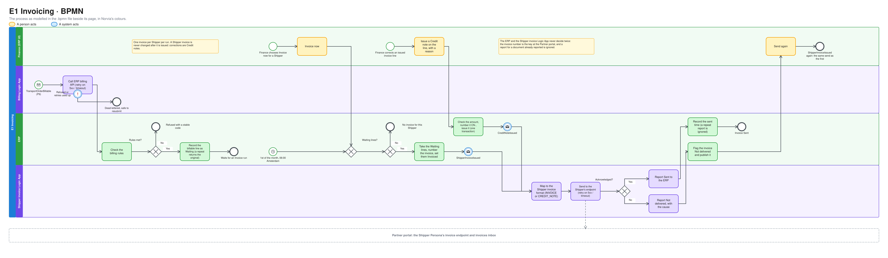
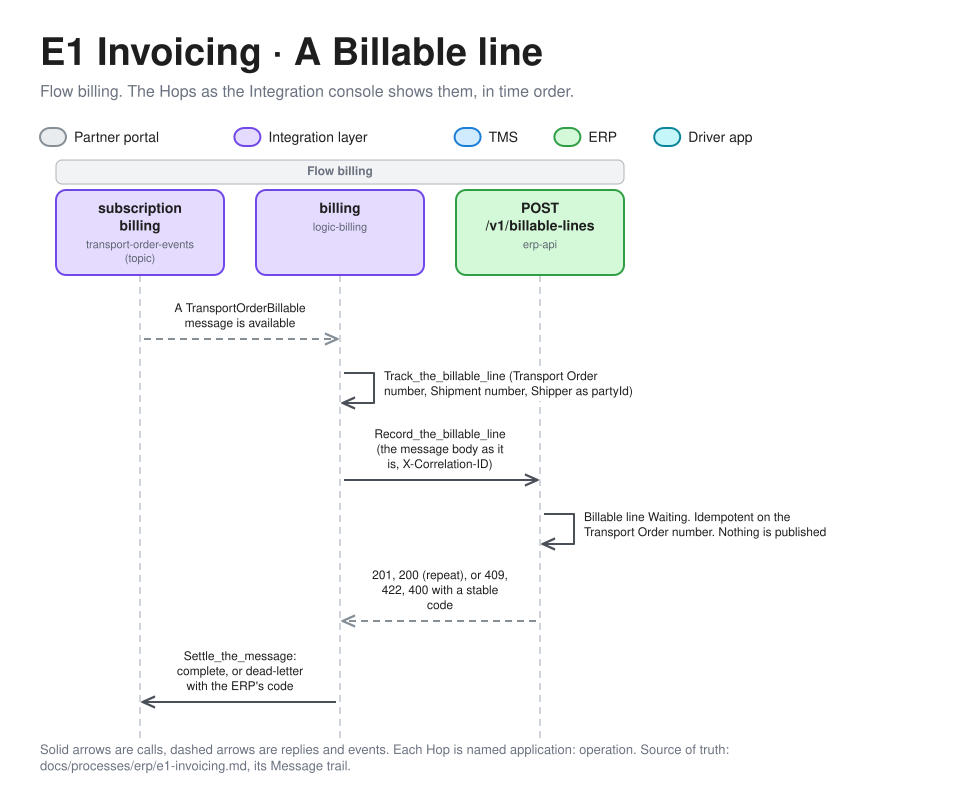
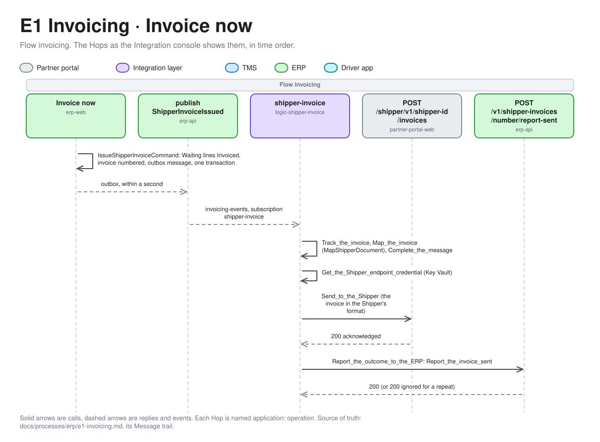
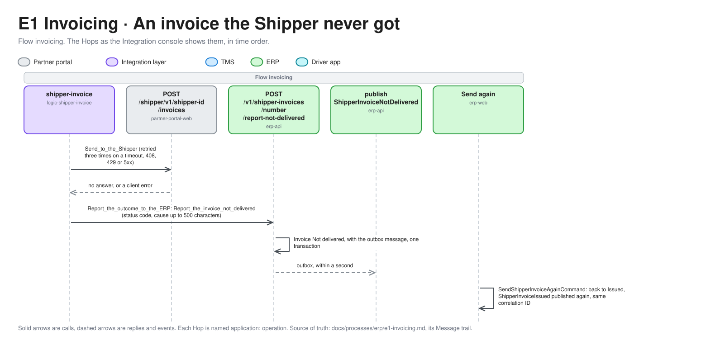

# E1 Invoicing

Invoicing turns the Billable Transport Orders the TMS hands over into Shipper invoices, one per Shipper per Invoice run, and sends them to the Shipper. Finance corrects an issued invoice with a Credit note. This is the ERP half of [P9 Freight settlement](../tms/p9-freight-settlement.md). Terms are defined in [GLOSSARY.md](../../../GLOSSARY.md).

| | |
|---|---|
| **Trigger** | `TransportOrderBillable` from the TMS (P9). The monthly Invoice run, or Finance choosing **Invoice now** |
| **Outcome** | A Shipper invoice for each Shipper with billable lines, sent to the Shipper's Persona. Credit notes where Finance corrects one |
| **Owning system** | ERP. It owns Shipper invoices and Credit notes (ADR 0002, ADR 0012) |
| **Applies to** | Transport-only orders, whether Own fleet or a Carrier carried them. Fulfilment orders are not invoiced here |
| **Integrations touched** | Service Bus (Transport Order events, Invoicing events), Billing Logic App, ERP billing API, Shipper invoice Logic App, Key Vault, Partner portal (Shipper invoice endpoint and inbox) |

## Process model

The model is [e1-invoicing.bpmn](e1-invoicing.bpmn), which opens in any BPMN tool and is the source. The picture is drawn from it by [bpmn.py](../../architecture/diagrams/bpmn.py), so change the model and run the script, not the picture ([the editable file](../../architecture/diagrams/bpmn-e1-invoicing.excalidraw)).

## Billable lines

The ERP keeps one **billable line** per Transport Order that the TMS made Billable. It holds what `TransportOrderBillable` carries: the Transport Order number, the Shipper, the Shipper reference, the Shipment number, the delivery time, the Freight Charge with its charge lines and Rate Card version, and whether it was released without a Proof of delivery. The ERP never recalculates a Freight Charge.

A billable line is either **Waiting**, until an Invoice run puts it on a Shipper invoice, or **Invoiced**, with that invoice's number. A line is invoiced once and only once.

## Steps

1. **Receive.** The Billing Logic App picks up `TransportOrderBillable` and maps it to the ERP's API. It calls the ERP billing API to record the billable line. The ERP checks the [billing rules](#billing-rules), records the line as Waiting and answers. A repeat for the same Transport Order number with the same content returns the original line, flagged as a repeat.
2. **Run.** An Invoice run collects every Waiting line for a Shipper (see [Invoice run](#invoice-run)).
3. **Issue.** For each Shipper with at least one Waiting line, the ERP creates a Shipper invoice with the next invoice number, sets its lines to Invoiced and publishes `ShipperInvoiceIssued`, all in one transaction. A Shipper without Waiting lines gets no invoice.
4. **Send.** The Shipper invoice Logic App picks up the event, maps it to the [Shipper invoice format](#shipper-invoice-format) and calls the Shipper Persona's invoice endpoint in the Partner portal, with credentials it reads from Key Vault. The endpoint acknowledges receipt. The Partner portal treats the invoice number as the key, so a repeated call is ignored.
5. **Report.** The Logic App reports the invoice to the ERP as Sent, and the ERP records the time. A report for a document that was reported already is ignored and logged.

On a server error or timeout, the Shipper invoice Logic App retries with a bounded exponential policy, as in P4. It doesn't retry a client error. When the retries are used up, or on a client error, it reports the invoice as **Not delivered**, with the technical cause, and the ERP publishes `ShipperInvoiceNotDelivered`. Finance sees the flag in the list of Shipper invoices and can **send again**, which publishes `ShipperInvoiceIssued` once more with the same invoice. If the Logic App can't reach the ERP either, its run fails and the invoice stays Issued without a sent time, which the list shows.

## Invoice run

| | |
|---|---|
| **Monthly** | On the 1st of each month at 06:00 Europe/Amsterdam, the ERP runs for every Shipper, over the Waiting lines whose delivery time is before the 1st |
| **Invoice now** | Finance chooses **Invoice now** for one Shipper in the ERP UI. It runs for that Shipper over all its Waiting lines. It exists so a demo doesn't wait a month |

A line that arrives after a run waits for the next one. Two runs can't invoice the same line: each run takes the Shipper's Waiting lines and sets them to Invoiced in one transaction.

## Shipper invoice

| Part | |
|---|---|
| Invoice number | `INV-<year>-<6 digits>`, from one gapless sequence per calendar year, as Dutch invoicing rules require. A number is only taken in the transaction that issues the invoice |
| Invoice date | The date of the run, Europe/Amsterdam |
| Shipper | From the ERP's seed-loaded Shipper data |
| Lines | One per Transport Order: Transport Order number, Shipper reference, delivery date, the charge lines and the line total. The Shipment number is kept on the line for Finance, and isn't sent to the Shipper |
| Total without VAT | The sum of the line totals |
| VAT | 21% of the total without VAT, rounded to cents, half away from zero, as in P2. Dutch VAT rules, including reverse charge, are deferred. Every seed Shipper is Dutch |
| Total with VAT | The two added up |
| Status | Issued, final. Sent, or Not delivered with the technical cause |

The Shipper invoice is never changed or deleted after it is issued. Corrections are Credit notes.

## Credit notes

Finance issues a Credit note from an issued Shipper invoice, for one of its lines:

- **Full or partial.** The amount without VAT is at most the line's total minus any earlier Credit notes on the same line.
- **A reason is required,** for example "Rate Card error on Lane NL-BE, see ticket 4411".
- **VAT** is 21% of the credited amount, rounded as for the invoice.
- **Numbering** is `CN-<year>-<6 digits>`, from its own gapless sequence per year.

The ERP issues the Credit note and publishes `CreditNoteIssued` in one transaction. The Shipper invoice Logic App sends it to the Shipper's Persona the same way as an invoice, with the same reports and the same Not delivered handling. The TMS never learns about it (ADR 0012).

Claims for damage or a shortage are settled outside the TMS and the ERP (P7). They never create a Credit note automatically. Finance can issue one by hand when a claim is settled against the invoice.

## Billing rules

| Rule | Failure code |
|---|---|
| The Shipper exists in the ERP's seed-loaded Shipper data | `ShipperNotFound` |
| The Freight Charge has at least one charge line | `FreightChargeWithoutChargeLines`, a client error |
| The Freight Charge's total is the sum of its lines | `FreightChargeTotalMismatch`, a client error |
| A Transport Order number already recorded with different content | `BillableLineConflict` |

Each failure has a stable code and a readable message. A client error or conflict fails the Billing Logic App's run, and the message is dead-lettered.

## Shipper invoice format

The Shipper invoice format follows the conventions of the Shipper booking format in P1: JSON with its own field names and local dates. The Shipper invoice Logic App maps ERP → Shipper. Towards the Shipper, Norvia carries the goods, so the format names neither the Carrier nor the Shipment number (ADR 0011).

| Field | Required |
|---|---|
| Document type: `INVOICE` or `CREDIT_NOTE` | Yes |
| Document number and date | Yes |
| For a Credit note: the invoice number and line it credits, and the reason | Yes |
| Lines: Transport Order number, Shipper reference, delivery date, charge lines with code and amount, line total | Yes |
| Totals without VAT, VAT and with VAT, in EUR | Yes |

The charge lines use the codes `FREIGHT` and `MINIMUM_CHARGE_ADJUSTMENT`.

## ERP UI

| List | Shows | Actions |
|---|---|---|
| Waiting billable lines | Per Shipper: the number of Waiting lines and their total, and each line on opening. A line released without a Proof of delivery is marked | Invoice now, per Shipper |
| Shipper invoices | Issued invoices and Credit notes, newest first: number, Shipper, date, totals, sent time or "Not delivered" | Open. Issue a Credit note (on an invoice line). Send again (when Not delivered) |
| Master data | Shippers, Carriers, Rate Cards and Carrier Rate Cards, from the seed file at first and edited by Finance since ([E3](e3-master-data-sync.md)) | View here; edited in E3's forms |

The lists update without a page refresh, as the TMS's do. Finance uses them with Finance permissions.

## Partner portal

Shipper Personas get an **invoice endpoint** and an **invoices inbox** that lists the Shipper invoices and Credit notes received, newest first, with their totals and lines. The endpoint has no answer modes. It acknowledges every valid message.

## ERP API

The ERP billing API accepts only the ERP's own model, which is the Canonical Model (ADR 0003). Each Logic App's managed identity holds only the role it needs.

| Operation | Caller | Role |
|---|---|---|
| Record a billable line | Billing Logic App | `BillableLines.Record` |
| Report a Shipper invoice or Credit note as sent or not delivered | Shipper invoice Logic App | `ShipperInvoices.Report` |
| Invoice now for a Shipper, issue a Credit note on an invoice line | The [Simulator](../../operations/simulator.md#what-finance-does), playing Finance | `ShipperInvoices.Manage` |

A sent or not-delivered report for a document that was already reported is ignored and logged, as in P7.

## Correlation ID

The billable line keeps the intake and billing correlation IDs from `TransportOrderBillable`. The ERP creates a new correlation ID for each Shipper invoice and each Credit note, and the Shipper invoice Logic App carries it on to the Partner portal and on its reports. Tracing a Transport Order from intake to its invoice follows the Transport Order number, which is on the invoice line.

## Events

All events go to a new topic for Invoicing events, through the ERP's transactional outbox (ADR 0003).

| Event | Published when | Carries | Consumers |
|---|---|---|---|
| `ShipperInvoiceIssued` | A Shipper invoice is issued, or Finance sends it again | The whole invoice with its lines and totals, Shipper, correlation ID | Shipper invoice Logic App |
| `CreditNoteIssued` | Finance issues a Credit note, or sends it again | The Credit note with the invoice and line it credits, amounts, reason, Shipper, correlation ID | Shipper invoice Logic App |
| `ShipperInvoiceNotDelivered` | An invoice or Credit note is reported not delivered | Document type and number, Shipper, technical cause, correlation ID | Monitoring. An alert later |

Recording a billable line publishes nothing. The Invoice run is what the Shipper sees.

## Presenter smoke run

After a deployment, and not in CI, the presenter checks the faults and the tracing of Invoicing on the deployed estate, before the headline relies on them. The happy path (Invoice now, Credit note, the Shipper's inbox) is played by the [Simulator](../../operations/simulator.md); this run doesn't repeat it. Do it after the presenter smoke run of Freight settlement ([P9](../tms/p9-freight-settlement.md#presenter-smoke-run)). The Logic Apps' faults are injected by pointing a Logic App at an address that doesn't answer, and put back when the run ends, even if it fails. The presenter's actions in the TMS UI and the ERP UI are theirs, and the script stops and says what to do. Run it in a terminal, with the TMS UI, the ERP UI and the Integration console side by side.

1. **Get two Transport Orders.** Deliver two with a Proof of delivery, ready to become Billable. Note their numbers.
2. **Run the check.** Run `infra/smoke-test-invoicing.ps1 <ERP fault order> <Shipper fault order>`. It reads Service Bus and Application Insights, which is usually 1 to 5 minutes behind.
3. **The ERP billing API is down.** The script points the Billing Logic App away from the ERP. Make the first order Billable. The script checks that the message is retried and then dead-lettered on the `billing` subscription with `ErpUnavailable`. In the ERP UI, see that the line isn't Waiting. The script puts the address back; resubmit the message from the Integration console to see the line arrive.
4. **The Shipper invoice endpoint is down.** The script points the Shipper invoice Logic App away from the Partner portal. Make the second order Billable and choose **Invoice now**. The script checks that the send is tracked `Failed` with `ShipperUnavailable`; the ERP UI shows the invoice Not delivered. The script puts the address back; choose **Send again**, and the script checks that the send is tracked `Succeeded`. The Shipper's inbox holds the invoice once.
5. **Follow it.** The script checks that the dead-lettered message is in Application Insights by correlation ID, in the Billing Logic App and the TMS, and the invoice in the ERP, the Shipper invoice Logic App and the Partner portal, and prints the Integration console's links.

The script prints `PASS` or `FAIL` per check, never a body, a token or a key. If a check fails, file the gap as its own issue against E1, rather than working around it in the run book.

## Implementation

For engineers and coding agents. It shows where E1 lives in the repository. Built so far: the ERP application with its seed-loaded master data, recording Billable lines through the ERP billing API with the list of Waiting lines, the Billing Logic App that hands `TransportOrderBillable` to it, **Invoice now**, which issues a Shipper invoice and publishes `ShipperInvoiceIssued`, the monthly Invoice run, the Partner portal's Shipper invoice endpoint and invoices inbox, and the Shipper invoice Logic App, which sends the invoice and reports it Sent or Not delivered, and Send again. Not delivered handling with **Send again** is built too, and so is issuing **Credit notes**, which publishes `CreditNoteIssued`, and sending them: the Shipper invoice Logic App sends a Credit note like an invoice, with the same reports, Not delivered handling and Send again.

### Message trail

The Hops of E1, named as the [Integration console](../../operations/integration-console.md#message-trail) shows them, in time order. A Hop is grouped under the Flow it carries in the tracking contract. The same order's whole life, across every application, is drawn in [the order lifecycle](../../architecture/order-lifecycle.md#5-from-delivered-to-a-shipper-invoice).

**1. A Billable line.** The TMS's `TransportOrderBillable` is on the `transport-order-events` topic. The Billing Logic App reacts on the same trail, with the event's correlation ID.

*Editable source: [message-trail-e1-1.excalidraw](../../architecture/diagrams/message-trail-e1-1.excalidraw), generated from [message_trails.py](../../architecture/diagrams/message_trails.py).*

**2. An invoice.** Finance's **Invoice now**, or the monthly Invoice run, starts a new trail for the invoice. Its correlation ID is the invoice's own, and every later hop carries it.

*Editable source: [message-trail-e1-2.excalidraw](../../architecture/diagrams/message-trail-e1-2.excalidraw), generated from [message_trails.py](../../architecture/diagrams/message_trails.py).*

**3. A Credit note** takes the same path from `IssueCreditNoteCommand`: it publishes `CreditNoteIssued` to the same subscription, and the Logic App sends it as a `CREDIT_NOTE` and reports it to `/v1/credit-notes/{number}/report-sent`.

**4. An invoice the Shipper never got.** The send hop is `Failed` with `ShipperUnavailable` or `ShipperRefused`, and the Logic App reports it instead of failing the run.

*Editable source: [message-trail-e1-3.excalidraw](../../architecture/diagrams/message-trail-e1-3.excalidraw), generated from [message_trails.py](../../architecture/diagrams/message_trails.py).*

### What is built

| Piece | Where | Does |
|---|---|---|
| Domain | [src/Erp/Norvia.Erp.Domain](../../../src/Erp/Norvia.Erp.Domain/) | The aggregates `Shipper`, `Carrier`, `RateCard` and `CarrierRateCard`, with the IDs the TMS uses, and their specifications. A card keeps its versions, Zones and Lanes as the seed file has them; the ERP shows them and never rates with them. E1 adds `BillableLine`, `ShipperInvoice`, `CreditNote`, the year's `InvoiceNumberSequence` and the monthly run's schedule, and E2 the Carrier cost and Carrier invoice aggregates |
| Application | [src/Erp/Norvia.Erp.Application](../../../src/Erp/Norvia.Erp.Application/) | The queries behind the four master data lists, and `LoadMasterDataCommand`, which adds what the seed file has and reloads what is there already, so loading twice changes nothing. The use cases of E1 are in the rows below, one feature folder each: `BillableLines`, `ShipperInvoices` and `CreditNotes` |
| Infrastructure | [src/Erp/Norvia.Erp.Infrastructure](../../../src/Erp/Norvia.Erp.Infrastructure/) | The ERP's own `ErpDbContext` and database (`erp`), the transactional outbox and its publisher, and the seed loader that runs as the ERP starts |
| Migrations | [src/Erp/Norvia.Erp.Migrations](../../../src/Erp/Norvia.Erp.Migrations/) | A Container Apps job that applies the database's migrations; azd's postdeploy hook runs it |
| Billable lines | [src/Erp/Norvia.Erp.Domain/BillableLines](../../../src/Erp/Norvia.Erp.Domain/BillableLines/) | The `BillableLine` aggregate, keyed by its Transport Order number, and the billing rules: the charge lines are there and add up to the total, and what counts as the same content on a repeat. Waiting is the status a recorded line starts in, and an Invoice run moves it to Invoiced exactly once |
| Record a Billable line | [src/Erp/Norvia.Erp.Application/BillableLines](../../../src/Erp/Norvia.Erp.Application/BillableLines/Record/) | `RecordBillableLineCommand` and its handler: idempotent on the Transport Order number, `ShipperNotFound` for an unknown Shipper, `BillableLineConflict` for different content. It publishes nothing. The queries behind the Waiting lines list are beside it |
| ERP billing API | [src/Erp/Norvia.Erp.Api](../../../src/Erp/Norvia.Erp.Api/) | `POST /v1/billable-lines` takes only `TransportOrderBillable` (the Canonical Model) and needs the `BillableLines.Record` app role. 201 for a new line, 200 with `repeat: true` for the same content again. Refusals are `ProblemDetails` with the stable `code`: `ShipperNotFound` (422), `BillableLineConflict` (409), `FreightChargeWithoutChargeLines` and `FreightChargeTotalMismatch` (400). A body outside the Canonical Model is a 400. The OpenAPI document is published for API Management |
| Billing Logic App | [src/Integration/BillingLogicApp](../../../src/Integration/BillingLogicApp/), [billing-logic-app.bicep](../../../infra/estate/billing-logic-app.bicep) | A stateful workflow, `billing`, on the `billing` subscription of `transport-order-events` (the filter is `(eventType = 'TransportOrderBillable' AND resubmitTo IS NULL) OR resubmitTo = 'billing'`). It posts the message body to `POST /v1/billable-lines` as it is, because the ERP accepts the Canonical Model and there is nothing to map, as the Billing Logic App's identity with the event's correlation ID in `X-Correlation-ID` and as the run's client tracking ID. A `2xx` completes the message, a repeat (`200`) included. A timeout, `408`, `429` or a server error is retried three times (exponential, 5 s up to 20 s); another client error and a conflict are not. When the line is refused or the retries are used up, the message is dead-lettered with the ERP's code as `DeadLetterReason` (`ShipperNotFound`, `BillableLineConflict`, `FreightChargeWithoutChargeLines`, `FreightChargeTotalMismatch`, or `ErpCallRefused` and `ErpUnavailable`) and its message as `DeadLetterErrorDescription`, and the run fails. A message that isn't a `TransportOrderBillable` is dead-lettered as `BillableLineUnreadable`. The run tracks `billing` with the Transport Order number, the Shipment number, the Shipper as `partyId` and the event ID as `sourceMessageId`. The identity holds `BillableLines.Record` and the receiver role on its subscription, and nothing else. It has no Key Vault and no local function. Locally the AppHost runs `Norvia.Integration.LocalBillingWorker` in its place ([ADR 0043](../../adr/0043-locally-a-hosted-worker-plays-the-e1-billing-logic-app.md)), so a delivery in the TMS reaches the Waiting lines list; CI tests the workflow's definition and the [sample messages](../../../contracts/canonical-model/samples/transport-order-billable/) without Azure |
| Invoice now | [src/Erp/Norvia.Erp.Application/ShipperInvoices/Issue](../../../src/Erp/Norvia.Erp.Application/ShipperInvoices/Issue/), [ShipperInvoices](../../../src/Erp/Norvia.Erp.Domain/ShipperInvoices/) | `IssueShipperInvoiceCommand` and its handler run the Invoice run for one Shipper. It loads the Shipper's Waiting lines as tracked entities, takes the next number from the year's `InvoiceNumberSequence`, has `ShipperInvoice.Issue` set the lines to Invoiced and build the invoice (lines sorted by delivery time, VAT 21% rounded half away from zero), adds `ShipperInvoiceIssued` to the outbox and saves all of it in one `SaveChanges`, so one transaction. A Shipper without Waiting lines gets no invoice (the result carries none). The invoice date and the number's year are the day of the run in Europe/Amsterdam, from the injected `TimeProvider`. A new correlation ID is created for the invoice and carried by the event |
| Monthly Invoice run | [MonthlyInvoiceRunWorker](../../../src/Erp/Norvia.Erp.Web/ShipperInvoices/MonthlyInvoiceRunWorker.cs), [MonthlyInvoiceRun](../../../src/Erp/Norvia.Erp.Web/ShipperInvoices/MonthlyInvoiceRun.cs), [MonthlyInvoiceRunSchedule](../../../src/Erp/Norvia.Erp.Domain/ShipperInvoices/MonthlyInvoiceRunSchedule.cs) | A hosted service in the ERP UI's process looks every minute, and when the ERP starts, whether the latest 1st at 06:00 Europe/Amsterdam has been run since it started; if not, `MonthlyInvoiceRun` sends `IssueShipperInvoiceCommand` for every Shipper, each in a scope and a transaction of its own through `IConflictRetrier`, with `DeliveredBefore` set to midnight at the start of that 1st. It is the same handler as Invoice now, so the date, numbering (gapless, restarting each year) and double-invoicing guard are the same: a monthly run and Invoice now at once conflict on the lines, and the loser finds nothing Waiting. A Shipper that fails is logged and the whole run is tried again at the next look; what is invoiced already is not Waiting, so a repeat changes nothing. The worker reads the clock from the injected `TimeProvider`, so tests control it |
| Shipper invoice endpoint and invoices inbox | [contracts/partner-api/shipper-invoice.v1.schema.json](../../../contracts/partner-api/shipper-invoice.v1.schema.json), [ShipperInvoiceEndpoint](../../../src/PartnerPortal/Norvia.PartnerPortal.Web/ShipperInvoices/ShipperInvoiceEndpoint.cs), [InvoicesInbox](../../../src/PartnerPortal/Norvia.PartnerPortal.Web/ShipperInvoices/InvoicesInbox.razor), [ShipperInvoice](../../../src/PartnerPortal/Norvia.PartnerPortal.Domain/ShipperInvoices/ShipperInvoice.cs) | The [Shipper invoice format](#shipper-invoice-format) is the schema `shipper-invoice.v1` in the Partner API contracts, with sample documents in `samples/shipper-invoices`: `INVOICE` or `CREDIT_NOTE`, number and date as `dd-MM-yyyy`, the credited invoice number, Transport Order number and reason on a Credit note only, lines with `bookingRef`, `deliveryDate`, charge lines (`FREIGHT`, `MINIMUM_CHARGE_ADJUSTMENT`) and line total, and the totals without VAT, VAT and with VAT in EUR. It has no field for the Carrier or the Shipment number (ADR 0011). Each Shipper Persona has `POST /shipper/v1/<Shipper ID>/invoices`, guarded by the same credential as its notification endpoint (`X-Api-Key`, `shipper-endpoint-key-<Shipper ID>`) and called with `X-Correlation-ID`. It checks the message against the schema's rules and answers `200` with `{ documentNumber, repeated }` once the document is in the inbox. The document number is the key (a unique index per Persona), so a repeated call, or two at once, is acknowledged and ignored. `401` is a wrong credential, `404` an unknown Shipper and `400` a message that breaks the format. There are no answer modes. The inbox at `/personas/<id>/invoices` lists the documents newest first, each with its lines, charge lines and totals, a Credit note with the invoice, line and reason it credits, and reads itself again every two seconds, so a document shows without a page refresh. The portal keeps the document whole as one JSON column of `ShipperInvoices`, and **Reset** clears it with the notifications. The [Shipper invoice Logic App](#what-is-built) sends to it |
| Report a Shipper invoice Sent | [ReportShipperInvoiceSentHandler](../../../src/Erp/Norvia.Erp.Application/ShipperInvoices/ReportSent/ReportShipperInvoiceSentHandler.cs), [ShipperInvoiceEndpoints](../../../src/Erp/Norvia.Erp.Api/ShipperInvoices/ShipperInvoiceEndpoints.cs) | `POST /v1/shipper-invoices/{invoiceNumber}/report-sent` needs the `ShipperInvoices.Report` app role and an `X-Correlation-ID` (the invoice's own, which `ShipperInvoiceIssued` carried). It moves an Issued invoice to Sent, records `SentAt` from the injected `TimeProvider`, and publishes nothing. A report for an invoice that is Sent already is **ignored and logged**: it answers `200` with `ignored: true`, changes nothing and keeps the first sent time. `404` with `ShipperInvoiceNotFound` for an unknown number, `400` without the correlation ID. The call is traced as flow `invoicing` with `correlationId` and `documentNumber`, `Succeeded` for a first report and a repeat alike. An invoice never reported stays Issued with no sent time, and the Shipper invoices list and the invoice's page show that (a dash for the sent time). The invoice's number, lines and totals are never changed by a report |
| Report a Shipper invoice Not delivered | [ReportShipperInvoiceNotDeliveredHandler](../../../src/Erp/Norvia.Erp.Application/ShipperInvoices/ReportNotDelivered/ReportShipperInvoiceNotDeliveredHandler.cs), [ShipperInvoiceNotDeliveredV1](../../../src/Erp/Norvia.Erp.Application/ShipperInvoices/ReportNotDelivered/ShipperInvoiceNotDeliveredV1.cs), [ShipperInvoiceEndpoints](../../../src/Erp/Norvia.Erp.Api/ShipperInvoices/ShipperInvoiceEndpoints.cs) | `POST /v1/shipper-invoices/{invoiceNumber}/report-not-delivered` needs the `ShipperInvoices.Report` app role, an `X-Correlation-ID` (the invoice's own) and a body `{ statusCode, message }`: the Shipper endpoint's HTTP status (null when it didn't answer) and the technical cause (required, kept to 500 characters). It moves an Issued invoice to **Not delivered**, keeps the time, status code and cause on the invoice, and adds `ShipperInvoiceNotDelivered` to the outbox in the same save, under the invoice's correlation ID ([shipper-invoice-not-delivered.v1](../../../contracts/canonical-model/shipper-invoice-not-delivered.v1.schema.json), carried to `invoicing-events` with `flow`, `partyId`, `documentNumber` and `correlationId`). A report for an invoice that isn't Issued any more (Sent already, Not delivered already, or sent again since) is **ignored and logged**: `200` with `ignored: true`, nothing changed or published. A late Sent report for a Not delivered invoice is ignored the same way. `404` with `ShipperInvoiceNotFound`, `400` without the correlation ID or the cause. The invoice has a row version, so two reports, or a report and Send again, at once conflict and the loser is run again by `IConflictRetrier` and finds the new status |
| Send again | [SendShipperInvoiceAgainHandler](../../../src/Erp/Norvia.Erp.Application/ShipperInvoices/SendAgain/SendShipperInvoiceAgainHandler.cs), [SendAgainAction](../../../src/Erp/Norvia.Erp.Web/ShipperInvoices/SendAgainAction.cs), [SendAgainButton](../../../src/Erp/Norvia.Erp.Web/ShipperInvoices/SendAgainButton.razor) | `SendShipperInvoiceAgainCommand` moves a **Not delivered** invoice back to Issued (the cause is cleared; the number, lines, totals and correlation ID never change) and adds `ShipperInvoiceIssued` to the outbox with the same invoice, a new event ID and the invoice's own correlation ID, in one save. Any other status is refused with `ShipperInvoiceNotSendableAgain`, an unknown number with `ShipperInvoiceNotFound`, so a button pressed twice sends once. The Shipper invoice Logic App handles the repeat like the first event, and the Partner portal ignores a repeat of an invoice number it already has, so a Shipper never gets the invoice twice. The ERP UI shows **Send again** beside a Not delivered invoice in the list and on its page, run by `SendAgainAction` in a scope and a span of its own (`Send again`) |
| Credit notes | [credit-note.v1](../../../contracts/canonical-model/credit-note.v1.schema.json), [credit-note-issued.v1](../../../contracts/canonical-model/credit-note-issued.v1.schema.json), [CreditNote](../../../src/Erp/Norvia.Erp.Domain/CreditNotes/CreditNote.cs), [IssueCreditNoteHandler](../../../src/Erp/Norvia.Erp.Application/CreditNotes/Issue/IssueCreditNoteHandler.cs), [IssueCreditNoteForm](../../../src/Erp/Norvia.Erp.Web/ShipperInvoices/IssueCreditNoteForm.razor) | On an invoice's page each line has a **Credit note** form (amount without VAT and reason). `IssueCreditNoteCommand` refuses with a stable code and a readable message: `ShipperInvoiceNotFound`, `InvoiceLineNotFound`, `CreditNoteReasonRequired`, `CreditNoteReasonTooLong` (over 500 characters), `CreditNoteAmountInvalid` (not above zero, or more than cents) and `CreditNoteAboveLineTotal` (above the line total minus the earlier Credit notes on that line, which the message states). Otherwise the Credit note, the next number of its own `CreditNoteNumberSequences` row (one per year, gapless, taken only in this save, conflicting on its row version like the invoice sequence) and `CreditNoteIssued` are saved by one save, under a new correlation ID. VAT is `ShipperInvoice.VatOf` of the credited amount. The `ShipperInvoices` row is only read, so an invoice is never changed, and the ERP has no operation that changes or deletes a Credit note. The Credit note keeps the credited line's Transport Order number, Shipper reference, Shipment number and delivery date, so the Shipper invoice Logic App needs nothing else to map it. `CreditNoteIssued` goes to `invoicing-events`, to `monitoring` and the Shipper invoice Logic App. A Credit note has a status like an invoice (Issued, Sent, Not delivered, Issued again after Send again), with the sent time or the cause, on the `CreditNotes` row and in `CreditNoteIssued`'s optional `status`, `sentAt` and `notDelivered`; `POST /v1/credit-notes/{creditNoteNumber}/report-sent` and `/report-not-delivered` ([CreditNoteEndpoints](../../../src/Erp/Norvia.Erp.Api/ShipperInvoices/CreditNoteEndpoints.cs)) work as the invoice's, with the `ShipperInvoices.Report` role, the Credit note's own correlation ID and `CreditNoteNotFound` (`404`); a Not delivered report publishes `ShipperInvoiceNotDelivered` with document type `CREDIT_NOTE`. `SendCreditNoteAgainCommand` publishes `CreditNoteIssued` again for a Not delivered Credit note (`CreditNoteNotSendableAgain` otherwise). In the Shipper invoices list the Credit notes show their status and sent time, with **Send again** beside a Not delivered one. The Canonical Model's Credit note names no charge, so the map sends the credited amount as one `FREIGHT` charge line on the credited line. The Shipper invoices page lists the Credit notes below the invoices, and an invoice's page lists its own; both read themselves again every two seconds, so a new Credit note shows without a page refresh |
| Shipper invoice Logic App | [src/Integration/ShipperInvoiceLogicApp](../../../src/Integration/ShipperInvoiceLogicApp/), [ShipperInvoiceMap](../../../src/Integration/Norvia.Integration.CarrierBooking/ShipperInvoiceMap.cs), [MapShipperDocument](../../../src/Integration/Norvia.Integration.ShipperInvoice.Functions/MapShipperDocument.cs), [shipper-invoice-logic-app.bicep](../../../infra/estate/shipper-invoice-logic-app.bicep) | A stateful workflow, `shipper-invoice`, on the `shipper-invoice` subscription of `invoicing-events` (the filter is `(eventType IN ('ShipperInvoiceIssued', 'CreditNoteIssued') AND resubmitTo IS NULL) OR resubmitTo = 'shipper-invoice'`). It maps the event with the local function `MapShipperDocument` (the `INVOICE` or `CREDIT_NOTE` document of the [Shipper invoice format](#shipper-invoice-format): `bookingRef` is the Shipper's reference, dates are `dd-MM-yyyy`, the amounts are the ERP's own, and neither the Carrier, the Shipment number, the Shipper's name nor the status goes over), completes the message, reads the Shipper's credential from Key Vault (`shipper-endpoint-key-<Shipper ID>`) and posts the invoice to `/shipper/v1/<Shipper ID>/invoices` with `X-Correlation-ID` and `X-Api-Key`, retrying a timeout, `408`, `429` and a server error three times (exponential, 5 s up to 20 s). The send step is followed by `Report_the_outcome_to_the_ERP`, which runs whatever the endpoint answered. When the endpoint acknowledges the invoice, the Logic App calls `report-sent` on the ERP (`/v1/shipper-invoices/{number}/` for an invoice, `/v1/credit-notes/{number}/` for a Credit note) as its own identity, which holds `ShipperInvoices.Report` and nothing else on the ERP. When the retries are used up, or on a client error, it takes the endpoint's answer (or the technical cause when there was none) and calls `report-not-delivered` with the status code and a message of at most 500 characters, under the same identity, retry policy and correlation ID. A message that isn't a `ShipperInvoiceIssued` or `CreditNoteIssued` the map can read is dead-lettered as `ShipperInvoiceIssuedUnreadable`, for both documents, and the run fails. When the ERP doesn't take either report, the run fails and the invoice stays Issued without a sent time, which the list shows. A Not delivered invoice is not a failed run: the Logic App did its job and reported it. The send's own hop is tracked `Failed` with `ShipperUnavailable` or `ShipperRefused`. The run tracks `invoicing` with the Shipper as `partyId`, the invoice or Credit note number as `documentNumber` and the event ID as `sourceMessageId`. The Bicep adds the subscription and its filter, the identity (`ShipperInvoices.Report`, the receiver role on its subscription, and Key Vault Secrets User on each Shipper's endpoint secret, not the vault), and the Logic App on the shared plan; azd's postdeploy hook (`infra/deploy-shipper-invoice-logic-app.ps1`) deploys the workflow and sets the ERP's and the portal's addresses. Locally the AppHost runs `Norvia.Integration.LocalShipperInvoiceWorker` in its place, with the same reports (ADR 0033, [ADR 0043](../../adr/0043-locally-a-hosted-worker-plays-the-e1-billing-logic-app.md)). CI tests the map against the [sample messages](../../../contracts/canonical-model/samples/shipper-invoice-issued/) without Azure: the invoice validates against its schema, equals the Partner API's sample and carries no Carrier or Shipment number; and it tests the workflow's definition |
| Numbering and double invoicing | [InvoiceNumberSequence](../../../src/Erp/Norvia.Erp.Domain/ShipperInvoices/InvoiceNumberSequence.cs), [configurations](../../../src/Erp/Norvia.Erp.Infrastructure/Data/Configurations/) | The sequence is one row per year with a row version, so two transactions taking the next number conflict instead of both taking it, and a rolled-back run takes none. A year's first run starts its row in a save of its own, which takes no number. Billable lines carry a row version too: two overlapping runs, or a request sent twice, conflict on the lines. The loser is run again by `IConflictRetrier` in a scope of its own, finds nothing Waiting and issues nothing. A `ShipperInvoice` has no method that changes its number, lines or totals after `Issue`, its only change is `ReportSent`, and nothing deletes it |
| Shipper invoices queries | [src/Erp/Norvia.Erp.Application/ShipperInvoices](../../../src/Erp/Norvia.Erp.Application/ShipperInvoices/) | `ListShipperInvoicesQuery` (newest first) and `OpenShipperInvoiceQuery` (one invoice with its lines) |
| Invoice now and Credit note through the API, and the invoices inbox read | [ShipperInvoiceEndpoints](../../../src/Erp/Norvia.Erp.Api/ShipperInvoices/ShipperInvoiceEndpoints.cs), [ShipperInboxEndpoint](../../../src/PartnerPortal/Norvia.PartnerPortal.Web/ShipperInvoices/ShipperInboxEndpoint.cs), [InvoicingStage](../../../src/Simulator/Norvia.Simulator.Application/Runs/Execute/InvoicingStage.cs) | So the [Simulator](../../operations/simulator.md#what-finance-does) can play Finance through a real door, the ERP API runs the ERP UI's two actions with the same commands: `POST /v1/shipper-invoices` (body `shipperId`; answers 200 with the invoice, or with `invoice` null when nothing is Waiting; `ShipperNotFound` is a 404) and `POST /v1/shipper-invoices/{invoiceNumber}/credit-notes` (body `transportOrderNumber`, `amountWithoutVat`, `reason`; 201 with the Credit note, or a problem with the stable `CreditNoteRefusalCode`: 404 for `ShipperInvoiceNotFound` and `InvoiceLineNotFound`, 422 for `CreditNoteAboveLineTotal`, 400 for the rest). Both need the `ShipperInvoices.Manage` app role, which only the Simulator's identity holds. The Partner portal's invoice endpoint answers a `GET` on its address with the Shipper's key and lists the Persona's inbox (document number, type, credited invoice and line, reason, Transport Order numbers, totals, trail), so the Simulator sees each document arrive |
| `ShipperInvoiceIssued` | [ShipperInvoiceIssuedV1](../../../src/Erp/Norvia.Erp.Application/ShipperInvoices/ShipperInvoiceIssuedV1.cs) | Goes to the `invoicing-events` topic through the ERP's outbox, which the ERP UI's process runs. The topic has the `monitoring` subscription and the Shipper invoice Logic App's `shipper-invoice`. The body is [shipper-invoice-issued.v1](../../../contracts/canonical-model/shipper-invoice-issued.v1.schema.json) with the [shipper-invoice.v1](../../../contracts/canonical-model/shipper-invoice.v1.schema.json) document in it. The tracking keys on the message are `flow` (`invoicing`), `partyId` (the Shipper), `documentNumber` (the invoice number) and `correlationId`. The invoice inside it is as issued, so `status` is Issued and `sentAt` is left out |
| ERP UI | [src/Erp/Norvia.Erp.Web](../../../src/Erp/Norvia.Erp.Web/) | The Waiting billable lines list, per Shipper with its count and total, and each Shipper's lines opening to everything a line holds (a release without Proof of delivery is marked), reading again every second so a line the API records appears without a refresh. **Invoice now** is a button per Shipper in that list and on the Shipper's page; it runs `InvoiceNowAction` in a scope and a span of its own (`Invoice now`) and says which invoice it issued, linking to it, or that nothing was waiting. The Shipper invoices list shows the issued invoices newest first with number, Shipper, date and the three totals, and opens an invoice with its lines and charge lines; it reads again every second like the other lists. Four master data lists, Shippers, Carriers, Rate Cards and Carrier Rate Cards, with no edit action. Built with Fluent UI components only |

The Canonical Model has the answer as [billable-line.v1](../../../contracts/canonical-model/billable-line.v1.schema.json) and [billable-line-recording.v1](../../../contracts/canonical-model/billable-line-recording.v1.schema.json). Locally the AppHost hosts the API as `erp-api` and trusts a token signed with the local key, the Billing Logic App's client ID standing in for its managed identity. In Azure the estate defines the API's app registration and the role, and grants the role to the Billing Logic App's identity.

The seed loader reads `shippers`, `carriers`, `rateCards` and `carrierRateCards` from `seed/norvia.seed.json` (`Seed:Path`), as the TMS does. A broken seed stops the ERP as it starts. Recording a Billable line publishes nothing by design. Issuing an invoice publishes `ShipperInvoiceIssued`, issuing a Credit note `CreditNoteIssued`, and a document reported not delivered `ShipperInvoiceNotDelivered`, all through the ERP's outbox.

### Access

Only a user with the `Finance` app role reaches the UI. The billing API is the other door, for the Billing Logic App alone. In Azure Container Apps' Easy Auth signs Finance in to the ERP's app registration and Entra refuses a user without the role; the ERP checks the role as well. Locally the AppHost signs the developer in as a local user holding `Finance` (`LocalUser` settings, accepted only in Development). See [identity and access](../../architecture/identity-and-access.md).

### Hosting

Aspire hosts the ERP like the TMS ([ADR 0004](../../adr/0004-bicep-owns-the-estate-aspire-owns-the-apps.md)): the AppHost declares the `erp` database, the migrations job and `erp-web`. The estate Bicep owns the ERP's managed identity (`id-erp-…`), and its app registration with the `Finance` role. The ERP's identity has no role on another application; it only sends to Service Bus.

## Deferred

These were left out on purpose while designing E1, each with its reason.

- **Payments, receivables, due dates and dunning.** Issuing the invoice is enough for the demo. Payment terms belong to the Contract, which the ERP doesn't model yet.
- **Dutch VAT rules,** including reverse charge for Shippers outside the Netherlands. Every seed Shipper is Dutch.
- **Invoicing Fulfilment orders.** They are billed through the Fulfilment Contract.
- **Invoice layouts and PDFs.** The Shipper receives the invoice as data in its Persona's inbox.
- **Credit notes across several lines, and re-invoicing.** One Credit note credits one line. A corrected charge is a new Credit note, not a new invoice.
- **Editing master data in the ERP, and syncing it to the TMS.** That is E3.
- **As-found toggles and presenter-panel faults.** The [as-found estate](../../operations/as-found.md) is built. Of the candidates, the two toggles are built (`flowsWithoutFailedRunAlert=shipper-invoice` and `entitiesWithoutDeadLetterAlert`) and the fault is not:
  - Presenter-panel fault: the Shipper invoice endpoint is down, so the invoice ends Not delivered.
  - Toggle: no alert on failed Shipper invoice Logic App runs.
  - Toggle: no alert on the dead-letter queue of the `TransportOrderBillable` subscription (also listed in [P9](../tms/p9-freight-settlement.md#deferred)).
