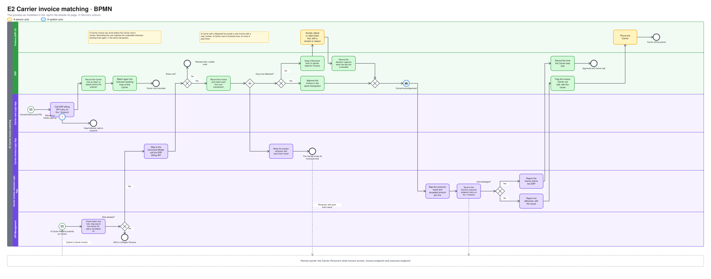
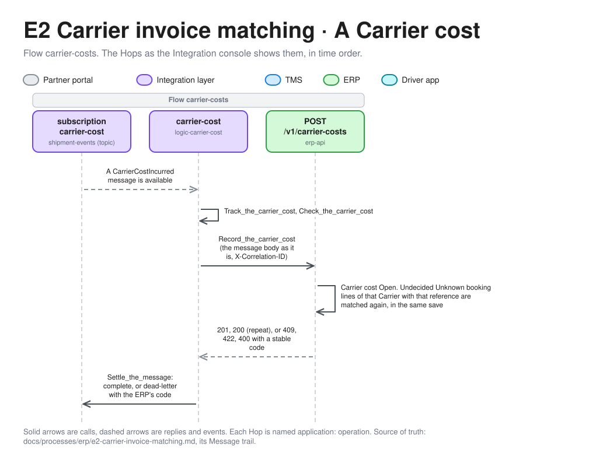
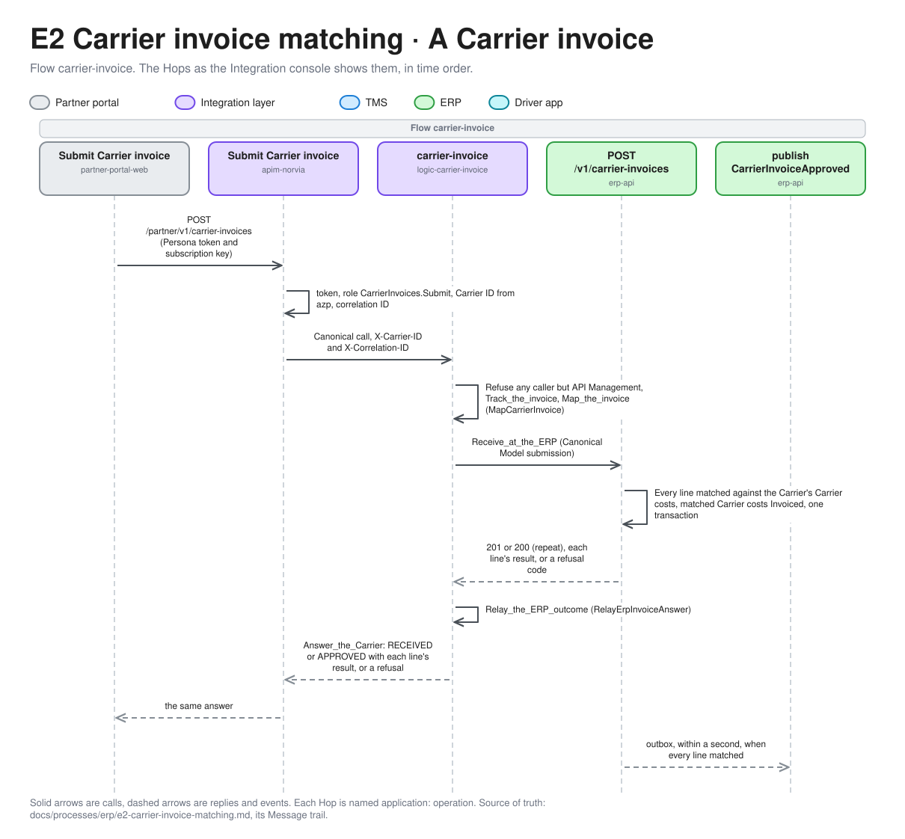
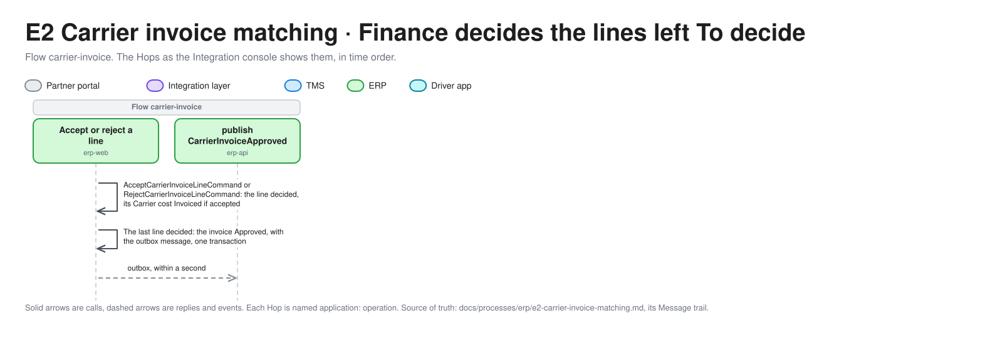
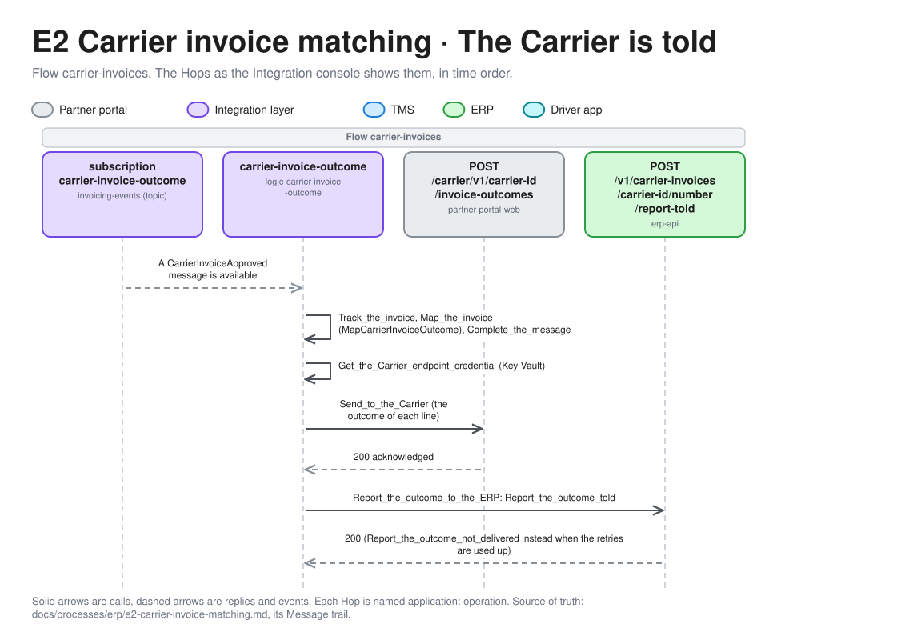

# E2 Carrier invoice matching

Carrier invoice matching checks what a Carrier asks to be paid against the Carrier cost Norvia agreed for each Carrier booking. The TMS hands the ERP each Carrier cost once the Shipment is Delivered. The Carrier sends a Carrier invoice from its Persona through API Management. The ERP matches each line, approves an invoice that matches in full, puts the rest in front of Finance, and tells the Carrier the outcome. This is the ERP half of [P9 Freight settlement](../tms/p9-freight-settlement.md). Terms are defined in [GLOSSARY.md](../../../GLOSSARY.md).

| | |
|---|---|
| **Trigger** | A Carrier invoice is submitted by a Carrier. `CarrierCostIncurred` from the TMS (P9) supplies what it is matched against |
| **Outcome** | An Approved Carrier invoice: every line Matched, Accepted or Rejected. The Carrier told the outcome of each line |
| **Owning system** | ERP. It owns Carrier invoices (ADR 0002). The TMS owns the Carrier cost until it hands it over (ADR 0013) |
| **Applies to** | Carriers only |
| **Integrations touched** | Service Bus (Shipment events, Invoicing events), Carrier cost Logic App, Partner portal (Carrier invoice screens and endpoint), API Management, Carrier invoice Logic App, Carrier invoice outcome Logic App, Key Vault, ERP billing API |

## Process model

The model is [e2-carrier-invoice-matching.bpmn](e2-carrier-invoice-matching.bpmn), which opens in any BPMN tool and is the source. The picture is drawn from it by [bpmn.py](../../architecture/diagrams/bpmn.py), so change the model and run the script, not the picture ([the editable file](../../architecture/diagrams/bpmn-e2-carrier-invoice-matching.excalidraw)).

## Carrier costs

The ERP keeps one **Carrier cost** per Carrier booking that the TMS handed over: the Carrier booking number, the Carrier booking reference, the Carrier, the Shipment number, the Transport Order number, the charge lines and total, the source (Carrier Rate Card version, or Spot with its remark) and the delivery time. The Carrier cost Logic App picks up `CarrierCostIncurred` and calls the ERP billing API to record it. A repeat for the same Carrier booking number with the same content returns the original, flagged as a repeat.

A Carrier cost is **Open** until a Carrier invoice line is Matched or Accepted against it, and then **Invoiced**.

## Carrier invoice

A Carrier sends one Carrier invoice for any number of its Carrier bookings.

| Part | Required |
|---|---|
| The Carrier's own invoice number. Unique per Carrier | Yes |
| Invoice date | Yes |
| Lines: Carrier booking reference, amount in EUR without VAT, an optional description | At least one |

The Carrier comes from the token, never from the payload (ADR 0005). Amounts are without VAT, and VAT on Carrier invoices is deferred with Dutch VAT rules ([E1](e1-invoicing.md#deferred)).

## Matching

The ERP matches each line on its own, against the Carrier cost with that Carrier booking reference.

| Line result | When |
|---|---|
| Matched | The Carrier cost exists for this Carrier, is Open, and the amount is within tolerance of its total |
| Price mismatch | The Carrier cost exists for this Carrier and is Open, but the amount is outside tolerance |
| Unknown booking | No Carrier cost with that reference has arrived for this Carrier. That includes a reference that belongs to another Carrier |
| Duplicate | The Carrier cost is already Invoiced by an earlier line |

The **tolerance** is an ERP setting, in EUR, €0 by default: the amount must equal the Carrier cost to the cent.

Matching runs in the same transaction that records the Carrier invoice. A Matched line is accepted at once and its Carrier cost becomes Invoiced. The other lines wait for Finance.

Carrier costs and Carrier invoices arrive on separate paths, so a Carrier invoice can arrive before the Carrier cost it refers to. When a Carrier cost is recorded, the ERP matches again every undecided Unknown booking line with that Carrier and Carrier booking reference, in the same transaction. The line gets its new result, and it can be Matched and accepted then.

## Status

### Carrier invoice line

| Status | Meaning |
|---|---|
| Matched | Accepted automatically at the invoiced amount. Final |
| To decide | Price mismatch, Unknown booking or Duplicate. It waits for Finance, and an Unknown booking line can still become Matched |
| Accepted | Finance accepted it, at the invoiced amount or an adjusted amount, with a remark when adjusted. Its Carrier cost becomes Invoiced. Final |
| Rejected | Finance rejected it, with a reason. Its Carrier cost, if any, stays as it was. Final |

Finance can accept only a line that has an Open Carrier cost for this Carrier. An Unknown booking or Duplicate line can only be rejected, or left for a late Carrier cost to arrive.

### Carrier invoice

| Status | Meaning |
|---|---|
| Received | Recorded, with at least one line To decide |
| Approved | Every line is Matched, Accepted or Rejected. The approved amount is the sum of the Matched and Accepted amounts. Final |

A Carrier invoice whose lines all match is Approved in the transaction that records it. Paying the approved amount is out of scope, and Approved is the end of E2.

## Steps

1. **Draft.** The presenter plays a Carrier Persona in the Partner portal and opens its **draft invoice** screen. It lists the Persona's Confirmed bookings that it has reported Delivered and hasn't invoiced yet, each with the price from the booking request (P4). The presenter selects bookings and can edit an amount, to show a mismatch on purpose.
2. **Submit.** The portal calls API Management with the Persona's token and subscription key.
3. **Check at the edge.** API Management checks the token (audience "Norvia Partner API", role `CarrierInvoices.Submit`). A Shipper Persona's token gets 403. API Management maps the `azp` claim to a Carrier ID (ADR 0005), creates a correlation ID and passes both to the Carrier invoice Logic App.
4. **Map.** The Logic App maps the [Carrier invoice format](#carrier-invoice-format) to the Canonical Model and calls the ERP billing API.
5. **Record and match.** The ERP checks the [receiving rules](#receiving-rules), records the Carrier invoice and matches its lines, all in one transaction. The Logic App relays the ERP's answer to the Carrier: received, with each line's result. The path is synchronous, as the Carrier's booking answer is in P4, so the Carrier knows its invoice arrived.
6. **Decide.** A Carrier invoice with lines To decide appears in Finance's list. Finance accepts or rejects each line. When the last line is decided, the invoice becomes Approved.
7. **Tell the Carrier.** When a Carrier invoice becomes Approved, whether on receipt or after Finance, the ERP publishes `CarrierInvoiceApproved`. The Carrier invoice outcome Logic App maps it and calls the Carrier Persona's invoice outcome endpoint with credentials from Key Vault, and reports it to the ERP as told, as in P7.

On a server error or timeout from the Carrier's endpoint, the outcome Logic App retries as in P4. When the retries are used up, or on a client error, it reports the outcome as not delivered. The ERP flags the invoice **Carrier not told** with the technical cause, and Finance phones the Carrier.

A Carrier with a Rejected line sends a new Carrier invoice, with a new invoice number, for whatever it still claims. The Duplicate rule makes sure no Carrier cost is paid twice.

## Receiving rules

| Rule | Failure code |
|---|---|
| The Carrier exists in the ERP's seed-loaded Carrier data | `CarrierNotFound` |
| The Carrier hasn't used this invoice number for different content | `InvoiceNumberUsed` |
| There is at least one line, and each line has a Carrier booking reference and an amount above zero | Client error |
| No Carrier booking reference appears twice in the same invoice | Client error |

A submission that repeats one already recorded (the same Carrier, invoice number and content) succeeds, returns the original result flagged as a repeat, and publishes no event. Each failure has a stable code and a readable message. A line whose Carrier booking reference is unknown doesn't fail the invoice. It becomes Unknown booking.

## Carrier invoice format

The Carrier invoice format follows the conventions of the [Carrier booking format](../tms/p4-carrier-booking.md#carrier-booking-format): JSON with its own field names and local dates. The Carrier invoice Logic App maps Carrier → Canonical, and the outcome Logic App maps Canonical → Carrier.

The invoice carries the Carrier's own invoice number as `invoiceNo`, the `invoiceDate` as `dd-MM-yyyy`, and per line the Carrier's own booking reference as `bookingRef`, the `amount` in EUR without VAT and an optional `description`. It never names the Carrier or a correlation ID. The answer to the Carrier carries the invoice's status, its approved amount once Approved, and per line the result (`MATCHED`, `PRICE_MISMATCH`, `UNKNOWN_BOOKING` or `DUPLICATE`) straight away; a failure of the receiving rules comes back as a stable result (`INVOICE_NUMBER_USED`, `CARRIER_NOT_FOUND`, `INVALID`, `NOT_RECEIVED`) with a readable message. The formats, the field-by-field map and the answers are in the [Partner API contract](../../../contracts/partner-api/README.md#carrier-invoice), with the schemas [carrier-invoice.v1](../../../contracts/partner-api/carrier-invoice.v1.schema.json) and [carrier-invoice-response.v1](../../../contracts/partner-api/carrier-invoice-response.v1.schema.json) and sample pairs to test the maps against.

The outcome carries the Carrier's invoice number, the approved amount and, per line, the Carrier booking reference, the result (`MATCHED`, `ACCEPTED`, `ACCEPTED_ADJUSTED` or `REJECTED`), the accepted amount, and Finance's remark or reason.

## ERP UI

| List | Shows | Actions |
|---|---|---|
| Carrier invoices to decide | Received Carrier invoices, oldest first: Carrier, Carrier invoice number, date, total, the number of lines per result | Open. Per line: accept, accept at an adjusted amount (with a remark), reject (with a reason) |
| Carrier invoices | All Carrier invoices, newest first, with their status, approved amount, and a Carrier told time or "Carrier not told" | Open |
| Carrier cost Logic App | [src/Integration/CarrierCostLogicApp](../../../src/Integration/CarrierCostLogicApp/), [carrier-cost-logic-app.bicep](../../../infra/estate/carrier-cost-logic-app.bicep) | A stateful workflow, `carrier-costs`, on the `carrier-cost` subscription of `shipment-events` (the filter is `(eventType = 'CarrierCostIncurred' AND resubmitTo IS NULL) OR resubmitTo = 'carrier-cost'`, and only Carrier Shipments publish the event). It posts the message body to `POST /v1/carrier-costs` as it is, because the ERP accepts the Canonical Model and there is nothing to map, as the Carrier cost Logic App's identity with the event's correlation ID in `X-Correlation-ID` and as the run's client tracking ID. A `2xx` completes the message, a repeat (`200`) included. A timeout, `408`, `429` or a server error is retried three times (exponential, 5 s up to 20 s); another client error and a conflict are not. When the Carrier cost is refused or the retries are used up, the message is dead-lettered with the ERP's code as `DeadLetterReason` (`CarrierNotFound`, `CarrierCostConflict`, `CarrierCostWithoutChargeLines`, `CarrierCostTotalMismatch`, or `ErpCallRefused` and `ErpUnavailable`) and its message as `DeadLetterErrorDescription`, and the run fails. A message that isn't a `CarrierCostIncurred` is dead-lettered as `CarrierCostUnreadable`. The run tracks `carrier-costs` with the Carrier booking number, Shipment number, Transport Order number, the Carrier as `partyId` and the event ID as `sourceMessageId`. The identity holds `CarrierCosts.Record` and the receiver role on its subscription, and nothing else. It has no Key Vault and no local function. Locally the AppHost runs `Norvia.Integration.LocalCarrierCostWorker` in its place ([ADR 0045](../../adr/0045-locally-a-hosted-worker-plays-the-p9-carrier-cost-logic-app.md)), so a delivered Carrier Shipment reaches the Open Carrier costs list; CI tests the workflow's definition and the [sample messages](../../../contracts/canonical-model/samples/carrier-cost-incurred/) without Azure |
| Open Carrier costs | Carrier costs not yet Invoiced, per Carrier, oldest delivery first, with their source. A Spot price is marked | Open |

On opening a line, Finance sees its Carrier cost next to it: the charge lines, the source and, for a Spot price, the Planner's remark. The lists update without a page refresh.

### Explain a line that is To decide

When the Agents are on (`Agents:Enabled`, off by default; the whole ERP UI is Finance's), each line that is To decide in "Carrier invoices to decide" has an **Explain** button. It puts one fixed question about the line to the Carrier invoice matching agent ([ADR 0040](../../adr/0040-agents-read-the-estate-through-api-management-have-no-write-tools-and-their-own-identity.md)) and shows the Suggestion it answers with: the cause in plain language, the evidence it cites, the kind of action it suggests (see "The Suggestion pre-selects an action" below), what Finance could do and its confidence. It says whether the line may still resolve: an Unknown booking line is matched again by itself when its Carrier cost arrives, a Price mismatch or a Duplicate waits for Finance. A candidate for an Unknown booking is always a **likely candidate**, never a certainty. The agent changes nothing; Finance accepts or rejects the line as before. When the agent is down the button says "Assistant unavailable" and everything else works.

#### The Suggestion pre-selects an action

A Suggestion about a line is one of **Accept as invoiced**, **Accept adjusted** (Finance enters the amount and the remark), **Reject** (Finance writes the reason), **Wait** (an Unknown booking line, because a late Carrier cost matches it again by itself) or **Needs a person**. It adds no match action: the agent never links a line to another Carrier cost.

- **The ERP decides what is allowed.** The agent view carries `allowedActions` for the line, worked out by the same rules Accept and Reject enforce (`CarrierInvoice.AllowedActionsOf`): only a line that is To decide can be decided; Accept and Accept adjusted need an Open Carrier cost of this Carrier that the line was matched against; Wait is for a line that resolves by itself. An Unknown booking therefore allows Reject and Wait, a Duplicate only Reject. The agent is told to suggest only an action in that list, and `ExplainInvoiceLineHandler` checks again: a Suggestion whose action is not allowed is turned into Needs a person, with a text saying so, so no ineligible action is ever shown.
- **A Suggestion pre-selects and executes nothing.** When it names Accept, Accept adjusted or Reject, the line's decision form emphasises that action and says "The assistant suggests: …". Finance writes the remark or reason, enters any amount and confirms with the same button as ever; the decision runs under the Finance role through the same command the click always sent (`AcceptCarrierInvoiceLineCommand` / `RejectCarrierInvoiceLineCommand`, in process as the rest of the ERP UI does, [ADR 0040](../../adr/0040-agents-read-the-estate-through-api-management-have-no-write-tools-and-their-own-identity.md)). Wait and Needs a person pre-select nothing. Nothing in the agent can approve an invoice.
- **The audit.** When Finance does what was suggested (accepting a line counts as acting on a suggestion to accept it, at the invoiced amount or an adjusted one; rejecting it as acting on a suggestion to reject), the command carries the Agent and its run, and the decision's logging scope on the Carrier invoice's trail adds `agentId` (`finance-matching`) and `agentRunId`. A decision of another kind, or one Finance made without a Suggestion, names no Agent. The ERP API's accept and reject operations take the same two optional fields, `agentName` and `agentRunId`, together, so a decision made through the API can be audited the same way. A Suggestion that is ignored is not recorded, and the agent is never told whether it was accepted.

### Explain a whole Carrier invoice

Each Carrier invoice in "Carrier invoices to decide" also has an **Explain this invoice** button (same switch, `Agents:Enabled`). It puts one fixed question about the invoice to the same agent and shows a short summary, the lines that are To decide grouped by cause (Price mismatch, Unknown booking, Duplicate) with the counts, each claim citing the result it came from, and which of those lines may still resolve by themselves (only Unknown booking lines can). It offers no action: Finance still accepts or rejects each line under its own role. The agent reads the invoice with its second tool, `get_invoice_summary` (`GET /v1/agent/finance/carriers/{carrierId}/invoices/{invoiceNumber}`), whose view holds the Carrier's name, the invoice and received dates, the status, the total, the approved amount so far and, per result, the number of lines, how many are To decide, the claimed amount and how many resolve by themselves. The ERP counts them, never the model. The view names no line: no reference, description or remark, no Spot remark and no Shipper or Consignee personal data reaches the agent.

#### How the agent reads a line

The agent reads the line through the ERP API's **agent view** (`GET /v1/agent/finance/carriers/{carrierId}/invoices/{invoiceNumber}/lines/{carrierBookingReference}`), behind a token and the role `CarrierInvoices.FinanceAgent.Read`, which only its identity holds. The view is an allowlist of fields. It gives the line's result, the invoiced amount, the agreed Carrier cost total and the difference, the Matching tolerance, the cost's source as a label (`Rate Card version N` or `Spot`; the Planner's remark never reaches the agent), for a Duplicate the earlier invoice and line, for an Unknown booking up to three candidate Open Carrier costs of the same Carrier, and the actions the ERP allows for the line (`allowedActions`). The ERP ranks them (reference similarity 60%, amount 30%, delivery date 10%), never the model. Carrier names and booking references are visible; no Shipper or Consignee personal data and no file contents are. Locally the ERP UI runs the agent in process against the MCP stand-in's `finance-matching` server, which makes the API Management policy's checks in the same order (token, role, rate limit, then the call as the agent's identity carrying the correlation ID); a scripted model replays a mangled reference, a Price mismatch (Spot against a Rate Card) and a Duplicate. In Azure the ERP UI's `FoundryAgentClient` asks the Agent published in the Foundry project (a real model), as the ERP UI's own managed identity; Foundry's loop calls API Management's `finance-matching` MCP server as the Agent's identity, and API Management calls the agent view with a token for the ERP agent API ([finance-matching-mcp.bicep](../../../infra/estate/finance-matching-mcp.bicep)). `infra/smoke-test-finance-agent.ps1` submits a Carrier invoice of Van Dijk Transport with a mangled reference after `azd up`, asks the Agent and checks that the answer names the cause and that no Spot remark appears in the tool calls. The agent's calls join the Carrier invoice's own Message trail.

### Draft the rejection reason

The reason Finance gives when rejecting a line is **Carrier-facing**: it leaves Norvia in the invoice outcome, where the line comes back as `REJECTED` with that reason (a Rejected line is resent in a new invoice with a new invoice number). So the text may carry nothing internal: not the Planner's Spot remark, not a Rate Card version, not another Carrier's reference. With the Agents on, the decision form of a line that is To decide has a **Draft reason** button beside the reason field ([ADR 0040](../../adr/0040-agents-read-the-estate-through-api-management-have-no-write-tools-and-their-own-identity.md)). It prefills the reason; Finance edits it and presses **Reject**. Nothing is sent to the Carrier except by that confirmed decision, and the button rejects nothing.

- **The boundary is a tool, not an instruction.** The draft comes from a different agent from Explain, the Carrier invoice rejection reason agent (`finance-rejection-reason`): its own definition, its own identity, its own MCP server and its own role `CarrierInvoices.FinanceRejectionReasonAgent.Read` ([identity matrix](../../architecture/identity-and-access.md#agents)). It has **one** tool, `get_carrier_visible_line_facts` (`GET /v1/agent/finance-rejection-reason/carriers/{carrierId}/invoices/{invoiceNumber}/lines/{carrierBookingReference}/carrier-visible-facts`), so it cannot name what no tool of its returns, and its role does not open the Carrier invoice matching agent's view (and that agent's role does not open this one). Architecture tests hold the tool list, the two roles and the view's list of fields.
- **What the tool returns** is what the Carrier can see of its own line: its own invoice number, line and booking reference, the invoiced amount, the agreed Carrier cost the Carrier accepted when it confirmed the booking, the likely correct reference only when it is one of that Carrier's own Open Carrier costs (never another Carrier's, even when it looks alike), and for a Duplicate the Carrier's own earlier invoice number. It names no Rate Card or version, no source of the price, no Planner remark and no Matching tolerance. The view is built field by field in `GetCarrierVisibleLineFactsHandler`.
- **What the draft says.** For a mangled reference it tells the Carrier the likely correct reference (as a possibility, never a certainty) and to send a new invoice with a new invoice number. For a Duplicate it names the Carrier's earlier invoice. For a Price mismatch it states both amounts and asks for a new invoice at the agreed amount. It states no price negotiation, no Rate Card and no internal remark.
- **The audit.** The decision's logging scope on the Carrier invoice's trail names the Agent (`finance-rejection-reason`) and its run when the reason was drafted by the agent, edited or not (a reason that Finance emptied and wrote anew is Finance's own). It takes the place of a Suggestion's run for the same rejection, because it is the draft's text that goes to the Carrier.
- **Limits.** Pressing Draft reason replaces what is in the reason field. The invoice number and reference are put in the agent's question only when they are plain identifiers (letters, digits, `-`, `_`, `.`, `:`), as for Explain, because the Carrier typed them; a reference that is not one gets "Assistant unavailable" and Finance writes the reason.
- **When the agent is down** the button says "Assistant unavailable" and the reason stays as it was; everything else works.

## Partner portal

- Each Carrier Persona gets the **draft invoice** screen from step 1. It works from the Persona's own records of its bookings and Tracking events, so it needs no call to Norvia.
- Each Carrier Persona gets an **invoice outcome endpoint** and an **invoices** page listing its submitted Carrier invoices with the outcome per line once told.

## ERP API

| Operation | Caller | Role |
|---|---|---|
| Record a Carrier cost | Carrier cost Logic App | `CarrierCosts.Record` |
| Receive a Carrier invoice | Carrier invoice Logic App | `CarrierInvoices.Receive` |
| Report a Carrier invoice outcome as told or not delivered | Carrier invoice outcome Logic App | `CarrierInvoices.Report` |
| Accept or reject a Carrier invoice line | The [Simulator](../../operations/simulator.md), playing Finance | `CarrierInvoices.Manage` |
| Read a Carrier invoice line through the agent view | The Carrier invoice matching agent, through the MCP stand-in locally and API Management's MCP server in Azure | `CarrierInvoices.FinanceAgent.Read` |
| Read what the Carrier can see of its own line, to draft a rejection reason | The Carrier invoice rejection reason agent, through its own MCP server | `CarrierInvoices.FinanceRejectionReasonAgent.Read` |

Finance decides lines in the ERP UI, with Finance permissions, or through the API as the Simulator, which runs the same commands. `POST /v1/carrier-invoices/{carrierId}/{invoiceNumber}/lines/{bookingReference}/accept` (optional `adjustedAmount` and `remark`) and `/reject` (`reason`) answer 200 with the invoice, and a decision that makes the invoice Approved publishes `CarrierInvoiceApproved` once. Refusals are `ProblemDetails` with the domain's stable `code`: 404 for `CarrierInvoiceNotFound` and `CarrierInvoiceLineNotFound`, 409 for `CarrierInvoiceLineAlreadyDecided`, 422 for `CarrierInvoiceLineHasNoOpenCarrierCost`, 400 for `CarrierInvoiceAdjustedAmountNotAboveZero`, `CarrierInvoiceAdjustedAmountNeedsRemark` and `CarrierInvoiceRejectionNeedsReason`. The ERP billing API accepts only the Canonical Model (ADR 0003).

## Correlation ID

API Management creates a new correlation ID for each Carrier invoice, as it does for each Carrier answer in P4. The ERP stores it on the Carrier invoice, and `CarrierInvoiceApproved` carries it. The Carrier cost keeps the correlation ID from `CarrierCostIncurred`. Tracing a Carrier booking from release to payment approval follows the Carrier booking number in the TMS and the Carrier booking reference on the invoice line.

## Events

All events go to the topic for Invoicing events, through the ERP's transactional outbox (ADR 0003).

| Event | Published when | Carries | Consumers |
|---|---|---|---|
| `CarrierInvoiceApproved` | A Carrier invoice becomes Approved | Carrier ID, the Carrier's invoice number, approved amount, per line the Carrier booking reference, result, accepted amount and remark or reason, correlation ID | Carrier invoice outcome Logic App. Monitoring |
| `CarrierInvoiceOutcomeNotDelivered` | The outcome is reported not delivered | Carrier ID, the Carrier's invoice number, technical cause, correlation ID | Monitoring. An alert later |

Recording a Carrier cost, receiving a Carrier invoice that still has lines To decide, and deciding a line that isn't the last publish nothing.

## Presenter smoke run

After a deployment, and not in CI, the presenter checks Carrier invoice matching on the deployed estate, before the headline relies on it. Do it after the presenter smoke run of Freight settlement ([P9](../tms/p9-freight-settlement.md#presenter-smoke-run)). The Logic App's fault is injected by pointing the Carrier invoice outcome Logic App at an address that doesn't answer, and put back when the run ends, even if it fails. The presenter's actions in the Partner portal and the ERP UI are theirs, and the script stops and says what to do. Run it in a terminal, with the Partner portal, the ERP UI and the Integration console side by side.

1. **Get two delivered bookings.** Take two Shipments of Van Dijk Transport through Freight settlement: Confirmed, Delivered by the Persona's Tracking events, with their Carrier costs in the ERP's Open Carrier costs. Don't invoice either.
2. **Run the check.** Run `infra/smoke-test-carrier-invoice-matching.ps1`. It reads Application Insights, which is usually 1 to 5 minutes behind.
3. **Story 15.** As Van Dijk Transport, draft an invoice for the first booking with an edited amount and submit it. The answer shows PRICE_MISMATCH. In the ERP UI, Finance opens the invoice in Carrier invoices to decide and accepts the line at the agreed amount. The script checks that the Carrier invoice Logic App and the ERP tracked the invoice and that the outcome was sent. The invoices page shows the outcome, and the ERP's Carrier told column a time.
4. **A Shipper Persona.** The script submits a Carrier invoice as Brouwer Dranken and checks for 403 and no Carrier invoice Logic App run.
5. **The invoice outcome endpoint is down.** The script points the outcome Logic App away from the Partner portal. Submit an invoice for the second booking at its price: it is Matched and Approved on receipt. The script checks that the send is tracked `Failed` with `CarrierUnavailable`; the ERP UI shows **Carrier not told** with the technical cause. The script puts the address back.
6. **Follow it.** The script checks that the first invoice is in Application Insights by correlation ID, in API Management, the Carrier invoice Logic App, the ERP and the Partner portal, and prints the Integration console's links.

The script prints `PASS` or `FAIL` per check, never a body, a token or a key. If a check fails, file the gap as its own issue against E2, rather than working around it in the run book.

## Implementation

For engineers and coding agents. Built so far: the Carrier cost Logic App, recording a Carrier cost and the Open Carrier costs list, receiving and matching a Carrier invoice with the Carrier invoices list, Finance deciding lines, matching again when a Carrier cost arrives, the Carrier invoice Logic App with its API Management operation, the Partner portal's draft invoice screen, invoice outcome endpoint and invoices page, and the Carrier invoice outcome Logic App, which tells the Carrier and reports it told or not delivered. Locally the Carrier invoice path runs under Aspire too: the stand-in Partner API takes the invoice and a hosted worker plays the Carrier invoice Logic App, as another plays the outcome Logic App.

### Message trail

The Hops of E2, named as the [Integration console](../../operations/integration-console.md#message-trail) shows them, in time order. A Hop is grouped under the Flow it carries in the tracking contract. The same order's whole life, across every application, is drawn in [the order lifecycle](../../architecture/order-lifecycle.md#6-from-a-carrier-cost-to-a-carrier-invoice-outcome).

**1. A Carrier cost.** The TMS publishes `CarrierCostIncurred` when a Carrier Shipment is Delivered, on the trail of the Delivered Tracking event.

*Editable source: [message-trail-e2-1.excalidraw](../../architecture/diagrams/message-trail-e2-1.excalidraw), generated from [message_trails.py](../../architecture/diagrams/message_trails.py).*

**2. A Carrier invoice.** The Carrier's submission starts a new trail, and API Management creates its correlation ID.

*Editable source: [message-trail-e2-2.excalidraw](../../architecture/diagrams/message-trail-e2-2.excalidraw), generated from [message_trails.py](../../architecture/diagrams/message_trails.py).*

**3. Finance decides the lines left To decide.** Finance's action starts a new trail.

*Editable source: [message-trail-e2-3.excalidraw](../../architecture/diagrams/message-trail-e2-3.excalidraw), generated from [message_trails.py](../../architecture/diagrams/message_trails.py).*

**4. The Carrier is told.** The Carrier invoice outcome Logic App reacts to the Approved event on its trail.

*Editable source: [message-trail-e2-4.excalidraw](../../architecture/diagrams/message-trail-e2-4.excalidraw), generated from [message_trails.py](../../architecture/diagrams/message_trails.py).*

### What is built

| Piece | Where | Does |
|---|---|---|
| Record a Carrier cost | [src/Erp/Norvia.Erp.Application/CarrierCosts](../../../src/Erp/Norvia.Erp.Application/CarrierCosts/Record/) | `RecordCarrierCostCommand` and its handler: idempotent on the Carrier booking number, `CarrierNotFound` for an unknown Carrier, `CarrierCostConflict` for different content. The domain refuses charge lines that are missing or don't add up to the total. Recording also matches again, in the same save, every undecided Unknown booking line of that Carrier with that reference (`CarrierInvoice.MatchAgain`, over the Carrier's Received invoices, oldest first): the line becomes Matched (and accepted), Price mismatch or Duplicate, and an invoice whose last line this was is Approved with `CarrierInvoiceApproved` in the outbox. Lines Finance decided and references of other Carriers are untouched, and a repeat of a Carrier cost re-matches nothing. It publishes nothing otherwise |
| Open Carrier costs | [src/Erp/Norvia.Erp.Application/CarrierCosts/ListOpen](../../../src/Erp/Norvia.Erp.Application/CarrierCosts/ListOpen/), [src/Erp/Norvia.Erp.Web/CarrierCosts](../../../src/Erp/Norvia.Erp.Web/CarrierCosts/) | The `/carrier-costs` page, for Finance only: Open Carrier costs per Carrier, oldest delivery first, each opening to its charge lines and source. A Spot price is marked with the Planner's remark. The list updates without a refresh |
| ERP billing API | [src/Erp/Norvia.Erp.Api/CarrierCosts](../../../src/Erp/Norvia.Erp.Api/CarrierCosts/) | `POST /v1/carrier-costs` takes only `CarrierCostIncurred` (the Canonical Model, so the Carrier cost Logic App has nothing to map) and needs the `CarrierCosts.Record` app role. 201 for a new Carrier cost, 200 with `repeat: true` for the same content again. Refusals are `ProblemDetails` with the stable `code`: `CarrierNotFound` (422), `CarrierCostConflict` (409), `CarrierCostWithoutChargeLines` and `CarrierCostTotalMismatch` (400). A body outside the Canonical Model is a 400 |
| Receive a Carrier invoice | [src/Erp/Norvia.Erp.Application/CarrierInvoices/Receive](../../../src/Erp/Norvia.Erp.Application/CarrierInvoices/Receive/), [src/Erp/Norvia.Erp.Domain/CarrierInvoices](../../../src/Erp/Norvia.Erp.Domain/CarrierInvoices/) | `ReceiveCarrierInvoiceCommand` and its handler: idempotent on the Carrier and its invoice number (`InvoiceNumberUsed` for different content), `CarrierNotFound` for an unknown Carrier. `CarrierInvoice.Receive` in the domain checks the receiving rules, matches every line against the Carrier's own Carrier costs, and makes a Matched line's Carrier cost Invoiced. An invoice whose lines all match is Approved in that transaction and `CarrierInvoiceApproved` is written to the outbox in it, so it is published once and only if the change committed. A concurrent invoice for the same Carrier cost conflicts on the Carrier cost's row version and is run again, finding it Invoiced (Duplicate) |
| Matching tolerance | [src/Erp/Norvia.Erp.Infrastructure/CarrierInvoices](../../../src/Erp/Norvia.Erp.Infrastructure/CarrierInvoices/) | The ERP setting `CarrierInvoices:MatchingTolerance`, in EUR, €0 by default and never negative; a bad value fails the ERP's start. A line matches when its amount is within the tolerance of the Carrier cost's total |
| Carrier invoices list | [src/Erp/Norvia.Erp.Application/CarrierInvoices/List](../../../src/Erp/Norvia.Erp.Application/CarrierInvoices/List/), [src/Erp/Norvia.Erp.Web/CarrierInvoices](../../../src/Erp/Norvia.Erp.Web/CarrierInvoices/) | The `/carrier-invoices` page, for Finance only: every Carrier invoice, newest first, with its Carrier, number, date, status, total, the number of lines per result and the approved amount. It updates without a refresh. A **Carrier told** column shows when the Carrier was told the outcome (Amsterdam time), "Carrier not told" once the outcome was reported not delivered, or a dash while it is yet to be told |
| Decide Carrier invoice lines | [src/Erp/Norvia.Erp.Application/CarrierInvoices/Decide](../../../src/Erp/Norvia.Erp.Application/CarrierInvoices/Decide/), [src/Erp/Norvia.Erp.Application/CarrierInvoices/List](../../../src/Erp/Norvia.Erp.Application/CarrierInvoices/List/), [src/Erp/Norvia.Erp.Web/CarrierInvoices](../../../src/Erp/Norvia.Erp.Web/CarrierInvoices/) | The `/carrier-invoices/to-decide` page, for Finance only: Received Carrier invoices, oldest first, with the number of lines per result, updating without a refresh. Opening a line shows its Carrier cost next to it (charge lines, source and, for Spot, the Planner's remark). `AcceptCarrierInvoiceLineCommand` accepts a line at the invoiced amount or at an adjusted amount with a remark, and `RejectCarrierInvoiceLineCommand` rejects it with a reason. Accept is offered only for a line with an Open Carrier cost for that Carrier, so an Unknown booking or Duplicate line offers reject only; the domain refuses the rest with stable codes (`CarrierInvoiceLineHasNoOpenCarrierCost`, `CarrierInvoiceAdjustedAmountNeedsRemark`, `CarrierInvoiceRejectionNeedsReason`, `CarrierInvoiceLineAlreadyDecided`). Accepting makes the Carrier cost Invoiced in the same save; rejecting leaves it as it was. When the last line is decided the invoice becomes Approved with the sum of the Matched and Accepted amounts, and `CarrierInvoiceApproved` is written to the outbox in that save; deciding any other line publishes nothing. Two decisions on one invoice conflict on its row version and the loser is run again |
| Carrier invoices API | [src/Erp/Norvia.Erp.Api/CarrierInvoices](../../../src/Erp/Norvia.Erp.Api/CarrierInvoices/) | `POST /v1/carrier-invoices` takes only the Canonical Model's [Carrier invoice](../../../contracts/canonical-model/carrier-invoice-submission.v1.schema.json) and needs the `CarrierInvoices.Receive` app role. The `carrierId` in the body is the Carrier API Management took from the token (ADR 0005); the Carrier invoice Logic App sets it, and what the Carrier wrote never does. 201 for a new Carrier invoice, 200 with `repeat: true` for the same content again, which publishes nothing. Refusals are `ProblemDetails` with the stable `code`: `CarrierNotFound` (422), `InvoiceNumberUsed` (409), and 400 for `CarrierInvoiceWithoutLines`, `CarrierInvoiceLineWithoutReference`, `CarrierInvoiceLineAmountNotAboveZero` and `CarrierInvoiceReferenceRepeated`. The ERP stores the correlation ID from the body. The Carrier invoices flow is `carrier-invoices`, with the Carrier invoice number as `documentNumber` and the Carrier as `partyId` |
| Carrier invoice Logic App | [src/Integration/CarrierInvoiceLogicApp](../../../src/Integration/CarrierInvoiceLogicApp/), [src/Integration/Norvia.Integration.CarrierInvoice.Functions](../../../src/Integration/Norvia.Integration.CarrierInvoice.Functions/), [carrier-invoice-logic-app.bicep](../../../infra/estate/carrier-invoice-logic-app.bicep) | A stateful workflow, `carrier-invoice` (flow `carrier-invoice`), behind an HTTP trigger only API Management may call (Easy Auth, then the workflow's first step, as in P4). It tracks the correlation ID, the Carrier as `partyId` and the Carrier's invoice number as `documentNumber`, takes `X-Carrier-ID` and `X-Correlation-ID` from API Management alone, passes the invoice to the map base64-encoded (`MapCarrierInvoice`, a local function over `CarrierInvoiceMap`), posts the Canonical Model submission to `POST /v1/carrier-invoices` as the Carrier invoice identity with the correlation ID in `X-Correlation-ID` and as the run's client tracking ID, and answers the Carrier at once with `RelayErpInvoiceAnswer` (`CarrierInvoiceResponses`): each line's result, or the ERP's code as a stable result with a readable message. A timeout, `408`, `429` or a server error is retried three times (exponential, 5 s up to 20 s); a client error is not. The run fails only for `CarrierInvoiceUnreadable`, `ErpCallRefused` and `ErpUnavailable`: a refusal the ERP gave has been told to the Carrier. The identity holds `CarrierInvoices.Receive` and nothing else; the Logic App has no Key Vault access beyond its own content connection and no queue. Locally the AppHost runs `Norvia.Integration.LocalCarrierInvoiceWorker` in its place behind the same trigger, with the same map, relay, retries, identity and tracking keys, and `LocalPartnerApi` plays API Management in front of it ([ADR 0046](../../adr/0046-locally-a-hosted-worker-plays-the-e2-carrier-invoice-logic-app.md)). CI tests the workflow's definition, the maps and the [sample pairs](../../../contracts/partner-api/samples/carrier-invoices/) without Azure |
| Submit a Carrier invoice | [infra/estate/partner-api/submit-carrier-invoice.policy.xml](../../../infra/estate/partner-api/submit-carrier-invoice.policy.xml), [partner-api.bicep](../../../infra/estate/partner-api.bicep) | `POST /partner/v1/carrier-invoices` on the Norvia Partner API. The policy validates the Entra token for the audience "Norvia Partner API", refuses a token without the role `CarrierInvoices.Submit` with `403` (a Shipper Persona's, which is never granted it), maps `azp` to the Carrier ID with `carriers-by-client-id` (`403` for a client that is no Carrier), creates a new correlation ID, and calls the Logic App with `X-Carrier-ID` and `X-Correlation-ID` overwriting anything the caller sent, as API Management's identity. It traces each refusal and the Logic App's answer under flow `carrier-invoice` with the tracking contract's keys. Estate Bicep also creates the `CarrierInvoices.Submit` app role on the Partner API and grants it to the Carrier Personas, the trigger's app registration (`CarrierInvoice.Trigger`, held by API Management alone) and the Carrier invoice identity. Locally `LocalPartnerApi` makes the same checks and answers the same refusals (`SubmitCarrierInvoice`) |
| Report a Carrier invoice outcome | [src/Erp/Norvia.Erp.Application/CarrierInvoices/ReportTold](../../../src/Erp/Norvia.Erp.Application/CarrierInvoices/ReportTold/), [src/Erp/Norvia.Erp.Application/CarrierInvoices/ReportNotDelivered](../../../src/Erp/Norvia.Erp.Application/CarrierInvoices/ReportNotDelivered/), [CarrierInvoiceEndpoints](../../../src/Erp/Norvia.Erp.Api/CarrierInvoices/CarrierInvoiceEndpoints.cs), [CarrierInvoiceOutcomeNotDeliveredV1](../../../src/Erp/Norvia.Erp.Application/CarrierInvoices/ReportNotDelivered/CarrierInvoiceOutcomeNotDeliveredV1.cs) | `POST /v1/carrier-invoices/{carrierId}/{invoiceNumber}/report-told` and `/report-not-delivered` need the `CarrierInvoices.Report` app role and an `X-Correlation-ID` (the Carrier invoice's own); `report-not-delivered` also takes a body `{ statusCode, message }`: the Carrier endpoint's HTTP status (null when it didn't answer) and the technical cause (required, kept to 500 characters). `report-told` records `ToldAt` and publishes nothing. `report-not-delivered` flags the invoice **Carrier not told** (`NotToldAt`, `NotToldStatusCode`, `NotToldMessage`) and adds `CarrierInvoiceOutcomeNotDelivered` to the outbox in the same save, under the invoice's correlation ID ([carrier-invoice-outcome-not-delivered.v1](../../../contracts/canonical-model/carrier-invoice-outcome-not-delivered.v1.schema.json), with `flow` `carrier-invoices`, `partyId` and `documentNumber`), so the event is published if and only if the flag committed. Only an Approved invoice whose outcome is not reported yet takes a report; any other (reported already, either way, or not Approved) is **ignored and logged**: `200` with `ignored: true`, nothing changed or published. `404` with `CarrierInvoiceNotFound`, `400` without the correlation ID or the cause. The invoice has a row version, so two reports at once conflict and the loser is run again by `IConflictRetrier` and finds the new state |
| Carrier invoice outcome Logic App | [src/Integration/CarrierInvoiceOutcomeLogicApp](../../../src/Integration/CarrierInvoiceOutcomeLogicApp/), [CarrierInvoiceOutcomeMap](../../../src/Integration/Norvia.Integration.CarrierBooking/CarrierInvoiceOutcomeMap.cs), [MapCarrierInvoiceOutcome](../../../src/Integration/Norvia.Integration.CarrierInvoiceOutcome.Functions/MapCarrierInvoiceOutcome.cs), [carrier-invoice-outcome-logic-app.bicep](../../../infra/estate/carrier-invoice-outcome-logic-app.bicep) | A stateful workflow, `carrier-invoice-outcome` (flow `carrier-invoices`), on the `carrier-invoice-outcome` subscription of `invoicing-events` (the filter is `(eventType = 'CarrierInvoiceApproved' AND resubmitTo IS NULL) OR resubmitTo = 'carrier-invoice-outcome'`), with the event's correlation ID as the run's client tracking ID and the Carrier as `partyId`, the Carrier's invoice number as `documentNumber` and the event ID as `sourceMessageId`. It maps the event with the local function `MapCarrierInvoiceOutcome` into the [Carrier invoice outcome](../../../contracts/partner-api/README.md#carrier-invoice-outcome) (`invoiceNo`, `approvedAmount` and per line `bookingRef`, `result`, `acceptedAmount`, `remark`: `Matched` is `MATCHED`, `Accepted` is `ACCEPTED` or `ACCEPTED_ADJUSTED` when Finance accepted another amount than the invoiced one, `Rejected` is `REJECTED` at `0`; neither the Carrier ID nor the correlation ID goes in the body), completes the message, reads the Carrier's credential from Key Vault (`carrier-endpoint-key-<Carrier ID>`) and posts the outcome to `/carrier/v1/<Carrier ID>/invoice-outcomes` with `X-Correlation-ID` and `X-Api-Key`, retrying a timeout, `408`, `429` and a server error three times (exponential, 5 s up to 20 s). `Report_the_outcome_to_the_ERP` runs whatever the endpoint answered: on an acknowledgement it calls `report-told`; when the retries are used up, or on a client error, it calls `report-not-delivered` with the status code and a message of at most 500 characters, under the same identity, retry policy and correlation ID. A message that isn't a `CarrierInvoiceApproved` the map can read is dead-lettered as `CarrierInvoiceApprovedUnreadable` and the run fails. When the ERP doesn't take a report, the run fails and the invoice shows neither a told time nor the flag. A Carrier not told is not a failed run: the Logic App did its job and reported it. The send's own hop is tracked `Failed` with `CarrierUnavailable` or `CarrierRefused`. The Bicep adds the subscription and its filter, the identity (`CarrierInvoices.Report` and nothing else on the ERP, the receiver role on its subscription, and Key Vault Secrets User on each Carrier's endpoint secret, not the vault) and the Logic App on the shared plan; azd's postdeploy hook (`infra/deploy-carrier-invoice-outcome-logic-app.ps1`) deploys the workflow and sets the ERP's and the portal's addresses. Locally the AppHost runs `Norvia.Integration.LocalCarrierInvoiceOutcomeWorker` in its place, with the same map, retries and reports (ADR 0033, [ADR 0043](../../adr/0043-locally-a-hosted-worker-plays-the-e1-billing-logic-app.md)), on a subscription with the same filter; the Partner portal's invoice outcome endpoints are outside the Easy Auth gate in Azure, as the other Personas' endpoints are. CI tests the map against the [sample messages](../../../contracts/canonical-model/samples/carrier-invoice-approved/): the outcome validates against its schema, keeps the amounts the ERP gave and adds up to the approved amount; and it tests the workflow's definition |
| Partner portal Carrier invoices | [src/PartnerPortal/Norvia.PartnerPortal.Application/CarrierInvoices](../../../src/PartnerPortal/Norvia.PartnerPortal.Application/CarrierInvoices/), [src/PartnerPortal/Norvia.PartnerPortal.Web/CarrierInvoices](../../../src/PartnerPortal/Norvia.PartnerPortal.Web/CarrierInvoices/) | For Carrier Personas only (a Shipper Persona's address is Not found). The `/personas/{id}/draft-invoice` page is built from the Persona's own records (`CarrierDeliveriesOfPersonaSpec`: Confirmed bookings it reported Delivered), so listing bookings needs no call to Norvia. Each carries the price of its booking request as an editable amount. A booking is left out while a Carrier invoice of the Persona claims its Carrier booking reference, unless Norvia told it rejected that line (`CarrierInvoiced`), so a rejected line is offered again and goes out under a new invoice number, which the page suggests. `SubmitCarrierInvoiceCommand` checks the number (1 to 50 characters), at least one line, no repeated reference and amounts above zero to the cent, then posts the invoice to `carrier-invoices` on the Norvia Partner API as the Persona (its token and subscription key, in a `Send Carrier invoice` span, flow `carrier-invoice` with the invoice number as `documentNumber`). It keeps the invoice (`CarrierInvoice`, keyed on the Persona and the invoice number) only when Norvia answers `RECEIVED`, and the page shows the result of each line. Any other answer is shown and keeps nothing, so the invoice can be sent again. `POST /carrier/v1/{carrierId}/invoice-outcomes` is the Persona's **invoice outcome endpoint**, behind the Carrier's credential (`X-Api-Key`, the same one as its booking endpoint): it validates the [outcome](../../../contracts/partner-api/README.md#carrier-invoice-outcome) and only acknowledges, `200` with `repeated: false` once stored and `repeated: true` for an invoice number it has an outcome for already. The outcome is kept as its own record (`CarrierInvoiceOutcome`), not inside the invoice, because the outcome of an invoice approved on receipt can arrive before the portal has stored the answer to the submission. The `/personas/{id}/carrier-invoices` page lists the Persona's invoices, newest first, with Norvia's result per line on receipt and, once told, the outcome per line (`MATCHED`, `ACCEPTED`, `ACCEPTED_ADJUSTED`, `REJECTED`), the accepted amount, the remark and the approved amount. It updates without a refresh. The reset clears both records |
| Carrier invoice matching agent | [src/Erp/Norvia.Erp.Application/CarrierInvoices/AgentView](../../../src/Erp/Norvia.Erp.Application/CarrierInvoices/AgentView/), [src/Erp/Norvia.Erp.Api/Agents](../../../src/Erp/Norvia.Erp.Api/Agents/), [src/Erp/Norvia.Erp.Application/Agents](../../../src/Erp/Norvia.Erp.Application/Agents/), [src/Erp/Norvia.Erp.Infrastructure/Agents](../../../src/Erp/Norvia.Erp.Infrastructure/Agents/), [src/Erp/Norvia.Erp.Web/Agents](../../../src/Erp/Norvia.Erp.Web/Agents/), [agents/finance-matching.agent.yaml](../../../agents/finance-matching.agent.yaml), [contracts/agent-mcp/finance-matching.tools.json](../../../contracts/agent-mcp/finance-matching.tools.json) | The agent view and its ranking of likely candidates (`CandidateCarrierCosts`), the `IAgentClient` port in the Application layer (implemented in Infrastructure by the local runner), the Explain button on a line that is To decide, its pre-selection on the decision form (`SuggestedDecision`) and the allowed actions (`CarrierInvoice.AllowedActionsOf`), the agent's definition and its tool server on the local MCP stand-in. Azure comes with #470 |
| Carrier invoice rejection reason agent | [src/Erp/Norvia.Erp.Application/Agents/RejectionReason](../../../src/Erp/Norvia.Erp.Application/Agents/RejectionReason/), [FinanceRejectionReasonAgentEndpoints](../../../src/Erp/Norvia.Erp.Api/Agents/FinanceRejectionReasonAgentEndpoints.cs), [DecideCarrierInvoiceLineForm](../../../src/Erp/Norvia.Erp.Web/CarrierInvoices/DecideCarrierInvoiceLineForm.razor), [agents/finance-rejection-reason.agent.yaml](../../../agents/finance-rejection-reason.agent.yaml), [contracts/agent-mcp/finance-rejection-reason.tools.json](../../../contracts/agent-mcp/finance-rejection-reason.tools.json), [finance-rejection-reason-mcp.bicep](../../../infra/estate/finance-rejection-reason-mcp.bicep) | The Carrier-facing rejection reason draft (#473): the Carrier-visible facts view (`GetCarrierVisibleLineFactsHandler`), `DraftRejectionReasonHandler`, the Draft reason button of the decision form, and the agent's definition, one tool, role and MCP server. Integration tests are #482, UI tests #483 |
| Simulator Carrier invoicing | [CarrierInvoicingStage](../../../src/Simulator/Norvia.Simulator.Application/Runs/Execute/CarrierInvoicingStage.cs), [CarrierInboxEndpoints](../../../src/PartnerPortal/Norvia.PartnerPortal.Web/CarrierInvoices/CarrierInboxEndpoints.cs) | So the [Simulator](../../operations/simulator.md#what-the-carriers-invoice-and-finance-decides) can play E2 through real doors: each Carrier Persona that delivered sends an invoice through the Partner API, Finance decides the lines left To decide through the ERP API, and the outcomes are read from the Carrier Persona's side of the Partner portal. The portal answers a `GET` on the Carrier's booking endpoint address (`/carrier/v1/{carrierId}/bookings`) with the Carrier's key and lists its inbox with the price Norvia offered for each booking (`agreedAmount`), which is what the Carrier invoices, and a `GET` on its invoice outcome endpoint address (`/carrier/v1/{carrierId}/invoice-outcomes`) lists the outcomes it was told, latest first, in the Carrier invoice outcome format, so the Simulator sees each line's result arrive |
| Canonical schemas | [contracts/canonical-model](../../../contracts/canonical-model/) | [carrier-cost-record.v1](../../../contracts/canonical-model/carrier-cost-record.v1.schema.json) is the ERP's record of a Carrier cost, and [carrier-cost-recording.v1](../../../contracts/canonical-model/carrier-cost-recording.v1.schema.json) is the API's answer. For Carrier invoices, [carrier-invoice-submission.v1](../../../contracts/canonical-model/carrier-invoice-submission.v1.schema.json) is what the API takes, [carrier-invoice.v1](../../../contracts/canonical-model/carrier-invoice.v1.schema.json) the ERP's record, [carrier-invoice-receipt.v1](../../../contracts/canonical-model/carrier-invoice-receipt.v1.schema.json) the API's answer and [carrier-invoice-approved.v1](../../../contracts/canonical-model/carrier-invoice-approved.v1.schema.json) the event |

The Carrier cost is traced on the `carrier-costs` flow, on the correlation ID of the Delivered Tracking event, with the Carrier booking number, Shipment number, Transport Order number and the Carrier as `partyId`.

## Deferred

These were left out on purpose while designing E2, each with its reason.

- **Paying Carriers.** Approved is the end of E2. Payment runs and bank files are a separate process.
- **VAT on Carrier invoices,** and Dutch VAT rules. Lines are without VAT.
- **Carrier credit notes.** A Carrier claims less by sending a new Carrier invoice. Rejected lines are simply not paid.
- **Cancellation fees, waiting time and other surcharges.** The TMS hands over only the Carrier cost of the booking that carried the Shipment (P9).
- **A percentage tolerance, and a tolerance per Carrier.** One fixed amount is enough for the demo.
- **EDI invoices (INVOIC).** All Carriers use the one JSON format, as for bookings in P4.
- **As-found toggles and presenter-panel faults.** They are added after the fixed state is built. The candidates:
  - Presenter-panel fault: a Carrier sends its invoice with the Carrier booking reference in a format the Carrier invoice Logic App mangles (for example with a prefix stripped), so every line lands as Unknown booking.
  - Toggle: no alert on the dead-letter queue of the `CarrierCostIncurred` subscription, so Carrier invoices wait on Unknown booking with no one told why.
  - Presenter-panel fault: a Carrier's invoice outcome endpoint is down, so the invoice is flagged Carrier not told.
