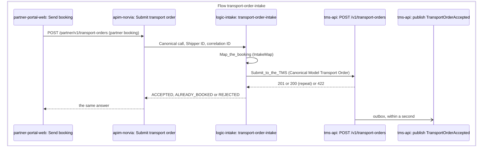

# P1 Transport Order intake

Transport Order intake takes a Shipper's booking into the TMS and accepts or rejects it. This document covers the Transport-only service through the Shipper API, the only intake channel built so far. It was written from the P1 spec (GitHub issue #1). Terms are defined in [CONTEXT.md](../../../CONTEXT.md).

| | |
|---|---|
| **Trigger** | A Shipper submits a booking in the Partner portal |
| **Outcome** | An Accepted Transport Order with a Transport Order number, or a Rejected booking with every reason. The Shipper sees the outcome in the same call |
| **Owning system** | TMS. It owns Transport Orders and assigns their numbers (ADR 0002) |
| **Applies to** | Own fleet and Carriers alike. Intake happens before P3 decides who carries the goods |
| **Integrations touched** | Partner portal, API Management, intake Logic App, TMS intake API, Service Bus (outcome events) |

## Channels

The intake API records the intake channel each Transport Order came from, and it is readable on the Transport Order through the query side. The channel follows from who calls: the TMS setting `IntakeCallers:ClientIdsByChannel` lists the client IDs (the token's `azp`, or `appid` in a v1 token) that may call for each channel, each client ID on one channel only, so a caller can't submit for a channel that isn't its own. In Azure the intake Logic App's managed identity is the only caller on the Shipper API channel.

| Channel | Value | Service | Status |
|---|---|---|---|
| Shipper API | `ShipperApi` | Transport-only | Built by this process |
| WMS handoff | `Wms` | Fulfilment | The channel exists, mapped from its own client ID, but no WMS calls it yet. Its Transport Orders are Not rated separately ([P2](p2-rating.md)) |

BizTalk and EDI intake are not part of the sandbox.

## Status

| Status | Meaning |
|---|---|
| Accepted | The booking passed validation and has a Transport Order number. It waits for Rating (P2) and planning (P3) |
| Rejected | The booking failed validation. It is stored with its reasons and the submitted content, so Customer service can see it. It has no Transport Order number |

P1 creates no Shipments. P3 does that.

## Steps

The path runs synchronously end to end: Partner portal → API Management → intake Logic App → TMS intake API. No queue sits between API Management and the Logic App.

1. **Book.** The presenter plays a Shipper Persona (Brouwer Dranken) in the Partner portal, fills in the booking form and submits it. The portal calls API Management with the Persona's token and subscription key.
2. **Check at the edge.** API Management checks the subscription key and the Entra token (audience "Norvia Partner API", role `TransportOrders.Submit`). A token without the role gets 403 before any Logic App runs. This is how a Carrier Persona (Van Dijk Transport) gets refused. API Management maps the token's `azp` claim to a Shipper ID through the seed-derived mapping, creates the correlation ID and passes both to the Logic App (ADR 0005).
3. **Map.** The Logic App maps the partner booking to a Canonical Model `TransportOrder` with the intake map, a .NET local function ([ADR 0019](../../adr/0019-the-intake-map-is-dotnet-code-run-as-a-logic-apps-local-function.md)). The partner format differs on purpose: it has its own field names, flat address fields, weights as text with units and local date/times. The Canonical Model uses UTC timestamps with offsets, weights in kilograms as numbers and ISO 3166 country codes. The map never rejects a booking: a value it can't read is left out, for the validation rules to report. The partner format, the map and its samples are in [contracts/partner-api](../../../contracts/partner-api/README.md).
4. **Submit to the TMS.** The Logic App calls the TMS intake API with its managed identity, which is the only identity that holds the intake role (`TransportOrders.Intake`). A caller without it, or not registered for an intake channel, is refused before any Transport Order logic runs, so nothing is stored or published ([Identity and access](../../architecture/identity-and-access.md) lists every role and who holds it). The API accepts only the Canonical Model (ADR 0003). The Shipper ID in it is the one API Management took from the Shipper's token, never one the Shipper typed (ADR 0005). The TMS trusts it because only the intake Logic App can call.
5. **Check for a repeat.** If the Shipper already has an Accepted Transport Order under this Shipper reference with the same content, the TMS returns the original Transport Order, flags it as a repeat and stops. This happens before validation, so a repeat that arrives after the collection window has started still gets the original. If the reference is held for different content, the booking is rejected (`ShipperReferenceReused`), together with any other failures. A Rejected booking holds no reference, so the Shipper can resubmit a corrected booking under the same one.
6. **Validate.** The TMS checks the booking against the [validation rules](#validation-rules). It collects every failure and never stops at the first one.
7. **Record.** An accepted booking gets a Transport Order number and the status Accepted. A rejected one is stored with the status Rejected and its reasons. The outcome event is published in the same transaction (see [Events](#events)).
8. **Respond.** The TMS answers the Logic App, which relays the answer to the Shipper in the partner format with its meaning unchanged: `ACCEPTED`, `ALREADY_BOOKED` or `REJECTED` ([responses](../../../contracts/partner-api/README.md#responses)). The accepted Transport Order appears in the TMS UI's list of Transport Orders waiting for planning, without a page refresh.

### When the same booking arrives twice at once

A unique index on the Shipper and the Shipper reference of Accepted Transport Orders makes sure only one of them is booked. The TMS then runs the other once more, finds the Transport Order the first one booked and answers it as a repeat. It publishes nothing.

### When the TMS can't be reached

On a TMS server error or timeout, the Logic App retries with a bounded exponential policy: three retries, 5 to 20 seconds apart, each attempt timing out after 30 seconds. The Shipper's call waits for the answer, so even when every attempt times out the answer comes back in about three minutes, before Azure closes the call at 230 seconds. When the retries are used up, it returns a gateway error (`NOT_RECEIVED`) that tells the Shipper the booking was not received, so they know to try again. The run shows as failed in the Logic App run history. Intake is idempotent, so a retry of a booking the TMS did take in is answered as a repeat.

## Validation rules

| Rule | Codes |
|---|---|
| The Shipper exists and is active in the TMS's seed-loaded Shipper data | `UnknownShipper`, `InactiveShipper` |
| A Shipper reference is given, is at most 100 characters and is unique per Shipper: no Accepted Transport Order of the same Shipper holds it for different content. Two Shippers may use the same reference | `ShipperReferenceMissing`, `ShipperReferenceTooLong`, `ShipperReferenceReused` |
| The collection address, the delivery address and the Consignee name are given | `CollectionAddressMissing`, `DeliveryAddressMissing`, `ConsigneeNameMissing` |
| Each address has a street, postcode, city and country | `CollectionAddressIncomplete`, `DeliveryAddressIncomplete` |
| The collection window has an earliest and a latest time. Its earliest time is not in the past and is not after its latest time | `CollectionWindowMissing`, `CollectionWindowInPast`, `CollectionWindowReversed` |
| A delivery window, when given, is internally consistent and doesn't end before the collection window starts | `DeliveryWindowIncomplete`, `DeliveryWindowReversed`, `DeliveryWindowBeforeCollection` |
| There is at least one goods line | `GoodsLinesMissing` |
| Each goods line has a package type from the fixed list (pallet, parcel, crate, loose), a quantity of at least 1 and a weight greater than 0 | `PackageTypeInvalid`, `QuantityInvalid`, `WeightInvalid` |
| Dimensions, when given, are positive | `DimensionsInvalid` |
| The total weight doesn't exceed the limit for a single Transport Order (the TMS setting `TransportOrderRules:MaxTotalWeightKg`, 24,000 kg by default) | `TotalWeightOverLimit` |

Each failure has a stable code and a readable message. Codes are never renamed; new rules add new codes. The 24,000 kg limit and the package type list are sandbox defaults, chosen to be believable, not to follow any regulation.

## Responses

| Case | TMS response |
|---|---|
| Accepted | Success, with the Transport Order number and status |
| Repeat (same Shipper, same Shipper reference, same content) | Success (200 rather than 201), returning the original Transport Order's number and status, flagged as a repeat (`repeat: true`) |
| Validation failure, or a reused Shipper reference with different content | Client error (422 ProblemDetails) listing every failure's code and message. Its `instance` is where the Rejected booking can be read |
| Caller without a valid token for the TMS API | Refused (401) |
| Caller whose token lacks the intake role, or that isn't registered for an intake channel | Refused (403) |

## Correlation ID

API Management creates the correlation ID at the edge. It travels as a header through the Logic App to the TMS, is stored on the Transport Order and is carried in the properties of the outcome event. Every intake attempt, whether accepted, rejected, refused or failed, can be found by it in Application Insights.

The TMS puts the tracking-contract keys it knows in the logging scope of an intake call. `correlationId` and `flow` (`transport-order-intake`) cover the whole call, from before authentication, so a refused call is logged under its correlation ID with the outcome `Refused`. `partyId` (the Shipper ID) covers the submission, and `transportOrderNumber` is added once the booking is accepted. Publishing the outcome event later is logged under the event's own tracking keys, so it joins the same trail. The TMS never logs the Consignee's name, address or phone number.

API Management records its part of the trail as traces in Application Insights, with the same keys: a call it passes on with `correlationId`, `flow` and `partyId`, and a call it refuses with `correlationId`, `flow`, `outcome` (`Refused`) and `failureCode`. Its request telemetry also carries the correlation ID it sent to the Logic App and returned to the caller.

The intake Logic App sets the run's client tracking ID to the correlation ID, and sets the tracking contract's keys as tracked properties on the step after the caller check (`correlationId`, `flow`, `partyId`) and on the step that calls the TMS, which adds `transportOrderNumber` once known, `outcome` and `failureCode`. Logic Apps doesn't record a Request trigger's tracked properties, so `Track_the_booking`, which runs once the caller check has let API Management's call through, takes the correlation ID and the Shipper from the trigger's headers and tracks them; a run that stops before the TMS call, such as a booking the map can't read, is still on its Message trail. A refused caller is on its trail through the refusal. Logic Apps lets a tracked property read only its own step, so the TMS call's keys come from the call itself: the correlation ID from its header, the Shipper from the Transport Order it sends. The run history shows the partner booking (the trigger), the Canonical Model Transport Order (the TMS call's input) and the TMS's answer (its output). No step uses secure inputs or outputs.

| TMS answer | `outcome` | `failureCode` | The Shipper gets |
|---|---|---|---|
| Accepted, or a repeat | `Succeeded` | | `ACCEPTED` or `ALREADY_BOOKED` |
| Rejected (422) | `Refused` | `TransportOrderRejected`. Each reason's own code is in the run's TMS answer | `REJECTED` |
| Another client error, such as 400, 401 or 403: the integration layer is at fault | `Failed` | `TmsCallRefused` | `NOT_RECEIVED`, and the run fails |
| A server error, 408, 429 or no answer, after the retries | `Failed` | `TmsUnavailable` | `NOT_RECEIVED`, and the run fails |

The relay decides the failure code the run fails with, and the TMS call's `failureCode` follows the same rule in the workflow, because a tracked property can't read the relay. Logic Apps can't leave a tracked property out when it doesn't apply, so `transportOrderNumber` and `failureCode` are recorded as null there, never as an empty value.

It is not the Transport Order number. The TMS assigns that number only on acceptance, and rejected or refused attempts need tracing too.

## Events

Both events are published to the topic for Transport Order events, through the TMS's transactional outbox, so an event exists exactly when the state change was committed (ADR 0003).

| Event | Carries | Consumers |
|---|---|---|
| `TransportOrderAccepted` | The full Canonical Model Transport Order, correlation ID | [Subscribers](../../architecture/events.md#catalogue). P3 works from the TMS's own data, not from this event (ADR 0003). |
| `TransportOrderRejected` | The reasons and the Shipper reference, correlation ID | [Subscribers](../../architecture/events.md#catalogue) |

A repeat submission publishes no event.

## Implementation

For engineers and coding agents. It shows what the estate does when a Shipper books, where each step lives in the repository, what plays each Azure piece on a developer's machine, and what is designed but not built. Azure is the estate [c4.md](../../architecture/c4.md) draws. This section is the template the Implementation sections of the other processes follow.

### Message trail

The Hops an accepted booking leaves on its Message trail, named as the [Integration console](../../operations/integration-console.md#message-trail) shows them, in time order. All of them belong to the one Flow `transport-order-intake`. The Shipper waits on the whole path, so every call returns before the one that started it does.

- A rejected booking publishes `TransportOrderRejected` instead of `TransportOrderAccepted`. A repeat publishes nothing, so its trail ends at the TMS call.
- A refused call stops at `apim-norvia`. A booking with a value the map can't read still reaches the TMS, which rejects it. One the map can't parse at all fails the run before the TMS call.
- The publish Hop appears only once the outbox has sent the message ([failure behaviour](../../architecture/failure-behaviour.md#the-tms-outbox)).

### Code map

Links go to files, not lines, so they stay true as the code moves.

| Step | Where |
|---|---|
| 1. Book | [NewBooking.razor](../../../src/PartnerPortal/Norvia.PartnerPortal.Web/Bookings/NewBooking.razor) (the form), [SubmitBookingHandler.cs](../../../src/PartnerPortal/Norvia.PartnerPortal.Application/Bookings/Submit/SubmitBookingHandler.cs), [NorviaPartnerApiClient.cs](../../../src/PartnerPortal/Norvia.PartnerPortal.Infrastructure/PartnerApi/NorviaPartnerApiClient.cs) (the `Send booking` Hop), [Booking.cs](../../../src/PartnerPortal/Norvia.PartnerPortal.Domain/Bookings/Booking.cs) (the Persona's own record) |
| 2. Check at the edge | API Management: [submit-transport-order.policy.xml](../../../infra/estate/partner-api/submit-transport-order.policy.xml), the operation declared in [partner-api.bicep](../../../infra/estate/partner-api.bicep) |
| 3. Map | Logic App: [workflow.json](../../../src/Integration/IntakeLogicApp/transport-order-intake/workflow.json) (`Map_the_booking`). Function: [MapPartnerBooking.cs](../../../src/Integration/Norvia.Integration.TransportOrderIntake.Functions/MapPartnerBooking.cs). Map: [IntakeMap.cs](../../../src/Integration/Norvia.Integration.TransportOrderIntake/IntakeMap.cs). Contract and samples: [contracts/partner-api](../../../contracts/partner-api/README.md) |
| 4. Submit to the TMS | Logic App: `Submit_to_the_TMS` in the same [workflow.json](../../../src/Integration/IntakeLogicApp/transport-order-intake/workflow.json). Endpoint: [TransportOrderEndpoints.cs](../../../src/Tms/Norvia.Tms.Api/TransportOrders/TransportOrderEndpoints.cs). Channel check: [IntakeCallers.cs](../../../src/Tms/Norvia.Tms.Api/TransportOrders/IntakeCallers.cs). Command: [SubmitTransportOrderCommand.cs](../../../src/Tms/Norvia.Tms.Application/TransportOrders/Submit/SubmitTransportOrderCommand.cs) |
| 5. Check for a repeat | [SubmitTransportOrderHandler.cs](../../../src/Tms/Norvia.Tms.Application/TransportOrders/Submit/SubmitTransportOrderHandler.cs), with [TransportOrderByShipperReferenceSpec.cs](../../../src/Tms/Norvia.Tms.Domain/TransportOrders/TransportOrderByShipperReferenceSpec.cs). The unique index is in [TransportOrderConfiguration.cs](../../../src/Tms/Norvia.Tms.Infrastructure/Data/Configurations/TransportOrderConfiguration.cs) |
| 6. Validate | [TransportOrderRules.cs](../../../src/Tms/Norvia.Tms.Domain/TransportOrders/TransportOrderRules.cs), codes in [RejectionCode.cs](../../../src/Tms/Norvia.Tms.Domain/TransportOrders/RejectionCode.cs). Shipper data: [SeedFileShipperDirectory.cs](../../../src/Tms/Norvia.Tms.Infrastructure/Shippers/SeedFileShipperDirectory.cs) |
| 7. Record | Aggregate methods `Accept` and `Reject` in [TransportOrder.cs](../../../src/Tms/Norvia.Tms.Domain/TransportOrders/TransportOrder.cs) |
| 7. Publish | Event types [TransportOrderAcceptedEvent.cs](../../../src/Tms/Norvia.Tms.Domain/TransportOrders/TransportOrderAcceptedEvent.cs) and [TransportOrderRejectedEvent.cs](../../../src/Tms/Norvia.Tms.Domain/TransportOrders/TransportOrderRejectedEvent.cs). Publishers [PublishTransportOrderAccepted.cs](../../../src/Tms/Norvia.Tms.Application/TransportOrders/Submit/PublishTransportOrderAccepted.cs) and [PublishTransportOrderRejected.cs](../../../src/Tms/Norvia.Tms.Application/TransportOrders/Submit/PublishTransportOrderRejected.cs), sent by [OutboxPublisher.cs](../../../src/Tms/Norvia.Tms.Infrastructure/Outbox/OutboxPublisher.cs). Topic and subscription: [messaging.bicep](../../../infra/estate/messaging.bicep) |
| 8. Respond | Logic App: `Relay_the_TMS_outcome` and `Answer_the_Shipper`. Function: [RelayTmsOutcome.cs](../../../src/Integration/Norvia.Integration.TransportOrderIntake.Functions/RelayTmsOutcome.cs). Responses: [BookingResponses.cs](../../../src/Integration/Norvia.Integration.TransportOrderIntake/BookingResponses.cs) |
| 8. Show in the TMS UI | [WaitingForPlanning.razor](../../../src/Tms/Norvia.Tms.Web/TransportOrders/WaitingForPlanning.razor), which re-reads every second by default ([LiveTransportOrderList.cs](../../../src/Tms/Norvia.Tms.Web/TransportOrders/LiveTransportOrderList.cs)) |
| The applications | The TMS API, TMS UI and Partner portal are declared in the [AppHost](../../../src/Norvia.AppHost/AppHost.cs). The Function host is the [Functions project](../../../src/Integration/Norvia.Integration.TransportOrderIntake.Functions/Norvia.Integration.TransportOrderIntake.Functions.csproj), deployed with the Logic App |
| The Logic App resource | [intake-logic-app.bicep](../../../infra/estate/intake-logic-app.bicep), deployed by [deploy-intake-logic-app.sh](../../../infra/deploy-intake-logic-app.sh) and checked after a deploy by [smoke-test-intake.sh](../../../infra/smoke-test-intake.sh) |

### Locally

Under Aspire there is no API Management and no Logic Apps runtime. `Norvia.Integration.LocalPartnerApi` plays both, in one request: [SubmitTransportOrder.cs](../../../src/Integration/Norvia.Integration.LocalPartnerApi/SubmitTransportOrder.cs) makes the edge's checks, then calls `IntakeMap`, the TMS (through [TmsIntake.cs](../../../src/Integration/Norvia.Integration.LocalPartnerApi/TmsIntake.cs)) and the relay, the same classes the Logic App's local functions wrap. The Partner portal, the TMS API and the TMS UI are the same applications in both, the Service Bus emulator plays Service Bus, and the Aspire dashboard plays Application Insights. The full map, and the places where the two can differ, are in [local-vs-azure.md](../../architecture/local-vs-azure.md).

Two differences matter for P1. The retry of the TMS call is the Logic App's policy in Azure and the service defaults' standard resilience handler locally, so the numbers are chosen separately. The policy's checks and the stand-in's are two implementations kept close by tests.

### Gaps

Designed in this document and not built yet:

| Gap | Where it stands |
|---|---|
| The WMS handoff channel (`Wms`) | The TMS accepts the channel and maps it from its own client ID, but no WMS exists to call it ([Channels](#channels)) |
| Entry by Norvia staff in the TMS UI, amend and cancel after acceptance, notifying the Shipper, asynchronous intake, the ERP and master-data sync | Left out on purpose ([Deferred](#deferred)) |
| As-found toggles and presenter-panel faults for P1 | None added. No Bicep parameter switches anything broken in intake, and nothing in the Partner portal injects an intake fault. [Failure behaviour](../../architecture/failure-behaviour.md#p1-transport-order-intake) lists the row each would worsen |
| Alerts on P1 | None built: failed requests on the Partner API and failed runs of the intake Logic App are planned only ([monitoring.bicep](../../../infra/estate/monitoring.bicep) declares no alert rule) |
| The Integration console's failed runs and dead-letter panels for P1 | Planned, slice 2. Finding the Hops and opening the run are built |

## Deferred

These were left out on purpose while designing P1, each with its reason.

- **The WMS handoff (Fulfilment Transport Orders).** The intake API records the channel so the handoff can reuse it, but no WMS work is included yet.
- **Transport Orders entered by Norvia staff in the TMS UI.** The Shipper API is enough for the first slice.
- **Amending or cancelling a Transport Order after acceptance.**
- **Dangerous goods, temperature control, multi-leg or multi-stop Transport Orders, and customs.** They are too much for the first slice.
- **Notifying the Shipper by email or webhook.** The Shipper sees the outcome in the call response and in the Partner portal's list of bookings.
- **Asynchronous intake (202 Accepted).** It was dropped along with the queue between API Management and the Logic App, so the Shipper sees the TMS's decision straight away. It can come back if a demo needs it.
- **The ERP and master-data sync.** Shippers come from the seed file for now.
- **As-found toggles and presenter-panel faults.** They are added after the fixed state is built.
