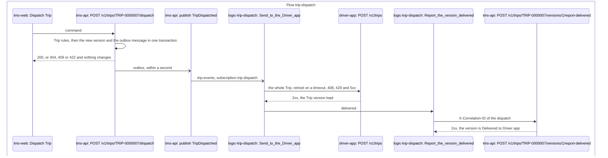

# P11 Trip dispatch

Trip dispatch brings Released Own fleet Shipments together on Trips and sends each Trip to its Driver. The Planner builds a Trip by hand in the TMS UI: picks its Shipments, puts their Stops in order, and gives it a Vehicle, a Driver, a planned start and a planned driving duration from what P10 says is available. Dispatching it pushes the whole Trip to the Driver app through a Logic App. Terms are defined in [GLOSSARY.md](../../../GLOSSARY.md).

| | |
|---|---|
| **Trigger** | An Own fleet Shipment is Released (P3) and appears in the Planner's list of Shipments to put on Trips |
| **Outcome** | A Dispatched Trip, delivered to its Driver in the Driver app, and its Shipments Dispatched |
| **Owning system** | TMS. It owns Trips and Shipments (ADR 0002). Availability comes from [P10](p10-fleet-capacity-planning.md), inside the TMS |
| **Applies to** | Own fleet only |
| **Integrations touched** | Service Bus (Trip events and Shipment events), Trip dispatch Logic App, Driver app (Trip endpoint), TMS Trip API |

## What P11 decides, and what it doesn't

P11 decides **which Shipments go on which Trip, in what order, with which Vehicle and Driver**, and gets the Trip to the Driver. It doesn't choose between Own fleet and a Carrier. That stays in [P3](p3-transport-planning.md). It doesn't say what the Own fleet can do on a day. That is [P10](p10-fleet-capacity-planning.md), whose availability rules P11 applies. It doesn't record what happens on the road. Starting and ending a Trip, completing its Stops, and the Tracking events and Proofs of delivery that come from it are [P12](p12-trip-execution.md).

The Planner does P11, with the Planner permissions from P3. A separate dispatcher role is deferred.

## Trips and Stops

A Trip is one run on one day by one Vehicle and one Driver. A Vehicle or Driver has at most one Trip a day, as P10's load check already assumes.

A Trip visits an ordered sequence of **Stops**. Each Shipment on a Trip has exactly two: its collection and its delivery, and the collection always comes before the delivery. A Shipment Awaiting [re-delivery](p12-trip-execution.md#re-delivery) has only its delivery Stop, because its collection is done. A Stop is derived from its Shipment (address, window, goods lines). It isn't a record with a life of its own (ADR 0007). Two Stops at the same address stay two Stops.

The Planner puts the Stops in order by hand. The TMS doesn't suggest a sequence or estimate driving time.

A Trip carries:

| Field | Notes |
|---|---|
| Trip number | Given when the Trip is created |
| Day | An open day in the Planning horizon |
| Vehicle and Driver | From that day's available ones. Both may be empty on a Draft |
| Planned start | A time on the Trip's day, inside the Driver's Shift |
| Planned driving duration | Entered by the Planner, more than nothing and at most 24 hours. It uses up the Driver's [Driving-hour budget](p10-fleet-capacity-planning.md#driving-hour-budget) |
| Stops | The ordered sequence |
| Version | Starts at 1 on Dispatch and goes up with each Amend (ADR 0015) |

There are no planned times per Stop.

## Status

### Trip

| Status | Meaning |
|---|---|
| Draft | Being built. The Planner can change anything or discard it. A Draft still holds its Vehicle, Driver and driving hours, for the one-Trip-a-day rule and the Driving-hour budget |
| Dispatched | Sent to its Driver. It changes only by Amend |

[P12](p12-trip-execution.md) adds **In progress**, from the Driver's Start Trip, and **Completed**, from End Trip. A Dispatched Trip is never deleted.

A Trip is Dispatched as soon as the Planner dispatches it. Whether its Driver has it is a separate [delivery state](#delivery-to-the-driver-app) on each version.

### Shipment

P11 adds one Shipment status.

| Status | Meaning |
|---|---|
| Dispatched | Its Trip is Dispatched. The Own fleet counterpart of Booked. [P5](p5-shipment-tracking.md) takes it from here |

An Own fleet Shipment moves Planned → Released → Dispatched → Collected. A Shipment on a Draft Trip stays Released. When the Planner takes a Shipment off its Trip, it goes back to **Planned** in the same transaction, as a Carrier Shipment does after a rejection (P4) or a cancellation (P7). Its Tracking status stays Scheduled, since that never moves backwards.

## Steps

1. **See what needs a Trip.** The Planner opens the list of Shipments to put on Trips: Released Own fleet Shipments not yet on a Trip, and Shipments Awaiting re-delivery (P12), sorted by collection time and filtered by day.
2. **Build.** The Planner selects Shipments and creates a new Trip for their collection day, or adds them to an existing Trip that day. An empty Trip can be created too. Each Shipment adds its collection and delivery Stops at the end of the sequence. The Planner drags Stops into order, chooses the Vehicle and Driver from that day's available ones, and enters the planned start and driving duration. Every change is checked against the [Trip rules](#trip-rules) and refused if it breaks one.
3. **Dispatch.** The Planner dispatches the Trip. The TMS re-checks every rule, sets the Trip and its Shipments to Dispatched, and publishes `TripDispatched` with version 1, in one transaction.
4. **Deliver.** The Trip dispatch Logic App picks up `TripDispatched`, sends the Trip to the Driver app for its Driver, and reports back to the TMS whether it was delivered.
5. **Amend, if needed.** The Planner changes the Dispatched Trip. Each Amend is checked, raises the version and publishes `TripDispatched` again with the whole Trip.

### Amending a Dispatched Trip

Until P12 marks the Trip In progress, the Planner can change anything on a Dispatched Trip, under the same rules as a Draft: add or take off Shipments, reorder Stops, change the Vehicle, Driver, planned start or duration. Once it is In progress, the only change allowed is [taking off a Shipment](#taking-a-shipment-off-a-trip) whose collection hasn't happened.

Each Amend sends the whole Trip as a new version, and the latest version replaces whatever the Driver app held (ADR 0015). A Shipment added to a Dispatched Trip becomes Dispatched with that version.

### Taking a Shipment off a Trip

This is how an Own fleet Shipment is re-planned, for example to resolve a [P7](p7-exception-handling.md) Exception when the Consignee can't take the goods until next week. The Planner can take a Shipment off its Trip until its collection Stop is done, that is, until the Shipment is Collected. Its two Stops leave the Trip, the Shipment goes back to Planned, and `ShipmentTakenOffTrip` is published. A Re-delivery can be taken off until it is delivered. Its delivery Stop leaves the Trip and it is Awaiting re-delivery again (P12), since its goods are already collected. In P3 the Planner can then release it again for another Trip or reassign it to a Carrier.

On a Draft this is just an edit. On a Dispatched Trip it is an Amend and sends a new version. After collection a Shipment can't be taken off: a failed delivery goes through P7.

### When availability changes under a Trip

P10 always accepts an Absence, an Off the road day, a Roster change, or a Driver or Vehicle becoming inactive in the ERP, even when a Trip uses that Driver or Vehicle. The TMS then flags the Trip **Needs a Driver** or **Needs a Vehicle**.

The flag is not a status, and nothing happens automatically, like Stale in P5. A flagged Draft can't be dispatched, because Dispatch re-checks the rules. A flagged Dispatched Trip stays with its Driver until the Planner Amends it with another Driver or Vehicle. The flag clears as soon as the rule passes again, for example when the Absence is removed.

The flag is computed from the Draft or Dispatched Trip each time it is read, by asking P10's availability rules about the Trip's own Driver and Vehicle: the `DriverNotAvailable` rule gives *Needs a Driver* and `VehicleNotAvailable` gives *Needs a Vehicle*. A Roster change flags the Trip because it takes the Driver's Shift from that day. Another Trip that day, the licence, the Driving-hour budget and the load don't count.

## Trip rules

Each failure has a stable code and a readable message, as in P3. Every change to a Trip is refused if it breaks a rule. A Draft may still lack a Vehicle, a Driver, a planned start or a duration, and the rules about them apply once they are set.

From P10 ([Availability rules for Trips](p10-fleet-capacity-planning.md#availability-rules-for-trips)):

| Code | Rule |
|---|---|
| `VehicleNotAvailable` | The Vehicle is active and not Off the road that day, and has no other Trip that day |
| `DriverNotAvailable` | The Driver is active, has a Shift that day and no Absence, and has no other Trip that day |
| `LicenceNotHeld` | The Driver's licence covers the Vehicle type |
| `DrivingHoursExceeded` | The planned driving duration fits in the Driver's Driving-hour budget: daily (with an extension if one is left), weekly and fortnightly. Draft and Dispatched Trips both count |
| `PayloadExceeded` | The total weight of the Trip's Shipments fits the Vehicle's payload |
| `PalletPlacesExceeded` | The Trip's pallets fit the Vehicle's pallet places |
| `DayNotOpen` | The Trip's day is in the Planning horizon |

Added by P11:

| Code | Rule |
|---|---|
| `ShipmentNotReleased` | A Shipment added to a Trip is an Own fleet Shipment and Released, or Awaiting re-delivery (P12) |
| `ShipmentOnAnotherTrip` | A Shipment is on no other Trip |
| `CollectionBeforeDelivery` | Each Shipment's collection Stop comes before its delivery Stop |
| `CollectionDayMismatch` | Each Shipment's collection day, as P10 defines it, is the Trip's day. It doesn't apply to a Re-delivery |
| `OutsideShift` | The planned start is inside the Driver's Shift that day: from its start up to but not including its end. A start with no Driver, or a Driver with no Shift, isn't checked here (the Driver rules say so), and the Planner changing a Shift later doesn't re-check Drafts |
| `TripUnderWay` | Once the Trip is In progress (P12), only an uncollected Shipment can be taken off |

The load rules count the whole Trip as loaded at once, as P10's load check does. The TMS doesn't work out the load between Stops.

Dispatch also needs a Vehicle, a Driver, a planned start, a planned driving duration and at least one Shipment (`TripIncomplete`).

One check only **warns**: a Shipment whose delivery window doesn't include the Trip's day. The Planner may deliver early or late by agreement, and P7's Late delivery catches the rest.

## Delivery to the Driver app

Each version of a Trip has a delivery state:

| State | Meaning |
|---|---|
| Sending | Published, not yet reported by the Logic App |
| Delivered to Driver app | The Driver app accepted this version |
| Not delivered | The Logic App gave up after its retries. `TripNotDelivered` is published |

The Planner can **send again** a version that is Not delivered, which publishes `TripDispatched` again with the same version. A report for a version older than the Trip's latest is stored against that version and changes nothing else. So the Planner always sees which version the Driver has.

## Trip dispatch format

`TripDispatched` carries the whole Trip, in the Canonical Model:

| Part | Fields |
|---|---|
| Trip | Trip number, version, day, planned start, planned driving duration |
| Vehicle | ID, registration, Vehicle type |
| Driver | ID, name |
| Each Stop, in order | Sequence number, collection or delivery, Shipment number, Transport Order number, Shipper, address, window, goods lines. For a delivery Stop also the Consignee |
| Tracing | Correlation ID |

A Shipment taken off appears only as a version without its Stops. The Driver app never calls back for more.

## Driver app

P11 builds the smallest Driver app the demo needs. [P12](p12-trip-execution.md#driver-app) adds the rest.

| In P11 | In P12 |
|---|---|
| An API that accepts a Trip version from the Trip dispatch Logic App and keeps the latest per Trip | Completing each Stop, and capturing a Proof of delivery, published as events (ADR 0016) |
| Signing in by picking one of the seeded Drivers, as a Persona is picked in the Partner portal | Sign-in with Entra ID |
| A read-only list of that Driver's Trips, with their Stops in order | Starting and ending a Trip |

The Driver app is its own application and reaches the TMS only through Azure Integration Services (ADR 0001). In P11 nothing flows back from it except the Logic App's delivery report.

## Planner's views

| View | Shows | Actions |
|---|---|---|
| Shipments to put on Trips | Released Own fleet Shipments not on a Trip, and Shipments Awaiting re-delivery, marked Re-delivery (P12): Shipment, Shipper, collection and delivery places and windows, weight and pallets. By collection time, filtered by day | Create a Trip, add to a Trip |
| Trips | One row per Trip per day: status, Vehicle, Driver, Stop count, load against the Vehicle's payload and pallet places, the P10 flag, and the delivery state of the latest version | Open a Trip |
| Trip detail | The Stops in order, the Vehicle, Driver, planned start and duration, rule failures and warnings, and each version with its delivery state | Reorder Stops, set the Vehicle, Driver and times, Dispatch, take off a Shipment, send again, discard a Draft |

The views update without a page refresh, as P3's lists do. P10's capacity view links to flagged Trips.

## TMS API

The Trip API accepts only the Canonical Model (ADR 0003). The Planner's actions are in the TMS UI.

Who holds each role, and what else each identity may reach, is in [Identity and access](../../architecture/identity-and-access.md).

| Operation | Caller | Role |
|---|---|---|
| Report a Trip version as delivered or not delivered | Trip dispatch Logic App | `Trips.ReportDelivery` |

## Correlation ID

A Planner's action starts in the TMS UI, so the TMS creates a new correlation ID for each Dispatch, Amend, send again and Shipment taken off, as in P3. `TripDispatched` carries it, and the Trip dispatch Logic App passes it on to the Driver app and uses it on its report to the TMS.

Tracing a Trip follows the Trip number and version. Tracing a Shipment onto its Trip follows the Shipment number, which every Stop carries.

## Events

Trip events go to a new topic for Trip events, and `ShipmentTakenOffTrip` to the topic for Shipment events, both through the TMS's transactional outbox (ADR 0003). Creating, editing or discarding a Draft publishes nothing. There is no event per Shipment on Dispatch, because `TripDispatched` lists them.

| Event | Published when | Carries | Consumers |
|---|---|---|---|
| `TripDispatched` | The Planner dispatches, Amends or sends a version again | The [whole Trip](#trip-dispatch-format) | Trip dispatch Logic App. Monitoring |
| `TripNotDelivered` | The Trip's latest version is reported not delivered | Trip number, version, Driver ID, technical cause, correlation ID | Monitoring. An alert later |
| `ShipmentTakenOffTrip` | The Planner takes a Shipment off a Trip | Shipment number, Transport Order number, Trip number, the new version (if Dispatched), reason text, correlation ID | Monitoring |

## Demo seed

Released Own fleet Shipments collecting on one day in the first week of the Planning horizon, enough for two Trips: one on a rigid truck and one on a van. One more Shipment that day is too heavy for the van, so adding it shows `PayloadExceeded`.

The seed file's `demoTripDay` part holds six Own fleet Transport Orders from Brouwer Dranken, Rotterdam to Utrecht and Antwerp. Three (15 pallets, 6,800 kg) are for the rigid truck, since they are too many for a van; two (3 pallets, 800 kg) fit a van; the sixth, one pallet of 1,500 kg, is more than a van's 1,200 kg payload, so adding it to the van's Trip is refused with `PayloadExceeded`. The TMS books them, assigns them to Own fleet and releases them when it first starts and holds no Trip. The day is the first weekday on or after three days from the day the TMS first starts, and never the Over capacity day of [P10](p10-fleet-capacity-planning.md#demo-seed).

The demo: the Planner builds a Trip, dispatches it, and it appears in the Driver app for that Driver. The Planner then takes a Shipment off, and the Driver app shows version 2.

As-found: a presenter-panel fault, **Driver app unavailable**, makes the Driver app refuse Trips. The Planner sees Not delivered, and the failed Logic App run shows where it broke. The fault is switched off and the Planner sends it again.

## Presenter smoke run

After a deployment, and not in CI, the presenter checks Trip dispatch on the deployed estate. Do it after the presenter smoke run of Fleet capacity planning ([P10](p10-fleet-capacity-planning.md#presenter-smoke-run)). Open the TMS UI, the Driver app and the Partner portal's presenter panel side by side. Run `infra/smoke-test-trip-dispatch.sh <scenario 1 Trip number> <scenario 2 Trip number>` in a terminal: it stops at each step the presenter does, reads the TMS, the Driver app and Application Insights, and prints `PASS` or `FAIL` per check, never a body.

**Scenario 1: build, dispatch and amend.**

1. In the TMS UI, as the Planner, select the two seeded Shipments that fit a van and create a Trip for the demo's day. Add the sixth, the one too heavy for the van, as the script says: it is refused with `PayloadExceeded`.
2. Pick the van, a Driver, a planned start and a driving duration, and dispatch the Trip. Open the Driver app, pick that Driver, and see the Trip.
3. Take a Shipment off the Trip. The Driver app shows version 2.

**Scenario 2: the Driver app unavailable.**

4. Open the Partner portal's presenter panel (`/presenter`) and make the Driver app unavailable.
5. Build a second Trip and dispatch it. After the Logic App's retries it shows Not delivered in the TMS UI, and the Trip dispatch Logic App's run failed at `Send_to_the_Driver_app` with `DriverAppUnavailable`. Find the run in the Integration console.
6. Switch the fault off in the panel and send the version again. It shows Delivered to Driver app, and the Driver app has the Trip.

The script checks that the first Trip is Dispatched with versions 1 and 2 both Delivered to Driver app and that the Driver app holds version 2 with the TMS's Stops; that the second Trip's version was Not delivered with a cause, was not in the Driver app, and its send failed with `DriverAppUnavailable`; that after the fault is off and the version sent again the same version is Delivered, the Driver app holds it and the fault is off; and that each Trip's correlation IDs are in Application Insights for the TMS API, the Trip dispatch Logic App and the Driver app. `PayloadExceeded` is shown to the Planner and kept nowhere, so step 1 is the presenter's to see, as the warning is in P10's run. If a check fails, file the gap as its own issue against P11, rather than working around it in the run book.

## Implementation

For engineers and coding agents. It shows where the built part of P11 lives in the repository, the Hops a dispatch leaves on the Message trail, what plays each Azure piece on a developer's machine, and what is designed but not built. It follows the [P10 section](p10-fleet-capacity-planning.md#implementation).

### Built so far

The Trip tracer bullet: the Planner creates an empty Draft Trip for an open day, picks its Vehicle and Driver from that day's available ones, sees the Trips in a view that updates without a refresh, and discards a Draft. Creating, changing or discarding a Draft publishes nothing, so there is no Message trail beyond the TMS UI's and the TMS API's hops, which log the `trip-planning` flow with the Trip number. Creating a Draft takes an `Idempotency-Key`, the same for each retry; changing and discarding are repeatable by nature (a discard sent again finds no Trip).

Shipments on Trips: the Planner sees the Released Own fleet Shipments not on a Trip, by collection time and filtered by day, selects some and creates a Trip for their collection day or adds them to a Draft of that day. Each Shipment adds its collection Stop and its delivery Stop at the end of the sequence. Adding is refused with `ShipmentNotReleased`, `ShipmentOnAnotherTrip`, `CollectionDayMismatch`, `PayloadExceeded` or `PalletPlacesExceeded`, and all the Shipments of one call go on together or not at all. A delivery window that doesn't include the Trip's day is a warning. The Trips view shows each Trip's Stop count and load against its Vehicle's capacity, and the Trip detail shows the Stops, the load, the rules the Trip breaks now and the warnings. A Shipment on a Draft stays Released. Adding the same Shipment to the Trip again changes nothing, so it needs no idempotency key.

Reordering Stops: on a Draft's Trip detail the Planner drags a Stop to where it should go, or uses its arrows. The whole new sequence is sent in one call and checked before it is saved. A Shipment's delivery before its collection is refused with `CollectionBeforeDelivery`, and an order that leaves out a Stop, repeats one or names another is refused with `StopsNotTheTripsStops`. A refusal leaves the sequence as it was. Two Stops at the same address stay two Stops, since a Stop is a Shipment's collection or delivery, not a place. Sending the same order again changes nothing.

Dispatch: the Planner dispatches a complete Draft from its Trip detail. A Trip lacking a Vehicle, a Driver, a planned start, a planned driving duration or a Shipment is refused with a `TripIncomplete` for each missing part, and every other Trip rule is checked again, the Shipment rules included, so a Draft that became invalid (for example after an Absence on its Driver) is refused with that rule's code and nothing changes. On success, in one transaction, the Trip is Dispatched at version 1, its Shipments are Dispatched, and exactly one `TripDispatched` is written to the outbox for the `trip-events` topic under a new correlation ID, which the answer returns. There is no event per Shipment. Dispatching a Dispatched Trip is refused with `TripNotDraft`. The `trip-events` topic has a `monitoring` subscription only; the Trip dispatch Logic App's `trip-dispatch` subscription is described below.

Delivery state: every version has one, which starts as Sending when the version is published. The Trip dispatch Logic App reports a version with `POST /v1/trips/{number}/versions/{version}/report-delivered` or `.../report-not-delivered` (a `cause` in the body) under the role `Trips.ReportDelivery`, with the `X-Correlation-ID` of the Dispatch or send-again it continues. A report for a version that is no longer Sending is ignored and logged, and one for a version the Trip never had is `TripVersionNotFound` (404). Not delivered on the Trip's latest version publishes `TripNotDelivered` in the same transaction. A report for an older version is stored against that version and publishes nothing, so the Planner still sees which version the Driver has; an Amend makes one, since it raises the version while the previous one may still be Sending. The Planner sends the latest version again from its Trip detail (`POST /v1/trips/{number}/versions/{version}/send-again`, role `TransportOrders.Manage`): the version is Sending once more and `TripDispatched` is published with the same version, the Trip as it stands now, under a new correlation ID that the answer returns. It is refused with `NothingToSendAgain` for a version that is Sending or Delivered, `TripVersionNotLatest` for an older one, `TripNotDispatched` for a Draft and `VehicleOrDriverInactive` when the Trip's Vehicle or Driver has gone inactive. The Trips view shows the latest version's delivery state and the Trip detail lists every version with its state and cause, both updating without a refresh like the rest.

Amend: until P12 marks the Trip In progress, the Planner changes a Dispatched Trip with the same calls as a Draft: `PUT /v1/trips/{number}` (Vehicle, Driver, planned start and duration), `POST /v1/trips/{number}/shipments` and `PUT /v1/trips/{number}/stops`, under the same rules. On a Dispatched Trip each call is an Amend: if it changes something, in one transaction the version goes up, the Shipments added become Dispatched, and exactly one `TripDispatched` with the whole Trip is written to the outbox under a new correlation ID, which the answer returns in the `X-Correlation-ID` header (a Draft ignores it). A call that changes nothing (the same order, a Shipment already on the Trip, the same values) raises no version. A refusal leaves the Trip, its version and its Shipments as they were. An Amend can't take a part away (`TripIncomplete`), and a Dispatched Trip whose Vehicle or Driver has gone inactive refuses a call that would keep them (`VehicleOrDriverInactive`) until the Planner Amends it with another one. A Trip that is In progress (`TripStatus.InProgress`, set when P12's [Start Trip](p12-trip-execution.md#implementation) succeeds) refuses every change with `TripUnderWay`, except [taking off an uncollected Shipment](#taking-a-shipment-off-a-trip). The Trip detail lists each version with its delivery state, and its Stops can be moved, the Trips view's Plan button works, and Shipments to put on Trips offers Dispatched Trips of the day, for a Dispatched Trip too.

Taking a Shipment off: `POST /v1/trips/{number}/shipments/{shipmentNumber}/take-off` with a required `reason`, role `TransportOrders.Manage`. In one transaction the Shipment's two Stops leave the Trip (the sequence closes up), the Shipment goes back to Planned, and exactly one `ShipmentTakenOffTrip` is written to the outbox for the `shipment-events` topic under a new correlation ID, which the answer returns in the body and the `X-Correlation-ID` header. On a Draft that is all. On a Dispatched Trip, and also one In progress, it is an Amend too: the version goes up and one `TripDispatched` with the Shipments that remain, possibly none, is written under the same correlation ID, and the event carries that version. It is refused with `ShipmentCollected` once the Shipment is Collected (or further), `ShipmentNotOnTrip`, `VehicleOrDriverInactive` for a sent Trip whose Vehicle or Driver has gone inactive, `TripNotFound` or `ShipmentNotFound` (404), and a refusal changes nothing. The Shipment can then be released again in P3. Nothing makes a Shipment Collected on an Own fleet Trip yet (P12), so the handler's unit tests set that state up. The Trip detail does not have the button yet. Re-delivery is P12's.

### Message trail

The Hops one dispatch leaves on the Message trail, named as the [Integration console](../../operations/integration-console.md#message-trail) shows them, in time order. They belong to the Flow `trip-dispatch`. Dispatching, each Amend, each take-off of a Shipment from a Dispatched Trip and each send again start a trail of their own with a new correlation ID, found together by the Trip number. Building a Draft (the Flow `trip-planning`) publishes nothing and has no trail beyond the TMS UI's and the TMS API's Hops. The Planner waits for the call, not for the publish.

- When the Driver app doesn't take the Trip, the `Send_to_the_Driver_app` Hop is `Failed` with `DriverAppUnavailable` or `DriverAppRefused`, and the Logic App calls `Report_the_version_not_delivered` instead. The TMS marks the version **Not delivered** and publishes `TripNotDelivered`, with the same correlation ID. The Planner's send again (`Send Trip again` in the TMS UI) starts a new trail.
- A message the Logic App can't read is dead-lettered as `TripDispatchUnreadable` and the run fails; no send or report Hop appears.
- If the TMS doesn't answer the report, the report Hop is `Failed` with `TmsUnavailable` or `TmsCallRefused` and the version stays Sending.
- A refused action stops at the call. It has the outcome `Refused` and the failure code, and no publish Hop. A call that changes nothing publishes nothing.
- The publish Hop appears only once the outbox has sent the message ([failure behaviour](../../architecture/failure-behaviour.md#the-tms-outbox)).
- The Driver app logs its receipt under the same correlation ID and the same Flow `trip-dispatch`, so its Hop is on the trail too.

### Code map

Links go to files, not lines, so they stay true as the code moves.

| Step | Where |
|---|---|
| Trips | [Trip.cs](../../../src/Tms/Norvia.Tms.Domain/Trips/Trip.cs) with [TripNumber.cs](../../../src/Tms/Norvia.Tms.Domain/Trips/TripNumber.cs), [TripStatus.cs](../../../src/Tms/Norvia.Tms.Domain/Trips/TripStatus.cs) and the refusals [TripRefusal.cs](../../../src/Tms/Norvia.Tms.Domain/Trips/TripRefusal.cs) (`TripNotFound`, `TripNotDraft`). Specifications [TripsOnDaySpec.cs](../../../src/Tms/Norvia.Tms.Domain/Trips/TripsOnDaySpec.cs), [TripByNumberSpec.cs](../../../src/Tms/Norvia.Tms.Domain/Trips/TripByNumberSpec.cs) and [TripsPlannedBetweenSpec.cs](../../../src/Tms/Norvia.Tms.Domain/Trips/TripsPlannedBetweenSpec.cs) |
| 2. Build: create, pick, discard | `POST /v1/trips`, `PUT /v1/trips/{number}` and `DELETE /v1/trips/{number}` in [TripEndpoints.cs](../../../src/Tms/Norvia.Tms.Api/Trips/TripEndpoints.cs), with [CreateDraftTripHandler.cs](../../../src/Tms/Norvia.Tms.Application/Trips/Create/CreateDraftTripHandler.cs), [ChangeTripHandler.cs](../../../src/Tms/Norvia.Tms.Application/Trips/Change/ChangeTripHandler.cs) and [DiscardDraftTripHandler.cs](../../../src/Tms/Norvia.Tms.Application/Trips/Discard/DiscardDraftTripHandler.cs) |
| Trip rules | [TripPlanningChecks.cs](../../../src/Tms/Norvia.Tms.Application/Trips/TripPlanningChecks.cs) tells P10's [TripAvailabilityRules.cs](../../../src/Tms/Norvia.Tms.Application/Fleet/Availability/TripAvailabilityRules.cs) whether the Vehicle or Driver has another Trip that day (Drafts count), so a second Trip is `VehicleNotAvailable` or `DriverNotAvailable`. A refusal is a 409 problem whose `code` is the first rule broken and whose `failures` lists them all; a refused change leaves the Trip as it was. Giving a Draft's Vehicle, Driver, planned start and duration all back at once is never refused, even when its day has left the horizon |
| Planner's views | `GET /v1/trips`, every Trip by day, a past Draft included so it can be discarded ([ListTripsHandler.cs](../../../src/Tms/Norvia.Tms.Application/Trips/List/ListTripsHandler.cs)). The Vehicles and Drivers on offer for a day: [ListTripChoicesHandler.cs](../../../src/Tms/Norvia.Tms.Application/Trips/Choices/ListTripChoicesHandler.cs). UI: [TripsPage.razor](../../../src/Tms/Norvia.Tms.Web/Trips/TripsPage.razor) and [TripForm.razor](../../../src/Tms/Norvia.Tms.Web/Trips/TripForm.razor), which read again every few seconds as the other live lists do. API client: [TmsApiClient.Trips.cs](../../../src/Tms/Norvia.Tms.Web/TmsApi/TmsApiClient.Trips.cs) |
| Persistence | [TripConfiguration.cs](../../../src/Tms/Norvia.Tms.Infrastructure/Data/Configurations/TripConfiguration.cs), with unique indexes on (day, Vehicle), (day, Driver) and the idempotency key as a backstop to the rule, [RetryTripThatLostARace.cs](../../../src/Tms/Norvia.Tms.Infrastructure/Trips/RetryTripThatLostARace.cs) (when two requests ask at once, the loser runs again and is refused with a stable code, or answered with the Draft the first one created), [SqlTripNumbers.cs](../../../src/Tms/Norvia.Tms.Infrastructure/Trips/SqlTripNumbers.cs) and the migration [TripsDrafts](../../../src/Tms/Norvia.Tms.Infrastructure/Data/Migrations/20261010085657_TripsDrafts.cs) |
| Planned start and duration | A Draft holds them ([Trip.cs](../../../src/Tms/Norvia.Tms.Domain/Trips/Trip.cs)); [TripPlanningChecks.cs](../../../src/Tms/Norvia.Tms.Application/Trips/TripPlanningChecks.cs) applies `OutsideShift` (a start at or after the Shift's start and before its end, checked only when the Trip has a Driver with a Shift) and P10's `DrivingHoursExceeded`. [TripPlannedDrivingHours.cs](../../../src/Tms/Norvia.Tms.Infrastructure/Fleet/TripPlannedDrivingHours.cs) gives P10's budget the planned driving of every Trip, so a Draft uses up hours and discarding it gives them back. Migration [TripPlannedStartAndDuration](../../../src/Tms/Norvia.Tms.Infrastructure/Data/Migrations/20261010091707_TripPlannedStartAndDuration.cs) |
| Stops and Shipments on a Trip | A Trip keeps its Stops as [TripStop.cs](../../../src/Tms/Norvia.Tms.Domain/Trips/TripStop.cs) (which Shipment, [StopKind.cs](../../../src/Tms/Norvia.Tms.Domain/Trips/StopKind.cs) and the place in the sequence), and nothing else of them: where, when and what goods come from the Shipment and its Transport Order ([ShipmentOnTrip.cs](../../../src/Tms/Norvia.Tms.Application/Trips/ShipmentOnTrip.cs), found by [TripShipments.cs](../../../src/Tms/Norvia.Tms.Application/Trips/TripShipments.cs)). `POST /v1/trips/{number}/shipments`, and `shipmentNumbers` on `POST /v1/trips`, in [TripEndpoints.cs](../../../src/Tms/Norvia.Tms.Api/Trips/TripEndpoints.cs), with [AddShipmentsToTripHandler.cs](../../../src/Tms/Norvia.Tms.Application/Trips/AddShipments/AddShipmentsToTripHandler.cs). [TripPlanningChecks.cs](../../../src/Tms/Norvia.Tms.Application/Trips/TripPlanningChecks.cs) counts the whole Trip's load for P10's `PayloadExceeded` and `PalletPlacesExceeded` (also when the Vehicle changes), applies the three Shipment rules ([TripRefusal.cs](../../../src/Tms/Norvia.Tms.Domain/Trips/TripRefusal.cs)) to the Shipments being added, and collects the warnings ([TripWarning.cs](../../../src/Tms/Norvia.Tms.Application/Trips/TripWarning.cs)) |
| Shipments to put on Trips and Trip detail | `GET /v1/shipments/to-put-on-trips?day=` ([ListShipmentsToPutOnTripsHandler.cs](../../../src/Tms/Norvia.Tms.Application/Shipments/ListToPutOnTrips/ListShipmentsToPutOnTripsHandler.cs)) and `GET /v1/trips/{number}` ([GetTripHandler.cs](../../../src/Tms/Norvia.Tms.Application/Trips/GetByNumber/GetTripHandler.cs)). UI: [ShipmentsToPutOnTrips.razor](../../../src/Tms/Norvia.Tms.Web/Trips/ShipmentsToPutOnTrips.razor) (select, then Create Trip or Add to Trip) and [TripDetailPage.razor](../../../src/Tms/Norvia.Tms.Web/Trips/TripDetailPage.razor), which read again every few seconds as the other live lists do |
| Persistence of Stops | The `TripStops` table in [TripConfiguration.cs](../../../src/Tms/Norvia.Tms.Infrastructure/Data/Configurations/TripConfiguration.cs), with unique indexes on (Shipment, kind) and (Trip, place) as a backstop to `ShipmentOnAnotherTrip`; [RetryTripThatLostARace.cs](../../../src/Tms/Norvia.Tms.Infrastructure/Trips/RetryTripThatLostARace.cs) runs the loser again so it is refused with the stable code. Migration [TripStops](../../../src/Tms/Norvia.Tms.Infrastructure/Data/Migrations/20261010095230_TripStops.cs) |
| Reorder Stops | `PUT /v1/trips/{number}/stops` in [TripEndpoints.cs](../../../src/Tms/Norvia.Tms.Api/Trips/TripEndpoints.cs), with [ReorderTripStopsHandler.cs](../../../src/Tms/Norvia.Tms.Application/Trips/ReorderStops/ReorderTripStopsHandler.cs). The rule lives in `Trip.ReorderStops` ([Trip.cs](../../../src/Tms/Norvia.Tms.Domain/Trips/Trip.cs)). UI: [TripStopsTable.razor](../../../src/Tms/Norvia.Tms.Web/Trips/TripStopsTable.razor) (HTML drag and drop, plus arrows for the keyboard) inside [TripDetailPage.razor](../../../src/Tms/Norvia.Tms.Web/Trips/TripDetailPage.razor) |
| Dispatch | `POST /v1/trips/{number}/dispatch` in [TripEndpoints.cs](../../../src/Tms/Norvia.Tms.Api/Trips/TripEndpoints.cs), with [DispatchTripHandler.cs](../../../src/Tms/Norvia.Tms.Application/Trips/Dispatch/DispatchTripHandler.cs). `Trip.Dispatch` and `Trip.MissingParts` ([Trip.cs](../../../src/Tms/Norvia.Tms.Domain/Trips/Trip.cs)) hold the rule, `Shipment.Dispatch` moves a Shipment to the new Dispatched status, and [TripDispatchedEvent.cs](../../../src/Tms/Norvia.Tms.Domain/Trips/TripDispatchedEvent.cs) becomes the integration event [TripDispatchedV1.cs](../../../src/Tms/Norvia.Tms.Application/Trips/Dispatch/TripDispatchedV1.cs) in [PublishTripDispatched.cs](../../../src/Tms/Norvia.Tms.Application/Trips/Dispatch/PublishTripDispatched.cs).  |
| Dispatch: contract and estate | Schema [trip-dispatched.v1](../../../contracts/canonical-model/trip-dispatched.v1.schema.json) with [sample messages](../../../contracts/canonical-model/samples/trip-dispatched/two-shipments.json), which [PublishTripDispatchedTests.cs](../../../tests/Tms/Norvia.Tms.Application.UnitTests/Trips/PublishTripDispatchedTests.cs) validates in CI without Azure, together with the event the code builds. The topic is declared in [AppHost.cs](../../../src/Norvia.AppHost/AppHost.cs) and [messaging.bicep](../../../infra/estate/messaging.bicep). |
| Dispatch: UI and migration | The Dispatch button is in [TripDetailPage.razor](../../../src/Tms/Norvia.Tms.Web/Trips/TripDetailPage.razor). Migration [TripVersion](../../../src/Tms/Norvia.Tms.Infrastructure/Data/Migrations/20261010122127_TripVersion.cs) |
| Delivery state | `POST /v1/trips/{number}/versions/{version}/report-delivered` and `report-not-delivered`, role `Trips.ReportDelivery`, and `POST .../send-again` in [TripEndpoints.cs](../../../src/Tms/Norvia.Tms.Api/Trips/TripEndpoints.cs), with [ReportTripDeliveredHandler.cs](../../../src/Tms/Norvia.Tms.Application/Trips/ReportDelivery/ReportTripDeliveredHandler.cs), [ReportTripNotDeliveredHandler.cs](../../../src/Tms/Norvia.Tms.Application/Trips/ReportDelivery/ReportTripNotDeliveredHandler.cs) and [SendTripAgainHandler.cs](../../../src/Tms/Norvia.Tms.Application/Trips/SendAgain/SendTripAgainHandler.cs). The Trip keeps a [TripVersionDelivery.cs](../../../src/Tms/Norvia.Tms.Domain/Trips/TripVersionDelivery.cs) per version, in the `TripVersionDeliveries` table ([TripConfiguration.cs](../../../src/Tms/Norvia.Tms.Infrastructure/Data/Configurations/TripConfiguration.cs), migration `TripVersionDeliveries`, which gives a Trip dispatched before it a Sending latest version). `Trip.ReportDelivered`, `Trip.ReportNotDelivered` and `Trip.SendAgain` hold the rules, and [TripNotDeliveredEvent.cs](../../../src/Tms/Norvia.Tms.Domain/Trips/TripNotDeliveredEvent.cs) becomes the integration event [TripNotDeliveredV1.cs](../../../src/Tms/Norvia.Tms.Application/Trips/ReportDelivery/TripNotDeliveredV1.cs) in [PublishTripNotDelivered.cs](../../../src/Tms/Norvia.Tms.Application/Trips/ReportDelivery/PublishTripNotDelivered.cs). |
| Delivery state: contract and estate | Schema [trip-not-delivered.v1](../../../contracts/canonical-model/trip-not-delivered.v1.schema.json) with [sample messages](../../../contracts/canonical-model/samples/trip-not-delivered/driver-app-unavailable.json), which [PublishTripNotDeliveredTests.cs](../../../tests/Tms/Norvia.Tms.Application.UnitTests/Trips/PublishTripNotDeliveredTests.cs) validates in CI without Azure, together with the event the code builds. The role is defined in [identities.bicep](../../../infra/estate/identities.bicep); the Trip dispatch Logic App's identity holds it (see Estate below). |
| Delivery state: UI and tests | The views show it in [TripsPage.razor](../../../src/Tms/Norvia.Tms.Web/Trips/TripsPage.razor) and [TripDetailPage.razor](../../../src/Tms/Norvia.Tms.Web/Trips/TripDetailPage.razor), which has the Send again button. Tests through the TMS boundary: [TripDeliveryTests.cs](../../../tests/Tms/Norvia.Tms.Api.IntegrationTests/Trips/TripDeliveryTests.cs) |
| Taking a Shipment off | `POST /v1/trips/{number}/shipments/{shipmentNumber}/take-off` in [TripEndpoints.cs](../../../src/Tms/Norvia.Tms.Api/Trips/TripEndpoints.cs), with [TakeShipmentOffTripHandler.cs](../../../src/Tms/Norvia.Tms.Application/Trips/TakeShipmentOff/TakeShipmentOffTripHandler.cs). The rules live in `Trip.EnsureCanTakeOff`, `Trip.TakeShipmentOff` and `Shipment.TakeOffTrip`; [ShipmentTakenOffTripEvent.cs](../../../src/Tms/Norvia.Tms.Domain/Trips/ShipmentTakenOffTripEvent.cs) becomes the integration event [ShipmentTakenOffTripV1.cs](../../../src/Tms/Norvia.Tms.Application/Trips/TakeShipmentOff/ShipmentTakenOffTripV1.cs) in [PublishShipmentTakenOffTrip.cs](../../../src/Tms/Norvia.Tms.Application/Trips/TakeShipmentOff/PublishShipmentTakenOffTrip.cs). Schema [shipment-taken-off-trip.v1](../../../contracts/canonical-model/shipment-taken-off-trip.v1.schema.json) with [sample messages](../../../contracts/canonical-model/samples/shipment-taken-off-trip/dispatched-trip.json), which [PublishShipmentTakenOffTripTests.cs](../../../tests/Tms/Norvia.Tms.Application.UnitTests/Trips/PublishShipmentTakenOffTripTests.cs) validates in CI without Azure, together with the event the code builds. Tests: [TakeShipmentOffTripTests.cs](../../../tests/Tms/Norvia.Tms.Application.UnitTests/Trips/TakeShipmentOffTripTests.cs) and through the TMS boundary [TripTakeOffTests.cs](../../../tests/Tms/Norvia.Tms.Api.IntegrationTests/Trips/TripTakeOffTests.cs) |
| Amend | The edit handlers [ChangeTripHandler.cs](../../../src/Tms/Norvia.Tms.Application/Trips/Change/ChangeTripHandler.cs), [AddShipmentsToTripHandler.cs](../../../src/Tms/Norvia.Tms.Application/Trips/AddShipments/AddShipmentsToTripHandler.cs) and [ReorderTripStopsHandler.cs](../../../src/Tms/Norvia.Tms.Application/Trips/ReorderStops/ReorderTripStopsHandler.cs) accept a Dispatched Trip (`Trip.EnsureAmendable`) and, when a call changes it, hand it to [TripAmendments.cs](../../../src/Tms/Norvia.Tms.Application/Trips/TripAmendments.cs), which calls `Trip.Amend` ([Trip.cs](../../../src/Tms/Norvia.Tms.Domain/Trips/Trip.cs)): next version, its delivery state, the added Shipments Dispatched and the same `TripDispatchedEvent` as a Dispatch. `TripUnderWay` is in [TripRefusal.cs](../../../src/Tms/Norvia.Tms.Domain/Trips/TripRefusal.cs). Tests: [AmendDispatchedTripTests.cs](../../../tests/Tms/Norvia.Tms.Application.UnitTests/Trips/AmendDispatchedTripTests.cs) and, through the TMS boundary, [TripAmendTests.cs](../../../tests/Tms/Norvia.Tms.Api.IntegrationTests/Trips/TripAmendTests.cs) |
| Trip dispatch Logic App | [workflow.json](../../../src/Integration/TripDispatchLogicApp/trip-dispatch/workflow.json), with its [parameters](../../../src/Integration/TripDispatchLogicApp/parameters.json) and [connections](../../../src/Integration/TripDispatchLogicApp/connections.json). It reads the `trip-dispatch` subscription of `trip-events`, completes the message once it is read (an unreadable one is dead-lettered as `TripDispatchUnreadable`), reads the Driver app's `driver-app-endpoint-key` from Key Vault, posts the Trip as the event carries it to the Driver app's `POST /v1/trips` with the correlation ID, retries a timeout, `408`, `429` and a server error with the exponential policy of P4 and P7 (3 retries, 5 s to 20 s), and reports the version delivered, or not delivered with the technical cause, to the TMS as the Trip dispatch identity. Tracked properties, the client tracking ID and the dead-letter properties follow the tracking contract. [TripDispatchWorkflowTests.cs](../../../tests/Integration/Norvia.Integration.CarrierBooking.UnitTests/TripDispatchLogicApp/TripDispatchWorkflowTests.cs) reads the definition in CI |
| Local stand-in | `Norvia.Integration.LocalTripDispatchWorker` ([TripDispatchFlow.cs](../../../src/Integration/Norvia.Integration.LocalTripDispatchWorker/TripDispatchFlow.cs), [TripDispatchConsumer.cs](../../../src/Integration/Norvia.Integration.LocalTripDispatchWorker/TripDispatchConsumer.cs)) plays the Logic App with the same subscription, filter, retry numbers, reports and dead-letter, as the P7 workers do ([ADR 0033](../../adr/0033-locally-a-hosted-worker-plays-the-p7-shipper-notification-logic-app.md), [ADR 0034](../../adr/0034-locally-a-hosted-worker-plays-the-p7-carrier-cancellation-logic-app.md)); it sets no new pattern, so it has no ADR of its own. The AppHost gives it and the Driver app the same generated `driver-app-endpoint-key`. A change to the workflow's steps, retry policy or tracked properties is made in both; [the worker's tests](../../../tests/Integration/Norvia.Integration.LocalTripDispatchWorker.UnitTests/TripDispatchFlowTests.cs) check the same list |
| Driver app's Trip endpoint credential | `POST /v1/trips` asks for `X-Api-Key` ([TripEndpoints.cs](../../../src/DriverApp/Norvia.DriverApp.Api/Trips/TripEndpoints.cs), [EndpointCredential.cs](../../../src/DriverApp/Norvia.DriverApp.Api/Trips/EndpointCredential.cs)) and answers `401` without it. The Driver app fails at startup without `DriverEndpoint:ApiKey` |
| Estate | In [messaging.bicep](../../../infra/estate/messaging.bicep) the `trip-dispatch` subscription with the SQL filter `(eventType = 'TripDispatched' AND resubmitTo IS NULL) OR resubmitTo = 'trip-dispatch'` and the Data Receiver role on it. In [identities.bicep](../../../infra/estate/identities.bicep) the `trip-dispatch` identity, which holds `Trips.ReportDelivery` and nothing else on the TMS, and the `driver-app` identity. [driver-app.bicep](../../../infra/estate/driver-app.bicep) holds the Driver app's Key Vault with `driver-app-endpoint-key`, readable by those two identities alone. [trip-dispatch-logic-app.bicep](../../../infra/estate/trip-dispatch-logic-app.bicep) is the Logic Apps Standard app on the shared plan, and [deploy-trip-dispatch-logic-app.sh](../../../infra/deploy-trip-dispatch-logic-app.sh) deploys the workflow and gives it the TMS's and the Driver app's addresses once Aspire has deployed them. The Driver app's API is hosted by Aspire like the other apps, with external ingress and its credential read from that vault as the `driver-app` identity |
| Presenter panel fault | [PresenterPanel.razor](../../../src/PartnerPortal/Norvia.PartnerPortal.Web/Presenter/PresenterPanel.razor) (`/presenter` in the Partner portal) sends `GetDriverAppFaultQuery` and `SetDriverAppFaultCommand` ([DriverAppFaultView.cs](../../../src/PartnerPortal/Norvia.PartnerPortal.Application/DriverAppFault/DriverAppFaultView.cs)) to the Driver app's `GET` and `PUT /v1/settings/unavailable` ([SettingsEndpoints.cs](../../../src/DriverApp/Norvia.DriverApp.Api/Settings/SettingsEndpoints.cs)) through [DriverAppSettingsClient.cs](../../../src/PartnerPortal/Norvia.PartnerPortal.Infrastructure/DriverApp/DriverAppSettingsClient.cs), at `DriverApp:Address`, which the AppHost sets. While it is on the Driver app answers every Trip version with a 503 (the Driver app's own `/settings` page switches the same setting). The settings endpoint asks for no credential, and in Azure the Driver app API is reachable from outside, so anyone with its address can switch the fault; the demo accepts that |
| Presenter smoke run | [smoke-test-trip-dispatch.sh](../../../infra/smoke-test-trip-dispatch.sh), run after the [Fleet capacity planning](../../../infra/smoke-test-over-capacity-day.sh) one |
| Demo seed | [DemoTripDaySeeder.cs](../../../src/Tms/Norvia.Tms.Infrastructure/Fleet/DemoTripDaySeeder.cs) reads the `demoTripDay` part ([DemoTripDay.cs](../../../src/Tms/Norvia.Tms.Infrastructure/Fleet/DemoTripDay.cs)) of the seed file |
| Tests through the TMS boundary | [TripDraftTests.cs](../../../tests/Tms/Norvia.Tms.Api.IntegrationTests/Trips/TripDraftTests.cs) and [TripShipmentTests.cs](../../../tests/Tms/Norvia.Tms.Api.IntegrationTests/Trips/TripShipmentTests.cs) and [TripStopOrderTests.cs](../../../tests/Tms/Norvia.Tms.Api.IntegrationTests/Trips/TripStopOrderTests.cs) and [TripDispatchTests.cs](../../../tests/Tms/Norvia.Tms.Api.IntegrationTests/Trips/TripDispatchTests.cs) and [TripTakeOffTests.cs](../../../tests/Tms/Norvia.Tms.Api.IntegrationTests/Trips/TripTakeOffTests.cs) and [TripFlagTests.cs](../../../tests/Tms/Norvia.Tms.Api.IntegrationTests/Trips/TripFlagTests.cs), on a TMS with P10's controllable clock |

### Locally

The [Local stand-in row](#code-map) says how the worker plays the Logic App. Besides that, API Management is not in the path of the TMS call, the Service Bus is the emulator, and the Driver app's Key Vault is the key the AppHost generates. The full map is in [local-vs-azure.md](../../architecture/local-vs-azure.md).

### Gaps

Designed in this document and not built yet:

| Gap | Where it stands |
|---|---|
| The rest of the Driver app, `Trips.Start` and `Trips.End`, and a Trip going In progress | The Trip endpoint and a read-only list of a Driver's Trips are built. Starting and ending a Trip, Stop reports and the Driver reports Logic App come with [P12](p12-trip-execution.md). Until then every Dispatched Trip can still be Amended |
| Alerts on failed runs of the Trip dispatch Logic App, and the dead-letter queue | None built ([Failure behaviour](../../architecture/failure-behaviour.md)) |
| As-found toggles in the Bicep for P11 | None added. The one fault is the presenter-panel one, the Driver app unavailable. No Bicep parameter switches anything else broken in Trip dispatch, and [Failure behaviour](../../architecture/failure-behaviour.md#planned-processes) names none yet |
| Everything under [Deferred](#deferred) | Left out on purpose |

## Deferred

These were left out on purpose while designing P11, each with its reason.

- **Suggested sequences and route optimisation.** Planning is manual, as in P3 and P10, and the TMS doesn't estimate driving time.
- **Planned times per Stop.** Typing them in would be a routing engine's job done by hand. The planned start and duration are enough for P10's budget.
- **Several Trips per Vehicle or Driver a day, and Trips across midnight.** They need time-overlap rules. P10's load check assumes one Trip per Vehicle a day too.
- **Handing a Trip over to another Driver mid-run.** It needs the two Drivers' parts of the Trip and their driving hours split.
- **The Driver app pulling its Trip** as a fallback to the push. The push with a report back is the hop the demo shows.
- **Breaks and rest periods in the sequence.** The Driving-hour budget covers the driving limits only (P10).
- **Load between Stops.** The whole Trip counts as loaded at once.
- **Depots**, and collection and delivery runs through them. The Own fleet is one pool (P10).
- **A separate dispatcher role.** The Planner does P11. The role can be added without changing the model.
- **Real sign-in for the Driver app.** Picking a seeded Driver covers the demo. [P12](p12-trip-execution.md#sign-in) designs it.
- **As-found toggles** in the Bicep, for example no alert on the Trip dispatch Logic App's failed runs. They are added after the fixed state is built, as for P1 and P2.
