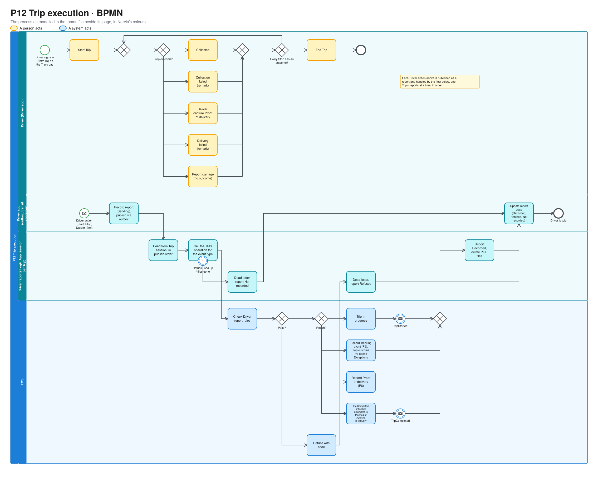
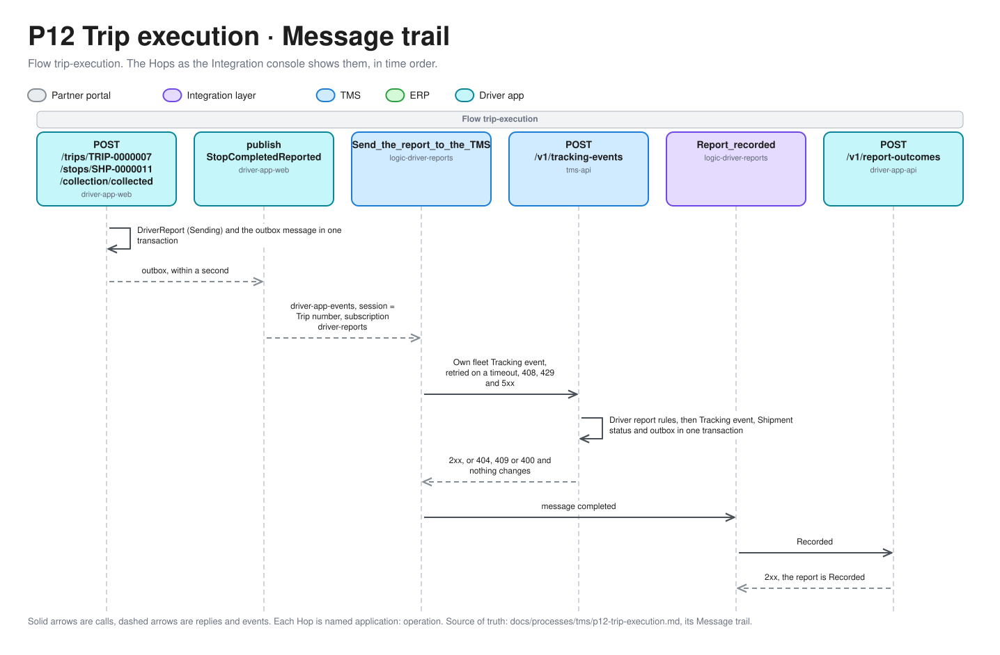

# P12 Trip execution

Trip execution is the Driver working a Dispatched Trip on the road. In the Driver app the Driver starts the Trip, completes each Stop (collected, delivered with a Proof of delivery, or failed) and ends the Trip. The Driver app publishes each report as an event. A Logic App processes one Trip's reports in order and hands them to the TMS, which records them as Tracking events (P5), Proofs of delivery (P6) and changes to the Trip. The Logic App then tells the Driver app whether each report was recorded. Terms are defined in [GLOSSARY.md](../../../GLOSSARY.md).

| | |
|---|---|
| **Trigger** | A Driver starts a Dispatched Trip in the Driver app on the Trip's day |
| **Outcome** | A Completed Trip. Each Shipment on it is Delivered, has an Exception open, is Awaiting re-delivery, or is back to Planned |
| **Owning system** | TMS. It owns Trips, Shipments, Tracking events and Proofs of delivery (ADR 0002). The Driver app owns nothing and holds reports only until they are recorded |
| **Applies to** | Own fleet only |
| **Integrations touched** | Driver app (outbox, topic for Driver app events, transit container, outcome endpoint), Service Bus (Driver app events with sessions, Trip events, Shipment events), Driver reports Logic App, TMS Trip API, TMS Tracking event API, TMS Proof of delivery API, Entra ID |

## Process model

The model is [p12-trip-execution.bpmn](p12-trip-execution.bpmn), which opens in any BPMN tool and is the source. The picture is drawn from it by [bpmn.py](../../architecture/diagrams/bpmn.py), so change the model and run the script, not the picture ([the editable file](../../architecture/diagrams/bpmn-p12-trip-execution.excalidraw)).

## What P12 decides, and what it doesn't

P12 decides **what a Driver reports and how it reaches the TMS**: starting and ending a Trip, the outcome of each Stop, and the Proof of delivery captured at a delivery. It also decides what happens to Shipments that didn't finish on their Trip.

It doesn't change the tracking model. Tracking event types, Shipment statuses, ETA and Stale are [P5](p5-shipment-tracking.md)'s, and the Proof of delivery model is [P6](p6-proof-of-delivery.md)'s. P12 is their Own fleet source. It doesn't decide what to do about an Exception, which stays with [P7](p7-exception-handling.md). It doesn't build or change Trips, which stays with [P11](p11-trip-dispatch.md).

## The Driver's actions

| Action | Where | Sends |
|---|---|---|
| **Start Trip** | A Dispatched Trip, on its day | `TripStartReported` |
| **Collected** | A collection Stop | `StopCompletedReported` with a Collected Tracking event |
| **Collection failed** | A collection Stop, with a remark | `StopCompletedReported` with a Collection failed Tracking event |
| **Deliver** | A delivery Stop whose collection is done. Opens the [Proof of delivery form](#capturing-a-proof-of-delivery) | `StopCompletedReported` with a Delivered Tracking event, and `ProofOfDeliveryCaptured` |
| **Delivery failed** | A delivery Stop whose collection is done, with a remark | `StopCompletedReported` with a Delivery failed Tracking event |
| **Report damage** | Any Stop, with a remark | `StopCompletedReported` with a Damaged Tracking event. It doesn't give the Stop an outcome |
| **End Trip** | An In progress Trip whose Stops all have an outcome | `TripEndReported` |

The Driver **completes a Stop** by giving it an outcome: Collected or Collection failed for a collection Stop, and Delivered or Delivery failed for a delivery Stop. An outcome is final for that Trip. A second attempt at the same Stop happens on a later Trip (see [Re-delivery](#re-delivery)).

The Driver app lists the Stops in the Planner's sequence, but the Driver can complete them in any order. The only restriction is that a delivery Stop waits for its collection Stop.

The Driver app sends no Departed, Arrived or Out for delivery, and no ETA. The Driver app has no planned times per Stop (P11), and the TMS doesn't calculate an ETA (P5). The ETA of an Own fleet Shipment is therefore its delivery window. The location of each report is the Stop's address. The Driver app doesn't read GPS.

### Capturing a Proof of delivery

A delivery Stop can't be completed as Delivered without a Proof of delivery. The form asks for:

| Part | Required |
|---|---|
| Received by | Yes |
| Condition: clean, or with reservations | Yes |
| Remark | Only with reservations |
| Signature, drawn on screen, stored as a PNG | Yes |
| Photos, JPEG or PNG | 0 to 4 |

That gives 1 to 5 files, within [P6's rules](p6-proof-of-delivery.md#proof-of-delivery-rules). The delivery time is when the Driver confirms the form, and the place is the Stop's address. The Driver app gives each Proof of delivery a unique document ID.

The Delivered Tracking event and the Proof of delivery stay two reports to two TMS operations, as P5 and P6 keep them apart. They share one correlation ID. Because a Proof of delivery is required, "Proof of delivery missing" (P6) should almost never flag an Own fleet Shipment. When it does, a report went wrong in the integration layer.

## Status

### Trip

P12 adds two statuses to P11's.

| Status | Meaning |
|---|---|
| In progress | The Driver started it. From now on the only Amend allowed is taking off a Shipment that isn't collected ([P11](p11-trip-dispatch.md#amending-a-dispatched-trip)) |
| Completed | The Driver ended it. Final |

A Trip moves Draft → Dispatched → In progress → Completed.

### Stop

Each Stop on a Trip has an outcome, recorded by the TMS from the Driver's report:

| Stop | Outcomes |
|---|---|
| Collection | Open, Collected, Collection failed |
| Delivery | Open, Delivered, Delivery failed |

The outcome belongs to the Stop on this Trip. A Stop is still derived from its Shipment (ADR 0007), and its outcome is read from the Tracking events that Trip recorded.

### Shipment

P12 adds no Shipment status. An Own fleet Shipment moves Released → Dispatched → Collected → Delivered through P5, driven by the Driver's Tracking events. A Collection failed, Delivery failed or Damaged Tracking event never changes the status (P5). In the same transaction [P7](p7-exception-handling.md) opens an Exception for it.

At End Trip the TMS deals with each Shipment that didn't finish, in the same transaction:

| The Shipment was | It becomes |
|---|---|
| Not collected (Collection failed) | **Planned** again, off the Trip, as when the Planner takes it off (P11). In P3 the Planner can choose Own fleet or a Carrier again |
| Collected, not delivered (Delivery failed) | **Awaiting re-delivery**, off the Trip, keeping its status (see [Re-delivery](#re-delivery)) |

Neither publishes `ShipmentTakenOffTrip`, because `TripCompleted` lists both.

## Re-delivery

A Shipment that was collected but not delivered is still on Norvia's Vehicle when the Trip ends. It is re-delivered on a later Trip.

**Awaiting re-delivery** is a flag, not a status, like Stale. The Shipment keeps the status it has (Collected), because it is still true: Norvia holds the goods. The flag means:

- The Shipment appears in P11's *Shipments to put on Trips*, marked **Re-delivery**.
- On a Trip it has **only its delivery Stop**. Its collection is done.
- P11's `ShipmentNotReleased` accepts it, and `CollectionDayMismatch` doesn't apply to it.
- P5's Stale rule for a Collected or In transit Shipment that has gone quiet doesn't apply while the flag is set. Late delivery (P7) already covers the wait.

The flag clears when the Planner Dispatches a Trip that carries the Shipment. The Shipment stays Collected until its Delivered Tracking event. When the Planner takes it off a Trip again, the flag comes back. It can't go back to Planned, because the goods are already collected.

Handing a Re-delivery to a Carrier is [deferred](#deferred).

## Steps

1. **Sign in.** The Driver signs in to the Driver app with Entra ID (see [Sign-in](#sign-in)) and sees their Trips.
2. **Start.** On the Trip's day the Driver starts a Dispatched Trip. The Driver app records the report and publishes `TripStartReported` through its outbox to the topic for Driver app events.
3. **Work the Stops.** At each Stop the Driver completes it, and at a delivery captures the Proof of delivery. Each action is published the same way. A Proof of delivery's files go to the Driver app's transit container first, and the event carries their blob references (the claim check of ADR 0009).
4. **Process in order.** The Driver reports Logic App reads its topic subscription, which uses sessions keyed by Trip number. It handles one Trip's reports one at a time, in the order they were published, and calls the matching [TMS operation](#tms-api) for each.
5. **Record.** The TMS checks the [rules](#driver-report-rules), then records the change and publishes its events in one transaction:
   - a Start Trip moves the Trip to In progress
   - a Stop report records the Tracking event (P5) and the Stop's outcome
   - a Proof of delivery is recorded as in P6
   - an End Trip moves the Trip to Completed and deals with the unfinished Shipments
6. **Report back.** The Logic App calls the Driver app with the outcome: Recorded, or Refused with the TMS's code and message. For a Proof of delivery that was recorded, it then deletes the files from the transit container.
7. **End.** Once every Stop has an outcome, the Driver ends the Trip, through the same path.

### What the Driver sees

Each report in the Driver app has a state:

| State | Meaning |
|---|---|
| Sending | Published, not yet reported by the Logic App |
| Recorded | The TMS accepted it |
| Refused | The TMS refused it, with its failure code and message |
| Not recorded | The Logic App gave up after its retries |

This is the deliberate contrast with Carriers, who never learn whether a Tracking event or Proof of delivery arrived (ADR 0008, ADR 0009). The Driver app is Norvia's own, so the Driver is told (ADR 0016).

### When something fails

| Failure | What happens |
|---|---|
| The TMS refuses a report (client error) | The Logic App dead-letters the message with the TMS's failure code and message, as in P5, and reports it Refused to the Driver app. No retry |
| The TMS is unavailable (server error or timeout) | The Logic App retries the call, and later reports for that Trip wait behind it in the session. When its retries are used up, it dead-letters the message, reports it Not recorded, and the session moves on |
| A Proof of delivery's files are gone from the transit container | The Logic App run fails, and the message is dead-lettered and reported Not recorded |
| The Driver app can't reach the Logic App to report an outcome | The report stays Sending in the Driver app. The TMS has it anyway |

A report after one that failed still goes to the TMS, and the TMS's rules decide it. For example, when a Start Trip is dead-lettered, every Stop report for that Trip is refused with `TripNotUnderWay` until the Start is replayed from the dead-letter queue.

### Taking a Shipment off while the Driver collects it

The Planner may take an uncollected Shipment off an In progress Trip (P11) while the Driver is collecting it, before the new version reaches the Driver app. The Collected report then arrives for a Shipment that is no longer on the Trip.

- The TMS refuses it with `ShipmentNotOnTrip`. The Shipment stays Planned.
- The Driver app shows the Stop as Refused, with the TMS's message.
- When the new version arrives, the Driver app keeps any Stop the Driver has already completed, marked **Taken off by the Planner, call the Planner**. It doesn't silently remove it.

The Planner and the Driver sort it out by phone. The Planner then re-plans the Shipment in P3. The TMS itself doesn't see the refused report (see [Deferred](#deferred)).

## Driver report rules

The Driver ID comes from the Driver's token, never from the Driver app's payload (see [Sign-in](#sign-in)).

| Rule | Applies to | Failure code |
|---|---|---|
| The Trip exists and its Driver is the Driver from the token | All | `TripNotFound` |
| The Trip is Dispatched | Start Trip | `TripNotDispatched` |
| Today is the Trip's day | Start Trip | `NotTripDay` |
| The Trip is In progress | Stop reports, Proofs of delivery, End Trip | `TripNotUnderWay` |
| The Shipment is on the Trip's latest version | Stop reports, Proofs of delivery | `ShipmentNotOnTrip` |
| The Stop has no outcome yet. Report damage is exempt | Stop reports | `StopAlreadyCompleted` |
| The Shipment's collection Stop is Collected, or the Shipment is a Re-delivery | Delivery Stop reports, Proofs of delivery | `CollectionBeforeDelivery` |
| Every Stop has an outcome. The delivery Stop of a Shipment whose collection failed waits for none: the Driver never had the goods | End Trip | `StopsOpen` |
| The event time isn't in the future, beyond a small clock-skew allowance | All | Client error |

The version a report names is stored for tracing only. A report records something that has already happened, so it doesn't have to name the latest version. The Shipment only has to be on the latest version.

A Proof of delivery is also checked against [P6's rules](p6-proof-of-delivery.md#proof-of-delivery-rules) for content and files. For an Own fleet source, the rules above replace P5's and P6's rules about Carrier bookings.

A report that repeats a Driver app event ID already recorded succeeds, returns the original result flagged as a repeat, and publishes no event, as in P5 and P6.

Each failure has a stable code and a readable message.

## Driver app event format

The Driver app is Norvia's own application, so it publishes in the Canonical Model, as it already receives the Trip dispatch in it (P11). The Logic App doesn't map formats. It routes by event type.

Every event carries the Driver app event ID, the Trip number, the version the Driver app held, the Driver ID from the token, the event time with its offset, and the correlation ID.

| Event | Also carries | TMS operation |
|---|---|---|
| `TripStartReported` | — | Start a Trip |
| `StopCompletedReported` | Shipment number, Stop (collection or delivery), Tracking event type, location, remark | Record a Tracking event, with Own fleet as the source |
| `ProofOfDeliveryCaptured` | Shipment number, document ID, received by, delivery time, location, condition, remark, and for each file its name, content type and blob reference | Record a Proof of delivery, with Own fleet as the source. The Logic App fetches the files and makes P6's multipart call |
| `TripEndReported` | — | End a Trip |

The events are named *Reported* and *Captured*, not *Started* and *Completed*: the Driver app reports, and the TMS decides.

## Sign-in

The Driver app signs Drivers in with Entra ID, replacing P11's Driver picker. Each seeded Driver has an Entra test user whose token carries the Driver ID from the ERP, as an app role ([ADR 0037](../../adr/0037-drivers-sign-in-to-the-driver-app-with-entra-and-the-driver-id-is-their-app-role.md)). The Driver app shows only that Driver's Trips and puts the Driver ID from the token on every event. The TMS checks it against the Trip's Driver. This follows ADR 0005: identity comes from the token, not the payload.

The presenter panel holds the seeded users' sign-in details for demos. Locally the Driver app's sign-in page stands in for Entra and lists the seeded Drivers.

The panel also lists every Fault with its owner and the time it has left, and switches one on (for a duration) or off; the Driver app's *Driver app unavailable* Fault is the one that affects P12's Driver too, because it refuses Trips before a Driver sees them ([P11](p11-trip-dispatch.md#use-cases)). P12 has two of its own: *TMS unavailable* (`tms-unavailable`, the TMS API answers 503 and the reports wait) and *Driver app HEIC photo* (`driver-app-heic-photo`, the Proof of delivery is refused). Every Fault switch needs the app role `Demo.Fault` ([as-found.md](../../operations/as-found.md#faults)).

## Driver app

P12 completes the Driver app that P11 started.

| Screen | Shows | Actions |
|---|---|---|
| My Trips | The Driver's Trips by day, with status | Open a Trip |
| Trip | The Stops in sequence, each with its outcome and report state. A banner when a new version arrives | Start Trip on its day, End Trip once every Stop has an outcome |
| Stop | The Shipment, Shipper, address, window and goods lines, and for a delivery the Consignee | Collected, Collection failed, Report damage. For a delivery: Deliver (the Proof of delivery form) and Delivery failed |

A new version from P11 replaces the Trip as before (ADR 0015). It keeps the outcomes and report states of Stops already completed, and a completed Stop for a Shipment taken off is kept, marked as [above](#taking-a-shipment-off-while-the-driver-collects-it).

The Driver app gains:

- an **outbox** that publishes its events to the topic for Driver app events, so a report is never lost between recording it and publishing it
- a **transit container** for Proof of delivery files. The Driver reports Logic App deletes each file once the TMS has accepted its Proof of delivery, and a lifecycle rule deletes anything left after 90 days, the integration layer's retention (`integrationRetentionDays`)
- an **outcome endpoint** that the Driver reports Logic App calls, role `DriverReports.ReportOutcome`
- the **Driver's actions as an API** (`/v1/driver/trips`), for a caller that acts as the Driver without the screens, such as the [Simulator](../../operations/simulator.md): the Driver's Trips, Start Trip, End Trip, the Stop reports and Deliver, through the same commands as the screens. The Driver ID is the one app role of the caller's token, as on the screens, and a Driver sees only their own Trips

It still reaches the TMS only through Azure Integration Services (ADR 0001).

## Planner's views

P12 adds no views. It extends P11's and P5's.

| View | Adds |
|---|---|
| Trips (P11) | The statuses In progress and Completed, and the count of Stops with an outcome |
| Trip detail (P11) | Each Stop's outcome, time and remark |
| Shipments to put on Trips (P11) | Shipments Awaiting re-delivery, marked Re-delivery, with only their delivery Stop |
| Shipments in progress (P5) | Nothing new. Own fleet Shipments show Own fleet and their Trip number where a Carrier's show the Carrier |

The Shipment's timeline shows the Driver's Tracking events and Proofs of delivery like a Carrier's, with Own fleet as the source.

## TMS API

The TMS APIs accept only the Canonical Model (ADR 0003). The Driver reports Logic App's managed identity holds these roles:

| Operation | API | Role |
|---|---|---|
| Start a Trip | Trip API | `Trips.Start` |
| End a Trip | Trip API | `Trips.End` |
| Record a Tracking event | Tracking event API (P5) | `TrackingEvents.Record` |
| Record a Proof of delivery | Proof of delivery API (P6) | `ProofsOfDelivery.Record` |

Who holds each role, and what else each identity may reach, is in [Identity and access](../../architecture/identity-and-access.md).

For an Own fleet source the canonical Tracking event and Proof of delivery carry the Trip number and the Driver ID in place of a Carrier booking reference. P5's and P6's events carry the Trip number where they carry a Carrier booking reference.

## Correlation ID

The Driver app creates a new correlation ID for each Driver action: Start Trip, completing a Stop, Deliver and End Trip. Deliver's two reports share one. The ID travels on the event, and the Logic App uses it on its call to the TMS and on its report back to the Driver app. The TMS stores it and puts it on the events it publishes.

Tracing a Driver's report follows the Trip number and the Driver app event ID. Tracing one that never reached the TMS starts at the dead-letter queue or the failed Logic App run, which keep both.

## Events

The Trip events go to P11's topic for Trip events, through the TMS's transactional outbox (ADR 0003). The Tracking events and Proofs of delivery publish P5's and P6's Shipment events as usual, and Exceptions publish P7's. A repeat publishes nothing.

| Event | Published when | Carries | Consumers |
|---|---|---|---|
| `TripStarted` | The Trip moves to In progress | Trip number, version, Driver ID, start time, correlation ID | Monitoring |
| `TripCompleted` | The Trip moves to Completed | As `TripStarted`, plus the end time and the Shipments delivered, not delivered (now Awaiting re-delivery) and not collected (now Planned) | Monitoring |

The Driver app's own events (see [Driver app event format](#driver-app-event-format)) go to the topic for Driver app events, and the Driver reports Logic App is their only consumer.

## Demo seed

A Trip Dispatched for **today** for a seeded Driver, with three Shipments, delivered to the Driver app.

The TMS seeds it when it first starts with no Trip of the Planner's, from the `demoTripExecution` part of the seed file: three Own fleet Transport Orders from Brouwer Dranken, collected today, assigned to Own fleet and Released, then put on a Trip for Bram Visser (`DRV-0003`) on the rigid truck `VEH-0003`, planned to start at 09:00 for three hours, and Dispatched. The Dispatch publishes `TripDispatched` as the Planner's does, so the Trip reaches the Driver app through the Trip dispatch Logic App. Dates are relative to the demo start: day 0 is today, and on a weekend the next Monday, because the Driver has a Shift only on weekdays and Start Trip is refused outside the Trip's day (`NotTripDay`). The Driver has an Entra test user like every seeded Driver (`infra/create-driver-test-users.ps1`).

The demo:

1. The Driver signs in and starts the Trip. The Planner sees it go In progress.
2. The Driver collects all three Shipments.
3. The Driver delivers the first with a signature and a photo. The Planner sees it Delivered with its Proof of delivery on the timeline, and it becomes Billable ([P9](p9-freight-settlement.md)).
4. The Driver reports the second as Delivery failed. P7 opens an Exception.
5. The Driver delivers the third with reservations. P7 opens a Reservations Exception.
6. The Driver ends the Trip. The second Shipment appears in *Shipments to put on Trips* as a Re-delivery.

## Presenter smoke run

After a deployment, and not in CI, the presenter runs the demo on the deployed estate. Do it after the presenter smoke run of Trip dispatch ([P11](p11-trip-dispatch.md#presenter-smoke-run)), once the Driver reports Logic App is deployed (`infra/deploy-driver-reports-logic-app.ps1`) and the seeded Trip shows Delivered to Driver app. Open the Driver app and the TMS UI side by side. The seeded Trip is for the day the TMS first started, so run this on a weekday with a TMS database seeded that day; the script fails first if the Trip isn't for today. Find the seeded Trip in the TMS UI's Trips (today, with Bram Visser) and run `infra/smoke-test-trip-execution.sh <Trip number>` in a terminal: it tells the presenter what to do, reads the TMS, the Driver app and Application Insights, and prints `PASS` or `FAIL` per check, never a signature, a photo, a remark or a token.

1. In the Driver app, sign in as the Driver's Entra test user (the presenter panel has the sign-in details) and start the Trip. The Planner sees it In progress.
2. Collect all three Shipments.
3. Deliver the first with a signature and a photo. The Planner sees it Delivered with its Proof of delivery on the timeline, and its Transport Order Billable.
4. Report the second as Delivery failed. The Planner sees a Delivery failed Exception.
5. Deliver the third with reservations. The Planner sees a Reservations Exception.
6. End the Trip. The second Shipment is in *Shipments to put on Trips* as a Re-delivery.

The script checks that the Trip is Completed in the TMS and in the Driver app, with every report Recorded; that the first Shipment is Delivered with its Proof of delivery and Billable, the second Collected and Awaiting re-delivery with an open Delivery failed Exception and listed as a Re-delivery, and the third Delivered with its Proof of delivery and an open Reservations Exception; that the Trip's reports were processed in order through the session (the Logic App recorded them in the order the Driver made them, read from the `trip-execution` rows by Driver app event ID); and that the whole path is findable in Application Insights: the Trip number finds the Logic App's and the TMS's rows, and every correlation ID the Logic App tracked for the Trip is found in the Driver app, the Logic App and the TMS. If a check fails, file the gap as its own issue against P12, rather than working around it in the run book.

## Implementation

For engineers and coding agents. It shows where the built part of P12 lives in the repository, the Hops a Driver's reports leave on the Message trail, what plays each Azure piece on a developer's machine, and what is designed but not built. It follows the [P11 section](p11-trip-dispatch.md#implementation).

P12 is built end to end: the TMS records the Driver's Start Trip, Stop reports, Proofs of delivery and End Trip as Trip, Tracking event and Proof of delivery operations for an Own fleet source, the Driver app takes the Driver's reports and publishes them from its outbox, and the Driver reports Logic App ([ADR 0016](../../adr/0016-driver-reports-travel-as-driver-app-events-in-order-per-trip.md)) carries them in order from the `driver-app-events` topic to the TMS and tells the Driver app the outcome. The descriptions below follow the order a Driver works in; the [Code map](#code-map) gathers the files.

### Built so far

Start Trip at the TMS boundary: `POST /v1/trips/{number}/start` with the `driverId` from the Driver's token in the body and the Driver's `X-Correlation-ID`, role `Trips.Start` (the Driver reports Logic App's, defined in [identities.bicep](../../../infra/estate/identities.bicep)). The body may also carry the `driverAppEventId`. A Dispatched Trip on its day, in Norvia's time, becomes In progress at the same version, and in the same transaction exactly one `TripStarted` is written to the outbox for the `trip-events` topic under that correlation ID. It is refused with `TripNotFound` (404, also when the Driver isn't the Trip's), `TripNotDispatched` (409, a Draft or a Trip that is In progress already) or `NotTripDay` (409), and a refusal changes nothing. A second Start is `TripNotDispatched`, unless it repeats the Driver app event ID that started the Trip (`Trip.StartedByEventId`, migration `TripStartedByEventId`): that is answered `200` with `repeat: true` and changes and publishes nothing, so the Logic App can retry a Start whose answer it never got. From Start on, every Amend but [taking off an uncollected Shipment](p11-trip-dispatch.md#taking-a-shipment-off-a-trip) is refused with `TripUnderWay`. The Trips view and the Trip detail show the status. The Flow is `trip-execution`: the call logs `correlationId`, `flow`, `tripNumber` and the `outcome` with the `failureCode` of a refusal.

Own fleet Stop reports at the TMS boundary: `POST /v1/tracking-events` (role `TrackingEvents.Record`, which the Driver reports Logic App holds next to `Trips.Start`) takes an event whose source is `{ "type": "OwnFleet", "driverId": … }`, with the Driver ID from the Driver's token, and whose `tripNumber`, `shipmentNumber` and `tripVersion` replace the Carrier booking reference. The `X-Correlation-ID` is the Driver's action trail, which the Shipment events and the Exception it opens carry. A Driver reports Collected, CollectionFailed, Delivered, DeliveryFailed and Damaged, and nothing else (`UnknownEventType`). Collected and Delivered move the Shipment Dispatched, Collected, Delivered through P5; the other three change no status and open the matching P7 Exception in the same transaction, and Delivered goes through the Billing check as it does for a Carrier. The Driver report rules are refused with `TripNotFound` (404, also for another Driver's Trip), `TripNotUnderWay`, `ShipmentNotOnTrip` (against the Trip's latest version, even when the report names an older one), `StopAlreadyCompleted` (Report damage is exempt), `CollectionBeforeDelivery` (409) and `EventTimeInTheFuture` (400). A repeated Driver app event ID returns the original result with `repeat: true` on the original trail and publishes nothing, whatever has happened on the Trip since. The Flow is `trip-execution`: the call logs `flow`, `correlationId`, `tripNumber`, `shipmentNumber` and the Driver app event ID as `sourceMessageId`, and the Shipment events carry the `tripNumber` as an application property and in the body (`tripNumber`, additive in the four Shipment event schemas).

A Stop holds no outcome of its own (ADR 0007): it is read from the Tracking events the Trip recorded, Collected or Collection failed for a collection Stop, Delivered or Delivery failed for a delivery Stop. Trips shows `Stops done` once the Trip is In progress, Trip detail shows each Stop's outcome, time and remark, and Shipments in progress shows the Trip number next to Own fleet.

An Own fleet Proof of delivery at the TMS boundary: `POST /v1/proofs-of-delivery` (role `ProofsOfDelivery.Record`, which the Driver reports Logic App holds next to `TrackingEvents.Record`) takes the same multipart call as a Carrier's, whose metadata names the source `{ "type": "OwnFleet", "driverId": … }`, with the Driver ID from the Driver's token, and whose `tripNumber`, `shipmentNumber` and `tripVersion` replace the Carrier booking reference. P6's content and file rules are unchanged. The `X-Correlation-ID` is the one of the Delivered Tracking event, so the two reports share a trail. The Proof of delivery is recorded as the Shipment's current one and, as in P6, makes a Delivered Shipment's Transport Order Billable (P9) when it completes the conditions; one with reservations opens a Reservations Exception (P7). The Driver report rules are refused with `TripNotFound` (404, also for another Driver's Trip), `TripNotUnderWay`, `ShipmentNotOnTrip` (against the Trip's latest version, even when the report names an older one) and `CollectionBeforeDelivery` (409), and `DeliveryTimeInTheFuture` (400). `StopAlreadyCompleted` doesn't apply: the Delivered Tracking event completes the Stop, and a Proof of delivery can follow it or, with a new document ID, replace the current one. A repeated document ID returns the original result with `isRepeat: true` and publishes nothing, whatever has happened on the Trip since. `ProofOfDeliveryReceived` carries the `tripNumber` (additive: an application property and a body field, null for a Carrier's), and the call logs `flow` `trip-execution`, `tripNumber`, `shipmentNumber` and the document ID as `sourceMessageId`.

End Trip at the TMS boundary: `POST /v1/trips/{number}/end` with the `driverId` from the Driver's token in the body and the Driver's `X-Correlation-ID`, role `Trips.End` (the Driver reports Logic App's; the app role is defined in [identities.bicep](../../../infra/estate/identities.bicep) and only that identity holds it). An In progress Trip whose Stops all have an outcome becomes Completed, at the same version, and in the same transaction exactly one `TripCompleted` is written to the outbox for the `trip-events` topic under that correlation ID, listing the Shipments delivered, not delivered and not collected. The delivery Stop of a Shipment whose collection failed needs no outcome, because a Driver can't attempt it (`CollectionBeforeDelivery`), so it doesn't keep the Trip open. In the same transaction an uncollected Shipment goes back to Planned and a collected one that wasn't delivered is flagged Awaiting re-delivery (`AwaitingRedelivery` on the Shipment, shown in the Shipment's `awaitingRedelivery`), keeping its status. Both leave the Trip, whose Stops keep only the delivered Shipments', and no `ShipmentTakenOffTrip` is published. P5's Stale rule is suspended while the flag is set (`ShipmentStaleRules.IsStale` takes it), and Late delivery (P7) works from the Shipment's status and delivery window, so it still applies. It is refused with `TripNotFound` (404, also when the Driver isn't the Trip's), `TripNotUnderWay` (409, a Dispatched Trip or one that has ended) or `StopsOpen` (409), and a refusal changes nothing. A Completed Trip can't be changed by the Planner (`TripCompleted`, 409). The Flow is `trip-execution`, logged as for Start Trip.

Re-delivery on a later Trip is built in P11's calls: Shipments to put on Trips lists a Shipment Awaiting re-delivery with `redelivery` true, a Trip takes it with only its delivery Stop and with `CollectionDayMismatch` not applying, Dispatch clears the flag (`Shipment.Dispatch`), and taking it off sets the flag again, leaving it Collected. The boundary tests are in `TripRedeliveryTests`.

Driver app sign-in ([ADR 0037](../../adr/0037-drivers-sign-in-to-the-driver-app-with-entra-and-the-driver-id-is-their-app-role.md)). In Azure the Driver app's screens are behind Easy Auth, signing in to the *Norvia Driver app* registration, whose app roles are the active seeded Drivers' IDs; `infra/create-driver-test-users.ps1` makes a test user for each Driver and assigns the role, and the estate's `ESTATE_DRIVER_SIGN_IN_*` parameters give the presenter panel the domain and the shared password. The Driver app reads the user from `X-MS-CLIENT-PRINCIPAL`, turns the role into the `driverId` claim, and `GetDriverTripsQuery` takes the Driver ID from that claim only. Locally `LocalSignIn__Enabled` (set by the AppHost, refused outside Development) turns on a sign-in page that lists the seeded Drivers and signs one in with a cookie holding the same claim. My Trips shows the Driver's Trips by day, each with its status (a Trip the Driver app holds is Dispatched until the Driver can start it). The Driver ID goes on every event the Driver app publishes, taken from that claim. With `ESTATE_DRIVER_PICKER=true` the Driver app is behind the presenter's gate instead (the demo UIs' registration) and shows a Driver picker, so no Driver test user needs multi-factor authentication ([ADR 0047](../../adr/0047-the-presenter-can-pick-the-driver-in-the-driver-app-behind-their-own-sign-in.md)).

Start Trip through the reporting path ([ADR 0016](../../adr/0016-driver-reports-travel-as-driver-app-events-in-order-per-trip.md), [ADR 0038](../../adr/0038-locally-a-hosted-worker-plays-the-p12-driver-reports-logic-app.md)): the Trip screen offers Start Trip for a Trip the Driver app holds as Dispatched, on its day in Norvia's time, with no Start Trip waiting for an answer or recorded. Pressing it posts to `/trips/{number}/start` (antiforgery-checked, the Driver ID from the token, never the form). The Driver app saves a `DriverReport` (state **Sending**) and, in the same transaction, an outbox message for `TripStartReported` (a new correlation ID, the Driver app event ID, the Trip number, the version held, the Driver ID, the event time), which its outbox publisher sends to the `driver-app-events` topic with the Trip number as the session ID. Pressing it again while the report is Sending or Recorded publishes nothing; after a refusal or a failure it reports again. The Driver reports Logic App reads the session-enabled `driver-reports` subscription, calls the TMS Start a Trip operation with the Driver ID, the event ID and the correlation ID, retrying a timeout, 408, 429 and a server error with the bounded exponential policy (3 retries, 5 to 20 seconds), settles the message first (completed when the TMS recorded it, dead-lettered with `DeadLetterReason` the failure code and `DeadLetterErrorDescription` the message when the TMS refused it or stayed down) and then posts the outcome to the Driver app's `POST /v1/report-outcomes` (role `DriverReports.ReportOutcome`): **Recorded**, **Refused** with the TMS's code and message, or **Not recorded** (`TmsUnavailable` with the cause). The Driver app changes the report's state, once: an outcome for a report that has one is acknowledged and ignored. When the Logic App can't reach the Driver app the report stays Sending. The Trip shows In progress once its Start is Recorded, and its reports with their states on the Trip card. My Trips looks again every five seconds while a report is Sending; a Stop screen does not, so it can't reload under a Driver typing a remark. Locally `LocalDriverReportsWorker` plays the Logic App.

Stop reports through the reporting path: a Stop's screen (`/trips/{number}/stops/{shipment}/{collection|delivery}`, linked from the Trip card) shows the Shipment and Transport Order, the Shipper, the address, the window and the goods lines, and for a delivery the Consignee, with the Stop's status and the reports on it. The Stops come in the Planner's sequence and the Driver completes them in any order. Once the TMS has recorded the Start (the Trip shows In progress) a collection Stop offers **Collected** and **Collection failed** (remark required), a delivery Stop offers **Delivery failed** (remark required), and **Report damage** (remark required) is offered on every Stop and doesn't complete it. A delivery Stop is unavailable until its collection is Collected (Sending or Recorded), with the reason shown; a delivery whose collection failed stays unavailable; a Shipment with only its delivery Stop on the Trip (a Re-delivery) needs no collection. Each action posts to `/trips/{number}/stops/{shipment}/{kind}/{action}` (antiforgery-checked, the Driver ID from the token, never the form; the form carries only the remark) and saves a `DriverReport` (state **Sending**, with the Shipment, the Stop and the remark) with, in the same transaction, an outbox message for `StopCompletedReported` (a new correlation ID, the Driver app event ID, the Trip number, the version held, the Driver ID, the event time, the Shipment, the Stop, the Tracking event type, the Stop's address as the location, the remark) to the `driver-app-events` topic with the Trip number as the session ID, behind the Start in the same session. The Driver app refuses with a redirect back to the Stop screen what it knows the TMS would refuse (an outcome already given, a delivery before its collection, the Trip not In progress, a missing remark: `?problem=remark`), and the TMS still decides. Pressing the same action again while its report is Sending or Recorded publishes nothing, and a Stop whose report was Refused or Not recorded can be reported again. The Driver reports Logic App tells the two events apart by `eventType`: `Send_the_report_to_the_TMS` posts `Trips.Start`'s call for a start, and for a Stop report `POST /v1/tracking-events` with the Canonical Model's Tracking event of Own fleet (the Driver ID as the source, the event ID as the event ID so a retry is a repeat, the Trip number, Shipment number and version, the type, the event time and location, and the remark when there is one) as the identity holding `TrackingEvents.Record`, under the same retry policy, settlement and outcome report as a start, and the `driver-reports` subscription's filter admits both event types. A new Trip version replaces the Trip as before and keeps the outcomes and report states of Stops already completed, because the reports belong to the Trip and not to a version; a completed Stop whose Shipment the new version no longer has stays on the Trip card and its screen, marked **Taken off by the Planner, call the Planner**, and a Collected refused with `ShipmentNotOnTrip` shows Refused with the TMS's message. Locally `LocalDriverReportsWorker` plays the same steps.

Deliver through the reporting path ([ADR 0009](../../adr/0009-carrier-proofs-of-delivery-use-a-claim-check.md)): a delivery Stop whose collection is done (or that is a Re-delivery) shows the Proof of delivery form on its screen, above Delivery failed: received by, clean or with reservations (the remark is required with reservations and dropped otherwise), a signature drawn on a canvas (`wwwroot/signature.js`) and posted as a PNG data URL, and up to four photos. The form posts to `/trips/{number}/stops/{shipment}/delivery/deliver` as multipart (antiforgery-checked, the Driver ID from the token, never the form). The Driver app refuses with a redirect back to the Stop screen what it knows the TMS would refuse (`?problem=receivedBy`, `condition`, `remark`, `signature` or `photos`), before it stores a file: a missing name, condition or signature, reservations without a remark, a signature that isn't a PNG, a fifth photo, a photo that isn't a JPEG or PNG by what the device said, or a file over 10 MB (which is not even read). The TMS judges each file by its content, so a HEIC photo declared as a JPEG gets as far as the TMS and is refused there with `FileNotAccepted`. An accepted Deliver stores the 1 to 5 files in the Driver app's transit container (`driver-proofs-of-delivery`, named `<document ID>/signature.png` and `<document ID>/photo-<n>.jpg|png`), saves two reports (**Delivered**, which completes the Stop, and **Proof of delivery**, which doesn't) and, in the same transaction, two outbox messages under **one** correlation ID: `StopCompletedReported` (Delivered, the Stop's address as the location) and then `ProofOfDeliveryCaptured` (the Driver app event ID of its report, which is also its document ID, the delivery time of the Driver's confirmation, the Stop's address, the condition and remark, and the blob reference of each file), both to the `driver-app-events` topic in the Trip's session. They are two reports because the TMS records them with two operations and may refuse them apart: the Stop shows each with its own state, so a Delivered the TMS recorded can sit beside a Proof of delivery it refused. Pressing Deliver again while the Delivered is Sending or Recorded stores and publishes nothing; after a refusal the Driver can deliver again, with a new document ID. The Driver reports Logic App tells the three event types apart by `eventType`: for a Proof of delivery it reads each file from the transit container in order (`Fetch_the_files`), makes P6's multipart call with `POST /v1/proofs-of-delivery` (the canonical metadata as the `metadata` part, Own fleet with the Driver ID from the event as the source, the Trip, Shipment and version in place of a Carrier booking, and the files as `files` parts) as the identity holding `ProofsOfDelivery.Record`, under the same retry policy, settlement and outcome report as the others, and then deletes the files (`Delete_the_files`) once the TMS accepted the Proof of delivery. A refused or lost Proof of delivery keeps its files for investigation until the container's lifecycle rule deletes them after `integrationRetentionDays`. Files that are gone make the run fail: the message is dead-lettered as `ProofOfDeliveryFilesGone` and the Driver app is told **Not recorded**, with nothing sent to the TMS. Locally `LocalDriverReportsWorker` plays the same steps with the container on Azurite.

End Trip through the reporting path: the Trip screen offers End Trip for a Trip that is In progress (the TMS has recorded its Start) once every Stop has an outcome that the TMS has or hasn't answered yet (`TripEndRules`). Until then it shows a disabled End Trip with "Give every Stop an outcome first.", and a Stop whose outcome was refused is open again. Pressing it posts to `/trips/{number}/end` (antiforgery-checked, the Driver ID from the token, never the form). The Driver app saves a `DriverReport` (state **Sending**) and, in the same transaction, an outbox message for `TripEndReported` (a new correlation ID, the Driver app event ID, the Trip number, the version held, the Driver ID, the event time) for the `driver-app-events` topic with the Trip number as the session ID, so it is read after the Driver's last Stop report. Pressing it again while the report is Sending or Recorded publishes nothing; after a refusal or a failure the Driver reports again. The Logic App calls the TMS End a Trip operation with the Driver ID and the correlation ID, as for Start Trip (the Driver reports identity holds `Trips.End`), and reports **Recorded**, **Refused** with the TMS's code (`StopsOpen` if the TMS disagrees that every Stop has an outcome, `TripNotUnderWay` if it doesn't have the Start) or **Not recorded**. The Trip shows Completed once its End is Recorded. The Planner then sees the Trip Completed, the uncollected Shipments back in Planned and an undelivered Shipment as a Re-delivery, from the TMS's `TripCompleted` as above.

The demo is runnable end to end ([Demo seed](#demo-seed), [Presenter smoke run](#presenter-smoke-run)).

### Message trail

The Hops one Driver action leaves on the Message trail, named as the [Integration console](../../operations/integration-console.md#message-trail) shows them, in time order. They belong to the Flow `trip-execution`. Each Driver action (Start Trip, completing a Stop, Deliver, End Trip) starts a trail of its own with a new correlation ID, found together by the Trip number; Deliver's two reports share one. The Driver waits for nothing: the Driver app shows the report as Sending until the outcome arrives. A Stop report is shown below; Start Trip and End Trip differ only in the TMS call, and a Proof of delivery adds the fetching and deleting of its files.

*Editable source: [message-trail-p12-1.excalidraw](../../architecture/diagrams/message-trail-p12-1.excalidraw), generated from [message_trails.py](../../architecture/diagrams/message_trails.py).*

- A Start Trip calls `POST /v1/trips/TRIP-0000007/start`, an End Trip `.../end`, and a Proof of delivery `POST /v1/proofs-of-delivery`, preceded by `Fetch_the_files` and followed on success by `Delete_the_files`.
- When the TMS refuses the report (a client error), `Send_the_report_to_the_TMS` is `Failed` with `TmsCallRefused`, the Logic App dead-letters the message with the TMS's failure code and message (`Dead_letter_the_refused_report`, `DeadLettered`) and calls `Report_refused`, which tells the Driver app the report is Refused. No retry, and the next report in the session goes on.
- When the TMS stays down after the retries, the Hop is `Failed` with `TmsUnavailable`, the message is dead-lettered as `TmsUnavailable` and the Logic App calls `Report_not_recorded`; the session moves on.
- When a Proof of delivery's files are gone, `Fetch_the_files` fails, the message is dead-lettered as `ProofOfDeliveryFilesGone`, the run fails and the Driver app is told Not recorded. Nothing is sent to the TMS.
- A message the Logic App can't read is dead-lettered as `DriverReportUnreadable` and the run fails; no send or report Hop appears.
- If the Driver app doesn't answer the report back, `Report_recorded`, `Report_refused` or `Report_not_recorded` is `Failed` with `DriverAppUnavailable` or `DriverAppRefused`. The message is settled already, so the report stays Sending in the Driver app; the TMS has it anyway.
- The TMS publishes its events within the same trail, under the Driver's correlation ID: the Shipment events and Exception of a Stop report, `ProofOfDeliveryReceived`, `TripStarted` and `TripCompleted` ([Events](#events)). The publish Hop appears only once the outbox has sent the message ([failure behaviour](../../architecture/failure-behaviour.md#the-tms-outbox)).
- Reports of one Trip are read one at a time, in the order the Driver app published them; the Trip number is the session ID.

### Code map

Links go to files, not lines, so they stay true as the code moves. The rows are in the order a Driver's reports travel: the TMS boundary first, then the Driver app and the Logic App.

| Step | Where |
|---|---|
| Start Trip, TMS: rules and the status change | `Trip.EnsureCanStart` and `Trip.Start` in [Trip.cs](../../../src/Tms/Norvia.Tms.Domain/Trips/Trip.cs), raising `TripStartedEvent` |
| Start Trip, TMS: command, handler, `TripStarted` | [StartTripHandler.cs](../../../src/Tms/Norvia.Tms.Application/Trips/Start/StartTripHandler.cs) |
| Start Trip, TMS: endpoint | `StartAsync` in [TripEndpoints.cs](../../../src/Tms/Norvia.Tms.Api/Trips/TripEndpoints.cs) |
| Start Trip, TMS: schema and samples | [trip-started.v1.schema.json](../../../contracts/canonical-model/trip-started.v1.schema.json), [samples/trip-started](../../../contracts/canonical-model/samples/trip-started/amended-before-start.json) |
| Start Trip, TMS: boundary tests | [TripStartTests.cs](../../../tests/Tms/Norvia.Tms.Api.IntegrationTests.Trips/Trips/TripStartTests.cs), with the controllable clock of P10 |
| Stop reports, TMS: rules | `TrackingEventRules.CheckOwnFleetReport` in [TrackingEventRules.cs](../../../src/Tms/Norvia.Tms.Domain/TrackingEvents/TrackingEventRules.cs), with the new codes in [TrackingEventRefusalCode.cs](../../../src/Tms/Norvia.Tms.Domain/TrackingEvents/TrackingEventRefusalCode.cs) |
| Stop reports, TMS: what an Own fleet report names | [OwnFleetReport.cs](../../../src/Tms/Norvia.Tms.Domain/TrackingEvents/OwnFleetReport.cs), carried by [TrackingReport.cs](../../../src/Tms/Norvia.Tms.Domain/TrackingEvents/TrackingReport.cs) and kept on [TrackingEvent.cs](../../../src/Tms/Norvia.Tms.Domain/TrackingEvents/TrackingEvent.cs) (migration `TrackingEventOwnFleetTrip`) |
| Stop reports, TMS: stop outcomes | [StopOutcome.cs](../../../src/Tms/Norvia.Tms.Domain/Trips/StopOutcome.cs), [StopOutcomes.cs](../../../src/Tms/Norvia.Tms.Domain/Trips/StopOutcomes.cs), [TrackingEventsOfTripSpec.cs](../../../src/Tms/Norvia.Tms.Domain/TrackingEvents/TrackingEventsOfTripSpec.cs) and, for the views, [TripOutcomes.cs](../../../src/Tms/Norvia.Tms.Application/Trips/TripOutcomes.cs) |
| Stop reports, TMS: recording | `HandleOwnFleetAsync` and the part it shares with a Carrier's event in [RecordTrackingHandler.cs](../../../src/Tms/Norvia.Tms.Application/TrackingEvents/Record/RecordTrackingHandler.cs) |
| Stop reports, TMS: endpoint and request | [TrackingEventEndpoints.cs](../../../src/Tms/Norvia.Tms.Api/TrackingEvents/TrackingEventEndpoints.cs), [TrackingEventRequest.cs](../../../src/Tms/Norvia.Tms.Api/TrackingEvents/TrackingEventRequest.cs) |
| Stop reports, TMS: schemas | [tracking-event.v1.schema.json](../../../contracts/canonical-model/tracking-event.v1.schema.json) and the `tripNumber` of [shipment-collected](../../../contracts/canonical-model/shipment-collected.v1.schema.json), [shipment-in-transit](../../../contracts/canonical-model/shipment-in-transit.v1.schema.json), [shipment-delivered](../../../contracts/canonical-model/shipment-delivered.v1.schema.json) and [shipment-exception-reported](../../../contracts/canonical-model/shipment-exception-reported.v1.schema.json) |
| Stop reports, TMS: boundary tests | [TripStopReportTests.cs](../../../tests/Tms/Norvia.Tms.Api.IntegrationTests.Trips/Trips/TripStopReportTests.cs) |
| Proof of delivery, TMS: rules | `ProofOfDeliveryRules.CheckOwnFleetReport` in [ProofOfDeliveryRules.cs](../../../src/Tms/Norvia.Tms.Domain/ProofsOfDelivery/ProofOfDeliveryRules.cs), with the new codes in [ProofOfDeliveryRefusalCode.cs](../../../src/Tms/Norvia.Tms.Domain/ProofsOfDelivery/ProofOfDeliveryRefusalCode.cs) |
| Proof of delivery, TMS: what an Own fleet report names | [OwnFleetReport.cs](../../../src/Tms/Norvia.Tms.Domain/TrackingEvents/OwnFleetReport.cs), carried by [ProofOfDeliveryReport.cs](../../../src/Tms/Norvia.Tms.Domain/ProofsOfDelivery/ProofOfDeliveryReport.cs) and kept on [ProofOfDelivery.cs](../../../src/Tms/Norvia.Tms.Domain/ProofsOfDelivery/ProofOfDelivery.cs) (migration `ProofOfDeliveryOwnFleetTrip`) |
| Proof of delivery, TMS: recording | `FindByTripAsync` and the part it shares with a Carrier's in [RecordProofOfDeliveryHandler.cs](../../../src/Tms/Norvia.Tms.Application/ProofsOfDelivery/Record/RecordProofOfDeliveryHandler.cs) |
| Proof of delivery, TMS: endpoint and request | [ProofOfDeliveryEndpoints.cs](../../../src/Tms/Norvia.Tms.Api/ProofsOfDelivery/ProofOfDeliveryEndpoints.cs), [ProofOfDeliveryRequest.cs](../../../src/Tms/Norvia.Tms.Api/ProofsOfDelivery/ProofOfDeliveryRequest.cs), [ProofOfDeliveryReader.cs](../../../src/Tms/Norvia.Tms.Api/ProofsOfDelivery/ProofOfDeliveryReader.cs) |
| Proof of delivery, TMS: schemas and samples | [proof-of-delivery.v1.schema.json](../../../contracts/canonical-model/proof-of-delivery.v1.schema.json) with [samples/proof-of-delivery](../../../contracts/canonical-model/samples/proof-of-delivery/carrier.json), and the `tripNumber` of [proof-of-delivery-received.v1.schema.json](../../../contracts/canonical-model/proof-of-delivery-received.v1.schema.json) |
| Proof of delivery, TMS: boundary tests | [TripStopReportTests.cs](../../../tests/Tms/Norvia.Tms.Api.IntegrationTests.Trips/Trips/TripStopReportTests.cs) |
| End Trip, TMS: rules and the status change | `Trip.EnsureCanEnd` and `Trip.End` in [Trip.cs](../../../src/Tms/Norvia.Tms.Domain/Trips/Trip.cs), raising [TripCompletedEvent.cs](../../../src/Tms/Norvia.Tms.Domain/Trips/TripCompletedEvent.cs); which Stops are open and what became of each Shipment in [StopOutcomes.cs](../../../src/Tms/Norvia.Tms.Domain/Trips/StopOutcomes.cs) |
| End Trip, TMS: the flag | `Shipment.AwaitRedelivery` and `AwaitingRedelivery` in [Shipment.cs](../../../src/Tms/Norvia.Tms.Domain/Shipments/Shipment.cs) (migration `ShipmentAwaitingRedelivery`), and [ShipmentStaleRules.cs](../../../src/Tms/Norvia.Tms.Domain/Shipments/ShipmentStaleRules.cs) |
| End Trip, TMS: command, handler, `TripCompleted` | [EndTripHandler.cs](../../../src/Tms/Norvia.Tms.Application/Trips/Complete/EndTripHandler.cs) |
| End Trip, TMS: endpoint | `EndAsync` in [TripEndpoints.cs](../../../src/Tms/Norvia.Tms.Api/Trips/TripEndpoints.cs) |
| End Trip, TMS: schema and samples | [trip-completed.v1.schema.json](../../../contracts/canonical-model/trip-completed.v1.schema.json), [samples/trip-completed](../../../contracts/canonical-model/samples/trip-completed/all-delivered.json) |
| End Trip, TMS: boundary tests | [TripEndTests.cs](../../../tests/Tms/Norvia.Tms.Api.IntegrationTests.Trips/Trips/TripEndTests.cs) |
| Sign-in: both ways of signing in, the policy | [Drivers](../../../src/DriverApp/Norvia.DriverApp.Web/Drivers/DriverClaims.cs): `DriverSignIn`, `EasyAuthHandler`, `DriverClaims` |
| Sign-in: my Trips and the refusal | [Trips.razor](../../../src/DriverApp/Norvia.DriverApp.Web/Components/Pages/Trips.razor), [Refused.razor](../../../src/DriverApp/Norvia.DriverApp.Web/Components/Pages/Refused.razor) |
| Sign-in: the app registration and its roles | `driverApp` in [identities.bicep](../../../infra/estate/identities.bicep), [create-driver-test-users.ps1](../../../infra/create-driver-test-users.ps1), [register-sign-in-callbacks.ps1](../../../infra/register-sign-in-callbacks.ps1) |
| Sign-in: the Easy Auth gate and the AppHost's settings | [AppHost.cs](../../../src/Norvia.AppHost/AppHost.cs), [Estate.cs](../../../src/Norvia.AppHost/Estate.cs) |
| Sign-in: the presenter panel | [PresenterPanel.razor](../../../src/PartnerPortal/Norvia.PartnerPortal.Web/Presenter/PresenterPanel.razor), [DriverSignIns](../../../src/PartnerPortal/Norvia.PartnerPortal.Application/DriverSignIns/DriverSignInView.cs) |
| Sign-in: boundary tests | [SignInTests.cs](../../../tests/DriverApp/Norvia.DriverApp.Web.IntegrationTests/SignInTests.cs) |
| Start Trip, Driver app and Logic App: report, its states and queries | [DriverReport.cs](../../../src/DriverApp/Norvia.DriverApp.Domain/Reports/DriverReport.cs), [ReportsOfTripsSpecification.cs](../../../src/DriverApp/Norvia.DriverApp.Domain/Reports/ReportsOfTripsSpecification.cs), [ActiveStartOfTripSpecification.cs](../../../src/DriverApp/Norvia.DriverApp.Domain/Reports/ActiveStartOfTripSpecification.cs) |
| Start Trip, Driver app and Logic App: start Trip and the outcome, `TripStartReported` | [StartTripHandler.cs](../../../src/DriverApp/Norvia.DriverApp.Application/Reports/StartTrip/StartTripHandler.cs), [ReportOutcomeHandler.cs](../../../src/DriverApp/Norvia.DriverApp.Application/Reports/ReportOutcome/ReportOutcomeHandler.cs), [TripStartReportedV1.cs](../../../src/DriverApp/Norvia.DriverApp.Application/Events/TripStartReportedV1.cs) |
| Start Trip, Driver app and Logic App: outbox and publisher | [OutboxPublisher.cs](../../../src/DriverApp/Norvia.DriverApp.Infrastructure/Outbox/OutboxPublisher.cs), [OutboxBuffer.cs](../../../src/DriverApp/Norvia.DriverApp.Infrastructure/Outbox/OutboxBuffer.cs) (migration `DriverReportsAndOutbox`) |
| Start Trip, Driver app and Logic App: outcome endpoint | [ReportOutcomeEndpoints.cs](../../../src/DriverApp/Norvia.DriverApp.Api/Reports/ReportOutcomeEndpoints.cs) |
| Start Trip, Driver app and Logic App: start Trip on the Trip screen | [ReportEndpoints.cs](../../../src/DriverApp/Norvia.DriverApp.Web/Reports/ReportEndpoints.cs), [TripCard.razor](../../../src/DriverApp/Norvia.DriverApp.Web/Components/TripCard.razor), [ReportItem.razor](../../../src/DriverApp/Norvia.DriverApp.Web/Components/ReportItem.razor) |
| Start Trip, Driver app and Logic App: the Logic App | [driver-reports/workflow.json](../../../src/Integration/DriverReportsLogicApp/driver-reports/workflow.json), [driver-reports-logic-app.bicep](../../../infra/estate/driver-reports-logic-app.bicep), [deploy-driver-reports-logic-app.ps1](../../../infra/deploy-driver-reports-logic-app.ps1) |
| Start Trip, Driver app and Logic App: locally | [DriverReportsFlow.cs](../../../src/Integration/Norvia.Integration.LocalDriverReportsWorker/DriverReportsFlow.cs) |
| Start Trip, Driver app and Logic App: estate | the topic, session subscription and its filter in [messaging.bicep](../../../infra/estate/messaging.bicep); the Logic App's identity, `Trips.Start` and the Driver app API's registration with `DriverReports.ReportOutcome` in [identities.bicep](../../../infra/estate/identities.bicep) |
| Start Trip, Driver app and Logic App: schemas and samples | [trip-start-reported.v1.schema.json](../../../contracts/canonical-model/trip-start-reported.v1.schema.json), [driver-report-outcome.v1.schema.json](../../../contracts/canonical-model/driver-report-outcome.v1.schema.json), [sample](../../../contracts/canonical-model/samples/trip-start-reported/driver-starts-the-trip.json) |
| Start Trip, Driver app and Logic App: boundary tests | [ReportingPathTests.cs](../../../tests/DriverApp/Norvia.DriverApp.Api.IntegrationTests/ReportingPathTests.cs) (Driver app, real database and Service Bus), [TripStartTests.cs](../../../tests/Tms/Norvia.Tms.Api.IntegrationTests.Trips/Trips/TripStartTests.cs) (TMS), [DriverReportsFlowTests.cs](../../../tests/Integration/Norvia.Integration.LocalDriverReportsWorker.UnitTests/DriverReportsFlowTests.cs) and [DriverReportsWorkflowTests.cs](../../../tests/Integration/Norvia.Integration.CarrierBooking.UnitTests/DriverReportsLogicApp/DriverReportsWorkflowTests.cs) (the Logic App) |
| Stop reports, Driver app and Logic App: report kinds, the Shipment, Stop and remark of a Stop report | [DriverReport.cs](../../../src/DriverApp/Norvia.DriverApp.Domain/Reports/DriverReport.cs) (`ReportStop`, `CompletesStop`), [ReportKind.cs](../../../src/DriverApp/Norvia.DriverApp.Domain/Reports/ReportKind.cs) (migration `DriverReportStops`) |
| Stop reports, Driver app and Logic App: what the Driver may report on a Stop, and what they see of each | The rules are the Domain's: [TripProgress.cs](../../../src/DriverApp/Norvia.DriverApp.Domain/Reports/TripProgress.cs), [StopReportRules.cs](../../../src/DriverApp/Norvia.DriverApp.Domain/Reports/StopReportRules.cs), [StopStatus.cs](../../../src/DriverApp/Norvia.DriverApp.Domain/Reports/StopStatus.cs). The views are [StopProgress.cs](../../../src/DriverApp/Norvia.DriverApp.Application/Trips/StopProgress.cs), [StopView.cs](../../../src/DriverApp/Norvia.DriverApp.Application/Trips/StopView.cs) and [GetDriverStopHandler.cs](../../../src/DriverApp/Norvia.DriverApp.Application/Trips/GetStop/GetDriverStopHandler.cs) |
| Stop reports, Driver app and Logic App: reporting on a Stop, `StopCompletedReported` | [ReportStopHandler.cs](../../../src/DriverApp/Norvia.DriverApp.Application/Reports/ReportStop/ReportStopHandler.cs), [StopCompletedReportedV1.cs](../../../src/DriverApp/Norvia.DriverApp.Application/Events/StopCompletedReportedV1.cs) |
| Stop reports, Driver app and Logic App: the Stop screen and its posts | [Stop.razor](../../../src/DriverApp/Norvia.DriverApp.Web/Components/Pages/Stop.razor), [RemarkForm.razor](../../../src/DriverApp/Norvia.DriverApp.Web/Components/RemarkForm.razor), [StopItem.razor](../../../src/DriverApp/Norvia.DriverApp.Web/Components/StopItem.razor), [StopRoutes.cs](../../../src/DriverApp/Norvia.DriverApp.Web/Reports/StopRoutes.cs), [ReportEndpoints.cs](../../../src/DriverApp/Norvia.DriverApp.Web/Reports/ReportEndpoints.cs) |
| Stop reports, Driver app and Logic App: the Logic App | `Build_the_Trip_start`, `Build_the_Tracking_event` and `Send_the_report_to_the_TMS` in [driver-reports/workflow.json](../../../src/Integration/DriverReportsLogicApp/driver-reports/workflow.json); `TrackingEvents.Record` for its identity in [identities.bicep](../../../infra/estate/identities.bicep); the filter in [messaging.bicep](../../../infra/estate/messaging.bicep) and [ResubmitAwareFilters.cs](../../../src/Norvia.AppHost/ResubmitAwareFilters.cs) |
| Stop reports, Driver app and Logic App: locally | [DriverReport.cs](../../../src/Integration/Norvia.Integration.LocalDriverReportsWorker/DriverReport.cs), [TmsTripCalls.cs](../../../src/Integration/Norvia.Integration.LocalDriverReportsWorker/TmsTripCalls.cs) |
| Stop reports, Driver app and Logic App: schema and samples | [stop-completed-reported.v1.schema.json](../../../contracts/canonical-model/stop-completed-reported.v1.schema.json), [samples](../../../contracts/canonical-model/samples/stop-completed-reported/driver-collected-the-shipment.json) |
| Stop reports, Driver app and Logic App: tests | [StopScreenTests.cs](../../../tests/DriverApp/Norvia.DriverApp.Web.UnitTests/StopScreenTests.cs) (bUnit), [StopReportRulesTests.cs](../../../tests/DriverApp/Norvia.DriverApp.Domain.UnitTests/Reports/StopReportRulesTests.cs) (the rules), [StopReportTests.cs](../../../tests/DriverApp/Norvia.DriverApp.Web.IntegrationTests/StopReportTests.cs) (the screens and posts), [ReportingPathTests.cs](../../../tests/DriverApp/Norvia.DriverApp.Api.IntegrationTests/ReportingPathTests.cs) (Driver app, real database and Service Bus), [ReportStopHandlerTests.cs](../../../tests/DriverApp/Norvia.DriverApp.Application.UnitTests/Reports/ReportStopHandlerTests.cs) and [StopProgressTests.cs](../../../tests/DriverApp/Norvia.DriverApp.Application.UnitTests/Reports/StopProgressTests.cs), [DriverReportsFlowTests.cs](../../../tests/Integration/Norvia.Integration.LocalDriverReportsWorker.UnitTests/DriverReportsFlowTests.cs) and [DriverReportsWorkflowTests.cs](../../../tests/Integration/Norvia.Integration.CarrierBooking.UnitTests/DriverReportsLogicApp/DriverReportsWorkflowTests.cs) (the Logic App), [TripStopReportTests.cs](../../../tests/Tms/Norvia.Tms.Api.IntegrationTests.Trips/Trips/TripStopReportTests.cs) (the TMS records them) |
| Deliver, Driver app and Logic App: the two reports of a Deliver | `DriverReport.Deliver`, `ReportKind.Delivered` and `ReportKind.ProofOfDelivery` in [DriverReport.cs](../../../src/DriverApp/Norvia.DriverApp.Domain/Reports/DriverReport.cs) and [ReportKind.cs](../../../src/DriverApp/Norvia.DriverApp.Domain/Reports/ReportKind.cs) (no migration: kinds are stored as text) |
| Deliver, Driver app and Logic App: what the form asks | The rules are the Domain's: [ProofOfDeliveryRules.cs](../../../src/DriverApp/Norvia.DriverApp.Domain/Reports/ProofOfDeliveryRules.cs), [ProofOfDeliveryForm.cs](../../../src/DriverApp/Norvia.DriverApp.Domain/Reports/ProofOfDeliveryForm.cs), [DeliveryCondition.cs](../../../src/DriverApp/Norvia.DriverApp.Domain/Reports/DeliveryCondition.cs) |
| Deliver, Driver app and Logic App: deliver, `StopCompletedReported` and `ProofOfDeliveryCaptured` | [DeliverHandler.cs](../../../src/DriverApp/Norvia.DriverApp.Application/Reports/Deliver/DeliverHandler.cs), [IProofOfDeliveryTransit.cs](../../../src/DriverApp/Norvia.DriverApp.Application/Reports/Deliver/IProofOfDeliveryTransit.cs), [ProofOfDeliveryCapturedV1.cs](../../../src/DriverApp/Norvia.DriverApp.Application/Events/ProofOfDeliveryCapturedV1.cs) |
| Deliver, Driver app and Logic App: the transit container | [AzureBlobProofOfDeliveryTransit.cs](../../../src/DriverApp/Norvia.DriverApp.Infrastructure/ProofsOfDelivery/AzureBlobProofOfDeliveryTransit.cs) (connection `driver-app-blobs`) |
| Deliver, Driver app and Logic App: the form and its post | [DeliverForm.razor](../../../src/DriverApp/Norvia.DriverApp.Web/Components/DeliverForm.razor), [signature.js](../../../src/DriverApp/Norvia.DriverApp.Web/wwwroot/signature.js), [ProofOfDeliveryPost.cs](../../../src/DriverApp/Norvia.DriverApp.Web/Reports/ProofOfDeliveryPost.cs), `/deliver` in [ReportEndpoints.cs](../../../src/DriverApp/Norvia.DriverApp.Web/Reports/ReportEndpoints.cs) |
| Deliver, Driver app and Logic App: the Logic App | `Fetch_the_files`, `Build_the_Proof_of_delivery_multipart`, `Send_the_report_to_the_TMS` and `Delete_the_files` in [driver-reports/workflow.json](../../../src/Integration/DriverReportsLogicApp/driver-reports/workflow.json); the blob connection in [connections.json](../../../src/Integration/DriverReportsLogicApp/connections.json) |
| Deliver, Driver app and Logic App: locally | [BlobDriverProofFiles.cs](../../../src/Integration/Norvia.Integration.LocalDriverReportsWorker/BlobDriverProofFiles.cs), [TmsTripCalls.cs](../../../src/Integration/Norvia.Integration.LocalDriverReportsWorker/TmsTripCalls.cs), [DriverReportsFlow.cs](../../../src/Integration/Norvia.Integration.LocalDriverReportsWorker/DriverReportsFlow.cs) |
| Deliver, Driver app and Logic App: estate | the container, its lifecycle rule (`integrationRetentionDays`) and the Driver app's and the Logic App's access to it in [driver-app.bicep](../../../infra/estate/driver-app.bicep); `ProofsOfDelivery.Record` for the Logic App's identity in [identities.bicep](../../../infra/estate/identities.bicep); the subscription's filter in [messaging.bicep](../../../infra/estate/messaging.bicep) and [ResubmitAwareFilters.cs](../../../src/Norvia.AppHost/ResubmitAwareFilters.cs) |
| Deliver, Driver app and Logic App: schema and samples | [proof-of-delivery-captured.v1.schema.json](../../../contracts/canonical-model/proof-of-delivery-captured.v1.schema.json), [samples](../../../contracts/canonical-model/samples/proof-of-delivery-captured/driver-delivers-clean-with-a-photo.json) |
| Deliver, Driver app and Logic App: tests | [ProofOfDeliveryRulesTests.cs](../../../tests/DriverApp/Norvia.DriverApp.Domain.UnitTests/Reports/ProofOfDeliveryRulesTests.cs) (the rules), [DeliverHandlerTests.cs](../../../tests/DriverApp/Norvia.DriverApp.Application.UnitTests/Reports/DeliverHandlerTests.cs), [DeliverTests.cs](../../../tests/DriverApp/Norvia.DriverApp.Web.IntegrationTests/DeliverTests.cs) (the form and its post), [ReportingPathTests.cs](../../../tests/DriverApp/Norvia.DriverApp.Api.IntegrationTests/ReportingPathTests.cs) (Driver app, real database, Service Bus and Azurite), [DriverReportsProofOfDeliveryFlowTests.cs](../../../tests/Integration/Norvia.Integration.LocalDriverReportsWorker.UnitTests/DriverReportsProofOfDeliveryFlowTests.cs) and [DriverReportsWorkflowTests.cs](../../../tests/Integration/Norvia.Integration.CarrierBooking.UnitTests/DriverReportsLogicApp/DriverReportsWorkflowTests.cs) (the Logic App), [TripStopReportTests.cs](../../../tests/Tms/Norvia.Tms.Api.IntegrationTests.Trips/Trips/TripStopReportTests.cs) (the TMS records them) |
| End Trip, Driver app and Logic App: end Trip rules | [TripEndRules.cs](../../../src/DriverApp/Norvia.DriverApp.Domain/Reports/TripEndRules.cs), [TripEndDecision.cs](../../../src/DriverApp/Norvia.DriverApp.Domain/Reports/TripEndDecision.cs), `DriverReport.EndTrip` in [DriverReport.cs](../../../src/DriverApp/Norvia.DriverApp.Domain/Reports/DriverReport.cs) |
| End Trip, Driver app and Logic App: end Trip, `TripEndReported` | [EndTripHandler.cs](../../../src/DriverApp/Norvia.DriverApp.Application/Reports/EndTrip/EndTripHandler.cs), [TripEndReportedV1.cs](../../../src/DriverApp/Norvia.DriverApp.Application/Events/TripEndReportedV1.cs) |
| End Trip, Driver app and Logic App: end Trip on the Trip screen | [ReportEndpoints.cs](../../../src/DriverApp/Norvia.DriverApp.Web/Reports/ReportEndpoints.cs), [TripCard.razor](../../../src/DriverApp/Norvia.DriverApp.Web/Components/TripCard.razor) |
| End Trip, Driver app and Logic App: schema and sample | [trip-end-reported.v1.schema.json](../../../contracts/canonical-model/trip-end-reported.v1.schema.json), [samples/trip-end-reported](../../../contracts/canonical-model/samples/trip-end-reported/driver-ends-the-trip.json) |
| End Trip, Driver app and Logic App: the Logic App, locally, the estate | `Build_the_Trip_end` in [driver-reports/workflow.json](../../../src/Integration/DriverReportsLogicApp/driver-reports/workflow.json), `End` in [TmsTripCalls.cs](../../../src/Integration/Norvia.Integration.LocalDriverReportsWorker/TmsTripCalls.cs), the filter in [messaging.bicep](../../../infra/estate/messaging.bicep) and the `Trips.End` grant in [identities.bicep](../../../infra/estate/identities.bicep) |
| End Trip, Driver app and Logic App: tests | [EndTripHandlerTests.cs](../../../tests/DriverApp/Norvia.DriverApp.Application.UnitTests/Reports/EndTripHandlerTests.cs), [EndTripTests.cs](../../../tests/DriverApp/Norvia.DriverApp.Web.IntegrationTests/EndTripTests.cs), `EndingTheTrip_…` in [ReportingPathTests.cs](../../../tests/DriverApp/Norvia.DriverApp.Api.IntegrationTests/ReportingPathTests.cs), [DriverReportsFlowTests.cs](../../../tests/Integration/Norvia.Integration.LocalDriverReportsWorker.UnitTests/DriverReportsFlowTests.cs) |
| Demo seed and smoke run: demo seed | [DemoTripExecutionSeeder.cs](../../../src/Tms/Norvia.Tms.Infrastructure/Fleet/DemoTripExecutionSeeder.cs) reads the `demoTripExecution` part ([DemoTripExecution.cs](../../../src/Tms/Norvia.Tms.Infrastructure/Fleet/DemoTripExecution.cs)) of the seed file and goes through the Planner's commands. The two Trip seeders share [DemoSeeder.cs](../../../src/Tms/Norvia.Tms.Infrastructure/Fleet/DemoSeeder.cs) (retry until the database and the planning horizon are ready) and the booking steps in [DemoBookings.cs](../../../src/Tms/Norvia.Tms.Infrastructure/Fleet/DemoBookings.cs). The Trip-day seeder ignores this Trip when it decides whether the Planner has built one ([DemoTrips.cs](../../../src/Tms/Norvia.Tms.Infrastructure/Fleet/DemoTrips.cs): the Trip's idempotency key starts with `demo-trip-execution-`) |
| Demo seed and smoke run: presenter smoke run | [smoke-test-trip-execution.sh](../../../infra/smoke-test-trip-execution.sh), run after the [Trip dispatch](../../../infra/smoke-test-trip-dispatch.sh) one |
| Demo seed and smoke run: tests | [DemoTripExecutionSeederTests.cs](../../../tests/Tms/Norvia.Tms.Infrastructure.UnitTests/Fleet/DemoTripExecutionSeederTests.cs), `TripExecution_…` in [DemoSeedTests.cs](../../../tests/Tms/Norvia.Tms.Api.IntegrationTests.Remaining/DemoSeedTests.cs) |
| Estate, general | The `driver-app-events` topic, the session-enabled `driver-reports` subscription and its filter in [messaging.bicep](../../../infra/estate/messaging.bicep); the identities and roles in [identities.bicep](../../../infra/estate/identities.bicep) (documented in [Identity and access](../../architecture/identity-and-access.md)); the Logic App in [driver-reports-logic-app.bicep](../../../infra/estate/driver-reports-logic-app.bicep), deployed by [deploy-driver-reports-logic-app.ps1](../../../infra/deploy-driver-reports-logic-app.ps1) |
| Local stand-in | `Norvia.Integration.LocalDriverReportsWorker` ([DriverReportsFlow.cs](../../../src/Integration/Norvia.Integration.LocalDriverReportsWorker/DriverReportsFlow.cs)) plays the Logic App with the same subscription, filter, retry numbers, calls, settlement and outcome reports ([ADR 0038](../../adr/0038-locally-a-hosted-worker-plays-the-p12-driver-reports-logic-app.md)). A change to the workflow's steps, retry policy or tracked properties is made in both; the tests of both check the same list |

### Locally

The [Local stand-in row](#code-map) says how the worker plays the Logic App. Besides that, the Driver app's sign-in page stands in for Entra ID ([ADR 0037](../../adr/0037-drivers-sign-in-to-the-driver-app-with-entra-and-the-driver-id-is-their-app-role.md)), API Management is not in the path of the TMS call, the Service Bus is the emulator and the transit container for Proof of delivery files is on Azurite. The subscription filter is written twice, in the Bicep and in [ResubmitAwareFilters.cs](../../../src/Norvia.AppHost/ResubmitAwareFilters.cs). The full map is in [local-vs-azure.md](../../architecture/local-vs-azure.md).

### Gaps

Designed in this document and not built yet:

| Gap | Where it stands |
|---|---|
| Alerts on failed runs of the Driver reports Logic App, and on the dead-letter queue of its subscription | None built ([Failure behaviour](../../architecture/failure-behaviour.md)). The Driver's reports then stay in the dead-letter queue until someone looks |
| As-found toggles and presenter-panel faults for P12 | Two faults: `tms-unavailable` and `driver-app-heic-photo` ([as-found](../../operations/as-found.md#faults-of-the-tms-and-the-driver-app)). `noReportBackToDriverApp` is a toggle. The other candidates are listed under [Deferred](#deferred), and [Failure behaviour](../../architecture/failure-behaviour.md#planned-processes) names them |
| Replaying a dead-lettered Driver report | Resubmitting to the `driver-reports` subscription is planned in [Failure behaviour](../../architecture/failure-behaviour.md). Until then a Start Trip dead-lettered by a TMS outage leaves the Trip's later reports refused with `TripNotUnderWay` |
| The Planner's button for taking a Shipment off a Trip | The call is built (P11). The Trip detail does not have the button yet, so the Planner can't yet take an uncollected Shipment off an In progress Trip from the UI |
| Everything under [Deferred](#deferred) | Left out on purpose |

## Deferred

These were left out on purpose while designing P12, each with its reason.

- **Capturing reports offline.** The Driver app assumes a connection, and completing a Stop fails visibly without one. An offline queue in the app brings conflicts with Amends that the demo doesn't need.
- **ETA and GPS location from the Driver app.** There are no planned times per Stop, and the TMS doesn't calculate an ETA (P5). The Stop's address is the location.
- **Departed, Arrived and Out for delivery from Drivers.** Collected and Delivered say what the Planner and the Shipper need.
- **A second attempt at the same Stop on the same Trip.** An outcome is final on its Trip. A Re-delivery goes on a later one.
- **Handing a Re-delivery to a Carrier.** A Carrier booking would have to start after collection, from Norvia's Vehicle.
- **The TMS seeing a refused Driver report**, for example a Collected for a Shipment taken off. The Driver sees it and calls the Planner.
- **Actual driving hours read back from Trips.** P10 plans with planned hours, and tachograph data is deferred there.
- **Handing a Trip over to another Driver mid-run.** Deferred in P11 (ADR 0015).
- **As-found toggles and presenter-panel faults.** They are added after the fixed state is built, as for P1 to P11. The candidates:
  - Presenter-panel fault: the Driver reports Logic App is disabled. The Driver's reports stay Sending, the Planner's Trip never goes In progress, and Stale flags its Shipments.
  - Presenter-panel fault: the TMS is unavailable for a few minutes. The reports wait in their sessions and are processed in order afterwards, so nothing is lost. Built: `tms-unavailable` ([as-found](../../operations/as-found.md#faults-of-the-tms-and-the-driver-app)); a fault that outlasts the Logic App's retries dead-letters the report as `TmsUnavailable`.
  - Toggle: no report back to the Driver app. The Driver is as blind as a Carrier. Built: `noReportBackToDriverApp` ([as-found](../../operations/as-found.md#business-safety-nets-and-api-management)).
  - Toggle: no alert on failed Driver reports Logic App runs, or on the dead-letter queue of its subscription.
  - Toggle: no lifecycle rule on the Driver app's transit container, and processed files aren't deleted.
  - Presenter-panel fault: the Driver app sends a photo as HEIC. The TMS refuses the Proof of delivery with `FileNotAccepted`, and the Driver sees it Refused. Built: `driver-app-heic-photo` ([as-found](../../operations/as-found.md#faults-of-the-tms-and-the-driver-app)).
