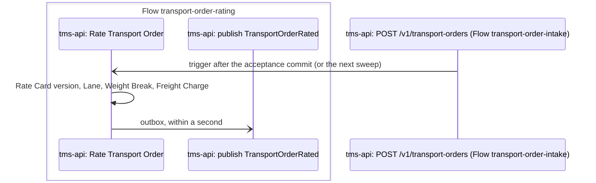

# P2 Rating

Rating calculates the Freight Charge for an accepted Transport Order from the Shipper's Rate Card. It covers only what Norvia charges the Shipper. What a Carrier costs Norvia is not part of it. Terms are defined in [CONTEXT.md](../../../CONTEXT.md).

| | |
|---|---|
| **Trigger** | A Transport Order is accepted (P1) |
| **Outcome** | The Transport Order is Rated with a frozen Freight Charge, or Rating failed with a reason |
| **Owning system** | TMS (ADR 0006). The ERP owns Contracts and Rate Cards |
| **Applies to** | Own fleet and Carriers alike. Rating happens before P3 decides who carries the goods |
| **Integrations touched** | Service Bus (outcome events). ERP, through the seed file for now |

## Rating result

Each Transport Order has a rating result that is separate from its status. The status (Accepted, then planned, and so on) belongs to P3 and later processes, and a Transport Order can be planned whatever its rating result.

| Rating result | Meaning |
|---|---|
| Not yet rated | Accepted, and Rating hasn't run yet |
| Rated | A Freight Charge has been calculated and is frozen |
| Rating failed | The Rate Card couldn't price the order. The result carries a failure reason: a stable code and a message, which the query API shows. The order stays Accepted |
| Not rated separately | A Fulfilment Transport Order (WMS channel). It is billed through the Fulfilment Contract, not per transport |

Rating failed can move to Rated through a re-rate. Rated and Not rated separately are final.

## Steps

1. **Acceptance.** P1 accepts a Transport Order and commits it. A Transport-only order starts as *Not yet rated*. An order that came in through the WMS channel is set straight to *Not rated separately*, and P2 does nothing more with it.
2. **Pick-up.** A background worker in the TMS picks up orders that are *Not yet rated*. It is triggered right after the acceptance commit and also sweeps on a timer, so a crash between acceptance and Rating only delays Rating. No order stays *Not yet rated* for good.
3. **Choose the Rate Card version.** Take the Shipper's Rate Card version that is valid on the collection date: the date of the earliest collection time in the collection window, in the Europe/Amsterdam timezone.
4. **Match the Lane.** Find the origin Zone (collection address) and the destination Zone (delivery address) by country and postcode prefix. Postcodes and prefixes are compared without spaces and in upper case. The most specific prefix wins: when an address lies in a Zone for `35` and in one for `3584`, it is in the `3584` Zone. The Lane is that pair of Zones.
5. **Choose the Weight Break.** Take the order's total gross weight in kg and find the Lane's Weight Break it falls in. Each Weight Break runs from just above the next lighter one (or 0 kg) up to and including its own upper limit, so a weight exactly on a boundary falls in the lighter band: with breaks up to 500 kg and up to 2,000 kg, 500 kg is priced at the up-to-500 kg price.
6. **Calculate.** Freight = weight ÷ 100 × the price per 100 kg for that Weight Break. If the Freight, rounded to cents, is below the Lane's minimum charge, add a charge line that makes up the difference, so the total is exactly the minimum charge.
7. **Record.** Store the Freight Charge (its charge lines, the total, and a reference to the Rate Card version used) and set the result to *Rated*. If any of steps 3–5 failed, set the result to *Rating failed* with the reason instead. Publish the outcome event in the same transaction.

### Re-rate

Customer service sees orders with *Rating failed* in a rating exceptions list in the TMS UI, with each order's Shipper, failure code and reason. They can re-rate one from the list, typically after the Rate Card has been corrected. A re-rate runs steps 3–7 again with the same collection-date rule, not today's Rate Card. Only orders with *Rating failed* can be re-rated. A Rated order is never re-rated: a wrong charge is corrected in invoicing with a Credit note ([E1](../erp/e1-invoicing.md#credit-notes)).

The TMS API has a list query for the rating exceptions (`GET /v1/transport-orders/rating-exceptions`, each with its failure code and message) and the re-rate command (`POST /v1/transport-orders/{number}/re-rate`). The command answers with the rating result the order has afterwards, and refuses an order that isn't *Rating failed* with a 409 that changes nothing. Each re-rate carries an `Idempotency-Key`. The order keeps the key of its last re-rate, so that re-rate sent again, as a retry, gets the same answer, flagged as a repeat, and rates and publishes nothing. A new key on a Rated order is still refused. A re-rate that fails again stays *Rating failed* with the new reason and publishes another `TransportOrderRatingFailed`. The list query takes the same authorization as the TMS API's other queries. The re-rate answers only the TMS UI, which calls it as its own managed identity, the one principal holding the TMS API's `TransportOrders.Manage` role ([Identity and access](../../architecture/identity-and-access.md#tms-api-roles)).

In a real operation a pricing desk would work these exceptions. The sandbox gives the job to Customer service, to keep the number of demo roles small.

## Calculation

- **Money:** EUR only, without VAT. The ERP adds VAT when it invoices. Each charge line is rounded to cents, half away from zero, and the total is the sum of the rounded lines. The Minimum charge adjustment is worked out from the rounded Freight line: 100.25 kg at 14.00 per 100 kg is a Freight line of 14.04 (from 14.035), and with a minimum of 45.00 an adjustment of 30.96.
- **Charge lines:** always a *Freight* line. A *Minimum charge adjustment* line is added only when the minimum applies.
- **Weight basis:** total gross weight. Volumetric weight isn't used yet.

## Failure reasons

| Code | When |
|---|---|
| `NoRateCard` | The Shipper has no Rate Card |
| `NoValidRateCardVersion` | No version of the Rate Card is valid on the collection date |
| `NoMatchingLane` | No Lane covers the origin and destination Zones |
| `WeightAboveHighestBreak` | The total weight is above the Lane's highest Weight Break |

## Rate Cards in the TMS

The TMS holds a read copy of each Shipper's Rate Card and never edits it (ADR 0006). Until the ERP exists, the TMS loads Rate Cards from the seed file at startup, the same way it loads Shippers. A Rate Card has versions, and each version has a validity period and its own Zones and Lanes, each Lane with its Weight Breaks and minimum charge.

Zones may nest, a narrower prefix inside a wider one, because the most specific prefix decides. Two Zones of one version overlap when they claim the same prefix in the same country, as then neither is more specific. A Rate Card whose Zones overlap is rejected when the seed loads, and the TMS doesn't start.

The demo seed gives Brouwer Dranken a Rate Card with Lanes from Rotterdam into the Benelux and a deliberate gap: no Lane into Germany. A booking from Rotterdam to Brouwer Dranken's Antwerp address is Rated. A booking from Rotterdam to Düsseldorf shows `NoMatchingLane` and lands in the rating exceptions list. The live "fix the Rate Card, then re-rate" demo waits for the ERP sync. Until then, tests cover that path.

## Events

Both events are published to the topic for Transport Order events, through the TMS's transactional outbox (ADR 0003).

| Event | Carries | Consumers |
|---|---|---|
| `TransportOrderRated` | Transport Order number, Shipper, Freight Charge with charge lines, Rate Card version, correlation ID | [Subscribers](../../architecture/events.md#catalogue). [P9](p9-freight-settlement.md) checks whether the order is Billable inside the TMS, not from this event (ADR 0003). |
| `TransportOrderRatingFailed` | Transport Order number, Shipper, failure code and message, correlation ID | [Subscribers](../../architecture/events.md#catalogue) |

*Not rated separately* publishes no event. Each successful rating or re-rating publishes exactly one event.

## Tracking

Rating continues the Message trail of the Transport Order's intake: its events carry the intake's correlation ID. A re-rate continues it too, so a Transport Order's whole rating, re-rates included, is found by its intake's correlation ID. The rating worker, and the TMS API for a re-rate, put the tracking-contract keys in the logging scope and on the trace of each rating: `correlationId`, `flow` (`transport-order-rating`), `partyId` (the Shipper ID) and `transportOrderNumber`. The outcome event carries the same keys as application properties. When Rating failed, the log scope, the trace and `TransportOrderRatingFailed` also carry `failureCode`.

A rating that gives its answer, Rated or Rating failed, and a re-rate that does, records the `outcome` `Succeeded` in its log scope and on its trace, next to its `failureCode` when Rating failed. Rating failed is Rating's answer, not a failed flow: the order stays Accepted, and nothing is retried or dead-lettered, so the Integration console shows the failure code on the rating's hop without counting the trail as one with a failure. Customer service works these from the rating exceptions. A rating that doesn't give its answer, because it threw, records `Retrying`: the order stays Not yet rated and the next sweep rates it. A re-rate the TMS refuses, because the order isn't Rating failed or doesn't exist, records `Refused`.

## Presenter smoke run

After a deployment, and not in CI, the presenter checks Rating on the deployed estate with the demo seed's two bookings. Do it after the demo smoke run of the Norvia Partner API ([infra/smoke-test-partner-api.sh](../../../infra/smoke-test-partner-api.sh)), signed in as the presenter the estate was provisioned for. The postdeploy hook prints each UI's address. Open the Partner portal and the TMS UI side by side.

1. **Book to Antwerp.** In the Partner portal, choose Brouwer Dranken in the Persona switcher. The booking form opens with Brouwer Dranken's Rotterdam warehouse as the collection and Café De Zwaan in Utrecht as the delivery, with 2 pallets of 850 kg. Change the delivery to Drankenhandel De Schelde BV (contact Pieter Janssens, +32 3 555 0117), Noorderlaan 120, 2030 Antwerpen, BE, and choose *Book transport*. Note the Transport Order number and Norvia's reference for the attempt under it, which is the booking's correlation ID.
2. **Book to Düsseldorf.** Choose *Start a new booking*, change the delivery to Getränke Schmitz GmbH (contact Jonas Schmitz, +49 211 555 0190), Kölner Landstraße 301, 40591 Düsseldorf, DE, and book it. Note its Transport Order number and reference too.
3. **Check the TMS.** Run `infra/smoke-test-rating.sh <Antwerp's number> <Düsseldorf's number>`. It reads the TMS as the intake identity, from a throwaway Container Apps job, and reads each order's Message trail in Application Insights, which is usually 1 to 5 minutes behind. It checks that:
   - the Antwerp order is Rated, with a Freight Charge in EUR that has a Freight line, and is waiting for planning;
   - the Düsseldorf order is Rating failed with `NoMatchingLane` and has no Freight Charge, is in the rating exceptions, and is still waiting for planning;
   - each order's intake and rating are on one Message trail under the intake's correlation ID, the rating for Brouwer Dranken (`SHP-0001`) with the outcome `Succeeded`, and with `failureCode` `NoMatchingLane` for Düsseldorf's only.

   It prints `PASS` or `FAIL` per check, never a body, and ends with the pages to open below.
4. **See it Rated.** In the TMS UI, as the Planner, both orders are in *Waiting for planning*: Antwerp's with the rating result Rated, Düsseldorf's with Rating failed. Open Antwerp's. Its Rating section shows Rated and a Freight Charge of EUR 105.40: one Freight line, 850 kg at EUR 12.40 per 100 kg on the Rotterdam → Antwerpen Lane, which is above the Lane's EUR 85.00 minimum.
5. **See the exception.** Switch to Customer service and open *Rating exceptions*. Düsseldorf's order is listed for Brouwer Dranken with the failure *No matching Lane* and a reason that Rate Card `RC-0001` version 1 has no Lane from Rotterdam to the delivery address. Antwerp's isn't listed. Don't re-rate it: the Rate Card still has no Lane into Germany, so a re-rate fails again with the same reason until the ERP sync can correct it.
6. **Follow the rating.** In the Integration console, search for each order's correlation ID and open the one trail it finds. Its hops hold the intake (`transport-order-intake`) and, after it, the rating (`transport-order-rating`). The rating's hop shows the outcome `Succeeded`, and on Düsseldorf's trail also the failure code `NoMatchingLane`: Rating failed is Rating's answer, not a failed flow, so neither trail is among the trails with a failure.

If a check fails, file the gap as its own issue against P2, rather than working around it in the run book.

## Implementation

For engineers and coding agents. It shows what the estate does when a Transport Order is rated, where each step lives in the repository, what plays each Azure piece on a developer's machine, and what is designed but not built. It follows the template set by [P1's Implementation section](p1-transport-order-intake.md#implementation). Azure is the estate [c4.md](../../architecture/c4.md) draws.

Rating runs entirely inside the TMS: there is no API Management operation, Logic App or Function in it. The rating worker is a hosted service of the TMS API, and the only things it sends out are its outcome events.

### Message trail

The Hops that Rating adds to the Message trail of the Transport Order's intake, named as the [Integration console](../../operations/integration-console.md#message-trail) shows them, in time order. They belong to the Flow `transport-order-rating` and carry the intake's correlation ID, so they follow the intake's Hops ([P1](p1-transport-order-intake.md#implementation)) on the same trail. The Shipper does not wait for them: the booking is answered before Rating starts.

- A Transport Order the Rate Card can't price publishes `TransportOrderRatingFailed` instead, and the first Hop carries the `failureCode`. Its `outcome` is still `Succeeded`: Rating failed is Rating's answer, not a failed flow.
- A Transport Order from the WMS channel is *Not rated separately* and has no rating Hop and no event.
- A rating that threw has a `Rate Transport Order` Hop with the outcome `Retrying` and no publish Hop. The next sweep rates the order, and its Hop follows.
- A re-rate starts in the TMS UI, so it continues the intake's trail from the other side. The UI's Hop is `tms-web: Re-rate Transport Order`, which calls `tms-api: POST /v1/transport-orders/TO-0000042/re-rate` and then the publish Hop. A refused re-rate (409) stops at the call.
- The publish Hop appears only once the outbox has sent the message ([failure behaviour](../../architecture/failure-behaviour.md#the-tms-outbox)).

### Code map

Links go to files, not lines, so they stay true as the code moves.

| Step | Where |
|---|---|
| 1. Acceptance | `Accept` in [TransportOrder.cs](../../../src/Tms/Norvia.Tms.Domain/TransportOrders/TransportOrder.cs) sets the rating result from the channel ([IntakeChannel.cs](../../../src/Tms/Norvia.Tms.Domain/TransportOrders/IntakeChannel.cs), [RatingResult.cs](../../../src/Tms/Norvia.Tms.Domain/TransportOrders/RatingResult.cs)) |
| 2. Pick-up | [TriggerRatingAfterAcceptance.cs](../../../src/Tms/Norvia.Tms.Application/TransportOrders/Rate/TriggerRatingAfterAcceptance.cs) signals the worker ([RatingSignal.cs](../../../src/Tms/Norvia.Tms.Infrastructure/Rating/RatingSignal.cs)). The worker is [RatingWorker.cs](../../../src/Tms/Norvia.Tms.Infrastructure/Rating/RatingWorker.cs), with its sweep interval in [RatingOptions.cs](../../../src/Tms/Norvia.Tms.Infrastructure/Rating/RatingOptions.cs). It finds the orders through [ListTransportOrdersNotYetRatedHandler.cs](../../../src/Tms/Norvia.Tms.Application/TransportOrders/Rate/ListTransportOrdersNotYetRatedHandler.cs) and [TransportOrdersNotYetRatedSpec.cs](../../../src/Tms/Norvia.Tms.Domain/TransportOrders/TransportOrdersNotYetRatedSpec.cs). It is registered by `AddTmsRatingWorker` in [DependencyInjection.cs](../../../src/Tms/Norvia.Tms.Infrastructure/DependencyInjection.cs) and called from the TMS API's [Program.cs](../../../src/Tms/Norvia.Tms.Api/Program.cs) |
| 3. Choose the Rate Card version | [RateCard.cs](../../../src/Tms/Norvia.Tms.Domain/RateCards/RateCard.cs), [RateCardVersion.cs](../../../src/Tms/Norvia.Tms.Domain/RateCards/RateCardVersion.cs) and the collection date rule in [CollectionDate.cs](../../../src/Tms/Norvia.Tms.Domain/RateCards/CollectionDate.cs). The copy comes from [SeedFileRateCardDirectory.cs](../../../src/Tms/Norvia.Tms.Infrastructure/RateCards/SeedFileRateCardDirectory.cs) through [IRateCardDirectory.cs](../../../src/Tms/Norvia.Tms.Application/RateCards/IRateCardDirectory.cs), loaded at startup by [LoadSeedOnStart.cs](../../../src/Tms/Norvia.Tms.Infrastructure/Seed/LoadSeedOnStart.cs) |
| 4. Match the Lane | [Zone.cs](../../../src/Tms/Norvia.Tms.Domain/RateCards/Zone.cs) (the most specific prefix), [Lane.cs](../../../src/Tms/Norvia.Tms.Domain/RateCards/Lane.cs) |
| 5. Choose the Weight Break | [WeightBreak.cs](../../../src/Tms/Norvia.Tms.Domain/RateCards/WeightBreak.cs), `WeightBreakFor` in [Lane.cs](../../../src/Tms/Norvia.Tms.Domain/RateCards/Lane.cs) |
| 6. Calculate | `ChargeLinesFor` in [Lane.cs](../../../src/Tms/Norvia.Tms.Domain/RateCards/Lane.cs), with [ChargeLine.cs](../../../src/Tms/Norvia.Tms.Domain/TransportOrders/ChargeLine.cs), [FreightCharge.cs](../../../src/Tms/Norvia.Tms.Domain/TransportOrders/FreightCharge.cs) and [Money.cs](../../../src/Tms/Norvia.Tms.Domain/TransportOrders/Money.cs) |
| 7. Record | [RateTransportOrderHandler.cs](../../../src/Tms/Norvia.Tms.Application/TransportOrders/Rate/RateTransportOrderHandler.cs), with [RateTransportOrderCommand.cs](../../../src/Tms/Norvia.Tms.Application/TransportOrders/Rate/RateTransportOrderCommand.cs). Aggregate methods `Rate` and `ReRate` in [TransportOrder.cs](../../../src/Tms/Norvia.Tms.Domain/TransportOrders/TransportOrder.cs), outcome and reasons in [RatingOutcome.cs](../../../src/Tms/Norvia.Tms.Domain/TransportOrders/RatingOutcome.cs), [RatingFailure.cs](../../../src/Tms/Norvia.Tms.Domain/TransportOrders/RatingFailure.cs) and [RatingFailureCode.cs](../../../src/Tms/Norvia.Tms.Domain/TransportOrders/RatingFailureCode.cs). Stored by [TransportOrderConfiguration.cs](../../../src/Tms/Norvia.Tms.Infrastructure/Data/Configurations/TransportOrderConfiguration.cs) (the concurrency token that stops two instances rating one order) |
| 7. Publish | Event types [TransportOrderRatedEvent.cs](../../../src/Tms/Norvia.Tms.Domain/TransportOrders/TransportOrderRatedEvent.cs) and [TransportOrderRatingFailedEvent.cs](../../../src/Tms/Norvia.Tms.Domain/TransportOrders/TransportOrderRatingFailedEvent.cs). Publishers [PublishTransportOrderRated.cs](../../../src/Tms/Norvia.Tms.Application/TransportOrders/Rate/PublishTransportOrderRated.cs) and [PublishTransportOrderRatingFailed.cs](../../../src/Tms/Norvia.Tms.Application/TransportOrders/Rate/PublishTransportOrderRatingFailed.cs), messages [TransportOrderRatedV1.cs](../../../src/Tms/Norvia.Tms.Application/TransportOrders/Rate/TransportOrderRatedV1.cs) and [TransportOrderRatingFailedV1.cs](../../../src/Tms/Norvia.Tms.Application/TransportOrders/Rate/TransportOrderRatingFailedV1.cs), sent by [OutboxPublisher.cs](../../../src/Tms/Norvia.Tms.Infrastructure/Outbox/OutboxPublisher.cs). Contracts: [transport-order-rated.v1.schema.json](../../../contracts/canonical-model/transport-order-rated.v1.schema.json) and [transport-order-rating-failed.v1.schema.json](../../../contracts/canonical-model/transport-order-rating-failed.v1.schema.json). Topic and subscription: [messaging.bicep](../../../infra/estate/messaging.bicep) |
| Tracking | The flow name is in [Flows.cs](../../../src/Tms/Norvia.Tms.Application/IntegrationEvents/Flows.cs). The worker puts the keys on the `Rate Transport Order` span and in the log scope ([RatingWorker.cs](../../../src/Tms/Norvia.Tms.Infrastructure/Rating/RatingWorker.cs)). A re-rate does it in [TrackReRateInLoggingScope.cs](../../../src/Tms/Norvia.Tms.Application/TransportOrders/Rate/TrackReRateInLoggingScope.cs) |
| Re-rate: list and command | Endpoints `GET /v1/transport-orders/rating-exceptions` and `POST /v1/transport-orders/{number}/re-rate` in [TransportOrderEndpoints.cs](../../../src/Tms/Norvia.Tms.Api/TransportOrders/TransportOrderEndpoints.cs). The list is [ListRatingExceptionsHandler.cs](../../../src/Tms/Norvia.Tms.Application/TransportOrders/RatingExceptions/ListRatingExceptionsHandler.cs) with [TransportOrdersRatingFailedSpec.cs](../../../src/Tms/Norvia.Tms.Domain/TransportOrders/TransportOrdersRatingFailedSpec.cs). The outcomes are [ReRateOutcome.cs](../../../src/Tms/Norvia.Tms.Domain/TransportOrders/ReRateOutcome.cs) and [IdempotencyKey.cs](../../../src/Tms/Norvia.Tms.Domain/TransportOrders/IdempotencyKey.cs) |
| Re-rate: TMS UI | [RatingExceptions.razor](../../../src/Tms/Norvia.Tms.Web/TransportOrders/RatingExceptions.razor) (the list and the button), [TmsApiClient.cs](../../../src/Tms/Norvia.Tms.Web/TmsApi/TmsApiClient.cs) (the `Re-rate Transport Order` Hop), [ReRateAnswer.cs](../../../src/Tms/Norvia.Tms.Web/TransportOrders/ReRateAnswer.cs). The Rating section of an order is [TransportOrderRating.razor](../../../src/Tms/Norvia.Tms.Web/TransportOrders/TransportOrderRating.razor), worded by [RatingText.cs](../../../src/Tms/Norvia.Tms.Web/TransportOrders/RatingText.cs) |
| The seed Rate Cards | [norvia.seed.json](../../../seed/norvia.seed.json). The overlap rule is checked as the seed loads |
| The applications | The TMS API, which hosts the worker, and the TMS UI are declared in the [AppHost](../../../src/Norvia.AppHost/AppHost.cs) |
| The presenter smoke run | [smoke-test-rating.sh](../../../infra/smoke-test-rating.sh), run after the [Norvia Partner API](../../../infra/smoke-test-partner-api.sh) smoke run |

### Locally

Nothing plays an Azure piece for Rating itself: the rating worker is part of the TMS API, which is the same application in both, and the Rate Cards come from the seed file in both. What differs is around it. The Service Bus emulator plays Service Bus for the outcome events, and the Aspire dashboard plays Application Insights, so the rating Hops are searched through the dashboard's telemetry. The full map, and the places where the two can differ, are in [local-vs-azure.md](../../architecture/local-vs-azure.md).

To see a rating locally, book from the Partner portal and watch the order's Rating section in the TMS UI. The Antwerp and Düsseldorf bookings of the [presenter smoke run](#presenter-smoke-run) work the same way, apart from the script, which needs a deployed estate.

### Gaps

Designed in this document and not built yet:

| Gap | Where it stands |
|---|---|
| The ERP to TMS Rate Card sync, and with it the live "fix the Rate Card, then re-rate" demo | Rate Cards come from the seed file ([Rate Cards in the TMS](#rate-cards-in-the-tms)). Tests cover the fix-and-re-rate path |
| A fuller Rate Card, automatic re-rating, Quotes, Carrier cost, a pricing desk role | Left out on purpose ([Deferred](#deferred)) |
| As-found toggles and presenter-panel faults for P2 | None added. No Bicep parameter switches anything broken in Rating. [Failure behaviour](../../architecture/failure-behaviour.md#p2-rating) lists the row each would worsen |
| Alerts on P2 | None built: there is no alert on `TransportOrderRatingFailed` ([monitoring.bicep](../../../infra/estate/monitoring.bicep) declares no alert rule) |
| Rating in the Integration console's failed runs and dead-letter panels | Nothing to show: Rating has no Logic App run and no dead letter. Finding its Hops and their `failureCode` is built |

## Deferred

These were left out on purpose while designing P2, each with its reason.

- **A fuller Rate Card**: fuel surcharge, per-pallet pricing, volumetric weight, tail-lift and time-window surcharges, volume discounts. The minimal Rate Card is enough for a believable demo. Add the fuel surcharge first, together with the ERP sync.
- **ERP → TMS Rate Card sync.** The ERP publishes Rate Cards and a Logic App calls a command on the TMS to replace the Rate Card. This is the live "fix the Rate Card, then re-rate" demo. It waits until the ERP is built.
- **Automatic re-rating when a new Rate Card arrives.** It needs the sync first.
- **Correcting the charge on a Rated order.** Handled as a Credit note in the ERP ([E1](../erp/e1-invoicing.md#credit-notes)).
- **Showing the Freight Charge to Shippers, and Quotes before booking.** Out of scope because a displayed price reads as a commitment.
- **Carrier cost.** Designed in [P9](p9-freight-settlement.md#carrier-cost) with the same method as Rating, against a Carrier Rate Card (ADR 0013).
- **A pricing desk role** separate from Customer service.
- **As-found toggles**, for example no alert on `TransportOrderRatingFailed`, or an event nobody subscribes to. They are added after the fixed state is built, as for P1.
