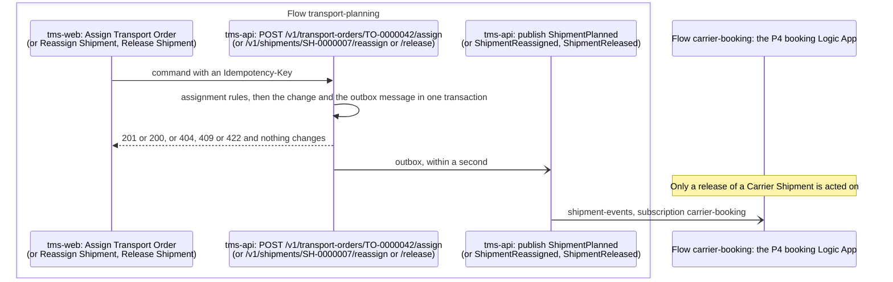

# P3 Transport planning

Transport planning turns an accepted Transport Order into a Shipment and decides who carries it: Norvia's Own fleet or a Carrier. The Planner does this by hand in the TMS UI and then releases the Shipment, which hands it over to Carrier booking (P4) or Trip dispatch (P11). Terms are defined in [CONTEXT.md](../../../CONTEXT.md).

| | |
|---|---|
| **Trigger** | A Transport Order is Accepted (P1) and appears in the Planner's list of Transport Orders to plan |
| **Outcome** | A Shipment assigned to Own fleet or to a named Carrier, and then Released |
| **Owning system** | TMS. It owns Transport Orders and Shipments (ADR 0002). The ERP owns Carrier master data |
| **Applies to** | Own fleet and Carriers alike. P3 makes the choice between them |
| **Integrations touched** | Service Bus (Shipment events). ERP, through the seed file for now (Carriers) |

## One Shipment per Transport Order

Each Transport Order gets exactly one Shipment, and a Shipment never carries more than one Transport Order (ADR 0007). P3 does not consolidate. Several Shipments are brought together later, on a Trip (P11). P4 books each Shipment with its Carrier on its own, and consolidating Shipments in one Carrier booking is deferred.

## What P3 decides, and what it doesn't

P3 assigns a Shipment to **Own fleet** as a whole, or to **one named Carrier**. It does not pick a Vehicle or a Driver (P11) or confirm anything with the Carrier (P4). Own fleet capacity is P10's: assigning to Own fleet shows [P10's load check](p10-fleet-capacity-planning.md#the-load-check) as a warning, and never blocks.

P3 works from the TMS's own data. It doesn't consume `TransportOrderAccepted` (ADR 0003).

## Status

### Transport Order

P3 adds one Transport Order status.

| Status | Meaning |
|---|---|
| Planned | The Transport Order has its Shipment. It leaves the Planner's list of Transport Orders to plan. It is the Transport Order's last status: all later progress is Shipment status |

The rating result (P2) is separate. A Transport Order can be planned whatever its rating result.

### Shipment

P3 owns the first two Shipment statuses. P4, P5 and [P11](p11-trip-dispatch.md) add the later ones.

| Status | Meaning |
|---|---|
| Planned | Assigned to Own fleet or a Carrier, not yet released. The Planner can still reassign it |
| Released | Handed over. A Carrier Shipment goes to P4 for booking. An Own fleet Shipment waits for P11 to put it on a Trip. P3 can no longer change it |

P4 adds **Booked**, and sends a Carrier Shipment back to Planned when its booking ends without confirmation (see [When a booking isn't confirmed](#when-a-booking-isnt-confirmed)). P11 adds **Dispatched** for an Own fleet Shipment on a Dispatched Trip, and sends it back to Planned when the Planner takes it off its Trip. In the first build, Released is as far as a Shipment gets.

## Steps

1. **See what needs planning.** The Planner opens the list of Transport Orders to plan: Accepted and not yet Planned, sorted by earliest collection time. Each row shows the Shipper, the collection and delivery places, the collection window and the rating result. The rating result is only information. It never filters or blocks. New Transport Orders appear without a page refresh, as in P1.
2. **Assign.** The Planner selects one or more Transport Orders and assigns them to Own fleet or to a Carrier chosen from the active Carriers. For each Transport Order, the TMS checks the [assignment rules](#assignment-rules), creates its Shipment with a Shipment number and the status Planned, sets the Transport Order to Planned and publishes `ShipmentPlanned`, all in one transaction. In a multi-select, each Transport Order succeeds or fails on its own.
3. **Reassign, if needed.** While a Shipment is Planned, the Planner can assign it to Own fleet or another Carrier. The Shipment and its Shipment number stay the same. The TMS records the change in the Shipment's history of assignments and publishes `ShipmentReassigned`, in one transaction.
4. **Release.** The Planner selects one or more Planned Shipments and releases them. Each one moves to Released and `ShipmentReleased` is published with its Transport Order's details, in one transaction, each on its own. A Released Shipment can't be reassigned or released again. A Carrier Shipment is priced from its Carrier's Carrier Rate Card at release, and when that fails the Planner can release it with a Spot price ([P9](p9-freight-settlement.md#pricing-a-carrier-booking-at-release)).
5. **Hand over.** For a Carrier Shipment, the release also creates its Carrier booking, and the P4 booking Logic App picks up `ShipmentReleased` and sends it to the Carrier ([P4](p4-carrier-booking.md)). For an Own fleet Shipment, [P11](p11-trip-dispatch.md) in the TMS takes it from the Released Shipments and puts it on a Trip. Neither is built yet.

The Planner's second list, of Shipments to release, shows Planned Shipments with who carries them, in the order they were planned. P4 adds a third list, of Carrier bookings awaiting an answer.

### When a booking isn't confirmed

When a Carrier booking ends Rejected, Not delivered or Withdrawn, P4 moves the Shipment back to Planned. So does a Carrier booking that [P7](p7-exception-handling.md) Cancels before collection. It comes back to the Planner's list of Shipments to release, showing its last Carrier booking's outcome and reason. The Planner reassigns it (to another Carrier or to Own fleet) or releases it again to the same Carrier. It keeps the same Shipment and Shipment number. So the ordinary rules for a Planned Shipment apply, with no special status. A rejection is ordinary planning work, not an Exception for P7.

## Assignment rules

| Rule | Failure codes |
|---|---|
| The Transport Order is Accepted and not yet Planned (for an assignment) | `TransportOrderNotFound`, `TransportOrderNotAccepted`, `TransportOrderAlreadyPlanned` |
| The Shipment is Planned (for a reassignment or a release) | `ShipmentNotFound`, `ShipmentNotPlanned` |
| A chosen Carrier exists in the TMS's seed-loaded Carrier data and is active | `UnknownCarrier`, `InactiveCarrier` |
| A reassignment changes who carries the Shipment | `AssignmentUnchanged` |

There are no coverage rules. Nothing stops the Planner from putting a Rotterdam → Düsseldorf order on Own fleet. Each failure has a stable code and a readable message. A refused action stores and publishes nothing, and its trace records the outcome `Refused` with the failure code.

A Shipment is never deleted, and a Transport Order never goes back from Planned to Accepted.

## Carriers in the TMS

The ERP owns Carrier master data (ADR 0002). The TMS holds a read copy: an ID, a name and an active flag for now. Until the ERP exists, it loads that copy from the seed file at startup, the same way it loads Shippers.

The demo seed has:

| Carrier | Role in the demo |
|---|---|
| Van Dijk Transport | Long-haul. Its Partner portal Persona answers bookings by hand |
| Kessler Spedition | German long-haul. The natural choice for Rotterdam → Düsseldorf |
| PakketPunt Express | Parcel |
| One inactive Carrier | For testing that inactive Carriers can't be chosen |

Every active Carrier has a Partner portal Persona, so it can answer the bookings P4 sends it. Each Persona has a setting that says whether it answers by hand or automatically (see P4).

## Correlation ID

A Planner's action starts in the TMS UI, not at API Management. So the TMS creates a new correlation ID for each action on each Shipment: each assignment, reassignment and release, including each Shipment in a multi-select. The events carry it together with the Transport Order number. The Transport Order keeps its intake correlation ID, so tracing a booking through to release follows the Transport Order number. The TMS traces each action under the flow name `transport-planning`, with `transportOrderNumber` and `shipmentNumber` ([tracking contract](../../coding-guidelines.md#tracking-contract)). The P4 Logic App carries the release's correlation ID on into the Carrier booking.

## Events

All three events go to a new topic for Shipment events, `shipment-events`, through the TMS's transactional outbox (ADR 0003). Each carries a property, `assignedTo` (`OwnFleet` or `Carrier`), saying whether the Shipment is assigned to Own fleet or a Carrier, so subscriptions can filter on it. The topic has a `monitoring` subscription, as the Transport Order events topic does. P3 publishes no `TransportOrderPlanned`, because `ShipmentPlanned` already says it.

| Event | Carries | Consumers |
|---|---|---|
| `ShipmentPlanned` | Shipment number, Transport Order number, Shipper, Own fleet or the Carrier's ID, correlation ID | [Subscribers](../../architecture/events.md#catalogue) |
| `ShipmentReassigned` | As `ShipmentPlanned`, plus who carried it before | [Subscribers](../../architecture/events.md#catalogue) |
| `ShipmentReleased` | The full Shipment with its Transport Order's details (addresses, windows, goods lines), Own fleet or the Carrier's ID, the Carrier booking number for a Carrier Shipment (P4), correlation ID | [Subscribers](../../architecture/events.md#catalogue) |

## Presenter smoke run

After a deployment, and not in CI, the presenter checks Transport planning end to end on the deployed estate: booking, assigning, reassigning and releasing. Do it after the presenter smoke run of Rating ([docs/processes/tms/p2-rating.md](p2-rating.md#presenter-smoke-run)). The postdeploy hook prints each UI's address. Open the Partner portal and the TMS UI side by side.

1. **Book.** In the Partner portal, choose Brouwer Dranken in the Persona switcher. The booking form opens with Brouwer Dranken's Rotterdam warehouse as the collection and Café De Zwaan in Utrecht as the delivery. Change the delivery to Getränke Schmitz GmbH (contact Jonas Schmitz, +49 211 555 0190), Kölner Landstraße 301, 40591 Düsseldorf, DE, and choose *Book transport*. Note the Transport Order number.
2. **Assign to Van Dijk Transport.** In the TMS UI, open *Transport Orders waiting for planning*. The booking appears there, with its rating result Rating failed (the Rate Card has no Lane into Germany, as in Rating's smoke run; that never blocks planning). Select it, choose *Van Dijk Transport* under *Assign to*, and choose *Assign selected*. It leaves the list and a Shipment number appears in the outcome message.
3. **Reassign to Kessler Spedition.** Open *Shipments to release*. The Shipment is listed, carried by Van Dijk Transport. Choose *Kessler Spedition* under *Reassign to* on its row and choose *Reassign*. The outcome message says it is now carried by Kessler Spedition, and the row updates without leaving the list.
4. **Release.** Select the Shipment and choose *Release selected*. It leaves the list.
5. **Check the TMS.** Run `infra/smoke-test-transport-planning.sh <Transport Order number>`. It reads the TMS as the intake identity, from a throwaway Container Apps job, and reads Application Insights, which is usually 1 to 5 minutes behind. It checks that the Transport Order is Planned with its Shipment, that the Shipment is Released and carried by Kessler Spedition, that its history of assignments shows Van Dijk Transport and then Kessler Spedition, that it has left both of the Planner's lists, and that the assignment, the reassignment and the release each ran on a Message trail of its own under the Transport Order number, publishing `ShipmentPlanned`, `ShipmentReassigned` and `ShipmentReleased` in turn on the Shipment events topic.

   It prints `PASS` or `FAIL` per check, never a body, and ends with the pages to open below.
6. **See it planned.** In the TMS UI, open the Shipment from the outcome message, or find it from the Transport Order. Its detail shows Released, carried by Kessler Spedition, and an Assignments history with two rows: Van Dijk Transport, then Kessler Spedition, each with its own correlation ID.
7. **Follow the planning.** In the Integration console, search for the Transport Order number. Three trails come back, one per planning step: the assignment (`tms-api: POST /v1/transport-orders/<number>/assign`, then `tms-api: publish ShipmentPlanned`), the reassignment (`tms-api: POST /v1/shipments/<Shipment number>/reassign`, then `tms-api: publish ShipmentReassigned`) and the release (`tms-api: POST /v1/shipments/<Shipment number>/release`, then `tms-api: publish ShipmentReleased`). None of the three chains to the booking's own trail: a Planner's action always starts a trail of its own ([Correlation ID](#correlation-id)).

If a check fails, file the gap as its own issue against P3, rather than working around it in the run book.

## Implementation

For engineers and coding agents. It shows what the estate does when a Planner assigns, reassigns and releases, where each step lives in the repository, what plays each Azure piece on a developer's machine, and what is designed but not built. It follows the template set by [P1's Implementation section](p1-transport-order-intake.md#implementation). Azure is the estate [c4.md](../../architecture/c4.md) draws.

Planning runs inside the TMS: there is no API Management operation, Function or Logic App in it. The Planner's actions start in the TMS UI and call the TMS API, which publishes to the `shipment-events` topic. The only Azure piece P3 hands to is the P4 booking Logic App, on that topic.

### Message trail

The Hops one Planner action leaves on the Message trail, named as the [Integration console](../../operations/integration-console.md#message-trail) shows them, in time order. They belong to the Flow `transport-planning`. Every action starts a trail of its own, with a new correlation ID ([Correlation ID](#correlation-id)), so the diagram is run once per action: an assignment, a reassignment and a release are three trails, found together by the Transport Order number. The Planner waits for the call, not for the publish.

- The three actions differ in the path of the call and the event: assign is `POST /v1/transport-orders/<number>/assign` and publishes `ShipmentPlanned`, reassign is `POST /v1/shipments/<number>/reassign` and publishes `ShipmentReassigned`, release is `POST /v1/shipments/<number>/release` and publishes `ShipmentReleased`.
- A refused action stops at the call. It has the outcome `Refused` and the failure code, and no publish Hop. A repeat under the same Idempotency-Key is answered as before and publishes nothing, so its trail ends at the call too.
- None of the three trails chains to the booking's intake trail or to Rating's. Tracing a booking through to release follows the Transport Order number.
- The `carrier-booking` subscription takes the three events of a Carrier Shipment, and the Logic App acts on `ShipmentReleased` only. Its Hops carry the release's correlation ID on, under the Flow `carrier-booking` ([P4](p4-carrier-booking.md)).
- An Own fleet Shipment has no further Hop: nothing takes it from Released until P11 is built.
- The publish Hop appears only once the outbox has sent the message ([failure behaviour](../../architecture/failure-behaviour.md#the-tms-outbox)).

### Code map

Links go to files, not lines, so they stay true as the code moves.

| Step | Where |
|---|---|
| 1. Lists to plan | The Transport Orders to plan: [ListTransportOrdersToPlanHandler.cs](../../../src/Tms/Norvia.Tms.Application/TransportOrders/ToPlan/ListTransportOrdersToPlanHandler.cs) with [TransportOrderToPlanSpec.cs](../../../src/Tms/Norvia.Tms.Domain/TransportOrders/TransportOrderToPlanSpec.cs) and [TransportOrderToPlanSummary.cs](../../../src/Tms/Norvia.Tms.Application/TransportOrders/ToPlan/TransportOrderToPlanSummary.cs). The Carriers to choose from: [ListActiveCarriersHandler.cs](../../../src/Tms/Norvia.Tms.Application/Carriers/ListActive/ListActiveCarriersHandler.cs). The TMS UI reads both through [TransportOrderQueries.cs](../../../src/Tms/Norvia.Tms.Web/TransportOrders/TransportOrderQueries.cs), and shows them in [WaitingForPlanning.razor](../../../src/Tms/Norvia.Tms.Web/TransportOrders/WaitingForPlanning.razor) |
| 2. Assign: call | Endpoint `POST /v1/transport-orders/{number}/assign` in [TransportOrderEndpoints.cs](../../../src/Tms/Norvia.Tms.Api/TransportOrders/TransportOrderEndpoints.cs) (`AssignAsync`, tracked as `Flows.TransportPlanning`), with [AssignTransportOrderRequest.cs](../../../src/Tms/Norvia.Tms.Api/TransportOrders/AssignTransportOrderRequest.cs), the shared checks and refusals in [AssignmentCalls.cs](../../../src/Tms/Norvia.Tms.Api/Shipments/AssignmentCalls.cs) and [RefusalProblem.cs](../../../src/Tms/Norvia.Tms.Api/RefusalProblem.cs) |
| 2. Assign: rules and record | [AssignTransportOrderHandler.cs](../../../src/Tms/Norvia.Tms.Application/TransportOrders/Assign/AssignTransportOrderHandler.cs), with [AssignTransportOrderCommand.cs](../../../src/Tms/Norvia.Tms.Application/TransportOrders/Assign/AssignTransportOrderCommand.cs) and [AssignTransportOrderResult.cs](../../../src/Tms/Norvia.Tms.Application/TransportOrders/Assign/AssignTransportOrderResult.cs). The rules and their failure codes are [AssignmentRules.cs](../../../src/Tms/Norvia.Tms.Domain/Shipments/AssignmentRules.cs), [AssignmentRefusal.cs](../../../src/Tms/Norvia.Tms.Domain/Shipments/AssignmentRefusal.cs) and [AssignmentRefusalCode.cs](../../../src/Tms/Norvia.Tms.Domain/Shipments/AssignmentRefusalCode.cs), turned into a result by [AssignmentRefused.cs](../../../src/Tms/Norvia.Tms.Application/Shipments/AssignmentRefused.cs). Aggregate methods `Plan` in [TransportOrder.cs](../../../src/Tms/Norvia.Tms.Domain/TransportOrders/TransportOrder.cs) (sets the status Planned) and in [Shipment.cs](../../../src/Tms/Norvia.Tms.Domain/Shipments/Shipment.cs) (creates the Shipment). Who carries it: [CarriedBy.cs](../../../src/Tms/Norvia.Tms.Domain/Shipments/CarriedBy.cs), [ShipmentAssignment.cs](../../../src/Tms/Norvia.Tms.Domain/Shipments/ShipmentAssignment.cs) (the history of assignments), [ShipmentStatus.cs](../../../src/Tms/Norvia.Tms.Domain/Shipments/ShipmentStatus.cs). The Shipment number comes from [IShipmentNumbers.cs](../../../src/Tms/Norvia.Tms.Application/Shipments/IShipmentNumbers.cs), implemented by [SqlShipmentNumbers.cs](../../../src/Tms/Norvia.Tms.Infrastructure/Shipments/SqlShipmentNumbers.cs). Stored by [ShipmentConfiguration.cs](../../../src/Tms/Norvia.Tms.Infrastructure/Data/Configurations/ShipmentConfiguration.cs) |
| 3. Reassign | Endpoint `POST /v1/shipments/{number}/reassign` in [ShipmentEndpoints.cs](../../../src/Tms/Norvia.Tms.Api/Shipments/ShipmentEndpoints.cs) (`ReassignAsync`, with [ReassignShipmentRequest.cs](../../../src/Tms/Norvia.Tms.Api/Shipments/ReassignShipmentRequest.cs)). Handler [ReassignShipmentHandler.cs](../../../src/Tms/Norvia.Tms.Application/Shipments/Reassign/ReassignShipmentHandler.cs) with [ReassignShipmentCommand.cs](../../../src/Tms/Norvia.Tms.Application/Shipments/Reassign/ReassignShipmentCommand.cs) and [ReassignShipmentResult.cs](../../../src/Tms/Norvia.Tms.Application/Shipments/Reassign/ReassignShipmentResult.cs). Aggregate method `Reassign` in [Shipment.cs](../../../src/Tms/Norvia.Tms.Domain/Shipments/Shipment.cs), whose `AssignmentUnchanged` rule is in [AssignmentRules.cs](../../../src/Tms/Norvia.Tms.Domain/Shipments/AssignmentRules.cs) |
| 4. Release | Endpoint `POST /v1/shipments/{number}/release` in [ShipmentEndpoints.cs](../../../src/Tms/Norvia.Tms.Api/Shipments/ShipmentEndpoints.cs) (`ReleaseAsync`). Handler [ReleaseShipmentHandler.cs](../../../src/Tms/Norvia.Tms.Application/Shipments/Release/ReleaseShipmentHandler.cs) with [ReleaseShipmentCommand.cs](../../../src/Tms/Norvia.Tms.Application/Shipments/Release/ReleaseShipmentCommand.cs) and [ReleaseShipmentResult.cs](../../../src/Tms/Norvia.Tms.Application/Shipments/Release/ReleaseShipmentResult.cs). Aggregate method `Release` in [Shipment.cs](../../../src/Tms/Norvia.Tms.Domain/Shipments/Shipment.cs), recording a [ShipmentRelease.cs](../../../src/Tms/Norvia.Tms.Domain/Shipments/ShipmentRelease.cs). For a Carrier Shipment the handler also requests the Carrier booking ([CarrierBooking.cs](../../../src/Tms/Norvia.Tms.Domain/CarrierBookings/CarrierBooking.cs), `Request`) |
| 5. Hand over | Carrier Shipment: the `carrier-booking` subscription in [messaging.bicep](../../../infra/estate/messaging.bicep) and the Logic App [workflow.json](../../../src/Integration/BookingLogicApp/carrier-booking/workflow.json), with its Function [MapShipmentReleased.cs](../../../src/Integration/Norvia.Integration.CarrierBooking.Functions/MapShipmentReleased.cs) (P4). Own fleet Shipment: nothing yet (P11) |
| Publish | Event types [ShipmentPlannedEvent.cs](../../../src/Tms/Norvia.Tms.Domain/Shipments/ShipmentPlannedEvent.cs), [ShipmentReassignedEvent.cs](../../../src/Tms/Norvia.Tms.Domain/Shipments/ShipmentReassignedEvent.cs) and [ShipmentReleasedEvent.cs](../../../src/Tms/Norvia.Tms.Domain/Shipments/ShipmentReleasedEvent.cs). Publishers [PublishShipmentPlanned.cs](../../../src/Tms/Norvia.Tms.Application/TransportOrders/Assign/PublishShipmentPlanned.cs), [PublishShipmentReassigned.cs](../../../src/Tms/Norvia.Tms.Application/Shipments/Reassign/PublishShipmentReassigned.cs) and [PublishShipmentReleased.cs](../../../src/Tms/Norvia.Tms.Application/Shipments/Release/PublishShipmentReleased.cs), messages [ShipmentPlannedV1.cs](../../../src/Tms/Norvia.Tms.Application/TransportOrders/Assign/ShipmentPlannedV1.cs), [ShipmentReassignedV1.cs](../../../src/Tms/Norvia.Tms.Application/Shipments/Reassign/ShipmentReassignedV1.cs) and [ShipmentReleasedV1.cs](../../../src/Tms/Norvia.Tms.Application/Shipments/Release/ShipmentReleasedV1.cs). The `assignedTo` property is set by [ShipmentEventProperties.cs](../../../src/Tms/Norvia.Tms.Application/Shipments/ShipmentEventProperties.cs), and the messages are sent by [OutboxPublisher.cs](../../../src/Tms/Norvia.Tms.Infrastructure/Outbox/OutboxPublisher.cs). Contracts: [shipment-planned.v1.schema.json](../../../contracts/canonical-model/shipment-planned.v1.schema.json), [shipment-reassigned.v1.schema.json](../../../contracts/canonical-model/shipment-reassigned.v1.schema.json) and [shipment-released.v1.schema.json](../../../contracts/canonical-model/shipment-released.v1.schema.json). Topic and subscriptions: [messaging.bicep](../../../infra/estate/messaging.bicep) |
| Carriers | [Carrier.cs](../../../src/Tms/Norvia.Tms.Domain/Carriers/Carrier.cs), [CarrierId.cs](../../../src/Tms/Norvia.Tms.Domain/Carriers/CarrierId.cs), read through [ICarrierDirectory.cs](../../../src/Tms/Norvia.Tms.Application/Carriers/ICarrierDirectory.cs) from [SeedFileCarrierDirectory.cs](../../../src/Tms/Norvia.Tms.Infrastructure/Carriers/SeedFileCarrierDirectory.cs), loaded at startup by [LoadSeedOnStart.cs](../../../src/Tms/Norvia.Tms.Infrastructure/Seed/LoadSeedOnStart.cs) from [norvia.seed.json](../../../seed/norvia.seed.json) |
| Tracking | The flow name is in [Flows.cs](../../../src/Tms/Norvia.Tms.Application/IntegrationEvents/Flows.cs). Each action puts the keys in the log scope: [TrackAssignmentInLoggingScope.cs](../../../src/Tms/Norvia.Tms.Application/TransportOrders/Assign/TrackAssignmentInLoggingScope.cs), [TrackReassignmentInLoggingScope.cs](../../../src/Tms/Norvia.Tms.Application/Shipments/Reassign/TrackReassignmentInLoggingScope.cs), [TrackReleaseInLoggingScope.cs](../../../src/Tms/Norvia.Tms.Application/Shipments/Release/TrackReleaseInLoggingScope.cs) and [TrackPlanningInLoggingScope.cs](../../../src/Tms/Norvia.Tms.Application/Shipments/TrackPlanningInLoggingScope.cs). The new correlation ID is made in the endpoint, from [CorrelationId.cs](../../../src/Tms/Norvia.Tms.Domain/TransportOrders/CorrelationId.cs) |
| Lists and detail | The Shipments to release: [ListShipmentsToReleaseHandler.cs](../../../src/Tms/Norvia.Tms.Application/Shipments/ListToRelease/ListShipmentsToReleaseHandler.cs) with [ShipmentsToReleaseSpec.cs](../../../src/Tms/Norvia.Tms.Domain/Shipments/ShipmentsToReleaseSpec.cs) and [LastCarrierBookingOutcome.cs](../../../src/Tms/Norvia.Tms.Application/Shipments/ListToRelease/LastCarrierBookingOutcome.cs). One Shipment, with its history of assignments: [GetShipmentHandler.cs](../../../src/Tms/Norvia.Tms.Application/Shipments/GetByNumber/GetShipmentHandler.cs) and endpoint `GET /v1/shipments/{number}` in [ShipmentEndpoints.cs](../../../src/Tms/Norvia.Tms.Api/Shipments/ShipmentEndpoints.cs) |
| TMS UI | [WaitingForPlanning.razor](../../../src/Tms/Norvia.Tms.Web/TransportOrders/WaitingForPlanning.razor) (the list and *Assign selected*), [ShipmentsToRelease.razor](../../../src/Tms/Norvia.Tms.Web/Shipments/ShipmentsToRelease.razor) (*Reassign* and *Release selected*), [ShipmentDetail.razor](../../../src/Tms/Norvia.Tms.Web/Shipments/ShipmentDetail.razor), [TmsApiClient.cs](../../../src/Tms/Norvia.Tms.Web/TmsApi/TmsApiClient.cs) (the `Assign Transport Order`, `Reassign Shipment` and `Release Shipment` Hops), answers [AssignAnswer.cs](../../../src/Tms/Norvia.Tms.Web/TransportOrders/AssignAnswer.cs), [ReassignAnswer.cs](../../../src/Tms/Norvia.Tms.Web/Shipments/ReassignAnswer.cs) and [ReleaseAnswer.cs](../../../src/Tms/Norvia.Tms.Web/Shipments/ReleaseAnswer.cs), wording [PlanningText.cs](../../../src/Tms/Norvia.Tms.Web/TransportOrders/PlanningText.cs) |
| The seed Carriers | [norvia.seed.json](../../../seed/norvia.seed.json): the Carriers and their Partner portal Personas |
| The applications | The TMS API and the TMS UI are declared in the [AppHost](../../../src/Norvia.AppHost/AppHost.cs) |
| Bicep | P3 has no Bicep resource of its own beyond the topic `shipment-events` and its `monitoring` and `carrier-booking` subscriptions in [messaging.bicep](../../../infra/estate/messaging.bicep) |
| The presenter smoke run | [smoke-test-transport-planning.sh](../../../infra/smoke-test-transport-planning.sh), run after the [Rating](../../../infra/smoke-test-rating.sh) smoke run |

### Locally

Nothing plays an Azure piece for planning itself: the TMS API and the TMS UI are the same applications in both, and the Carriers come from the seed file in both. What differs is around it. The Service Bus emulator plays Service Bus, with the topic `shipment-events` and its subscriptions declared in the [AppHost](../../../src/Norvia.AppHost/AppHost.cs), and the Aspire dashboard plays Application Insights, so the planning Hops are searched through the dashboard's telemetry. The one Azure piece P3 hands to is the P4 booking Logic App, which `LocalBookingWorker` plays: [ShipmentReleasedConsumer.cs](../../../src/Integration/Norvia.Integration.LocalBookingWorker/ShipmentReleasedConsumer.cs) takes the `ShipmentReleased` from the `carrier-booking` subscription ([local-vs-azure.md](../../architecture/local-vs-azure.md) has the row). The full map, and the places where the two can differ, are in [local-vs-azure.md](../../architecture/local-vs-azure.md).

To see planning locally, book from the Partner portal, then assign, reassign and release in the TMS UI. The steps of the [presenter smoke run](#presenter-smoke-run) work the same way, apart from the script, which needs a deployed estate.

### Gaps

Designed in this document and not built yet:

| Gap | Where it stands |
|---|---|
| Pricing a Carrier Shipment from its Carrier Rate Card at release, and releasing with a Spot price | Designed in [P9](p9-freight-settlement.md#pricing-a-carrier-booking-at-release). The release does not price anything yet |
| Handing an Own fleet Shipment over to a Trip, and P10's load check as a warning when assigning to Own fleet | Own fleet capacity and Trips are P10 and P11. A Released Own fleet Shipment waits |
| The ERP and the Carrier master-data sync | Carriers come from the seed file ([Carriers in the TMS](#carriers-in-the-tms)) |
| Suggested or automatic assignment, coverage rules, groupage, un-planning, a dispatcher role | Left out on purpose ([Deferred](#deferred)) |
| As-found toggles and presenter-panel faults for P3 | None added. No Bicep parameter switches anything broken in planning, for example a `ShipmentReleased` subscription with no alert on its dead-letter queue. [Failure behaviour](../../architecture/failure-behaviour.md#p3-transport-planning) lists the row each would worsen |
| Alerts on P3 | None built: there is no alert on the `carrier-booking` dead-letter queue ([monitoring.bicep](../../../infra/estate/monitoring.bicep) declares no alert rule) |
| Planning in the Integration console's failed runs and dead-letter panels | Nothing to show for planning itself: it has no Logic App run. Finding its Hops by the Transport Order number is built |

## Deferred

These were left out on purpose while designing P3, each with its reason.

- **Suggested or automatic assignment, and coverage rules** such as "Own fleet only within the Benelux". Planning is manual for now, so the demo has a visible human step and needs no rules or lane-to-Carrier data.
- **Choosing on Carrier cost.** Carrier Rate Cards exist since [P9](p9-freight-settlement.md#carrier-cost), but planning stays manual.
- **Groupage, and splitting a Transport Order over several Shipments.** The one-Shipment-per-Transport-Order rule stands (ADR 0007).
- **Un-planning, and changes after release.** Reassigning covers mistakes before release. After release, changes go through P4 (withdrawing) and P7 (cancelling from an Exception). Cancelling a Transport Order is already deferred in P1.
- **A separate dispatcher role for Trips.** The Planner does P11 too (see [P11](p11-trip-dispatch.md)).
- **The ERP and the Carrier master-data sync.** Carriers come from the seed file for now.
- **As-found toggles**, for example a `ShipmentReleased` subscription with no alert on its dead-letter queue. They are added after the fixed state is built, as for P1 and P2.
