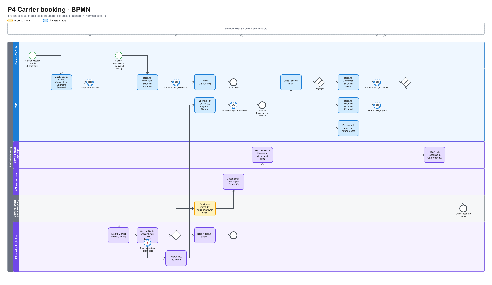
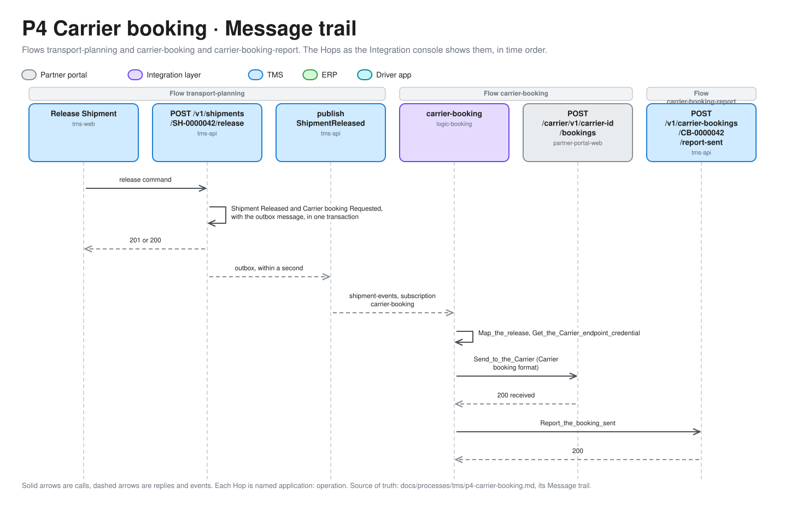
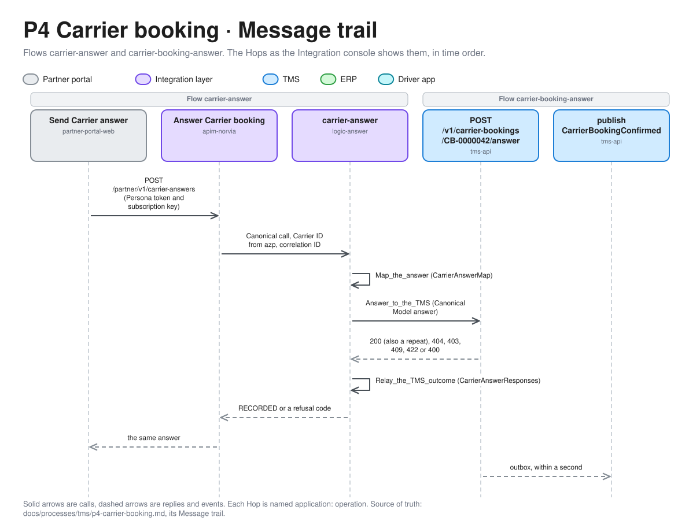

# P4 Carrier booking

Carrier booking asks a Carrier to carry a Shipment that the Planner released to it, and records the Carrier's answer. The TMS creates the Carrier booking at release. A Logic App sends it to the Carrier, and the Carrier confirms or rejects it later. A confirmed booking makes the Shipment Booked. Any other end sends the Shipment back to the Planner. Terms are defined in [GLOSSARY.md](../../../GLOSSARY.md).

| | |
|---|---|
| **Trigger** | A Shipment assigned to a Carrier is Released (P3) |
| **Outcome** | A Confirmed Carrier booking and a Booked Shipment. Or a Rejected, Not delivered or Withdrawn Carrier booking, with the Shipment back in Planned for the Planner |
| **Owning system** | TMS. It owns Carrier bookings and Shipments (ADR 0002) |
| **Applies to** | Carriers only. Own fleet Shipments go to P11 |
| **Integrations touched** | Service Bus (Shipment events), P4 booking Logic App, Key Vault, Partner portal (Carrier booking endpoint and Carrier Personas), API Management, Carrier-answer Logic App, TMS Carrier booking API |

## Process model

The model is [p4-carrier-booking.bpmn](p4-carrier-booking.bpmn), which opens in any BPMN tool and is the source. The picture is drawn from it by [bpmn.py](../../architecture/diagrams/bpmn.py), so change the model and run the script, not the picture ([the editable file](../../architecture/diagrams/bpmn-p4-carrier-booking.excalidraw)).

## One Carrier booking per Shipment

Each Carrier booking covers exactly one Shipment. A Shipment can have several Carrier bookings over its life, one after each booking that ends without confirmation, but never more than one Requested at a time. Consolidating several Shipments into one Carrier booking is deferred (ADR 0007).

The Carrier booking has two identifiers:

| Identifier | Given by | Used for |
|---|---|---|
| Carrier booking number | The TMS, at release | The reference the Carrier answers with. It links the release to the answer |
| Carrier booking reference | The Carrier, on confirmation | The Carrier's own number. P5 matches Tracking events on it, and P9 will match invoices on it |

## Carriers and their Personas

Every active Carrier has a Partner portal Persona that receives its booking requests and answers them. Each Persona has an **answer mode**, set on its own Carrier page in the Partner portal (not on the presenter panel, which is only for faults):

| Answer mode | Behaviour | Default for |
|---|---|---|
| Manual | The presenter confirms or rejects each request by hand | Every Carrier Persona |
| Auto-confirm | The Persona confirms each request after a delay | — (the seed leaves every Persona on Manual, because the [Simulator](../../operations/simulator.md) plays the Carriers; set it on the Carrier page when a demo wants it) |
| Auto-reject | The Persona rejects each request after a delay, with a chosen reason code | — |

The delay is a Partner portal setting per Persona, a few seconds by default, so a demo can show the answer arriving. Automatic answers go through exactly the same path as manual ones (step 5 in [Steps](#steps)). An auto-confirmed booking gets a generated Carrier booking reference in a pattern per Carrier, for example `VDT-240917-0042`.

The Persona's inbox lists its booking requests (open, confirmed, rejected, withdrawn by Norvia) with their details, including the Carrier cost offered ([P9](p9-freight-settlement.md#what-the-carrier-sees)). An open request offers **Confirm** and **Reject**.

## Status

### Carrier booking

| Status | Meaning |
|---|---|
| Requested | Created at release. It waits for the Carrier's answer. It gets a "sent" timestamp once the Carrier has acknowledged receipt |
| Confirmed | The Carrier accepted it, with its Carrier booking reference. Final |
| Rejected | The Carrier turned it down, with a reason. Final |
| Not delivered | The request never reached the Carrier, with the technical cause. Final |
| Withdrawn | The Planner took it back before the Carrier answered. Final |
| Cancelled | Norvia ended it after confirmation and before collection, to resolve an Exception. Final. Added by [P7](p7-exception-handling.md#cancelling-a-carrier-booking) |

Only a Requested Carrier booking can change its answer. The one exception is P7, which can cancel a Confirmed booking before collection (ADR 0010). Each of the other statuses is final.

### Shipment

P4 adds one Shipment status, and changes how a Shipment leaves Released.

| Status | Meaning |
|---|---|
| Booked | Its Carrier booking is Confirmed. [P5](p5-shipment-tracking.md) takes it from here. P3 and P4 can no longer change it. Only P7 can, by cancelling the Carrier booking before collection |

A Carrier Shipment moves Planned → Released → Booked. When its Carrier booking ends Rejected, Not delivered or Withdrawn, the Shipment goes back from Released to **Planned**, in the same transaction. The Planner can then reassign it or release it again, to the same Carrier or another, as for any Planned Shipment (P3). A new release creates a new Carrier booking. The Shipment and its Shipment number stay the same.

There is no Shipment status for a failed booking. The reason lives on the Carrier booking.

## Steps

1. **Create the booking.** When the Planner releases a Carrier Shipment (P3), the TMS creates its Carrier booking with a Carrier booking number and the status Requested, and freezes its Carrier cost on it, calculated from the Carrier Rate Card or entered as a Spot price ([P9](p9-freight-settlement.md#carrier-cost)). It moves the Shipment to Released and publishes `ShipmentReleased`, which carries the Carrier booking number, all in one transaction.
2. **Map.** The P4 booking Logic App picks up `ShipmentReleased` through a subscription filtered to Carrier Shipments. It maps the Canonical Model to the [Carrier booking format](#carrier-booking-format).
3. **Send.** The Logic App calls the Carrier Persona's booking endpoint in the Partner portal, with credentials it reads from Key Vault. The endpoint acknowledges receipt with a success response. The Partner portal treats the Carrier booking number as the key, so a repeated request for the same booking is ignored.
4. **Report sent.** The Logic App calls the TMS to report the booking as sent. The TMS records the sent time on the Requested booking. If this call fails, the booking simply shows "not yet sent" and eventually becomes overdue.
5. **Answer.** The Carrier confirms or rejects the request in the Partner portal, by hand or through its answer mode. The portal calls API Management with the Persona's token and subscription key. API Management checks the token (audience "Norvia Partner API", role `CarrierBookings.Respond`), maps the `azp` claim to a Carrier ID (ADR 0005), creates a correlation ID and passes both to the Carrier-answer Logic App. The Logic App maps the answer to the Canonical Model and calls the TMS Carrier booking API. The Carrier comes from the token, never from the payload. In the Partner portal, the Carrier's Persona confirms or rejects a request from its inbox: confirming asks for the Carrier booking reference and, optionally, a planned collection time; rejecting asks for a reason code, and a text for `Other`. The portal never calls the TMS: both go through API Management. The formats are in [the Partner API contract](../../../contracts/partner-api/README.md#carrier-answer).
6. **Record the answer.** The TMS checks the [answer rules](#answer-rules), then records the answer. A confirmation moves the Carrier booking to Confirmed and the Shipment to Booked. A rejection moves the Carrier booking to Rejected and the Shipment back to Planned. The matching event is published in the same transaction. The Logic App relays the TMS's response to the Carrier in the Carrier format, `BookingNotOpen` and `ReferenceInUse` included. The Partner portal shows a recorded answer in the inbox, and a request answered after Norvia withdrew it as withdrawn by Norvia.
7. **Follow up.** The Planner sees each open booking in the list of bookings awaiting an answer, and each Shipment that came back in the list of Shipments to release (see [Planner's lists](#planners-lists)).

### When the Carrier can't be reached

On a server error or timeout from the Carrier's endpoint, the P4 booking Logic App retries with a bounded exponential policy, as in P1. It doesn't retry a client error, which means the Carrier refused the request itself. When the retries are used up, or on a client error, the Logic App calls the TMS to report the booking as **Not delivered**, with the technical cause (status code and message). The TMS moves the Carrier booking to Not delivered and the Shipment back to Planned, and publishes `CarrierBookingNotDelivered`. The Planner sees it in the list of Shipments to release and can release it again.

If the Logic App can't reach the TMS either, its run fails and the booking stays Requested until it becomes overdue. Nothing is lost silently in either case.

### Withdrawing a booking

While a Carrier booking is Requested, the Planner can **withdraw** it from the list of bookings awaiting an answer. The TMS moves the Carrier booking to Withdrawn and the Shipment back to Planned, and publishes `CarrierBookingWithdrawn`. The Carrier cancellation Logic App from [P7](p7-exception-handling.md#cancelling-a-carrier-booking) tells the Carrier, and the booking is flagged Carrier not told if that fails. If the Carrier answers later, the answer is refused with `BookingNotOpen`, and the Partner portal shows the request as withdrawn by Norvia.

## Carrier booking format

The Carrier format is JSON and differs from the Canonical Model on purpose, as the Shipper format does in P1: it has its own field names, flat address fields, local date/times without an offset in the time zone of the address they belong to, and ISO 3166 alpha-3 country codes. The P4 booking Logic App maps Canonical → Carrier, and the Carrier-answer Logic App maps Carrier → Canonical.

The booking request carries:

| Included | Left out |
|---|---|
| Carrier booking number, Shipment number | The Shipper's identity. Towards the Carrier, Norvia is the customer |
| Collection and delivery addresses | The Freight Charge and anything else from the Shipper's Rate Card |
| Collection window and delivery window | |
| Consignee name | |
| Goods lines: package type, quantity, weight, dimensions | |
| The Carrier cost: total and charge lines in EUR without VAT, and whether it is a Spot price ([P9](p9-freight-settlement.md#what-the-carrier-sees)) | |

A confirmation carries the Carrier booking number, the Carrier booking reference (required) and a planned collection time (optional). By confirming, the Carrier accepts the Carrier cost in the request (ADR 0013). A rejection carries the Carrier booking number, a reason code and a reason text.

| Reason code | Meaning |
|---|---|
| `NoCapacity` | The Carrier has no capacity for it |
| `LaneNotServed` | The Carrier doesn't serve this origin and destination |
| `WindowNotFeasible` | The Carrier can't meet the collection or delivery window |
| `GoodsNotAccepted` | The Carrier doesn't take these goods |
| `PriceNotAccepted` | The Carrier doesn't accept the Carrier cost. Added by [P9](p9-freight-settlement.md#what-the-carrier-sees). There is no counter-offer |
| `Other` | Anything else. The reason text is required |

The reason text is optional for every other code. A reason text without a code is not accepted.

## Answer rules

| Rule | Failure code |
|---|---|
| The Carrier booking number exists | `BookingNotFound` |
| The Carrier in the token is the Carrier booking's Carrier | Refused |
| The Carrier booking is Requested | `BookingNotOpen` |
| A confirmation's Carrier booking reference isn't one the Carrier already holds on another Confirmed Carrier booking. Tracking events and Proofs of delivery find their Shipment by it | `ReferenceInUse` |
| A confirmation has a Carrier booking reference | Client error |
| A rejection has a reason code from the list, and a reason text when the code is `Other` | Client error |

An answer that repeats the answer already recorded (the same outcome and content for the same booking) succeeds, returns the original result flagged as a repeat, and publishes no event. A different answer to a booking that is already Confirmed or Rejected fails with `BookingNotOpen`.

A Carrier that became inactive after the booking was sent can still answer. Being active matters only when the Planner assigns a Carrier (P3).

Each failure has a stable code and a readable message.

## Planner's lists

P4 adds a third list to the Planner's two from P3.

| List | Shows | Actions |
|---|---|---|
| Transport Orders to plan (P3) | Unchanged | Assign |
| Shipments to release (P3) | Planned Shipments. A Shipment that came back from a booking shows its last Carrier booking's outcome, for example "Rejected by Kessler Spedition: NoCapacity, no trucks on Friday", or "Not delivered", or "Withdrawn", or "Cancelled by Norvia" (P7) | Reassign, release |
| Bookings awaiting an answer (P4) | Requested Carrier bookings, sorted by the earliest collection time: Shipment, Carrier, Carrier booking number, requested time, sent time or "not yet sent", and an overdue flag | Withdraw: call and handler |

A Carrier booking is **overdue** once it has been Requested for longer than a TMS setting (2 hours by default), or once its collection window's earliest time has passed, whichever comes first. Overdue is only a flag. Nothing happens automatically.

A Booked Shipment leaves the Planner's lists. All lists update without a page refresh, as in P1 and P3.

## TMS API

The Carrier booking API accepts only the Canonical Model (ADR 0003). Each Logic App's managed identity holds only the role it needs.

Who holds each role, and what else each identity may reach, is in [Identity and access](../../architecture/identity-and-access.md).

| Operation | Caller | Role |
|---|---|---|
| Record the Carrier's answer (confirm or reject) | Carrier-answer Logic App | `CarrierBookings.Answer` |
| Report a booking as sent | P4 booking Logic App | `CarrierBookings.Report` |
| Report a booking as not delivered | P4 booking Logic App | `CarrierBookings.Report` |

A sent or not-delivered report for a booking that is no longer Requested (for example, one withdrawn while the Logic App was still sending) is ignored and logged. It changes nothing and publishes no event.

The Planner withdraws a booking from the TMS UI, with the Planner permissions from P3.

## Correlation ID

The booking request carries the release's correlation ID (P3). The P4 booking Logic App passes it on to the Carrier's endpoint and uses it on its reports to the TMS.

API Management creates a new correlation ID for each Carrier answer, as it does for each booking in P1. The TMS stores it on the Carrier booking alongside the release's, and the answer events carry it.

The Carrier booking number links the two. Tracing a Shipment from release to confirmation follows the Shipment number and the Carrier booking number, the same way P3 follows the Transport Order number.

## Events

All events go to the topic for Shipment events, through the TMS's transactional outbox (ADR 0003). The Shipment going back to Planned publishes no event of its own, because the Carrier booking event already says it.

| Event | Carries | Consumers |
|---|---|---|
| `ShipmentReleased` (P3, extended) | As in P3, plus the Carrier booking number and its Carrier cost (P9) | [Subscribers](../../architecture/events.md#catalogue) |
| `CarrierBookingConfirmed` | Carrier booking number, Shipment number, Transport Order number, Carrier ID, Carrier booking reference, planned collection time, Carrier cost total, correlation ID | [Subscribers](../../architecture/events.md#catalogue). P9 hands the Carrier cost to the ERP on Delivered, not on this event. |
| `CarrierBookingRejected` | Carrier booking number, Shipment number, Carrier ID, reason code and text, correlation ID | [Subscribers](../../architecture/events.md#catalogue) |
| `CarrierBookingNotDelivered` | Carrier booking number, Shipment number, Carrier ID, technical cause, correlation ID | [Subscribers](../../architecture/events.md#catalogue) |
| `CarrierBookingWithdrawn` | Carrier booking number, Shipment number, Carrier ID, correlation ID | [Subscribers](../../architecture/events.md#catalogue) |

A sent report and a repeated answer publish no event.

## Presenter smoke run

After a deployment, and not in CI, the presenter checks Carrier booking end to end on the deployed estate: a release that a Carrier rejects on its own, a second release that another Carrier confirms by hand, and the Shipment Booked. Do it after the presenter smoke run of Transport planning ([docs/processes/tms/p3-transport-planning.md](p3-transport-planning.md#presenter-smoke-run)), whose booking it repeats. The postdeploy hook prints each UI's address. Open the Partner portal and the TMS UI side by side.

1. **Set Kessler Spedition to Auto-reject.** In the Partner portal, choose Kessler Spedition in the Persona switcher and open its Carrier page. In *Answer mode*, set *Mode* to *Auto-reject*, choose a *Rejection reason* such as No capacity, keep a delay of a few seconds, and choose *Save answer mode*.
2. **Book and plan.** As in P3's run, book Rotterdam to Düsseldorf as Brouwer Dranken (delivery Getränke Schmitz GmbH, Kölner Landstraße 301, 40591 Düsseldorf, DE) and note the Transport Order number. In the TMS UI, assign it to Kessler Spedition.
3. **Release to Kessler Spedition.** In *Shipments to release*, select the Shipment and choose *Release selected*. It leaves the list and may appear for a moment in *Bookings awaiting an answer*, Requested, with its Carrier booking number and a Sent time once the P4 booking Logic App has delivered it.
4. **See the auto-reject.** After the delay, the Shipment is back in *Shipments to release*, showing its last Carrier booking's outcome, "Rejected by Kessler Spedition: NoCapacity". In the Partner portal, Kessler Spedition's inbox shows the request as rejected.
5. **Release again to Van Dijk Transport.** On the Shipment's row choose *Van Dijk Transport* under *Reassign to* and choose *Reassign*, then select it and choose *Release selected*. A new Carrier booking number appears in *Bookings awaiting an answer*, with Van Dijk Transport as its Carrier and, within moments, a Sent time instead of "not yet sent". Van Dijk Transport answers by hand, so it stays there.
6. **Confirm as Van Dijk Transport.** In the Partner portal, choose Van Dijk Transport in the Persona switcher. Its inbox lists the open request. Choose *Confirm*, enter a Carrier booking reference such as `VDT-SMOKE-0001` and confirm. The inbox shows it confirmed.
7. **See it Booked.** In the TMS UI, the booking has left *Bookings awaiting an answer* and the Shipment's detail shows Booked, carried by Van Dijk Transport, with two Carrier bookings: Kessler Spedition's Rejected with its reason, then Van Dijk Transport's Confirmed with the reference entered.
8. **Check the TMS.** Run `infra/smoke-test-carrier-booking.sh <Transport Order number>`. It reads the TMS as the intake identity, from a throwaway Container Apps job, and reads Application Insights, which is usually 1 to 5 minutes behind. It checks that the Shipment is Booked and carried by Van Dijk Transport, that it has left both of the Planner's lists, that its Carrier bookings are Kessler Spedition's Rejected, with a reason code, and Van Dijk Transport's Confirmed, with a Carrier booking reference, each reported sent, that each booking's release published `ShipmentReleased` and had its sent report recorded, and that each answer ran on a Message trail of its own, Succeeded for that Carrier, publishing `CarrierBookingRejected` and `CarrierBookingConfirmed` in turn on the Shipment events topic.

   It prints `PASS` or `FAIL` per check, never a body, and ends with the pages to open below.
9. **Follow it.** In the Integration console, search for the Shipment number, then for each Carrier booking number. A booking's search shows its release (`tms-api: POST /v1/shipments/<Shipment number>/release`, `tms-api: publish ShipmentReleased`, the P4 booking Logic App's run, and the `report-sent` call to the TMS) and, as a trail of its own, its answer (API Management, the Carrier-answer Logic App's run, `tms-api: POST /v1/carrier-bookings/<Carrier booking number>/answer` and `tms-api: publish CarrierBookingRejected` or `CarrierBookingConfirmed`). Application Insights holds the same rows: query `union AppRequests, AppTraces, AppDependencies` by the Shipment number or a Carrier booking number in `Properties.shipmentNumber` or `Properties.carrierBookingNumber`.
10. **Restore Kessler Spedition.** In the Partner portal, set its *Mode* back to *Manual*, so the next run, the Simulator and the other demos find it as seeded.

If a check fails, file the gap as its own issue against P4, rather than working around it in the run book.

## Implementation

For engineers and coding agents. It shows what the estate does when a Planner releases a Shipment to a Carrier and the Carrier answers, where each step lives in the repository, what plays each Azure piece on a developer's machine, and what is designed but not built. It follows the template set by [P1's Implementation section](p1-transport-order-intake.md#implementation). Azure is the estate [c4.md](../../architecture/c4.md) draws.

P4 is two trails with a wait between them, not one. The release starts the booking: the P4 booking Logic App sends the request and reports it sent. The Carrier's answer is a call of its own, later, through API Management and the Carrier-answer Logic App. The two are tied together by the Carrier booking number ([Correlation ID](#correlation-id)).

### Message trail

The Hops of both trails, named as the [Integration console](../../operations/integration-console.md#message-trail) shows them, in time order. The release and the booking belong to the Flows `transport-planning` and `carrier-booking`, with the sent report in `carrier-booking-report`. The answer's Hops belong to two Flows on one correlation ID that API Management creates: `carrier-answer` for API Management and the Carrier-answer Logic App, and `carrier-booking-answer` for the TMS's calls.

*Editable source: [message-trail-p4-1.excalidraw](../../architecture/diagrams/message-trail-p4-1.excalidraw), generated from [message_trails.py](../../architecture/diagrams/message_trails.py).*

The answer arrives later, as a trail of its own:

*Editable source: [message-trail-p4-2.excalidraw](../../architecture/diagrams/message-trail-p4-2.excalidraw), generated from [message_trails.py](../../architecture/diagrams/message_trails.py).*

- A rejection publishes `CarrierBookingRejected` instead. A repeated answer and a refused one publish nothing, so the trail ends at the TMS call.
- A refused call stops at `apim-norvia`. The Logic App refuses anything but API Management's call, and its run fails with `CallerNotApiManagement`.
- When the Carrier can't be reached, `Send_to_the_Carrier` is `Failed` (`CarrierUnavailable` or `CarrierRefused`) and the Logic App calls `report-not-delivered` instead of `report-sent`. The TMS publishes `CarrierBookingNotDelivered`.
- A report for a booking that is no longer Requested is ignored: its Hop ends at the call, with no publish.
- A withdrawal is a third trail, in the Flow `transport-planning`: `tms-web: Withdraw Carrier booking`, then `tms-api: POST /v1/carrier-bookings/<number>/withdraw`, then `tms-api: publish CarrierBookingWithdrawn`. The Carrier cancellation Logic App takes it from there ([P7](p7-exception-handling.md#cancelling-a-carrier-booking)).
- An automatic answer from a Persona ([answer mode](#carriers-and-their-personas)) leaves the same Hops as a manual one, started by the Partner portal's background worker instead of a click.
- The publish Hops appear only once the outbox has sent the message ([failure behaviour](../../architecture/failure-behaviour.md#the-tms-outbox)).

### Code map

Links go to files, not lines, so they stay true as the code moves.

| Step | Where |
|---|---|
| 1. Create the booking | The release's handler [ReleaseShipmentHandler.cs](../../../src/Tms/Norvia.Tms.Application/Shipments/Release/ReleaseShipmentHandler.cs) (see [P3's code map](p3-transport-planning.md#code-map)) requests the booking. Aggregate [CarrierBooking.cs](../../../src/Tms/Norvia.Tms.Domain/CarrierBookings/CarrierBooking.cs) (`Request`), its [CarrierBookingStatus.cs](../../../src/Tms/Norvia.Tms.Domain/CarrierBookings/CarrierBookingStatus.cs) and [CarrierBookingNumber.cs](../../../src/Tms/Norvia.Tms.Domain/CarrierBookings/CarrierBookingNumber.cs), numbered by [ICarrierBookingNumbers.cs](../../../src/Tms/Norvia.Tms.Application/CarrierBookings/ICarrierBookingNumbers.cs) from [SqlCarrierBookingNumbers.cs](../../../src/Tms/Norvia.Tms.Infrastructure/CarrierBookings/SqlCarrierBookingNumbers.cs). Stored by [CarrierBookingConfiguration.cs](../../../src/Tms/Norvia.Tms.Infrastructure/Data/Configurations/CarrierBookingConfiguration.cs). Event [ShipmentReleasedEvent.cs](../../../src/Tms/Norvia.Tms.Domain/Shipments/ShipmentReleasedEvent.cs), message [ShipmentReleasedV1.cs](../../../src/Tms/Norvia.Tms.Application/Shipments/Release/ShipmentReleasedV1.cs), contract [shipment-released.v1.schema.json](../../../contracts/canonical-model/shipment-released.v1.schema.json) |
| 2. Map | Logic App: [workflow.json](../../../src/Integration/BookingLogicApp/carrier-booking/workflow.json) (`When_a_Shipment_is_released`, `Track_the_booking`, `Map_the_release`). Function: [MapShipmentReleased.cs](../../../src/Integration/Norvia.Integration.CarrierBooking.Functions/MapShipmentReleased.cs). Map: [CarrierBookingMap.cs](../../../src/Integration/Norvia.Integration.CarrierBooking/CarrierBookingMap.cs), with [Alpha3Codes.cs](../../../src/Integration/Norvia.Integration.CarrierBooking/Alpha3Codes.cs) and [MessageContent.cs](../../../src/Integration/Norvia.Integration.CarrierBooking/MessageContent.cs). Contract and samples: [carrier-booking.v1.schema.json](../../../contracts/partner-api/carrier-booking.v1.schema.json) |
| 3. Send | Logic App: `Get_the_Carrier_endpoint_credential` and `Send_to_the_Carrier` in the same [workflow.json](../../../src/Integration/BookingLogicApp/carrier-booking/workflow.json). The Carrier's side in the Partner portal: endpoint [CarrierBookingEndpoint.cs](../../../src/PartnerPortal/Norvia.PartnerPortal.Web/CarrierBookings/CarrierBookingEndpoint.cs) (`POST /carrier/v1/{carrierId}/bookings`), [CarrierBookingRequestBody.cs](../../../src/PartnerPortal/Norvia.PartnerPortal.Web/CarrierBookings/CarrierBookingRequestBody.cs), startup check that every Carrier Persona has an endpoint credential, [EveryCarrierHasACredential.cs](../../../src/PartnerPortal/Norvia.PartnerPortal.Web/CarrierBookings/EveryCarrierHasACredential.cs), handler [ReceiveCarrierBookingHandler.cs](../../../src/PartnerPortal/Norvia.PartnerPortal.Application/CarrierBookings/Receive/ReceiveCarrierBookingHandler.cs) (keyed on the Carrier booking number, so a repeat is ignored), and the Persona's record [CarrierBookingRequest.cs](../../../src/PartnerPortal/Norvia.PartnerPortal.Domain/CarrierBookings/CarrierBookingRequest.cs) |
| 4. Report sent | Logic App: `Report_the_booking_sent`. Endpoint `POST /v1/carrier-bookings/{number}/report-sent` in [CarrierBookingEndpoints.cs](../../../src/Tms/Norvia.Tms.Api/CarrierBookings/CarrierBookingEndpoints.cs). Handler [ReportCarrierBookingSentHandler.cs](../../../src/Tms/Norvia.Tms.Application/CarrierBookings/Report/ReportCarrierBookingSentHandler.cs) with [ReportCarrierBookingSentCommand.cs](../../../src/Tms/Norvia.Tms.Application/CarrierBookings/Report/ReportCarrierBookingSentCommand.cs) and [CarrierBookingReportResult.cs](../../../src/Tms/Norvia.Tms.Application/CarrierBookings/Report/CarrierBookingReportResult.cs). Aggregate method `MarkSent` in [CarrierBooking.cs](../../../src/Tms/Norvia.Tms.Domain/CarrierBookings/CarrierBooking.cs) |
| Not delivered | Logic App: `Report_the_booking_not_delivered`. Endpoint `POST /v1/carrier-bookings/{number}/report-not-delivered` in [CarrierBookingEndpoints.cs](../../../src/Tms/Norvia.Tms.Api/CarrierBookings/CarrierBookingEndpoints.cs) with [CarrierBookingNotDeliveredRequest.cs](../../../src/Tms/Norvia.Tms.Api/CarrierBookings/CarrierBookingNotDeliveredRequest.cs). Handler [ReportCarrierBookingNotDeliveredHandler.cs](../../../src/Tms/Norvia.Tms.Application/CarrierBookings/Report/ReportCarrierBookingNotDeliveredHandler.cs). Event [CarrierBookingNotDeliveredEvent.cs](../../../src/Tms/Norvia.Tms.Domain/CarrierBookings/CarrierBookingNotDeliveredEvent.cs), publisher [PublishCarrierBookingNotDelivered.cs](../../../src/Tms/Norvia.Tms.Application/CarrierBookings/Report/PublishCarrierBookingNotDelivered.cs), message [CarrierBookingNotDeliveredV1.cs](../../../src/Tms/Norvia.Tms.Application/CarrierBookings/Report/CarrierBookingNotDeliveredV1.cs), contract [carrier-booking-not-delivered.v1.schema.json](../../../contracts/canonical-model/carrier-booking-not-delivered.v1.schema.json) |
| 5a. Answer: the Persona's inbox | The inbox [BookingRequests.razor](../../../src/PartnerPortal/Norvia.PartnerPortal.Web/CarrierBookings/BookingRequests.razor) with [AnswerPanel.razor](../../../src/PartnerPortal/Norvia.PartnerPortal.Web/CarrierBookings/AnswerPanel.razor). Handler [AnswerCarrierBookingHandler.cs](../../../src/PartnerPortal/Norvia.PartnerPortal.Application/CarrierBookings/Answer/AnswerCarrierBookingHandler.cs), the call `Send Carrier answer` in [NorviaPartnerApiClient.cs](../../../src/PartnerPortal/Norvia.PartnerPortal.Infrastructure/PartnerApi/NorviaPartnerApiClient.cs) with [CarrierAnswerFormat.cs](../../../src/PartnerPortal/Norvia.PartnerPortal.Infrastructure/PartnerApi/CarrierAnswerFormat.cs), and the reply read by [PartnerAnswers.cs](../../../src/PartnerPortal/Norvia.PartnerPortal.Infrastructure/PartnerApi/PartnerAnswers.cs). |
| Answer modes and automatic answers | [CarrierAnswerSettings.cs](../../../src/PartnerPortal/Norvia.PartnerPortal.Domain/CarrierBookings/CarrierAnswerSettings.cs), [CarrierAnswerMode.cs](../../../src/PartnerPortal/Norvia.PartnerPortal.Domain/CarrierBookings/CarrierAnswerMode.cs), [AnswerModePanel.razor](../../../src/PartnerPortal/Norvia.PartnerPortal.Web/CarrierBookings/AnswerModePanel.razor) and [ChangeCarrierAnswerSettingsHandler.cs](../../../src/PartnerPortal/Norvia.PartnerPortal.Application/CarrierBookings/AnswerSettings/ChangeCarrierAnswerSettingsHandler.cs). Automatic answers: [AutoAnswerWorker.cs](../../../src/PartnerPortal/Norvia.PartnerPortal.Web/CarrierBookings/AutoAnswerWorker.cs) and [AnswerDueCarrierBookingsHandler.cs](../../../src/PartnerPortal/Norvia.PartnerPortal.Application/CarrierBookings/AutoAnswer/AnswerDueCarrierBookingsHandler.cs). The generated reference: [BookingReferencePattern.cs](../../../src/PartnerPortal/Norvia.PartnerPortal.Domain/CarrierBookings/BookingReferencePattern.cs) |
| 5b. Answer: the edge | API Management: [answer-carrier-booking.policy.xml](../../../infra/estate/partner-api/answer-carrier-booking.policy.xml), the operation `answer-carrier-booking` declared in [partner-api.bicep](../../../infra/estate/partner-api.bicep). Contract and samples: [carrier-answer.v1.schema.json](../../../contracts/partner-api/carrier-answer.v1.schema.json), [carrier-answer-response.v1.schema.json](../../../contracts/partner-api/carrier-answer-response.v1.schema.json) and [the Partner API contract](../../../contracts/partner-api/README.md#carrier-answer) |
| 5c. Answer: map | Logic App: [workflow.json](../../../src/Integration/AnswerLogicApp/carrier-answer/workflow.json) (`Track_the_answer`, `Map_the_answer`). Function: [MapCarrierAnswer.cs](../../../src/Integration/Norvia.Integration.CarrierAnswer.Functions/MapCarrierAnswer.cs). Map: [CarrierAnswerMap.cs](../../../src/Integration/Norvia.Integration.CarrierBooking/CarrierAnswerMap.cs) producing [MappedCarrierAnswer.cs](../../../src/Integration/Norvia.Integration.CarrierBooking/MappedCarrierAnswer.cs). Canonical contract: [carrier-booking-answer.v1.schema.json](../../../contracts/canonical-model/carrier-booking-answer.v1.schema.json) |
| 6a. Record the answer: call and handlers | Logic App: `Answer_to_the_TMS`. Endpoint `POST /v1/carrier-bookings/{number}/answer` in [CarrierBookingEndpoints.cs](../../../src/Tms/Norvia.Tms.Api/CarrierBookings/CarrierBookingEndpoints.cs) with [CarrierBookingAnswerRequest.cs](../../../src/Tms/Norvia.Tms.Api/CarrierBookings/CarrierBookingAnswerRequest.cs) and [CarrierBookingAnswerOutcome.cs](../../../src/Tms/Norvia.Tms.Api/CarrierBookings/CarrierBookingAnswerOutcome.cs). Handlers [ConfirmCarrierBookingHandler.cs](../../../src/Tms/Norvia.Tms.Application/CarrierBookings/Answer/ConfirmCarrierBookingHandler.cs) and [RejectCarrierBookingHandler.cs](../../../src/Tms/Norvia.Tms.Application/CarrierBookings/Answer/RejectCarrierBookingHandler.cs). |
| 6a. Record the answer: rules and aggregate | The answer rules and their failure codes: [CarrierBookingRules.cs](../../../src/Tms/Norvia.Tms.Domain/CarrierBookings/CarrierBookingRules.cs), [CarrierBookingRefusal.cs](../../../src/Tms/Norvia.Tms.Domain/CarrierBookings/CarrierBookingRefusal.cs), [CarrierBookingRefusalCode.cs](../../../src/Tms/Norvia.Tms.Domain/CarrierBookings/CarrierBookingRefusalCode.cs) and [CarrierBookingRejectionReason.cs](../../../src/Tms/Norvia.Tms.Domain/CarrierBookings/CarrierBookingRejectionReason.cs). The reference check (finds a Confirmed booking of the Carrier that already holds the reference): [ConfirmedCarrierBookingByReferenceSpec.cs](../../../src/Tms/Norvia.Tms.Domain/CarrierBookings/ConfirmedCarrierBookingByReferenceSpec.cs). Aggregate methods `Confirm` and `Reject` in [CarrierBooking.cs](../../../src/Tms/Norvia.Tms.Domain/CarrierBookings/CarrierBooking.cs); the Shipment's moves to Booked and back to Planned are in [Shipment.cs](../../../src/Tms/Norvia.Tms.Domain/Shipments/Shipment.cs) |
| 6b. Publish | Event types [CarrierBookingConfirmedEvent.cs](../../../src/Tms/Norvia.Tms.Domain/CarrierBookings/CarrierBookingConfirmedEvent.cs) and [CarrierBookingRejectedEvent.cs](../../../src/Tms/Norvia.Tms.Domain/CarrierBookings/CarrierBookingRejectedEvent.cs). Publishers [PublishCarrierBookingConfirmed.cs](../../../src/Tms/Norvia.Tms.Application/CarrierBookings/Answer/PublishCarrierBookingConfirmed.cs) and [PublishCarrierBookingRejected.cs](../../../src/Tms/Norvia.Tms.Application/CarrierBookings/Answer/PublishCarrierBookingRejected.cs), messages [CarrierBookingConfirmedV1.cs](../../../src/Tms/Norvia.Tms.Application/CarrierBookings/Answer/CarrierBookingConfirmedV1.cs) and [CarrierBookingRejectedV1.cs](../../../src/Tms/Norvia.Tms.Application/CarrierBookings/Answer/CarrierBookingRejectedV1.cs), sent by [OutboxPublisher.cs](../../../src/Tms/Norvia.Tms.Infrastructure/Outbox/OutboxPublisher.cs). Contracts [carrier-booking-confirmed.v1.schema.json](../../../contracts/canonical-model/carrier-booking-confirmed.v1.schema.json) and [carrier-booking-rejected.v1.schema.json](../../../contracts/canonical-model/carrier-booking-rejected.v1.schema.json). Topic and subscriptions: [messaging.bicep](../../../infra/estate/messaging.bicep) |
| 6c. Relay to the Carrier | Logic App: `Relay_the_TMS_outcome` and `Answer_the_Carrier`. Function: [RelayTmsAnswer.cs](../../../src/Integration/Norvia.Integration.CarrierAnswer.Functions/RelayTmsAnswer.cs). Responses: [CarrierAnswerResponses.cs](../../../src/Integration/Norvia.Integration.CarrierBooking/CarrierAnswerResponses.cs) and [TmsAnswerOutcome.cs](../../../src/Integration/Norvia.Integration.CarrierBooking/TmsAnswerOutcome.cs) |
| 7. Follow up: lists | The bookings awaiting an answer: [ListCarrierBookingsAwaitingAnswerHandler.cs](../../../src/Tms/Norvia.Tms.Application/Shipments/ListAwaitingAnswer/ListCarrierBookingsAwaitingAnswerHandler.cs) with [RequestedCarrierBookingsSpec.cs](../../../src/Tms/Norvia.Tms.Domain/CarrierBookings/RequestedCarrierBookingsSpec.cs), [CarrierBookingAwaitingAnswerSummary.cs](../../../src/Tms/Norvia.Tms.Application/Shipments/ListAwaitingAnswer/CarrierBookingAwaitingAnswerSummary.cs) and the overdue rule [CarrierBookingOverdueRules.cs](../../../src/Tms/Norvia.Tms.Domain/CarrierBookings/CarrierBookingOverdueRules.cs), whose limit is `OverdueAfter` in [CarrierBookingOptions.cs](../../../src/Tms/Norvia.Tms.Infrastructure/CarrierBookings/CarrierBookingOptions.cs). Endpoint `GET /v1/shipments/bookings-awaiting-answer` in [ShipmentEndpoints.cs](../../../src/Tms/Norvia.Tms.Api/Shipments/ShipmentEndpoints.cs). The last outcome on the Shipments to release: [LastCarrierBookingOutcome.cs](../../../src/Tms/Norvia.Tms.Application/Shipments/ListToRelease/LastCarrierBookingOutcome.cs) |
| Withdraw: call and handler | Endpoint `POST /v1/carrier-bookings/{number}/withdraw` in [CarrierBookingEndpoints.cs](../../../src/Tms/Norvia.Tms.Api/CarrierBookings/CarrierBookingEndpoints.cs) (tracked as `Flows.TransportPlanning`). Handler [WithdrawCarrierBookingHandler.cs](../../../src/Tms/Norvia.Tms.Application/CarrierBookings/Withdraw/WithdrawCarrierBookingHandler.cs). Aggregate method `Withdraw` in [CarrierBooking.cs](../../../src/Tms/Norvia.Tms.Domain/CarrierBookings/CarrierBooking.cs). |
| Withdraw: publish | Event [CarrierBookingWithdrawnEvent.cs](../../../src/Tms/Norvia.Tms.Domain/CarrierBookings/CarrierBookingWithdrawnEvent.cs), publisher [PublishCarrierBookingWithdrawn.cs](../../../src/Tms/Norvia.Tms.Application/CarrierBookings/Withdraw/PublishCarrierBookingWithdrawn.cs), message [CarrierBookingWithdrawnV1.cs](../../../src/Tms/Norvia.Tms.Application/CarrierBookings/Withdraw/CarrierBookingWithdrawnV1.cs), contract [carrier-booking-withdrawn.v1.schema.json](../../../contracts/canonical-model/carrier-booking-withdrawn.v1.schema.json). The Carrier is told by the P7 Logic App [workflow.json](../../../src/Integration/CarrierCancellationLogicApp/carrier-cancellation/workflow.json) |
| Tracking | The flow names are in [Flows.cs](../../../src/Tms/Norvia.Tms.Application/IntegrationEvents/Flows.cs). Each call puts the keys in the log scope: [TrackCarrierBookingAnswerInLoggingScope.cs](../../../src/Tms/Norvia.Tms.Application/CarrierBookings/Answer/TrackCarrierBookingAnswerInLoggingScope.cs), [TrackCarrierBookingReportInLoggingScope.cs](../../../src/Tms/Norvia.Tms.Application/CarrierBookings/Report/TrackCarrierBookingReportInLoggingScope.cs) and [TrackCarrierBookingWithdrawalInLoggingScope.cs](../../../src/Tms/Norvia.Tms.Application/CarrierBookings/Withdraw/TrackCarrierBookingWithdrawalInLoggingScope.cs) |
| TMS UI | [BookingsAwaitingAnswer.razor](../../../src/Tms/Norvia.Tms.Web/Shipments/BookingsAwaitingAnswer.razor) (the list and *Withdraw*), [ShipmentsToRelease.razor](../../../src/Tms/Norvia.Tms.Web/Shipments/ShipmentsToRelease.razor), [ShipmentDetail.razor](../../../src/Tms/Norvia.Tms.Web/Shipments/ShipmentDetail.razor), [TmsApiClient.cs](../../../src/Tms/Norvia.Tms.Web/TmsApi/TmsApiClient.cs) (the `Withdraw Carrier booking` Hop), [CarrierBookingWithdrawals.cs](../../../src/Tms/Norvia.Tms.Web/Shipments/CarrierBookingWithdrawals.cs), [WithdrawAnswer.cs](../../../src/Tms/Norvia.Tms.Web/Shipments/WithdrawAnswer.cs), wording [CarrierBookingText.cs](../../../src/Tms/Norvia.Tms.Web/Shipments/CarrierBookingText.cs) |
| The applications | The TMS API, TMS UI and Partner portal are declared in the [AppHost](../../../src/Norvia.AppHost/AppHost.cs). The Function hosts are the [booking Functions project](../../../src/Integration/Norvia.Integration.CarrierBooking.Functions/Norvia.Integration.CarrierBooking.Functions.csproj) and the [answer Functions project](../../../src/Integration/Norvia.Integration.CarrierAnswer.Functions/Norvia.Integration.CarrierAnswer.Functions.csproj), each deployed with its Logic App |
| The Logic App resources | [booking-logic-app.bicep](../../../infra/estate/booking-logic-app.bicep) deployed by [deploy-booking-logic-app.ps1](../../../infra/deploy-booking-logic-app.ps1), and [answer-logic-app.bicep](../../../infra/estate/answer-logic-app.bicep) deployed by [deploy-answer-logic-app.ps1](../../../infra/deploy-answer-logic-app.ps1) |
| The presenter smoke run | [smoke-test-carrier-booking.sh](../../../infra/smoke-test-carrier-booking.sh), run after the [Transport planning](../../../infra/smoke-test-transport-planning.sh) smoke run |

### Locally

Under Aspire there are two stand-ins, because there are two Azure pieces to play. `Norvia.Integration.LocalBookingWorker` plays the P4 booking Logic App: [ShipmentReleasedConsumer.cs](../../../src/Integration/Norvia.Integration.LocalBookingWorker/ShipmentReleasedConsumer.cs) takes the `ShipmentReleased` from the `carrier-booking` subscription, and [CarrierBookingFlow.cs](../../../src/Integration/Norvia.Integration.LocalBookingWorker/CarrierBookingFlow.cs) runs the map ([CarrierBookingMap.cs](../../../src/Integration/Norvia.Integration.CarrierBooking/CarrierBookingMap.cs)), the send ([CarrierEndpoint.cs](../../../src/Integration/Norvia.Integration.LocalBookingWorker/CarrierEndpoint.cs)) and the reports ([TmsReports.cs](../../../src/Integration/Norvia.Integration.LocalBookingWorker/TmsReports.cs)). `Norvia.Integration.LocalPartnerApi` plays API Management and the Carrier-answer Logic App in one request: [AnswerCarrierBooking.cs](../../../src/Integration/Norvia.Integration.LocalPartnerApi/AnswerCarrierBooking.cs) makes the edge's checks, then calls `CarrierAnswerMap`, the TMS (through [TmsCarrierAnswers.cs](../../../src/Integration/Norvia.Integration.LocalPartnerApi/TmsCarrierAnswers.cs)) and the relay, the same classes the Logic App's local functions wrap. The Partner portal, the TMS API and the TMS UI are the same applications in both, the Service Bus emulator plays Service Bus with the `carrier-booking` subscription declared in the [AppHost](../../../src/Norvia.AppHost/AppHost.cs), the AppHost generates the Carrier endpoint credentials that Key Vault holds in Azure, and the Aspire dashboard plays Application Insights. The full map is in [local-vs-azure.md](../../architecture/local-vs-azure.md).

Three differences matter for P4:

- The `carrier-booking` subscription's filter is written twice, in [messaging.bicep](../../../infra/estate/messaging.bicep) and in [ResubmitAwareFilters.cs](../../../src/Norvia.AppHost/ResubmitAwareFilters.cs). Change one and the worker sees different messages from the Logic App.
- The retry of the Carrier and TMS calls is the Logic App's policy in Azure and the worker's bounded exponential policy locally, so the numbers are chosen separately.
- The edge's checks on an answer and the policy's are two implementations kept close by tests. Entra enforces the `CarrierBookings.Respond` role in Azure. Locally the Partner portal signs each Persona's token itself with that role.

To see P4 locally, book from the Partner portal as a Shipper, assign and release in the TMS UI, then answer from a Carrier Persona's inbox, or set the Persona to Auto-confirm. The steps of the [presenter smoke run](#presenter-smoke-run) work the same way, apart from the script, which needs a deployed estate.

### Gaps

Designed in this document and not built yet:

| Gap | Where it stands |
|---|---|
| The Carrier cost in the booking request | Designed in [P9](p9-freight-settlement.md#carrier-cost). The release prices the booking from the Carrier Rate Card and freezes the Carrier cost on it ([CarrierCost.cs](../../../src/Tms/Norvia.Tms.Domain/CarrierBookings/CarrierCost.cs)); `ShipmentReleased` carries it ([carrier-cost.v1.schema.json](../../../contracts/canonical-model/carrier-cost.v1.schema.json)) and `CarrierBookingConfirmed` its total. The booking request carries its total, charge lines and Spot flag ([carrier-booking.v1](../../../contracts/partner-api/carrier-booking.v1.schema.json)), and the Carrier-answer map takes `PRICE_NOT_ACCEPTED`. The TMS accepts the reason code `PriceNotAccepted`: the booking becomes Rejected and the Shipment goes back to Planned |
| Consolidating Shipments, changes after confirmation by the Carrier, automatic withdrawal or rebooking of an overdue booking, EDI and AS2, driver and vehicle details, notifying the Shipper | See [Deferred](#deferred) |
| As-found toggles and presenter-panel faults for P4 | None added. No Bicep parameter switches anything broken in booking, and nothing in the Partner portal injects a fault. [Failure behaviour](../../architecture/failure-behaviour.md#p4-carrier-booking) lists the row each would worsen: the Carrier endpoint's secret inlined, no alert on the `ShipmentReleased` dead-letter queue, a Carrier's endpoint down, an unmappable reason code |
| Alerts on P4 | None built: failed runs of the booking and Carrier-answer Logic Apps and the `carrier-booking` dead-letter queue are planned only ([monitoring.bicep](../../../infra/estate/monitoring.bicep) declares no alert rule) |
| The Integration console's failed runs and dead-letter panels for P4 | Planned. Finding the Hops and opening the run are built. A failed Carrier answer run is view-only, because the Carrier already has its answer |

## Deferred

These were left out on purpose while designing P4, each with its reason.

- **Consolidating several Shipments into one Carrier booking.** Release is per Shipment, so a booking per Shipment needs no grouping step. See ADR 0007.
- **Changes after confirmation.** Norvia cancelling a Confirmed Carrier booking before collection is designed in [P7](p7-exception-handling.md) (ADR 0010), which also tells the Carrier about a withdrawal. The Carrier backing out is still deferred there. Cancelling a Transport Order is already deferred in P1.
- **Automatic withdrawal or rebooking of an overdue booking.** The Planner decides. Overdue is only a flag.
- **EDI and AS2.** The scenario's unmigrated BizTalk estate is mostly EDI, and BizTalk is not part of the sandbox. All Carriers use the one JSON Carrier booking format.
- **Carrier rates and a price on the Carrier booking.** Now designed in [P9](p9-freight-settlement.md#carrier-cost) (ADR 0013): the Carrier cost is frozen at release and sent in the booking request.
- **Driver and vehicle details from the Carrier.** Nothing needs them yet, including P5.
- **Notifying the Shipper that its Shipment is booked.** Push to the Shipper is deferred in [P8](p8-shipper-visibility.md). The Shipper sees Scheduled when it queries.
- **As-found toggles and presenter-panel faults.** They are added after the fixed state is built, as for P1 to P3. The candidates:
  - Toggle: the Carrier endpoint's secret inlined in the P4 booking Logic App instead of read from Key Vault. Built: `carrierSecretInlined` ([as-found](../../operations/as-found.md#storage-secrets-and-retention)).
  - Toggle: no alert on the dead-letter queue of the `ShipmentReleased` subscription (from P3).
  - Presenter-panel fault: a Carrier's booking endpoint is down, which shows up as Not delivered. Built: `carrier-booking-endpoint-down` ([as-found](../../operations/as-found.md#faults-of-the-partner-portal)).
  - Presenter-panel fault: a Carrier answers with a reason code the Carrier-answer Logic App can't map, so the run fails. Paired with a toggle for no alert on failed Logic App runs, this re-enacts the headline incident's silent failure on the booking side. Built: `carrier-answer-unmapped-reason` ([as-found](../../operations/as-found.md#faults-of-the-partner-portal)).
