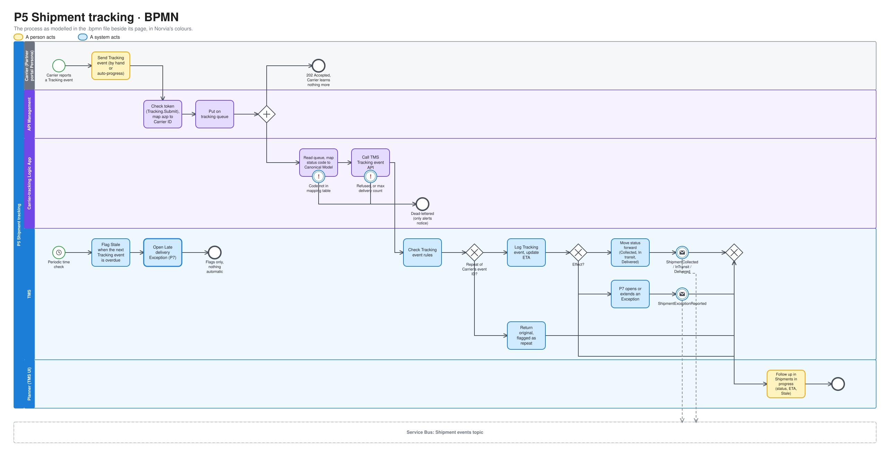
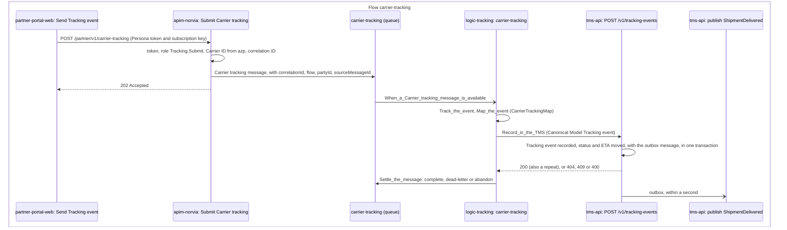

# P5 Shipment tracking

Shipment tracking records what happens to a Shipment after it has been handed over, and keeps its status and ETA up to date. Carriers, and later Drivers, report Tracking events. The TMS keeps every Tracking event and works out the Shipment's status from them. A Carrier's Tracking events are accepted asynchronously, so when one fails inside the integration layer, only Norvia can notice. Terms are defined in [GLOSSARY.md](../../../GLOSSARY.md).

| | |
|---|---|
| **Trigger** | A Carrier or Driver reports a Tracking event for a Shipment that is on its way |
| **Outcome** | The Tracking event recorded, the Shipment's status moved forward where the event warrants it, and its ETA updated |
| **Owning system** | TMS. It owns Shipments and their Tracking events (ADR 0002) |
| **Applies to** | Both. This design covers the Carrier source end to end. Own fleet feeds the same model through P12 |
| **Integrations touched** | Partner portal (Carrier Personas), API Management, Service Bus (tracking queue, Shipment events), Carrier-tracking Logic App, TMS Tracking event API |

## Process model

The model is [p5-shipment-tracking.bpmn](p5-shipment-tracking.bpmn), which opens in any BPMN tool and is the source. The picture is drawn from it by [bpmn.py](../../architecture/diagrams/bpmn.py), so change the model and run the script, not the picture ([the editable file](../../architecture/diagrams/bpmn-p5-shipment-tracking.excalidraw)).

## Scope

P5 defines the tracking model (Tracking events, Shipment statuses, ETA, Stale) and the Carrier path into it.

- **Carriers** are designed here in full.
- **Own fleet** is designed in [P12](p12-trip-execution.md). The Driver reports Logic App sends a Driver's Tracking events to the same TMS operation, with Own fleet as the source (see [Own fleet](#own-fleet)).
- **WMS ship events** are deferred, like the WMS handoff in P1.

## Tracking events and Shipment status

The TMS keeps every Tracking event it accepts as a log on the Shipment: what happened, when, where, the ETA if one was given, who reported it and a remark. The Shipment status follows from that log, but not every Tracking event changes it. The log keeps what the Carrier said separate from what the TMS concluded from it.

### Tracking event types

| Type | Moves the Shipment to | Kind |
|---|---|---|
| Collected | Collected | Progress |
| Departed | In transit | Progress |
| Arrived | In transit | Progress |
| Out for delivery | In transit | Progress |
| Delivered | Delivered | Progress |
| Collection failed | — | Exception |
| Delivery failed | — | Exception |
| Damaged | — | Exception |

An exception Tracking event never changes the status. It is recorded, and in the same transaction [P7](p7-exception-handling.md) opens an Exception for it, or adds it to an open one of the same type. The Planner decides what happens next.

### Shipment

P5 adds three Shipment statuses after P4's Booked.

| Status | Meaning |
|---|---|
| Collected | The goods have been picked up |
| In transit | The goods are on their way to the delivery address |
| Delivered | The goods have been delivered. Final for P5 |

A Carrier Shipment moves Booked → Collected → In transit → Delivered. An Own fleet Shipment has Dispatched in place of Booked and moves Released → Dispatched ([P11](p11-trip-dispatch.md)) → Collected → Delivered ([P12](p12-trip-execution.md)). Drivers send no Departed, Arrived or Out for delivery, so an Own fleet Shipment is never In transit.

The status **only moves forward**. A Tracking event moves the Shipment to its type's status when that status is further along than the current one. Otherwise it is only logged. So:

- **Steps can be skipped.** A Delivered straight after Booked moves the Shipment to Delivered, because some Carriers send only the final event.
- **Order comes from the event time**, not from when the event arrived. A late Collected after In transit is logged and changes nothing.
- **After Delivered**, Tracking events are still accepted and logged, with no status change. A late Delivery failed after a mistaken Delivered is therefore still on record, and P7 gets its event.

### ETA

The ETA comes from the Tracking event that **arrived last** and carried one. When no Tracking event has given an ETA, the ETA is the delivery window: the agreed delivery window if the Planner has set one (P7), otherwise the Transport Order's. The TMS doesn't calculate an ETA. An ETA after the delivery window opens a Late delivery Exception (P7).

## Steps

1. **Report.** The Carrier sends a Tracking event from its Persona in the Partner portal, by hand or through its tracking mode (see [Partner portal](#partner-portal)). The portal calls API Management with the Persona's token and subscription key.
2. **Accept.** API Management checks the token (audience "Norvia Partner API", role `Tracking.Submit`), maps the `azp` claim to a Carrier ID (ADR 0005) and creates a correlation ID. It puts the message with both on the Service Bus queue for inbound Carrier tracking and returns `202 Accepted`. The Carrier learns nothing more about this Tracking event (ADR 0008).
3. **Map.** The Carrier-tracking Logic App reads the queue. It maps the [Carrier tracking format](#carrier-tracking-format) to the Canonical Model, translating the Carrier's status code through its mapping table. A code that isn't in the table fails the run.
4. **Record.** The Logic App calls the TMS Tracking event API. The TMS checks the [Tracking event rules](#tracking-event-rules), records the Tracking event, moves the Shipment's status and ETA where the event warrants it, and publishes the matching [event](#events), all in one transaction.
5. **Follow up.** The Planner sees the Shipment in the list of Shipments in progress, with its last Tracking event, ETA and Stale flag (see [Planner's list](#planners-list)).

### When something fails

| Failure | What happens |
|---|---|
| The Carrier's status code isn't in the mapping table | The Logic App run fails. The message goes to the tracking queue's dead-letter queue |
| The TMS refuses the Tracking event (client error) | The Logic App dead-letters the message with the TMS's failure code and message. No retry |
| The TMS is unavailable (server error or timeout) | The message is retried from the queue. After the queue's maximum delivery count it goes to the dead-letter queue |

None of these reaches the Carrier. Nothing is lost, but it's only seen if someone watches: alerts on failed Carrier-tracking Logic App runs and on the dead-letter queue on the integration side, and the Stale flag on the business side.

## Carrier tracking format

The Carrier tracking format follows the conventions of the [Carrier booking format](p4-carrier-booking.md#carrier-booking-format): JSON with its own field names, flat address fields, local date/times without an offset, and ISO 3166 alpha-3 country codes. The Carrier-tracking Logic App maps Carrier → Canonical.

A Tracking event carries:

| Field | Required |
|---|---|
| Carrier booking reference | Yes |
| Carrier booking number | No. Used only when the reference doesn't match |
| Carrier's event ID | Yes |
| Status code | Yes |
| Event time, local to the location | Yes |
| Location: place, postcode, country | Yes |
| ETA, with its UTC offset | No |
| Remark | No |

The event time is read in the time zone of the event's location. The Canonical Model carries it with its offset. The ETA is the exception to the local times of the booking format: the message holds no delivery address, so the Carrier sends it with its UTC offset, and it is carried as UTC.

All Carriers use one shared code list:

| Carrier code | Tracking event type |
|---|---|
| `PU` | Collected |
| `DEP` | Departed |
| `ARR` | Arrived |
| `OFD` | Out for delivery |
| `POD` | Delivered |
| `NPU` | Collection failed |
| `NDL` | Delivery failed |
| `DMG` | Damaged |

The mapping table lives in the Carrier-tracking Logic App, not in the TMS. A Carrier that starts sending a new code breaks in the integration layer, where the health check looks.

## Tracking event rules

| Rule | Failure code |
|---|---|
| The Carrier booking reference (or number) is known for the Carrier from the token | `ShipmentNotFound` |
| That Carrier is the Carrier on the Shipment's Confirmed Carrier booking | `ShipmentNotFound` |
| The Shipment is Booked or later | `ShipmentNotInTransport` |
| The event time is not in the future, beyond a small clock-skew allowance | `EventTimeInTheFuture` (client error) |
| The status code maps to a known Tracking event type, and the required fields are present | `UnknownEventType` or `MissingRequiredField` (client error) |

A Carrier's events for one of its old bookings, one that was Rejected, Withdrawn or Cancelled (P7) before the Shipment went to someone else, are refused, not logged. For a Cancelled booking that holds even when the event time is before the cancellation (ADR 0010).

A Tracking event that repeats a Carrier's event ID already recorded for that Carrier succeeds, returns the original result flagged as a repeat, and publishes no event.

Each failure has a stable code and a readable message.

## Stale

A Shipment is **Stale** when its next expected Tracking event hasn't arrived in time. Each threshold is a TMS setting.

| Shipment is | Stale when | Default |
|---|---|---|
| Booked (or Dispatched, for Own fleet) | No Collected, this long after the collection window's latest time | 2 hours |
| Collected or In transit, and not Awaiting re-delivery ([P12](p12-trip-execution.md#re-delivery)) | No Tracking event of any kind for this long | 24 hours |
| Not yet Delivered | This long after the delivery window's latest time. The agreed delivery window counts when there is one (P7) | 2 hours |

Stale is only a flag. Nothing happens automatically, and it clears when a Tracking event arrives that makes the rule no longer true. The same time-based check also opens Late delivery Exceptions (P7), but Stale itself never opens one.

## Planner's list

P5 adds a fourth list to the Planner's three from P3 and P4.

| List | Shows | Actions |
|---|---|---|
| Shipments in progress (P5) | Booked (or Dispatched, for Own fleet), Collected and In transit Shipments: Shipment, Carrier (or Own fleet and the Trip number), status, last Tracking event (type, time, place), ETA and the Stale flag. Stale Shipments first, then by ETA | Open the timeline |

The timeline shows the Shipment's Tracking events in event-time order, with the time each one arrived and whether it moved the status. The timeline data also lists every Carrier booking of the Shipment, a rejected one with its reason code and text. [P6](p6-proof-of-delivery.md#planners-lists) adds Proofs of delivery to the timeline and a list of Delivered Shipments without one. The list is read-only. A Delivered Shipment leaves it. It updates without a page refresh, as the other lists do.

## Partner portal

Each Carrier Persona gets a list of its Shipments, Booked or later. A Delivered one stays on it, as its [Proof of delivery](p6-proof-of-delivery.md#partner-portal) can still be sent. Each undelivered Shipment offers buttons for the valid next progress Tracking events and for the exception Tracking events. Collection failed (`NPU`) is offered only while the Shipment is Booked.

Next to its answer mode from P4, each Persona has a **tracking mode**, set on its own Carrier page:

| Tracking mode | Behaviour | Default for |
|---|---|---|
| Manual | The presenter sends each Tracking event by hand | Every Carrier Persona |
| Auto-progress | After confirmation, the Persona sends `PU`, `DEP`, `OFD` and `POD` in turn, with a delay between each | — (seeded on Manual, because the [Simulator](../../operations/simulator.md) plays the Carriers; set it on the Carrier page when a demo wants it) |

The delay is a Partner portal setting per Persona, a few seconds by default. Automatic Tracking events go through exactly the same path as manual ones. The portal gives each Tracking event a unique event ID and a location from the Shipment's addresses.

## TMS API

The Tracking event API accepts only the Canonical Model (ADR 0003).

Who holds each role, and what else each identity may reach, is in [Identity and access](../../architecture/identity-and-access.md).

| Operation | Caller | Role |
|---|---|---|
| Record a Tracking event | Carrier-tracking Logic App. Driver reports Logic App ([P12](p12-trip-execution.md)) | `TrackingEvents.Record` |

The canonical Tracking event names its source: a Carrier ID, or Own fleet. For a Carrier, the Carrier comes from API Management through the Logic App, never from the payload.

Reading tracking for Shippers belongs to [P8](p8-shipper-visibility.md).

## Own fleet

Own fleet Shipments use the same model: the same Tracking event types, statuses, ETA and Stale rules. [P12](p12-trip-execution.md) adds a second caller of "Record a Tracking event", the Driver reports Logic App, with Own fleet as the source. An Own fleet Tracking event names its Trip and Shipment, and P12's [Driver report rules](p12-trip-execution.md#driver-report-rules) replace the Carrier booking rules above. It reaches the TMS as a Driver app event, in order per Trip, and the Driver is told whether it was recorded (ADR 0016). The events below carry the Trip number where they carry a Carrier booking reference.

## Correlation ID

API Management creates a new correlation ID for each Carrier Tracking event, as it does for each Carrier answer in P4. The TMS stores it on the Tracking event, and the events it publishes carry it.

Tracing a Tracking event follows the Shipment number and the Carrier's event ID. Tracing one that never reached the TMS starts at the dead-letter queue or the failed Logic App run, which keep the correlation ID and the Carrier's event ID.

## Events

All events go to the topic for Shipment events, through the TMS's transactional outbox (ADR 0003). A Tracking event that doesn't change the status and isn't an exception publishes nothing, and neither does an ETA update or a repeat. P8 reads those through its tracking API.

| Event | Published when | Carries | Consumers |
|---|---|---|---|
| `ShipmentCollected` | The Shipment moves to Collected | Shipment number, Transport Order number, Carrier ID or Own fleet, Carrier booking reference, event time, location, ETA, correlation ID | [Subscribers](../../architecture/events.md#catalogue) |
| `ShipmentInTransit` | The Shipment moves to In transit | As `ShipmentCollected` | [Subscribers](../../architecture/events.md#catalogue) |
| `ShipmentDelivered` | The Shipment moves to Delivered | As `ShipmentCollected` | [Subscribers](../../architecture/events.md#catalogue). [P9](p9-freight-settlement.md) acts inside the TMS in the same transaction, not on this event (ADR 0003). |
| `ShipmentExceptionReported` | An exception Tracking event is recorded | As `ShipmentCollected`, plus the exception type and remark | [Subscribers](../../architecture/events.md#catalogue). P7 opens its Exception inside the TMS, not from this event (ADR 0003). |

A Tracking event that skips steps publishes only the event for the status it lands on. For example, Delivered straight after Booked publishes only `ShipmentDelivered`.

Delivered doesn't wait for a Proof of delivery. [P6](p6-proof-of-delivery.md) attaches it separately and never changes the status. Invoicing does wait for it: a Transport Order is Billable only once it has a current Proof of delivery ([P9](p9-freight-settlement.md#conditions), ADR 0012).

## Presenter smoke run

After a deployment, and not in CI, the presenter checks Shipment tracking end to end on the deployed estate, before the headline incident breaks it. Do it after the presenter smoke run of Carrier booking ([docs/processes/tms/p4-carrier-booking.md](p4-carrier-booking.md#presenter-smoke-run)), whose Booked Shipment it tracks. Open the TMS UI and the Integration console side by side.

1. **Get a Booked Shipment.** Follow P4's run to step 7: Rotterdam to Düsseldorf as Brouwer Dranken, confirmed by Van Dijk Transport. Note the Transport Order number. In the TMS UI, the Shipment is in *Shipments in progress*, Booked, with no Tracking event yet. Then set Kessler Spedition back to *Manual*, as P4's last step says.
2. **Run the check.** Run `infra/smoke-test-shipment-tracking.sh <Transport Order number>`. It posts as Van Dijk Transport, through API Management, from a throwaway Container Apps job running as the Partner portal. It reads the TMS as the intake identity and Application Insights, which is usually 1 to 5 minutes behind. It checks that:
   - `PU`, `DEP` and `POD` each return `202 Accepted`, and the Shipment moves through Collected, In transit and Delivered, in the Planner's *Shipments in progress* until it is Delivered, with the three Tracking events on its timeline, each moving the status;
   - a Tracking event for a reference no Carrier booking has is accepted and lands on the `carrier-tracking` queue's dead-letter queue with `ShipmentNotFound`;
   - each accepted call is in Application Insights by its correlation ID, from API Management, the Carrier-tracking Logic App and the TMS.
3. **Stop the TMS.** The script then points the Carrier-tracking Logic App's `TMS_BASE_URL` at an address that answers nothing, and sends a `POD`. It still returns `202 Accepted`. The message is delivered again from the queue until, after the queue's maximum delivery count (10), Service Bus dead-letters it with `MaxDeliveryCountExceeded`. The script puts `TMS_BASE_URL` back, even when a check fails.
4. **Resubmit it.** The script prints the Integration console's link for the message. In the console, open the dead-letter queue of `carrier-tracking`, open the message and choose *Resubmit*. Press Enter in the script. The TMS records it: the Shipment's timeline holds a second Delivered event, which moved nothing. This is the dead-letter step the headline incident relies on.

The script prints `PASS` or `FAIL` per check, never a body, a token or a key, and ends with the pages to open. Dead-lettered messages are read with the presenter's own Service Bus Data Receiver right, by locking and releasing them, so the unknown reference's message stays on the queue for the console. Discard it there afterwards.

If a check fails, file the gap as its own issue against P5, rather than working around it in the run book.

## Implementation

For engineers and coding agents. It shows what the estate does when a Carrier reports a Tracking event, where each step lives in the repository, what plays each Azure piece on a developer's machine, and what is designed but not built. It follows the template set by [P1's Implementation section](p1-transport-order-intake.md#implementation). Azure is the estate [c4.md](../../architecture/c4.md) draws.

P5 is built for the Carrier source. The Own fleet source is accepted by the TMS API but has no caller yet ([Gaps](#gaps)).

### Message trail

The Hops a Carrier's Tracking event leaves on its Message trail, named as the [Integration console](../../operations/integration-console.md#message-trail) shows them, in time order. All of them belong to the one Flow `carrier-tracking`, on the correlation ID that API Management creates. The Carrier's event ID is the trail's `sourceMessageId`.

- The Carrier's reply ends at `202 Accepted`. Everything after the queue is invisible to it ([ADR 0008](../../adr/0008-carrier-tracking-events-are-accepted-asynchronously.md)).
- The publish Hop is named after the event the status landed on: `ShipmentCollected`, `ShipmentInTransit` or `ShipmentDelivered`. An exception Tracking event publishes `ShipmentExceptionReported`. A Tracking event that moves nothing, an ETA-only update and a repeat publish nothing, so the trail ends at the TMS call. The publish Hop appears only once the outbox has sent the message ([failure behaviour](../../architecture/failure-behaviour.md#the-tms-outbox)).
- A refused call stops at `apim-norvia` with `NotAllowedToSubmitTracking` or `NoCarrierForClient`. When API Management can't reach the queue the Hop is `Failed` with `TrackingNotQueued` and the Carrier gets `503`, so it sends the event again.
- A status code outside the mapping table fails `Map_the_event`. The Logic App dead-letters the message as `UnmappableTrackingMessage` and fails the run.
- A refusal by the TMS (`ShipmentNotFound`, `ShipmentNotInTransport`, `EventTimeInTheFuture`, `UnknownEventType`, `MissingRequiredField`) dead-letters the message with the TMS's failure code. A TMS that can't be reached abandons it back to the queue, the run fails with `TmsUnavailable`, and after ten deliveries Service Bus dead-letters it with `MaxDeliveryCountExceeded`. [Failure behaviour](../../architecture/failure-behaviour.md#p5-shipment-tracking) lists each row.
- An automatic Tracking event from a Persona ([tracking mode](#partner-portal)) leaves the same Hops as a manual one, started by the Partner portal's background worker instead of a click.
- The Own fleet source would leave a different trail, from the Driver reports Logic App ([P12](p12-trip-execution.md)). It isn't built.

### Code map

Links go to files, not lines, so they stay true as the code moves.

| Step | Where |
|---|---|
| 1a. Report: the Persona's list | The Carrier's Shipments: [Shipments.razor](../../../src/PartnerPortal/Norvia.PartnerPortal.Web/CarrierShipments/Shipments.razor) with [ListCarrierShipmentsHandler.cs](../../../src/PartnerPortal/Norvia.PartnerPortal.Application/CarrierShipments/List/ListCarrierShipmentsHandler.cs) and [CarrierShipmentView.cs](../../../src/PartnerPortal/Norvia.PartnerPortal.Application/CarrierShipments/CarrierShipmentView.cs). The buttons offered for each Shipment come from [TrackingRules.cs](../../../src/PartnerPortal/Norvia.PartnerPortal.Domain/CarrierBookings/TrackingRules.cs) and [TrackingEventType.cs](../../../src/PartnerPortal/Norvia.PartnerPortal.Domain/CarrierBookings/TrackingEventType.cs), worded by [TrackingEventText.cs](../../../src/PartnerPortal/Norvia.PartnerPortal.Web/CarrierShipments/TrackingEventText.cs) |
| 1b. Report: send | Handler [SendTrackingHandler.cs](../../../src/PartnerPortal/Norvia.PartnerPortal.Application/CarrierShipments/Send/SendTrackingHandler.cs) with [SendTrackingCommand.cs](../../../src/PartnerPortal/Norvia.PartnerPortal.Application/CarrierShipments/Send/SendTrackingCommand.cs) and [SentTrackingEvent.cs](../../../src/PartnerPortal/Norvia.PartnerPortal.Application/CarrierShipments/Send/SentTrackingEvent.cs). The Persona's event [CarrierTrackingEvent.cs](../../../src/PartnerPortal/Norvia.PartnerPortal.Domain/CarrierBookings/CarrierTrackingEvent.cs), the reply [TrackingReply.cs](../../../src/PartnerPortal/Norvia.PartnerPortal.Domain/CarrierBookings/TrackingReply.cs) and [TrackingResult.cs](../../../src/PartnerPortal/Norvia.PartnerPortal.Domain/CarrierBookings/TrackingResult.cs). The call `Send Tracking event` in [NorviaPartnerApiClient.cs](../../../src/PartnerPortal/Norvia.PartnerPortal.Infrastructure/PartnerApi/NorviaPartnerApiClient.cs) with [CarrierTrackingFormat.cs](../../../src/PartnerPortal/Norvia.PartnerPortal.Infrastructure/PartnerApi/CarrierTrackingFormat.cs). Tracking keys: [TrackingEventTracking.cs](../../../src/PartnerPortal/Norvia.PartnerPortal.Application/CarrierShipments/TrackingEventTracking.cs) |
| Tracking modes and automatic events | [CarrierTrackingSettings.cs](../../../src/PartnerPortal/Norvia.PartnerPortal.Domain/CarrierBookings/CarrierTrackingSettings.cs), [TrackingMode.cs](../../../src/PartnerPortal/Norvia.PartnerPortal.Domain/CarrierBookings/TrackingMode.cs), [CarrierTrackingPolicy.cs](../../../src/PartnerPortal/Norvia.PartnerPortal.Domain/CarrierBookings/CarrierTrackingPolicy.cs), [CarrierTrackingPolicies.cs](../../../src/PartnerPortal/Norvia.PartnerPortal.Application/CarrierShipments/TrackingSettings/CarrierTrackingPolicies.cs), [ChangeCarrierTrackingSettingsHandler.cs](../../../src/PartnerPortal/Norvia.PartnerPortal.Application/CarrierShipments/TrackingSettings/ChangeCarrierTrackingSettingsHandler.cs) and the panel [TrackingModePanel.razor](../../../src/PartnerPortal/Norvia.PartnerPortal.Web/CarrierShipments/TrackingModePanel.razor). Auto-progress: [AutoProgressWorker.cs](../../../src/PartnerPortal/Norvia.PartnerPortal.Web/CarrierShipments/AutoProgressWorker.cs), [SendDueTrackingHandler.cs](../../../src/PartnerPortal/Norvia.PartnerPortal.Application/CarrierShipments/AutoProgress/SendDueTrackingHandler.cs) and [NextAutoProgressSpec.cs](../../../src/PartnerPortal/Norvia.PartnerPortal.Domain/CarrierBookings/NextAutoProgressSpec.cs) |
| 2. Accept | API Management: [submit-carrier-tracking.policy.xml](../../../infra/estate/partner-api/submit-carrier-tracking.policy.xml), the operation `submit-carrier-tracking` declared in [partner-api.bicep](../../../infra/estate/partner-api.bicep). The queue `carrier-tracking` and the sender and receiver roles: [messaging.bicep](../../../infra/estate/messaging.bicep). Contract and samples: [carrier-tracking.v1.schema.json](../../../contracts/partner-api/carrier-tracking.v1.schema.json) and [the Partner API contract](../../../contracts/partner-api/README.md) |
| 3. Map | Logic App: [workflow.json](../../../src/Integration/TrackingLogicApp/carrier-tracking/workflow.json) (`Track_the_event`, `Map_the_event`, `Dead_letter_the_unmappable_message`). Function: [MapCarrierTracking.cs](../../../src/Integration/Norvia.Integration.CarrierTracking.Functions/MapCarrierTracking.cs). Map and code list: [CarrierTrackingMap.cs](../../../src/Integration/Norvia.Integration.CarrierBooking/CarrierTrackingMap.cs) with [TrackingMapResult.cs](../../../src/Integration/Norvia.Integration.CarrierBooking/TrackingMapResult.cs). Canonical contract: [tracking-event.v1.schema.json](../../../contracts/canonical-model/tracking-event.v1.schema.json) |
| 4a. Record: call | Logic App: `Record_in_the_TMS`. Endpoint `POST /v1/tracking-events` in [TrackingEventEndpoints.cs](../../../src/Tms/Norvia.Tms.Api/TrackingEvents/TrackingEventEndpoints.cs) (role `TrackingEvents.Record`, tracked as `Flows.CarrierTracking`) with [TrackingEventRequest.cs](../../../src/Tms/Norvia.Tms.Api/TrackingEvents/TrackingEventRequest.cs). Handler [RecordTrackingHandler.cs](../../../src/Tms/Norvia.Tms.Application/TrackingEvents/Record/RecordTrackingHandler.cs) with [RecordTrackingCommand.cs](../../../src/Tms/Norvia.Tms.Application/TrackingEvents/Record/RecordTrackingCommand.cs), [RecordTrackingResult.cs](../../../src/Tms/Norvia.Tms.Application/TrackingEvents/Record/RecordTrackingResult.cs) and [TrackingEventRefused.cs](../../../src/Tms/Norvia.Tms.Application/TrackingEvents/TrackingEventRefused.cs) |
| 4b. Record: rules and aggregate | The rules and their failure codes: [TrackingEventRules.cs](../../../src/Tms/Norvia.Tms.Domain/TrackingEvents/TrackingEventRules.cs), [TrackingEventRefusal.cs](../../../src/Tms/Norvia.Tms.Domain/TrackingEvents/TrackingEventRefusal.cs) and [TrackingEventRefusalCode.cs](../../../src/Tms/Norvia.Tms.Domain/TrackingEvents/TrackingEventRefusalCode.cs). The repeat check: [TrackingEventBySourceEventIdSpec.cs](../../../src/Tms/Norvia.Tms.Domain/TrackingEvents/TrackingEventBySourceEventIdSpec.cs). The log entry [TrackingEvent.cs](../../../src/Tms/Norvia.Tms.Domain/TrackingEvents/TrackingEvent.cs) with [TrackingEventType.cs](../../../src/Tms/Norvia.Tms.Domain/TrackingEvents/TrackingEventType.cs), [TrackingEventTypeExtensions.cs](../../../src/Tms/Norvia.Tms.Domain/TrackingEvents/TrackingEventTypeExtensions.cs), [TrackingReport.cs](../../../src/Tms/Norvia.Tms.Domain/TrackingEvents/TrackingReport.cs), [TrackingSource.cs](../../../src/Tms/Norvia.Tms.Domain/TrackingEvents/TrackingSource.cs) and [TrackingLocation.cs](../../../src/Tms/Norvia.Tms.Domain/TrackingEvents/TrackingLocation.cs). Aggregate method `Record` (the status only moves forward) in [Shipment.cs](../../../src/Tms/Norvia.Tms.Domain/Shipments/Shipment.cs) with [ShipmentStatus.cs](../../../src/Tms/Norvia.Tms.Domain/Shipments/ShipmentStatus.cs). ETA: [ShipmentEta.cs](../../../src/Tms/Norvia.Tms.Domain/TrackingEvents/ShipmentEta.cs). Stored by [TrackingEventConfiguration.cs](../../../src/Tms/Norvia.Tms.Infrastructure/Data/Configurations/TrackingEventConfiguration.cs). The clock-skew allowance `ClockSkew` is in [TrackingEventOptions.cs](../../../src/Tms/Norvia.Tms.Infrastructure/TrackingEvents/TrackingEventOptions.cs) |
| 4c. Record: exceptions | In the same transaction [RecordTrackingHandler.cs](../../../src/Tms/Norvia.Tms.Application/TrackingEvents/Record/RecordTrackingHandler.cs) opens or adds to an Exception for an exception Tracking event, and checks Late delivery against the ETA through [ExceptionCauses.cs](../../../src/Tms/Norvia.Tms.Application/Exceptions/ExceptionCauses.cs) (see [P7](p7-exception-handling.md)). The same transaction also decides Billable for a Delivered event, through [BillingCheck.cs](../../../src/Tms/Norvia.Tms.Application/Billing/BillingCheck.cs) ([P9](p9-freight-settlement.md)) |
| 4d. Publish | Event types [ShipmentCollectedEvent.cs](../../../src/Tms/Norvia.Tms.Domain/Shipments/ShipmentCollectedEvent.cs), [ShipmentInTransitEvent.cs](../../../src/Tms/Norvia.Tms.Domain/Shipments/ShipmentInTransitEvent.cs), [ShipmentDeliveredEvent.cs](../../../src/Tms/Norvia.Tms.Domain/Shipments/ShipmentDeliveredEvent.cs) and [ShipmentExceptionReportedEvent.cs](../../../src/Tms/Norvia.Tms.Domain/Shipments/ShipmentExceptionReportedEvent.cs). Publishers [PublishShipmentCollected.cs](../../../src/Tms/Norvia.Tms.Application/TrackingEvents/Record/PublishShipmentCollected.cs), [PublishShipmentInTransit.cs](../../../src/Tms/Norvia.Tms.Application/TrackingEvents/Record/PublishShipmentInTransit.cs), [PublishShipmentDelivered.cs](../../../src/Tms/Norvia.Tms.Application/TrackingEvents/Record/PublishShipmentDelivered.cs) and [PublishShipmentExceptionReported.cs](../../../src/Tms/Norvia.Tms.Application/TrackingEvents/Record/PublishShipmentExceptionReported.cs), messages [ShipmentCollectedV1.cs](../../../src/Tms/Norvia.Tms.Application/TrackingEvents/Record/ShipmentCollectedV1.cs), [ShipmentInTransitV1.cs](../../../src/Tms/Norvia.Tms.Application/TrackingEvents/Record/ShipmentInTransitV1.cs), [ShipmentDeliveredV1.cs](../../../src/Tms/Norvia.Tms.Application/TrackingEvents/Record/ShipmentDeliveredV1.cs) and [ShipmentExceptionReportedV1.cs](../../../src/Tms/Norvia.Tms.Application/TrackingEvents/Record/ShipmentExceptionReportedV1.cs), sent by [OutboxPublisher.cs](../../../src/Tms/Norvia.Tms.Infrastructure/Outbox/OutboxPublisher.cs). Contracts [shipment-collected.v1.schema.json](../../../contracts/canonical-model/shipment-collected.v1.schema.json), [shipment-in-transit.v1.schema.json](../../../contracts/canonical-model/shipment-in-transit.v1.schema.json), [shipment-delivered.v1.schema.json](../../../contracts/canonical-model/shipment-delivered.v1.schema.json) and [shipment-exception-reported.v1.schema.json](../../../contracts/canonical-model/shipment-exception-reported.v1.schema.json). Topic and subscriptions: [messaging.bicep](../../../infra/estate/messaging.bicep) |
| 4e. Settle | Logic App: `Settle_the_message` with `Complete_the_message`, `Dead_letter_the_refused_message` and `Abandon_the_message_to_retry` in the same [workflow.json](../../../src/Integration/TrackingLogicApp/carrier-tracking/workflow.json). The settling rules: [TmsTrackingOutcome.cs](../../../src/Integration/Norvia.Integration.CarrierBooking/TmsTrackingOutcome.cs) and [TrackingSettlement.cs](../../../src/Integration/Norvia.Integration.CarrierBooking/TrackingSettlement.cs) |
| 5a. Follow up: Shipments in progress | Handler [ListShipmentsInProgressHandler.cs](../../../src/Tms/Norvia.Tms.Application/Shipments/ListInProgress/ListShipmentsInProgressHandler.cs) with [ShipmentsInProgressSpec.cs](../../../src/Tms/Norvia.Tms.Domain/Shipments/ShipmentsInProgressSpec.cs), [ShipmentInProgressSummary.cs](../../../src/Tms/Norvia.Tms.Application/Shipments/ListInProgress/ShipmentInProgressSummary.cs) and [LastTrackingEventView.cs](../../../src/Tms/Norvia.Tms.Application/Shipments/ListInProgress/LastTrackingEventView.cs). Endpoint `GET /v1/shipments/in-progress` in [ShipmentEndpoints.cs](../../../src/Tms/Norvia.Tms.Api/Shipments/ShipmentEndpoints.cs). The page [ShipmentsInProgress.razor](../../../src/Tms/Norvia.Tms.Web/Shipments/ShipmentsInProgress.razor), worded by [TrackingText.cs](../../../src/Tms/Norvia.Tms.Web/Shipments/TrackingText.cs) |
| 5b. Follow up: Stale | The rule [ShipmentStaleRules.cs](../../../src/Tms/Norvia.Tms.Domain/Shipments/ShipmentStaleRules.cs), worked out each time the list is read. The thresholds `CollectionGrace`, `SilenceLimit` and `DeliveryGrace` are in [ShipmentStaleOptions.cs](../../../src/Tms/Norvia.Tms.Infrastructure/Shipments/ShipmentStaleOptions.cs) |
| 5c. Follow up: the timeline | Endpoint `GET /v1/shipments/{number}/tracking-events` in [ShipmentEndpoints.cs](../../../src/Tms/Norvia.Tms.Api/Shipments/ShipmentEndpoints.cs). Handler [GetTrackingTimelineHandler.cs](../../../src/Tms/Norvia.Tms.Application/TrackingEvents/Timeline/GetTrackingTimelineHandler.cs) with [TrackingTimelineSpec.cs](../../../src/Tms/Norvia.Tms.Domain/TrackingEvents/TrackingTimelineSpec.cs), [ShipmentTimeline.cs](../../../src/Tms/Norvia.Tms.Application/TrackingEvents/Timeline/ShipmentTimeline.cs) and [TrackingTimelineEntry.cs](../../../src/Tms/Norvia.Tms.Application/TrackingEvents/Timeline/TrackingTimelineEntry.cs). The component [TrackingTimeline.razor](../../../src/Tms/Norvia.Tms.Web/Shipments/TrackingTimeline.razor), opened from [ShipmentDetail.razor](../../../src/Tms/Norvia.Tms.Web/Shipments/ShipmentDetail.razor) |
| Tracking | The flow name is in [Flows.cs](../../../src/Tms/Norvia.Tms.Application/IntegrationEvents/Flows.cs). The call puts the keys in the log scope: [TrackTrackingEventInLoggingScope.cs](../../../src/Tms/Norvia.Tms.Application/TrackingEvents/Record/TrackTrackingEventInLoggingScope.cs) |
| The applications | The TMS API, TMS UI and Partner portal are declared in the [AppHost](../../../src/Norvia.AppHost/AppHost.cs). The Function host is the [tracking Functions project](../../../src/Integration/Norvia.Integration.CarrierTracking.Functions/Norvia.Integration.CarrierTracking.Functions.csproj), deployed with its Logic App |
| The Logic App resources | [tracking-logic-app.bicep](../../../infra/estate/tracking-logic-app.bicep) deployed by [deploy-tracking-logic-app.sh](../../../infra/deploy-tracking-logic-app.sh) |
| The presenter smoke run | [smoke-test-shipment-tracking.sh](../../../infra/smoke-test-shipment-tracking.sh), run after the [Carrier booking](../../../infra/smoke-test-carrier-booking.sh) smoke run |

### Locally

Under Aspire two stand-ins split the path as it splits in Azure ([ADR 0031](../../adr/0031-locally-a-stand-in-and-a-hosted-worker-play-the-carrier-tracking-path.md)). `Norvia.Integration.LocalPartnerApi` plays API Management: [SubmitCarrierTracking.cs](../../../src/Integration/Norvia.Integration.LocalPartnerApi/SubmitCarrierTracking.cs) makes the policy's checks in the same order, creates the correlation ID and puts the message on the queue through [ServiceBusTrackingQueue.cs](../../../src/Integration/Norvia.Integration.LocalPartnerApi/ServiceBusTrackingQueue.cs). `Norvia.Integration.LocalTrackingWorker` plays the Carrier-tracking Logic App: [TrackingQueueConsumer.cs](../../../src/Integration/Norvia.Integration.LocalTrackingWorker/TrackingQueueConsumer.cs) reads the queue, and [CarrierTrackingFlow.cs](../../../src/Integration/Norvia.Integration.LocalTrackingWorker/CarrierTrackingFlow.cs) runs the map ([CarrierTrackingMap.cs](../../../src/Integration/Norvia.Integration.CarrierBooking/CarrierTrackingMap.cs)), the call to the TMS ([TmsTrackingEvents.cs](../../../src/Integration/Norvia.Integration.LocalTrackingWorker/TmsTrackingEvents.cs)) and the settling by `TmsTrackingOutcome`, the same classes the workflow's expressions are tested against. The Partner portal, the TMS API and the TMS UI are the same applications in both, the Service Bus emulator plays Service Bus with the `carrier-tracking` queue declared in the [AppHost](../../../src/Norvia.AppHost/AppHost.cs), and the Aspire dashboard plays Application Insights. The full map is in [local-vs-azure.md](../../architecture/local-vs-azure.md).

Three differences matter for P5:

- The edge's checks on a Tracking event and the policy's are two implementations kept close by tests ([SubmitCarrierTrackingPolicyTests.cs](../../../tests/Integration/Norvia.Integration.CarrierBooking.UnitTests/PartnerApi/SubmitCarrierTrackingPolicyTests.cs)). Entra enforces the `Tracking.Submit` role in Azure. Locally the Partner portal signs each Persona's token itself with that role.
- The queue's lock is 1 minute in Azure and not set locally, and the maximum delivery count of 10 is set on both. A slow TMS is only proved not to be redelivered in Azure.
- Stopping `tracking-worker` is the local way to see messages wait on the queue. It is the presenter-panel fault of [Deferred](#deferred) where the TMS fails for a few minutes.

To see P5 locally, book and release a Shipment as in [P4](p4-carrier-booking.md#locally), confirm it from the Carrier's inbox, then send Tracking events from the Carrier's *Shipments* page, or set the Persona to Auto-progress. The steps of the [presenter smoke run](#presenter-smoke-run) work the same way, apart from the script, which needs a deployed estate.

### Gaps

Designed in this document and not built yet:

| Gap | Where it stands |
|---|---|
| The Own fleet source | The TMS API accepts a Tracking event with Own fleet as its source ([TrackingEventEndpoints.cs](../../../src/Tms/Norvia.Tms.Api/TrackingEvents/TrackingEventEndpoints.cs)). The Driver reports Logic App that calls it, and the Dispatched Shipments and Trips behind it, are [P12](p12-trip-execution.md#implementation), which is not built |
| Stale for Own fleet | [ShipmentStaleRules.cs](../../../src/Tms/Norvia.Tms.Domain/Shipments/ShipmentStaleRules.cs) knows Booked, Dispatched, Collected and In transit, and treats Dispatched like Booked for the collection rule. It has no Awaiting re-delivery exemption |
| Polling Carrier tracking APIs, per-Carrier code lists, WMS ship events, a Planner recording a Tracking event, a TMS-calculated ETA | See [Deferred](#deferred) |
| As-found toggles and presenter-panel faults for P5 | None added. No Bicep parameter switches anything broken in tracking, and nothing in the Partner portal injects a fault. [Failure behaviour](../../architecture/failure-behaviour.md#p5-shipment-tracking) lists the row each would worsen: a Carrier code outside the mapping table, no alert on failed runs, no alert on the dead-letter queue, the TMS failing for a few minutes, the Stale thresholds unset |
| Alerts on P5 | None built: failed runs of the Carrier-tracking Logic App and the `carrier-tracking` dead-letter queue are planned only ([monitoring.bicep](../../../infra/estate/monitoring.bicep) declares no alert rule) |
| The Integration console's failed runs and dead-letter panels for P5 | Planned, slice 2. Finding the Hops and opening the run are built. Resubmit and discard of the dead-lettered message, which the smoke run's last step uses, are planned |

## Deferred

These were left out on purpose while designing P5, each with its reason.

- **Polling Carrier tracking APIs.** Push through the Partner portal re-enacts the headline incident as told. Polling can be added as a variant.
- **Per-Carrier status code lists.** One shared list, as P4 has one Carrier booking format.
- **WMS ship events.** The WMS handoff is deferred in P1.
- **The Planner recording a Tracking event by hand**, for example when a Carrier phones in. It would add a third source with its own permissions, and it would cover up exactly the silent failure the demo exists to expose.
- **A TMS-calculated ETA.** It would need routing data the sandbox doesn't have.
- **What to do about an exception.** P5 records Collection failed, Delivery failed and Damaged. Re-planning or notifying the Shipper is [P7](p7-exception-handling.md).
- **Showing the Shipper its progress.** That is [P8](p8-shipper-visibility.md), which also defers pushing progress and Consignee tracking.
- **Driver and vehicle details from the Carrier.** Tracking doesn't need them either.
- **As-found toggles and presenter-panel faults.** They are added after the fixed state is built, as for P1 to P4. The candidates:
  - Presenter-panel fault: a Carrier sends a status code outside the mapping table (for example `DLV` instead of `POD`), so the Carrier-tracking Logic App run fails.
  - Toggle: no alert on failed Carrier-tracking Logic App runs. Together with the fault above, this re-enacts the headline incident: the Carrier posts "delivered", gets `202 Accepted`, and the Shipment stays In transit with no one told.
  - Toggle: no alert on the dead-letter queue of the tracking queue.
  - Presenter-panel fault: the TMS Tracking event API fails for a few minutes. Messages wait on the queue and are retried, so nothing is lost. This contrasts with the fault above.
  - Toggle: the Stale thresholds unset, so the business-side safety net is missing too, and only a Consignee's phone call reveals the problem.
