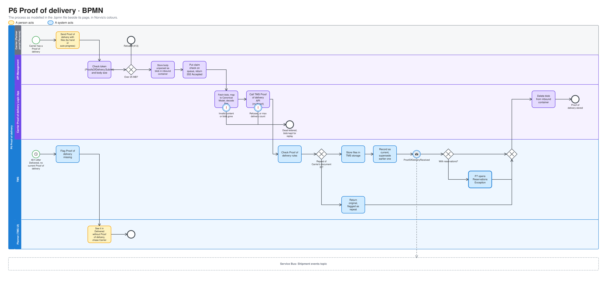
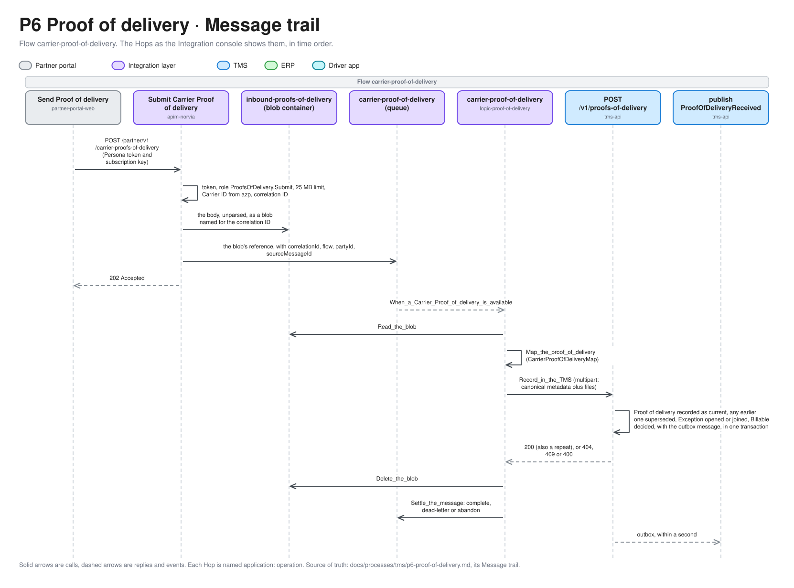

# P6 Proof of delivery

Proof of delivery records the Consignee's confirmation that it received a Shipment's goods, and keeps it on the Shipment. Carriers, and later Drivers, send a Proof of delivery with its files. The TMS stores it, makes it the Shipment's current one, and flags Delivered Shipments that are still missing one. A Carrier's Proof of delivery travels as a claim check and is accepted asynchronously, so when one fails inside the integration layer, only Norvia can notice. Terms are defined in [GLOSSARY.md](../../../GLOSSARY.md).

| | |
|---|---|
| **Trigger** | A Carrier or Driver sends a Proof of delivery for a Shipment that is Booked or later |
| **Outcome** | The Proof of delivery and its files stored by the TMS as the Shipment's current one, any earlier one superseded, and `ProofOfDeliveryReceived` published |
| **Owning system** | TMS. It owns Shipments and their Proofs of delivery, files included (ADR 0002) |
| **Applies to** | Both. This design covers the Carrier source end to end. Own fleet feeds the same model through P12 |
| **Integrations touched** | Partner portal (Carrier Personas), API Management, inbound blob container, Service Bus (Proof of delivery queue, Shipment events), Carrier Proof of delivery Logic App, TMS Proof of delivery API |

## Process model

The model is [p6-proof-of-delivery.bpmn](p6-proof-of-delivery.bpmn), which opens in any BPMN tool and is the source. The picture is drawn from it by [bpmn.py](../../architecture/diagrams/bpmn.py), so change the model and run the script, not the picture ([the editable file](../../architecture/diagrams/bpmn-p6-proof-of-delivery.excalidraw)).

## Scope

P6 defines the Proof of delivery model (content, current and superseded, the missing flag) and the Carrier path into it.

- **Carriers** are designed here in full.
- **Own fleet** is designed in [P12](p12-trip-execution.md). The Driver reports Logic App sends a Driver's Proof of delivery to the same TMS operation, with Own fleet as the source (see [Own fleet](#own-fleet)).
- **Shipper access** to a Proof of delivery belongs to P8. Invoicing waits for one: a Transport Order is Billable only with a current Proof of delivery ([P9](p9-freight-settlement.md#conditions), ADR 0012).

## Proof of delivery

A Proof of delivery holds:

| Part | Required |
|---|---|
| Received by: the name of the person who signed | Yes |
| Delivery time and place | Yes |
| Condition: clean, or with reservations | Yes |
| Remark. Required when the condition is with reservations | No |
| Files: a signed CMR, a signature, photos. PDF, JPEG or PNG, 1 to 5 files, each 10 MB or less | Yes |
| Source: a Carrier ID, or Own fleet | Yes |

### Current and superseded

A Shipment has at most one **current** Proof of delivery. A later one, with a different document ID, becomes current, and the earlier one is kept as **superseded**, files and all. A Carrier can therefore send a clearer scan, or a photo first and the signed CMR later. Nothing is merged: each Proof of delivery stands on its own.

### Relationship to the Shipment status

A Proof of delivery **never changes the Shipment status**. Only Tracking events do (P5). Tracking events and Proofs of delivery arrive on separate paths, so a Proof of delivery can arrive before the Delivered Tracking event, or for a Shipment that is still In transit. It is accepted and attached for any Shipment that is Booked or later, and the Planner sees it flagged (see [Planner's lists](#planners-lists)). Refusing it would lose a commercially important document over a race.

A Proof of delivery with reservations doesn't create a Damaged Tracking event either. The TMS doesn't invent Tracking events on a reporter's behalf. It records the reservations, and in the same transaction [P7](p7-exception-handling.md) opens a Reservations Exception, or adds it to an open one.

The delivery time on the Proof of delivery is what the Consignee signed. It isn't checked against the Delivered Tracking event's time.

## Steps

1. **Send.** The Carrier sends a Proof of delivery from its Persona in the Partner portal, by hand or through its tracking mode (see [Partner portal](#partner-portal)). The portal calls API Management with the Persona's token and subscription key. The body is one JSON document with the files base64-encoded.
2. **Accept.** API Management checks the token (audience "Norvia Partner API", role `ProofsOfDelivery.Submit`) and the body size, maps the `azp` claim to a Carrier ID (ADR 0005) and creates a correlation ID. It stores the body unparsed as a blob in the inbound container, then puts a message with the blob reference, the Carrier ID and the correlation ID on the Service Bus queue for inbound Proofs of delivery, and returns `202 Accepted` (ADR 0009). The Carrier learns nothing more about this Proof of delivery.
3. **Map.** The Carrier Proof of delivery Logic App reads the queue and fetches the blob. It maps the [Carrier Proof of delivery format](#carrier-proof-of-delivery-format) to the Canonical Model and decodes the files.
4. **Record.** The Logic App calls the TMS Proof of delivery API in one multipart call: the canonical metadata plus the files. The TMS checks the [Proof of delivery rules](#proof-of-delivery-rules), stores the files in its own storage, records the Proof of delivery as current, supersedes any earlier one, and publishes `ProofOfDeliveryReceived`, all in one transaction.
5. **Clean up.** Once the TMS has accepted it, the Logic App deletes the blob from the inbound container.
6. **Follow up.** The Planner sees Delivered Shipments without a Proof of delivery in their own list, and each Proof of delivery on the Shipment's timeline (see [Planner's lists](#planners-lists)).

### When something fails

| Failure | What happens |
|---|---|
| The body is over 25 MB | API Management refuses it with `413`. The only failure the Carrier sees |
| API Management stored the blob but couldn't put the message on the queue | The Carrier gets a server error and can send again. The orphaned blob is removed by the inbound container's retention rule |
| The content is invalid (a missing field, a bad file, the blob is gone) | The Logic App run fails. The message goes to the Proof of delivery queue's dead-letter queue |
| The TMS refuses the Proof of delivery (client error) | The Logic App dead-letters the message with the TMS's failure code and message. No retry |
| The TMS is unavailable (server error or timeout) | The message is retried from the queue. After the queue's maximum delivery count it goes to the dead-letter queue |

In every failure after `202`, the blob stays in the inbound container, so a dead-lettered message can be investigated and replayed. A lifecycle rule deletes anything left there after 90 days, the integration layer's retention (`integrationRetentionDays`).

None of these reaches the Carrier. Nothing is lost, but it's only seen if someone watches: alerts on failed Carrier Proof of delivery Logic App runs and on the dead-letter queue on the integration side, and the missing flag on the business side.

## Carrier Proof of delivery format

The Carrier Proof of delivery format follows the conventions of the [Carrier booking format](p4-carrier-booking.md#carrier-booking-format): JSON with its own field names, flat address fields, local date/times without an offset, and ISO 3166 alpha-3 country codes. Files are carried base64-encoded inside the JSON, so API Management can store the body without parsing it. The Carrier Proof of delivery Logic App maps Carrier → Canonical.

A Proof of delivery carries:

| Field | Required |
|---|---|
| Carrier booking reference | Yes |
| Carrier booking number | No. Used only when the reference doesn't match |
| Carrier's document ID | Yes |
| Received by | Yes |
| Delivery time, local to the location | Yes |
| Location: place, postcode, country | Yes |
| Condition: `CLEAN` or `RESERVATIONS` | Yes |
| Remark | Only with `RESERVATIONS` |
| Files: name, content type, content (base64) | 1 to 5 |

## Proof of delivery rules

| Rule | Failure code |
|---|---|
| The Carrier booking reference (or number) is known for the Carrier from the token | `ShipmentNotFound` |
| That Carrier is the Carrier on the Shipment's Confirmed Carrier booking | `ShipmentNotFound` |
| The Shipment is Booked or later | `ShipmentNotInTransport` |
| The delivery time is not in the future, beyond a small clock-skew allowance | Client error |
| The required fields are present, and a remark comes with reservations | Client error |
| 1 to 5 files, each 10 MB or less, each a PDF, JPEG or PNG judged by its content, not its declared name or type | `FileNotAccepted` |

A Carrier's Proof of delivery for one of its old bookings, one that was Rejected, Withdrawn or Cancelled (P7) before the Shipment went to someone else, is refused, not stored.

A Proof of delivery that repeats a Carrier's document ID already recorded for that Carrier succeeds, returns the original result flagged as a repeat, and publishes no event.

Each failure has a stable code and a readable message.

## Missing Proof of delivery

A Delivered Shipment is flagged **Proof of delivery missing** when it has no current Proof of delivery this long after the event time of its Delivered Tracking event. The threshold is a TMS setting, 48 hours by default. The rule is the same for Own fleet.

Like Stale, it is only a flag. Nothing happens automatically, it publishes nothing, and it clears when a Proof of delivery arrives. Chasing the Carrier happens outside the TMS.

## Planner's lists

P6 adds a fifth list to the Planner's four from P3 to P5, and extends P5's.

| List | Shows | Actions |
|---|---|---|
| Shipments in progress (P5, extended) | As in P5, plus a marker when a Proof of delivery has arrived before the Shipment is Delivered | Open the timeline |
| Delivered without Proof of delivery (P6) | Delivered Shipments with no current Proof of delivery: Shipment, Carrier or Own fleet, delivered time and the missing flag. Flagged Shipments first, then oldest first | Open the timeline |

A Shipment leaves the new list when a Proof of delivery arrives. The list is read-only and updates without a page refresh, as the other lists do.

The timeline shows Proofs of delivery alongside the Tracking events, in time order: received by, delivery time, condition and remark, and the files to view or download. Superseded Proofs of delivery are shown struck through.

## Partner portal

Each Shipment in a Carrier Persona's list, Delivered ones included, offers **Send Proof of delivery** once it is Booked. The form asks for received by, condition, remark (required with reservations) and files, 1 to 5: uploaded, or a sample CMR bundled with the portal. Nothing is sent until the presenter sends it.

The tracking modes from P5 decide whether one is sent automatically:

| Tracking mode | Proof of delivery |
|---|---|
| Manual | Only by hand |
| Auto-progress | After `POD` (Delivered), the Persona also sends a clean Proof of delivery with the sample CMR, after the same delay |

Automatic Proofs of delivery go through exactly the same path as manual ones. The portal gives each one a unique document ID and a location from the Shipment's delivery address.

## TMS API

The Proof of delivery API accepts only the Canonical Model (ADR 0003). It takes the files in the same call, as multipart. The TMS never reads from the integration layer's storage.

Who holds each role, and what else each identity may reach, is in [Identity and access](../../architecture/identity-and-access.md).

| Operation | Caller | Role |
|---|---|---|
| Record a Proof of delivery (canonical metadata plus files) | Carrier Proof of delivery Logic App. Driver reports Logic App ([P12](p12-trip-execution.md)) | `ProofsOfDelivery.Record` |
| Read a Proof of delivery file | TMS UI. Shippers use P8's own operation | Planner permissions from P3 |

The canonical Proof of delivery names its source: a Carrier ID, or Own fleet. For a Carrier, the Carrier comes from API Management through the Logic App, never from the payload.

## Storage

The TMS keeps Proof of delivery files in its own blob container. They stay in the hot tier for 30 days, then move to cool. They aren't deleted: a legal retention period is deferred.

The inbound container belongs to the integration layer and is only transit. The Logic App deletes each blob once the TMS has accepted it, and a lifecycle rule deletes anything left after 90 days, the integration layer's retention (`integrationRetentionDays`).

## Own fleet

Own fleet Shipments use the same model: the same content, current and superseded, and missing flag. [P12](p12-trip-execution.md) adds a second caller of "Record a Proof of delivery", the Driver reports Logic App, with Own fleet as the source.

- **Capture.** The Driver app requires a Proof of delivery to complete a delivery Stop as Delivered: received by, condition, a signature drawn on screen and up to four photos ([Capturing a Proof of delivery](p12-trip-execution.md#capturing-a-proof-of-delivery)). So the missing flag should almost never be raised for Own fleet, and when it is, a report went wrong in the integration layer.
- **Files.** They travel by claim check through the Driver app's own transit container, and the Driver reports Logic App makes the same multipart call as the Carrier Logic App (ADR 0016).
- **Rules.** P12's [Driver report rules](p12-trip-execution.md#driver-report-rules) replace the Carrier booking rules above. The content and file rules apply unchanged.

`ProofOfDeliveryReceived` carries the Trip number where it carries a Carrier booking reference.

## Correlation ID

API Management creates a new correlation ID for each Carrier Proof of delivery, as it does for each Carrier Tracking event in P5. It travels on the queue message. The TMS stores it on the Proof of delivery, and `ProofOfDeliveryReceived` carries it.

Tracing a Proof of delivery follows the Shipment number and the Carrier's document ID. Tracing one that never reached the TMS starts at the dead-letter queue or the failed Logic App run, which keep the correlation ID and the blob reference. The blob holds the Carrier's document ID.

## Events

All events go to the topic for Shipment events, through the TMS's transactional outbox (ADR 0003). A repeat publishes nothing, and neither does the missing flag.

| Event | Published when | Carries | Consumers |
|---|---|---|---|
| `ProofOfDeliveryReceived` | A Proof of delivery is recorded, including one that replaces an earlier one | Shipment number, Transport Order number, Carrier ID or Own fleet, Carrier booking reference, received by, delivery time, condition, remark, number of files, whether it replaces an earlier one, correlation ID | [Subscribers](../../architecture/events.md#catalogue). P7 opens its Exception, and P9 checks whether the order is Billable, inside the TMS, not from this event (ADR 0003). |

The event carries no file content and no link. Consumers read the files through the TMS.

## Presenter smoke run

After a deployment, and not in CI, the presenter checks Proof of delivery end to end on the deployed estate, before the headline incident breaks the claim-check path. Do it after the presenter smoke run of Shipment tracking ([docs/processes/tms/p5-shipment-tracking.md](p5-shipment-tracking.md#presenter-smoke-run)), whose steps get a Shipment Booked. Open the TMS UI and the Integration console side by side.

1. **Get another Booked Shipment.** Follow P4's run to step 7 again: Rotterdam to Düsseldorf as Brouwer Dranken, confirmed by Van Dijk Transport. Note the Transport Order number, and set Kessler Spedition back to *Manual* afterwards. Keep the Van Dijk Transport Persona's tracking mode on *Manual*, as the script delivers the Shipment itself, and an Auto-progress Persona would send a Proof of delivery of its own.
2. **Run the check.** Run `infra/smoke-test-proof-of-delivery.sh <Transport Order number>`. It posts as Van Dijk Transport, through API Management, from a throwaway Container Apps job running as the Partner portal, and reads the TMS as the intake identity. It reads the inbound container with the presenter's own Storage Blob Data Reader right and Application Insights, which is usually 1 to 5 minutes behind. It checks that:
   - `PU`, `DEP` and `POD` each return `202 Accepted` and the Shipment is Delivered, in *Delivered without Proof of delivery*;
   - a Proof of delivery with the sample CMR returns `202 Accepted`, the Shipment leaves that list, and its timeline holds the Proof of delivery as the current one, with its file;
   - the Proof of delivery's blob is gone from the inbound container;
   - a Proof of delivery for a reference no Carrier booking has is accepted and lands on the `carrier-proof-of-delivery` queue's dead-letter queue with `ShipmentNotFound`, and its blob is still in the inbound container;
   - a body over 25 MB is refused with `413`;
   - each call is in Application Insights by its correlation ID: from API Management, the Carrier Proof of delivery Logic App and the TMS, and for the refused body from API Management.
3. **Follow it.** The script prints the TMS UI's page for the Shipment, where the timeline shows the Proof of delivery with its file, and the Integration console's links by Shipment number and correlation ID.

The script prints `PASS` or `FAIL` per check, never a body, a token or a key. Dead-lettered messages are read by locking and releasing them, so the unknown reference's message and blob stay for the console and the inbound container. Discard the message in the console afterwards, and leave the blob to the retention rule.

If a check fails, file the gap as its own issue against P6, rather than working around it in the run book.

## Implementation

For engineers and coding agents. It shows what the estate does when a Carrier sends a Proof of delivery, where each step lives in the repository, what plays each Azure piece on a developer's machine, and what is designed but not built. It follows the template set by [P1's Implementation section](p1-transport-order-intake.md#implementation). Azure is the estate [c4.md](../../architecture/c4.md) draws.

P6 is built for the Carrier source. The Own fleet source is accepted by the TMS API but has no caller yet ([Gaps](#gaps)).

### Message trail

The Hops a Carrier's Proof of delivery leaves on its Message trail, named as the [Integration console](../../operations/integration-console.md#message-trail) shows them, in time order. All of them belong to the one Flow `carrier-proof-of-delivery`, on the correlation ID that API Management creates. The Carrier's document ID is the trail's `sourceMessageId`.

*Editable source: [message-trail-p6-1.excalidraw](../../architecture/diagrams/message-trail-p6-1.excalidraw), generated from [message_trails.py](../../architecture/diagrams/message_trails.py).*

- The Carrier's reply ends at `202 Accepted`, or at `413` for a body over 25 MB. Everything after the queue is invisible to it ([ADR 0009](../../adr/0009-carrier-proofs-of-delivery-use-a-claim-check.md)).
- The blob is written before the message is queued. When API Management can't store it the Hop is `Failed` with `ProofOfDeliveryNotStored`, and when it can't queue the reference, `ProofOfDeliveryNotQueued`. Both give the Carrier `503`, so it sends the Proof of delivery again, and the second leaves a blob behind until the inbound container's retention rule removes it.
- A refused call stops at `apim-norvia` with `NotAllowedToSubmitProofOfDelivery`, `NoCarrierForClient` or `ProofOfDeliveryTooLarge`.
- A blob that is gone dead-letters the message as `ProofOfDeliveryBlobMissing`. A body the map can't read dead-letters it as `UnmappableProofOfDelivery`. Both fail the run.
- A refusal by the TMS (`ShipmentNotFound`, `ShipmentNotInTransport`, `FileNotAccepted`, `DeliveryTimeInTheFuture`, `MissingRequiredField`) dead-letters the message with the TMS's failure code, and the blob stays. A TMS that can't be reached abandons it back to the queue, the run fails with `TmsUnavailable`, and after ten deliveries Service Bus dead-letters it with `MaxDeliveryCountExceeded`. [Failure behaviour](../../architecture/failure-behaviour.md#p6-proof-of-delivery) lists each row.
- The publish Hop appears only once the outbox has sent the message, and a repeat publishes nothing, so the trail ends at the TMS call ([failure behaviour](../../architecture/failure-behaviour.md#the-tms-outbox)).
- An automatic Proof of delivery from a Persona ([tracking mode](#partner-portal)) leaves the same Hops as a manual one, started by the Partner portal's background worker instead of a click.
- The Own fleet source would leave a different trail, from the Driver reports Logic App ([P12](p12-trip-execution.md)). It isn't built.

### Code map

Links go to files, not lines, so they stay true as the code moves.

| Step | Where |
|---|---|
| 1a. Send: the form | The Carrier's Shipments: [Shipments.razor](../../../src/PartnerPortal/Norvia.PartnerPortal.Web/CarrierShipments/Shipments.razor) with the panel [ProofOfDeliveryPanel.razor](../../../src/PartnerPortal/Norvia.PartnerPortal.Web/CarrierShipments/ProofOfDeliveryPanel.razor), [ProofOfDeliveryForm.cs](../../../src/PartnerPortal/Norvia.PartnerPortal.Web/CarrierShipments/ProofOfDeliveryForm.cs), [ProofOfDeliveryDraft.cs](../../../src/PartnerPortal/Norvia.PartnerPortal.Web/CarrierShipments/ProofOfDeliveryDraft.cs) and [ProofOfDeliveryText.cs](../../../src/PartnerPortal/Norvia.PartnerPortal.Web/CarrierShipments/ProofOfDeliveryText.cs). The sample CMR: [SampleCmr.cs](../../../src/PartnerPortal/Norvia.PartnerPortal.Web/CarrierShipments/SampleCmr.cs), [BundledSampleCmr.cs](../../../src/PartnerPortal/Norvia.PartnerPortal.Web/CarrierShipments/BundledSampleCmr.cs) and [ISampleCmr.cs](../../../src/PartnerPortal/Norvia.PartnerPortal.Application/CarrierShipments/SendProofOfDelivery/ISampleCmr.cs) |
| 1b. Send: the call | Handler [SendProofOfDeliveryHandler.cs](../../../src/PartnerPortal/Norvia.PartnerPortal.Application/CarrierShipments/SendProofOfDelivery/SendProofOfDeliveryHandler.cs) with [SendProofOfDeliveryCommand.cs](../../../src/PartnerPortal/Norvia.PartnerPortal.Application/CarrierShipments/SendProofOfDelivery/SendProofOfDeliveryCommand.cs), [ProofOfDeliveryUpload.cs](../../../src/PartnerPortal/Norvia.PartnerPortal.Application/CarrierShipments/SendProofOfDelivery/ProofOfDeliveryUpload.cs) and [SentProofOfDelivery.cs](../../../src/PartnerPortal/Norvia.PartnerPortal.Application/CarrierShipments/SendProofOfDelivery/SentProofOfDelivery.cs). The Persona's document [CarrierProofOfDelivery.cs](../../../src/PartnerPortal/Norvia.PartnerPortal.Domain/CarrierBookings/CarrierProofOfDelivery.cs) with [CarrierProofOfDeliveryFile.cs](../../../src/PartnerPortal/Norvia.PartnerPortal.Domain/CarrierBookings/CarrierProofOfDeliveryFile.cs) and [ProofOfDeliveryCondition.cs](../../../src/PartnerPortal/Norvia.PartnerPortal.Domain/CarrierBookings/ProofOfDeliveryCondition.cs). The call `SubmitProofOfDeliveryAsync` in [NorviaPartnerApiClient.cs](../../../src/PartnerPortal/Norvia.PartnerPortal.Infrastructure/PartnerApi/NorviaPartnerApiClient.cs) with [CarrierProofOfDeliveryFormat.cs](../../../src/PartnerPortal/Norvia.PartnerPortal.Infrastructure/PartnerApi/CarrierProofOfDeliveryFormat.cs). Tracking keys: [ProofOfDeliveryTracking.cs](../../../src/PartnerPortal/Norvia.PartnerPortal.Application/CarrierShipments/SendProofOfDelivery/ProofOfDeliveryTracking.cs) |
| Auto-progress | After `POD`, [SendDueTrackingHandler.cs](../../../src/PartnerPortal/Norvia.PartnerPortal.Application/CarrierShipments/AutoProgress/SendDueTrackingHandler.cs) also sends a clean Proof of delivery with the sample CMR, started by [AutoProgressWorker.cs](../../../src/PartnerPortal/Norvia.PartnerPortal.Web/CarrierShipments/AutoProgressWorker.cs). The modes are described in [P5's Code map](p5-shipment-tracking.md#code-map) |
| 2. Accept | API Management: [submit-carrier-proof-of-delivery.policy.xml](../../../infra/estate/partner-api/submit-carrier-proof-of-delivery.policy.xml), the operation `submit-carrier-proof-of-delivery` declared in [partner-api.bicep](../../../infra/estate/partner-api.bicep). The inbound container, its lifecycle rule and the roles that write, read and delete: [inbound-storage.bicep](../../../infra/estate/inbound-storage.bicep). The queue `carrier-proof-of-delivery` and its roles: [messaging.bicep](../../../infra/estate/messaging.bicep). Contract and samples: [carrier-proof-of-delivery.v1.schema.json](../../../contracts/partner-api/carrier-proof-of-delivery.v1.schema.json) and [the Partner API contract](../../../contracts/partner-api/README.md) |
| 3. Map | Logic App: [workflow.json](../../../src/Integration/ProofOfDeliveryLogicApp/carrier-proof-of-delivery/workflow.json) (`Track_the_message`, `Read_the_blob`, `Map_the_proof_of_delivery`, `Dead_letter_the_missing_blob`, `Dead_letter_the_unmappable_message`). Function: [MapCarrierProofOfDelivery.cs](../../../src/Integration/Norvia.Integration.CarrierProofOfDelivery.Functions/MapCarrierProofOfDelivery.cs). Map: [CarrierProofOfDeliveryMap.cs](../../../src/Integration/Norvia.Integration.CarrierBooking/CarrierProofOfDeliveryMap.cs) with [MappedProofOfDelivery.cs](../../../src/Integration/Norvia.Integration.CarrierBooking/MappedProofOfDelivery.cs), [MappedProofOfDeliveryFile.cs](../../../src/Integration/Norvia.Integration.CarrierBooking/MappedProofOfDeliveryFile.cs) and [InvalidProofOfDeliveryException.cs](../../../src/Integration/Norvia.Integration.CarrierBooking/InvalidProofOfDeliveryException.cs). Canonical contract: [proof-of-delivery.v1.schema.json](../../../contracts/canonical-model/proof-of-delivery.v1.schema.json) |
| 4a. Record: call | Logic App: `Record_in_the_TMS`, whose multipart body is built by [ProofOfDeliveryMultipart.cs](../../../src/Integration/Norvia.Integration.CarrierBooking/ProofOfDeliveryMultipart.cs). Endpoint `POST /v1/proofs-of-delivery` in [ProofOfDeliveryEndpoints.cs](../../../src/Tms/Norvia.Tms.Api/ProofsOfDelivery/ProofOfDeliveryEndpoints.cs) (role `ProofsOfDelivery.Record`, tracked as `Flows.CarrierProofOfDelivery`) with [ProofOfDeliveryRequest.cs](../../../src/Tms/Norvia.Tms.Api/ProofsOfDelivery/ProofOfDeliveryRequest.cs) and [ProofOfDeliveryReader.cs](../../../src/Tms/Norvia.Tms.Api/ProofsOfDelivery/ProofOfDeliveryReader.cs). Handler [RecordProofOfDeliveryHandler.cs](../../../src/Tms/Norvia.Tms.Application/ProofsOfDelivery/Record/RecordProofOfDeliveryHandler.cs) with [RecordProofOfDeliveryCommand.cs](../../../src/Tms/Norvia.Tms.Application/ProofsOfDelivery/Record/RecordProofOfDeliveryCommand.cs), [RecordProofOfDeliveryResult.cs](../../../src/Tms/Norvia.Tms.Application/ProofsOfDelivery/Record/RecordProofOfDeliveryResult.cs) and [ProofOfDeliveryRefused.cs](../../../src/Tms/Norvia.Tms.Application/ProofsOfDelivery/ProofOfDeliveryRefused.cs) |
| 4b. Record: rules and aggregate | The rules and their failure codes: [ProofOfDeliveryRules.cs](../../../src/Tms/Norvia.Tms.Domain/ProofsOfDelivery/ProofOfDeliveryRules.cs), [ProofOfDeliveryRefusal.cs](../../../src/Tms/Norvia.Tms.Domain/ProofsOfDelivery/ProofOfDeliveryRefusal.cs) and [ProofOfDeliveryRefusalCode.cs](../../../src/Tms/Norvia.Tms.Domain/ProofsOfDelivery/ProofOfDeliveryRefusalCode.cs). The repeat check: [ProofOfDeliveryByDocumentIdSpec.cs](../../../src/Tms/Norvia.Tms.Domain/ProofsOfDelivery/ProofOfDeliveryByDocumentIdSpec.cs). The aggregate [ProofOfDelivery.cs](../../../src/Tms/Norvia.Tms.Domain/ProofsOfDelivery/ProofOfDelivery.cs), where a new one supersedes the current one, with [ProofOfDeliveryReport.cs](../../../src/Tms/Norvia.Tms.Domain/ProofsOfDelivery/ProofOfDeliveryReport.cs), [ProofOfDeliverySource.cs](../../../src/Tms/Norvia.Tms.Domain/ProofsOfDelivery/ProofOfDeliverySource.cs), [DeliveryCondition.cs](../../../src/Tms/Norvia.Tms.Domain/ProofsOfDelivery/DeliveryCondition.cs), [ProofOfDeliveryFile.cs](../../../src/Tms/Norvia.Tms.Domain/ProofsOfDelivery/ProofOfDeliveryFile.cs) and [ProofOfDeliveryFileKind.cs](../../../src/Tms/Norvia.Tms.Domain/ProofsOfDelivery/ProofOfDeliveryFileKind.cs). The current one: [CurrentProofOfDeliverySpec.cs](../../../src/Tms/Norvia.Tms.Domain/ProofsOfDelivery/CurrentProofOfDeliverySpec.cs). Stored by [ProofOfDeliveryConfiguration.cs](../../../src/Tms/Norvia.Tms.Infrastructure/Data/Configurations/ProofOfDeliveryConfiguration.cs) and the migration [ProofOfDeliveryRecorded](../../../src/Tms/Norvia.Tms.Infrastructure/Data/Migrations/20261005140545_ProofOfDeliveryRecorded.cs). The clock-skew allowance `ClockSkew` and the missing threshold `MissingAfter` are in [ProofOfDeliveryOptions.cs](../../../src/Tms/Norvia.Tms.Infrastructure/ProofsOfDelivery/ProofOfDeliveryOptions.cs) |
| 4c. Record: files | The port [IProofOfDeliveryFiles.cs](../../../src/Tms/Norvia.Tms.Application/ProofsOfDelivery/IProofOfDeliveryFiles.cs), implemented by [AzureBlobProofOfDeliveryFiles.cs](../../../src/Tms/Norvia.Tms.Infrastructure/ProofsOfDelivery/AzureBlobProofOfDeliveryFiles.cs). The container and its lifecycle rule to cool: [ProofOfDeliveryStorage.cs](../../../src/Norvia.AppHost/ProofOfDeliveryStorage.cs) |
| 4d. Record: reservations and billing | In the same transaction the handler opens or adds to a Reservations Exception for a Proof of delivery with reservations ([P7](p7-exception-handling.md)), through [ExceptionCause.cs](../../../src/Tms/Norvia.Tms.Domain/Exceptions/ExceptionCause.cs) and the handler's `ExceptionCauses`. It also lets [BillingCheck.cs](../../../src/Tms/Norvia.Tms.Application/Billing/BillingCheck.cs) decide Billable for a Delivered Shipment ([P9](p9-freight-settlement.md)) |
| 4e. Publish | Event type [ProofOfDeliveryReceivedEvent.cs](../../../src/Tms/Norvia.Tms.Domain/ProofsOfDelivery/ProofOfDeliveryReceivedEvent.cs). Publisher [PublishProofOfDeliveryReceived.cs](../../../src/Tms/Norvia.Tms.Application/ProofsOfDelivery/Record/PublishProofOfDeliveryReceived.cs), message [ProofOfDeliveryReceivedV1.cs](../../../src/Tms/Norvia.Tms.Application/ProofsOfDelivery/Record/ProofOfDeliveryReceivedV1.cs), sent by [OutboxPublisher.cs](../../../src/Tms/Norvia.Tms.Infrastructure/Outbox/OutboxPublisher.cs). Contract [proof-of-delivery-received.v1.schema.json](../../../contracts/canonical-model/proof-of-delivery-received.v1.schema.json). Topic and subscriptions: [messaging.bicep](../../../infra/estate/messaging.bicep) |
| 5. Clean up and settle | Logic App: `Settle_the_message` with `Delete_the_blob`, `Complete_the_message`, `Dead_letter_the_refused_message` and `Abandon_the_message_to_retry` in the same [workflow.json](../../../src/Integration/ProofOfDeliveryLogicApp/carrier-proof-of-delivery/workflow.json). The settling rules: [TmsProofOfDeliveryOutcome.cs](../../../src/Integration/Norvia.Integration.CarrierBooking/TmsProofOfDeliveryOutcome.cs) and [ProofOfDeliverySettlement.cs](../../../src/Integration/Norvia.Integration.CarrierBooking/ProofOfDeliverySettlement.cs) |
| 6a. Follow up: Delivered without Proof of delivery | Handler [ListDeliveredShipmentsWithoutProofOfDeliveryHandler.cs](../../../src/Tms/Norvia.Tms.Application/ProofsOfDelivery/ListMissing/ListDeliveredShipmentsWithoutProofOfDeliveryHandler.cs) with [ListDeliveredShipmentsWithoutProofOfDeliveryQuery.cs](../../../src/Tms/Norvia.Tms.Application/ProofsOfDelivery/ListMissing/ListDeliveredShipmentsWithoutProofOfDeliveryQuery.cs) and [DeliveredShipmentWithoutProofOfDeliverySummary.cs](../../../src/Tms/Norvia.Tms.Application/ProofsOfDelivery/ListMissing/DeliveredShipmentWithoutProofOfDeliverySummary.cs). Endpoint `GET /v1/shipments/delivered-without-proof-of-delivery` in [ShipmentEndpoints.cs](../../../src/Tms/Norvia.Tms.Api/Shipments/ShipmentEndpoints.cs). The page [DeliveredWithoutProofOfDelivery.razor](../../../src/Tms/Norvia.Tms.Web/Shipments/DeliveredWithoutProofOfDelivery.razor), worded by [ProofOfDeliveryText.cs](../../../src/Tms/Norvia.Tms.Web/Shipments/ProofOfDeliveryText.cs) |
| 6b. Follow up: the missing flag | The rule [ProofOfDeliveryMissingRules.cs](../../../src/Tms/Norvia.Tms.Domain/ProofsOfDelivery/ProofOfDeliveryMissingRules.cs), worked out each time the list is read. The threshold is `MissingAfter` in [ProofOfDeliveryOptions.cs](../../../src/Tms/Norvia.Tms.Infrastructure/ProofsOfDelivery/ProofOfDeliveryOptions.cs), 48 hours by default |
| 6c. Follow up: early marker and timeline | The marker in [ShipmentsInProgress.razor](../../../src/Tms/Norvia.Tms.Web/Shipments/ShipmentsInProgress.razor), fed by [CurrentProofsOfDeliveryForShipmentsSpec.cs](../../../src/Tms/Norvia.Tms.Domain/ProofsOfDelivery/CurrentProofsOfDeliveryForShipmentsSpec.cs). The timeline: [GetTrackingTimelineHandler.cs](../../../src/Tms/Norvia.Tms.Application/TrackingEvents/Timeline/GetTrackingTimelineHandler.cs) with [ProofsOfDeliveryForShipmentSpec.cs](../../../src/Tms/Norvia.Tms.Domain/ProofsOfDelivery/ProofsOfDeliveryForShipmentSpec.cs), shown by [TrackingTimeline.razor](../../../src/Tms/Norvia.Tms.Web/Shipments/TrackingTimeline.razor) |
| 6d. Follow up: reading a Proof of delivery and its files | Endpoints `GET /v1/shipments/{shipmentNumber}/proof-of-delivery` and `.../files/{fileId}` in [ProofOfDeliveryEndpoints.cs](../../../src/Tms/Norvia.Tms.Api/ProofsOfDelivery/ProofOfDeliveryEndpoints.cs). Handlers [GetProofOfDeliveryHandler.cs](../../../src/Tms/Norvia.Tms.Application/ProofsOfDelivery/Read/GetProofOfDeliveryHandler.cs) and [GetProofOfDeliveryFileHandler.cs](../../../src/Tms/Norvia.Tms.Application/ProofsOfDelivery/Read/GetProofOfDeliveryFileHandler.cs) with [ProofOfDeliveryView.cs](../../../src/Tms/Norvia.Tms.Application/ProofsOfDelivery/Read/ProofOfDeliveryView.cs). The TMS UI streams a file through [ProofOfDeliveryFileEndpoints.cs](../../../src/Tms/Norvia.Tms.Web/Shipments/ProofOfDeliveryFileEndpoints.cs) |
| Tracking | The flow name is in [Flows.cs](../../../src/Tms/Norvia.Tms.Application/IntegrationEvents/Flows.cs). The call puts the keys in the log scope: [TrackProofOfDeliveryInLoggingScope.cs](../../../src/Tms/Norvia.Tms.Application/ProofsOfDelivery/Record/TrackProofOfDeliveryInLoggingScope.cs) |
| The applications | The TMS API, TMS UI and Partner portal are declared in the [AppHost](../../../src/Norvia.AppHost/AppHost.cs). The Function host is the [Proof of delivery Functions project](../../../src/Integration/Norvia.Integration.CarrierProofOfDelivery.Functions/Norvia.Integration.CarrierProofOfDelivery.Functions.csproj), deployed with its Logic App |
| The Logic App resources | [proof-of-delivery-logic-app.bicep](../../../infra/estate/proof-of-delivery-logic-app.bicep) deployed by [deploy-proof-of-delivery-logic-app.sh](../../../infra/deploy-proof-of-delivery-logic-app.sh) |
| The presenter smoke run | [smoke-test-proof-of-delivery.sh](../../../infra/smoke-test-proof-of-delivery.sh), run after the [Shipment tracking](../../../infra/smoke-test-shipment-tracking.sh) smoke run |

### Locally

Under Aspire two stand-ins split the path as it splits in Azure ([ADR 0032](../../adr/0032-locally-a-stand-in-and-a-hosted-worker-play-the-carrier-proof-of-delivery-path.md)). `Norvia.Integration.LocalPartnerApi` plays API Management: [SubmitCarrierProofOfDelivery.cs](../../../src/Integration/Norvia.Integration.LocalPartnerApi/SubmitCarrierProofOfDelivery.cs) makes the policy's checks in the same order, creates the correlation ID, stores the body through [BlobInboundProofsOfDelivery.cs](../../../src/Integration/Norvia.Integration.LocalPartnerApi/BlobInboundProofsOfDelivery.cs) and only then puts the reference on the queue through [ServiceBusProofOfDeliveryQueue.cs](../../../src/Integration/Norvia.Integration.LocalPartnerApi/ServiceBusProofOfDeliveryQueue.cs). `Norvia.Integration.LocalProofOfDeliveryWorker` plays the Carrier Proof of delivery Logic App: [ProofOfDeliveryQueueConsumer.cs](../../../src/Integration/Norvia.Integration.LocalProofOfDeliveryWorker/ProofOfDeliveryQueueConsumer.cs) reads the queue, and [CarrierProofOfDeliveryFlow.cs](../../../src/Integration/Norvia.Integration.LocalProofOfDeliveryWorker/CarrierProofOfDeliveryFlow.cs) fetches the blob ([BlobInboundProofsOfDelivery.cs](../../../src/Integration/Norvia.Integration.LocalProofOfDeliveryWorker/BlobInboundProofsOfDelivery.cs)), runs the map ([CarrierProofOfDeliveryMap.cs](../../../src/Integration/Norvia.Integration.CarrierBooking/CarrierProofOfDeliveryMap.cs)), the call to the TMS ([TmsProofsOfDelivery.cs](../../../src/Integration/Norvia.Integration.LocalProofOfDeliveryWorker/TmsProofsOfDelivery.cs)), the blob's deletion and the settling by `TmsProofOfDeliveryOutcome`, the same classes the workflow's expressions are tested against. The Partner portal, the TMS API and the TMS UI are the same applications in both, Azurite plays the inbound container and the TMS's own container for the files, the Service Bus emulator plays Service Bus with the `carrier-proof-of-delivery` queue declared in the [AppHost](../../../src/Norvia.AppHost/AppHost.cs), and the Aspire dashboard plays Application Insights. The full map is in [local-vs-azure.md](../../architecture/local-vs-azure.md).

Three differences matter for P6:

- The edge's checks on a Proof of delivery and the policy's are two implementations kept close by tests ([SubmitCarrierProofOfDeliveryPolicyTests.cs](../../../tests/Integration/Norvia.Integration.CarrierBooking.UnitTests/PartnerApi/SubmitCarrierProofOfDeliveryPolicyTests.cs)), as are the worker and the workflow ([ProofOfDeliveryWorkflowTests.cs](../../../tests/Integration/Norvia.Integration.CarrierBooking.UnitTests/ProofOfDeliveryLogicApp/ProofOfDeliveryWorkflowTests.cs)). Entra enforces the `ProofsOfDelivery.Submit` role in Azure. Locally the Partner portal signs each Persona's token itself with that role.
- The queue's lock is 5 minutes in Azure and not set locally, and the maximum delivery count of 10 is set on both. A slow TMS call with 25 MB of files is only proved not to be redelivered in Azure.
- The local inbound container has no lifecycle rule. A blob a failed message leaves behind stays in Azurite until its data is cleared, where Azure deletes it after `integrationRetentionDays`. Likewise the TMS's files are never moved to cool locally.

To see P6 locally, get a Shipment Booked as in [P5](p5-shipment-tracking.md#implementation), send `PU`, `DEP` and `POD` from the Carrier's *Shipments* page, then choose **Send Proof of delivery**, or set the Persona to Auto-progress. The steps of the [presenter smoke run](#presenter-smoke-run) work the same way, apart from the script, which needs a deployed estate.

### Gaps

Designed in this document and not built yet:

| Gap | Where it stands |
|---|---|
| The Own fleet source | The TMS API accepts a Proof of delivery with Own fleet as its source ([ProofOfDeliveryEndpoints.cs](../../../src/Tms/Norvia.Tms.Api/ProofsOfDelivery/ProofOfDeliveryEndpoints.cs), [ProofOfDeliverySource.cs](../../../src/Tms/Norvia.Tms.Domain/ProofsOfDelivery/ProofOfDeliverySource.cs)). The Driver reports Logic App that calls it, the Driver app and the Driver report rules are [P12](p12-trip-execution.md#implementation), which is not built |
| Shipper download of a Proof of delivery | Belongs to [P8](p8-shipper-visibility.md) |
| Polling Carrier APIs, the Planner uploading a Proof of delivery, malware scanning, a legal retention period | See [Deferred](#deferred) |
| As-found toggles and presenter-panel faults for P6 | None added. No Bicep parameter switches anything broken in Proof of delivery, and nothing in the Partner portal injects a fault. [Failure behaviour](../../architecture/failure-behaviour.md#p6-proof-of-delivery) lists the row each would worsen: a `.heic` photo, no lifecycle rule on the inbound container, processed blobs not deleted, files kept in the hot tier, the missing threshold unset, no malware scanning |
| Alerts on P6 | None built: failed runs of the Carrier Proof of delivery Logic App and the `carrier-proof-of-delivery` dead-letter queue are planned only ([monitoring.bicep](../../../infra/estate/monitoring.bicep) declares no alert rule) |
| The Integration console's failed runs and dead-letter panels for P6 | Planned, slice 2. Finding the Hops and opening the run are built. Resubmit and discard of the dead-lettered message, which the smoke run's last step uses, are planned |

## Deferred

These were left out on purpose while designing P6, each with its reason.

- **Shipper download of a Proof of delivery.** That is [P8](p8-shipper-visibility.md). Notifying the Shipper about one is deferred there.
- **Acting on reservations.** P6 records them. Notifying the Shipper and resolving them is [P7](p7-exception-handling.md). Claims are settled outside the TMS.
- **The Planner uploading a Proof of delivery by hand**, for example one a Carrier emailed. It would add a third source with its own permissions, and it would cover up exactly the silent failure the demo exists to expose, as manual Tracking events would in P5.
- **Malware scanning of uploaded files.** It costs money and has nothing to do with the incidents. It is an as-found candidate below.
- **A legal retention period, and deleting Proof of delivery files after it.**
- **Polling Carrier APIs for Proofs of delivery.** Push through the Partner portal, as in P5.
- **How the Driver app captures a Proof of delivery.** Designed in [P12](p12-trip-execution.md#capturing-a-proof-of-delivery).
- **As-found toggles and presenter-panel faults.** They are added after the fixed state is built, as for P1 to P5. The candidates:
  - Toggle: no alert on failed Carrier Proof of delivery Logic App runs, or on the dead-letter queue of the Proof of delivery queue.
  - Presenter-panel fault: a Carrier sends a `.heic` photo. The TMS refuses it with `FileNotAccepted` and the message is dead-lettered, while the Carrier believes it succeeded.
  - Toggle: no lifecycle rule on the inbound container, and the Logic App doesn't delete processed blobs, so storage grows silently. This ties to the headline incident's unexplained Azure bill.
  - Toggle: Proof of delivery files in the TMS stay in the hot tier.
  - Toggle: the missing threshold unset, so a Proof of delivery that never arrived goes unnoticed.
  - Toggle: no malware scanning, so files from outside reach the TMS unscanned.
