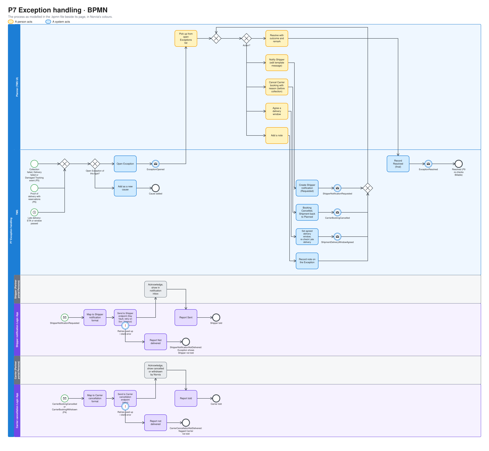
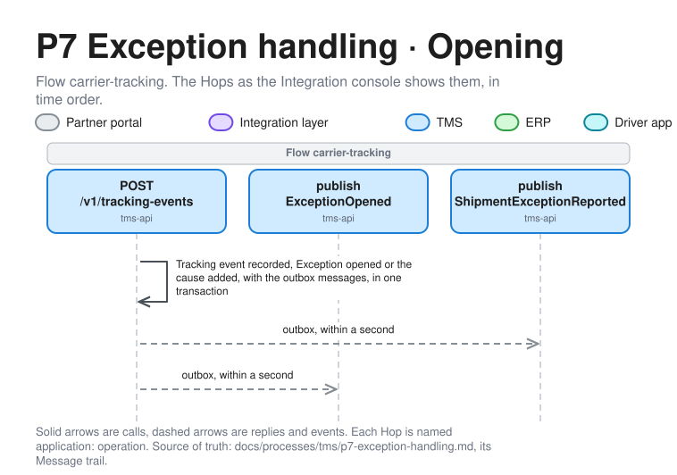
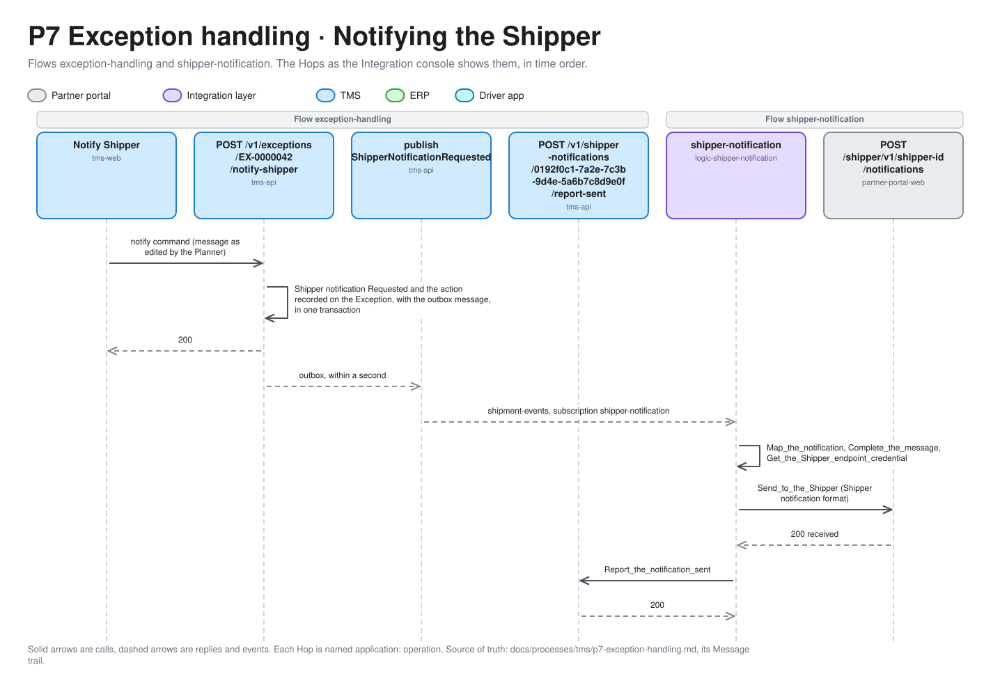
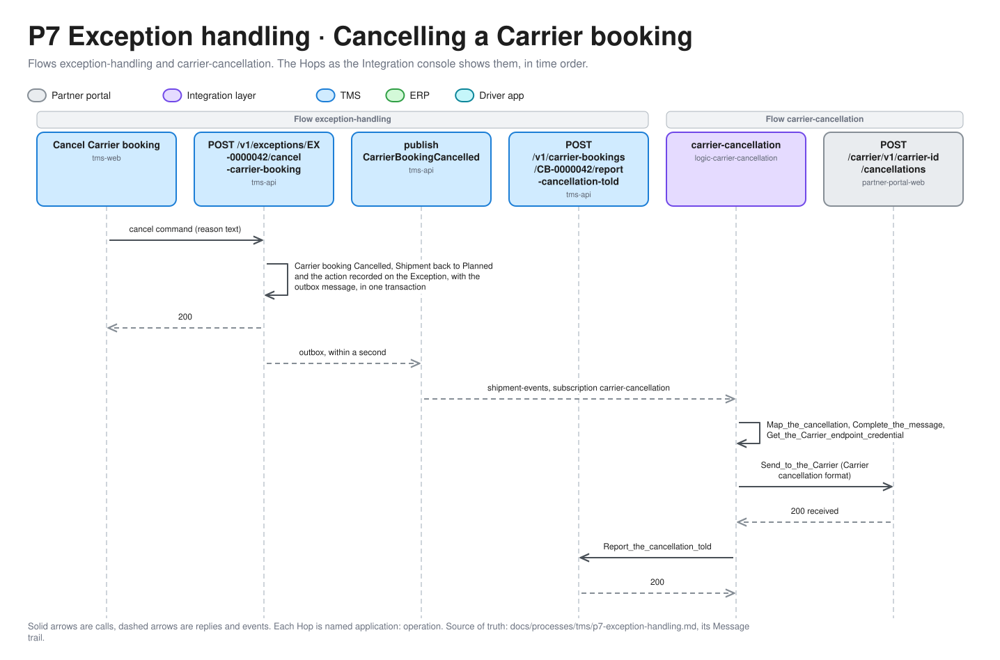

# P7 Exception handling

Exception handling makes sure someone acts when a Shipment on its way goes wrong. The TMS opens an Exception when a Tracking event reports a failed collection, a failed delivery or damage, when a Proof of delivery comes with reservations, or when a Shipment will be late. The Planner then decides what to do. They can notify the Shipper, cancel the Carrier booking and re-plan, agree a new delivery window, or conclude that nothing needs doing. Finally they resolve the Exception with an outcome. Terms are defined in [GLOSSARY.md](../../../GLOSSARY.md).

| | |
|---|---|
| **Trigger** | A Collection failed, Delivery failed or Damaged Tracking event (P5), a Proof of delivery with reservations (P6), or a Late delivery |
| **Outcome** | A Resolved Exception with its outcome, after any Shipper notifications, Carrier booking cancellation or agreed delivery window the Planner chose |
| **Owning system** | TMS. It owns Exceptions, Shipments and Carrier bookings (ADR 0002) |
| **Applies to** | Both. Re-planning by cancellation is for Carriers only. Taking an Own fleet Shipment off its Trip belongs to [P11](p11-trip-dispatch.md), and Re-delivery to [P12](p12-trip-execution.md#re-delivery) |
| **Integrations touched** | Service Bus (Shipment events), Shipper notification Logic App, Carrier cancellation Logic App, Key Vault, Partner portal (Shipper notification endpoint and inbox, Carrier cancellation endpoint), TMS Exception API |

## Process model

The model is [p7-exception-handling.bpmn](p7-exception-handling.bpmn), which opens in any BPMN tool and is the source. The picture is drawn from it by [bpmn.py](../../architecture/diagrams/bpmn.py), so change the model and run the script, not the picture ([the editable file](../../architecture/diagrams/bpmn-p7-exception-handling.excalidraw)).

## Scope

P7 defines the Exception model, the Planner's actions on it and the two outbound messages those actions send: a notification to the Shipper and a cancellation to the Carrier.

- **What opens an Exception**: exception Tracking events from P5, Proofs of delivery with reservations from P6, and the Late delivery check.
- **Re-planning** is designed for Carrier Shipments. For Own fleet, the Exception opens and the Shipper can be notified. The Planner can take the Shipment off its Trip before collection ([P11](p11-trip-dispatch.md#taking-a-shipment-off-a-trip)), and a Shipment not delivered is re-delivered on a later Trip ([P12](p12-trip-execution.md#re-delivery)).
- **Stale** stays a flag (P5). It doesn't open an Exception. Silence is a sign that the integration isn't healthy, not news for the Shipper.

## Exceptions

An Exception belongs to one Shipment. It has an Exception number given by the TMS, a type, one or more causes, the actions taken on it and, once resolved, an outcome.

### Types

| Type | Opened by |
|---|---|
| Collection failed | A Collection failed Tracking event (Carrier code `NPU`) |
| Delivery failed | A Delivery failed Tracking event (Carrier code `NDL`) |
| Damaged | A Damaged Tracking event (Carrier code `DMG`) |
| Reservations | A Proof of delivery recorded with the condition "with reservations" |
| Late delivery | A Tracking event whose ETA is after the latest time of the Shipment's delivery window. Or that latest time passing, plus a TMS setting (0 by default), without the Shipment being Delivered |

The delivery window is the agreed delivery window when the Planner has set one (see [Agreeing a delivery window](#agreeing-a-delivery-window)), and otherwise the Transport Order's.

Damaged and Reservations are kept apart because reservations are often a shortage, not damage. A Proof of delivery with reservations doesn't create a Damaged Tracking event (P6), so the two are never confused.

### One open Exception per type

A Shipment has at most one open Exception of each type. A cause of a type that already has an open Exception is **added** to it as a new cause. For example, a second Delivery failed, or a later ETA that is still after the window. It doesn't open a new Exception. A Shipment can have several Exceptions of different types open at once, for example Damaged and Late delivery.

Once an Exception is resolved, a new cause of the same type opens a new Exception.

### Cause cleared

The TMS never closes an Exception by itself. When its cause no longer holds, the Exception is only marked **cause cleared**, and the Planner still resolves it, because the Shipper may still need to be told.

| Type | Cause cleared when |
|---|---|
| Collection failed | The Shipment becomes Collected |
| Delivery failed | The Shipment becomes Delivered |
| Damaged | Never. Only the Planner can judge it |
| Reservations | A later Proof of delivery with the condition clean becomes current |
| Late delivery | The Shipment becomes Delivered. Or the latest ETA falls inside the delivery window again, for example after the Planner agrees a new one |

A new cause of the same type removes the marker again.

### After Delivered

P5 accepts Tracking events after Delivered and doesn't change the status. A Collection failed, Delivery failed or Damaged Tracking event that arrives then still opens an Exception, marked **after Delivered**. The Shipment stays Delivered. P7 never moves a Shipment's status forward, and it moves it back only when the Planner cancels a Carrier booking (see [Cancelling a Carrier booking](#cancelling-a-carrier-booking)). A Proof of delivery usually arrives after Delivered, so the marker applies only to Exceptions opened by Tracking events.

Late delivery isn't checked for a Shipment that is already Delivered.

## Status

### Exception

| Status | Meaning |
|---|---|
| Open | Opened by the TMS. It waits for the Planner. It can gain causes and actions |
| Resolved | The Planner resolved it with an outcome and a remark. Final |

| Outcome | Meaning |
|---|---|
| `NoActionNeeded` | Nothing needed doing, for example a Late delivery whose cause cleared |
| `Redelivered` | The Carrier delivered on another attempt, or the Own fleet on a Re-delivery, whether or not a delivery window was agreed |
| `Replanned` | The Carrier booking was cancelled, or the Own fleet Shipment was taken off its Trip, and the Shipment went back to planning |
| `ReturnedToShipper` | The goods go back to the Shipper. The return itself isn't planned in the TMS (see [Deferred](#deferred)) |
| `ClaimHandledOutsideTms` | Damage or a shortage is being settled as a claim outside the TMS |

The remark is required for every outcome. Any outcome can be chosen for any type. The TMS doesn't check that the outcome fits the actions taken.

### Carrier booking

P7 adds one Carrier booking status to P4's.

| Status | Meaning |
|---|---|
| Cancelled | Norvia ended the Carrier booking after the Carrier had confirmed it and before collection, with a reason. Final |

A Withdrawn or Cancelled Carrier booking also has a **Carrier told** time once the Carrier has acknowledged the cancellation message. If the message can't be delivered, it is flagged **Carrier not told**, with the technical cause.

### Shipment

P7 adds no Shipment status. Cancelling a Carrier booking moves the Shipment from Booked back to **Planned** in the same transaction, as a rejection does in P4 (ADR 0010).

## Steps

1. **Open.** The TMS opens the Exception in the same transaction as the Tracking event or Proof of delivery that causes it (P5, P6), and publishes `ExceptionOpened`. A Late delivery caused by the window passing is opened by the same time-based check that sets Stale. The TMS doesn't consume Service Bus events to do this (ADR 0003).
2. **See it.** The Exception appears at the top of the Planner's list of open Exceptions, and on the Shipment's timeline (see [Planner's lists](#planners-lists)).
3. **Act.** While it is open, the Planner takes any of the [actions](#actions), as often as needed and in any order.
4. **Resolve.** The Planner resolves the Exception with an outcome and a remark. The TMS publishes `ExceptionResolved`. The Exception leaves the list and stays on the timeline.

## Actions

| Action | Allowed when | Effect |
|---|---|---|
| Notify the Shipper | Always, while the Exception is open | A Shipper notification goes out (see [Notifying the Shipper](#notifying-the-shipper)) |
| Cancel the Carrier booking | A Carrier Shipment that is Booked, not yet Collected | The Carrier booking is Cancelled, the Shipment goes back to Planned and the Carrier is told (see [Cancelling a Carrier booking](#cancelling-a-carrier-booking)) |
| Agree a delivery window | A Shipment that is Collected or In transit | The Shipment gets an agreed delivery window (see [Agreeing a delivery window](#agreeing-a-delivery-window)) |
| Add a note | Always, while the Exception is open | A free-text note on the Exception, for example "phoned Kessler, redelivery Thursday" |

Every action is recorded on the Exception with the Planner and the time.

### Notifying the Shipper

1. **Write.** The Planner opens **Notify Shipper**. The message is prefilled from a template for the Exception's type, and the Planner can edit it.
2. **Record.** The TMS creates the Shipper notification with a notification ID and the status Requested, and publishes `ShipperNotificationRequested`, in one transaction.
3. **Map.** The Shipper notification Logic App picks up the event and maps the Canonical Model to the [Shipper notification format](#shipper-notification-format).
4. **Send.** The Logic App calls the Shipper Persona's notification endpoint in the Partner portal, with credentials it reads from Key Vault. The endpoint acknowledges receipt. The Partner portal treats the notification ID as the key, so a repeated call is ignored.
5. **Report.** The Logic App reports the notification to the TMS as Sent, and the TMS records the time.

The notification is one-way. The Shipper can't reply to it through the TMS.

On a server error or timeout, the Logic App retries with a bounded exponential policy, as in P4. It doesn't retry a client error. When the retries are used up, or on a client error, it reports the notification as **Not delivered** with the technical cause. The TMS publishes `ShipperNotificationNotDelivered`, and the Exception shows that the Shipper wasn't told. The Planner can notify again, or phone the Shipper and add a note. If the Logic App can't reach the TMS either, its run fails and the notification stays Requested, which the list shows.

| Shipper notification status | Meaning |
|---|---|
| Requested | Created by the Planner, not yet acknowledged by the Shipper |
| Sent | The Shipper's endpoint acknowledged it. Final |
| Not delivered | It never reached the Shipper, with the technical cause. Final |

### Cancelling a Carrier booking

The Planner cancels when a Carrier won't make its collection, for example after a Late delivery that opened because the ETA is far beyond the window. It is the only way P7 re-plans, and it is allowed only before collection (ADR 0010).

1. **Cancel.** The Planner chooses **Cancel Carrier booking** on the Exception and gives a reason text. In one transaction, the TMS moves the Carrier booking from Confirmed to Cancelled and the Shipment from Booked back to Planned, records the action on the Exception, and publishes `CarrierBookingCancelled`.
2. **Re-plan.** The Shipment appears in the Planner's list of Shipments to release, showing "Cancelled by Norvia" and the reason. The Planner reassigns it or releases it again, as for any Planned Shipment (P3). A new release creates a new Carrier booking (P4).
3. **Tell the Carrier.** The Carrier cancellation Logic App picks up the event and maps it to the [Carrier cancellation format](#carrier-cancellation-format). It calls the Carrier Persona's cancellation endpoint in the Partner portal with credentials from Key Vault, and reports the cancellation to the TMS as told. The Carrier can't refuse a cancellation. The endpoint only acknowledges receipt, and the Partner portal treats the Carrier booking number as the key.
4. **Resolve.** The Planner usually resolves the Exception as `Replanned`, now or once the Shipment is booked again.

The cancellation takes effect in the TMS straight away, whether or not the Carrier has been told. On a server error or timeout the Logic App retries as above. When the retries are used up, or on a client error, it reports the cancellation as not delivered. The TMS flags the Carrier booking **Carrier not told** with the technical cause and publishes `CarrierCancellationNotDelivered`. The Planner sees the flag in the list of Shipments to release and on the Exception, and phones the Carrier. Nothing is retried after that.

The same message and Logic App now also tell the Carrier about a **Withdrawn** Carrier booking (P4), with the same Carrier told and Carrier not told handling.

Once a Carrier booking is Cancelled, P5 and P6 refuse its Carrier's Tracking events and Proofs of delivery for it, as they refuse them for Rejected and Withdrawn bookings. That holds even when the event time is before the cancellation, for example a Collected that the Carrier sends late. The refused message is dead-lettered, and the Planner sorts it out with the Carrier.

### Agreeing a delivery window

After collection the Carrier holds the goods, so the Shipment can't be reassigned. What the Planner can re-plan is when it arrives. After agreeing a redelivery with the Carrier outside the TMS, for example by phone, the Planner sets an **agreed delivery window** on the Shipment from the Exception.

- The agreed delivery window replaces the Transport Order's for Late delivery, the Stale rules (P5) and the ETA when no Tracking event has given one (P5). The Transport Order keeps the Shipper's original window.
- Its latest time may not be in the past, and its earliest time may not be after its latest time.
- The Planner can set it again later. The last one set counts, and earlier ones are kept on the timeline.
- It isn't sent to the Carrier. The Carrier agreed it already.
- The TMS publishes `ShipmentDeliveryWindowAgreed`.

Setting it re-checks Late delivery at once. An open Late delivery whose latest ETA now falls inside the window is marked cause cleared.

## Shipper notification format

The Shipper notification format follows the conventions of the Shipper booking format in P1: JSON with its own field names, and local date/times without an offset, in the time zone of the delivery address. The Shipper notification Logic App maps Canonical → Shipper.

| Field | Required |
|---|---|
| Notification ID | Yes |
| Shipper reference (from the Transport Order) | Yes |
| Transport Order number | Yes |
| Exception type | Yes |
| Message, as written by the Planner | Yes |
| Current ETA, or the agreed delivery window if one is set | No |
| Norvia contact: the Planner's name | Yes |

The notification doesn't name the Carrier or the Shipment number. Towards the Shipper, Norvia carries the goods, just as towards the Carrier, Norvia is the customer (P4). The Shipper deals in Transport Orders (ADR 0011).

The schema is [shipper-notification.v1.schema.json](../../../contracts/partner-api/shipper-notification.v1.schema.json), with sample messages in `contracts/partner-api/samples/shipper-notifications`. The map reads the delivery address's country and postcode from the event, so it needs no lookup to show times in that time zone. An agreed delivery window replaces the ETA.

The Exception types map to the Shipper codes `COLLECTION_FAILED`, `DELIVERY_FAILED`, `DAMAGED`, `RESERVATIONS` and `LATE`.

## Carrier cancellation format

The Carrier cancellation format follows the conventions of the [Carrier booking format](p4-carrier-booking.md#carrier-booking-format). It carries:

| Field | Required |
|---|---|
| Carrier booking number | Yes |
| Carrier booking reference | Only for a Cancelled booking. A Withdrawn one never had one |
| Shipment number | Yes |
| Kind: `WITHDRAWN` or `CANCELLED` | Yes |
| Reason text | Yes for `CANCELLED`, no for `WITHDRAWN` |

The schema is [carrier-cancellation.v1.schema.json](../../../contracts/partner-api/carrier-cancellation.v1.schema.json), with sample messages in `contracts/partner-api/samples/carrier-cancellations`. The map reads the `CarrierBookingCancelled` or `CarrierBookingWithdrawn` event, so it needs no lookup. A `WITHDRAWN` message never carries a reference or a reason, and the Exception number stays inside Norvia.

## Action rules

| Rule | Failure code |
|---|---|
| The Exception exists | `ExceptionNotFound` |
| The Exception is Open (for every action and for resolving) | `ExceptionNotOpen` |
| For a cancellation: the Shipment has a Carrier, and its Carrier booking is Confirmed | `NoConfirmedCarrierBooking` |
| For a cancellation: the Shipment is Booked, not Collected or later | `ShipmentAlreadyCollected` |
| For a cancellation: a reason text is given | Client error |
| For an agreed delivery window: the Shipment is Collected or In transit | `ShipmentNotInTransport` |
| For an agreed delivery window: the window is consistent and doesn't end in the past | Client error |
| For resolving: the outcome is from the list, and a remark is given | Client error |

Each failure has a stable code and a readable message.

## Report rules

A sent or not-delivered report for a Shipper notification that is no longer Requested is ignored and logged. So is a told or not-told report for a Carrier booking that has already been told. Neither publishes an event.

## Planner's lists

P7 adds a sixth list to the Planner's five from P3 to P6, and extends two of them.

| List | Shows | Actions |
|---|---|---|
| Open Exceptions (P7) | Open Exceptions: Exception number, Shipment, Shipper, Carrier or Own fleet, type, opened at, number of causes, the cause cleared and after Delivered markers, and the last Shipper notification's status. Oldest first | Notify the Shipper, cancel the Carrier booking, agree a delivery window, add a note, resolve. Only the actions that are allowed are offered. Open the timeline |
| Shipments to release (P3, extended) | As in P4. The last Carrier booking's outcome can now also be "Cancelled by Norvia", with the reason. A Withdrawn or Cancelled booking shows "Carrier not told" when flagged | Reassign, release |
| Shipments in progress (P5, extended) | As in P6, plus a marker for a Shipment with an open Exception | Open the timeline |

The timeline shows each Exception with its causes, actions, Shipper notifications and outcome, and each agreed delivery window, alongside the Tracking events and Proofs of delivery. All lists update without a page refresh, as the other lists do.

## Partner portal

- **Shipper Personas** get a notification endpoint and a **notification inbox** that lists the notifications received, newest first, with their Transport Order number and Shipper reference. Every active Shipper has a Persona, as every active Carrier does.
- **Carrier Personas** get a cancellation endpoint. Their booking inbox from P4 shows a request as "withdrawn by Norvia" or "cancelled by Norvia", with the reason. A cancelled Shipment leaves the Persona's list of Shipments to track.

The endpoints have no answer modes. They acknowledge every valid message. A Shipper Persona's notification endpoint is `/shipper/v1/<Shipper ID>/notifications`. It asks its caller for the Shipper's own credential, which Key Vault holds as `shipper-endpoint-key-<Shipper ID>`, and stores a notification once per notification ID. A Carrier Persona's cancellation endpoint is `/carrier/v1/<Carrier ID>/cancellations`. It asks for the Carrier's own credential, the one Key Vault already holds as `carrier-endpoint-key-<Carrier ID>` for the booking endpoint, and applies a cancellation or withdrawal once per Carrier booking number. It acknowledges a message it can't apply, such as a cancellation for a booking its inbox never had, or a withdrawal of a request the Carrier already confirmed, and leaves the inbox as it was.

## TMS API

The Exception API accepts only the Canonical Model (ADR 0003). Each Logic App's managed identity holds only the role it needs.

Who holds each role, and what else each identity may reach, is in [Identity and access](../../architecture/identity-and-access.md).

| Operation | Caller | Role |
|---|---|---|
| Report a Shipper notification as sent or not delivered | Shipper notification Logic App | `ShipperNotifications.Report` |
| Report a cancellation as told or not delivered | Carrier cancellation Logic App | `CarrierBookings.Report` (from P4) |

The Planner takes every action and resolves Exceptions in the TMS UI, with the Planner permissions from P3.

## Own fleet

Own fleet Shipments get Exceptions in exactly the same way, from [P12](p12-trip-execution.md)'s Tracking events and Proofs of delivery, and from the Late delivery check. The Planner can notify the Shipper, agree a delivery window, add notes and resolve. Cancelling doesn't apply: there is no Carrier booking. Re-planning works in two ways:

- **Before collection**, the Planner takes the Shipment off its Trip, which sends it back to Planned ([P11](p11-trip-dispatch.md#taking-a-shipment-off-a-trip)). A Shipment whose collection failed goes back to Planned by itself when the Driver ends the Trip.
- **After collection**, a Shipment whose delivery failed is Awaiting re-delivery once the Driver ends the Trip, and the Planner puts it on a later Trip ([Re-delivery](p12-trip-execution.md#re-delivery)). The Planner can agree a delivery window with the Consignee for it, since the agreed delivery window isn't sent to anyone.

## Correlation ID

An Exception opened by a Tracking event or Proof of delivery carries that event's correlation ID. One opened by the time-based check gets a new one from the TMS. Each Planner action and each resolution gets a new correlation ID from the TMS, as in P3. The Shipper notification and cancellation Logic Apps carry the action's correlation ID on to the Partner portal and on their reports to the TMS.

Tracing an Exception follows the Shipment number and the Exception number. Tracing a notification follows its notification ID, and a cancellation its Carrier booking number.

## Events

All events go to the topic for Shipment events, through the TMS's transactional outbox (ADR 0003). A cause added to an open Exception, the cause cleared marker, a note, a sent report and a repeat publish nothing.

| Event | Published when | Carries | Consumers |
|---|---|---|---|
| `ExceptionOpened` | An Exception opens | Exception number, Shipment number, Transport Order number, Shipper, Carrier ID or Own fleet, type, the cause (Tracking event, Proof of delivery or window passed), the after Delivered marker, correlation ID | [Subscribers](../../architecture/events.md#catalogue) |
| `ExceptionResolved` | The Planner resolves an Exception | Exception number, Shipment number, type, outcome, remark, correlation ID | [Subscribers](../../architecture/events.md#catalogue). [P9](p9-freight-settlement.md) checks whether the order is Billable inside the TMS, not from this event (ADR 0003). |
| `ShipperNotificationRequested` | The Planner notifies the Shipper | Notification ID, Exception number, Shipment number, Transport Order number, Shipper, Shipper reference, delivery country and postcode, type, message, ETA or agreed delivery window, Planner's name, correlation ID | [Subscribers](../../architecture/events.md#catalogue) |
| `ShipperNotificationNotDelivered` | A notification is reported not delivered | Notification ID, Exception number, Shipment number, Shipper, technical cause, correlation ID | [Subscribers](../../architecture/events.md#catalogue) |
| `CarrierBookingCancelled` | The Planner cancels a Carrier booking | Carrier booking number, Carrier booking reference, Shipment number, Carrier ID, Exception number, reason text, correlation ID | [Subscribers](../../architecture/events.md#catalogue) |
| `CarrierCancellationNotDelivered` | A cancellation or withdrawal is reported not delivered | Carrier booking number, Shipment number, Carrier ID, kind, technical cause, correlation ID | [Subscribers](../../architecture/events.md#catalogue) |
| `ShipmentDeliveryWindowAgreed` | The Planner agrees a delivery window | Shipment number, Transport Order number, the window, Exception number, correlation ID | [Subscribers](../../architecture/events.md#catalogue) |
| `CarrierBookingWithdrawn` (P4, new consumer) | As in P4 | As in P4 | [Subscribers](../../architecture/events.md#catalogue) |

The Shipment going back to Planned publishes no event of its own, because `CarrierBookingCancelled` already says it, as in P4.

## Presenter smoke run

After a deployment, and not in CI, the presenter checks Exception handling end to end on the deployed estate, before the headline incident relies on it. Do it after the presenter smoke runs of Carrier booking ([P4](p4-carrier-booking.md#presenter-smoke-run)), Shipment tracking ([P5](p5-shipment-tracking.md#presenter-smoke-run)) and Proof of delivery ([P6](p6-proof-of-delivery.md#presenter-smoke-run)). The script makes the Carriers' calls. The Planner's actions are the presenter's, in the TMS UI, and the script stops and says what to do. Run it in a terminal, with the TMS UI, the Partner portal and the Integration console side by side.

1. **Get two Booked Shipments.** Follow P4's run twice: Rotterdam to Düsseldorf as Brouwer Dranken. The first is confirmed by Van Dijk Transport (story 25), the second by Kessler Spedition, set to *Auto-confirm* for it (story 26). Note both Transport Order numbers. Keep both Personas' tracking mode on *Manual*, as the script sends the Tracking events itself.
2. **Run the check.** Run `infra/smoke-test-exception-handling.sh <story 25 Transport Order number> <story 26 Transport Order number>`. It posts as the Carriers, through API Management, from a throwaway Container Apps job running as the Partner portal, and reads the TMS as the intake identity, and Application Insights, which is usually 1 to 5 minutes behind.
3. **Story 25.** The script sends `PU`, `DEP` and `NDL` as Van Dijk Transport and checks that a Delivery failed Exception opens. In the TMS UI, notify Brouwer Dranken and agree a new delivery window. The script checks that the notification ended Sent and that `ShipmentDeliveryWindowAgreed` was published, sends `POD` and checks that the Exception is marked cause cleared. Resolve it as `Redelivered`. The script checks that it left the list and that `ExceptionResolved` was published. Open Brouwer Dranken's notification inbox in the Partner portal and see the notification.
4. **Story 26.** The script sends an `NPU` with an ETA two weeks away as Kessler Spedition, so that the Shipment stays Booked, and checks that a Late delivery Exception opens. In the TMS UI, cancel the Carrier booking with a reason and wait. The script checks that the Carrier booking is Cancelled, that Shipments to release shows it as cancelled by Norvia with the reason and that the Carrier isn't flagged as not told. Then reassign the Shipment to Van Dijk Transport and release it. Open Kessler Spedition's booking inbox and see the request as "cancelled by Norvia".
5. **Stop the endpoint.** The script points the Shipper notification Logic App away from the Partner portal. Notify the Shipper again from the story 26 Exception. The script checks that the notification ends Not delivered after the retries, and puts the Logic App back, even when the run fails.
6. **Follow it.** The script checks that the Tracking events, the notification and the cancellation are in Application Insights by correlation ID, in API Management, the Logic Apps and the TMS, and prints the TMS UI's and the Integration console's links.

The script prints `PASS` or `FAIL` per check, never a body, a token or a key. If a check fails, file the gap as its own issue against P7, rather than working around it in the run book.

## Implementation

For engineers and coding agents. It shows what the estate does when an Exception opens and the Planner acts on it, where each step lives in the repository, what plays each Azure piece on a developer's machine, and what is designed but not built. It follows the template set by [P1's Implementation section](p1-transport-order-intake.md#implementation). Azure is the estate [c4.md](../../architecture/c4.md) draws.

P7 is built for Carrier Shipments. Exceptions from the Own fleet's Tracking events and Proofs of delivery, and the two Own fleet ways to re-plan, wait for [P11](p11-trip-dispatch.md) and [P12](p12-trip-execution.md) ([Gaps](#gaps)).

### Message trail

P7 leaves several Message trails, one per cause or Planner action. Each is named with the Hops as the [Integration console](../../operations/integration-console.md#message-trail) shows them, in time order. The Planner's actions run under a new correlation ID that the TMS API creates for each action and returns to the TMS UI. The Hops that the TMS makes belong to the Flow `exception-handling`, and the two Logic Apps' own Hops to the Flows `shipper-notification` and `carrier-cancellation`.

**Opening.** An Exception opens inside the call that causes it, so it adds no Hop of its own, only a publish at the end of that call's trail. The trails are those of [P5](p5-shipment-tracking.md#message-trail) (a Tracking event) and [P6](p6-proof-of-delivery.md#message-trail) (a Proof of delivery with reservations).

*Editable source: [message-trail-p7-1.excalidraw](../../architecture/diagrams/message-trail-p7-1.excalidraw), generated from [message_trails.py](../../architecture/diagrams/message_trails.py).*

**Notifying the Shipper.**

*Editable source: [message-trail-p7-2.excalidraw](../../architecture/diagrams/message-trail-p7-2.excalidraw), generated from [message_trails.py](../../architecture/diagrams/message_trails.py).*

**Cancelling a Carrier booking.**

*Editable source: [message-trail-p7-3.excalidraw](../../architecture/diagrams/message-trail-p7-3.excalidraw), generated from [message_trails.py](../../architecture/diagrams/message_trails.py).*

- Agreeing a delivery window, adding a note and resolving each leave one short trail in the Flow `exception-handling`: `tms-web: Agree delivery window`, `tms-web: Add note` or `tms-web: Resolve Exception`, then the call. Only the first and the last publish, `ShipmentDeliveryWindowAgreed` and `ExceptionResolved`. A note publishes nothing, so its trail ends at the call.
- A refused action stops at the call, with the failure code of the [action rules](#action-rules), and publishes nothing.
- The send Hop is `Failed` with `ShipperUnavailable` (no answer, 408, 429 or 5xx) or `ShipperRefused` (another 4xx) for a Shipper, and with `CarrierUnavailable` or `CarrierRefused` for a Carrier. The Logic App then calls `Report_the_notification_not_delivered` or `Report_the_cancellation_not_delivered` instead, and the TMS publishes `ShipperNotificationNotDelivered` or `CarrierCancellationNotDelivered`.
- A report for a notification that is no longer Requested, or a Carrier booking that has already been told, is ignored: its Hop ends at the call, with no publish.
- A message the map can't read is dead-lettered by the Logic App as `ShipperNotificationRequestedUnreadable` or `CarrierCancellationUnreadable`, and the run fails. The Logic App completes any other message as soon as it is mapped, so a failure after that point is on the trail and not in the dead-letter queue. When the report to the TMS fails too, the run fails with `TmsUnavailable` or `TmsCallRefused`, and the notification stays Requested. [Failure behaviour](../../architecture/failure-behaviour.md#p7-exception-handling) lists each row.
- The Late delivery check opens its Exception outside any call of a Carrier. It runs when the Planner's Shipments in progress is read, so the Exception and its `ExceptionOpened` publish are on a trail of their own, under a correlation ID that the TMS creates.
- A withdrawal reaches the same `carrier-cancellation` Logic App from [P4](p4-carrier-booking.md#message-trail), as `CarrierBookingWithdrawn`.
- The publish Hops appear only once the outbox has sent the message ([failure behaviour](../../architecture/failure-behaviour.md#the-tms-outbox)).

### Code map

Links go to files, not lines, so they stay true as the code moves.

| Step | Where |
|---|---|
| 1a. Open: the model | The aggregate [ExceptionCase.cs](../../../src/Tms/Norvia.Tms.Domain/Exceptions/ExceptionCase.cs) (`Open`, `AddCause`, `MarkCauseCleared`, `AddNote`, `Resolve`), with [ExceptionCause.cs](../../../src/Tms/Norvia.Tms.Domain/Exceptions/ExceptionCause.cs), [ExceptionCauseKind.cs](../../../src/Tms/Norvia.Tms.Domain/Exceptions/ExceptionCauseKind.cs), [ExceptionType.cs](../../../src/Tms/Norvia.Tms.Domain/Exceptions/ExceptionType.cs), [ExceptionTypes.cs](../../../src/Tms/Norvia.Tms.Domain/Exceptions/ExceptionTypes.cs), [ExceptionStatus.cs](../../../src/Tms/Norvia.Tms.Domain/Exceptions/ExceptionStatus.cs), [ExceptionOutcome.cs](../../../src/Tms/Norvia.Tms.Domain/Exceptions/ExceptionOutcome.cs), [ExceptionNote.cs](../../../src/Tms/Norvia.Tms.Domain/Exceptions/ExceptionNote.cs), [ExceptionNumber.cs](../../../src/Tms/Norvia.Tms.Domain/Exceptions/ExceptionNumber.cs) and [ExceptionId.cs](../../../src/Tms/Norvia.Tms.Domain/Exceptions/ExceptionId.cs). The refusals: [ExceptionRefusal.cs](../../../src/Tms/Norvia.Tms.Domain/Exceptions/ExceptionRefusal.cs) and [ExceptionRefusalCode.cs](../../../src/Tms/Norvia.Tms.Domain/Exceptions/ExceptionRefusalCode.cs). The one-open-per-type check: [OpenExceptionOfTypeForShipmentSpec.cs](../../../src/Tms/Norvia.Tms.Domain/Exceptions/OpenExceptionOfTypeForShipmentSpec.cs). Stored by [ExceptionCaseConfiguration.cs](../../../src/Tms/Norvia.Tms.Infrastructure/Data/Configurations/ExceptionCaseConfiguration.cs) and the migrations [ExceptionOpened](../../../src/Tms/Norvia.Tms.Infrastructure/Data/Migrations/20261006112655_ExceptionOpened.cs), [ExceptionCauseCleared](../../../src/Tms/Norvia.Tms.Infrastructure/Data/Migrations/20261006130053_ExceptionCauseCleared.cs) and [ExceptionNotes](../../../src/Tms/Norvia.Tms.Infrastructure/Data/Migrations/20261006135135_ExceptionNotes.cs). Numbers come from the port [IExceptionNumbers.cs](../../../src/Tms/Norvia.Tms.Application/Exceptions/IExceptionNumbers.cs), implemented by [SqlExceptionNumbers.cs](../../../src/Tms/Norvia.Tms.Infrastructure/Exceptions/SqlExceptionNumbers.cs) |
| 1b. Open: the causes | [ExceptionCauses.cs](../../../src/Tms/Norvia.Tms.Application/Exceptions/ExceptionCauses.cs) opens an Exception or adds a cause to the open one, and marks the cause cleared. It is called in the same transaction by [RecordTrackingHandler.cs](../../../src/Tms/Norvia.Tms.Application/TrackingEvents/Record/RecordTrackingHandler.cs) (P5), [RecordProofOfDeliveryHandler.cs](../../../src/Tms/Norvia.Tms.Application/ProofsOfDelivery/Record/RecordProofOfDeliveryHandler.cs) (P6) and [AgreeDeliveryWindowHandler.cs](../../../src/Tms/Norvia.Tms.Application/Exceptions/AgreeDeliveryWindow/AgreeDeliveryWindowHandler.cs). The Late delivery rule: [LateDeliveryRules.cs](../../../src/Tms/Norvia.Tms.Domain/Exceptions/LateDeliveryRules.cs). The check on the window passing: [CheckLateDeliveriesHandler.cs](../../../src/Tms/Norvia.Tms.Application/Exceptions/CheckLate/CheckLateDeliveriesHandler.cs) with [CheckLateDeliveriesCommand.cs](../../../src/Tms/Norvia.Tms.Application/Exceptions/CheckLate/CheckLateDeliveriesCommand.cs), sent when `GET /v1/shipments/in-progress` is read in [ShipmentEndpoints.cs](../../../src/Tms/Norvia.Tms.Api/Shipments/ShipmentEndpoints.cs). The extra wait after the window, `Grace`, is in [LateDeliveryOptions.cs](../../../src/Tms/Norvia.Tms.Infrastructure/Exceptions/LateDeliveryOptions.cs) |
| 1c. Open: publish | Event types [ExceptionOpenedEvent.cs](../../../src/Tms/Norvia.Tms.Domain/Exceptions/ExceptionOpenedEvent.cs), publisher [PublishExceptionOpened.cs](../../../src/Tms/Norvia.Tms.Application/Exceptions/Open/PublishExceptionOpened.cs), messages [ExceptionOpenedV1.cs](../../../src/Tms/Norvia.Tms.Application/Exceptions/Open/ExceptionOpenedV1.cs) and [ExceptionCauseV1.cs](../../../src/Tms/Norvia.Tms.Application/Exceptions/Open/ExceptionCauseV1.cs), sent by [OutboxPublisher.cs](../../../src/Tms/Norvia.Tms.Infrastructure/Outbox/OutboxPublisher.cs). Contract [exception-opened.v1.schema.json](../../../contracts/canonical-model/exception-opened.v1.schema.json). Topic and subscriptions: [messaging.bicep](../../../infra/estate/messaging.bicep) |
| 2a. See it: the list | Handler [ListOpenExceptionsHandler.cs](../../../src/Tms/Norvia.Tms.Application/Exceptions/ListOpen/ListOpenExceptionsHandler.cs) with [ListOpenExceptionsQuery.cs](../../../src/Tms/Norvia.Tms.Application/Exceptions/ListOpen/ListOpenExceptionsQuery.cs), [OpenExceptionSummary.cs](../../../src/Tms/Norvia.Tms.Application/Exceptions/ListOpen/OpenExceptionSummary.cs), [ExceptionNoteSummary.cs](../../../src/Tms/Norvia.Tms.Application/Exceptions/ListOpen/ExceptionNoteSummary.cs) and [OpenExceptionsSpec.cs](../../../src/Tms/Norvia.Tms.Domain/Exceptions/OpenExceptionsSpec.cs). Endpoint `GET /v1/exceptions/open` in [ExceptionEndpoints.cs](../../../src/Tms/Norvia.Tms.Api/Exceptions/ExceptionEndpoints.cs). The page [OpenExceptions.razor](../../../src/Tms/Norvia.Tms.Web/Exceptions/OpenExceptions.razor), worded by [ExceptionText.cs](../../../src/Tms/Norvia.Tms.Web/Exceptions/ExceptionText.cs) |
| 2b. See it: markers and timeline | The marker in [ShipmentsInProgress.razor](../../../src/Tms/Norvia.Tms.Web/Shipments/ShipmentsInProgress.razor), fed by [OpenExceptionsForShipmentsSpec.cs](../../../src/Tms/Norvia.Tms.Domain/Exceptions/OpenExceptionsForShipmentsSpec.cs). The timeline: [GetTrackingTimelineHandler.cs](../../../src/Tms/Norvia.Tms.Application/TrackingEvents/Timeline/GetTrackingTimelineHandler.cs) with [ExceptionsOfShipmentSpec.cs](../../../src/Tms/Norvia.Tms.Domain/Exceptions/ExceptionsOfShipmentSpec.cs), [ExceptionTimelineEntry.cs](../../../src/Tms/Norvia.Tms.Application/Exceptions/Timeline/ExceptionTimelineEntry.cs), [ExceptionCauseView.cs](../../../src/Tms/Norvia.Tms.Application/Exceptions/Timeline/ExceptionCauseView.cs), [ExceptionNoteView.cs](../../../src/Tms/Norvia.Tms.Application/Exceptions/Timeline/ExceptionNoteView.cs), [ShipperNotificationView.cs](../../../src/Tms/Norvia.Tms.Application/Exceptions/Timeline/ShipperNotificationView.cs), [CarrierBookingCancellationView.cs](../../../src/Tms/Norvia.Tms.Application/Exceptions/Timeline/CarrierBookingCancellationView.cs) and [AgreedDeliveryWindowView.cs](../../../src/Tms/Norvia.Tms.Application/Exceptions/Timeline/AgreedDeliveryWindowView.cs). Shown by [TrackingTimeline.razor](../../../src/Tms/Norvia.Tms.Web/Shipments/TrackingTimeline.razor), the story worded by [ExceptionStory.cs](../../../src/Tms/Norvia.Tms.Web/Exceptions/ExceptionStory.cs) |
| 3a. Act: the panel | [ExceptionActionPanel.razor](../../../src/Tms/Norvia.Tms.Web/Exceptions/ExceptionActionPanel.razor) with [ExceptionActionKind.cs](../../../src/Tms/Norvia.Tms.Web/Exceptions/ExceptionActionKind.cs), [ExceptionAnswer.cs](../../../src/Tms/Norvia.Tms.Web/Exceptions/ExceptionAnswer.cs), [ExceptionHappening.cs](../../../src/Tms/Norvia.Tms.Web/Exceptions/ExceptionHappening.cs) and [PlannerName.cs](../../../src/Tms/Norvia.Tms.Web/Exceptions/PlannerName.cs). The calls, each starting the span that names its Hop: [TmsApiClient.Exceptions.cs](../../../src/Tms/Norvia.Tms.Web/TmsApi/TmsApiClient.Exceptions.cs). The endpoints are in [ExceptionEndpoints.cs](../../../src/Tms/Norvia.Tms.Api/Exceptions/ExceptionEndpoints.cs) (role `TransportOrders.Manage`, tracked as `Flows.ExceptionHandling`). Every action's log scope derives from [TrackExceptionActionInLoggingScope.cs](../../../src/Tms/Norvia.Tms.Application/Exceptions/TrackExceptionActionInLoggingScope.cs), and its refusals come back as [ExceptionRefused.cs](../../../src/Tms/Norvia.Tms.Application/Exceptions/ExceptionRefused.cs) |
| 3b. Act: notify the Shipper | Handler [NotifyShipperHandler.cs](../../../src/Tms/Norvia.Tms.Application/Exceptions/NotifyShipper/NotifyShipperHandler.cs) with [NotifyShipperCommand.cs](../../../src/Tms/Norvia.Tms.Application/Exceptions/NotifyShipper/NotifyShipperCommand.cs), [NotifyShipperResult.cs](../../../src/Tms/Norvia.Tms.Application/Exceptions/NotifyShipper/NotifyShipperResult.cs) and [NotifyShipperRequest.cs](../../../src/Tms/Norvia.Tms.Api/Exceptions/NotifyShipperRequest.cs). The prefilled message: [ShipperNotificationTemplateHandler.cs](../../../src/Tms/Norvia.Tms.Application/Exceptions/ShipperNotificationTemplate/ShipperNotificationTemplateHandler.cs) from [ShipperNotificationTemplates.cs](../../../src/Tms/Norvia.Tms.Domain/ShipperNotifications/ShipperNotificationTemplates.cs). The aggregate [ShipperNotification.cs](../../../src/Tms/Norvia.Tms.Domain/ShipperNotifications/ShipperNotification.cs) (`Request`, `ReportSent`, `ReportNotDelivered`) with [ShipperNotificationStatus.cs](../../../src/Tms/Norvia.Tms.Domain/ShipperNotifications/ShipperNotificationStatus.cs), [ShipperNotificationId.cs](../../../src/Tms/Norvia.Tms.Domain/ShipperNotifications/ShipperNotificationId.cs), [ShipperNotificationByIdSpec.cs](../../../src/Tms/Norvia.Tms.Domain/ShipperNotifications/ShipperNotificationByIdSpec.cs) and [ShipperNotificationsOfExceptionsSpec.cs](../../../src/Tms/Norvia.Tms.Domain/ShipperNotifications/ShipperNotificationsOfExceptionsSpec.cs). Stored by [ShipperNotificationConfiguration.cs](../../../src/Tms/Norvia.Tms.Infrastructure/Data/Configurations/ShipperNotificationConfiguration.cs) and the migration [ShipperNotifications](../../../src/Tms/Norvia.Tms.Infrastructure/Data/Migrations/20261006185548_ShipperNotifications.cs). Event type [ShipperNotificationRequestedEvent.cs](../../../src/Tms/Norvia.Tms.Domain/ShipperNotifications/ShipperNotificationRequestedEvent.cs), publisher [PublishShipperNotificationRequested.cs](../../../src/Tms/Norvia.Tms.Application/Exceptions/NotifyShipper/PublishShipperNotificationRequested.cs), message [ShipperNotificationRequestedV1.cs](../../../src/Tms/Norvia.Tms.Application/Exceptions/NotifyShipper/ShipperNotificationRequestedV1.cs). Tracking keys: [TrackShipperNotificationInLoggingScope.cs](../../../src/Tms/Norvia.Tms.Application/Exceptions/NotifyShipper/TrackShipperNotificationInLoggingScope.cs) |
| 3c. Act: cancel the Carrier booking | Handler [CancelCarrierBookingHandler.cs](../../../src/Tms/Norvia.Tms.Application/Exceptions/CancelCarrierBooking/CancelCarrierBookingHandler.cs) with [CancelCarrierBookingCommand.cs](../../../src/Tms/Norvia.Tms.Application/Exceptions/CancelCarrierBooking/CancelCarrierBookingCommand.cs), [CancelCarrierBookingResult.cs](../../../src/Tms/Norvia.Tms.Application/Exceptions/CancelCarrierBooking/CancelCarrierBookingResult.cs) and [CancelCarrierBookingRequest.cs](../../../src/Tms/Norvia.Tms.Api/Exceptions/CancelCarrierBookingRequest.cs). Aggregate methods `Cancel` (Confirmed to Cancelled) in [CarrierBooking.cs](../../../src/Tms/Norvia.Tms.Domain/CarrierBookings/CarrierBooking.cs) and `ReturnToPlannedAfterCancellation` in [Shipment.cs](../../../src/Tms/Norvia.Tms.Domain/Shipments/Shipment.cs), with the status in [CarrierBookingStatus.cs](../../../src/Tms/Norvia.Tms.Domain/CarrierBookings/CarrierBookingStatus.cs). The rules and their failure codes: [CarrierBookingRules.cs](../../../src/Tms/Norvia.Tms.Domain/CarrierBookings/CarrierBookingRules.cs), [CarrierBookingRefusal.cs](../../../src/Tms/Norvia.Tms.Domain/CarrierBookings/CarrierBookingRefusal.cs) and [CarrierBookingRefusalCode.cs](../../../src/Tms/Norvia.Tms.Domain/CarrierBookings/CarrierBookingRefusalCode.cs). Stored by the migrations [CarrierBookingCancellation](../../../src/Tms/Norvia.Tms.Infrastructure/Data/Migrations/20261006154918_CarrierBookingCancellation.cs) and [CarrierCancellationReports](../../../src/Tms/Norvia.Tms.Infrastructure/Data/Migrations/20261006161913_CarrierCancellationReports.cs). Event type [CarrierBookingCancelledEvent.cs](../../../src/Tms/Norvia.Tms.Domain/CarrierBookings/CarrierBookingCancelledEvent.cs), publisher [PublishCarrierBookingCancelled.cs](../../../src/Tms/Norvia.Tms.Application/Exceptions/CancelCarrierBooking/PublishCarrierBookingCancelled.cs), message [CarrierBookingCancelledV1.cs](../../../src/Tms/Norvia.Tms.Application/Exceptions/CancelCarrierBooking/CarrierBookingCancelledV1.cs). Contract [carrier-booking-cancelled.v1.schema.json](../../../contracts/canonical-model/carrier-booking-cancelled.v1.schema.json). Tracking keys: [TrackCarrierBookingCancellationInLoggingScope.cs](../../../src/Tms/Norvia.Tms.Application/Exceptions/CancelCarrierBooking/TrackCarrierBookingCancellationInLoggingScope.cs). The Planner's list of Shipments to release shows the outcome through [LastCarrierBookingOutcome.cs](../../../src/Tms/Norvia.Tms.Application/Shipments/ListToRelease/LastCarrierBookingOutcome.cs) in [ShipmentsToRelease.razor](../../../src/Tms/Norvia.Tms.Web/Shipments/ShipmentsToRelease.razor) |
| 3d. Act: agree a delivery window | Handler [AgreeDeliveryWindowHandler.cs](../../../src/Tms/Norvia.Tms.Application/Exceptions/AgreeDeliveryWindow/AgreeDeliveryWindowHandler.cs) with [AgreeDeliveryWindowCommand.cs](../../../src/Tms/Norvia.Tms.Application/Exceptions/AgreeDeliveryWindow/AgreeDeliveryWindowCommand.cs), [AgreeDeliveryWindowResult.cs](../../../src/Tms/Norvia.Tms.Application/Exceptions/AgreeDeliveryWindow/AgreeDeliveryWindowResult.cs) and [AgreeDeliveryWindowRequest.cs](../../../src/Tms/Norvia.Tms.Api/Exceptions/AgreeDeliveryWindowRequest.cs). Aggregate methods `AgreeDeliveryWindow` and `DeliveryWindowOf` in [Shipment.cs](../../../src/Tms/Norvia.Tms.Domain/Shipments/Shipment.cs), with [AgreedDeliveryWindow.cs](../../../src/Tms/Norvia.Tms.Domain/Shipments/AgreedDeliveryWindow.cs). Stored by the migration [ShipmentAgreedDeliveryWindows](../../../src/Tms/Norvia.Tms.Infrastructure/Data/Migrations/20261006142022_ShipmentAgreedDeliveryWindows.cs). Event type [ShipmentDeliveryWindowAgreedEvent.cs](../../../src/Tms/Norvia.Tms.Domain/Shipments/ShipmentDeliveryWindowAgreedEvent.cs), publisher [PublishShipmentDeliveryWindowAgreed.cs](../../../src/Tms/Norvia.Tms.Application/Exceptions/AgreeDeliveryWindow/PublishShipmentDeliveryWindowAgreed.cs), message [ShipmentDeliveryWindowAgreedV1.cs](../../../src/Tms/Norvia.Tms.Application/Exceptions/AgreeDeliveryWindow/ShipmentDeliveryWindowAgreedV1.cs). Tracking keys: [TrackDeliveryWindowAgreementInLoggingScope.cs](../../../src/Tms/Norvia.Tms.Application/Exceptions/AgreeDeliveryWindow/TrackDeliveryWindowAgreementInLoggingScope.cs) |
| 3e. Act: add a note | Handler [AddExceptionNoteHandler.cs](../../../src/Tms/Norvia.Tms.Application/Exceptions/AddNote/AddExceptionNoteHandler.cs) with [AddExceptionNoteCommand.cs](../../../src/Tms/Norvia.Tms.Application/Exceptions/AddNote/AddExceptionNoteCommand.cs), [AddExceptionNoteResult.cs](../../../src/Tms/Norvia.Tms.Application/Exceptions/AddNote/AddExceptionNoteResult.cs), [AddExceptionNoteRequest.cs](../../../src/Tms/Norvia.Tms.Api/Exceptions/AddExceptionNoteRequest.cs) and [TrackExceptionNoteInLoggingScope.cs](../../../src/Tms/Norvia.Tms.Application/Exceptions/AddNote/TrackExceptionNoteInLoggingScope.cs). A note publishes nothing |
| 4. Resolve | Handler [ResolveExceptionHandler.cs](../../../src/Tms/Norvia.Tms.Application/Exceptions/Resolve/ResolveExceptionHandler.cs) with [ResolveExceptionCommand.cs](../../../src/Tms/Norvia.Tms.Application/Exceptions/Resolve/ResolveExceptionCommand.cs), [ResolveExceptionResult.cs](../../../src/Tms/Norvia.Tms.Application/Exceptions/Resolve/ResolveExceptionResult.cs), [ResolveExceptionRequest.cs](../../../src/Tms/Norvia.Tms.Api/Exceptions/ResolveExceptionRequest.cs) and [ExceptionToResolveSpec.cs](../../../src/Tms/Norvia.Tms.Domain/Exceptions/ExceptionToResolveSpec.cs). Event type [ExceptionResolvedEvent.cs](../../../src/Tms/Norvia.Tms.Domain/Exceptions/ExceptionResolvedEvent.cs), publisher [PublishExceptionResolved.cs](../../../src/Tms/Norvia.Tms.Application/Exceptions/Resolve/PublishExceptionResolved.cs), message [ExceptionResolvedV1.cs](../../../src/Tms/Norvia.Tms.Application/Exceptions/Resolve/ExceptionResolvedV1.cs). Contract [exception-resolved.v1.schema.json](../../../contracts/canonical-model/exception-resolved.v1.schema.json). Tracking keys: [TrackExceptionResolutionInLoggingScope.cs](../../../src/Tms/Norvia.Tms.Application/Exceptions/Resolve/TrackExceptionResolutionInLoggingScope.cs) |
| 5a. Tell the Shipper: map | Logic App: [workflow.json](../../../src/Integration/ShipperNotificationLogicApp/shipper-notification/workflow.json) (`Track_the_notification`, `Map_the_notification`, `Dead_letter_the_unreadable_notification`, `Complete_the_message`). Function: [MapShipperNotificationRequested.cs](../../../src/Integration/Norvia.Integration.ShipperNotification.Functions/MapShipperNotificationRequested.cs). Map: [ShipperNotificationMap.cs](../../../src/Integration/Norvia.Integration.CarrierBooking/ShipperNotificationMap.cs). Shipper contract: [shipper-notification.v1.schema.json](../../../contracts/partner-api/shipper-notification.v1.schema.json). Canonical contract: [shipper-notification-requested.v1.schema.json](../../../contracts/canonical-model/shipper-notification-requested.v1.schema.json) |
| 5b. Tell the Shipper: send and report | Logic App: `Get_the_Shipper_endpoint_credential`, `Send_to_the_Shipper` and `Report_the_outcome_to_the_TMS` with `Report_the_notification_sent`, `Take_the_Shippers_answer` and `Report_the_notification_not_delivered` in the same [workflow.json](../../../src/Integration/ShipperNotificationLogicApp/shipper-notification/workflow.json). The TMS side: endpoints `POST /v1/shipper-notifications/{notificationId}/report-sent` and `.../report-not-delivered` in [ShipperNotificationEndpoints.cs](../../../src/Tms/Norvia.Tms.Api/ShipperNotifications/ShipperNotificationEndpoints.cs) (role `ShipperNotifications.Report`) with [ShipperNotificationNotDeliveredRequest.cs](../../../src/Tms/Norvia.Tms.Api/ShipperNotifications/ShipperNotificationNotDeliveredRequest.cs). Handlers [ReportShipperNotificationSentHandler.cs](../../../src/Tms/Norvia.Tms.Application/ShipperNotifications/Report/ReportShipperNotificationSentHandler.cs) and [ReportShipperNotificationNotDeliveredHandler.cs](../../../src/Tms/Norvia.Tms.Application/ShipperNotifications/Report/ReportShipperNotificationNotDeliveredHandler.cs) with their commands, [ShipperNotificationLookup.cs](../../../src/Tms/Norvia.Tms.Application/ShipperNotifications/Report/ShipperNotificationLookup.cs) and [ShipperNotificationReportResult.cs](../../../src/Tms/Norvia.Tms.Application/ShipperNotifications/Report/ShipperNotificationReportResult.cs). Event publisher [PublishShipperNotificationNotDelivered.cs](../../../src/Tms/Norvia.Tms.Application/ShipperNotifications/Report/PublishShipperNotificationNotDelivered.cs), message [ShipperNotificationNotDeliveredV1.cs](../../../src/Tms/Norvia.Tms.Application/ShipperNotifications/Report/ShipperNotificationNotDeliveredV1.cs), type [ShipperNotificationNotDeliveredEvent.cs](../../../src/Tms/Norvia.Tms.Domain/ShipperNotifications/ShipperNotificationNotDeliveredEvent.cs). Tracking keys: [TrackShipperNotificationReportInLoggingScope.cs](../../../src/Tms/Norvia.Tms.Application/ShipperNotifications/Report/TrackShipperNotificationReportInLoggingScope.cs) |
| 5c. Tell the Shipper: the Partner portal | Endpoint `POST /shipper/v1/{shipperId}/notifications` in [ShipperNotificationEndpoint.cs](../../../src/PartnerPortal/Norvia.PartnerPortal.Web/ShipperNotifications/ShipperNotificationEndpoint.cs) with [ShipperNotificationBody.cs](../../../src/PartnerPortal/Norvia.PartnerPortal.Web/ShipperNotifications/ShipperNotificationBody.cs), [ShipperEndpointOptions.cs](../../../src/PartnerPortal/Norvia.PartnerPortal.Web/ShipperNotifications/ShipperEndpointOptions.cs) and [EveryShipperHasACredential.cs](../../../src/PartnerPortal/Norvia.PartnerPortal.Web/ShipperNotifications/EveryShipperHasACredential.cs). Handler [ReceiveShipperNotificationHandler.cs](../../../src/PartnerPortal/Norvia.PartnerPortal.Application/ShipperNotifications/Receive/ReceiveShipperNotificationHandler.cs) with [ReceiveShipperNotificationCommand.cs](../../../src/PartnerPortal/Norvia.PartnerPortal.Application/ShipperNotifications/Receive/ReceiveShipperNotificationCommand.cs). The Persona's [ShipperNotification.cs](../../../src/PartnerPortal/Norvia.PartnerPortal.Domain/ShipperNotifications/ShipperNotification.cs) (once per notification ID, found by [ShipperNotificationByNotificationIdSpec.cs](../../../src/PartnerPortal/Norvia.PartnerPortal.Domain/ShipperNotifications/ShipperNotificationByNotificationIdSpec.cs)) with [ShipperNotificationContent.cs](../../../src/PartnerPortal/Norvia.PartnerPortal.Domain/ShipperNotifications/ShipperNotificationContent.cs), [ShipperNotificationId.cs](../../../src/PartnerPortal/Norvia.PartnerPortal.Domain/ShipperNotifications/ShipperNotificationId.cs), [ShipperExceptionCode.cs](../../../src/PartnerPortal/Norvia.PartnerPortal.Domain/ShipperNotifications/ShipperExceptionCode.cs), [DeliveryTiming.cs](../../../src/PartnerPortal/Norvia.PartnerPortal.Domain/ShipperNotifications/DeliveryTiming.cs) and [LocalDateTimeText.cs](../../../src/PartnerPortal/Norvia.PartnerPortal.Domain/ShipperNotifications/LocalDateTimeText.cs). Stored by [ShipperNotificationConfiguration.cs](../../../src/PartnerPortal/Norvia.PartnerPortal.Infrastructure/Data/Configurations/ShipperNotificationConfiguration.cs) and the migration [ShipperNotifications](../../../src/PartnerPortal/Norvia.PartnerPortal.Infrastructure/Data/Migrations/20261007054924_ShipperNotifications.cs). The notification inbox: [NotificationInbox.razor](../../../src/PartnerPortal/Norvia.PartnerPortal.Web/ShipperNotifications/NotificationInbox.razor) with [ListShipperNotificationsHandler.cs](../../../src/PartnerPortal/Norvia.PartnerPortal.Application/ShipperNotifications/List/ListShipperNotificationsHandler.cs), [ShipperNotificationView.cs](../../../src/PartnerPortal/Norvia.PartnerPortal.Application/ShipperNotifications/ShipperNotificationView.cs) and [ExceptionText.cs](../../../src/PartnerPortal/Norvia.PartnerPortal.Web/ShipperNotifications/ExceptionText.cs). The credential `shipper-endpoint-key-<Shipper ID>` is created in [partner-api.bicep](../../../infra/estate/partner-api.bicep) |
| 6a. Tell the Carrier: map | Logic App: [workflow.json](../../../src/Integration/CarrierCancellationLogicApp/carrier-cancellation/workflow.json) (`Track_the_cancellation`, `Map_the_cancellation`, `Dead_letter_the_unreadable_cancellation`, `Complete_the_message`). Function: [MapCarrierCancellation.cs](../../../src/Integration/Norvia.Integration.CarrierCancellation.Functions/MapCarrierCancellation.cs). Map: [CarrierCancellationMap.cs](../../../src/Integration/Norvia.Integration.CarrierBooking/CarrierCancellationMap.cs). Carrier contract: [carrier-cancellation.v1.schema.json](../../../contracts/partner-api/carrier-cancellation.v1.schema.json) |
| 6b. Tell the Carrier: send and report | Logic App: `Get_the_Carrier_endpoint_credential`, `Send_to_the_Carrier` and `Report_the_outcome_to_the_TMS` with `Report_the_cancellation_told`, `Take_the_Carriers_answer` and `Report_the_cancellation_not_delivered` in the same [workflow.json](../../../src/Integration/CarrierCancellationLogicApp/carrier-cancellation/workflow.json). The TMS side: `POST /v1/carrier-bookings/{carrierBookingNumber}/report-cancellation-told` and `.../report-cancellation-not-delivered` in [CarrierBookingEndpoints.cs](../../../src/Tms/Norvia.Tms.Api/CarrierBookings/CarrierBookingEndpoints.cs) (role `CarrierBookings.Report`). Handlers [ReportCarrierCancellationToldHandler.cs](../../../src/Tms/Norvia.Tms.Application/CarrierBookings/Report/ReportCarrierCancellationToldHandler.cs) and [ReportCarrierCancellationNotDeliveredHandler.cs](../../../src/Tms/Norvia.Tms.Application/CarrierBookings/Report/ReportCarrierCancellationNotDeliveredHandler.cs) with their commands. Aggregate methods `MarkCarrierTold` and `ReportCarrierNotTold` in [CarrierBooking.cs](../../../src/Tms/Norvia.Tms.Domain/CarrierBookings/CarrierBooking.cs). Event type [CarrierCancellationNotDeliveredEvent.cs](../../../src/Tms/Norvia.Tms.Domain/CarrierBookings/CarrierCancellationNotDeliveredEvent.cs), publisher [PublishCarrierCancellationNotDelivered.cs](../../../src/Tms/Norvia.Tms.Application/CarrierBookings/Report/PublishCarrierCancellationNotDelivered.cs), message [CarrierCancellationNotDeliveredV1.cs](../../../src/Tms/Norvia.Tms.Application/CarrierBookings/Report/CarrierCancellationNotDeliveredV1.cs). Contract [carrier-cancellation-not-delivered.v1.schema.json](../../../contracts/canonical-model/carrier-cancellation-not-delivered.v1.schema.json) |
| 6c. Tell the Carrier: the Partner portal | Endpoint `POST /carrier/v1/{carrierId}/cancellations` in [CarrierCancellationEndpoint.cs](../../../src/PartnerPortal/Norvia.PartnerPortal.Web/CarrierBookings/CarrierCancellationEndpoint.cs) with [CarrierCancellationBody.cs](../../../src/PartnerPortal/Norvia.PartnerPortal.Web/CarrierBookings/CarrierCancellationBody.cs). Handler [ReceiveCarrierCancellationHandler.cs](../../../src/PartnerPortal/Norvia.PartnerPortal.Application/CarrierBookings/Cancel/ReceiveCarrierCancellationHandler.cs) with [ReceiveCarrierCancellationCommand.cs](../../../src/PartnerPortal/Norvia.PartnerPortal.Application/CarrierBookings/Cancel/ReceiveCarrierCancellationCommand.cs) and [ReceiveCarrierCancellationResult.cs](../../../src/PartnerPortal/Norvia.PartnerPortal.Application/CarrierBookings/Cancel/ReceiveCarrierCancellationResult.cs). The request is withdrawn or cancelled in [CarrierBookingRequest.cs](../../../src/PartnerPortal/Norvia.PartnerPortal.Domain/CarrierBookings/CarrierBookingRequest.cs), with [CarrierCancellationKind.cs](../../../src/PartnerPortal/Norvia.PartnerPortal.Domain/CarrierBookings/CarrierCancellationKind.cs), [CarrierCancellationOutcome.cs](../../../src/PartnerPortal/Norvia.PartnerPortal.Domain/CarrierBookings/CarrierCancellationOutcome.cs) and [CarrierBookingRequestStatus.cs](../../../src/PartnerPortal/Norvia.PartnerPortal.Domain/CarrierBookings/CarrierBookingRequestStatus.cs). It shows in the booking inbox through [CarrierBookingRequestView.cs](../../../src/PartnerPortal/Norvia.PartnerPortal.Application/CarrierBookings/CarrierBookingRequestView.cs), worded by [RequestStatusText.cs](../../../src/PartnerPortal/Norvia.PartnerPortal.Web/CarrierBookings/RequestStatusText.cs). Stored by the migration [CarrierCancellations](../../../src/PartnerPortal/Norvia.PartnerPortal.Infrastructure/Data/Migrations/20261007063808_CarrierCancellations.cs) |
| After a cancellation | P5 and P6 refuse a Cancelled Carrier booking's Tracking events and Proofs of delivery through the rules in [TrackingEventRules.cs](../../../src/Tms/Norvia.Tms.Domain/TrackingEvents/TrackingEventRules.cs) and [ProofOfDeliveryRules.cs](../../../src/Tms/Norvia.Tms.Domain/ProofsOfDelivery/ProofOfDeliveryRules.cs) |
| Tracking | The flow name is in [Flows.cs](../../../src/Tms/Norvia.Tms.Application/IntegrationEvents/Flows.cs). Each action puts the keys in the log scope through the `Track…InLoggingScope` classes above |
| The applications | The TMS API, TMS UI and Partner portal are declared in the [AppHost](../../../src/Norvia.AppHost/AppHost.cs). The Function hosts are the [Shipper notification Functions project](../../../src/Integration/Norvia.Integration.ShipperNotification.Functions/Norvia.Integration.ShipperNotification.Functions.csproj) and the [Carrier cancellation Functions project](../../../src/Integration/Norvia.Integration.CarrierCancellation.Functions/Norvia.Integration.CarrierCancellation.Functions.csproj), each deployed with its Logic App |
| The Logic App resources | [shipper-notification-logic-app.bicep](../../../infra/estate/shipper-notification-logic-app.bicep) deployed by [deploy-shipper-notification-logic-app.sh](../../../infra/deploy-shipper-notification-logic-app.sh), and [carrier-cancellation-logic-app.bicep](../../../infra/estate/carrier-cancellation-logic-app.bicep) deployed by [deploy-carrier-cancellation-logic-app.sh](../../../infra/deploy-carrier-cancellation-logic-app.sh) |
| The presenter smoke run | [smoke-test-exception-handling.sh](../../../infra/smoke-test-exception-handling.sh), run after the [Proof of delivery](../../../infra/smoke-test-proof-of-delivery.sh) smoke run |

### Locally

Under Aspire a hosted worker plays each of the two Logic Apps, each reading the same subscription the estate gives its Logic App ([ADR 0033](../../adr/0033-locally-a-hosted-worker-plays-the-p7-shipper-notification-logic-app.md), [ADR 0034](../../adr/0034-locally-a-hosted-worker-plays-the-p7-carrier-cancellation-logic-app.md)). `Norvia.Integration.LocalShipperNotificationWorker` plays the Shipper notification Logic App: [ShipperNotificationRequestedConsumer.cs](../../../src/Integration/Norvia.Integration.LocalShipperNotificationWorker/ShipperNotificationRequestedConsumer.cs) reads the subscription, and [ShipperNotificationFlow.cs](../../../src/Integration/Norvia.Integration.LocalShipperNotificationWorker/ShipperNotificationFlow.cs) runs the map ([ShipperNotificationMap.cs](../../../src/Integration/Norvia.Integration.CarrierBooking/ShipperNotificationMap.cs)), the send ([ShipperEndpoint.cs](../../../src/Integration/Norvia.Integration.LocalShipperNotificationWorker/ShipperEndpoint.cs)) under the retry policy, and the report ([TmsReports.cs](../../../src/Integration/Norvia.Integration.LocalShipperNotificationWorker/TmsReports.cs)). `Norvia.Integration.LocalCarrierCancellationWorker` plays the Carrier cancellation Logic App in the same shape: [CarrierCancellationConsumer.cs](../../../src/Integration/Norvia.Integration.LocalCarrierCancellationWorker/CarrierCancellationConsumer.cs), [CarrierCancellationFlow.cs](../../../src/Integration/Norvia.Integration.LocalCarrierCancellationWorker/CarrierCancellationFlow.cs) with [CarrierCancellationMap.cs](../../../src/Integration/Norvia.Integration.CarrierBooking/CarrierCancellationMap.cs), [CarrierEndpoint.cs](../../../src/Integration/Norvia.Integration.LocalCarrierCancellationWorker/CarrierEndpoint.cs), [TmsReports.cs](../../../src/Integration/Norvia.Integration.LocalCarrierCancellationWorker/TmsReports.cs) and [CarrierCancellationFailureCodes.cs](../../../src/Integration/Norvia.Integration.LocalCarrierCancellationWorker/CarrierCancellationFailureCodes.cs). The Partner portal, the TMS API and the TMS UI are the same applications in both. The Service Bus emulator plays Service Bus with the two subscriptions declared in the [AppHost](../../../src/Norvia.AppHost/AppHost.cs), the keys the AppHost generates for the run play the Key Vault secrets `shipper-endpoint-key-<Shipper ID>` and `carrier-endpoint-key-<Carrier ID>`, and the Aspire dashboard plays Application Insights. The full map is in [local-vs-azure.md](../../architecture/local-vs-azure.md).

Three differences matter for P7:

- Each worker is a second implementation of its workflow, kept close by tests: [ShipperNotificationWorkflowTests.cs](../../../tests/Integration/Norvia.Integration.CarrierBooking.UnitTests/ShipperNotificationLogicApp/ShipperNotificationWorkflowTests.cs) and [CarrierCancellationWorkflowTests.cs](../../../tests/Integration/Norvia.Integration.CarrierBooking.UnitTests/CarrierCancellationLogicApp/CarrierCancellationWorkflowTests.cs) check the workflow definition, and the workers' own unit tests check the same steps, retries and tracked properties. A change to a workflow's steps or retry policy is made in both.
- The workers lock a message and settle it themselves, as the workflows do, but write no Logic App run history. A failed run is in the Aspire dashboard's telemetry, not in the console's run detail.
- Entra enforces the `ShipperNotifications.Report` and `CarrierBookings.Report` roles in Azure. Locally each worker signs its own token for the TMS with that role.

To see P7 locally, get a Shipment Booked as in [P5](p5-shipment-tracking.md#implementation), send an `NPU`, `NDL` or `DMG` from the Carrier's *Shipments* page, then open *Open Exceptions* in the TMS UI and act on the Exception. Open the Shipper's *Notification inbox* and the Carrier's booking inbox in the Partner portal to see the messages. To see a notification stay Requested, stop the Shipper notification worker. The steps of the [presenter smoke run](#presenter-smoke-run) work the same way, apart from the script, which needs a deployed estate.

### Gaps

Designed in this document and not built yet:

| Gap | Where it stands |
|---|---|
| Exceptions on Own fleet Shipments, and the two Own fleet ways to re-plan | The Exception model is the same for both. What opens one from the Own fleet is [P12](p12-trip-execution.md#implementation), and taking a Shipment off its Trip ([P11](p11-trip-dispatch.md#implementation)) and Re-delivery are not built, so nothing opens or re-plans an Own fleet Exception yet |
| Alerts on P7 | None built: failed runs of the Shipper notification and Carrier cancellation Logic Apps and their dead-letter queues are planned only ([monitoring.bicep](../../../infra/estate/monitoring.bicep) declares no alert rule) |
| The Integration console's failed runs and dead-letter panels for P7 | Planned, slice 2. Finding the Hops and opening the run are built. Resubmit to the one subscription is planned |
| As-found toggles and presenter-panel faults for P7 | None added. No Bicep parameter switches anything broken in Exception handling, and nothing in the Partner portal injects a fault. [Failure behaviour](../../architecture/failure-behaviour.md#p7-exception-handling) lists the row each would worsen: the Shipper notification endpoint down, no alert on failed runs of either Logic App, a Carrier's cancellation endpoint down, and the Late delivery check switched off |
| Claims, automatic notification and re-planning, a Customer service role, Shipper replies, Carrier backing out, cancelling without an Exception | See [Deferred](#deferred) |

## Deferred

These were left out on purpose while designing P7, each with its reason.

- **The Carrier backing out after confirmation.** It needs a new inbound Carrier message. For now the Carrier reports Delivery failed with a remark, or the Planner cancels.
- **Cancelling a Carrier booking without an Exception, and cancelling a Transport Order.** Changes after confirmation go through an Exception so they always have a recorded reason. Cancelling a Transport Order is deferred in P1.
- **Re-planning after collection with another Carrier (transshipment), and return legs.** Both are new legs of transport, which needs one Transport Order to have several Shipments (ADR 0007). `ReturnedToShipper` records the decision only.
- **Sending an agreed delivery window to the Carrier as a booking amendment.** The Planner agreed it with the Carrier already. It needs a new Carrier message.
- **Automatic Shipper notification, and automatic re-planning.** The Planner decides, as in P3 to P6. The TMS only opens Exceptions.
- **A Customer service role** that works Exceptions and talks to Shippers. The Planner does it for now. The role can be added without changing the model.
- **Shipper replies, email notifications and notifying the Consignee.** The notification is one-way to the Shipper's endpoint. Consignee tracking is deferred in [P8](p8-shipper-visibility.md).
- **Claims.** Damage and shortages are settled outside the TMS and resolved as `ClaimHandledOutsideTms`. They don't affect invoicing: an open Exception holds billing back until it is resolved, and Finance issues a Credit note by hand if a claim is settled against the invoice ([P9](p9-freight-settlement.md#billable-is-final)).
- **Stale opening an Exception.** Stale means the Shipment has gone quiet, which is about the integration's health, not news for the Shipper.
- **As-found toggles and presenter-panel faults.** They are added after the fixed state is built, as for P1 to P6. The candidates:
  - Presenter-panel fault: the Shipper notification endpoint is down, so notifications end Not delivered.
  - Toggle: no alert on failed Shipper notification or Carrier cancellation Logic App runs.
  - Toggle: the Late delivery check switched off. Together with the unset Stale thresholds from P5, only a Consignee's phone call reveals the problem, as in the headline incident.
  - Presenter-panel fault: a Carrier's cancellation endpoint is down, so the Carrier booking is flagged Carrier not told.
