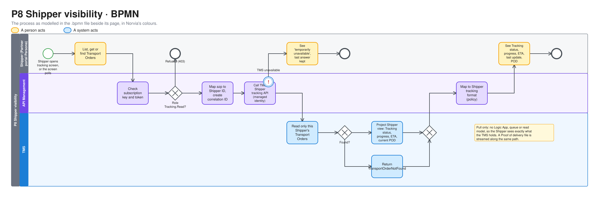
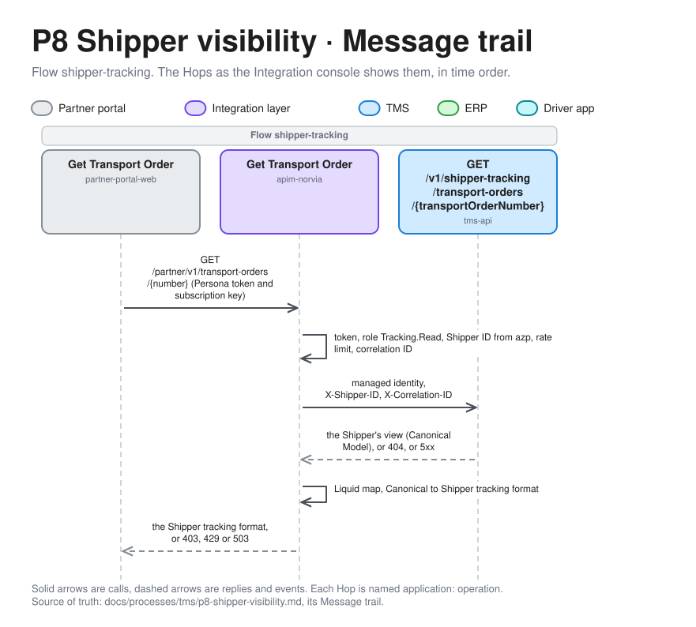

# P8 Shipper visibility

Shipper visibility lets a Shipper see where its Transport Orders stand. The Shipper asks, and the TMS answers straight away through API Management. What the Shipper sees is a Tracking status and the progress so far, not the workings of the Shipment: which Carrier carries it, what went wrong and how the Planner handles it stay inside Norvia (ADR 0011). Terms are defined in [GLOSSARY.md](../../../GLOSSARY.md).

| | |
|---|---|
| **Trigger** | A Shipper queries its Transport Orders, or one of them |
| **Outcome** | The Shipper sees each Transport Order's Tracking status, progress, ETA and current Proof of delivery, exactly as the TMS holds them at that moment |
| **Owning system** | TMS. It owns Transport Orders, Shipments, Tracking events and Proofs of delivery (ADR 0002). P8 only reads them |
| **Applies to** | Both. The Shipper can't tell Own fleet from a Carrier |
| **Integrations touched** | Partner portal (Shipper Personas), API Management (tracking API and its mapping policy), TMS Shipper tracking API |

## Process model

The model is [p8-shipper-visibility.bpmn](p8-shipper-visibility.bpmn), which opens in any BPMN tool and is the source. The picture is drawn from it by [bpmn.py](../../architecture/diagrams/bpmn.py), so change the model and run the script, not the picture ([the editable file](../../architecture/diagrams/bpmn-p8-shipper-visibility.excalidraw)).

## Scope

P8 is **pull only**. The Shipper queries, and nothing is sent to it. A query goes from API Management straight to the TMS, because Logic Apps are never used for read actions (ADR 0003). No Logic App, queue or read model sits in between, so the Shipper always sees what the TMS believes.

- **Shippers** are designed here in full, through their Personas.
- **Consignees** get no tracking view. See [Deferred](#deferred).
- **Telling the Shipper** about a problem stays with [P7](p7-exception-handling.md): the Planner decides what the Shipper hears, through a Shipper notification.

## Tracking status

The Shipper sees a **Tracking status**, not the Shipment status. It is worked out from the Transport Order and its Shipment when the query runs, and it isn't stored.

| Tracking status | When |
|---|---|
| Received | The Transport Order is Accepted and has no Shipment yet |
| Scheduled | The Shipment is Planned, Released, Booked or Dispatched |
| Collected | The Shipment is Collected |
| In transit | The Shipment is In transit |
| Delivered | The Shipment is Delivered |

Scheduled covers everything before collection, so the Shipper can't tell whether Own fleet or a Carrier carries the goods. A Shipment that goes back to Planned after a rejection (P4) or a cancellation (P7) stays Scheduled, so the Tracking status never moves backwards.

Rejected bookings aren't included. They have no Transport Order number, and the Shipper got every reason in the P1 response.

## What the Shipper sees

For each Transport Order:

| Item | Content |
|---|---|
| Transport Order | Transport Order number, Shipper reference, collection and delivery places, collection window |
| Tracking status | See [Tracking status](#tracking-status) |
| ETA | As P5 defines it: the ETA from the last Tracking event that carried one, otherwise the delivery window |
| Delivery window | The agreed delivery window when the Planner has set one (P7), otherwise the Transport Order's |
| Last update | The event time of the latest progress Tracking event. Empty before collection |
| Progress | The progress Tracking events (Collected, Departed, Arrived, Out for delivery, Delivered) in event-time order, each with its type, event time and place (city and country) |
| Proof of delivery | The current one only: received by, delivery time, condition and its files to download |

What the Shipper doesn't see, each with its reason:

- **The Carrier.** Towards the Shipper, Norvia carries the goods, as in P7's Shipper notification.
- **The Shipment number.** The Shipper deals in Transport Orders.
- **Exception Tracking events and Exceptions.** Delivery failed, Damaged and every Exception stay with the Planner, who decides what the Shipper is told (P7). A late Delivery failed after Delivered leaves the Shipper on Delivered.
- **Remarks** on Tracking events. They are the Carrier talking to Norvia.
- **Stale.** It is about the integration's health, not news for the Shipper (P7). The last update shows the silence without calling it anything.
- **Superseded Proofs of delivery.**
- **The Freight Charge.** A displayed price reads as a commitment (P2).

The last update is how a Shipper notices the headline incident: "In transit, last update 4 days ago".

## Steps

1. **Ask.** The presenter plays a Shipper Persona in the Partner portal and opens its tracking screen, or the screen polls (see [Partner portal](#partner-portal)). The portal calls API Management with the Persona's token and subscription key.
2. **Check at the edge.** API Management checks the subscription key and the Entra token (audience "Norvia Partner API", role `Tracking.Read`). A token without the role gets 403. This is how a Carrier Persona gets refused. API Management maps the `azp` claim to a Shipper ID (ADR 0005) and creates a correlation ID.
3. **Query.** API Management calls the TMS Shipper tracking API with its managed identity, passing the Shipper ID and the correlation ID as headers.
4. **Project.** The TMS reads only that Shipper's Transport Orders and returns the Shipper's view of them, as described in [What the Shipper sees](#what-the-shipper-sees), in the Canonical Model.
5. **Map.** An API Management policy maps the Canonical Model to the [Shipper tracking format](#shipper-tracking-format) and returns it.

A Proof of delivery file follows the same path. The TMS streams it and API Management passes it through unchanged.

### When something fails

| Failure | What happens |
|---|---|
| The Transport Order doesn't exist, or belongs to another Shipper | `TransportOrderNotFound`, the same in both cases, so the API doesn't reveal whose it is |
| The Proof of delivery file isn't the current one, or the Transport Order has none | `ProofOfDeliveryNotFound` |
| The TMS is unavailable (server error or timeout) | API Management waits a short time and doesn't retry. It returns a gateway error saying tracking is temporarily unavailable. The portal keeps its last answer, shows when it was fetched, and shows the error |

Unlike P5's write path, a failure here reaches the Shipper at once.

## Queries

| Query | Input | Returns |
|---|---|---|
| List Transport Orders | Optional Tracking status and collection-date range. Paged | Per Transport Order: number, Shipper reference, places, Tracking status, ETA, last update |
| Get a Transport Order | Transport Order number | Everything in [What the Shipper sees](#what-the-shipper-sees) |
| Find a Transport Order | Shipper reference | As "Get a Transport Order". The Shipper reference is unique per Shipper (P1) |
| Download a Proof of delivery file | Transport Order number and file ID | The file, streamed |

The list is sorted by collection date, newest first.

## Shipper tracking format

The Shipper tracking format follows the conventions of the Shipper booking format in P1: JSON with its own field names, flat address fields, and local date/times without an offset. Event times are in the time zone of their place. The ETA and delivery window are in the time zone of the delivery address. The API Management policy maps Canonical → Shipper.

The Tracking statuses map to the Shipper codes `RECEIVED`, `SCHEDULED`, `COLLECTED`, `IN_TRANSIT` and `DELIVERED`. Progress Tracking event types map to the Shipper codes `COLLECTED`, `DEPARTED`, `ARRIVED`, `OUT_FOR_DELIVERY` and `DELIVERED`.

The mapping lives in the policy because no Logic App runs on this path. What the Shipper may see is decided in the TMS. The policy only changes the format.

## Partner portal

Each Shipper Persona gets a **tracking screen**:

- **The list** of its Transport Orders, from "List Transport Orders", with the filters.
- **The detail** of one Transport Order: Tracking status, ETA, delivery window, last update, progress and the Proof of delivery with its files to download.
- **A search** by Transport Order number or Shipper reference.

While the screen is open, it polls the API every few seconds. The interval is a Partner portal setting per Persona. Each poll is a real API Management call, so a Carrier in auto-progress (P5) visibly moves the Shipper's screen along, until something stops it.

- **The interval** is `shipper.trackingPollSeconds` of the Persona in the seed file, at least 1 second, and 5 seconds for a Persona that sets none. A poll starts its wait when the last one finished, so a slow answer never piles polls up.
- **Times** are shown as the API returns them: local to the place they are about, with no conversion in the portal.
- **A Proof of delivery file** downloads through the portal (`/personas/{id}/tracking/{Transport Order number}/proof-of-delivery/files/{file ID}`), which fetches it from API Management as the Persona, so the Persona's token and subscription key never reach the browser.
- **On an error** (the portal can't reach API Management, or it answers with a gateway error, a refusal or an answer in no known format) the screen keeps the last answer, shows when it was fetched and shows the error with Norvia's reference when there is one. A Transport Order the API says isn't there is an answer, not an error.

The notification inbox from P7 stays where it is. The tracking screen doesn't show notifications.

## TMS API

The Shipper tracking API returns only the Canonical Model (ADR 0003).

Who holds each role, and what else each identity may reach, is in [Identity and access](../../architecture/identity-and-access.md).

| Operation | Caller | Role |
|---|---|---|
| List, get and find Transport Orders for a Shipper | API Management's managed identity | `ShipperTracking.Read` |
| Read a current Proof of delivery file for a Shipper | API Management's managed identity | `ShipperTracking.Read` |

Only API Management holds `ShipperTracking.Read`. The TMS trusts the Shipper ID header only from that caller, as it trusts the Shipper from the intake Logic App in P1. Every operation is scoped to that Shipper. The role is separate from the Planner permissions, so a Shipper-scoped call can never reach the Planner's views. P6's "Read a Proof of delivery file" stays the Planner's.

## Rate limiting

The Shipper product in API Management has a rate limit per subscription. Polling Personas stay well inside it.

## Correlation ID

API Management creates a correlation ID for each query and passes it to the TMS as a header. It isn't stored, because a query changes nothing, but it is in the logs, so a slow or failed query can be found in Application Insights.

## Events

P8 publishes no events and consumes none.

## Presenter smoke run

After a deployment, and not in CI, the presenter checks Shipper visibility end to end on the deployed estate, before the headline incident is re-enacted from the Shipper's side. Do it after the presenter smoke runs of Carrier booking ([P4](p4-carrier-booking.md#presenter-smoke-run)), Shipment tracking ([P5](p5-shipment-tracking.md#presenter-smoke-run)) and Proof of delivery ([P6](p6-proof-of-delivery.md#presenter-smoke-run)). The presenter's steps are in the Partner portal and the TMS UI, and the script stops and says what to do. Run it in a terminal, with the Partner portal, the TMS UI and the Integration console side by side.

1. **Get two Transport Orders.** Book two as Brouwer Dranken, Rotterdam to Düsseldorf. For story 14, plan the Shipment and assign it to Kessler Spedition, but don't release it. Set Kessler Spedition to *Auto-confirm* and *Auto-progress* on its Carrier page (it is seeded on *Manual*, because the Simulator plays it), and back to *Manual* afterwards. For story 15, follow P4's run to a Booked Shipment carried by Van Dijk Transport, with its tracking on *Manual*. Don't track either first. Note both Transport Order numbers.
2. **Run the check.** Run `infra/smoke-test-shipper-visibility.sh <story 14 Transport Order number> <story 15 Transport Order number>`. It queries as Brouwer Dranken, through API Management, from a throwaway Container Apps job running as the Partner portal. It reads the TMS as the intake identity and Application Insights, which is usually 1 to 5 minutes behind.
3. **Story 14.** The script checks that the Transport Order is Scheduled. Open Brouwer Dranken's tracking screen for it, then release the Shipment in the TMS UI. Kessler Spedition confirms and progresses it by itself. The script checks that the Shipper's view only moves forward to Delivered, with a Proof of delivery whose sample CMR downloads through API Management. Say whether you saw the screen do the same by itself.
4. **A Carrier is refused.** The script queries with Van Dijk Transport's token and checks for `403`.
5. **Story 15.** The script sends `PU` and `DEP` as Van Dijk Transport and checks that the Shipper sees In transit. Open the screen. The script then sends a status code outside P5's mapping table (`DLV`), which gets `202 Accepted` and fails in the Carrier-tracking Logic App, as P5's presenter-panel fault will. It checks that the Shipper's view stays In transit with the same last update for 90 seconds. Say whether the screen shows its last update getting older. The fault is not built yet, so the script plays what it does. The message stays on the `carrier-tracking` dead-letter queue. Discard it in the Integration console afterwards.
6. **Stop the TMS.** The script points API Management's `tms-api` backend at an address that answers nothing, and checks for `503` with a correlation ID. The screen keeps its last answer and shows the error with the time it was fetched. Say whether it does. The script puts the backend back, even when the run fails, and checks that the query works again.
7. **Follow it.** The script checks that the queries are in Application Insights by correlation ID, in API Management and, where the TMS answered, the TMS, and prints the Partner portal's and the Integration console's links.

The script prints `PASS` or `FAIL` per check, never a body, a token or a key. If a check fails, file the gap as its own issue against P8, rather than working around it in the run book.

## Implementation

For engineers and coding agents. It shows what the estate does when a Shipper queries its Transport Orders, where each step lives in the repository, what plays each Azure piece on a developer's machine, and what is designed but not built. It follows the template set by [P1's Implementation section](p1-transport-order-intake.md#implementation). Azure is the estate [c4.md](../../architecture/c4.md) draws.

P8 is read only: there is no Logic App, queue or event, so the trail is short and every call returns before the one that started it does.

### Message trail

The Hops a Shipper's query leaves on its Message trail, named as the [Integration console](../../operations/integration-console.md#message-trail) shows them, in time order. All of them belong to the one Flow `shipper-tracking`, on the correlation ID that API Management creates. The diagram shows "Get Transport Order". List, Find and Download Proof of delivery file have the same shape, with their own operation and TMS route.

*Editable source: [message-trail-p8-1.excalidraw](../../architecture/diagrams/message-trail-p8-1.excalidraw), generated from [message_trails.py](../../architecture/diagrams/message_trails.py).*

- A refused call stops at `apim-norvia` with `Refused` and a `failureCode`: `NotAllowedToReadTracking` (a Carrier Persona's token), `NoShipperForClient` or a rate-limited call. A TMS that doesn't answer in 5 seconds, or answers with a server error, ends the trail at `apim-norvia` with `TmsUnavailable`. The TMS hop is missing when it never got the call.
- The TMS's 4xx answers (`TransportOrderNotFound`, `ProofOfDeliveryNotFound`) pass through as `TmsRefused`.
- A Tracking status or event type the Shipper format has no code for gives `TrackingNotMapped`, a 503. The Shipper never gets a wrong answer.
- Nothing is published, so no publish Hop appears. The failure rows are in [failure behaviour](../../architecture/failure-behaviour.md#p8-shipper-visibility).

### Code map

Links go to files, not lines, so they stay true as the code moves.

| Step | Where |
|---|---|
| 1. Ask | The screens [TrackedOrders.razor](../../../src/PartnerPortal/Norvia.PartnerPortal.Web/ShipperTracking/TrackedOrders.razor) (list and search) and [TrackedOrder.razor](../../../src/PartnerPortal/Norvia.PartnerPortal.Web/ShipperTracking/TrackedOrder.razor) (detail), polling through [PollingPage.cs](../../../src/PartnerPortal/Norvia.PartnerPortal.Web/ShipperTracking/PollingPage.cs) and keeping the last answer in [LastAnswer.cs](../../../src/PartnerPortal/Norvia.PartnerPortal.Web/ShipperTracking/LastAnswer.cs). Handlers: [ListShipperTrackingHandler.cs](../../../src/PartnerPortal/Norvia.PartnerPortal.Application/ShipperTracking/List/ListShipperTrackingHandler.cs), [GetShipperTrackingHandler.cs](../../../src/PartnerPortal/Norvia.PartnerPortal.Application/ShipperTracking/GetTransportOrder/GetShipperTrackingHandler.cs) and [FindShipperTrackingHandler.cs](../../../src/PartnerPortal/Norvia.PartnerPortal.Application/ShipperTracking/FindTransportOrder/FindShipperTrackingHandler.cs). The calls (the portal's Hops): [NorviaPartnerApiClient.cs](../../../src/PartnerPortal/Norvia.PartnerPortal.Infrastructure/PartnerApi/NorviaPartnerApiClient.cs), with [ShipperTrackingFormat.cs](../../../src/PartnerPortal/Norvia.PartnerPortal.Infrastructure/PartnerApi/ShipperTrackingFormat.cs) reading the answer and [ShipperTrackingFailures.cs](../../../src/PartnerPortal/Norvia.PartnerPortal.Infrastructure/PartnerApi/ShipperTrackingFailures.cs) classifying errors. Poll interval: `shipper.trackingPollSeconds` in [SeedFilePersonaDirectory.cs](../../../src/PartnerPortal/Norvia.PartnerPortal.Infrastructure/Personas/SeedFilePersonaDirectory.cs), from [norvia.seed.json](../../../seed/norvia.seed.json) |
| 1. Download a file | [ProofOfDeliveryFileEndpoint.cs](../../../src/PartnerPortal/Norvia.PartnerPortal.Web/ShipperTracking/ProofOfDeliveryFileEndpoint.cs), with [DownloadProofOfDeliveryFileHandler.cs](../../../src/PartnerPortal/Norvia.PartnerPortal.Application/ShipperTracking/DownloadFile/DownloadProofOfDeliveryFileHandler.cs). It fetches the file from API Management as the Persona |
| 2. Check at the edge | API Management: [list-shipper-transport-orders.policy.xml](../../../infra/estate/partner-api/list-shipper-transport-orders.policy.xml), [get-shipper-transport-order.policy.xml](../../../infra/estate/partner-api/get-shipper-transport-order.policy.xml), [find-shipper-transport-order.policy.xml](../../../infra/estate/partner-api/find-shipper-transport-order.policy.xml) and [get-shipper-proof-of-delivery-file.policy.xml](../../../infra/estate/partner-api/get-shipper-proof-of-delivery-file.policy.xml). The operations are declared in [partner-api.bicep](../../../infra/estate/partner-api.bicep). The rate limit is the `rate-limit-by-key` in each policy |
| 3. Query | The TMS endpoints in [ShipperTrackingEndpoints.cs](../../../src/Tms/Norvia.Tms.Api/ShipperTracking/ShipperTrackingEndpoints.cs), which require the `ShipperTracking.Read` role and the Shipper ID header. The role is assigned in [identities.bicep](../../../infra/estate/identities.bicep) |
| 4. Project | Queries and handlers under [ShipperTracking/](../../../src/Tms/Norvia.Tms.Application/ShipperTracking/): [ListShipperTransportOrdersHandler.cs](../../../src/Tms/Norvia.Tms.Application/ShipperTracking/ListTransportOrders/ListShipperTransportOrdersHandler.cs), [GetShipperTransportOrderHandler.cs](../../../src/Tms/Norvia.Tms.Application/ShipperTracking/GetTransportOrder/GetShipperTransportOrderHandler.cs), [FindShipperTransportOrderHandler.cs](../../../src/Tms/Norvia.Tms.Application/ShipperTracking/GetTransportOrder/FindShipperTransportOrderHandler.cs) and [ShipperTransportOrderDetailProjection.cs](../../../src/Tms/Norvia.Tms.Application/ShipperTracking/GetTransportOrder/ShipperTransportOrderDetailProjection.cs), which decides what the Shipper may see. Specifications: [ShipperTransportOrdersSpec.cs](../../../src/Tms/Norvia.Tms.Domain/ShipperTracking/ShipperTransportOrdersSpec.cs), [ShipperTransportOrderByNumberSpec.cs](../../../src/Tms/Norvia.Tms.Domain/ShipperTracking/ShipperTransportOrderByNumberSpec.cs) and [ShipperTransportOrderByReferenceSpec.cs](../../../src/Tms/Norvia.Tms.Domain/ShipperTracking/ShipperTransportOrderByReferenceSpec.cs). Tracking status: [TrackingStatuses.cs](../../../src/Tms/Norvia.Tms.Domain/ShipperTracking/TrackingStatuses.cs). Refusals: [ShipperTrackingRefusalCode.cs](../../../src/Tms/Norvia.Tms.Domain/ShipperTracking/ShipperTrackingRefusalCode.cs). Proof of delivery file: [GetShipperProofOfDeliveryFileHandler.cs](../../../src/Tms/Norvia.Tms.Application/ShipperTracking/ReadProofOfDeliveryFile/GetShipperProofOfDeliveryFileHandler.cs). There is no aggregate method and no event: P8 changes nothing |
| 5. Map | The Liquid templates [shipper-tracking.liquid](../../../infra/estate/partner-api/shipper-tracking.liquid) and [shipper-tracking-list.liquid](../../../infra/estate/partner-api/shipper-tracking-list.liquid), loaded into the policies by [partner-api.bicep](../../../infra/estate/partner-api.bicep) ([ADR 0035](../../adr/0035-the-shipper-tracking-map-is-liquid-with-the-clock-rules-written-out.md)). Contracts, schemas and samples: [shipper-tracking.v1.schema.json](../../../contracts/partner-api/shipper-tracking.v1.schema.json), [shipper-tracking-list-item.v1.schema.json](../../../contracts/partner-api/shipper-tracking-list-item.v1.schema.json) and [contracts/partner-api](../../../contracts/partner-api/README.md). The Canonical Model side: [shipper-transport-order-detail.v1.schema.json](../../../contracts/canonical-model/shipper-transport-order-detail.v1.schema.json) and [shipper-transport-order-list-item.v1.schema.json](../../../contracts/canonical-model/shipper-transport-order-list-item.v1.schema.json) |
| The applications | The TMS API and Partner portal are declared in the [AppHost](../../../src/Norvia.AppHost/AppHost.cs). P8 adds no Logic App, Function, queue, topic or subscription |
| After a deploy | [smoke-test-shipper-visibility.sh](../../../infra/smoke-test-shipper-visibility.sh) |

### Locally

Under Aspire there is no API Management. `Norvia.Integration.LocalPartnerApi` plays it for a query: [ShipperTrackingQueries.cs](../../../src/Integration/Norvia.Integration.LocalPartnerApi/ShipperTrackingQueries.cs) answers the same `/partner/v1/transport-orders` routes, makes the edge's checks, applies [TrackingRateLimit.cs](../../../src/Integration/Norvia.Integration.LocalPartnerApi/TrackingRateLimit.cs), calls the TMS as API Management's identity through [TmsShipperTracking.cs](../../../src/Integration/Norvia.Integration.LocalPartnerApi/TmsShipperTracking.cs) and maps the answer with [ShipperTrackingMap.cs](../../../src/Integration/Norvia.Integration.LocalPartnerApi/ShipperTrackingMap.cs), which runs the same Liquid templates through DotLiquid. The Partner portal and the TMS API are the same applications in both, and the Aspire dashboard plays Application Insights. No worker plays a part, because there is no Logic App. The full map, and the places where the two can differ, are in [local-vs-azure.md](../../architecture/local-vs-azure.md).

Two differences matter for P8. The Liquid maps run in API Management in Azure and in DotLiquid locally, so a template can behave differently on a value neither tested. The policy's checks and the stand-in's are two implementations kept close by tests.

### Gaps

Designed in this document and not built yet:

| Gap | Where it stands |
|---|---|
| Consignee tracking, pushing progress to the Shipper, a tracking read model or caching, the Freight Charge, Fulfilment Transport Orders | Left out on purpose ([Deferred](#deferred)) |
| As-found toggles and presenter-panel faults for P8 | None added. No Bicep parameter switches API Management response caching or the rate limit, and nothing in the Partner portal makes the TMS Shipper tracking API fail for a few minutes ([Deferred](#deferred)). [Failure behaviour](../../architecture/failure-behaviour.md#p8-shipper-visibility) lists the toggles as planned |
| Alerts on P8 | None built: failed requests on the Shipper tracking operations are planned only ([monitoring.bicep](../../../infra/estate/monitoring.bicep) declares no alert rule) |
| The Integration console's panels for P8 | None. API Management's failures can be found by search only, with no panel |

## Deferred

These were left out on purpose while designing P8, each with its reason.

- **Pushing progress to the Shipper**, including telling it a Shipment is booked (P4). Pull shows the headline incident as it happened: the Shipper's screen stays on In transit. Push would add a second outbound Logic App path next to P7's Shipper notifications. When it is built, it can consume the Shipment events of P3 to P7.
- **Consignee tracking.** It needs another identity model, such as a link with a tracking code and no token, and a new kind of Persona.
- **Exceptions and exception Tracking events.** The Planner decides what the Shipper hears (P7, ADR 0011).
- **Goods going back to the Shipper.** P7's `ReturnedToShipper` doesn't change the Shipment, so the Shipper stays on its last Tracking status. It needs return legs, deferred with several Shipments per Transport Order (ADR 0007). The Shipper hears through a P7 notification.
- **A tracking read model or response caching.** Reading the TMS directly keeps the Shipper's view equal to the TMS's. Caching comes back only as an as-found toggle.
- **The Freight Charge.** As in P2.
- **Fulfilment Transport Orders.** They appear once the WMS handoff exists (P1), with no change to P8.
- **As-found toggles and presenter-panel faults.** They are added after the fixed state is built, as for P1 to P7. P8 needs no fault of its own to re-enact the headline incident: P5's mapping fault already leaves the Shipper's screen on In transit. The candidates:
  - Toggle: API Management response caching with a long lifetime. The TMS is right but the Shipper still sees an old Tracking status, which is a look-alike of the headline incident with a different root cause.
  - Presenter-panel fault: the TMS Shipper tracking API fails for a few minutes. The Shipper sees the error straight away, which contrasts with P5's silent failure.
  - Toggle: no rate limit on the Shipper product, so polling Personas can load the TMS.
