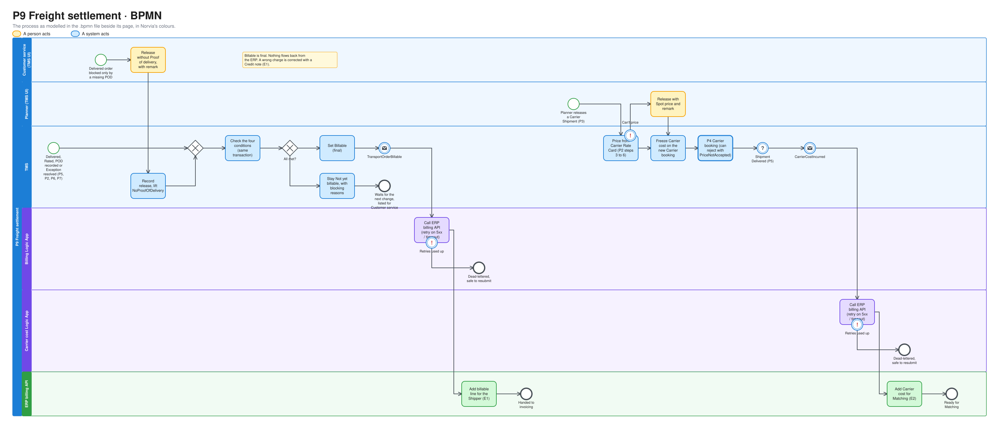
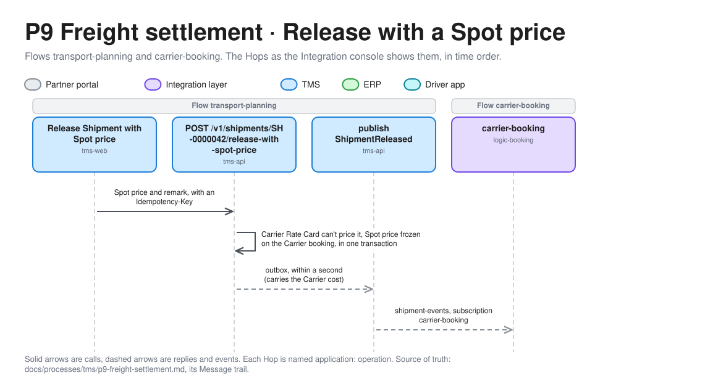
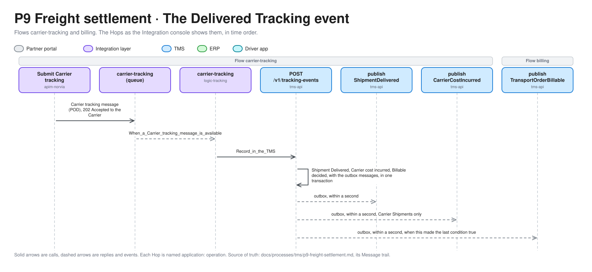
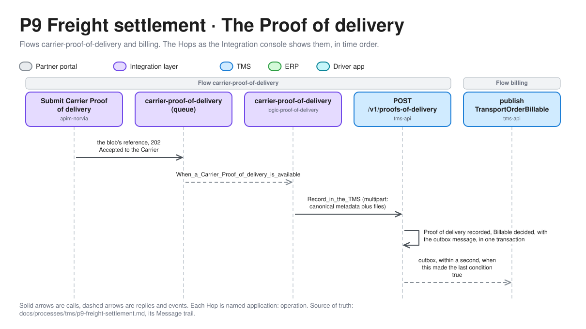
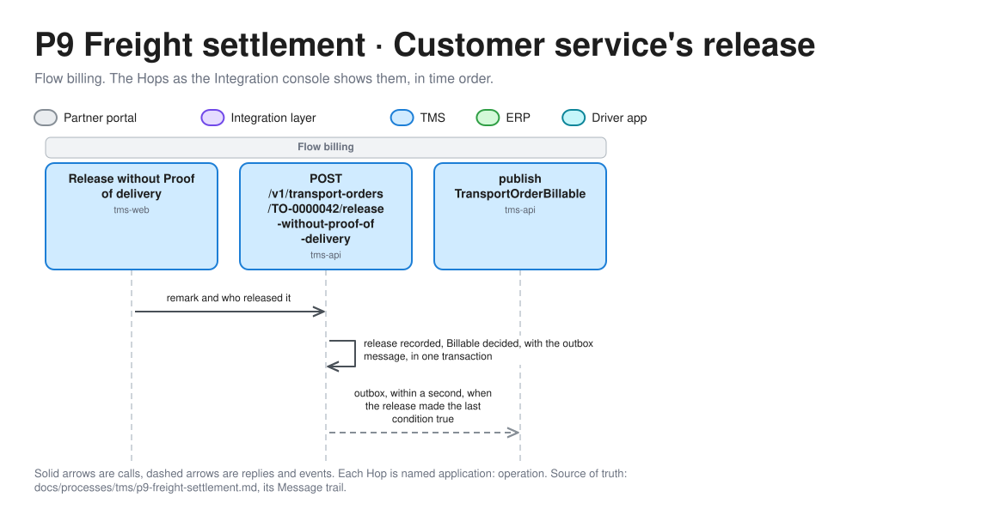

# P9 Freight settlement

Freight settlement makes sure Norvia is paid for each Transport Order it delivers, and pays each Carrier the price it agreed. The TMS decides when a Transport Order is Billable and hands it to the ERP with its frozen Freight Charge. It prices each Carrier booking at release and hands its Carrier cost to the ERP once the Shipment is Delivered. The ERP does the rest: Invoice runs, Credit notes and Matching Carrier invoices. This document covers the TMS side. The ERP side is [E1 Invoicing](../erp/e1-invoicing.md) and [E2 Carrier invoice matching](../erp/e2-carrier-invoice-matching.md). Terms are defined in [GLOSSARY.md](../../../GLOSSARY.md).

| | |
|---|---|
| **Trigger** | A Transport Order is Delivered (P5). For the Carrier cost, a Carrier Shipment is Released (P3, P4) |
| **Outcome** | A Billable Transport Order handed to the ERP with its Freight Charge. For a Carrier Shipment, a frozen Carrier cost on its Carrier booking, handed to the ERP once Delivered |
| **Owning system** | TMS for Billable and the Carrier cost (ADR 0012, ADR 0013). The ERP owns invoicing, Carrier Rate Cards and Carrier invoices (ADR 0002) |
| **Applies to** | Both for the Shipper side. The Carrier cost is Carriers only. Own fleet has no Carrier cost |
| **Integrations touched** | Service Bus (Transport Order and Shipment events), Billing Logic App, Carrier cost Logic App, ERP billing API. Partner portal (Carrier Personas) through P4. ERP, through the master-data sync ([E3](../erp/e3-master-data-sync.md)) over the seed file (Carrier Rate Cards) |

## Process model

The model is [p9-freight-settlement.bpmn](p9-freight-settlement.bpmn), which opens in any BPMN tool and is the source. The picture is drawn from it by [bpmn.py](../../architecture/diagrams/bpmn.py), so change the model and run the script, not the picture ([the editable file](../../architecture/diagrams/bpmn-p9-freight-settlement.excalidraw)).

## Scope

P9 is the first process that needs the ERP, and it is where the ERP is first built (ADR 0001), as an invoicing slice. The two halves are split by owner:

| Part | Where it is designed |
|---|---|
| Billable, the Carrier cost, the events that hand them over | Here |
| The Invoice run, Shipper invoices, Credit notes, sending invoices to the Shipper | [E1 Invoicing](../erp/e1-invoicing.md) |
| Receiving Carrier invoices, Matching, telling the Carrier | [E2 Carrier invoice matching](../erp/e2-carrier-invoice-matching.md) |

Nothing flows back from the ERP to the TMS (ADR 0012). The TMS never learns an invoice number, and Finance never changes anything in the TMS.

## Billable

### Billing state

Each Transport Order has a billing state that is separate from its status and its rating result, as the rating result is separate from the status in P2.

| Billing state | Meaning |
|---|---|
| Not billed separately | A Fulfilment Transport Order (WMS channel), whose rating result is Not rated separately (P2). It is billed through the Fulfilment Contract. P9 does nothing more with it |
| Not yet billable | A Transport-only order that doesn't meet the conditions below yet. It carries its blocking reasons |
| Billable | It met the conditions. `TransportOrderBillable` has been published with the frozen Freight Charge. Final |

A Transport-only order starts as Not yet billable when P1 accepts it. A Fulfilment order starts as Not billed separately.

### Conditions

A Transport Order becomes Billable when all of these hold ("no POD, no invoice", ADR 0012):

| Condition | Blocking reason while it doesn't hold |
|---|---|
| Its Shipment is Delivered (P5) | `NotDelivered` |
| Its rating result is Rated (P2) | `NotRated`, for Not yet rated or Rating failed |
| Its Shipment has a current Proof of delivery (P6), or Customer service has released it without one | `NoProofOfDelivery` |
| Its Shipment has no open Exception (P7) | `OpenException` |

The TMS checks the conditions in the same transaction as each change that can complete them, and never from a Service Bus event (ADR 0003):

- The Shipment moves to Delivered (P5).
- The Transport Order is Rated, or re-rated after Rating failed (P2).
- A Proof of delivery is recorded (P6). If it has reservations, P7 opens the Exception in the same transaction first, so the order stays blocked.
- An Exception is resolved (P7), whatever its outcome.
- Customer service releases the order without a Proof of delivery.

When the last condition is met, the TMS sets the billing state to Billable and publishes `TransportOrderBillable` in that transaction.

### Billable is final

Once Billable, a Transport Order stays Billable. Nothing that happens later reopens it or publishes the event again: a Proof of delivery that replaces the current one, a Delivery failed or Damaged Tracking event after Delivered, or a new Exception. A charge that turns out to be wrong is corrected with a Credit note in the ERP ([E1](../erp/e1-invoicing.md#credit-notes)). Claims for damage or a shortage are settled outside the TMS and the ERP, as P7's `ClaimHandledOutsideTms` says. They never create a Credit note automatically.

### Releasing without a Proof of delivery

A Carrier that never sends a Proof of delivery would otherwise hold up billing for good. So Customer service can release a Delivered Transport Order without one, from the list of [Transport Orders not yet billable](#customer-services-list), with a required remark, for example "CMR received by post, scanned in the dossier". The TMS records who released it, when, and the remark. The release lifts only `NoProofOfDelivery`. The other conditions still apply. A Proof of delivery that arrives later is recorded as usual (P6) and changes nothing for billing.

The release is allowed only for a Transport Order that is Not yet billable and whose Shipment is Delivered.

## Carrier cost

### Carrier Rate Cards in the TMS

The ERP owns Carrier Rate Cards (ADR 0013). The TMS holds a read copy of each Carrier's Carrier Rate Card and never edits it. The TMS loads them from the seed file at startup, the same way it loads Rate Cards (P2), and the ERP's master-data sync ([E3](../erp/e3-master-data-sync.md)) replaces a card whenever Finance edits it. A Carrier Rate Card has the same shape as a Rate Card: Zones, Lanes, Weight Breaks with a price per 100 kg, a minimum charge per Lane, and versions with validity periods. Overlapping Zones are rejected when the seed loads, as in P2.

### Pricing a Carrier booking at release

When the Planner releases a Carrier Shipment (P3), the TMS calculates its Carrier cost in the same transaction that creates the Carrier booking (P4). It runs P2's steps 3 to 6 against the Carrier's Carrier Rate Card instead of the Shipper's Rate Card:

1. Take the Carrier Rate Card version that is valid on the collection date, with the same collection-date rule as P2.
2. Match the Lane from the collection and delivery addresses.
3. Choose the Weight Break from the total gross weight.
4. Calculate the Freight line, and add a Minimum charge adjustment line when the minimum applies. The money rules are the same as P2's: EUR, without VAT, each line rounded to cents.

The Carrier cost is frozen on the Carrier booking, with its charge lines, its total, its source (*Carrier Rate Card*, with the version used) and the time it was calculated. It is never recalculated. A new release after a rejection creates a new Carrier booking with a newly calculated Carrier cost.

### When the Carrier Rate Card can't price the Shipment

If any step fails, the release of that Shipment fails with the same failure codes as P2 (`NoRateCard`, `NoValidRateCardVersion`, `NoMatchingLane`, `WeightAboveHighestBreak`), naming the Carrier. In a multi-select release, each Shipment succeeds or fails on its own, as in P3.

The Planner can then release that Shipment on its own with a **Spot price**: an amount in EUR, without VAT, and a required remark, for example "agreed with Van Dijk by phone, €480". The Carrier cost then has one *Freight* charge line, the source *Spot*, and the remark. A Spot price is allowed only after the Carrier Rate Card has failed for that release. The Planner can't use one to override a Carrier Rate Card that prices the Shipment.

### What the Carrier sees

The Carrier cost goes to the Carrier in the booking request: the total, its charge lines and whether it is a Spot price ([P4](p4-carrier-booking.md#carrier-booking-format)). When the Carrier confirms, it has accepted that price. When it doesn't accept the price, it rejects the booking with the reason code `PriceNotAccepted`, and the Shipment goes back to Planned as for any rejection. The Planner can release it again, to the same Carrier with a Spot price if the Carrier Rate Card failed, or to another Carrier. There is no counter-offer.

The Shipper's Freight Charge is still never sent to the Carrier.

### Handing the Carrier cost to the ERP

When a Carrier Shipment moves to Delivered (P5), the TMS publishes `CarrierCostIncurred` in the same transaction, for the Confirmed Carrier booking that carried it. The Carrier has earned its price once it delivers, so this doesn't wait for a Proof of delivery or for the Transport Order to be Billable.

Only that Confirmed Carrier booking has a Carrier cost to pay. Rejected, Not delivered, Withdrawn and Cancelled bookings never publish one. Cancellation fees and waiting time are deferred. The Carrier cost is final in the TMS. Any difference with the Carrier's invoice is settled during Matching in the ERP ([E2](../erp/e2-carrier-invoice-matching.md)).

## Steps

### Shipper side

1. **Deliver.** The Shipment moves to Delivered (P5, or P12 for Own fleet). The TMS checks the [conditions](#conditions).
2. **Complete.** The remaining conditions are met, in any order: Rating (P2), a Proof of delivery (P6), Exceptions resolved (P7), or Customer service releasing the order without a Proof of delivery. Each of them checks the conditions again.
3. **Billable.** The last condition is met. The TMS sets the billing state to Billable and publishes `TransportOrderBillable` in the same transaction. The Transport Order leaves Customer service's list.
4. **Hand over.** The Billing Logic App picks up the event and calls the ERP billing API to add a billable line for the Shipper ([E1](../erp/e1-invoicing.md#steps)).

### Carrier side

1. **Price.** The Planner releases a Carrier Shipment (P3). The TMS calculates the Carrier cost, or the Planner enters a Spot price, and it is frozen on the new Carrier booking.
2. **Book.** The booking request carries the Carrier cost (P4). The Carrier confirms it or rejects it, possibly with `PriceNotAccepted`.
3. **Deliver.** The Shipment moves to Delivered (P5). The TMS publishes `CarrierCostIncurred` in the same transaction.
4. **Hand over.** The Carrier cost Logic App picks up the event and calls the ERP billing API to add the Carrier cost ([E2](../erp/e2-carrier-invoice-matching.md#steps)).

### When the ERP can't be reached

On a server error or timeout from the ERP billing API, the Billing and Carrier cost Logic Apps retry with a bounded exponential policy, as in P4. When the retries are used up, the message goes to the subscription's dead-letter queue and the run fails. The ERP billing API is idempotent on the Transport Order number and the Carrier booking number, so a message that is resubmitted from the dead-letter queue is safe. The TMS isn't told either way: it has already done its part (ADR 0012).

## Customer service's list

P9 adds a list for Customer service in the TMS UI, next to P2's rating exceptions list.

| List | Shows | Actions |
|---|---|---|
| Transport Orders not yet billable (P9) | Transport-only orders whose Shipment is Delivered and whose billing state is Not yet billable: Transport Order number, Shipper, Shipper reference, delivery time, and the blocking reasons (`NotRated`, `NoProofOfDelivery`, `OpenException`). Oldest delivery first | Release without Proof of delivery (only when `NoProofOfDelivery` is one of the reasons). Open the rating exception (P2) or the Shipment's timeline |

Transport Orders that aren't Delivered yet aren't listed. They aren't late for billing, just not finished. The list updates without a page refresh, as the other lists do.

The Shipment's timeline shows the billing state, when it became Billable, and any release without a Proof of delivery with its remark. The Carrier booking on the timeline shows its Carrier cost and source.

## Planner's release

P9 changes one thing for the Planner: releasing a Carrier Shipment now prices it. A release that fails on the Carrier Rate Card shows the failure code in the list of Shipments to release, with a **Release with Spot price** action for that Shipment. The list of bookings awaiting an answer (P4) shows each booking's Carrier cost and source.

## TMS API

P9 adds no operations for Logic Apps. Everything happens in TMS transactions or in the TMS UI:

| Action | Who | Permissions |
|---|---|---|
| Release without Proof of delivery | Customer service, in the TMS UI | Customer service permissions from P2 |
| Release with Spot price | Planner, in the TMS UI | Planner permissions from P3 |

## Correlation ID

`TransportOrderBillable` carries the correlation ID of the transaction that made the order Billable: that of the Tracking event, Proof of delivery or re-rate, or a new one from the TMS for a Planner or Customer service action, as in P3. The Transport Order's intake correlation ID travels with it, so a Transport Order can be traced from intake to its Shipper invoice.

`CarrierCostIncurred` carries the Delivered Tracking event's correlation ID and the Carrier booking number. The Logic Apps carry both on to the ERP, which stores them on the billable line and the Carrier cost.

## Events

Both events go through the TMS's transactional outbox (ADR 0003).

| Event | Topic | Published when | Carries | Consumers |
|---|---|---|---|---|
| `TransportOrderBillable` | Transport Order events | A Transport Order becomes Billable | Transport Order number, Shipper, Shipper reference, Shipment number, delivery time, Freight Charge with charge lines and Rate Card version, whether it was released without a Proof of delivery, intake and billing correlation IDs | [Subscribers](../../architecture/events.md#catalogue) |
| `CarrierCostIncurred` | Shipment events, Carrier only | A Carrier Shipment moves to Delivered | Carrier booking number, Carrier booking reference, Shipment number, Transport Order number, Carrier ID, Carrier cost with charge lines, source (Carrier Rate Card version, or Spot with its remark), delivery time, correlation ID | [Subscribers](../../architecture/events.md#catalogue) |

The release without a Proof of delivery publishes nothing of its own. If it makes the order Billable, `TransportOrderBillable` says so.

## Demo seed

The seed file gets Carrier Rate Cards, in the same shape as the Rate Cards from P2:

| Carrier | Carrier Rate Card | Role in the demo |
|---|---|---|
| Van Dijk Transport | Benelux Lanes, and a deliberate gap: no Lane into Germany | Releasing Rotterdam → Düsseldorf to Van Dijk fails with `NoMatchingLane`, and the Planner enters a Spot price. Van Dijk answers by hand, so the presenter can confirm the Spot price or reject it with `PriceNotAccepted` |
| Kessler Spedition | Benelux and German Lanes | The Carrier Rate Card prices Rotterdam → Düsseldorf |
| PakketPunt Express | Every Lane of every Shipper's Rate Card, out of Rotterdam and Utrecht | Always priced |

Each Carrier cost sits about 15–25% below the Freight Charge for the same Lane and weight, so the margin in the ERP looks believable.

## Presenter smoke run

After a deployment, and not in CI, the presenter checks the TMS side of Freight settlement end to end on the deployed estate, before the headline relies on it. Do it after the presenter smoke runs of Carrier booking ([P4](p4-carrier-booking.md#presenter-smoke-run)), Proof of delivery ([P6](p6-proof-of-delivery.md#presenter-smoke-run)) and Exception handling ([P7](p7-exception-handling.md#presenter-smoke-run)). The script makes the Carriers' calls. The Planner's and Customer service's actions, and Van Dijk Transport's answers in the Partner portal, are the presenter's, and the script stops and says what to do. Run it in a terminal, with the TMS UI, the Partner portal and the Integration console side by side.

1. **Get three Transport Orders.** Book three as Brouwer Dranken, Rotterdam to Düsseldorf. Assign the first two to Van Dijk Transport and stop there: don't release them. Follow P4's run for the third to a Booked Shipment carried by Kessler Spedition, with its tracking on *Manual*. Don't track any of them first. Note the three Transport Order numbers.
2. **Run the check.** Run `infra/smoke-test-freight-settlement.ps1 <Spot price order> <PriceNotAccepted order> <no Proof of delivery order>`. It posts as the Carriers, through API Management, from a throwaway Container Apps job running as the Partner portal, and reads the TMS as the intake identity, and Application Insights, which is usually 1 to 5 minutes behind.
3. **Story 14.** The script checks that the first Shipment is in the list of Shipments to release with `NoMatchingLane`. In the TMS UI, try to release it and see it fail, then release it with a Spot price and a remark. The script checks that the Carrier booking is Requested with a Carrier cost of one *Freight* line, from the source *Spot*, with the remark. In the Partner portal, open Van Dijk's booking inbox, see the price and confirm. The script then sends `PU`, `DEP` and `POD` as Van Dijk Transport and checks that the Shipment is Delivered, that `CarrierCostIncurred` was published and that the order is Not yet billable for `NoProofOfDelivery`. It sends a clean Proof of delivery and checks that the order is Billable and that `TransportOrderBillable` was published.
4. **`PriceNotAccepted`.** The script checks that the second Shipment is in the list with `NoMatchingLane`. Release it with a Spot price, then reject the booking in Van Dijk's inbox with `PriceNotAccepted`. The script checks that the Shipment is Planned again and that the Carrier booking is Rejected with that reason.
5. **No Proof of delivery.** The script sends `PU`, `DEP` and `POD` as Kessler Spedition and checks that the third order shows in Customer service's list with `NoProofOfDelivery`. In the TMS UI, release it without a Proof of delivery, with a remark. The script checks that the order is Billable, with who released it and the remark, that it left the list and that `TransportOrderBillable` was published.
6. **Follow it.** The script checks that the Tracking events, the Proof of delivery, the Spot price release and the release without a Proof of delivery are in Application Insights by correlation ID, in API Management, the Logic Apps and the TMS, and prints the TMS UI's and the Integration console's links.

The script prints `PASS` or `FAIL` per check, never a body, a token or a key. It checks that both events were published, not that the ERP received them. If a check fails, file the gap as its own issue against P9, rather than working around it in the run book.

## Implementation

For engineers and coding agents. It shows what the estate does for the TMS half of Freight settlement, where each step lives in the repository, what plays each Azure piece on a developer's machine, and what is designed but not built. It follows the template set by [P1's Implementation section](p1-transport-order-intake.md#implementation). Azure is the estate [c4.md](../../architecture/c4.md) draws. The ERP half (E1, E2) isn't built, so it is under [Gaps](#gaps).

P9 has no API Management operation, Function or Logic App of its own yet. The TMS decides everything inside the transactions of the processes around it and publishes `TransportOrderBillable` and `CarrierCostIncurred` to the topics `transport-order-events` and `shipment-events`. What it adds to the Message trails are Hops at the end of those of P4, P5, P6 and P7, and two trails that start in the TMS UI.

### Message trail

The Hops of the TMS half, named as the [Integration console](../../operations/integration-console.md#message-trail) shows them, in time order. A Hop is grouped under the Flow it carries in the tracking contract, which is not always the Flow of the call it ends: `publish TransportOrderBillable` is always in Flow `billing`. The Carrier side and the Shipper side leave three trails, drawn one by one. Each trail has a correlation ID of its own, and a Transport Order number or Shipment number finds them together.

**1. Release with a Spot price.** The Planner's action starts the trail, with a new correlation ID.

*Editable source: [message-trail-p9-1.excalidraw](../../architecture/diagrams/message-trail-p9-1.excalidraw), generated from [message_trails.py](../../architecture/diagrams/message_trails.py).*

The Carrier then confirms or rejects in the Partner portal ([P4](p4-carrier-booking.md#message-trail)). A release the Carrier Rate Card can't price is refused in `tms-api: POST /v1/shipments/SH-0000042/release` (422, with the failure code) and publishes nothing. A Spot price release the Carrier Rate Card could have priced is refused with `CarrierRateCardPricesShipment` (409). The plain release's Hops are those of [P3](p3-transport-planning.md#message-trail).

**2. The Delivered Tracking event.** It is the trail of [P5](p5-shipment-tracking.md#message-trail), on the correlation ID API Management creates, with one more publish at its end.

*Editable source: [message-trail-p9-2.excalidraw](../../architecture/diagrams/message-trail-p9-2.excalidraw), generated from [message_trails.py](../../architecture/diagrams/message_trails.py).*

`publish CarrierCostIncurred` appears next to `publish ShipmentDelivered`, only for a Confirmed Carrier booking with a Carrier cost. An Own fleet Shipment publishes neither.

**3. The Proof of delivery.** It is the trail of [P6](p6-proof-of-delivery.md#message-trail), with `publish TransportOrderBillable` at its end when the Proof of delivery was the last condition.

*Editable source: [message-trail-p9-3.excalidraw](../../architecture/diagrams/message-trail-p9-3.excalidraw), generated from [message_trails.py](../../architecture/diagrams/message_trails.py).*

**Customer service's release.** It starts a trail in the TMS UI, in Flow `billing` throughout, with a new correlation ID.

*Editable source: [message-trail-p9-4.excalidraw](../../architecture/diagrams/message-trail-p9-4.excalidraw), generated from [message_trails.py](../../architecture/diagrams/message_trails.py).*

- The Billable check adds no Hop of its own. It runs in any call that can complete the last condition: the Tracking event and the Proof of delivery above, the rating or re-rate (`tms-api: Rate Transport Order`, Flow `transport-order-rating`, on the intake's trail, [P2](p2-rating.md#implementation)), the resolution of an Exception ([P7](p7-exception-handling.md#message-trail), Flow `exception-handling`) and Customer service's release.
- A release that isn't allowed (the order isn't in billing state Not yet billable, or its Shipment isn't Delivered) is refused in the TMS call and publishes nothing. A release that leaves another condition unmet records the release and publishes nothing yet.
- The publish Hops appear only once the outbox has sent the message ([failure behaviour](../../architecture/failure-behaviour.md#the-tms-outbox)).
- The trails end at the two events. The Billing and Carrier cost Logic Apps take them from the `billing` and `carrier-cost` subscriptions and the ERP billing API records them ([E1](../erp/e1-invoicing.md#implementation), [E2](../erp/e2-carrier-invoice-matching.md#implementation)), so those hops are on the trail too.

### Code map

Links go to files, not lines, so they stay true as the code moves. The numbers are those of [Steps](#steps).

| Step | Where |
|---|---|
| Shipper 1. Deliver | The Delivered Tracking event is the P5 path ([code map](p5-shipment-tracking.md#code-map)). Its handler passes the change to the check in *Shipper 2* |
| Shipper 2. Complete | Every change that can complete a condition calls [BillingCheck.cs](../../../src/Tms/Norvia.Tms.Application/Billing/BillingCheck.cs) with a [BillingChange.cs](../../../src/Tms/Norvia.Tms.Application/Billing/BillingChange.cs) before it saves: [RecordTrackingHandler.cs](../../../src/Tms/Norvia.Tms.Application/TrackingEvents/Record/RecordTrackingHandler.cs) (Delivered, and an Exception it opens), [RateTransportOrderHandler.cs](../../../src/Tms/Norvia.Tms.Application/TransportOrders/Rate/RateTransportOrderHandler.cs) (Rated or re-rated), [RecordProofOfDeliveryHandler.cs](../../../src/Tms/Norvia.Tms.Application/ProofsOfDelivery/Record/RecordProofOfDeliveryHandler.cs), [ResolveExceptionHandler.cs](../../../src/Tms/Norvia.Tms.Application/Exceptions/Resolve/ResolveExceptionHandler.cs) and [ReleaseWithoutProofOfDeliveryHandler.cs](../../../src/Tms/Norvia.Tms.Application/Billing/Release/ReleaseWithoutProofOfDeliveryHandler.cs). None of them reads a Service Bus event |
| Shipper 2. Customer service's release | Endpoint `POST /v1/transport-orders/{number}/release-without-proof-of-delivery` in [TransportOrderEndpoints.cs](../../../src/Tms/Norvia.Tms.Api/TransportOrders/TransportOrderEndpoints.cs) (`ReleaseWithoutProofOfDeliveryAsync`, tracked as `Flows.Billing`). Command [ReleaseWithoutProofOfDeliveryCommand.cs](../../../src/Tms/Norvia.Tms.Application/Billing/Release/ReleaseWithoutProofOfDeliveryCommand.cs), handler above, refusal codes [BillingRefusalCode.cs](../../../src/Tms/Norvia.Tms.Domain/TransportOrders/BillingRefusalCode.cs) |
| Shipper 3. Billable | Aggregate methods `TryBecomeBillable` and `ReleaseWithoutProofOfDelivery` in [TransportOrder.cs](../../../src/Tms/Norvia.Tms.Domain/TransportOrders/TransportOrder.cs), with [BillingState.cs](../../../src/Tms/Norvia.Tms.Domain/TransportOrders/BillingState.cs), [BillingFacts.cs](../../../src/Tms/Norvia.Tms.Domain/TransportOrders/BillingFacts.cs) and [FreightCharge.cs](../../../src/Tms/Norvia.Tms.Domain/TransportOrders/FreightCharge.cs). Stored by [TransportOrderConfiguration.cs](../../../src/Tms/Norvia.Tms.Infrastructure/Data/Configurations/TransportOrderConfiguration.cs) |
| Shipper 3. Publish | Event type [TransportOrderBillableEvent.cs](../../../src/Tms/Norvia.Tms.Domain/TransportOrders/TransportOrderBillableEvent.cs), publisher [PublishTransportOrderBillable.cs](../../../src/Tms/Norvia.Tms.Application/Billing/PublishTransportOrderBillable.cs), message [TransportOrderBillableV1.cs](../../../src/Tms/Norvia.Tms.Application/Billing/TransportOrderBillableV1.cs) (Flow in [Flows.cs](../../../src/Tms/Norvia.Tms.Application/IntegrationEvents/Flows.cs)), sent by [OutboxPublisher.cs](../../../src/Tms/Norvia.Tms.Infrastructure/Outbox/OutboxPublisher.cs). Schema [transport-order-billable.v1.schema.json](../../../contracts/canonical-model/transport-order-billable.v1.schema.json). Topic `transport-order-events` and its `monitoring` subscription: [messaging.bicep](../../../infra/estate/messaging.bicep) |
| Shipper 4. Hand over | Not built: the Billing Logic App, its `billing` subscription and the ERP billing API ([Gaps](#gaps)). Who reads the event is in the [event catalogue](../../architecture/events.md#catalogue) |
| Customer service's list | Handler [ListTransportOrdersNotYetBillableHandler.cs](../../../src/Tms/Norvia.Tms.Application/Billing/ListNotYetBillable/ListTransportOrdersNotYetBillableHandler.cs) with [TransportOrdersNotYetBillableSpec.cs](../../../src/Tms/Norvia.Tms.Domain/TransportOrders/TransportOrdersNotYetBillableSpec.cs), [BillingBlockingReason.cs](../../../src/Tms/Norvia.Tms.Application/Billing/ListNotYetBillable/BillingBlockingReason.cs) and [TransportOrderNotYetBillableSummary.cs](../../../src/Tms/Norvia.Tms.Application/Billing/ListNotYetBillable/TransportOrderNotYetBillableSummary.cs). Endpoint `GET /v1/transport-orders/not-yet-billable` in [TransportOrderEndpoints.cs](../../../src/Tms/Norvia.Tms.Api/TransportOrders/TransportOrderEndpoints.cs) |
| Customer service in the TMS UI | [NotYetBillable.razor](../../../src/Tms/Norvia.Tms.Web/TransportOrders/NotYetBillable.razor) (the list, which re-reads every second by default through [LiveTransportOrderList.cs](../../../src/Tms/Norvia.Tms.Web/TransportOrders/LiveTransportOrderList.cs)) and [ReleaseWithoutProofOfDeliveryPanel.razor](../../../src/Tms/Norvia.Tms.Web/TransportOrders/ReleaseWithoutProofOfDeliveryPanel.razor), calling through [TmsApiClient.cs](../../../src/Tms/Norvia.Tms.Web/TmsApi/TmsApiClient.cs) (the `Release without Proof of delivery` Hop) |
| Carrier Rate Cards | [CarrierRateCard.cs](../../../src/Tms/Norvia.Tms.Domain/RateCards/CarrierRateCard.cs), read through [ICarrierRateCardDirectory.cs](../../../src/Tms/Norvia.Tms.Application/RateCards/ICarrierRateCardDirectory.cs) from [SeedFileCarrierRateCardDirectory.cs](../../../src/Tms/Norvia.Tms.Infrastructure/RateCards/SeedFileCarrierRateCardDirectory.cs), loaded at startup by [LoadSeedOnStart.cs](../../../src/Tms/Norvia.Tms.Infrastructure/Seed/LoadSeedOnStart.cs) from `carrierRateCards` in [norvia.seed.json](../../../seed/norvia.seed.json). The Zones, Lanes and Weight Breaks are those of P2's [Rate Cards](p2-rating.md#implementation) |
| Carrier 1. Price | Handler [ReleaseShipmentHandler.cs](../../../src/Tms/Norvia.Tms.Application/Shipments/Release/ReleaseShipmentHandler.cs). Rules `PriceCarrierBooking` and `PriceCarrierBookingAtSpot` in [AssignmentRules.cs](../../../src/Tms/Norvia.Tms.Domain/Shipments/AssignmentRules.cs). Frozen on the booking as [CarrierCost.cs](../../../src/Tms/Norvia.Tms.Domain/CarrierBookings/CarrierCost.cs) with its source [CarrierCostSource.cs](../../../src/Tms/Norvia.Tms.Domain/CarrierBookings/CarrierCostSource.cs), by `Request` in [CarrierBooking.cs](../../../src/Tms/Norvia.Tms.Domain/CarrierBookings/CarrierBooking.cs) |
| Carrier 1. Release with a Spot price | Endpoint `POST /v1/shipments/{number}/release-with-spot-price` in [ShipmentEndpoints.cs](../../../src/Tms/Norvia.Tms.Api/Shipments/ShipmentEndpoints.cs) (`ReleaseWithSpotPriceAsync`, tracked as `Flows.TransportPlanning`) with [ReleaseWithSpotPriceRequest.cs](../../../src/Tms/Norvia.Tms.Api/Shipments/ReleaseWithSpotPriceRequest.cs), carried to the handler as [SpotPrice.cs](../../../src/Tms/Norvia.Tms.Application/Shipments/Release/SpotPrice.cs) in [ReleaseShipmentCommand.cs](../../../src/Tms/Norvia.Tms.Application/Shipments/Release/ReleaseShipmentCommand.cs) |
| Carrier 1. The Planner's list and UI | [ListShipmentsToReleaseHandler.cs](../../../src/Tms/Norvia.Tms.Application/Shipments/ListToRelease/ListShipmentsToReleaseHandler.cs) (the pricing failure per Shipment), [ShipmentsToRelease.razor](../../../src/Tms/Norvia.Tms.Web/Shipments/ShipmentsToRelease.razor), [ReleaseWithSpotPricePanel.razor](../../../src/Tms/Norvia.Tms.Web/Shipments/ReleaseWithSpotPricePanel.razor) and [BookingsAwaitingAnswer.razor](../../../src/Tms/Norvia.Tms.Web/Shipments/BookingsAwaitingAnswer.razor) (Carrier cost and source). The `Release Shipment with Spot price` Hop is in the [TmsApiClient.cs](../../../src/Tms/Norvia.Tms.Web/TmsApi/TmsApiClient.cs) already linked for Customer service |
| Carrier 2. Book | The release carries the Carrier cost in [ShipmentReleasedV1.cs](../../../src/Tms/Norvia.Tms.Application/Shipments/Release/ShipmentReleasedV1.cs) ([schema](../../../contracts/canonical-model/shipment-released.v1.schema.json), [carrier-cost.v1.schema.json](../../../contracts/canonical-model/carrier-cost.v1.schema.json)). The P4 Logic App [workflow.json](../../../src/Integration/BookingLogicApp/carrier-booking/workflow.json) maps it into the booking request with [CarrierBookingMap.cs](../../../src/Integration/Norvia.Integration.CarrierBooking/CarrierBookingMap.cs); the Freight Charge isn't in it. Samples in [contracts/partner-api](../../../contracts/partner-api/README.md) |
| Carrier 2. Answer | The Partner portal shows the cost next to *Confirm* in [BookingRequests.razor](../../../src/PartnerPortal/Norvia.PartnerPortal.Web/CarrierBookings/BookingRequests.razor) and offers `PriceNotAccepted` ([CarrierRejectionReason.cs](../../../src/PartnerPortal/Norvia.PartnerPortal.Domain/CarrierBookings/CarrierRejectionReason.cs)). [CarrierAnswerMap.cs](../../../src/Integration/Norvia.Integration.CarrierBooking/CarrierAnswerMap.cs) maps `PRICE_NOT_ACCEPTED`, and the TMS accepts it as [CarrierBookingRejectionReason.cs](../../../src/Tms/Norvia.Tms.Domain/CarrierBookings/CarrierBookingRejectionReason.cs) |
| Carrier 3. Deliver and publish | `IncurCarrierCost` in [Shipment.cs](../../../src/Tms/Norvia.Tms.Domain/Shipments/Shipment.cs), called by the tracking handler in *Shipper 2*. Event type [CarrierCostIncurredEvent.cs](../../../src/Tms/Norvia.Tms.Domain/CarrierBookings/CarrierCostIncurredEvent.cs), publisher [PublishCarrierCostIncurred.cs](../../../src/Tms/Norvia.Tms.Application/TrackingEvents/Record/PublishCarrierCostIncurred.cs), message [CarrierCostIncurredV1.cs](../../../src/Tms/Norvia.Tms.Application/TrackingEvents/Record/CarrierCostIncurredV1.cs), schema [carrier-cost-incurred.v1.schema.json](../../../contracts/canonical-model/carrier-cost-incurred.v1.schema.json). Topic `shipment-events`: [messaging.bicep](../../../infra/estate/messaging.bicep) |
| Carrier 4. Hand over | [src/Integration/CarrierCostLogicApp](../../../src/Integration/CarrierCostLogicApp/carrier-cost/workflow.json), its `carrier-cost` subscription and the ERP billing API's `POST /v1/carrier-costs` ([E2](../erp/e2-carrier-invoice-matching.md#implementation)) |
| The Shipment's timeline | [ShipmentBillingView.cs](../../../src/Tms/Norvia.Tms.Application/TrackingEvents/Timeline/ShipmentBillingView.cs) and [CarrierCostView.cs](../../../src/Tms/Norvia.Tms.Application/CarrierBookings/CarrierCostView.cs), shown by [TrackingTimeline.razor](../../../src/Tms/Norvia.Tms.Web/Shipments/TrackingTimeline.razor) |
| The applications | The TMS API, TMS UI and Partner portal are declared in the [AppHost](../../../src/Norvia.AppHost/AppHost.cs). P9 adds no Function, Logic App or Bicep resource |
| The presenter smoke run | [smoke-test-freight-settlement.ps1](../../../infra/smoke-test-freight-settlement.ps1), run after the smoke runs of [Carrier booking](../../../infra/smoke-test-carrier-booking.ps1), [Proof of delivery](../../../infra/smoke-test-proof-of-delivery.ps1) and [Exception handling](../../../infra/smoke-test-exception-handling.ps1) |

### Locally

P9 needs no stand-in of its own. The decision to bill and the Carrier cost are in the TMS API and TMS UI, which are the same applications locally and in Azure, and the Carrier Rate Cards come from the seed file in both. The paths around it run as they do for the processes they belong to: `LocalPartnerApi` plays API Management, `LocalTrackingWorker` plays the Carrier-tracking Logic App and `LocalProofOfDeliveryWorker` the Proof of delivery one ([CarrierTrackingFlow.cs](../../../src/Integration/Norvia.Integration.LocalTrackingWorker/CarrierTrackingFlow.cs), [CarrierProofOfDeliveryFlow.cs](../../../src/Integration/Norvia.Integration.LocalProofOfDeliveryWorker/CarrierProofOfDeliveryFlow.cs)), and `LocalBookingWorker` plays the booking Logic App, which sends the Carrier cost on ([CarrierBookingFlow.cs](../../../src/Integration/Norvia.Integration.LocalBookingWorker/CarrierBookingFlow.cs)). `LocalBillingWorker` and `LocalCarrierCostWorker` play the Billing and Carrier cost Logic Apps. The Service Bus emulator plays Service Bus, and the Aspire dashboard plays Application Insights, so the `publish` Hops of both events are searched there. The full map is in [local-vs-azure.md](../../architecture/local-vs-azure.md).

`TransportOrderBillable` and `CarrierCostIncurred` reach the `monitoring` subscription of their topics and the `billing` and `carrier-cost` subscriptions, whose workers hand them to the ERP billing API.

### Gaps

Designed in this document and not built yet:

| Gap | Where it stands |
|---|---|
| Shipper 4. Hand over: the Billing Logic App, the `billing` subscription of `transport-order-events` and the call to the ERP billing API | Not built. `TransportOrderBillable` is published and the catalogue lists the subscription as *planned* ([events.md](../../architecture/events.md#catalogue)) |
| Carrier 4. Hand over: the Carrier cost Logic App, the `carrier-cost` subscription of `shipment-events` and the call to the ERP billing API | Not built. `CarrierCostIncurred` is published and the subscription is *planned* |
| The ERP, its billing API, [E1 Invoicing](../erp/e1-invoicing.md) and [E2 Carrier invoice matching](../erp/e2-carrier-invoice-matching.md) | The ERP half of Freight settlement isn't built. The TMS never learns an invoice number ([Scope](#scope)) |
| Retry, dead-letter and idempotent resubmit when the ERP can't be reached ([When the ERP can't be reached](#when-the-erp-cant-be-reached)) | Belong to the two Logic Apps. Nothing in the estate does them yet |
| What was left out on purpose | Listed with their reasons in [Deferred](#deferred) |
| As-found toggles and presenter-panel faults for P9 | None added. No Bicep parameter switches anything broken in billing, so none of the candidates in [Deferred](#deferred) exist: no alert on the dead-letter queue of the `billing` subscription, and the ERP billing API being down. [Failure behaviour](../../architecture/failure-behaviour.md#planned-processes) lists the candidates |
| Alerts on P9 | None built: there is no subscription to alert on, and [monitoring.bicep](../../../infra/estate/monitoring.bicep) declares no alert rule |
| The Billing and Carrier cost Logic Apps in the Integration console's failed runs and dead-letter panels | Nothing to show until they are built. Finding the Hops of the TMS half by the Transport Order number is built |

## Deferred

These were left out on purpose while designing P9, each with its reason.

- **Invoicing Fulfilment orders.** They are billed through the Fulfilment Contract, which needs WMS data and a warehouse tariff.
- **Sending invoice numbers back to the TMS.** Nothing in the TMS needs them (ADR 0012).
- **Cancellation fees, waiting time and other Carrier surcharges.** Only the Confirmed Carrier booking that carried the Shipment has a Carrier cost.
- **Price negotiation with a Carrier.** A Carrier that doesn't accept the price rejects the booking with `PriceNotAccepted`.
- **A Spot price that overrides a Carrier Rate Card,** for example in peak weeks. It weakens the baseline for Matching. It can be added with its own permission.
- **Choosing a Carrier on cost in P3.** The Carrier costs exist now, but planning stays manual.
- **Carrier costs for Own fleet** (fuel, Driver hours). Own fleet has no Carrier invoice to match.
- **Holding billing on other conditions,** such as a Shipper credit block. Credit management belongs to the ERP and is deferred with payments.
- **As-found toggles and presenter-panel faults.** The [as-found estate](../../operations/as-found.md) is built. Of the candidates on the TMS side, the toggle is built (`entitiesWithoutDeadLetterAlert`) and the fault is not:
  - Toggle: no alert on the dead-letter queue of the `TransportOrderBillable` subscription. Together with the fault below, this replays the headline incident for revenue: the order is delivered, and it is never invoiced.
  - Presenter-panel fault: the ERP billing API is down, so the Billing and Carrier cost Logic Apps dead-letter their messages.
  - The ERP side has its own candidates, in [E1](../erp/e1-invoicing.md#deferred) and [E2](../erp/e2-carrier-invoice-matching.md#deferred).
